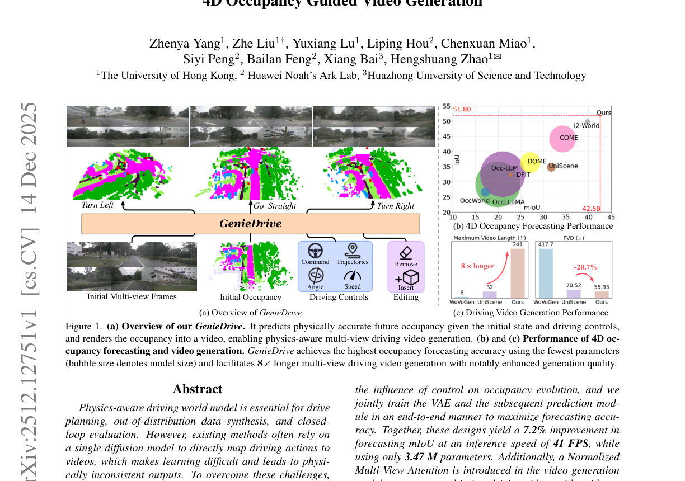
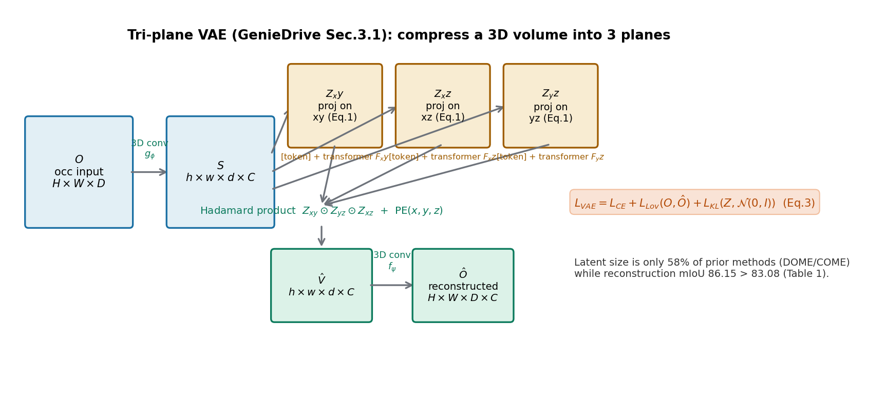
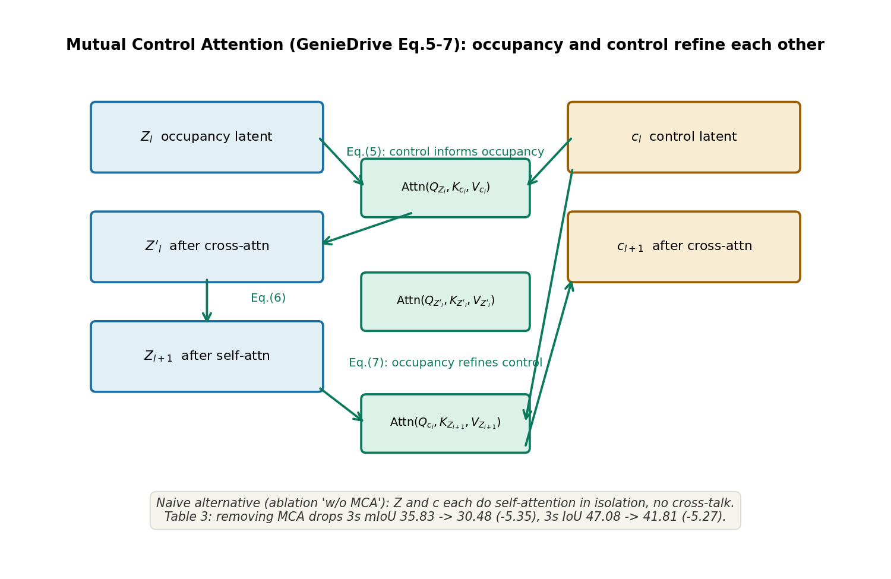
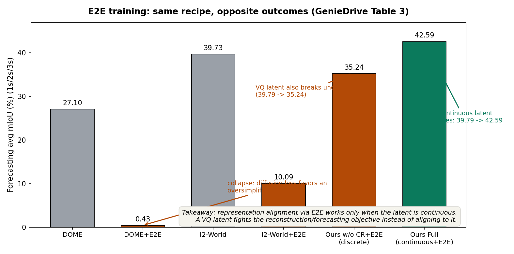
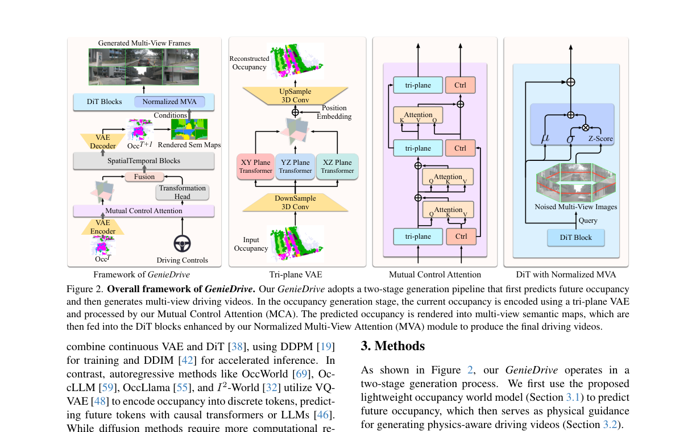

# 先让世界在三维里"演"对，再让视频"画"出来：GenieDrive 的两步走

> **全局编号**：042 ｜ **论文标题**：GenieDrive: Towards Physics-Aware Driving World Model with 4D Occupancy Guided Video Generation
> **作者**：Zhenya Yang, Zhe Liu, Yuxiang Lu, Liping Hou, Chenxuan Miao, Siyi Peng, Bailan Feng（港大/华为诺亚/HUST；Zhe Liu 为 project leader，Hengshuang Zhao 为通讯作者）
> **会议**：CVPR 2026 ｜ **arXiv**：[2512.12751](https://arxiv.org/abs/2512.12751)（v1，2025-12-14 提交；截至 2026-10-09 仅此一版，下载的 PDF 即该版本）
> **代码**：公开，https://github.com/Huster-YZY/GenieDrive（MIT license；仓库含 occ_gen / occ_rasterizer / occ_render 三部分，已 clone 到本文目录 `code/` 并核对关键实现）
> **一句话核心洞见**：别让一个黑盒扩散模型直接从驾驶动作学到视频——先用一个极轻的 occupancy 世界模型把"动作如何改变三维世界"学对（这一步只占 3.47M 参数），再把预测出的 4D occupancy 光栅化成语义图去"指挥"视频扩散模型画画；物理一致性来自中间表示，而不是来自更大的视频模型。

## 那个让所有人撞墙的具体场景：命令右转，车却直行

先看论文 Figure 3 摆出来的那个实验（本文 `paper-fig1.png` 右下、图注在第 1 页），因为它就是整篇论文的起点。给同一个路口的初始帧，分别输入三条轨迹：Turn Left、Go Straight、Turn Right。Vista 和 Epona 都是当时最好的驾驶世界模型，处理 Go Straight 都没问题；但输入 Turn Left 时，Vista 只表现出"一点点左转的倾向"就作罢，Epona 生成的场景直接前后不一致；输入 Turn Right 时更离谱——Vista 生成的车干脆停在原地不动，Epona 生成的车继续直行。

为什么？论文在引言里给了一个值得记住的诊断：公开驾驶视频数据里，自车直行的片段占绝对多数。一个直接把"动作→视频"端到端学下来的黑盒扩散模型，学到的根本不是"世界如何随动作变化"，而是"训练数据里给定这种路口最常见的视频长什么样"。去噪过程只在视频分布上拟合，没有任何东西逼它去理解三维场景和控制量之间的物理关系。数据偏差于是被整个学了进去：模型学出一个"世界模型"，在这个世界里车就是爱直行。

这个诊断决定了全文的走向。如果病根是"黑盒直接映射学偏了"，那药方不是把视频扩散模型做大，而是**在动作和视频之间插入一个必须讲物理的中间表示**，让"动作如何改变世界"这件事有一个独立、可检查、可监督的学习位置。GenieDrive 选的中间表示是 4D occupancy：一串随时间演化的三维语义体素网格。它有两层用处：第一，它是一个物理约束——occupancy 预测错了就是错了，没法像视频那样靠"看起来合理"蒙混；第二，它是一个物理先验——把预测好的 occupancy 渲染成多视角语义图，再拿去条件化视频生成，视频模型只需要做"把三维语义画成像素"这件事，不用再猜物理。

这个"两步走"本身不是首创。UniScene、WoVoGen、InfiniCube 都用 occupancy 指导过视频生成。GenieDrive 真正的赌注下在第一步：**occupancy 世界模型本身可以做得又准又轻**——准到 mIoU 超过之前所有方法，轻到 VAE 加预测模块一共 3.47M 参数、41 FPS。论文的全部技术设计（三平面 VAE、Mutual Control Attention、端到端训练）都是为这个赌注服务的。

*论文 Figure 1（第 1 页）：(a) 两阶段总览——初始 occupancy + 驾驶控制 → 未来 occupancy → 多视角视频；(b) occupancy 预测精度 vs 参数量（气泡大小），GenieDrive 在最小参数下精度最高；(c) 视频生成：8 倍更长、FVD 降低 20.7%。注意 (c) 的 20.7% 分母见后文核实——它是 8 帧设置下相对 UniScene 的降幅，不是全表最低值的比较。*

## 把一个三维体压成三张平面：tri-plane VAE 到底在算什么

Occupancy 世界模型的第一步是压缩。一个 Occ3D 的 occupancy 网格是 $200 \times 200 \times 16$ 个体素、每个体素 18 类语义（nuScenes 范围，见代码配置 `occ_shape`），直接在这种分辨率上做自回归预测，算力和内存都扛不住。前人（DOME、COME）用连续 VAE 压成稠密隐变量，I2-World 用 VQ-VAE 压成离散 token。GenieDrive 的观察是：occupancy 里有大量冗余——大片 empty 体素、一整片 driveable_surface——而低秩分解（EG3D 的 tri-plane、TensorF 的思想，论文引用 [7,8,22]）早就证明三维信号可以拆成三个正交平面的外积来表达。于是他们把 VAE 的隐空间直接做成 tri-plane。

先把符号和形状一次讲清。输入 $O \in \mathbb{R}^{H \times W \times D}$ 是语义标签体（注意：论文公式里 $O$ 写的是 $H\times W\times D$，类别维度被藏在了 embedding 里）。3D 卷积 $g_\phi$ 先把它降采样 4 倍并升到通道维，得到 $S \in \mathbb{R}^{h \times w \times d \times C}$，其中 $h=H/4, w=W/4, d=D/4$。然后对三个轴分别做投影，得到三个隐平面：$Z_{xy} \in \mathbb{R}^{h \times w \times C}$、$Z_{xz} \in \mathbb{R}^{h \times d \times C}$、$Z_{yz} \in \mathbb{R}^{w \times d \times C}$。

投影的具体做法（公式 1）是整篇方法里最值得细看的一个小机关，论文只用三行带过。以 $Z_{xy}$ 为例：先把 $S$ 重排成 $S' \in \mathbb{R}^{(hw) \times d \times C}$——可以理解为把 $xy$ 平面上的每个位置 $(i,j)$ 看成一个"样本"，它带着一条沿 $z$ 轴的长度为 $d$ 的特征序列。然后像 BERT 的 [CLS] token 一样，拼上一个可学习的 token $P_{xy} \in \mathbb{R}^{C}$，得到 $S'' \in \mathbb{R}^{(hw)\times(d+1)\times C}$，过一个 transformer $F_{xy}$，**只取输出序列里那个可学习 token 对应的位置**作为投影结果。

这个动作的几何意义是什么？那个可学习 token 在自注意力里同时 attend 到 $d$ 个沿 $z$ 轴的位置，它学到的是"沿着这条竖线看下去，最值得保留的一句话总结"。每个 $(i,j)$ 位置独立做一次，于是整张 $xy$ 平面就是"从上往下看、每根柱子压缩成一个向量"的俯视图。同理 $Z_{xz}$ 是主视图、$Z_{yz}$ 是侧视图。三张平面合起来，就是一个物体的三视图——工程制图里三视图能唯一确定一个立体，这里也一样：解码时把三张平面按外积乘回去。

解码（公式 2）：$\hat{O} = f_\psi(Z_{xy} \odot Z_{yz} \odot Z_{xz} + PE(x,y,z))$。Hadamard 积 $\odot$ 在这里是广播乘法：$Z_{xy}[i,j] \in \mathbb{R}^C$、$Z_{xz}[i,k]$、$Z_{yz}[j,k]$ 三个向量逐元素相乘，得到体素 $(i,j,k)$ 的特征。这正是"三视图交点"的代数表达——一个体素的特征由它在三个投影面上的投影共同决定。再加一个可学习的位置编码 $PE$，过上采样 3D 卷积 $f_\psi$，回到全分辨率语义体。

**在一个小实例上算一遍**，确认这个机制真的 work。假设降采样后体素是 $2\times2\times2$、$C=2$。某个体素 $(0,1,1)$ 要解码：取 $Z_{xy}[0,1]=[0.8, 0.2]$（俯视图说"这里像车"）、$Z_{xz}[0,1]=[0.9, 0.5]$、$Z_{yz}[1,1]=[0.7, 0.1]$，三者逐元素相乘得 $[0.504, 0.01]$，再加位置编码、过分类头，第一个通道占优 → 判为 car。如果俯视图在 $(0,1)$ 处是空的（向量接近零），乘积直接被拉向零——三张平面是"一票否决"制，任何一个视图说空，这个体素就是空。这解释了为什么 tri-plane 对稀疏 occupancy 特别有效：empty 区域在三个平面上都是大片零值，乘积天然稀疏。

VAE 的损失（公式 3）是三项：$L_{VAE} = L_{CE}(O,\hat{O}) + L_{Lov}(O,\hat{O}) + L_{KL}(Z,\mathcal{N}(0,I))$。逐项说：交叉熵是逐体素分类的主力；Lovász-softmax 直接优化 IoU，对小目标（行人、交通锥）友好——没有它，模型会倾向于把稀有类别判成背景，因为 CE 只关心逐体素对错不关心类别级重叠；KL 项把隐平面拉向标准正态，这是 VAE 的常规操作，保证隐空间连续可采样。但注意一个细节：**KL 在这里其实是个"名义 VAE"**——代码 `latent_sample` 里 `if self.training` 才加噪声采样，推理时直接用均值 $\mu$。也就是说训练时靠重参数化保持随机性，推理时退化成确定性自编码器。这在 occupancy 预测里是合理的：你要的是对未来的确定性预测，不是多样性采样。

核心张量形状表（tri-plane VAE，$H,W,D=200,200,16$，代码默认 `d_model=16`、`downsample_rate=4`）：

| 符号 | 形状 | 含义 |
|---|---|---|
| $O$ | $200\times200\times16$（类别标签） | 输入 occupancy |
| $S$ | $50\times50\times4\times16$ | 降采样 4 倍后的体特征 |
| $P_{xy},P_{xz},P_{yz}$ | $16$ | 每个平面的可学习投影 token |
| $Z_{xy}$ | $50\times50\times16$ | 俯视隐平面 |
| $Z_{xz}$ | $50\times4\times16$ | 主视隐平面 |
| $Z_{yz}$ | $50\times4\times16$ | 侧视隐平面 |
| $\hat{O}$ | $200\times200\times16\times18$ | 重建的语义 logits |

隐变量总大小：$16\times(2500+200+200)=46400$ 个浮点数。论文称这是前人方法的 58%——**这个分母我没有独立核实**（I2-World 的隐变量尺寸论文未给），只能确认分子侧的量级确实很小。重建 mIoU 86.15% 超过 DOME/COME 的 83.08%（Table 1），说明压缩没有伤到重建质量，这是后文敢做端到端训练的底气之一。

*自绘图：tri-plane VAE 的编码—解码路径。三张平面分别是沿 z/y/x 轴"看下去"的压缩视图，解码时在体素 $(i,j,k)$ 处做三向量外积（"三视图交点"）。*
## 控制信号不是"条件"，而是另一路需要被修正的隐变量：Mutual Control Attention

有了压缩表示，下一步是预测：给定过去的 occupancy 隐变量和驾驶控制 $c$（命令、轨迹），自回归地生成下一帧（公式 4：$\hat{Z}_{t+1} = F_{pred}(Z_t, c, [Z_{t-1},\dots,Z_{t-k}])$）。这里最直接的做法——也是消融实验里 "w/o MCA" 的 naive 版本——是把 occupancy 隐变量和控制隐变量各自做自注意力，顶多在最后拼一下。但作者认为控制和场景之间是双向关系：控制决定场景怎么变（右转 → 右侧建筑靠近），场景也反过来约束控制的解释（在十字路口，"右转"对应一个具体的几何变换）。

Mutual Control Attention（公式 5–7）把这个双向关系写成了三步交替：

$$\begin{align}
Z'_l &= Z_l + \mathrm{Attn}(Q_{Z_l}, K_{c_l}, V_{c_l}) \tag{5}\\
Z_{l+1} &= Z'_l + \mathrm{Attn}(Q_{Z'_l}, K_{Z'_l}, V_{Z'_l}) \tag{6}\\
c_{l+1} &= c_l + \mathrm{Attn}(Q_{c_l}, K_{Z_{l+1}}, V_{Z_{l+1}}) \tag{7}
\end{align}$$

读法：(5) occupancy 拿自己当 query，去控制信号里"查"——哪些控制分量和我这个位置的演化有关，加权拿回来修正自己；(6) occupancy 内部再做一次自注意力，整合空间关系；(7) 反过来，控制信号拿自己当 query，去**更新后**的 occupancy 里查——场景告诉控制"你这个右转指令，在当前几何下具体意味着什么"，控制隐变量被修正。注意 (7) 用的是 $Z_{l+1}$ 而不是 $Z_l$：控制看到的是已经被控制影响过的场景，这是一个不动点迭代的味道——控制塑造场景，场景反过来澄清控制。

*自绘图：MCA 的三步交替。两路隐变量在每一层都互相做 cross-attention，而不是单向的条件注入。*

控制信号 $c$ 到底是什么？论文正文只说 "command and trajectory"，代码（`ee_former.py`）揭示了更具体的真相。控制被编码成一个**变换矩阵的预测任务**：`plan_translation_output` 是一个 MLP，把 plan embedding 映射成 $(2+4)\times \text{ego\_mode}$ 个数——2 维平移增量 $\Delta t$ 加 4 维四元数相对旋转。`process_transformation_matrix` 里，四元数被归一化后与当前旋转相乘得到下一时刻旋转，平移增量加上当前平移得到下一时刻位置，再组装成 $4\times4$ 的 ego-to-global 矩阵，最后求出"当前帧到未来帧"的相对变换 $T^{t+1}_t$。

公式 (8) 的中间层监督 $L_{reg} = \lVert T^{t+1}_t - f_{trans}(c^m_t)\rVert_2$ 就是干这个的：从第 $m$ 层的控制隐变量解码出变换矩阵，和真值变换矩阵算 MSE。**这是 MCA 能 work 的关键**——控制隐变量不是一个自由漂浮的 embedding，它在中间层就被钉死在"几何变换"这个具体含义上。没有这个监督，(7) 里 occupancy 对控制的"修正"就没有着力点。代码里这个监督的权重是 `RotationLoss` 1.0 和 `TrajLoss` 0.01（config），论文正文只写了一个 $\lambda$，**$\lambda$ 的具体值和 $\beta_t$ 的取值论文和代码里都没有明确给出**——这是后文怀疑式审读要记的一笔。

预测损失（公式 9）：$L_{pred} = \sum_t \beta_t \lVert Z_{t+1} - ST(\mathrm{Attn}(Z^m_t, c^m_t, c^m_t))\rVert_2 + \lambda L_{reg}$，即在隐空间里做 MSE 预测，外加时空 transformer。注意这里的监督目标是**真值未来 occupancy 的隐表示**（用训练好的 VAE 编码器编码得到），不是体素本身——这是一个"隐空间自回归"，推理时把预测出的 $Z_{t+1}$ 喂回下一步。

## 端到端训练：为什么前人一做就塌，GenieDrive 却行了

这是论文里我最欣赏的一节，因为它包含了一个**反直觉的实验结果**，而不是又一个"我们加了 X 所以变好了"的故事。

背景：所有 occupancy 世界模型都用两阶段训练——先训 VAE（重建目标），冻住，再在隐空间里训预测模型。作者的论点是：为重建学到的表示，未必是为预测最优的表示（引用 Repa-E [29] 和 Yao 等 [64] 的 reconstruction-vs-generation 困境）。于是他们把 VAE 编码器、预测模块、VAE 解码器串起来，直接对**体素空间**的未来 occupancy 算 MSE（公式 10）：

$$L_{E2E} = \sum_t \beta_t \lVert O_{t+1} - f_\psi(F_{pred}(F_{\{xy,yz,xz\}}\circ g_\phi(O_t), c))\rVert_2$$

梯度从未来体素一路反穿过解码器、预测器、编码器。直觉上这很合理：让压缩表示直接为预测任务服务。

但 Table 3 的结果出人意料：**同样的端到端训练，加到 DOME 上直接把模型训塌了**（mIoU 从 27.10 跌到 0.43，基本等于随机），加到 I2-World 上从 39.73 跌到 10.09。作者的解释分两层。DOME 是扩散式方法：它的训练目标是去噪分数匹配，端到端之后，模型发现"把隐空间学得越简单，去噪损失越低"——走了一条捷径，隐空间塌缩成几乎不携带场景信息的退化解，生成质量随之崩盘。I2-World 的问题是离散表示：VQ 的 codebook 是不可微的（靠 straight-through estimator 硬传梯度），重建目标和预测目标对 codebook 的拉扯方向不一致，端到端反而互相拆台。

为了验证"离散 vs 连续"这个解释，作者做了一个干净的对照：在自己的 VAE 上加一个 vector quantization（"w/o CR"），发现**不加 E2E 时连续和离散版本性能接近**（39.79 vs 39.09），但一加 E2E，离散版本从 39.79 跌到 35.24，而连续版本从 39.79 涨到 42.59。这个交叉是整篇论文证据链里最硬的一环：它说明 E2E 本身不是灵丹妙药，**连续隐表示才是 E2E 能 work 的前提**。tri-plane 的连续性在这里不是装饰，是承重结构。

*自绘图：Table 3 的核心信息——同样的端到端训练，DOME 塌了（27.10→0.43），I2-World 大跌，只有连续 tri-plane 表示吃到了红利。*

MCA 的消融同样干净：去掉 MCA（换成两路独立自注意力），3s mIoU 从 35.83 掉到 30.48（-5.35），3s IoU 从 47.08 掉到 41.81（-5.27），而且掉得最多的是最远的 3s——说明 MCA 修的正是**长时程上控制对场景演化的持续影响**，短时（1s）靠惯性就能猜个大概，长时才需要真正的控制建模。

## 第二阶段：把 4D occupancy"光栅化"成视频的条件

Occupancy 预测准了之后，怎么变成视频？直接把体素喂给视频扩散模型是不现实的（三维体素 vs 二维视频，维度对不上；且预训练视频模型是 2D 的）。GenieDrive 的做法是先把 4D occupancy **splat 到多视角图像空间**，渲染成语义图（公式 11）：

$$M = \mathrm{argmax}\left(\sum_{i\in\mathcal{N}} s_i \alpha_i \prod_{j=1}^{i-1}(1-\alpha_j)\right)$$

这是标准的体渲染 alpha blending，只是把颜色换成了语义 one-hot $s_i$：沿着一条视线，把所有 occupancy primitive 的语义向量按"前面的先挡住后面的"加权求和，再 argmax 取最可能的类别。几何意义和 NeRF 的体渲染一模一样——**occupancy 在这里被当成了一个可微的语义辐射场**。渲染出的多视角语义图 $M$ 既保留了三维一致性（同一个体素在所有视角的投影一致），又变成了视频模型能吃的 2D 条件。

视频模型用的是 Wan2.1-1.3B 的 flow matching 预训练权重，损失是 v-prediction（公式 12）：$L_{video} = \mathbb{E}\lVert u(x_t, M, t; \theta) - v_t\rVert_2$。$x_t$ 是干净样本 $x_0$ 和纯噪声 $x_1$ 之间的插值，$v_t$ 是这条直线方向的真实速度场，模型学的是"沿着直线走"的速度——这是 rectified flow 的标准做法，比 DDPM 的噪声预测训练更稳定。

真正的技术点是 Normalized Multi-View Attention（公式 13–15）。问题背景：Wan2.1 是单视角视频模型，要生成 6 个视角一致的视频，必须让各视角之间通信息。最朴素的做法是把视角 $n$、时间 $t$、空间 $hw$ 全部展平成一个长序列做自注意力——复杂度是 $O((nthw)^2)$，直接爆炸。作者的观察是：**驾驶场景里跨视角的一致性主要存在于同一高度上**（地平线附近的建筑、车辆在相邻视角的同一高度出现）。于是公式 (13) 只做 `rearrange(Z, n(thw)C → (th)(nw)C)`——把"同一时刻、同一高度、所有视角拼起来"做自注意力，复杂度从 $O(n^2t^2h^2w^2)$ 降到 $O(t^2h^2 \cdot n^2w^2)$，仍然覆盖了全部"视角间"的信息交换。

但还有第二个问题：MVA 是新加的、随机初始化的模块，直接插进预训练好的 DiT 会把学好的先验冲垮（Table 5：去掉 normalization，FVD 从 98.06 恶化到 212.67，画面出现网格伪影和模糊）。公式 (15) 的解法很巧：

$$Z' = Z + \eta\left(\frac{M-\mu_M}{\sigma_M}\sigma_Z + \mu_Z\right)$$

先把 MVA 的输出 $M$ 做 z-score（消掉它随机初始化时的任意尺度），再**重缩放到输入 $Z$ 的均值方差**，最后乘一个小系数 $\eta$ 做残差加。几何意义：MVA 在训练初期输出的"方向"被保留，但"幅度"被强制压到和预训练特征同一个分布包络里——新模块只能小步地、沿着先验允许的方向修正，不能一上来就把特征空间掀翻。这和 ControlNet 的 zero-convolution 是同一个哲学：**让新模块从"恒等映射"开始学起**。消融证明了它的承重性：去掉 MVA（只去 normalization 保留 MVA 是 120.16/212.67 两个不同行），多视角一致性丢失——Figure 5(b) 里同一辆车在不同视角长得不一样了。

*论文 Figure 2（第 3 页）：整体框架。左上 tri-plane VAE，中上 MCA 预测，右上 Normalized MVA 增强的 DiT 视频生成。注意 MCA 的画法——occupancy 流和控制流在每层交叉，这正是公式 5–7 的图形表达。*

训练配置（代码核实，论文正文未写）：E2E 阶段 8 卡、每卡 batch 3（总 24）、24 epoch、AdamW lr 5e-5、weight decay 1e-2、梯度裁剪 max_norm 5、50 iters 线性 warmup、EMA（MEGVIIEMAHook，init_updates=10560）外加 Scheduled Sampling。损失权重：隐空间预测 FeatSimLoss 1.0、重建 CustomFocalLoss 10.0、轨迹 TrajLoss 0.01、旋转 RotationLoss 1.0。论文公式 (9)(10) 里的 $\beta_t$、$\lambda$ 在正文和代码配置里都没有明确数值——这是下文要记的一笔。
## 带着数字走一遍：右转指令下，基线和 GenieDrive 在哪分叉

场景：自车停在十字路口准备右转。过去 4 帧（2 秒，Occ3D 2Hz）的 occupancy 显示：前方是直行车道，右侧是一排建筑，左侧有对向车道。输入控制：一条向右 90 度的轨迹（未来 3 秒 6 帧）。

**GenieDrive 的第一阶段**。4 帧历史 occupancy 被 tri-plane VAE 编成 $Z_t$（三张平面，$50\times50\times16$ 等）。控制信号 $c$ 被编码成变换序列：右转意味着 ego-to-global 矩阵的旋转部分每 0.5 秒转约 15 度、平移向前+向右。MCA 的第 (5) 步：$Z_l$ 里对应"右侧建筑"体素的位置 query 去 $c_l$ 里查——控制说"未来帧自车朝右"，这些体素的注意力权重被推高，它们的隐特征被修正为"离自车更近、视角更正对"；第 (7) 步反过来：$c_l$ 去更新后的 $Z_{l+1}$ 里查，场景告诉控制"右侧确实有建筑墙面，右转 90 度后它会占据正前方视野"，控制隐变量的几何含义被钉死。中间层监督 $L_{reg}$ 直接比对解码出的变换矩阵和真值：如果某层把右转解成了直行，这一项立刻给梯度。

自回归 rollout 6 步之后，解码出的 $\hat{O}_{t+1}\dots\hat{O}_{t+6}$ 里，建筑体素逐帧向自车前方汇聚、左侧对向车道的车体素相对左移——这就是"物理上对的"右转未来。

**基线 Vista 在哪一步分叉**：它没有第一阶段。右转轨迹被编码成一个条件向量，直接拼进视频扩散模型的 cross-attention。训练数据里"路口+右转轨迹"组合稀少，模型学到的条件-视频映射被"路口+直行"的主导模式淹没。去噪过程中，条件向量的影响弱于数据先验——生成的视频里车继续直行（Figure 3 右转列 Epona 的行为）或干脆不动（Vista）。分叉点不在某个具体数值，而在**架构层面就没有一个必须对"三维世界如何随动作变化"负责的模块**——条件可以被先验淹没，而 GenieDrive 里 occupancy 预测错了会直接反映在体素 IoU 上，无处可藏。

**第二阶段**。6 帧未来 occupancy 被 splat 成 6 视角语义图 $M$：右转时，右侧建筑的语义体素在前视相机的投影逐帧变大、右视相机的建筑投影保持稳定——这些跨视角一致的语义图喂给 Wan2.1。Normalized MVA 让右视和前视在"同一高度"上交换信息：前视里建筑边缘的纹理细节被右视共享，生成的多视角视频里同一栋建筑不会在两个视角长成两种样子。最终输出 241 帧（rollout）、约 20 秒的多视角视频。

## 怀疑式审读：数字都对得上吗，代价是什么

**7.2% 和 20.7% 的分母**。摘要的 "7.2% improvement in forecasting mIoU" 是**相对**提升：Table 1 里 I2-World 的平均 mIoU 39.73 → Ours 42.59，$(42.59-39.73)/39.73 = 7.20\%$，绝对只涨了 2.86 个点。IoU 的 "4%" 同理：49.80 → 51.80，相对 4.02%。20.7% 的 FVD 降幅：Table 4 里 8 帧设置下 UniScene 70.52 → GenieDrive-S 55.93，$(70.52-55.93)/70.52 = 20.69\%$。也就是说 20.7% 是**同为 8 帧、同样以 occupancy 为条件**的公平比较，不是拿 241 帧的 rollout 去比别人的 8 帧。这个分母选得老实，但摘要没写，读者容易误以为是全表最佳比较。

**"8 倍更长"的分母**。Figure 1(c) 写 8× longer。Table 4 里 GenieDrive-L rollout 241 帧，UniScene-Rollout 32 帧，$241/32 = 7.5$——约等于 8×。但注意 MagicDrive-V2 本来就能生成 241 帧（Table 4 有 241 帧一行，FVD 94.84），所以"8 倍"是相对 UniScene 这个 occupancy 基线的，不是相对所有方法。论文没撒谎，但这个 8× 的对手是精心挑选的。

**mIoU 里含不含 empty 类**。代码配置的评估日志（`vae_e2e.py` 顶部注释掉的真实评估输出）显示 per-class IoU 里 "empty - IoU = 97.02" 被计入，最后 "mIoU of 4669 samples: 50.47"——这 50.47 正是 Table 3 "Our Full Method" 的 1s mIoU。18 个类里 empty 一项 97 接近满分，会把均值抬高约 $(97-40)/18 \approx 3$ 个点。所有对比方法（OccWorld、DOME、I2-World 等）用的都是同一套 Occ3D 评估脚本，所以**横向比较是公平的**，但读者如果拿这个 50.47 去和不含 empty 的 benchmark 比，会高估。这是领域惯例（Occ3D 官方评测含 empty），不是论文的问题，但值得点破。

**FPS 和参数量的口径**。3.47M 参数"包括 VAE 和预测模块"——视频生成器（Wan2.1-1.3B 微调）不在内，论文明确写了，算诚实。41 FPS（Table 1 是 41.38）：论文只说实验在 8×L40S 服务器上做，**没有说明 FPS 在哪块卡上、batch 多大、是否含 VAE 解码测的**。I2-World 的 37.04 FPS 出处也未交代（抄自 I2-World 论文还是自测，未说明）。跨方法的 FPS 对比在这里只能当定性参考。

**Table 2 的引用笔误**。Table 2 第一行写的是 "OccWorld [17]"，但参考文献 [17] 是 DOME，OccWorld 是 [69]。结合数值（7.79/6.29/5.76）看，这行确实是 OccWorld——是个排版错误，不影响结论，但说明表格是手工拼的，数字建议以 Table 1 为准交叉核对。

**基线是重跑还是抄数**。论文没有明确说 Table 1 的基线数字是重跑的还是引用的。各方法的输入列（Occ / Occ&Text / Occ&Camera / Occ&Box&Map）标注得很细，至少说明作者核对了设置对齐。但 DOME 的 6.54 FPS、COME 的 0.30 FPS 这种数字明显来自原文各自的测试环境——**跨行对比速度时，硬件不一致**。精度指标（mIoU/IoU）抄数在 occupancy 预测领域是惯例（Occ3D 评测固定），可以接受。

**超参数的诚实度**。$\lambda$、$\beta_t$ 的值论文没给；代码里能找到损失权重（1.0/10.0/0.01/1.0）和优化器配置，但 $\beta_t$（各未来帧的权重）**在代码配置里也没有出现**——可能是 1（均匀权重），未确认。MCA 的层数、$m$（中间监督在哪一层）论文未报告。随机种子数未报告。附录不存在（20 页全文无附录），所以也没有超参数搜索范围。审稿人视角：核心结论（E2E 交叉实验、MCA 消融）不依赖这些，但复现者需要去代码里翻。

**视频评估的 mIoU/mAP 是怎么算的**。论文说 follow [9,15,31] 用 FVD、mIoU、mAP 评估视频。FVD 好理解；mIoU/mAP 通常的做法是：用预训练的 occupancy/BEV 模型从生成视频里反推 occupancy，再和条件 occupancy 比对——但论文没有展开这个流程，**生成视频的 mIoU 31.00 到底在多大程度上反映"视频质量"、多大程度上反映"反推模型的误差"，无法判断**。Table 4 里 GenieDrive-S 的 mIoU 31.00 远高于 MagicDrive-V2 的 20.40，这至少说明条件对齐更好，但和 FVD 不是同一个维度的事。

**范围与失效模式**。实验只在 nuScenes（Occ3D 标注）上做；occupancy 来自 LiDAR 标注的体素化，不是纯视觉——第一阶段的输入是"真值 occupancy 的历史"，不是从图像估计的。这意味着论文验证的是"给定历史 occupancy，预测未来 occupancy"，**没有验证"从图像出发"的完整链路**。长视频（241 帧）是 rollout 拼出来的，Table 4 里 GenieDrive-L Rollout 的 FVD 137.25 比单次 81 帧的 92.78 差了一大截——rollout 的误差累积是真实存在的，论文如实报告了，没有藏。

**做得漂亮的地方**。Table 3 的 E2E 交叉实验是真正的对照实验设计：同一个处理（E2E）施加到三个方法上，结果方向相反，再用 w/o CR 把机制钉死在"连续 vs 离散"上。这比"去掉我的模块性能下降"式的消融信息量大得多。另外，DOME+E2E 训塌（0.43）这种负面结果敢原样放出来，而不是藏起来只报好的，值得肯定。

## 带走的东西

这篇论文留下的可迁移想法有三个。第一，**把"物理"从视频生成里剥离出来，放到一个可独立监督的三维中间表示上**，是比"把视频模型做大"更便宜的解法——3.47M 参数的第一阶段解决的是原本需要整个视频模型去猜的问题。第二，**连续隐表示是端到端对齐的前提**：想让压缩表示为下游任务服务，先问你的隐空间是不是连续的，VQ 的离散瓶颈在 E2E 下会和重建目标打架。第三，**往预训练模型里嫁接新模块时，让新模块从恒等映射开始**（z-score + 重缩放到先验分布 + 小残差系数），这是一个通用技巧，名字不叫 Normalized MVA 也成立。

真正值得做的后续问题：第一阶段的输入如果换成从图像估计的 occupancy（而不是 LiDAR 标注），整条链路的误差如何传导，论文没有回答；MCA 的双向修正目前只在 occupancy 上验证，能否用到"控制-视频"的直接交互上；以及那个 241 帧 rollout 的误差累积——长视频生成的瓶颈已经从单帧质量变成了时序一致性，这正是 world model 该回答的问题。
