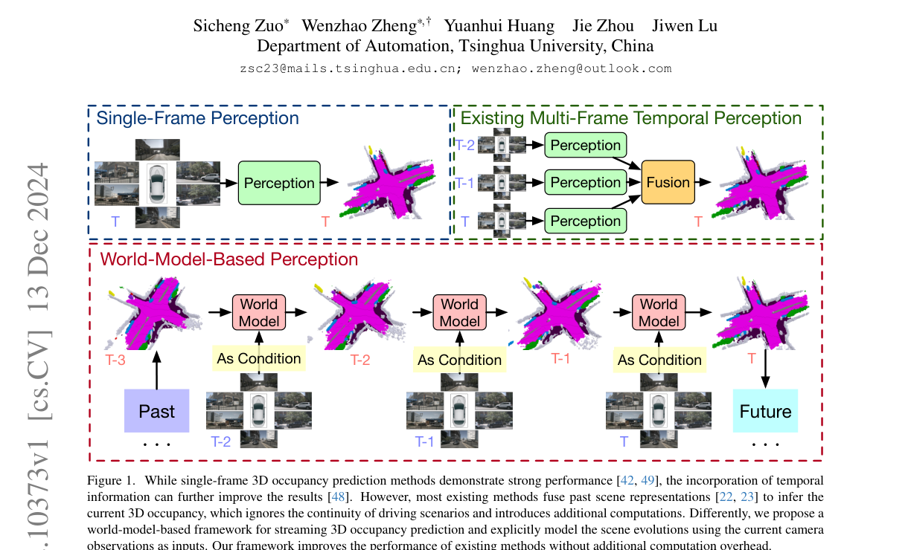
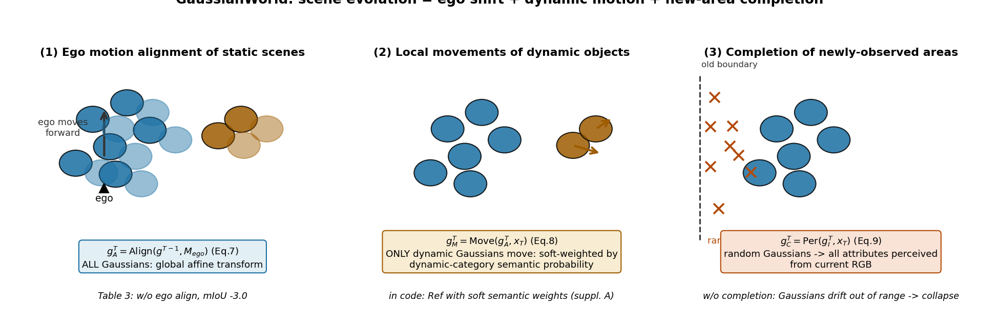
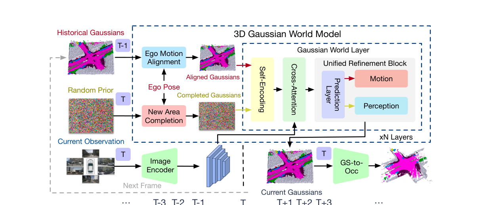
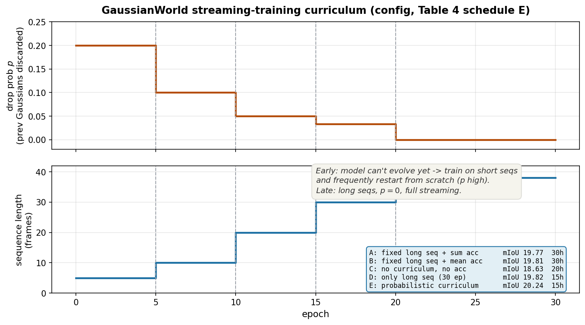
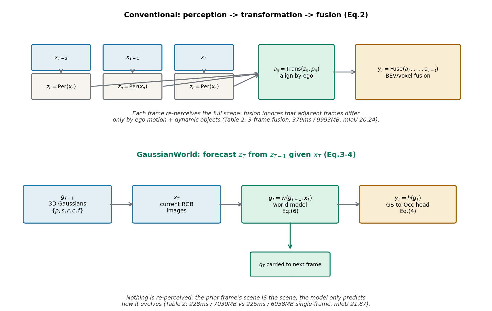

# 别再每帧重新看世界：把 3D occupancy 预测改写成"带着当前观测的 4D 预报"

> **全局编号**：043 ｜ **论文标题**：GaussianWorld: Gaussian World Model for Streaming 3D Occupancy Prediction
> **作者**：Sicheng Zuo*, Wenzhao Zheng*†, Yuanhui Huang, Jie Zhou, Jiwen Lu（清华大学自动化系；* 共同一作，† project leader）
> **会议**：CVPR 2025 ｜ **arXiv**：[2412.10373](https://arxiv.org/abs/2412.10373)（v1，2024-12-13 提交；下载的 PDF 即该版本）
> **代码**：公开，https://github.com/zuosc19/GaussianWorld（已 clone 到本文目录 `code/` 并核对模型定义、损失与训练配置；论文与代码不一致处见正文）
> **一句话核心洞见**：3D occupancy 预测不需要每帧从零感知——上一帧的 3D 高斯已经装着这一帧 99% 的场景，真正要学的只是一个"场景如何演化"的增量（自车动了、动态物体动了、新区域出现了），而 3D 高斯这种显式连续表示让这三个增量可以直接写成几何操作。

## Figure 1 里那个三格对比：作者到底在赌什么

论文 Figure 1（本文 `paper-fig1.png`，第 1 页）画了三种范式。左边：单帧感知，每帧独立看图，时序信息一点不用。中间：当时主流的多帧时序感知——每帧独立提特征（BEV 或 voxel），再按 ego 轨迹对齐、融合，输出当前帧 occupancy。右边：GaussianWorld——上一帧的世界模型输出直接作为当前帧的"先验场景"，只结合当前图像做一次演化更新。

作者赌的是中间那格有个结构性浪费。想清楚一个具体事实：nuScenes 是 2Hz 关键帧，相邻两帧之间自车最多移动几米，场景里 90% 以上的体素根本没变——静止的建筑、路面、停着的车，一个体素都没动。中间范式的做法是：对每一帧都从六张图像重新做一次完整的 3D 感知（ResNet101-DCN 提特征、2D→3D 变换），然后把几帧的稠密特征对齐融合。这相当于**每一帧都把世界重新"看"一遍，再试图从几份"看法"里平均出当前帧**。它隐含了一个被所有人默认的假设：时序信息的作用是"多看几眼再融合"。GaussianWorld 推翻了这个假设，换成：**时序信息的作用是"上一帧的世界就是这一帧世界的草稿"，感知 = 预测草稿如何演化**。

这个改写在数学上就是公式 (3)(4)：$z_T = w(z_{T-1}, x_T)$，$y_T = h(w(z_{T-1}, x_T))$。注意它和传统公式 (2) $y_T = \mathrm{Fuse}(a_T,\dots,a_{T-t})$ 的区别：传统范式里 $x_T$ 只是 $t+1$ 个输入中的一个，GaussianWorld 里 $x_T$ 是**修正项**——主角是 $z_{T-1}$，图像只负责提供"草稿和现实的偏差"。这就是为什么论文敢说"without additional computations"：推理时每一帧只做一次图像编码（和单帧方法一样），省掉了多帧重复感知和融合模块。

*论文 Figure 1（第 1 页）：三种范式。注意右图里 "World Model" 的输出同时是下一时刻的输入——这是一个随时间展开的递推，而不是每帧独立的前向。*

## 为什么非得是 3D 高斯：把"物体动了"写成可微的几何操作

场景演化要建模，第一个问题是选什么表示。BEV 特征和 voxel 特征都是**隐式**的：一团特征向量"编码"了某个区域，但你没法指着某几个数说"这就是那辆车"。如果一辆车在两帧之间移动了 0.5 米，在 voxel 表示里，这意味着一堆离散格子的 occupancy 翻转——"移动"这个连续动作被栅格化了，模型只能靠学出来的权重去拟合这种翻转模式。

3D 高斯是**显式**的。每个高斯 $g = \{p, s, r, c, f\}$：位置 $p \in \mathbb{R}^3$、尺度 $s \in \mathbb{R}^3$、旋转 $r \in \mathbb{R}^4$（四元数）、语义概率 $c \in \mathbb{R}^{18}$、时间特征 $f \in \mathbb{R}^{d}$。一辆车就是空间里一簇高斯，它移动 0.5 米 = 这一簇高斯的 $p$ 加上 0.5 米的位移向量。**"演化"在这里第一次变成了一个可以直接写出来的几何操作，而不是一个需要学习的参数映射**。这是全文所有设计的地基。

张量形状表（代码配置 `num_anchor=25600`，`_dim_=128`，类别 18）：

| 符号 | 形状 | 含义 |
|---|---|---|
| $p$ | $25600 \times 3$ | 高斯中心在 ego 坐标系下的位置 |
| $s$ | $25600 \times 3$ | 三个轴的尺度（椭球半轴） |
| $r$ | $25600 \times 4$ | 旋转四元数 |
| $c$ | $25600 \times 18$ | 语义概率（16 类 + empty + unknown/ignore） |
| $f$ | $25600 \times d$ | 时间特征，携带历史信息（论文新增的属性） |
| $M_{ego}$ | $4 \times 4$ | 上一帧到当前帧的 ego 刚体变换 |

## 场景演化的三因子分解：公式 7–9 逐个过一遍

论文把"上一帧场景 → 这一帧场景"分解成三个因子（Figure 3，自绘图 `fig-three-factors.png`）。这个分解的妙处在于：**第一项是解析解，不需要学；第二项只动一小部分高斯；第三项只处理新出现的区域**。学习负担被压缩到最小。

**因子一：ego 运动对齐（公式 7）**。自车从 $T-1$ 开到 $T$，ego 坐标系本身平移旋转了，静态世界在新坐标系下的坐标整体变了。这一步是纯几何：$g^T_A = \mathrm{Align}(g^{T-1}, M_{ego})$，把每个高斯的位置 $p$ 左乘 $4\times4$ 刚体变换矩阵。论文的记号 $\mathrm{Ref}(g; n; p)$ 读作"把高斯 $g$ 的属性 $p$ 更新为 $n$"，$\mathrm{Attr}(g; p)$ 是"取出属性 $p$"——记号有点绕，但意思就是 $p \leftarrow M_{ego} \cdot p$。**算个小例子**：自车以 2m/s 直行，0.5 秒移动 1 米。上一帧在自车正前方 10 米处的一根电线杆，高斯位置 $p=(10, 0, 2)$；对齐后 $p' = (9, 0, 2)$。所有静态高斯都做一次这个减法——场景的"静态部分"演化完毕，零参数。

代码里的实现细节和论文公式有一个值得注意的差异：`warp_anchor` 不是直接变换高斯位置 $p$，而是变换 **anchor**（高斯位置的归一化先验参数，在 logit 空间里），用的是 `lidar2global` 矩阵链算出的 `prev2cur`。数学上等价（都是刚体变换），但说明代码的对齐发生在"高斯从 anchor 解码出来之前"。另外超出新视野边界的高斯被直接丢弃（`valid_mask` 过滤）。

**因子二：动态物体的局部移动（公式 8）**。对齐之后，静态世界已经对了，剩下的偏差只来自动态物体：$g^T_M = \mathrm{Move}(g^T_A, x_T)$。做法是把对齐后的高斯按语义概率分成动态集 $\{g^D\}$ 和静态集 $\{g^S\}$，只更新动态高斯的位置：$\mathrm{Ref}(g^T_A; \mathrm{Enc}(g^T_A, x_T)\cdot \mathbb{I}(g^T_A\in\{g^D\}); p)$。指示函数 $\mathbb{I}$ 是硬门——但这里有个鸡生蛋的问题：**动静分类依赖的语义概率 $c$ 本身是模型预测的**，如果 $c$ 错了，动态物体就不会被移动。代码（supplementary A 和 `refine_layer_delta.py`）揭示论文没细说的真相：实际用的是**软语义权重**——用高斯属于动态类别的概率加权位置更新量，而不是硬分类。这样即使语义不确定，模型也能"半信半疑地"挪一下。这是一个论文正文一笔带过、但对鲁棒性很关键的工程选择。

**因子三：新区域补全（公式 9）**。自车前进了，视野后方丢掉一块、前面新看到一块。丢掉的直接删；新区域用**随机初始化**的高斯 $g^T_I$ 填上（数量与丢掉的相等，保持总数 25600 不变），然后 $g^T_C = \mathrm{Per}(g^T_I, x_T)$——用当前图像把这批"白板"高斯的全部属性（位置、尺度、旋转、语义、时间特征）感知出来。Table 3 的消融显示，去掉这一项训练直接 collapse（×）：可以想见，没有补全的高斯集合会随着自车前进逐帧漏光，最后视野里一个高斯都不剩，监督信号全是空，模型无从学起。

*自绘图：三个因子的几何含义。(1) 自车前移 → 全部高斯做一次刚体变换（解析解）；(2) 只有动态高斯的位置被神经网络更新；(3) 视野外的新区域用随机高斯填补再感知。*

## Unified refinement block：evolution 和 perception 其实是同一个算子

公式 (11)(12) 容易让人以为有两种层：$n_e$ 个 evolution layer（历史高斯只更新位置、新高斯全属性感知）和 $n_r$ 个 refinement layer（全部高斯全属性微调）。论文 Figure 4 和 supplementary A 揭示了更漂亮的结构：**它们是同一个 refinement block 的两种模式**。每个高斯走统一的 prediction layer 预测属性改变量 $\Delta$，然后：新高斯（perception 模式）$\otimes all$——全部属性加上 $\Delta$；历史高斯（motion/evolution 模式）$\otimes pos$——只有动态高斯的位置加上语义加权的 $\Delta$。最后 $\oplus$ 拼回去。

代码配置：`num_encoder=4`（即 $n_e=4$ 个 evolution layer），`num_refine_temporal=3`（$n_r=3$）。注意论文正文说"4 Gaussian world layers"，指的是 evolution 的 4 层；3 个 refinement layer 只在附录和代码里出现。每个 layer 内部是：3D 稀疏卷积做高斯间交互（self-encoding）→ deformable attention 让高斯和多尺度图像特征交互（cross-attention）→ unified refinement 更新属性。

三个代码真相，论文正文都没写：
1. **预测的是改变量 $\Delta$ 而不是属性本身**（`refine_layer_delta.py`）。几何意义：让高斯"保持原样，只挪一点"，而不是每层重新发明一遍场景。这对流式建模至关重要——如果每层都直接预测绝对位置，上一帧的几何先验就丢了。
2. **流式微调时图像 backbone 被冻结**（`freeze_perception=True`，`train_stream.py` 把 backbone 和 neck 的参数 `requires_grad_(False)`）。第二阶段只训练高斯编码器/解码器（世界模型部分）。论文正文只说"先单帧预训练、再流式微调"，没说微调时 backbone 不动——这意味着 Table 1 里 +2.4% 的提升**全部来自世界模型部分**，图像特征提取器和单帧基线是同一个。这对"world model 是否有效"的归因是好消息。
3. **损失权重**：`CELoss weight=10.0`（带 18 类的类别权重，empty 类权重 0.5——压制空体素的主导地位）+ `LovaszLoss weight=1.0`。论文正文只说用了 CE 和 Lovász，没给权重和类别权重。类别权重是按频率算出来的（car 类 0.946，bicycle 类 1.30），这是典型的长尾处理。

*论文 Figure 2（第 3 页）：整体框架。历史高斯经 ego 对齐、新区域补全后，与当前图像一起进入 N 层 Gaussian world layer（self-encoding + cross-attention + unified refinement），输出当前高斯，经 GS-to-Occ 得到 occupancy。注意"History"箭头把 $g_T$ 送回下一帧——流式递推。*
## 流式训练为什么需要课程表：Table 4 的五个 schedule 在比什么

流式训练有个内在的困难：训练刚开始，世界模型还不会演化场景，用它自己的输出做下一帧输入，误差会滚雪球——第一帧错一点，第二帧错更多，梯度全是噪声。论文的解法是课程学习（Table 4，配置 `p_frame_schedule` / `frame_schedule`），两个旋钮一起拧：

- **序列长度**：$5 \to 10 \to 20 \to 30 \to 38$ 帧，epoch 数 $[5,5,5,5,10]$，共 30 epoch；
- **丢弃概率 $p$**：每轮以概率 $p$ 扔掉上一帧的高斯、从随机初始化重来，$p$ 从 0.2 衰减到 0。$p$ 高的时候，模型经常"重开一局"，学的是单步演化；$p$ 降到 0，模型必须扛住 38 帧的连续 rollout。

Table 4 比较了五种 schedule。A/B：固定用长序列训（梯度累积求和/平均），30 小时，mIoU 19.77/19.81——慢且没更好，说明**长序列的梯度噪声在早期是有害的**，累积梯度救不回来。C：无课程、每轮随机长度，20 小时，18.63——最差，说明光有随机性不够，要有从易到难的顺序。D：直接上 38 帧训 30 epoch，15 小时，19.82——居然还行，但不如 E。E（论文采用的）：概率性课程，15 小时，**20.24** 最高。结论：课程的形状（先短后长、先高 $p$ 后零 $p$）比训练时长更重要。

*自绘图：流式训练课程表（代码配置原文）。$p$ 和序列长度分五段变化；右下角是 Table 4 五种 schedule 的对比——E 用最少的时间拿到最好的 mIoU。*

## 带着数字走一遍：自车直行、前车慢行、右侧新区域

场景：自车以 2m/s 直行。上一帧 $T-1$ 的高斯集合 $g_{T-1}$ 里：路面高斯（静态）、前方 12 米处一辆同向行驶的汽车（动态，1m/s）、右侧路边一排树（静态）。当前帧 $T$（0.5 秒后），自车前进了 1 米。

**第 1 步：ego 对齐**。$M_{ego}$ 是"后退 1 米"的刚体变换。全部 25600 个高斯的位置 $p$ 被变换：电线杆高斯 $(10,0,2) \to (9,0,2)$，路面高斯整体后移 1 米。前车的高斯也被整体后移 1 米——但注意，前车自己还在往前开（相对地面 0.5 米/0.5秒），所以对齐后它的位置相对真值**偏后 0.5 米**。这个残差就是第 2 步要修的。

**第 2 步：动态移动**。$\mathrm{Enc}(g^T_A, x_T)$ 让每个高斯和当前六张图像做 deformable attention。前车高斯的语义概率 $c$ 里"car"分量高（比如 0.85），软权重 0.85 乘上网络预测的位移 $\Delta \approx (+0.5, 0, 0)$（在当前 ego 系下前车相对靠近了 0.5 米，网络从图像运动线索里学到这个），位置被修正。静态的树和路面高斯，动态类别概率接近 0，位置几乎不动——**第 1 步的解析解已经把它们摆对了，神经网络不需要再碰它们**。这就是"只学增量"的含义：25600 个高斯里，需要神经网络真正出力的只有那几百个动态高斯。

**第 3 步：新区域补全**。自车前进 1 米，视野最后 1 米宽的条带掉出边界（几百个高斯被删），前方新进来 1 米宽的条带。用随机高斯填满，perception 模式从当前图像里把它们的语义、位置全部估计出来——新区域没有历史可用，只能靠单帧感知，这一步的精度就是单帧方法的精度。

**第 4 步：4 个 evolution layer + 3 个 refinement layer 迭代**，最后 GS-to-Occ 把高斯 splat 成 $200\times200\times16$ 的 occupancy 网格，输出 $y_T$。同时 $g_T$ 被存下来，作为下一帧的 $g_{(T+1)-1}$。

**基线 GaussianFormer-T（3D Gaussian 融合版）在同一场景做什么**：它对 $T-2, T-1, T$ 三帧**各做一次完整的图像→高斯感知**（三遍 ResNet101-DCN），再用 4D 稀疏卷积在三帧的高斯之间做时序交互。路面、树、电线杆这些静态物体被感知了三遍，融合模块再学"这三份其实是一样的"。Table 2 的数字把代价写得很清楚：379ms / 9993MB vs GaussianWorld 的 228ms / 7030MB——**多花的 150ms 和 3GB 显存，换来的 mIoU 反而低 1.6 个点**（20.24 vs 21.87）。这不是"大力出奇迹"，是方向错了：融合范式让模型把容量花在"对齐三份重复感知"上，而不是"理解演化"上。

*自绘图：两种范式的数据流对比。上：传统范式每帧独立感知再融合；下：GaussianWorld 只保留上一帧的高斯，用当前图像做演化修正，高斯被递推地传给下一帧。*

## 怀疑式审读

**"over 2%" 的分母**。摘要说相对单帧提升 over 2% mIoU。Table 1：GaussianFormer-B（作者复现的单帧）19.73 → GaussianWorld 22.13，**+2.40 个百分点**，IoU 30.68 → 33.40（+2.72）。是绝对百分点，不是相对。相对单帧基线的相对提升是 12%。摘要的表述保守了，或者说含糊——"2%" 指的是百分点，读者按相对理解会低估。

**Table 1 和 Table 2 的数字对不上**。Table 1 里 GaussianWorld 是 22.13/33.40，Table 2 里同一行是 21.87/33.02。差 0.26/0.38 个点。论文没有解释。可能的原因：Table 2 的测试条件不同（比如序列长度、batch=1 的推理设置），或者是不同的 checkpoint。**同样的问题出现在 Table 3**：全因子开启的一行是 21.50/32.72，和 Table 2 的 21.87/33.02 也有出入。三个表三个数，论文没有交代哪个是"最终成绩"。最可能的是 Table 1 用了完整的验证流程（38 帧序列），Table 2/3 用了较短的序列或不同的评估脚本——但这是推测，**论文在此处信息缺失**。审稿人视角：这不影响"显著优于基线"的结论（差距远大于表间波动），但说明作者没有统一评估管线。

**基线 GaussianFormer-T 是作者自己搭的**。Table 1 里没有其他已发表的时序 occupancy 方法做对比（当时确实没有，CVT-Occ 是同期 arXiv），所以作者自己实现了两个 temporal fusion 变体：3D Gaussian 空间的 4D 稀疏卷积融合、透视视角空间的 deformable attention 融合。这两个变体的实现细节论文只用两句话带过——4D 稀疏卷积的核大小、deformable attention 的采样点数都没给。**一个自己搭的基线，调参预算是否和自家方法对等，无法验证**。公平地说，作者至少给了两个不同空间的融合变体，而且都比自家方法慢得多、差得多，方向性结论可信；但"1.7% 领先 temporal fusion"的精确数字要打折扣。

**"without additional computations"基本成立，但要看怎么读**。Table 2：单帧 225ms/6958MB，GaussianWorld 228ms/7030MB——确实几乎零额外开销。但注意这是**推理**开销；训练开销是 15 小时在 16 张 RTX 4090 上（30 epoch 流式微调），外加第一阶段单帧预训练的时间（**论文和代码都没报告 base 模型训了多久**）。"无额外计算"只指推理，训练代价是实实在在的。

**随机种子**。配置 `seed=1`，论文只报告了一次运行的结果，没有均值方差。2.4 个点的提升远大于通常的种子噪声（occupancy 预测的种子波动一般在 0.2-0.3 个点），结论不太可能被种子翻盘，但严谨性上缺了一块。

**动静解耦是作者自己承认的软肋**。Limitations 一节明说：动静元素解耦不准，导致静态场景跨帧不完全一致。这是鸡生蛋问题的直接后果——用预测的语义概率决定谁该动，语义错了，静态物体会被误判为动态而抖动。Figure 5 显示序列长度超过 20 帧后性能反而下降，作者归因于"标注在场景边缘稀疏"——这个解释是**推测**，没有实验支撑（比如在标注稠密区域单独评估）。另一种可能的解释是误差累积：流式递推 20 帧后，$g_T$ 里累积的漂移超过了单帧感知的修正能力。论文没有区分这两种假设。

**评估范围**。只在 nuScenes 验证集、SurroundOcc 标注上评估，没有测试集结果（nuScenes test 需要提交到服务器，作者没做）。Occ3D 标注和 SurroundOcc 标注的体素定义不同（Occ3D 是 2Hz 密集标注，SurroundOcc 是多帧 LiDAR 融合），Table 1 的对比方法里有些是在 Occ3D 上报的数字——**跨标注的数字直接对比需要谨慎**，论文把 TPVFormer*（dense 标注重训版）单独列出来，说明作者意识到了这个问题，但其他方法的数字是否都是 SurroundOcc 对齐的，表格没有逐一注明。

**做得漂亮的地方**。把感知改写成预报（公式 1→4 的范式对比）是一个真问题意识，不是 trick。Table 2 的效率对比是诚实的：把 latency 和显存摆出来，承认自家方法和单帧基线几乎一样快——很多论文会回避这种"没更快"的对比。附录 A 把 unified refinement block 的两种模式讲清楚了，附录 B 的 Table 5 诚实报告了三个小设计的增益（temporal feature、delta 预测、扩大高斯影响范围各自只带来 0.3-0.6 个点的提升）——**没有把 0.3 个点的涨幅包装成核心贡献**，主菜始终是范式本身。

## 带走的东西

这篇论文最值得带走的不是 3D 高斯，而是一个范式转换：**当相邻帧的场景高度相关时，"感知"应该被改写成"预测上一帧的演化"，观测只负责修正**。这个思想不依赖高斯表示——换成 BEV、换成 voxel，只要表示是显式的、演化是可写的，同样的分解（ego 对齐 + 动态更新 + 新区域补全）都成立。GaussianWorld 的贡献是证明了这条路在 occupancy 预测上 work，而且几乎不增加推理代价。

第二个可迁移的点是**课程学习的必要性**：流式递推的训练从一开始就用长序列是训不动的（Table 4 的 C/D 行），必须让模型先学会单步演化、再学会长程 rollout。这对任何"用自己的输出做输入"的世界模型训练都成立。

真正值得做的后续问题，作者自己在 Limitations 里点了一个：动静解耦。更难的一个是论文没提的：如果把 $M_{ego}$ 换成**预测**的 ego 运动（而不是真值轨迹），整个框架就变成了一个自洽的世界模型——既能感知又能预测未来。这正是 OccWorld 那条线的方向，而 GaussianWorld 的流式高斯表示可能是比 voxel 更合适的载体。
