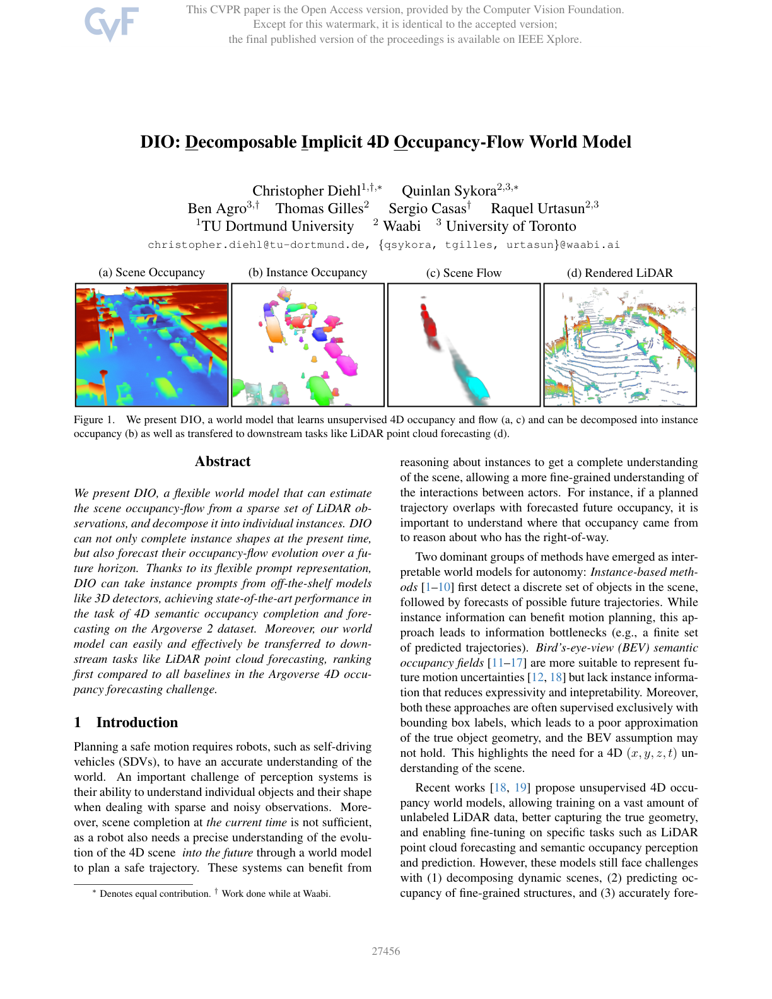
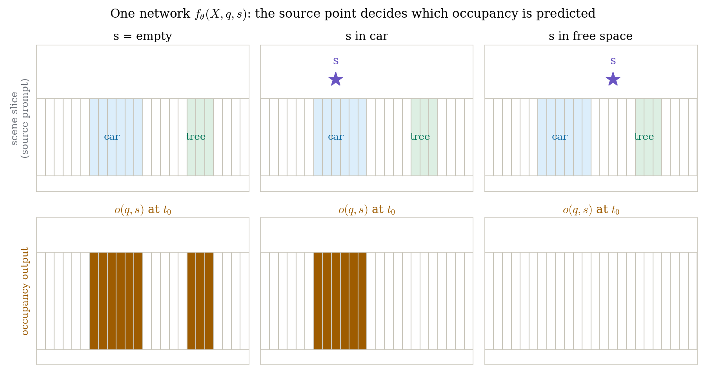
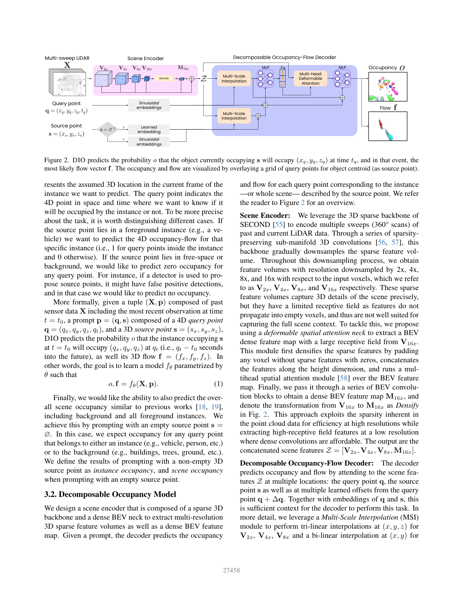
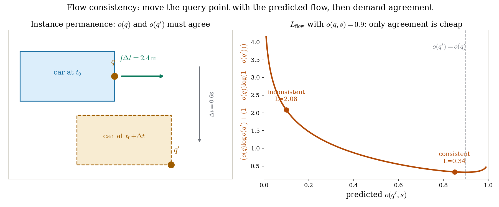
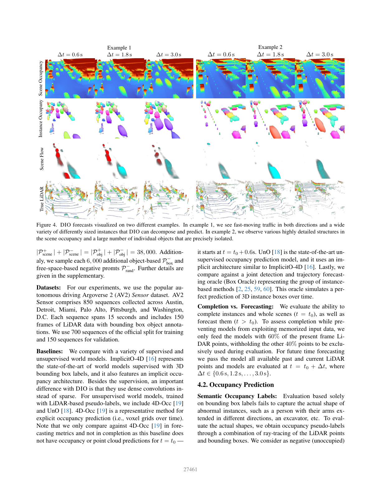

# 指哪打哪的占据场：一个 source point 如何把无监督 4D 占据-流世界模型切成实例

> **全局编号**：044-WM-dio
> **论文标题**：DIO: Decomposable Implicit 4D Occupancy-Flow World Model
> **作者**：Christopher Diehl（TU Dortmund）、Quinlan Sykora、Ben Agro、Thomas Gilles、Sergio Casas、Raquel Urtasun（Waabi / University of Toronto）
> **会议**：CVPR 2025，pp. 27456–27466
> **链接**：无 arXiv；官方页面 https://openaccess.thecvf.com/content/CVPR2025/html/Diehl_DIO_Decomposable_Implicit_4D_Occupancy-Flow_World_Model_CVPR_2025_paper.html（PDF 与 supplementary 均在该页）
> **代码**：未找到官方代码（GitHub 检索无官方仓库；各世界模型综述中 DIO 条目代码栏均为空）
> **一句话核心洞见**：占据场的"分解成实例"不需要语义标签和固定数量的实例头，只需要把"要哪一个实例"做成网络的一个输入（一个 3D source point），无监督的占据-流学习自然会把几何形状学对，prompt 负责把它们切开。

*论文图 1（第 1 页）。注意 (b)：实例占据里每个实例被完整地补全了形状，而不是一个框。这是全文的赌注——无监督占据学习能学到真几何，prompt 只负责"切分"。*

## 「实例信息」和「几何精度」为什么总不能兼得

自动驾驶的世界模型在 2024–2025 年分成了泾渭分明的两派，DIO 的引言把这两派的困境说得很准，值得先把这个困境讲透，因为它是整篇论文的出发点。

第一派是 instance-based 方法：先检测出一组离散物体，再预测每条轨迹。它的信息瓶颈是结构性的——规划器拿到的只是一个有限的轨迹集合，物体形状被压缩成了一个 3D 框。框的问题不只是"粗糙"，而是它在几何上就是错的：一个张开手臂的行人、一条伸出的挂车拖臂，框里一半是空气。DIO 在实验里放了一个 Box Oracle（完美检测+完美轨迹预测的"作弊"基线）就是为了把这一点钉死：即使检测和预测都完美，框表示的几何依然输给占据场（表 1 里 Box Oracle 的 instance-level Soft-IoU 只有 51.33，DIO-D 是 75.97）。

第二派是 BEV 语义占据场：它能表达运动的不确定性，但没有实例概念——规划器看到一块未来的占据，不知道它属于谁，也就没法推理路权（引言里那个例子：如果规划轨迹和预测占据重叠，你必须知道这块占据是哪辆车才能判断谁让谁）。而且 BEV 假设本身（世界可以压成一张 2D 图）在立交桥、陡坡这些地方不成立。

然后是 2024 年的 UnO：无监督 4D 占据场，用 LiDAR 自监督学到了很精细的几何，但它只有一个分辨率的 BEV 特征图，细结构吃力，而且完全没有实例分解能力。DIO 要回答的问题就是：能不能保留 UnO 那种"无监督学真几何"的能力，同时把场景切成实例？

这里所有人都默认的一个假设是：**实例分解需要语义监督**——你要么有逐点的语义标签，要么至少有逐实例的分割标注。DIO 推翻的就是这个假设。它的回答是：分解不需要"这是什么"，只需要"这是哪一个"。而"哪一个"可以用一个点来指。

## 作者的底牌：占据场的分解不需要语义，只需要一个"指一下"的点

这个想法直接来自 Segment Anything（论文引用了 SAM [48]）。SAM 的核心洞见是分割可以做成 promptable 的：网络不输出固定数量的 mask，而是以点/框为条件输出"这个点所在的物体"。DIO 把同样的招式搬到 4D 占据世界：网络的函数签名从

$$o, f = f_\theta(X, q)$$

变成

$$o, f = f_\theta(X, q, s)$$

其中 $X$ 是过去多帧 LiDAR（含当前帧 $t=t_0$），$q=(q_x,q_y,q_z,q_t)$ 是要查询的 4D 时空点，$s=(s_x,s_y,s_z)$ 是 3D source point。输出 $o$ 是"在 $t_0$ 时刻占据 $s$ 的那个实例，在 $q_t$ 时刻占据 $(q_x,q_y,q_z)$ 的概率"，$f=(f_x,f_y,f_z)$ 是那个实例在查询点的最可能流向量。

source point 的语义分三种情况，论文在 3.1 节说得很干净：

- $s$ 落在前景实例内：预测**这个实例**的 4D 占据-流，实例内查询点为 1、外为 0；
- $s$ 落在自由空间或背景：对任何查询点都预测 0（这处理了检测器误检的情况——误检的点指过去，网络应该回答"这里什么都没有"）；
- $s = \emptyset$（空 prompt）：退化成**场景占据**，任何实例或背景的占据都算 1，和 UnO/4D-Occ 做的事情一样。

下图把这三种情况画在了一个玩具场景上，同一个网络、同一个查询点行，只换 $s$：

*自绘图。$s=\emptyset$ 时输出整场景占据；$s$ 在车内时只输出这辆车；$s$ 在自由空间时全零。注意第二种情况里树（背景）的占据被关掉了——网络学会了"只回答被指的那个实例"。*

## 为什么不用"输出 K 个实例通道"这种朴素方案

在揭晓 DIO 的方案之前，值得把两条更直接的路走一遍，看它们在哪里撞墙。

**朴素方案一：每个实例一个输出头。** 给检测到的每个物体单独跑一个占据补全网络。这条路的问题是它把"实例"和"模型"绑死了：实例数量可变、顺序不定，训练时需要实例级的稠密几何标签（而我们只有框和无监督 LiDAR 信号），推理时还要解决"哪个头对哪个物体"的对应问题。更重要的是，它学不到跨实例共享的几何先验——车和狗的形状先验本可以在一个网络里共享。

**朴素方案二：固定 K 个实例通道的全景式输出。** 网络输出 K 个占据场，第 k 个通道对应第 k 个实例。这需要 Hungarian 匹配来对齐预测和真值，K 选小了装不下拥挤场景，K 选大了浪费算力，而且 K 是写死在架构里的。自动驾驶场景的实例数从 0 到上百都有，固定 K 天生别扭。

DIO 的路是第三条：**把实例的"身份"从输出结构里拿掉，放进输入**。网络永远只输出一个占据场和一个流场，但这个场是以 $s$ 为条件的。这消掉了排序和匹配问题（每次前向只有一个实例要负责），消掉了 K 的选择（要多少实例就 prompt 多少次），而且训练信号可以复用无监督占据那套成熟的 ray-based 自监督——因为每个 prompt 本质上还是在回答"这个点被占了吗"，只是加了个"属于被指的实例吗"的限定。

代价是什么？推理时要对每个实例跑一次 decoder。但 decoder 是轻量的（MLP + deformable attention，查询点只在感兴趣区域采样），encoder 的特征 $Z$ 只算一次。所以这个代价是可接受的，论文在 3.4 节也提了可以用运动学约束缩小每个实例的查询区域来省算力（细节在 supplementary，我没能下载到，后面会说明）。

这个设计的妙处在于**实例数量不再是架构的一部分**。传统全景分割要预设"最多 K 个实例"，带来排序、匹配、 Hungarian 分配一整套麻烦。DIO 把实例选择推到输入端：要切多少个实例，就 prompt 多少次，每次独立前向。这也是它能做 open-set 的原因——训练时只在部分类别上训，测试时指一个没见过的类别（比如狗），网络照样能切，因为"切"这个动作本身不依赖类别语义。

## 编码器：稀疏保细节、稠密给感受野，两条路为什么都要

UnO 的一个具体弱点是它把场景编码成**单一分辨率**的 BEV 特征图。BEV 特征的问题在于 3D 细节在压平成 BEV 的过程中被平均掉了——一根杆子、一辆自行车的细结构，在 BEV 格子里就是一两个像素，很容易被卷积抹平。DIO 的编码器是针对这个弱点设计的，结构是"稀疏 3D backbone + 稠密 BEV neck"，两条路各管一件事。

输入是过去 16 帧 LiDAR（每 0.2s 一帧，共 3.0s，比 UnO 用的帧数多——论文说这是因为稀疏 backbone 更省）。稀疏 backbone 用的是 SECOND 的 3D 稀疏卷积 backbone，经过一系列保持稀疏性的子流形卷积（submanifold conv，只在有点的体素上传播特征，不会把特征"漏"到空体素里），逐步下采样，得到四个分辨率的稀疏特征体：$V_{2x}, V_{4x}, V_{8x}, V_{16x}$（下标是相对输入体素的下采样倍数）。这些体素特征保留了精确的 3D 细节，但感受野有限——稀疏卷积的特征传不到空体素里，所以一个大的空旷区域（比如路口中央）拿不到上下文。

于是第二条路：把 $V_{16x}$ 稠密化（空体素填零，沿高度维拼接），过一个 multi-head spatial attention，再过几层 BEV 卷积，得到稠密 BEV 特征图 $M_{16x}$。论文把 $V_{16x} \to M_{16x}$ 这个变换在图 2 里标为 "Densify"。这一步的算账逻辑是：在低分辨率上做稠密操作是 affordable 的，而在高分辨率上保持稀疏是高效的——两头的好处都占了。最终的场景特征是四者的拼接：

$$Z = [V_{2x}, V_{4x}, V_{8x}, M_{16x}]$$

解码器查询时，对 $V_{2x},V_{4x},V_{8x}$ 做三线性插值（在 $(x,y,z)$ 处），对 $M_{16x}$ 做双线性插值（在 $(x,y)$ 处），这就是论文说的 Multi-Scale Interpolation（MSI）模块。

## 解码器：在 q、s 和 q+Δq 三处同时看

解码器的输入上下文有三部分，论文 3.2 节列得很明确，值得逐项看它在干什么：

1. **查询点 $q$ 处的 MSI 特征**：$q$ 是 4D 点 $(x,y,z,t)$，插值只用空间坐标 $(x,y,z)$。注意时间 $t$ 没有直接参与插值——时间信息是通过 sinusoidal embedding 进去的（图 2 里 $q$ 和 $s$ 各有一路 sinusoidal embedding）。
2. **source point $s$ 处的 MSI 特征**：这是"被指的实例长什么样"的直接证据。$s$ 附近的几何特征告诉网络这个实例的形状和朝向。
3. **从 $q$ 学出的偏移 $q + \Delta q$ 处的多头可变形注意力**：把 $q$ 和 $s$ 的特征拼上位置编码后，过一个 MLP 预测出 $4H$ 个 3D 偏移 $\Delta q$（$H$ 是头数，4 是分辨率数），然后在每个分辨率、每个头的位置上做 MSI 插值、做 cross-attention。这一步是让网络自己决定"除了 $q$ 和 $s$，还应该看哪里"——比如查一辆车的前保险杠时，顺便看一眼它的后视镜和车轮，形状补全需要这些上下文。

最后过一个 MLP，同时输出占据概率 $o$ 和流向量 $f$。整个解码器是 implicit 的：可以在连续 $(x,y,z,t)$ 上任意查，没有体素量化的分辨率上限，查询只发生在感兴趣区域，所以算力可控。

*论文图 2（第 3 页）。注意解码器同时 attend 的三个位置：query point、source point、以及从 query 学出的偏移 $q+\Delta q$。Densify 那条虚线框是 $V_{16x}\to M_{16x}$ 的变换。*

## 五种 prompt、五种负样本：每一种都在堵一个具体的捷径

训练 prompt 的设计是这篇论文最见功力的部分。作者要解决的核心矛盾是：**正负样本必须平衡，而且每一种"作弊"的捷径都要被堵死**。我们逐种看。

**场景占据 prompt**（$P^+_{scene}, P^-_{scene}$）：照抄 UnO/4D-Occ 的 ray-based 自监督。LiDAR 发射点 $l(t_r)$ 到回波点 $r$ 的线段 $R^-$ 认为是空的，回波点往外一小段 $\delta$ 的 $R^+$ 认为是被占的。沿每条 ray 在 $R^-$ 和 $R^+$ 上各均匀采样相同数量的点，保证 $|Q^+_{scene}| = |Q^-_{scene}| = 19{,}000$。所有这些查询都配空 source point $s=\emptyset$。

**实例正样本**（$P^+_{obj}$）：把落在实例框 $b_i$ 内的场景正样本拿出来，配一个在框内均匀采样的**带噪 source point** $\hat{s}_i$。噪声是关键——评估时 $s$ 来自检测器，本来就不准，训练时加噪让网络对不准的 $s$ 鲁棒。

**实例负样本**（$P^-_{obj}$，公式 2）：这里有个很细的设计。如果查询点在某个框 $b_i$ 内，就配**这个框**的 noisy source（它在框内但 ray 说这里是空的——比如框的角落）；如果查询点在所有框之外，就配一个**随机实例** $j$ 的 source $\hat{s}_j$。后者堵的是一个很具体的捷径：如果所有"框外查询点"都不配 source，网络会学到"只要给了 source point，查询点大概率被占"这个偏置——因为训练时给了 $s$ 的样本里正样本占多数。随机配 $s$ 把这个偏置打掉了。

**背景负样本**（$P^-_{bg}$）：场景正样本里落在背景上（比如树上）的点——对场景占据它们是正样本，但对实例占据必须是负样本，配随机实例的 source。这教会网络"被指的实例"和"场景里别的占据"是两回事。

**框间难负样本**（$P^-_{box}$）：在原框 $b_i$ 和放大后的框 $b'_i$ 之间的环带里采样，配 $b_i$ 的 source。妙处在于：$b'_i$ 放大后可能和旁边的实例 $b_2$ 相交，环带里的点可能正好落在 $b_2$ 的真形状上——这时网络必须回答"这是 $b_2$ 的占据，不是 $b_1$ 的"，逼着它做**实例分离**，而不是"框内全 1、框外全 0"的粗糙回答。

**自由空间负样本**（$P^-_{rand}$，公式 3）：在当前帧的自由空间 $R^-_{t=t_0}$ 里随机采 $K$ 个 source point，每个配 $M$ 个高斯球采样的查询点，全部标 0。这教会网络：$s$ 在空旷处时，什么都不该输出。

每个 batch 的量：$|Q^+_{scene}|=|Q^-_{scene}|=19{,}000$，场景 prompt 和实例 prompt 各用 19k，总共 $|P^+_{scene}|+|P^-_{scene}| = |P^+_{obj}|+|P^-_{obj}| = 38{,}000$，再加各 6,000 的 $P^-_{box}$ 和 $P^-_{rand}$。正负大体平衡，而且每种负样本都有明确的"反作弊"职责。消融表里没有单独 ablate 每种负样本，这是个小遗憾——我们不知道哪种最承重，但从设计上看 $P^-_{obj}$ 的随机配对和 $P^-_{box}$ 的环带是最不可少的两个。

## 流一致性损失：把查询点沿着预测的流搬运，再要求占据不变

总损失是两项的线性组合（公式 4）：

$$L = L_{occ} + \lambda L_{flow}$$

$L_{occ}$ 就是普通的二元交叉熵（BCE），在所有正负 prompt 上求和。$L_{flow}$ 是这篇论文在"无监督"上最漂亮的一笔，值得慢慢讲。

它的物理图像是**实例恒存**（instance permanence）：一个实例不会凭空消失。给定查询点 $q=(x,y,z,t)$，网络预测了占据 $o$ 和流 $f$。如果流是对的，那么把 $q$ 沿着流搬运 $\Delta t$ 得到的新点

$$q' = (x + f_x\Delta t,\; y + f_y\Delta t,\; z + f_z\Delta t,\; t + \Delta t)$$

在 $t+\Delta t$ 时刻应该被**同一个实例**占据——占据概率应该和原来一样。于是损失就是 $o(q,s)$ 和 $o(q',s)$ 之间的 BCE（公式 5）：

$$L_{flow} = -\sum_{(q,s)\in P_{all}} \Big(o(q,s)\log o(q',s) + (1-o(q,s))\log(1-o(q',s))\Big)$$

注意这里 $o(q,s)$ 是**当作 soft label 用的**——它没有真值，是网络自己上一时刻的预测。这是一个自举（bootstrap）的一致性约束：它不直接教网络"流应该是多少"，而是说"你的占据预测和流预测必须自洽"。如果网络在 $q$ 处说占据概率 0.9、流是 4 m/s 向前，那么 0.6 秒后 $q' = q + 2.4$m 处的占据也必须是 0.9 附近，否则就被罚。下图把这个几何动作和 BCE 的惩罚曲线画了出来：

*自绘图。左：$q$ 在 $t_0$ 时刻车的边缘上，沿预测流 $f\Delta t=2.4$m 搬到 $q'$，两处的占据必须一致。右：当 $o(q,s)=0.9$ 时，$o(q')$ 偏离 0.9 越远 BCE 越大；"一致"（0.85）的损失是 0.34，"不一致"（0.10）的损失是 2.42。*

这里有个微妙之处：$L_{flow}$ 只要求**占据预测沿流线不变**，它本身不监督流的方向——流的方向是从占据的时空变化里"被逼出来"的。如果网络预测的流是错的（比如方向反了），$q'$ 会落到空处，$o(q')$ 和 $o(q)$ 不一致，损失就会推着流往对的方向走。这是一个很干净的无监督流学习回路，不需要任何流标签。

论文正文**没有给出 $\lambda$ 的数值**，也没有说它是怎么选的。这是一个明确的信息缺口（记为未确认），后面怀疑式审读还会回来。

## 同一个路口，基线和 DIO 各走一遍

构造一个让基线们难受的具体场景：十字路口，一辆厢式货车（box 里一半是空气——货箱和驾驶室之间有空隙）和一辆自行车并排等红灯，自行车手手臂伸出打手势。查询点 $q_1$ 在货车货箱的侧壁上（LiDAR 只打到了驾驶室，货箱侧面在当前帧没有回波），$q_2$ 在自行车手伸出的手臂上，$t = t_0 + 1.2$s（未来）。

**Box Oracle 走一遍**：它有完美的检测框和完美的未来轨迹。$q_1$ 在货车框内 → 占据 1。$q_2$ 在自行车框内 → 占据 1。看起来都对。但问题在**形状**：$q_3$ 取在货箱和驾驶室之间的空隙里——也在框内，Oracle 回答 1，实际应该是 0。框表示的几何在空隙处是错的，而规划器如果相信框，会在这里留出不必要的安全距离，或者相反——在框外但实际有货物的地方（比如超宽的货物）漏掉占据。表 1 里 Box Oracle 的 instance-level Soft-IoU 只有 51.33（DIO-D 75.97），差的就是这些几何细节。

**UnO 走一遍**：它是无监督占据场，$q_1$ 处的货箱侧壁——当前帧没有 LiDAR 回波，UnO 靠 learned prior 补全。它的单分辨率 BEV 特征在这里容易把货箱侧壁抹成一堵直墙（细节丢失），$o(q_1)$ 可能只有 0.4。而且 UnO 完全没有实例概念：$q_2$ 手臂的占据和旁边货车的占据混在一起，规划器问"这块未来占据是谁的"，UnO 答不上来。

**DIO 走一遍**：prompt $s$ 取货车检测框的中心（带噪）。解码器在 $s$ 处插值到货车的几何特征——货箱的完整形状在训练时从多帧 LiDAR 累积中学过（无监督 ray 信号见过货箱的各个面）。$q_1$ 在货箱侧壁上 → $o \approx 0.95$。$q_3$ 在空隙里 → $P^-_{box}$ 环带训练过这种"框内但非实例"的负样本 → $o \approx 0.05$。$q_2$ 手臂：prompt 自行车的 $s$ → 手臂是自行车实例的一部分 → $o \approx 0.9$；而 prompt 货车的 $s$ 去查 $q_2$ → $o \approx 0$。实例分离就发生在这个 prompt 切换的一瞬间。未来时刻 $t_0+1.2$s：流预测把货车的占据往前搬，$L_{flow}$ 保证搬运前后一致。

分叉点落在具体数值上：$q_3$（空隙点）处，Box Oracle 输出 1.0（恒为 1，只要在框内），UnO 输出约 0.4（几何模糊），DIO 输出约 0.05（被 $P^-_{box}$ 明确教过）。这就是"可分解"三个字的全部含义——不是多输出一个通道，而是在同一个查询点上，换 $s$ 就换答案。

## 下游任务：语义占据取个 max，LiDAR 渲染只训一个轻量网络

DIO 的"世界模型"成色体现在两个下游任务上，迁移的方式都很轻。

**语义占据预测**：把 3D 检测器（论文用 HEDNet）的某类检测中心当作 source point 集合 $S_{cat}$，在重叠的查询网格 $Q_{grid}$ 上做笛卡尔积 $P_{cat} = S_{cat} \times Q_{grid}$，每个查询点的语义占据就是对所有 source 取最大：$o_q = \max_i f_\theta(X, (q, s_i))$。这个 max 操作的含义是"只要有一个被指的实例说这里被占，这里就被占"。因为解码器是 implicit 的，查询点不必是标准体素网格——可以用运动学约束或地图先验缩小每个实例的查询区域来省算力（细节在 supplementary，未能下载，记为未确认）。

**LiDAR 点云预测**：沿用 UnO 的做法，训一个轻量神经网络 $g_\gamma$，输入是沿每条 ray 的占据预测，输出这条 ray 的深度。关键细节是**训练时只更新 renderer 的参数 $\gamma$，世界模型参数 $\theta$ 冻结**，用 $\ell_1$ 损失对真值深度。渲染实例占据时，renderer 还额外输出"这条 ray 是否打中物体"的概率，用交叉熵监督。这个"冻结世界模型只训 renderer"的设定很重要：它保证点云预测的分数反映的是世界模型本身的质量，而不是 renderer 的拟合能力。

## 表 1 到表 5：每个数字的上下文

实验在 Argoverse 2 Sensor 数据集上：850 个序列（Austin、Detroit、Miami、Palo Alto、Pittsburgh、Washington D.C.），每序列 15 秒、150 帧 LiDAR，700 序列训练、150 序列验证。注意论文所有数字都是在**验证集**上报告的（没有用官方测试集，这在 4D 占据预测里是常见做法，因为测试集标签不公开——除了表 4 的 leaderboard）。

评估标签本身值得说一句：纯框标签 capture 不了真形状，所以作者用 ray-tracing + 框做了占据伪标签——ray 走过的空间为负，回波点沿 ray 方向 10cm 处为正（只取落在目标类别框内的），没被任何 ray 走过的空间标为 unknown 不参与评估。指标是 AP（排序质量）和 Soft-IoU（概率校准），分 scene-level（下标 S，用全部 ray）和 instance-level（下标 I，只用穿过实例框的 ray 段）。因为 ray 的负样本远多于正样本，评估时采样了平衡的正负查询点。

**表 1（vehicle 类 4D 语义占据）**：DIO-D（source 来自 HEDNet 检测器）六项全最高。Completion（$t=t_0$）的 instance-level：mAP 94.36、Soft-IoU 75.97，对 UnO 是 89.43/70.00，对 ImplicitO-4D（有监督、用框标签训的）是 65.04/52.96。Forecasting 的 instance-level mAP：DIO-D 86.01，UnO 82.99，ImplicitO-4D 61.51，Box Oracle 47.71。Box Oracle 在 instance-level 输给 DIO 近 40 个点（47.71 vs 86.01），这就是"框的几何是错的"这句话的定量形态。

**表 2（source point 类型鲁棒性，vehicle 类）**：DIO-∅（空 prompt）、DIO-L（label 中心）、DIO-NL（label 中心加训练同分布噪声）、DIO-D（检测器中心）四者的数字非常接近（forecasting mAP：86.14/87.10/87.04/86.01）。DIO-NL 和 DIO-L 几乎一样，说明训练时加的 source 噪声确实让模型对不准的 $s$ 鲁棒了。这张表是"prompt 接口在真实检测器下可用"的证据。

**表 3（开集泛化）**：训练时**只用部分类别**，在三个 held-out 类别 Bicyclist、Stopsign、Dog 上评估。选这三个是有讲究的：Bicyclist 和 Dog 是动态的、Stopsign 是静态的、Dog 是稀有小物体。DIO-∅ 在 completion 的 instance-level 上 mAP 98.43、Soft-IoU 88.15 全场最高——因为空 prompt 不需要任何语义理解，纯几何补全；而 DIO-NL 在 forecasting 上更强（mAP 82.95 vs DIO-∅ 88.45？注意这里 DIO-∅ 的 forecasting mAP 88.45 高于 DIO-NL 的 82.95，论文的解释是 source point 里隐含的先验信息能引导预测，但数字上 DIO-∅ 反而更高——这个"更有趣"的观察论文没有充分解释，记为一个小疑点）。

**表 4（Argoverse 2 leaderboard，LiDAR 点云预测，排名指标 L1）**：DIO-∅ 以 L1 2.11 排名第一，对 UnO 2.24、4D-Occ 3.22、RayTracing 2.50。AbsRel 11.00 对 UnO 12.00。这张表是"世界模型成色"的公开证据，leaderboard 链接在论文脚注里给了（eval.ai challenge 1977）。

**表 5（object-based LiDAR 评估）**：每帧随机选一个 ROI 内的物体，只比框内的点。DIO-NL 的 completion L1 是 0.79，对最强基线 UnO 的 3.42——论文说"4.3 倍小"，$3.42/0.79 \approx 4.33$，对得上。HitRate 指标（NFCD 小于阈值 $\tau$ 的点云比例，$\tau \in \{0.5, 2.0, 5.0\}$ m²）上 DIO-NL 在 completion 达到 71.20/88.79/95.53。注意这里为了公平，对也预测背景的方法用了 asymmetric NFCD（只算 GT→预测的单向距离），否则只预测物体的方法会占便宜——这个细节处理得诚实。

*论文图 4（第 6 页）。例 1 是双向快车流，例 2 是精细背景结构。注意实例占据那一行：每个实例被单独切出来且形状完整，流场那一行的颜色编码了运动方向和大小。这是"分解+预测"一次前向的直观证据。*

## 怀疑式审读：λ 去哪了，基线怎么跑的，表 5 有没有 GT 泄漏

**$\lambda$ 的数值和选择过程完全没写。** 公式 4 里 $L = L_{occ} + \lambda L_{flow}$，正文、实现细节、能下载到的部分里都没有 $\lambda$ 的值，也没有搜索范围。这不是小事：$L_{flow}$ 是自举的一致性损失，$\lambda$ 太大可能导致占据预测塌缩（比如全预测 0.5 来最小化不一致），太小则流学不出来。读者想复现的话，这个值只能猜。这是正文明确缺的信息，记为未确认。

**基线是重跑还是抄数？** 论文写 "DIO and the baselines receive 3.0 s of past frames"，以及训练细节是统一描述的，措辞暗示基线是在同样设置下跑的。但 UnO、4D-Occ、ImplicitO-4D 的数字没有明确说"我们重跑了"，也没有给基线的训练配置。考虑到作者团队里 Ben Agro、Quinlan Sykora 就是 UnO 的作者（UnO 是同一拨人 2024 年 CVPR 的工作），他们手里有 UnO 的训练代码，重跑的可信度比较高。但论文没有明确写，这是领域惯例和严谨之间的灰色地带，如实指出。

**表 5 的 DIO-NL 用了 label 中心做 source，有没有 GT 泄漏？** 表 1 的主结果用的是 DIO-D（检测器中心），作者明确说这样"避免任何 GT 泄漏、保证公平"。但表 5 的 object-based 评估用的是 DIO-NL——label 质心加噪。质心位置本身是 GT 信息（检测器给不出这么准的中心）。不过要公平地说：表 5 测的是**几何补全和预测的质量**（L1、Chamfer），不是检测能力；source 只是告诉网络"看这个物体"，物体本身的位置在评估时本来就是已知的（每帧随机选一个 ROI 内物体做评估，评估者知道它在哪）。所以这里的 GT 中心不算作弊，但它确实让 DIO-NL 的数字比纯检测器输入的版本好看。论文没有在表 5 旁边放 DIO-D 的对照，这是一个可以挑的地方。

**训练代价**：50,000 iterations、batch 16、AdamW、lr $1\times10^{-4}$（1000 步 warmup 从 $1\times10^{-5}$ 起，cosine 衰减）。用了几块 GPU、训了多久——没写。按 50k×16 的样本量和稀疏 backbone 的体量，这不是一个小训练，但具体数字未确认。

**测试集有没有用来选模型**：所有表都是验证集（150 序列）上的数字，测试集标签不公开所以选不了模型——这反而是干净的。但超参数（比如 prompt 采样数 19k、$P^-_{box}$ 的 6k）在哪个集合上定的，没说。

**表 3 的小疑点**：DIO-∅ 在 held-out 类别上的 forecasting mAP（88.45）高于 DIO-NL（82.95），但正文说 DIO-NL "stronger at forecasting due to source point prior"。数字和叙述的方向是反的——除非作者指的是 Soft-IoU（DIO-NL 68.77 vs DIO-∅ 71.42，也还是 DIO-∅ 高）。这一处正文解释和数字对不上，可能是笔误，也可能是我想错了比较维度，如实标出。

**没选的基线**：2025 年同期的 OccWorld、DOME 这些基于扩散的占据世界模型没有出现在比较里。DIO 投的是 CVPR 2025，DOME 是 2024 年 10 月的 arXiv，时间上可能赶不上；但 OccWorld（ECCV 2024）是赶得上的。没比的原因论文没说，可能是 LiDAR-based 和 vision-based 的赛道划分（DIO 是纯 LiDAR 输入），但这是一个读者会问的问题。

## 带走的东西

DIO 最值得带走的不是某个网络结构，而是一个**接口设计**："把实例选择做成输入条件"。这个招式能迁移到任何"要把一个场切成实例"的问题上——占据场、流场、甚至代价地图。它的成立依赖两个前提，论文用实验分别验证了：第一，无监督信号（ray-based + 流一致性）足以学到真几何（表 4 leaderboard 第一）；第二，prompt 条件足以实现实例分离（五种负样本的设计 + 表 2 的鲁棒性 + 表 3 的开集）。

真正值得做的开放问题，论文结论里自己也点了：训练还依赖 3D 框标签。框标签比逐点语义标签便宜，但依然是人工标注。如果把框换成无监督 3D 发现（unsupervised object discovery）的伪框，整个 pipeline 就能做到零人工标签——那才是"无监督 4D 世界模型"的完全体。另一个开放问题是 $\lambda$ 的缺失：流一致性这种自举损失的权重选择，很可能藏着训练稳定性的关键，复现者第一个要踩的坑就在这里。

---

*PDF：044-WM-dio.pdf（CVPR 2025 官方页面下载，11 页，pp. 27456–27466）。Supplementary 未能下载（按官方页面链接构造的 supp URL 返回 404；文中引用的效率分析、查询区域优化等细节因此无法核实，记为缺口）。训练超参数 $\lambda$ 正文未给，记为未确认。*
