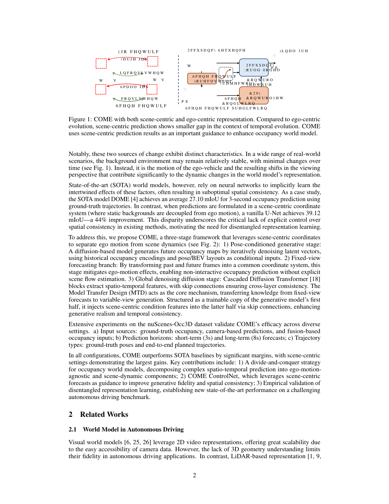
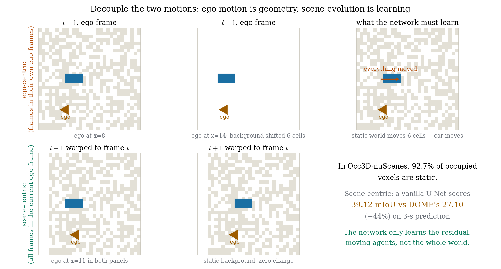
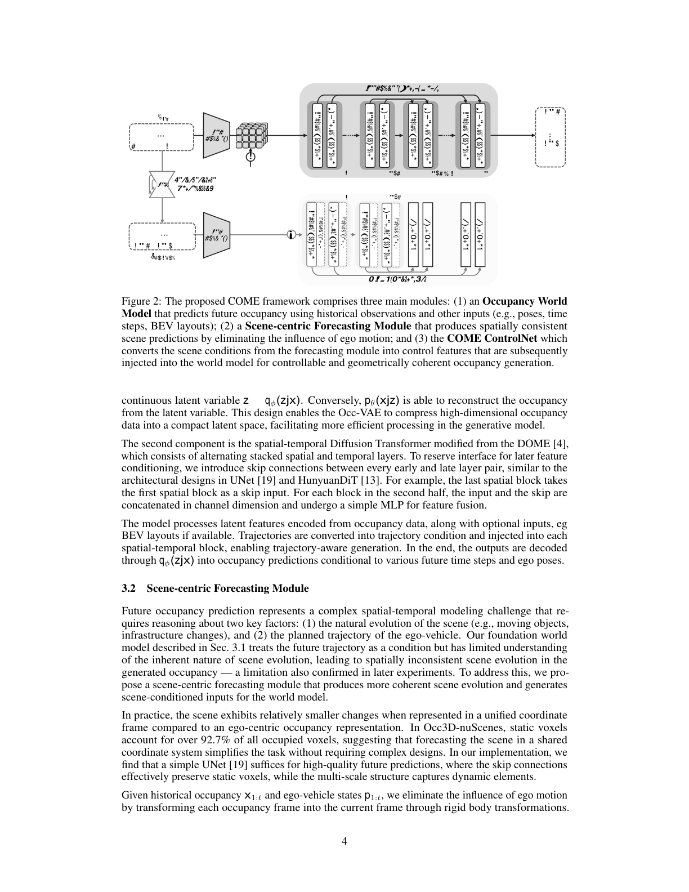
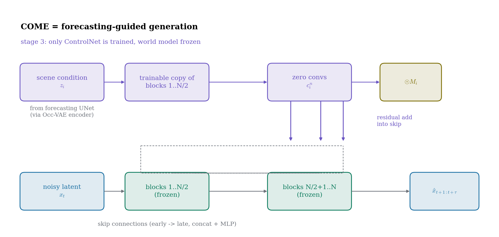
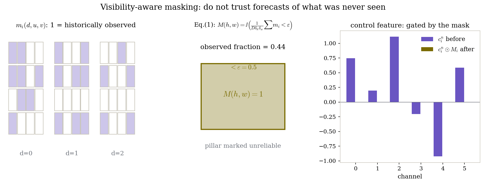
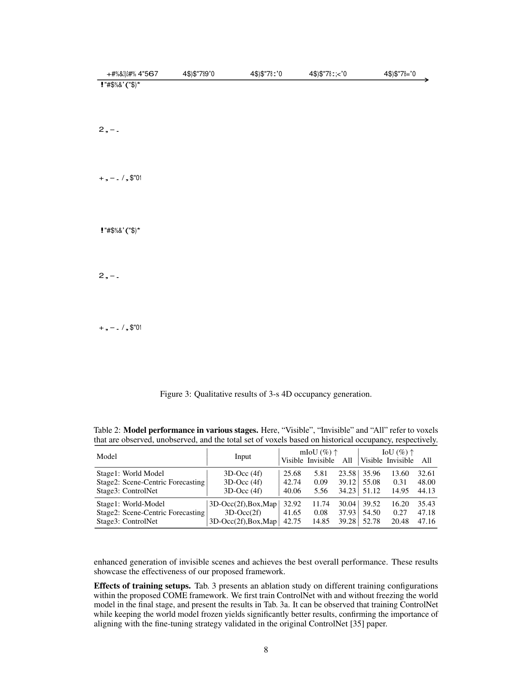

# 把自车运动从世界里抠掉：场景中心坐标系如何让占据世界模型学会空间一致性

> **全局编号**：045-WM-come
> **论文标题**：COME: Adding Scene-Centric Forecasting Control to Occupancy World Model
> **作者**：Yining Shi、Kun Jiang（通讯）、Qiang Meng、Ke Wang、Jiabao Wang、Wenchao Sun、Tuopu Wen、Mengmeng Yang、Diange Yang（通讯）（清华大学车辆与运载学院、智能绿色车辆与交通全国重点实验室、Kargobot Inc.、南开大学）
> **会议**：NeurIPS 2025；arXiv:2506.13260v1（2025-06-16，preprint，投稿时状态为 under review）
> **代码**：已公开，https://github.com/synsin0/COME（已 clone 到本目录 code/；下文"代码"均指该仓库）
> **一句话核心洞见**：未来占据的变化是"自车运动（视角变化）"和"场景自然演化"两件事的纠缠，前者是纯几何、后者才是要学的；把历史帧全部变换到当前自车坐标系下，静态世界就几乎不动了——一个 vanilla U-Net 在这个坐标系下做预测能反超 SOTA 44%，COME 用 ControlNet 把这份"空间一致性"蒸馏进扩散世界模型。

*论文图 1（第 2 页）。这是全文的赌注：场景中心（scene-centric）预测在时间演化上的变化远小于自车中心（ego-centric）演化。注意右边那两行小字——"scene-centric prediction"配"small gap"，"ego-centric"配"large gap"。*

## 未来占据的变化到底是谁造成的：两个因素的纠缠

论文开篇把未来占据的外观变化拆成两个因素，这个拆分是全文一切设计的源头，值得先把它讲成一个能看见的画面。

**因素一：自车运动。** 车往前开了 5 米，整个世界在自车坐标系下往后挪了 5 米。路边的房子没动，但在占据网格里，房子的体素从 $(x,y)$ 搬到了 $(x-5,y)$。这是一种**纯几何**的变化——已知自车轨迹，它就是一个刚体变换，没有任何不确定性。

**因素二：场景自然演化。** 别的车在动、行人在走、红绿灯在变。这是**真正需要学习**的部分，带有不确定性和多模态性。

现有世界模型（DOME、OccWorld 等）的做法是：把历史占据和未来轨迹一起喂给网络，让网络**隐式地**同时学会这两件事。但这两件事的难度完全不在一个量级：因素一占了变化的绝大部分（静态背景占了 92.7% 的占据体素，见下节），因素二才是小头。网络的大部分容量被迫花在"学会做刚体变换"这种本可以用一行矩阵乘法解决的事情上，而且学得还不好——论文图 3 显示 DOME 会犯"物体类别不一致"和"物体突然消失"这种低级错误，本质上就是空间一致性没学好。

这里被默认接受的假设是：**世界模型应该在自车坐标系下直接预测未来**。COME 推翻它：先把自车运动这个纯几何因素用坐标变换显式抠掉，让网络只学场景演化，再把学到的东西作为控制信号注回生成模型。

## 作者的底牌：同一个任务换个坐标系，vanilla U-Net 反超 SOTA 44%

这篇论文的底气来自引言里一个极其干净的对照实验，干净到它几乎可以独立作为一篇 workshop 论文：

> 在场景中心坐标系下（静态背景和自车运动解耦），一个 vanilla U-Net 做到 39.12 mIoU；而 SOTA 的 DOME 在自车中心坐标系下是 27.10 mIoU——**高了 44%**。

这个数字的杀伤力在于它**把"坐标系选择"这个因素单独隔离了出来**。DOME 是一个 diffusion transformer，容量、训练量都远超 vanilla U-Net，但它输了。输的原因不在模型容量，而在任务本身的难度：自车中心坐标系下，网络每一步都要同时做"刚体变换"和"场景演化"两件事；场景中心坐标系下，刚体变换被预处理做掉了，网络只做后者。

审稿人看到这个数字会怎么想？"如果坐标系这么重要，那我直接用场景中心坐标系做预测不就行了，为什么还要 COME 这一整套？"——论文用表 2 提前回答了这个问题：场景中心 U-Net 在 **visible** 体素上 mIoU 42.74 碾压世界模型的 25.68，但在 **invisible** 体素（历史没见过的区域）上只有 0.09，对世界模型是 5.81。UNet 没有想象力，世界模型没有一致性。COME 的整个设计就是**把 UNet 的一致性嫁接到世界模型的想象力上**。

## 92.7% 这个数字为什么是全文的定海神针

论文 3.2 节给了 Occ3D-nuScenes 的一个统计：**静态体素占所有占据体素的 92.7%**。这个数字是"场景中心坐标系下任务变简单"的定量根基，值得算一笔账。

假设未来 3 秒的占据预测，自车以 10 m/s 前进，3 秒走了 30 米。在自车中心坐标系下，一个 80m×80m 的占据网格里，几乎所有静态体素的位置都变了——网络要输出的"变化量"接近 100% 的体素。而在场景中心坐标系下（所有帧变换到当前帧），静态体素的变化量是 0，只有 7.3% 的动态体素在变。**预测目标的熵差了一个数量级。**

这就是为什么"a simple UNet suffices"（论文原话）。UNet 的 skip connection 直接把静态体素从编码器搬到解码器——静态部分几乎不用学，多尺度结构负责那 7.3% 的动态部分。一个听起来"太简单"的方法在这里成立，不是因为 UNet 强，而是因为坐标系把难题提前解掉了。这也是全文最值得带走的一个思维习惯：**在抱怨模型不够强之前，先问表示本身是不是在和你要解决的问题作对。**

*自绘图。上：自车中心坐标系，自车从 x=8 开到 x=14，整个静态背景在网格里平移了 6 格，网络什么都要学。下：场景中心坐标系，所有帧对齐到当前帧，静态背景纹丝不动，网络只学那辆车的移动。论文的真实数字：静态体素占 92.7%，场景中心 U-Net 39.12 mIoU 对 DOME 27.10（+44%）。*

*论文图 2（第 4 页）。注意中间那一列 ControlNet 的位置：它不直接改世界模型的输入输出，而是把场景条件转成控制特征，从侧面"拽"着后半段 block。这张图和 3.3 节的文字是对应的，但 zero conv 的具体落点要看代码才清楚（见"怀疑式审读"）。*

## Stage 2 的 UNet：刚体变换、最近邻、Dt×H×W 的 reshape

场景中心预测模块的实现是一篇"把简单做到极致"的代码，论文 3.2 节和代码 `model/UNet/base_forecaster.py` 对得上，逐段看。

**第一步：对齐。** 给定历史占据 $x_{1:t}$ 和自车位姿 $p_{1:t}$，初始化一个与当前位姿 $p_t$ 对齐的空占据网格，把每一帧的体素用刚体变换搬到当前帧：$x'_i = T(x_i, p_i, p_t)$，用 nearest-neighbor search + grid sampling 实现（代码里 `transform_coor_system`）。Nearest-neighbor 而不是双线性插值——因为占据是离散的语义标签，插值会产生不存在的类别。这个选择是对的，但它也引入了量化噪声：0.4m 的体素做最近邻搬运，亚体素精度的运动信息就丢了。论文没有讨论这一点，记为一个小注脚。

**第二步：reshape 省算力。** 对齐后的序列 $x'_{1:t}$ 被 reshape 成 $Dt \times H \times W$ 的 3D 张量（$D=16$ 是高度维，$t$ 是时间帧数），然后用 **2D 卷积**处理，而不是 3D 卷积。算一笔账：$D=16$、$t=4$ 历史帧，$Dt=64$ 个通道，$H=W=200$。2D 卷积的计算量是 $O(C_{in}C_{out}HW)$，3D 卷积是 $O(C_{in}C_{out}DHW)$——省掉了一个 $D=16$ 的因子。代价是高度维和时间维被混在通道维里，网络要自己学会解耦"这是第几层高"和"这是第几帧"。UNet 的多尺度结构 + 2 层 temporal conv（代码和附录 A.3.2 确认）就是干这个的。

**第三步：UNet 预测 + 搬回去。** UNet 输出 $D\tau \times H \times W$（$\tau$ 是未来帧数），decode 成占据预测 $\hat{y}'_{t+1:t+\tau}$，再用逆变换搬到各自未来时刻的坐标系：$\hat{y}_i = T(\hat{y}'_i, p_t, p_i)$，最后过 Occ-VAE 编码器得到场景条件 $z_i = q_\phi(z|\hat{y}_i)$。注意这里用的是 **VAE 的 encoder**，不是直接用占据——因为 ControlNet 吃的是 latent 条件的维度（$C\times H_1 \times W_1$），和世界模型的 latent 空间对齐。

网络配置（附录 A.3.2，代码 `model/UNet/unet.py` 默认参数一致）：5 级编码器-解码器，通道数 256/512/1024/1024/1024，下采样比 [1,2,4,8,16]，上采样用 InterpConv，base channel 256。训练 12 epoch、batch 32、CBGS 重采样、cross-entropy 损失。参数量 27.31M，737.76 GFLOPs——比世界模型（362.31M）小一个数量级，但这是在"简单任务"上的小网络，不能直接比。

## Stage 1 为什么要给 DiT 加 skip connection

Stage 1 的世界模型是"modified DOME"：空间-时间交替堆叠的 Diffusion Transformer，28 层、12 头、hidden 768（DiT-XL 量级；另有一个小版本 12 层/6 头/384）。作者加了一个 DOME 原版没有的东西：**每对 early/late 层之间加 skip connection**（UNet 式，也参考了 HunyuanDiT）。具体做法：后半段每个 block 的输入和 skip 在通道维 concat，过一个简单 MLP 融合。

为什么要加？论文 3.1 节说得很直白：**为后面的条件注入预留接口**。ControlNet 的控制特征要加进后半段的 block，没有 skip 的话，控制信号没有一个"官方入口"，只能硬塞进某个中间层。Skip connection 在这里不是为了训练稳定（DiT 本来训得动），而是一个**架构上的预埋件**。这是一个值得注意的设计习惯：为未来的条件机制提前留接口，而不是等要用的时候再改架构。

训练：2000 epoch、总 batch 128、lr 2e-4，Occ-VAE 用 DOME 的预训练权重（压缩比 64，中间特征 [[200,200],[100,100],[50,50],[25,25]]）。2000 个 epoch 听起来吓人，但 Occ3D-nuScenes 训练集只有 700 个序列——按每个序列 20 秒、采 2fps 算，一个 epoch 的样本数并不大。论文没有给墙钟时间，4 块 H20 上的实际耗时未确认。

## Stage 3 的 ControlNet：trainable copy、zero conv、残差注入

这是 COME 的名字来源（**C**ontrol **O**ccupancy **M**od**E**l），也是全文机械上最复杂的一块。结构照搬 ControlNet [35] 的哲学，但细节是为 DiT 定制的。

ControlNet 由 $N$ 个 block 组成（论文 3.3 节）：**前 $N/2$ 个是世界模型前半段 block 的可训练拷贝**（从 stage 1 的权重初始化），**后 $N/2$ 个是 zero convolution 层**。每个 zero 层输出控制特征 $\{c^n_i\}^\tau_{i=1} \in \mathbb{R}^{C\times H_1 \times W_1}$，$n$ 跑遍后半段。训练时**只训 ControlNet，世界模型冻结**——表 3a 证明了这是对的：冻结世界模型 mIoU 34.23，一起训掉到 28.67。

读代码（`model/dome_controlnet.py`）会发现论文描述和实现之间有几处值得记的出入：

1. 论文说"后 $N/2$ 个 block 是 zero convolution layers"，代码里实际是**每个 block（包括前半段的每个 spatial/temporal block）后面都跟一个 zero-initialized linear**（`after_proj_list`，`zero_module(nn.Linear)`），controls 列表里每个 block 都贡献一个。也就是说控制特征不是只从后 $N/2$ 个"zero conv block"出，而是每个 block 的输出都过一个 zero linear。这和论文的文字描述不完全一致，但精神一致：初始时控制信号为零，不破坏预训练世界模型。

2. 注入方式：论文说"通过残差加法注入到对应层"（residual addition），"控制特征加到 skip 特征上再和每 block 的输入特征 concat"。代码 `domev2.py` 第 491–493 行：`skip = skips.pop() + controls.pop()`——控制特征和 skip **相加**，然后这个和再和输入 concat 进后半 block。和论文一致。

3. 条件怎么进 ControlNet：`x = x + self.before_proj(condition)`——场景条件 latent 先过 patch embed（和输入共用 `x_embedder`），再过一个 zero linear 加到输入上。这也是 ControlNet 的标准做法。

*自绘图。下：冻结的 DiT 世界模型，early→late 的 skip 预留了注入接口。上：ControlNet，前半是可训练拷贝，后半是 zero 层，输出 $c^n_i$ 经 invisibility mask 门控后残差加进 skip。Stage 3 只训紫色部分。*

## Eq.(1) 的 visibility mask：在小例子上算一遍

论文 3.3 节观察到一个真实的问题：UNet 结构简单，对**历史没见过的区域**没有想象力，它的预测在那里是噪声。把这份噪声原样注进世界模型会损害生成质量（附录表 6：No Mask 的定量反而最高，但定性把不可见区都生成成了 free——后面会细讲这个背离）。于是需要 visibility-aware masking：只信任历史上被观察过的区域的控制特征。

公式 (1) 的构造，逐符号讲。每个未来时刻 $i$，先找到控制特征 $c^n_i$ 的"根源"——UNet 预测的占据 $\hat{y}_i$。构造二值体素 mask $m_i \in \mathbb{R}^{D\times H \times W}$：$\hat{y}_i$ 中体素中心在历史占据里被观察过的位置为 1，否则为 0。然后对每个 pillar（对应控制特征图上的一个 $(h,w)$ 位置，覆盖 $\delta_h \times \delta_w \times D$ 个体素，其中 $\delta_h = H/H_1$、$\delta_w = W/W_1$ 是下采样比）算被观察体素的比例，低于阈值 $\varepsilon = 0.5$ 就把 $M_i(h,w)$ 置 1（不可靠），最后 $c^n_i \leftarrow c^n_i \odot M_i$ 把不可靠的控制特征压掉。

几何意义：一个 pillar 如果一半以上的体素都没被历史见过，UNet 对这一柱的预测就是在"编"，不让它说话。下图在一个玩具 pillar 上把公式算了一遍：

*自绘图。左：$3\times4\times4$ 的玩具 pillar，紫色=历史上被观察过（$m_i=1$）。中：被观察比例 0.44 < 0.5，该 pillar 标记不可靠。右：控制特征在该 pillar 处被置零（按代码的实际语义；见下段关于论文公式符号的注记）。真实尺寸：$D=16$，$\delta_h=\delta_w=8$（200→25 的下采样）。*

这里要停下来指出论文公式本身的一个符号问题。按 3.3 节的定义：$m_i=1$ 表示"历史上被观察过"，$M_i(h,w)=\mathbb{I}(\text{被观察比例} < \varepsilon)$，所以 $M_i=1$ 标记的是**不可靠**（不可见占多数）的 pillar。但正文接着写"we suppress unreliable features via element-wise multiplication: $c^n_i \leftarrow c^n_i \odot M_i$"——按这个写法，$M_i=1$ 的不可靠特征被保留，$M_i=0$ 的可靠特征被置零，**和"suppress unreliable"的 stated intent 正好反了**。代码的实际行为是反过来的：`input_latents[invisible] = 0`（True=不可见处清零），推理时的后融合（`test_diffusion_control.py` 第 580–581 行）也是"不可见区用世界模型预测、可见区用 UNet 预测"。所以真实生效的操作是 $\odot(1-M_i)$，论文公式大概率是个符号笔误（indicator 该取 $\geq\varepsilon$，或乘的该是 $1-M_i$）。这不影响结论，但复现者如果照抄公式会得到反的 mask，第一时间就会发现生成质量崩掉——提前知道能省半天。

代码里的实现（`utils/misc.py::downsample_visible_mask`）用的是多数投票（`true_count > false_count`，即不可见超 50% 则 mask），和 $\varepsilon=0.5$ 的精神一致。但有一个**论文与代码的出入**值得记：论文 Eq.(1) 和附录 A.4.2 都说 mask 是乘在 **ControlNet 输出的控制特征**上（"use a fixed invisibility mask on control features after COME ControlNet"）；而训练代码 `tools/train_diffusion_control_ddp.py` 第 531 行实际做的是 `input_latents[invisible] = 0`——把 mask 乘在了 **ControlNet 的输入 latent**（UNet 预测编码后的场景条件）上，再送进 ControlNet。效果上相近（输入被置零的区域，ControlNet 输出的控制量也近乎零），但不是同一个操作。严格来说，乘在输入上还会影响 ControlNet 内部的 self-attention 上下文，而乘在输出上是纯门控。论文没有说明这个差异，复现时按代码来（输入端置零）才是和作者实验一致的做法。

## 为什么不用直接拼接：附录 A.1 的设计哲学与 shortcut 学习

附录 A.1 回答了一个读者一定会问的问题：场景条件 $z_i$ 为什么不直接 concat 进世界模型，而要搞一个外部 ControlNet？作者给了三层理由，一层比一层实在：

第一，**保持世界模型的生成能力**。直接拼接会让场景预测变成生成的"必需组件"——模型退化成一个补全/inpainting 模型：可见体素照抄预测，不可见体素靠上下文填。而 ControlNet 是"外加的引导"，世界模型本身还是一个完整的生成器，不用 ControlNet 也能工作（附录图 10 的超长 rollout 就是第一段用 ControlNet、后面不用，展示这种灵活性）。

第二，**防止 shortcut 学习**。如果直接拼接，模型会学一个捷径：在可见体素上直接输出预测结果——这会杀死生成模型的多模态性（本来可以想象多种未来，现在被锚定在 UNet 的单一预测上），也杀死了预测任务的多模态性。这是一个很具体的失败模式，不是空话。

第三，**维度匹配的经验**：位姿（waypoints $[x,y,yaw]$）和 BEV layout（语义图）是低维条件，适合直接拼接；占据序列 latent 是高维条件，适合外部 ControlNet。而且训 ControlNet 需要的数据量比从头训世界模型小。

这三条里第一条是最硬的：它把 COME 和"UNet+精修"这类两阶段 pipeline 区分开来。COME 的世界模型在 stage 3 之后仍然是一个独立可用的生成器，ControlNet 是可插拔的增强，不是一条单行道。

## 一个右转路口：Stage 1 把隔离带看成路口，Stage 3 怎么纠回来

论文附录图 6 给了一个 8 秒长时生成的具体案例，值得走一遍，因为它把三个 stage 的分工演活了。

场景：自车沿主路行驶，路边有一条隔离带。Stage 1 的世界模型（纯自车中心生成） rollout 到几秒后，**在隔离带的位置生成了一条新的岔路**，和主路形成一个不存在的十字路口。这就是空间不一致性的典型症状：模型"忘了"几秒前看到的隔离带，靠想象力编了一个路口出来。

Stage 2 的场景中心 UNet 看到的是另一番景象：所有历史帧对齐到当前帧后，隔离带的体素在过去 2 秒里**纹丝不动**（静态体素），UNet 的 skip connection 把它们原样搬到未来——它的预测里隔离带还在，没有路口。

Stage 3：ControlNet 把 UNet 的这份"隔离带还在"的控制特征注进世界模型后半段。Zero conv 初始为零，所以训练早期世界模型的行为不变；随着训练，控制特征在可见区域（隔离带是历史上可见的，mask 不会压掉它）逐渐把生成往"保持隔离带"的方向拽。最终输出：8 秒的生成里道路结构保持一致，没有凭空出现的路口。

这个案例也解释了为什么 mask 重要：如果没有 mask，UNet 在不可见区域（比如路口转角后面）的噪声预测也会被注进去，反而可能引入新的幻觉。附录图 8 的 mask 策略对比就是在讲这件事。

*论文图 3（第 8 页）。上：DOME 出现物体类别不一致；下：DOME 的物体突然消失。COME 在这两处都保持了空间一致性——这正是场景中心控制要解决的症状。*

## 表 1 四个设置的数字与各自的上下文

主结果表 1 在四个设置下报告，每个设置的输入模态和轨迹来源都不同，数字要分开看。数据集是 Occ3D-nuScenes：200×200×16 体素、0.4m 分辨率、18 类、700/150/150 序列划分，指标是几何 IoU 和语义 mIoU，在验证集上按 1s/2s/3s 报告平均。

**设置一：camera 输入 + 规划模块预测的轨迹。** 这是最难也最真实的设置（上游全是预测噪声）。COME 平均 mIoU 19.11、IoU 37.63，对之前最好的 OccVAR（11.79/24.35）是 **+62.1%/+54.5%**。注意 OccVAR、DFIT-OccWorld 这些基线里有的还用了 occupancy flow 或语言等额外信息，COME 只用轨迹条件。

**设置二：camera 输入 + GT 轨迹。** COME 22.26/44.07，对 DOME（18.25/28.84）是 **+22.0%/+34.6%**。这是和 DOME 的同条件对打，22% 的 mIoU 提升是 ControlNet 的净贡献。

**设置三：GT 占据输入 + 预测轨迹。** COME 21.29/29.03，mIoU 略低于 DFIT-OccWorld 的 22.71。这是全文唯一一个 COME 没拿第一的设置，作者自己给了假设：COME 对轨迹输入是强依赖的（严格按轨迹条件生成），规划误差会直接传导。表 4c 的"重摆评估"验证了这个假设（见下节）。这是一个诚实的写法——没藏着掖着。

**设置四：GT 占据 + GT 轨迹。** COME 34.23/44.13，对 DOME（27.10/36.36）是 **+26.3%/+21.3%**（摘要里的 26.3% 就是这里来的）。加 BEV layout 后 39.28/47.16，对 UniScene-Fore（31.76/34.84）是 **+23.7%/+35.4%**（摘要里的 23.7%）。

**表 5（附录，8 秒长时生成）**：COME 平均 mIoU 19.07、IoU 29.96，对 DOME（15.83/25.21）是 +20.5%/+18.8%，8 个时间点全赢。长时生成的优势符合预期：自车中心方法的误差随时间累积（每一步的刚体变换误差叠加），场景中心方法没有这个累积项。

## 表 2：visible 和 invisible 上两个模块的明确分工

表 2 是全文信息量最高的消融，它把"UNet 负责一致性、世界模型负责想象力"这句话变成了数字。评估按体素是否在历史中被观察过分成 visible/invisible/all 三档：

- Stage 2（UNet）：visible mIoU **42.74**，invisible **0.09**。在见过的区域准得惊人，在没见过的区域几乎交白卷（0.09 基本就是随机）。
- Stage 1（世界模型）：visible 25.68，invisible **5.81**。见过的区域不如 UNet，但没见过的区域是 UNet 的 60 多倍——这就是生成模型的"想象力"。
- Stage 3（ControlNet 融合）：visible 40.06，invisible 5.56，all 34.23。Visible 上比纯 UNet 略降（42.74→40.06，生成模型的多模态性带来了方差），invisible 上基本保住了世界模型的水平，还略降一点（5.81→5.56）。作者的解读是：用一点 visible 精度换想象力和适应性，是值得的交换。

加 BEV layout 后 Stage 3 的 invisible 涨到 14.85，all 39.28——外部语义先验补上了 UNet 在不可见区的短板。这个数字也说明 COME 的框架是开放的：更好的条件（layout、更好的轨迹）能直接兑换成分数。

## 表 4c 的"重摆评估"：它到底在测什么

表 4c 研究轨迹质量的影响，里面藏了一个方法论上值得单独讲的操作。把 GT pose/yaw 逐步换成预测值，mIoU 从 34.23 掉到 21.29——看起来 COME 对轨迹误差很敏感。但最后一行加了一个 "Align." 操作：**把 GT 占据按预测轨迹的旋转矩阵重摆（reorigin），再和生成结果比**。对齐后 mIoU 回到 34.00，只掉了 0.23。

这个操作在测什么？它把评估拆成了两项：轨迹准不准（规划模块的事） vs 场景生成得好不好（世界模型的事）。重摆之后，轨迹误差被对齐掉了，剩下的差距就是纯生成质量——而生成质量几乎没掉。结论是：**预测轨迹导致的分数下跌主要来自"坐标没对齐"，而不是"场景生成变差了"**。附录 A.2 把这个道理讲得更透：早期自回归世界模型同时生成轨迹和占据，评估时两者的误差是耦合的；COME 的做法是把两者解耦评估。

但要指出这个操作的另一面：重摆评估是一种**自定义的评估协议**，它回答的是"生成质量"这个子问题，而不是"端到端系统"的真实表现。在真实部署里，轨迹不准就是不准，重摆不会发生。所以表 4c 的最后一行不能和表 1 的其他数字直接比——它是一个诊断工具，不是成绩单。论文把它放在消融里而不是主表，这个位置是恰当的。

## 表 6：定量最高分和最好看的生成不在同一个模型上

附录表 6 是全文最诚实的一张表，它暴露了**现有指标和生成质量之间的背离**：

- No Mask：mIoU **36.19**（四种策略里最高），IoU 45.97；
- Mask Control（主论文用的）：mIoU 34.23，IoU 44.13。

定量上 No Mask 赢了近 2 个点，但定性上（附录图 8）No Mask 有强烈的倾向把不可见区生成成 free——"看不见就当没东西"，这在自动驾驶里是危险的倾向（遮挡后面可能有车）。作者的解释一针见血：**现有指标对"把不可见区生成错"的惩罚，重于对"把不可见区空着（全 free）"的惩罚**。因为不可见区的真值本来就是不确定的，生成了具体内容但和真值不一致要扣分，空着反而扣得少。指标在奖励"保守的空白"，而应用需要的是"合理的想象"。

于是作者选了 Mask Control 作为默认——**用 2 个 mIoU 的代价换定性的正确**。这个选择值得尊敬，但它也留下了一个开放问题：Occ3D-nuScenes 的 mIoU/IoU 指标在不可见区的评估逻辑，可能需要重新设计（比如只评估可见区，或者对不可见区用分布匹配而非逐体素比对）。读者如果只看主表的数字，会错过这一层。

## 怀疑式审读：2000 个 epoch、复现的 DOME 基线、代码与论文的四处出入

**训练代价。** Stage 1 训 2000 epoch（batch 128）、Stage 3 训 1000 epoch（batch 64），4 块 H20。论文给了 epoch 数和 batch，没给墙钟时间。按 700 序列、每序列 20 秒 2fps 采样的体量，一个 epoch 的 step 数是 $700 \times 40 / 128 \approx 219$（假设每帧一个样本），2000 epoch 约 43.8 万 step——这是 DiT-XL 量级模型在 4 卡上的数周量级训练。具体时长未确认，但"不便宜"是确定的。表 3b 的小模型实验（147.8 GFLOPS 的世界模型 + ControlNet 做到 32.00 mIoU，超过 1375 GFLOPS 的大世界模型 23.49）倒是给了一个省钱的启示：**控制信号的性价比高于堆模型容量**。

**DOME 基线是作者自己复现的。** README 里明确写了 "DOME generation with reproduced checkpoint" 的对比视频，表 1 里 DOME camera+GT 的 18.25 mIoU 是 COME 团队训出来的复现版本，不是 DOME 官方 checkpoint 的数字。复现的 DOME 有没有训到官方水平？论文没有给复现 DOME 和官方 DOME 的对比。考虑到 COME 的 stage 1 就是"modified DOME"（加了 skip），复现质量直接影响"22% 提升"里有多少是 ControlNet 的功劳、多少是复现偏差。这个信息缺口是真实存在的。

**超参数。** $\varepsilon=0.5$ 没有敏感性分析——0.3 或 0.7 会怎样？不知道。去噪步数做了（表 4a：2 步 4.41 → 5 步 4.95 → 10 步 33.42 → 20 步 34.23，10 步是个明显的拐点，20 步是默认）。Guidance scale 7.5、pose 条件概率 0.9（附录 A.3.3）给了值但没给搜索过程。种子数没报告。

**测试集。** 主表数字都在验证集上（论文 4.1 节明说 "on the validation set, in line with previous works"），测试集 150 序列没有用。这是领域惯例（Occ3D 的测试标签不公开做榜），不算问题，但读者要知道这些数字不是测试集成绩。

**代码与论文的四处出入**（前三处前面已分别讲过，第四处是新发现的，汇总）：一是 mask 的作用位置——论文 Eq.(1)/附录 A.4.2 说是乘在 ControlNet 输出的控制特征上，训练代码实际是把输入 latent 的不可见区置零；二是论文说后 $N/2$ 个 block 是 zero convolution，代码里是每个 block 配一个 zero-initialized linear（`after_proj_list`）；三是附录 A.3.1 说"a learning rate of 1e-4 is not stated specifically"——这句话本身就有语病，stage 2/3 的学习率到底是不是 1e-4，论文没有干净地交代（config 里 ControlNet 训练用的是 lr=0.0001，和论文一致，但论文的表述是含糊的）；四是 Eq.(1) 的符号问题：按定义 $M_i=1$ 标记不可靠 pillar，但正文写 $c^n_i \leftarrow c^n_i \odot M_i$ 会保留不可靠、清零可靠，与"suppress unreliable"的意图和代码行为（不可见区清零）都相反，实际生效的是 $\odot(1-M_i)$，大概率是公式笔误。

**没选的基线。** 主表里没有 2025 年同期的其他扩散占据世界模型（比如 UniScene 只在 BEV layout 设置里出现了一次）。Camera+pred 轨迹设置下的基线（OccWorld、OccLLaMA 等）大多是 2024 年的工作。横向比较的覆盖面是够的，但"同条件对打"的只有 DOME。

## 带走的东西

COME 最值得带走的不是 ControlNet 的具体接法，而是一个**问题分解的习惯**：当一个预测任务的变化来源可以分成"纯几何"和"待学习"两部分时，先用坐标变换把几何部分显式解掉，剩下的再学。92.7% 静态体素这个数字是这句话的定量背书，而"vanilla U-Net 反超 SOTA 44%"是它的戏剧化呈现。

第二个可迁移的想法是**用 cheap & consistent 的模型去引导 expensive & imaginative 的模型**，而不是反过来。表 2 的分工（UNet 管 visible、世界模型管 invisible）和表 3b 的小模型实验（小世界模型 + ControlNet 超大世界模型）合在一起说明：控制信号的质量比生成器的容量更决定上限。这对资源有限的团队是个好消息。

真正值得做的开放问题有两个，都在论文里露了头：第一，指标与质量的背离（表 6）——占据生成的评估需要重新设计，否则大家都会往"No Mask"那个保守的方向过拟合；第二，端到端的训练（结论里作者自己提了），三阶段 pipeline 里 stage 2 的 UNet 误差会传导给 stage 3，一个联合优化的版本可能更好，但也可能遇到 shortcut 学习的老问题——附录 A.1 的警告依然有效。

---

*PDF：045-WM-come.pdf（arXiv:2506.13260v1，2025-06-16，21 页，含附录 A.1–A.5）。代码：code/（https://github.com/synsin0/COME，depth-1 clone）。论文与代码的四处出入见"怀疑式审读"汇总。超参数 $\varepsilon=0.5$ 无敏感性分析、DOME 为团队复现基线、训练墙钟时间未给，均记为未确认。*
