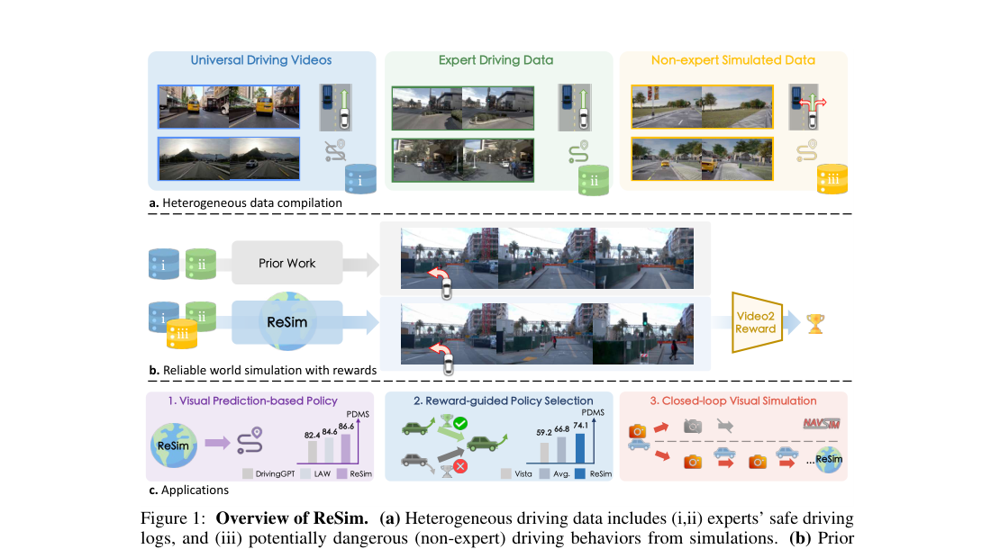
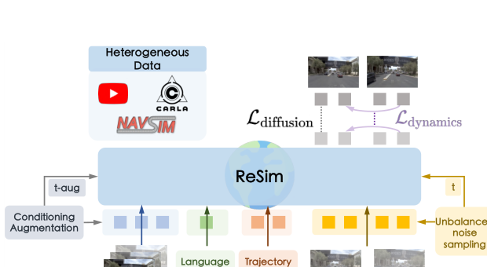
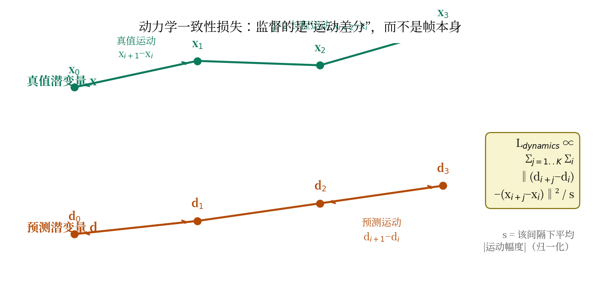
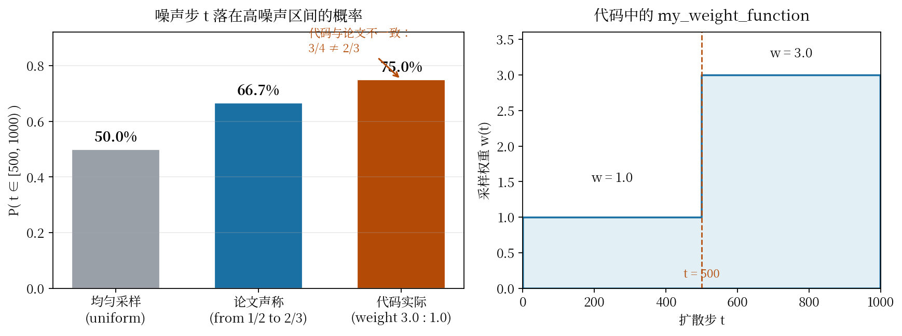
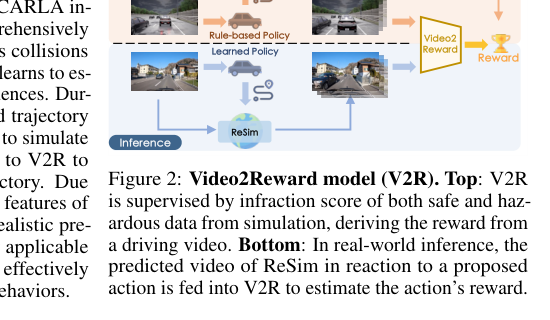

# 危险动作没有样本，世界模型就只会"撒谎"：ReSim 用仿真数据补上动作跟随的短板

> **全局编号**：046-WM-resim
> **论文标题**：ReSim: Reliable World Simulation for Autonomous Driving
> **作者**：Jiazhi Yang（港中文/OpenDriveLab）, Kashyap Chitta（NVIDIA Research/图宾根）, Shenyuan Gao（HKUST）, Long Chen（小米 EV）, Yuqian Shao/Xiaosong Jia（上交）, Hongyang Li（港大）, Andreas Geiger（图宾根）, Xiangyu Yue（港中文）, Li Chen（港大/OpenDriveLab）
> **会议**：NeurIPS 2025，Spotlight（Top 3.2%）
> **版本**：arXiv:2506.09981 —— v1（2025-06-11，投稿版），v2（2026-04-28，会后更新版）。NeurIPS 官方 proceedings 的 PDF 在本机多次下载均被截断（papers.nips.cc 与 proceedings.neurips.cc 两个镜像都在约 3.5–4.2MB 处断流），本解读基于完整下载的 arXiv v2（25 页）。v2 与 camera-ready 之间的具体差异未知，下文凡涉及版本差异处会单独说明。
> **代码**：公开，https://github.com/opendrivelab/resim（Apache-2.0）。训练与推理脚本齐全；权重分两档发布，其中含 CARLA 非专家数据的那档在 README 中仍标记为"未发布"。
> **一句话核心洞见**：视频世界模型"不听动作的话"，根子不在架构而在数据——真实人类驾驶数据里几乎没有危险/非专家动作的样本，模型在这些动作上只能靠猜；ReSim 用 CARLA 按"专家接管"流程批量制造非专家行为数据，与真实数据混训，再配上专压运动一致性的损失和噪声采样，才让世界模型第一次既能画得像、又能听动作的话。

世界模型这个概念在自动驾驶里已经被谈了好几年，但这篇论文问了一个之前没人正面回答的问题：当你给世界模型一个它训练时从没见过的危险动作——比如迎面撞上去——它会发生什么？答案是它会"撒谎"：生成一段看起来合理、但和你给的动作毫无关系的未来。ReSim 整篇论文就是冲着这个撒谎问题去的。读懂这篇论文的关键，是先看明白"撒谎"在什么具体场景下发生，再看作者为什么认定这是数据问题而不是模型容量问题。

## 世界模型最怕的不是画得不像，而是"不听话"

先看论文 Figure 1(b) 这个作者押了赌注的图（原文第 2 页）：

*图注：论文 Figure 1（第 2 页），分三部分。(a) 异构数据：真实视频、专家驾驶数据、仿真非专家数据；(b) 只训专家数据的旧模型在非专家动作下"想象"出安全的未来，而 ReSim 能跟随动作并给出 reward；(c) 三个下游应用。看这张图重点看 (b) 的对比：同一个转向动作输入，旧模型和 ReSim 生成的未来完全不同。*

图 (b) 的场景值得展开说。假设自车在一条直道上，你给世界模型的动作是"向左打死方向盘冲出路面"——一个人类司机几乎不会做的非专家动作。此前的世界模型（比如同组前作 Vista，NeurIPS 2024）是在纯专家数据上训练的，它见过的所有"向左打方向盘"的样本，最后都安全地转过去了。于是它学到的条件分布 p(未来 | 历史， 动作="左打死") 实际上坍缩成了 p(未来 | 历史， 动作≈"正常左转")。生成的结果就是：车乖乖地沿着车道开，方向盘输入被无视了。论文在第 5 页的 Figure 5 把这个现象摆得更直接：Vista 要么不跟随轨迹，要么为了"安全"把场景结构都改了（scenario inconsistent）。

这件事为什么严重？因为世界模型在自动驾驶里的终极用途是当"裁判"和"陪练"：评估一个候选策略好不好（policy evaluation）、在想象中训练策略（model-based RL）。这两个用途都要求模型对坏动作给出坏的未来——一个永远只生成安全未来的世界模型，会给所有策略打高分，等于裁判在吹黑哨。论文引言里点名了这个后果：这种不平衡"restricts their applicability to tasks such as policy evaluation"。

## 被推翻的默认假设：真实人类数据越多，仿真就越可靠

过去两年驾驶世界模型的主流叙事是"scale 真实数据"：GAIA-1、GenAD（OpenDV，1700 小时）、Vista，一路都在把真实驾驶视频越堆越多，FID/FVD 越刷越低。藏在这个叙事背后的默认假设是：只要真实数据足够多、足够多样，世界模型自然就能可靠地仿真各种动作。

ReSim 在引言里直接质疑了这个假设，原话大意是问：Is real-world human data alone sufficient to guarantee simulation reliability？作者的论证很直白，不绕弯子：真实数据受安全和法规约束，其状态-动作空间天然被截断了。人类司机不会故意追尾、不会故意冲出路面，所以"危险动作 → 危险后果"这个映射在真实数据里根本不存在。数据量从 1700 小时堆到 17000 小时，这个映射依然不存在——因为缺的不是量，是覆盖。这是一个结构性论证：靠放大同一分布的数据，补不上分布之外的洞。

这个判断决定了整篇论文的走向。既然洞在数据分布里，解法就不是把 DiT 做大，而是把分布补全。作者的底牌也在这里：CARLA 仿真器里可以零成本、零风险地采集非专家行为——追尾、别车、冲出路面，怎么危险怎么来。这是此前"在真实场景中运行的驾驶世界模型"都 overlook 的数据源（附录 A.2 原话），而只做仿真世界模型的那些工作（Dreamer 系列）又跨不过 sim-to-real 的视觉鸿沟。ReSim 的赌注是：两者混在一起训，能不能既保留真实世界的视觉保真度，又学会仿真器里的危险动作映射。

## 作者手里到底有几张牌

从论文的组织方式看，作者押了三张牌，硬度不一样。

第一张牌是异构数据本身：OpenDV（400 万视频片段，无动作标注，管泛化）+ NAVSIM（8.5 万样本，有动作标注，管动作条件）+ CARLA（8.8 万样本，一半专家一半非专家，管危险动作）。这张牌最硬的地方在于它是一个"无法反驳"的观察：真实数据里没有的东西，你再怎么调模型都学不会。Table 1 的消融（w/o sim.）就是这张牌的验钞机——去掉 CARLA 数据，Waymo 上的 Trajectory Difference 从 1.13/0.86 掉到 1.47/1.18，专家和非专家两个模式都掉。

第二张牌是两个训练技巧：dynamics consistency loss（式 2）和 unbalanced noise sampling。这两个是"让数据真正被吃进去"的手段。光有危险动作数据还不够——扩散模型在低噪声步有个偷懒的捷径（下面细讲），不堵上这个捷径，模型还是学不会剧烈运动。这张牌的证据是 Figure 9 和 Figure 10，但注意，这两张图都是定性的，没有数字消融表——这是后文怀疑式审读要盯的地方。

第三张牌是 Video2Reward：用 CARLA 的 infraction score 做监督，在冻结的 DINOv2 上加一个轻量 head，把 ReSim 生成的未来视频变成标量 reward。这张牌瞄准的是"世界模型和高保真仿真之间还差一个 reward 接口"（摘要原话：close the gap between high-fidelity simulation and applications that require reward signals）。它的聪明之处在于接口选的是视频——不需要 3D 感知先验、不需要相机位姿，DINOv2 的跨域泛化带着它从仿真走到真实。

## 从 CogVideoX 到 ReSim：方法是怎么一步步被逼出来的

还原一下这条路。起点是一个现成的文本到视频 DiT：CogVideoX（2B 参数，ICLR 2025）。最朴素的尝试是：直接拿它当驾驶世界模型用，给历史帧、给文本命令（"Turn left"），让它预测未来。这一步对应训练 stage 1（只训 OpenDV）。

但很快会撞上第一堵墙：文本命令太粗了。"Turn left"管不了具体的轨迹形状，更管不了"以什么速度、多大曲率"这种细粒度动作。世界模型要当裁判，必须吃细粒度动作。于是有了 trajectory encoder：把未来 8 个路点（2Hz，4 秒）编码成 token，和视频 latent 一起送进 DiT。代码里这个 encoder 是两层 attention + 线性头（`sat/sgm/modules/encoders/traj_encoder.py`，depth=2，dim=1024，out_dim=4096），和论文  B.2 节的描述对得上。

第二堵墙是运动一致性。标准的视频扩散损失（式 1）是逐帧监督的——每一帧独立地和真值比 L2。帧内长得像，不等于帧间动得对。模型可以每帧都画得很逼真，但车在帧间"瞬移"、行人"闪现"。这在专家数据上不明显，因为专家动作温和、帧间变化小；但在非专家动作（急打方向、追尾）下，帧间变化剧烈，问题暴露。于是有了 dynamics consistency loss：不再只比"帧长得像不像"，而是比"运动像不像"——真值潜变量的帧间差分和预测潜变量的帧间差分要对上。

第三堵墙更隐蔽，是训练动力学层面的。扩散训练时 timestep 均匀采样，低噪声步（t 小）占一半。在低噪声步，输入视频只被加了一点噪声，模型有个偷懒的捷径：直接把相邻帧平均一下，就能把噪声"抹掉"，根本不需要理解运动。结果是模型在低噪声步上把 loss 刷得很低，但学到的全是"平均一下"这种表面功夫，一到高噪声步（真正要理解运动的地方）就露馅。这就是论文里那句"take a shortcut"的含义。解法是 unbalanced noise sampling：把 t∈[500,1000) 的采样频率从 1/2 提到 2/3，逼模型在"看不清"的输入上学运动。

三阶段课程（附录表 S.5）收尾：stage 1 在 OpenDV 上学会"看历史、听命令"（512×896，20K 步）；stage 2 冻住 DiT 主干，只训 LoRA + trajectory encoder，在低分辨率（256×448）上学会"听动作"（80K 步）；stage 3 全量微调回到高分辨率（50K 步）。这个课程的逻辑是：先让模型会"看"，再让它会"听"，最后一起打磨。注意 stage 2 冻主干的用意——动作条件刚进来时不希望它把已经学好的视觉先验冲掉。

整体架构如附录 Figure S.11（原文第 19 页）：异构数据从上方进入，历史帧（经 conditioning augmentation 的 t-aug 加噪）+ 文本命令（Language Encoder）+ 轨迹（Trajectory Encoder）从下方作为条件进入 ReSim DiT，上方输出两路损失——$L_{\text{diffusion}}$ 管帧像不像，$L_{\text{dynamics}}$ 管运动对不对，右侧的 unbalanced noise sampling 控制 timestep 采样。

*图注：论文 Figure S.11（第 19 页）裁切。ReSim 世界模型总览：条件输入（历史帧、文本命令、轨迹）与两路损失、噪声采样策略的位置关系。*

## 式 1：扩散损失到底在监督什么

$$L_{\text{diffusion}} = \mathbb{E}_{x,\epsilon,t}\left[\|x_{k:} - D_\theta(x_t; t, h, c[, a])_{k:}\|^2\right]$$

先把每个符号的形状和含义钉死。$x$ 是干净视频的潜变量（3D Causal VAE 压出来的），形状大约是 $[B, C, T, H, W]$，$T$ 是潜变量帧数。$x_t$ 是对 $x$ 按扩散步 $t$ 加噪后的版本。$D_\theta$ 是 DiT 去噪器。$h$ 是历史帧的潜变量（9 帧，干净的——注意这里有个关键设计：去噪器的历史 latent 输入被替换成了干净版本，follow Vista 的做法，这样历史帧不参与去噪，只当条件）。$c$ 是高层文本命令（"Turn left" 之类）。$a$ 是细粒度动作——未来 8 个路点组成的轨迹，方括号表示可选（NAVSIM 样本以 0.5 概率被 mask 掉，支持无动作预测）。

下标 $k:$ 的意思是：损失只从第 $k$ 帧往后算，历史帧不算。这很合理——历史是给定的条件，不需要模型"预测"历史。

这个式子本身没有新东西，就是条件扩散的标准写法。它的作用是"帧长得像"。真正的新东西在式 2。

## 式 2：动力学一致性损失，小实例上算一遍

$$L_{\text{dynamics}} = \mathbb{E}_{x,\epsilon,t}\left[\frac{1}{s}\sum_{j=1}^{K}\sum_{i=1}^{N-j}\|(d_{i+j} - d_i) - (x_{i+j} - x_i)\|^2\right]$$

$x$ 是真值视频潜变量，$d$ 是模型预测的视频潜变量，$i$ 是帧索引，$K=4$ 是考虑的最大帧间隔，$N$ 是潜变量总帧数，$s$ 是每个间隔下平均运动幅度的归一化因子。总损失 $L = L_{\text{diffusion}} + \lambda L_{\text{dynamics}}$，$\lambda=0.1$。

几何上它在做什么？$(x_{i+j} - x_i)$ 是真值在潜变量空间里"走了哪一步"——第 $i$ 帧到第 $i+j$ 帧的位移向量；$(d_{i+j} - d_i)$ 是预测的位移向量。损失要求这两个位移向量对齐。注意它完全不关心 $d_i$ 和 $x_i$ 本身的位置——只要"运动"一致，整体漂一点没关系。这正好和式 1 互补：式 1 管"位置"（每帧长得像），式 2 管"速度"（帧间动得对）。

为什么要求多个间隔 $j=1..K$？论文的直觉是：有些行为在短间隔里看不出来。比如"让行"（yielding）——相邻两帧的位移都很小，$j=1$ 的差分几乎为零，模型随便糊弄一下就过去了；但拉长到 $j=4$，累积位移就明显了。多间隔就是多尺度的运动监督。

归一化因子 $s$ 也很关键：$j$ 越大，位移幅度天然越大，不归一化的话长间隔项会主导损失。除以各自间隔的平均运动幅度后，每个间隔的贡献回到同一量级。

下面在一个极小的实例上算一遍。假设潜变量只有 1 个通道、4 帧（$N=4$），真值 $x = [0.0, 1.0, 1.0, 2.0]$，预测 $d = [0.0, 0.8, 1.2, 1.9]$。取 $K=2$。

$j=1$ 时：真值运动 $[1.0, 0.0, 1.0]$，预测运动 $[0.8, 0.4, 0.7]$，差的平方 $[0.04, 0.16, 0.09]$，和为 $0.29$。$s_1 =$ 平均运动幅度 $= (1.0+0.0+1.0)/3 \approx 0.667$，这一项贡献 $0.29/0.667 \approx 0.435$。

$j=2$ 时：真值运动 $[1.0, 1.0]$，预测运动 $[1.2, 1.1]$，差的平方 $[0.04, 0.01]$，和为 $0.05$。$s_2 = 1.0$，贡献 $0.05$。

总和约 $0.485$，再乘 $\lambda=0.1$。注意第 2 帧那个"停顿"（真值运动为 0，预测给了 0.4）是 $j=1$ 项里罚得最重的（0.16）——这正是"让行"式微动作的例子：短间隔项专门抓这种局部不一致，而长间隔项确认整体趋势没走偏。

*图注：自绘示意图。动力学一致性损失监督的是帧间"位移向量"（虚线双箭头）是否对齐，而不是帧本身的位置。$j=1$ 抓局部微动作，$j=2$ 确认长程趋势；每个间隔除以自己的平均运动幅度 $s$ 归一化。*

## 不平衡噪声采样：堵住"平均一下"这个捷径

扩散模型的训练有个常被忽略的细节：timestep 怎么采样，决定了模型在学什么。均匀采样时，一半的训练步落在低噪声区（$t<500$）。在低噪声区，输入视频几乎就是干净视频加点毛刺，模型发现一个作弊办法：输出相邻帧的平均值，就能把 loss 降得很低——因为平均操作本身就是很好的去噪器。这个捷径的可怕之处在于，它让模型在"看起来 loss 很低"的情况下，完全没学到运动。

论文的解法简单粗暴：把 $t \in [500, 1000)$ 的采样频率从 1/2 提到 2/3。在高噪声区，输入已经被毁得面目全非，平均相邻帧救不回来，模型被迫去学真正的运动结构——车应该往哪走、行人应该怎么动。

但这里有个论文和代码对不上的地方，值得单独说。论文正文写的是"从 1/2 提到 2/3"，而代码里（`sat/sgm/modules/diffusionmodules/sigma_sampling.py` 的 `my_weight_function`）给 $[500,1000)$ 的权重是 3.0、$[0,500)$ 的权重是 1.0，算下来高噪声区间的实际采样概率是 $3/(3+1) = 3/4$，不是 2/3。注释里自己都写了"Probability of sampling in [500, 1000] = 3/4"。差 8 个百分点，不算大，但在"怀疑式审读"的意义上，这说明论文里的 2/3 可能是早期实验的数字，或者作者四舍五入式地写了个约数。

*图注：自绘图。左：三种采样策略下 timestep 落在高噪声区间的概率——均匀采样 50%、论文声称 2/3、代码实际 3/4。右：代码中 `my_weight_function` 的形状，$t=500$ 处权重从 1.0 跳到 3.0。*

## Video2Reward：给世界模型装上"裁判"功能

世界模型能生成未来还不够——下游要用它做决策，需要一个标量 reward 来比较"哪个未来更好"。之前的尝试要么靠手工规则（需要 3D 感知模型，对相机位姿敏感，跨域就崩，见附录 A.2 对 Drive-WM 的批评），要么靠不确定性（Vista 的做法，分不清"偏离路线"这种具体坏行为）。

ReSim 的解法是 Video2Reward（Figure 2，原文第 5 页）：

*图注：论文 Figure 2（第 5 页）裁切。训练时（上）：CARLA 里的规则策略和学到的策略产生安全/危险驾驶视频，用 CARLA 的 infraction score 做监督，训练 V2R。推理时（下）：任意策略给出候选轨迹 → ReSim 仿真未来视频 → V2R 打分。*

训练时，V2R 只在 CARLA 数据上学：输入一段驾驶视频，监督信号是 CARLA 仿真器记录的 infraction score——一个综合扣分项，撞车、闯红灯、开出路面、龟速行驶都扣分。模型结构是冻结的 DINOv2 backbone（每帧独立过）+ 两层时空 attention 做聚合 + MLP 输出标量。推理时，任意策略先给出候选轨迹，ReSim 把它渲染成未来视频，V2R 打分。

这个设计的妙处在于"视频接口"的选择：reward 模型看到的只是视频，不需要知道相机内参、不需要 3D 标注。DINOv2 的视觉特征跨域能力强，ReSim 生成的视频又足够逼真，所以一个只在 CARLA 上训出来的 reward 模型，能直接用到真实场景的视频上。Figure 7 的 reward correlation 实验验证了这一点：在 CARLA 和 NAVSIM 上，ReSim+V2R 判断"专家轨迹 vs 非专家轨迹"谁分更高的准确率都超过了 Vista 的 reward 和不用仿真数据的版本。

## 三个应用：从"会想象"到"能用"

论文 2.4 节把 ReSim 落到三个真实任务上，这也是 Figure 1(c) 的内容。

第一个是 video prediction-based policy：不给动作条件，让 ReSim 自由想象未来，再用一个逆动力学模型（IDM）把想象出来的视频反解成可执行的轨迹。IDM 的结构是 XVO 视觉里程计 backbone + 轻量 attention 头，输出 8 个路点（2Hz）。在 NAVSIM navtest 上，这个"先想象、再反解"的策略拿到 PDMS 86.6，超过 LAW（84.6）、DrivingGPT（82.4）、Transfuser（84.0），而且输入只有前视视频+高层命令——UniAD/Transfuser 需要多传感器、自车状态、历史轨迹甚至额外标注。摘要里的"planning 提升 2%"指的就是 86.6 vs 84.6 这 +2.0 个 PDMS 点。

第二个是 reward-guided policy selection：两个候选策略（Transfuser 和 LTF，在 300 个"一对一错"的难例上各自只有 47.7/47.2 PDMS），每个候选轨迹都用 ReSim 渲染成视频、V2R 打分，选分最高的执行。结果 74.1，接近按真值选的 oracle（94.2 的天花板下，74.1 已经是最接近的），也超过了简单平均 ensemble（66.8）和 Vista 的 reward（59.2）。摘要里的"policy selection 提升 25%"对应的是 74.1 vs 59.2（+25.2%）。

第三个是 closed-loop visual simulation：让一个只吃前视视频的 VO planner 在 ReSim 的想象世界里闭环跑，每一步 ReSim 根据 planner 输出的动作生成下一帧，再喂回去。Figure 8 展示了两个 NAVSIM 场景的定性结果。注意这部分没有任何定量指标——论文在附录 D 里承认，用 ReSim 做公平的闭环规划 benchmark 还是 open problem（只支持前视输入，多视角规划器如 UniAD 接不进来）。

## 同一个路口，两种未来：把 Vista 和 ReSim 各走一遍

构造一个论文 Figure 5 风格的具体场景。路口直道，自车以 8m/s 跟随前车（车间距 15 米）。历史 9 帧（0.9 秒）都是正常跟驰。现在输入一个非专家动作：未来 4 秒的路点序列是"全油门直线加速"——按运动学，4 秒后自车将追尾前车。

Vista 走一遍：它的训练数据里没有"全油门追尾"样本。DiT 的条件输入里，轨迹 encoder 给出的 token 说"加速"，但模型学到的 p(未来|加速动作) 实际上是从专家数据里"加速超车"等安全样本里学来的。去噪过程中，动作条件的引导和视觉先验打架，视觉先验赢了——生成的未来里，自车要么莫名其妙减速（不跟随轨迹，Trajectory Difference 飙到 5.68），要么前车"凭空让开"（场景不一致，Figure 5 中间那行）。用论文的 Trajectory Difference 指标量化：在 Waymo 的 action-free 模式下，Vista 的生成视频经 IDM 反解出的轨迹和真值差 5.68 米——注意 GT future 自己过 IDM 也有 0.58 米误差（IDM 本身不完美），所以 5.68 几乎是"完全没跟上"的水平。

ReSim 走一遍：CARLA 数据里有大量"expert-takeover"采集的追尾样本（先让 PDM-Lite 开 1 秒，然后随机油门/方向盘接管 4 秒），模型见过"全油门→前车在视野中迅速放大→碰撞"这个完整的因果链。Unbalanced 采样逼它在高噪声步学运动，DCL 逼它学对帧间位移。生成的未来里，前车由远及近、最后两车接触，IDM 反解出的轨迹和输入路点只差 1.13 米（action-free）/ 0.86 米（expert action）。分叉点就落在这两个数字上：5.68 vs 1.13，差了 80%。

这个例子也解释了为什么"去掉仿真数据"（w/o sim.）的 ReSim 会掉到 1.47/1.18：架构完全一样，差的只是训练分布里有没有危险动作的样本。这正是"数据问题而非架构问题"的直接证据。

## 怀疑式审读

**超参数怎么定的，论文基本没说。** $\lambda=0.1$、$K=4$ 都是"empirically set"，附录没有搜索范围、没有敏感性曲线。Figure 10 定性对比了 $K=1$ 和 $K=4$（$K=4$ 更连贯），但没有 $K=2,8$ 的数字。Unbalanced 采样的比例（2/3 还是 3/4）在正文和代码里都不一致，更没有不同比例的对比。Trajectory encoder 的 ucg_rate=0.5（NAVSIM 轨迹以 0.5 概率 drop，CARLA 不 drop）是个关键设计——CARLA 轨迹不 drop 的理由是"危险行为从历史帧推不出来"，这个理由是成立的，但 0.5 这个值本身没有消融。

**消融没有隔离变量。** 论文最核心的两个方法贡献（DCL 和 unbalanced sampling）都只有定性图（Figure 9、Figure 10），没有任何数字。有数字的消融全是关于数据的（Tab 1 的 w/o sim.、Figure 7、Tab 3）。一个严格的读者会问：DCL 到底贡献了 FVD 里的几个点？不知道。考虑到 DCL 在公开发布的 `train.yaml` 里默认是关闭的（`loss_weight_multi_dcl` 默认 False，config 里没有打开），这个缺失更让人不安——读者按默认 config 复训，得到的是没有 DCL 的模型。

**基线的公平性参差。** Trajectory Difference 这个指标本身是自创的：把各家生成的视频过一个自己训的 IDM（Waymo 上训 40 epochs），反解出轨迹再和真值算 L2。IDM 的误差（GT future 都有 0.58）混进了指标。好的一面是所有方法过的是同一个 IDM，相对比较是公平的；坏的一面是它测的是"生成视频经 IDM 反解后像不像输入轨迹"，IDM 在分布外视频（比如 Vista 的幻觉视频）上的行为是未知的。FID/FVD 部分，基线数字直接抄原论文（in-distribution 模型），ReSim 是零样本——设置上对 ReSim 有利，好在作者把"zero-shot"标得很清楚，没有藏着。

**Reward 评估的"非专家"定义偏弱。** Figure 7 的 reward correlation 里，"非专家轨迹"是从其他样本里随机抽一条轨迹冒充的。一条随机抽来的轨迹大概率是安全的（毕竟数据集里全是专家），这让"区分专家/非专家"这个任务比真实情况容易。V2R 在这个偏容易的任务上赢了，不等于它在真刀真枪的危险动作上也能分对。

**Policy selection 的场景是挑过的。** 300 个场景特意选成"一个候选对、一个候选错"（按真值 PDMS 划分）。这种构造下，选对策略的上限很高（oracle 94.2），74.1 的成绩要打折扣看——它衡量的是"裁判"能力，不是端到端规划能力。候选本身（47.7/47.2）是故意选弱的，摘要里"55.3% 提升"是相对这些弱候选而言。

**种子、调参集一概未报告。** 全文 25 页没有提随机种子，没有说模型是在验证集还是测试集上选的。NAVSIM 的 navtest 既是 Tab 4 的评估集，IDM 也在 navtrain 上训——至少训练/评估 split 是干净的。但考虑 40 张 A100 训 14 天（约 13440 GPU 小时）的成本，别人基本不可能复现调参过程，种子缺失让这个问题更严重。

**代价是真实的瓶颈。** 推理时 4 秒视频要 2 分钟（单张 A100，DDIM 50 步），附录 D 自己承认这是"iterative denoising"带来的根本瓶颈。Closed-loop 那节因此只能做定性 demo。任何想把 ReSim 当在线仿真器用的人，先要过蒸馏/加速这一关。

**附录里有个笔误值得一提。** B.1 节描述 CARLA 非专家采集策略时，"Slight Turns"和"Hard Turns"两条的文字描述完全一样（都是"steer slightly left or right towards a randomly chosen angle between 10-20 degrees"）——明显是复制粘贴错误，真正的 hard turn 参数未知。这不影响结论，但说明附录的校对有疏漏。

**数字核对。** 摘要的"44% higher visual fidelity"对应 FVD 89.4→50.4（43.6%）；"controllability 提升超 50%"对应 Tab 1 的 80.1%（action-free）和 54.5%（expert action），都是相对 Vista；"planning +2%"是 Tab 4 的 +2.0 PDMS 点；"policy selection +25%"是 Tab 3 里 74.1 vs Vista-guided 59.2（+25.2%）。Tab 3 caption 里的"+26% PDMS compared to candidate policies"措辞含糊——按数字反推，它相对的是 Vista 的 59.2 而不是候选策略本身的 47.x，读者容易误读。人类评估（Figure 4）的具体百分比数字在文本提取中损坏，无法核实，只能确认"ReSim 在真实感和轨迹跟随两项都得票最高"。

## 代码里看到的，和论文不一样的地方

| 论文的说法 | 代码的实际情况 | 出处 |
|---|---|---|
| Unbalanced 采样把 $t\in[500,1000)$ 频率从 1/2 提到 2/3 | `my_weight_function` 给权重 3.0:1.0，实际概率是 3/4 | `sat/sgm/modules/diffusionmodules/sigma_sampling.py:40-44` |
| $L = L_{\text{diffusion}} + 0.1\,L_{\text{dynamics}}$，$K=4$，按 $s$ 归一化 | DCL 的实现存在（`get_dynamics_consistency_loss`），但发布的 `train.yaml` 里没有启用（`loss_weight_multi_dcl` 默认 False）；实现里还有论文没提的 `discount_multi_dcl` 折扣因子、detach 开关、分母里的 `+1` 稳定项 | `sat/sgm/modules/diffusionmodules/loss.py:83-88,265-303`，`sat/configs/train.yaml` |
| DCL 在"干净视频潜变量"上计算帧间差分 | 代码在 denoiser 的输出（v-prediction 目标）上算差分，再和 target 的差分比——v-pred 空间和干净潜变量空间不是一回事 | `loss.py:269-287` |
| Conditioning augmentation（t-aug） | 代码有 V1/V2 两档实现，config 用的是 V2（对历史帧做完整扩散前向加噪）；论文只说"following [111,11]" | `loss.py:193-216`，`train.yaml:264` |
| Trajectory encoder：two attention blocks + linear head | 对得上：depth=2，dim=1024，out_dim=4096，sine 位置编码；`use_all_tokens: true`（9 个 token） | `sat/sgm/modules/encoders/traj_encoder.py`，`train.yaml:197-209` |
| 文本命令和轨迹都以 $p=0.5$ drop（CFG） | 对得上：`ucg_rate: 0.5`；且 `with_traj` 机制把 OpenDV 这类无轨迹样本的轨迹 embedding 置零 | `modules.py:141-146`，`train.yaml:200` |
| 三阶段训练（表 S.5） | 发布版只有一个 `train.yaml`，看不出三阶段如何调度；LoRA 的配置在 yaml 里（`LoraMixin`），但哪一阶段冻主干要靠注释推断 | `train.yaml:122-183` |
| 权重发布 | README 明确说只发布了 OpenDV+NAVSIM 版权重，含 CARLA 数据的版本"未发布"——而论文所有关于非专家动作的结论都依赖 CARLA 数据 | `README.md` Release Roadmap |

## 能带走的东西

ReSim 留下的最硬的教训是关于数据分布的：在安全攸关的仿真里，缺的从来不是"更多同分布数据"，而是"分布之外的样本"。真实驾驶数据有一个结构性的盲区——危险动作，这个盲区别的办法都绕不过去，只能用仿真器去补。这个论证不依赖任何架构细节，今天做视频世界模型的人，明天做占用网络世界模型的人，都绕不开它。

第二，扩散训练里 timestep 采样的"捷径"问题值得所有做视频扩散的人检查一遍：低噪声步的"平均一下就能去噪"是不是在偷走你的运动学习？ReSim 的解法（偏置采样）简单到只有四行代码，但它指向的是一个一般性问题。

第三，Video2Reward 提供了一个可复用的模式：reward 模型不一定要搭在 3D 感知上，视频接口 + 仿真器监督 + 视觉基础模型 backbone，是一条更便宜、更跨域的路。

真正值得做的问题，论文自己在附录 D 里点了两个：怎么把 2 分钟/4 秒的推理压到实时（蒸馏或单步模型），以及怎么在 ReSim 的想象世界里真正训出策略（而不仅仅是评估）。前者是工程问题，后者是研究问题——Dreamer 在 Atari 上走通的路，在驾驶视频上还没人走通。
