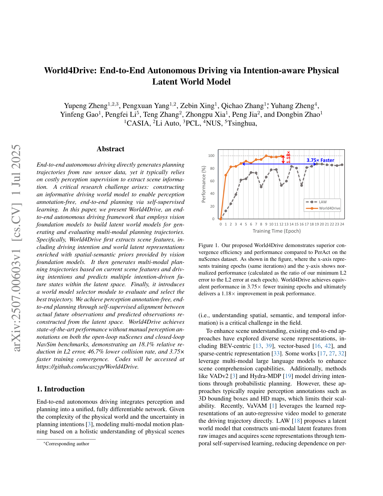
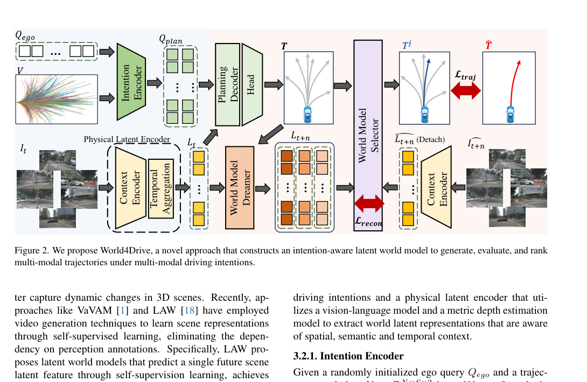
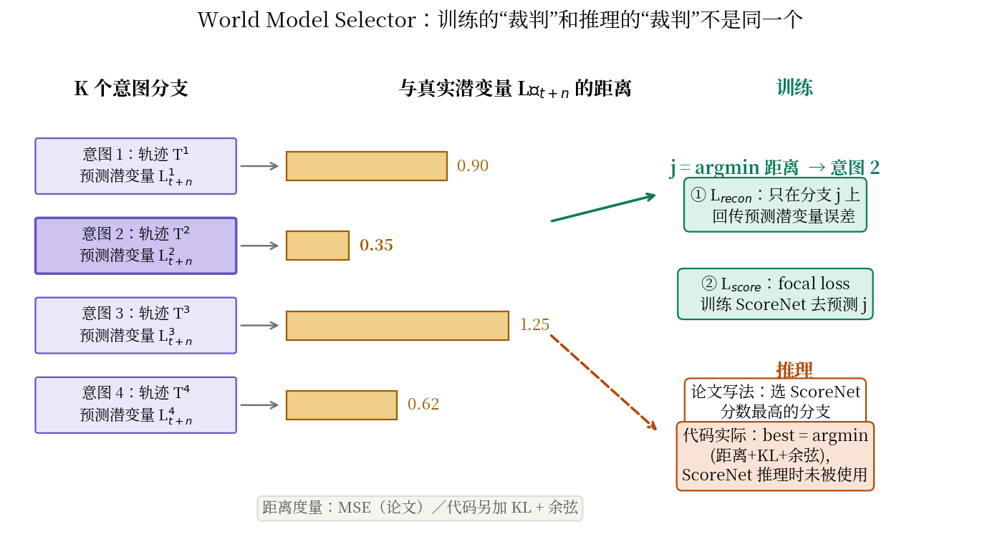

# 把世界模型当裁判用：World4Drive 让意图在潜变量里先"试驾"一遍

> **全局编号**：047-WM-world4drive
> **论文标题**：World4Drive: End-to-End Autonomous Driving via Intention-aware Physical Latent World Model
> **作者**：Yupeng Zheng（CASIA/理想汽车/PCL）, Pengxuan Yang, Zebin Xing, Qichao Zhang（通讯）, Yinfeng Gao, Zhongpu Xia, Dongbin Zhao（CASIA）, Yuhang Zheng（NUS）, Pengfei Li（清华）, Teng Zhang, Peng Jia（理想汽车）
> **会议**：ICCV 2025
> **版本**：arXiv:2507.00603v1（2025-07-01，"ICCV 2025, first version"；仅此一版）。本解读基于该 10 页版本。论文中提到的 supplementary material（$n=3$ 的消融、其他距离损失的消融）未能获取，下文凡依赖它的判断会明确标注"未确认"。
> **代码**：公开，https://github.com/ucaszyp/World4Drive（mmdet3d 框架）。可训练可评估，但注意下文"代码与论文的六处不一致"。
> **一句话核心洞见**：端到端规划最大的不确定性不是"场景看不懂"，而是"意图太多"——同一个路口左转和直行都是合法未来；World4Drive 让 K 个意图分支各自在潜变量世界模型里"试驾"一遍，用"谁预测的未来最像真实未来"来选出最靠谱的轨迹，而场景理解则靠视觉基础模型的深度+语义先验补足，全程不需要人工感知标注。

这篇论文要解决的矛盾很具体：端到端自动驾驶想摆脱昂贵的感知标注（3D 框、HD 地图），但摆脱标注之后，纯从 RGB 图像里自监督学出的场景表示又不够好——前作 LAW（ICLR 2025）就是卡在这里，收敛慢、性能次优。World4Drive 的回答是两条腿走路：一条腿是"看"，用 Metric3D 的深度和 Grounded-SAM 的语义给潜变量注入物理先验；另一条腿是"想"，把世界模型从"生成未来的工具"变成"评估意图的裁判"。第二条腿是这篇论文真正的新东西。

## LAW 留下的那个缺口：一个未来不够用

论文 Figure 1（第 1 页）是作者的开场赌注：同一张图里，LAW 和 World4Drive 的训练曲线并排，World4Drive 用 3.75 倍更少的 epoch 达到同等性能，最终峰值还高 1.18 倍。这张图想让你相信的不是"我们调参更努力"，而是"表示本身的信息量不一样"。

LAW 的问题出在哪里？它从单帧（加时序自监督）图像里学一个单模态的潜变量，然后预测"一个"未来。但驾驶的未来天然是多模态的：路口前，左转、直行、右转都是可能的；同一个左转，急一点缓一点也是不同的未来。单模态世界模型在这种分叉处只能学一个"平均未来"——几何上就是把几条路的中间地带糊成一条，既不像左转也不像直行。论文 2.2 节 related work 里对 LAW 的批评就这一句：single-modal latent features struggle to capture spatial-semantic information and multi-modal driving intentions。



*图注：论文 Figure 1（第 1 页）裁切。nuScenes 上 World4Drive 相对 LAW（文中误写作 PerAct，应为 LAW）的训练曲线：x 轴是 epoch，y 轴是归一化性能（最小 L2 / 当前 L2）。World4Drive 用 3.75 倍更少的 epoch 达到 LAW 的性能，峰值高 1.18 倍。注意这是 epoch 数的对比，不是墙钟时间对比——VFM 离线标注的成本不在图里。*

更深一层，LAW 的潜变量是从 RGB 直接学的，没有显式的 3D 结构。时序自监督（"下一帧的潜变量应该能被预测"）在光照变化大时很脆弱——夜间、雨天，像素层面的对应关系被打乱，自监督信号就弱了。这就是为什么 Table 4 里 LAW 在夜间/雨天的碰撞率明显更差，而 World4Drive 的优势恰恰在这些条件下最大（夜间碰撞率降 63.7%，雨天降 68.8%）。

## 被推翻的两个默认假设

第一个被推翻的假设是："无感知标注 ⇒ 场景理解必然弱"。World4Drive 的反驳是：人工标注不是物理先验的唯一来源。Metric3D v2（单目度量深度基础模型）和 Grounded-SAM（开词汇语义分割）都是在海量数据上训出来的视觉基础模型，它们提供的深度和语义伪标签，信息量不比人工 3D 框差，而且不要钱、不限场景。论文把这叫"spatial-semantic priors"，本质上是用基础模型的知识蒸馏来替代人工标注。

第二个被推翻的假设更微妙："世界模型是用来生成未来的"。在这篇论文里，世界模型的核心职责不是生成，而是打分。K 个意图分支各生成一条轨迹，世界模型为每条轨迹"试驾"出一个未来潜变量，然后比较哪个未来最像真实未来——世界模型在这里是裁判，不是运动员。这个视角转换是全文最值得带走的东西：自监督的未来预测损失，天然就是一个"意图合理性"的度量，不用它来选轨迹是浪费。

## 方法的生成过程：从 LAW 出发，一步步加东西

想象你是作者，起点是 LAW 的代码。第一步，你发现单模态不够用，要加多模态意图。最直接的做法是 VADv2 那套：轨迹词汇表（trajectory vocabulary）+ k-means 聚出意图。但 VADv2 需要感知标注来训。你的约束是无标注，所以意图只能从"轨迹词汇表"本身来——8192 条轨迹，按 3 种命令（左/右/直行）分组，每组 k-means 取 6 个端点，得到 $P_I \in \mathbb{R}^{3\times K\times 2}$。意图 query 加上 ego query，过自注意力得到 $Q_{\text{plan}}$。这就是式 1。

第二步，意图有了，但"看"的部分还是弱的。直接加感知头就违背了无标注的初衷，所以加的是"先验"而不是"监督"：Metric3D 给每个像素算度量深度，前向投影成 ego 系下的 3D 位置（区别于 PETR 的后向投影 meshgrid），正弦编码 + MLP 变成位置嵌入 $E_t$，加到图像特征上；Grounded-SAM 生成伪语义标签，用交叉熵 $L_{\text{sem}}$ 训一个语义头。这就是式 2–4 的物理潜变量编码器。

第三步，意图和世界模型要"紧耦合"。松耦合的做法是：先规划 K 条轨迹，再用一个独立的世界模型打分。紧耦合是：意图 query 直接参与未来潜变量的预测（式 6 里动作 token 和潜变量拼在一起），然后用预测误差反过来选意图、训打分器。选择和预测用的是同一套潜变量表示，这就是论文反复说的"tightly coupled"。

论文的整体管线如图（Figure 2，原文第 3 页）：上路是意图（轨迹词汇表 → 意图编码器 → 规划解码器 → K 条轨迹），下路是世界（图像 → 物理潜变量编码器 → Dreamer 预测 K 个未来潜变量），中间的 World Model Selector 用"谁的预测最接近真实未来"选出最终轨迹，同时用 $L_{\text{traj}}$ 把选中轨迹往专家轨迹上拉。



*图注：论文 Figure 2（第 3 页）。World4Drive 完整管线：意图分支（上）与世界模型分支（下）在 World Model Selector 处汇合。注意 $L_{\text{recon}}$ 的箭头指向被选中的潜变量 $\bar{L}_{t+n}$ 与真实潜变量 $\hat{L}_{t+n}$ 之间——只有选中的分支回传重建误差。*

## 式 1：意图编码器——8192 条轨迹怎么变成 6 个意图

$$Q_{\text{plan}} = \text{SelfAttention}(Q_{\text{ego}} + Q_I)$$

符号表：$V \in \mathbb{R}^{N\times S\times 2}$ 是轨迹词汇表，$N=8192$ 条轨迹，每条 $S$ 个路点（nuScenes 配置下 $S=6$，3 秒 2Hz），每个路点 2 维 $(x,y)$。$P_I \in \mathbb{R}^{3\times K\times 2}$ 是意图点：3 种命令 × 每种 $K=6$ 个意图 × 2 维坐标，做法是对词汇表里每种命令的轨迹端点做 k-means，取 6 个聚类中心。$Q_I$ 是对 $P_I$ 做正弦位置编码得到的意图 query。$Q_{\text{ego}}$ 是随机初始化的 ego query。

这个设计的几何意义：8192 条轨迹太多，没法每条都"试驾"；k-means 把它们压缩成 18 个（3×6）代表性意图——每种命令下 6 个"典型走法"。自注意力的作用是让这 18 个意图 query 彼此"通气"：比如"左转急"和"左转缓"这两个 query 经过自注意力后，会知道彼此的存在，避免学出 6 条几乎一样的轨迹。代码里这一步对应 `waypoint_mode_ref`（从 `data/kmeans/kmeans_plan_6.npy` 加载，形状 `[1,3,6,6,2]`）+ `gen_sineembed_for_position` + `waypoint_mode_embedding` + `ego_attn`。

注意代码里有个论文没强调的细节：`cur_waypoint = cur_waypoint[:, ego_cmd == 1]`——3 个命令分支里，只保留 GT 命令对应的那 6 条。也就是说，训练和推理时"选哪种命令"用的是真值命令（从 GT 未来轨迹分的类），意图的不确定性只在命令内部的 6 个 mode 上展开。这是开环评测里的标准做法（VAD、UniAD 都吃高层命令），不算作弊，但"多模态意图"的实际覆盖范围比论文标题给人的印象要小。

## 式 2–4：物理潜变量编码器——给像素找回 3D 位置

$$S_t = \text{GroundedSAM}(F_t) \tag{2}$$

$$E_t = \text{MLP}(\text{SPE}(P_t)) \tag{3}$$

$$L_t = \text{CrossAttention}(\hat{F}_t, \hat{F}_{t-1}) \tag{4}$$

$I_t \in \mathbb{R}^{M\times H\times W\times 3}$ 是 $t$ 时刻 $M$ 个相机的图像（nuScenes $M=6$），$F_t \in \mathbb{R}^{M\times h\times w\times D}$ 是 backbone（ResNet-50）提的特征。式 2 用 Grounded-SAM 对特征图做开词汇语义分割，得到伪标签 $S_t$，只保留高置信度的，用交叉熵 $L_{\text{sem}}$ 监督语义头——这是"语义先验"进来的地方。

式 3 是"空间先验"：Metric3D v2 估计每个视角的度量深度图 $D_t \in \mathbb{R}^{M\times h\times w}$。和 PETR 的后向投影（先撒 3D 网格再投影回图像）不同，这里用的是前向投影：对每个像素 $(u,v)$，用深度和相机内参直接算出它在 ego 系下的 3D 位置 $p=(x,y,z)$，拼成位置图 $P_t \in \mathbb{R}^{M\times h\times w\times 3}$，正弦编码后再过 MLP 得到 $E_t$，加到 $F_t$ 上得到 $\hat{F}_t$。

在一个具体像素上算一遍：假设内参 $f_x=f_y=1000$，主点 $(c_x,c_y)=(320,180)$，某像素 $(u,v)=(420,280)$，Metric3D 给的深度 $d=10$ 米。前向投影：$x = (420-320)\times 10/1000 = 1.0$，$y = (280-180)\times 10/1000 = 1.0$，$z = 10$。这个像素对应的 3D 点在自车前方 10 米、右偏 1 米、高 1 米（取决于相机外参，这里简化为相机系≈ego 系）。正弦编码把 $(1.0, 1.0, 10.0)$ 变成高维向量，MLP 再把它变成和图像特征同维度的 $E_t$。从此以后，特征图上的每个位置都知道自己"在物理世界的哪里"——这是纯 RGB 自监督学不出来的东西，也是夜间/雨天鲁棒性的来源：深度先验不随光照变化。

式 4 是时序聚合：以当前帧 $\hat{F}_t$ 为 query、前一帧 $\hat{F}_{t-1}$ 为 key/value 做交叉注意力，得到世界潜变量 $L_t \in \mathbb{R}^{M\times h\times w\times D}$。LAW 用的是随机初始化的 query 来"抽"潜变量，这里改成以前一帧为记忆的时序交叉注意力——潜变量里显式带上了运动上下文。代码里对应每个视角一个 `_temp_decoder`（TransformerDecoder，3 层）。

## 式 5–6：Dreamer——每个意图都在潜变量里"试驾"一遍

$$T = \text{MLP}(\text{CrossAttention}(Q_{\text{plan}}, L_t)) \tag{5}$$

$$L_{t+n} = \text{CrossAttention}(Q_{\text{future}}, \text{Concat}(A, L_t)) \tag{6}$$

式 5：意图 query $Q_{\text{plan}}$ 先交叉注意力聚合场景上下文 $L_t$，再过 MLP 得到 K 条轨迹 $T = \{T^1, \dots, T^K\} \in \mathbb{R}^{K\times S\times 2}$。式 6 是世界模型的核心：把意图动作编码成 token $A \in \mathbb{R}^{K\times D}$（MLP 编码轨迹），和当前潜变量 $L_t$ 在通道维拼接，用一个可学习的 $Q_{\text{future}}$ 做 query、做多层交叉注意力，预测出每个意图下的未来潜变量 $L_{t+n} = \{L_{t+n}^1, \dots, L_{t+n}^K\}$。默认 $n=3$（时间间隔）。

几何上可以这样想象：$Q_{\text{future}}$ 是 240 个"探针"token（代码里 `num_spatial_token=240`），每个探针去拼接后的"场景+动作"表示里抓信息，拼出"如果执行意图 k，未来世界长什么样"。K 个意图各有一套未来，互不干扰。

代码里的 `wm_prediction` 和论文基本对得上：每个视角一个 `_wm_decoder`，query 是学到的 `_wm_query_embedding`（240 tokens），key/value 是 `cat([img_feat[:, i], wp_token])`。一个细节：代码里 `wp_token` 来自 `wp_encoder(cur_waypoint.cumsum(-2))`——轨迹先做累积和（把"位移增量"变成"绝对位置"）再编码，这和论文文字没提，但和 `simple_test_pts` 里评测时 `cumsum` 的处理一致。

## 式 7–8：Selector——裁判的判决书怎么写

$$S = \text{Softmax}(C(L_{t+n})) \tag{7}$$

$$L = \alpha L_{\text{sem}} + \beta L_{\text{recon}} + \gamma L_{\text{score}} + \eta L_{\text{traj}} \tag{8}$$

Selector 的逻辑分两步。第一步，对每个意图 $k$，算它预测的未来潜变量 $L_{t+n}^k$ 和真实未来潜变量 $\hat{L}_{t+n}$（把未来帧过 context encoder 得到，detach 不回传）的特征距离（MSE），距离最小的那个记为 $j$。$L_{\text{recon}}$ 只在分支 $j$ 上回传——只有"猜得最准"的那个意图的世界模型得到修正，猜错的不罚（winner-take-all 的变体）。第二步，训练一个 ScoreNet $C$ 去预测 $j$：输出 K 个分数 $S$，用 focal loss 和 $j$ 对齐。推理时，直接选 ScoreNet 分数最高的分支对应的轨迹。

这个设计的精妙之处在于自监督的闭环：不需要任何人工标注，"哪个意图对"这个监督信号来自未来帧本身——真实未来只有一个，离它最近的预测就是最好的意图。$L_{\text{traj}}$（L1）则把选中的轨迹 $T^j$ 往专家轨迹 $\hat{T}$ 上拉，保证规划精度。

但这里也是论文和代码分歧最大的地方（下一节展开）：代码推理时根本没用 ScoreNet，而是直接 argmin 组合损失；ScoreNet 的 focal 用的是 sigmoid 而不是式 7 的 Softmax。



*图注：自绘图。Selector 的训练/推理流程。训练时用"距离最小"定出 $j$，$L_{\text{recon}}$ 只在分支 $j$ 回传，同时用 focal loss 训练 ScoreNet 去预测 $j$。论文说推理时选 ScoreNet 分数最高的分支，但 released 代码推理时用的是 argmin（距离+KL+余弦），ScoreNet 在推理时未被使用。*

## 代码与论文的六处不一致

这是读代码部分最有价值的发现。论文的公式（式 8）和代码实际优化的目标函数，是两套不同的东西。

**第一，推理时的选择器不是 ScoreNet。** 论文 3.3.2 明确写"推理时直接选世界模型分数最高的轨迹"。但 `W4D.py` 的 `simple_test_pts` 里，选择逻辑是 `all_loss = loss_rec_tensor + loss_kl_tensor + loss_cos_tensor; best_prev_traj_idx = all_loss.argmin(dim=-1)`——直接对三个损失求和取最小，ScoreNet 的输出 `pred_img_cls` 只被存进 `plan_annos` 用于记录，没有参与选择。也就是说，论文里重点介绍的"world model selector"在 released 代码的推理路径上是个摆设。这可能是作者实验了两种选择方式后，argmin 效果更好但论文没更新；也可能是代码版本滞后。无论哪种，复现论文 Table 1/2 数字的人应该用 argmin 而不是 ScoreNet。

**第二，`losses['loss_rec']` 取错了列表。** `forward_pts_train` 里：

```python
losses['loss_rec'] = (loss_kl_list[prev_best_idx] * self.wm_loss_weight)
losses['loss_kl']  = (loss_kl_list[prev_best_idx] * self.wm_loss_weight)
```

`loss_rec` 和 `loss_kl` 用的是同一个 `loss_kl_list`——MSE 重建损失算出来了（`loss_rec_list`），但根本没进总损失。这是个明显的 bug（复制粘贴错误）。后果是：三个世界模型损失里，MSE 项被 KL 项重复计算了两次，真正的重建误差没有被优化。

**第三，损失函数比论文多出一大截。** 论文式 8 只有四项：$\alpha L_{\text{sem}} + \beta L_{\text{recon}} + \gamma L_{\text{score}} + \eta L_{\text{traj}}$（0.2/0.2/0.5/1.0）。代码里实际在优化的：waypoint L1（权重 1.0，对应 $\eta$）、waypoint focal cls、wm focal cls（权重 0.5，对应 $\gamma$）、semantic（权重 **0.05**，不是论文的 0.2）、rec/kl/cos（权重 `wm_loss_weight=0.2`，对应 $\beta$），外加论文只字未提的 KL 散度损失、余弦相似度损失、世界模型多样性损失（`loss_wm_diversity`，cosine_thre=0.7）。KL 和余弦损失在论文里完全没出现，多样性损失也没有。`select_optimal_modality` 里还有一个轨迹匹配项（FDE），训练调用时 `weight_tm=0.0` 关掉了，但函数签名默认 0.01，注释里留着 `#0.2 0.1`——能看出调参的痕迹。

**第四，ScoreNet 的 Softmax 写成了 sigmoid。** 式 7 是 $S = \text{Softmax}(C(L_{t+n}))$，代码里 `loss_wm_cls` 用的是 `FocalLoss(use_sigmoid=True, gamma=2.0, alpha=0.25, loss_weight=0.5)`。Sigmoid focal 和 softmax 在 K 分类上的行为不一样：前者允许"都不选/都选"，后者是互斥分布。结合第一点（推理不用 ScoreNet），这个差异目前不影响结果，但说明论文和代码不是同一个版本。

**第五，训练配置对不上论文。** 论文 4.2 节：nuScenes 训 12 epoch，lr 5e-5，batch 8。`projects/configs/w4d/default.py` 里：`total_epochs = 24`，lr 4e-5（backbone 再 ×0.1），`samples_per_gpu=1`（8 卡即 batch 8，这点对得上），`queue_length=4`。12 vs 24 差一倍——论文的"3.75× 更快收敛"如果是在 24 epoch 的配置下测的，结论依然成立（相对值），但想复现 Table 1 的人按论文写 12 epoch 可能会欠拟合。

**第六，深度是推理时的必需输入。** 论文通篇说输入是"multi-view images"，但代码的 test pipeline 里有 `LoadMultiDepthFromFiles`，forward 里 depth 用于 `backproject_patch` 算 3D 位置嵌入。没有 depth，`img_pos3d` 就算不出来——模型不是纯 RGB 输入的，depth 是 Metric3D v2 离线算好的伪标签。所以"无感知标注"的准确含义是"无人工标注"，代价是推理时依赖 VFM 的离线输出。这不算缺点，但部署时要把这笔账算进去。

## 同一个左转路口，六条意图各走一遍

构造一个 nuScenes 风格的场景：无保护左转路口，自车在停止线前，GT 未来是"中等速度左转"。K=6 个意图分支（GT 命令=左转，6 个 mode 是不同曲率/速度的左转）各走一遍：

分支 1（缓左转，曲率小）：轨迹 $T^1$ 偏直，Dreamer 预测的未来潜变量 $L^1_{t+3}$ 里，自车位置偏向直行道；与真实未来潜变量 $\hat{L}_{t+3}$（自车已转入左转弯道）的 MSE 距离 0.9。

分支 2（标准左转）：$T^2$ 贴近 GT，预测潜变量里自车位置、周围车辆相对位置都和真实未来对得上，距离 0.35——最小，$j=2$。

分支 3（急左转）：$T^3$ 切得太狠，预测未来里自车压到对向车道，距离 1.25。

分支 4–6：掉头、停车等，距离更大。

训练时，只有分支 2 的 Dreamer 收到 $L_{\text{recon}}$ 的梯度——它的"左转世界模型"被修正得更准；ScoreNet 被 focal loss 推着学会"在这种路口给分支 2 打最高分"。推理时（按代码实际行为），对 6 个分支算"距离+KL+余弦"取最小，选出分支 2 的轨迹执行。

LAW 在这个场景里走一遍：它只有一个未来，训练时被左转/直行/右转样本来回拉扯，学出的"平均未来"是"往前蹭一点、方向不定"。规划头从这个糊掉的潜变量里解出的轨迹骑在车道线上，Table 5 里 LAW 左转场景的碰撞率 0.54% vs World4Drive 0.40%，L2 0.67 vs 0.63——差距就从这里来。分叉点落在 Table 3 的 row 5 vs row 6：只加意图不加世界模型（row 5）L2 反而从 0.61 掉到 0.61、碰撞率从 0.30 升到 0.36——多模态没有裁判，还不如单模态；加上世界模型当裁判（row 6）才到 0.50/0.16。这组消融是"世界模型当裁判"这个核心主张最直接的证据。

## 怀疑式审读

**LAW 基线是作者自己重跑的，论文说了——这是加分项。** "Since LAW [18] is not open-sourced, we reimplement and evaluate it under settings identical to ours." 很多论文会把这种重跑藏起来，这里明确说明了。但重跑的质量无法验证：LAW 原论文的 perception-free 版本用的是什么配置、作者的重跑有没有复现出原论文的 0.61/0.30，无从得知。Table 1 里还有一行 LAW（Perception-based）0.49/0.19，脚注说明它用 Swin-Tiny backbone 而其他行用 ResNet-50——backbone 不对齐，0.49 vs 0.50 的"只差 2%"要打折扣看。

**四个损失权重的来源不明。** $\alpha=0.2, \beta=0.2, \gamma=0.5, \eta=1.0$ 没有搜索范围、没有敏感性分析。更麻烦的是代码里的 semantic 权重是 0.05 而不是 0.2——论文和代码至少有一个没更新。如果 0.05 是最终用的，说明语义监督的实际作用比论文声称的小；Table 3 里 row 3→row 6（加语义先验）碰撞率从 0.29 降到 0.16，语义确实有用，但到底是 0.2 还是 0.05 的功劳，说不清。

**关键消融在拿不到的 supplementary 里。** $n=3$ 的时间间隔消融、"其他距离损失"的对比，论文都指向 supplementary。本次只拿到 10 页正文，这两处无法核实。$n$ 的选择很关键：$n$ 太小，未来和现在几乎一样，选不出意图；$n$ 太大，预测误差淹没信号。代码里实际是"前一帧预测 vs 当前帧"（queue 内单步），和论文的 $n=3$ 不是一回事——这又是一处论文-代码不一致。

**"3.75× 更快收敛"不是墙钟时间。** Figure 1 的 x 轴是 epoch，y 轴是归一化性能。它比较的是"达到同等性能需要的 epoch 数"，没算 VFM 离线标注的时间（Metric3D giant + Grounded-SAM 跑完整個 nuScenes），也没算每 epoch 的墙钟时间（World4Drive 的模型比 LAW 大）。"收敛快"的结论在"相同训练配置下"的意义上成立，但工程账要另算。

**开环指标的老问题：L2 和碰撞率的 trade-off。** Table 4 里夜间场景 World4Drive 的 L2 是 0.76，比 LAW 的 0.67 还差，但碰撞率 0.08 vs 0.22 好得多。论文把这归因于 VFM 先验对光照鲁棒——说得通，但也暴露了开环 L2 的局限：它奖励"像专家"，不奖励"安全"。一个更保守（离 GT 远一点但更安全）的轨迹在 L2 上吃亏。这个现象本身是诚实的，论文没有藏。

**NavSim 上并没有打败最强的感知方法。** PDMS 85.1 超过 LAW（83.8）和一众感知方法，但 DiffusionDrive（CVPR 2025，需要激光雷达+感知标注）是 88.1，明显更高。"Comparable to advanced perception-based models"这个表述在开环 nuScenes 上成立（0.50 vs 0.49），在闭环 NavSim 上要弱一些。摘要的措辞是"SOTA without manual perception annotations"——限定语加了，不算夸大。

**种子数、调参集均未报告。** 全文没有随机种子，没有说明 Table 1/2 的数字是单次还是多次平均。mmdet3d 框架的训练有一定随机性（数据打乱、dropout），0.50 vs 0.49 这种 2% 的差距在没有误差棒的情况下，很难说是不是噪声。

**数字核对。** L2 降幅：$(0.61-0.50)/0.61 = 18.0\%$——摘要写 18.1%，正文写 18.2%，表注写 18.0%，三处小数不一致，按表 1 原始数字算是 18.0%。碰撞率：$(0.30-0.16)/0.30 = 46.7\%$，三处一致。夜间碰撞率降幅：$(0.22-0.08)/0.22 = 63.6\%$；雨天：$(0.16-0.05)/0.16 = 68.8\%$，和正文一致。Table 6 的 scalability：ResNet-50/384 维达到 0.49/0.10，是该表最好——但注意这是 3 秒平均 L2，和 Table 1 的 0.50/0.16（ResNet-50/256 维）是同一配置的不同行，Table 1 用的是 256 维版本。

## 能带走的东西

World4Drive 留下的第一个可迁移想法是"世界模型当裁判"：只要你有一个能预测未来的潜变量模型，"哪个意图的预测最接近真实未来"就是一个免费的、无需标注的意图选择信号。这个模式不依赖自动驾驶——任何多模态决策问题（机器人操作、导航）都能用。Table 3 的 row 5 vs row 6 是它的最小验证：多模态提议 + 世界模型筛选 > 多模态提议本身。

第二个是"用基础模型替代人工标注"的具体配方：Metric3D 的度量深度（前向投影成 3D 位置编码）+ Grounded-SAM 的伪语义标签（交叉熵监督），两者都是离线算一次、训练推理反复用。这个配方把"无感知标注"从一句口号变成了可执行的 pipeline，代价是推理时也要喂 depth——这是论文没大声说的 trade-off。

第三个教训是反面的：这篇论文的代码和论文有六处对不上，从推理选择器到损失权重。这提醒复现者——也是提醒写论文的人——"以代码为准"不是一句空话。如果按论文的式 8 和 ScoreNet 推理去复现，很可能得不到 Table 1 的数字；按代码的 argmin + 0.05 语义权重，反而更接近作者实际跑出的结果。

值得做的问题：$n$（预测时域）和选择信号的信噪比之间的关系，论文把消融藏在了 supplementary 里；世界模型只"试驾"1 秒（单步 queue），能不能把裁判的视野延长到完整的 3 秒规划时域；以及 ScoreNet 到底有没有用——如果 argmin 就够了，那个精心设计的 focal 训练是不是多余的，回答了这个问题才能知道"紧耦合"的边界在哪里。
