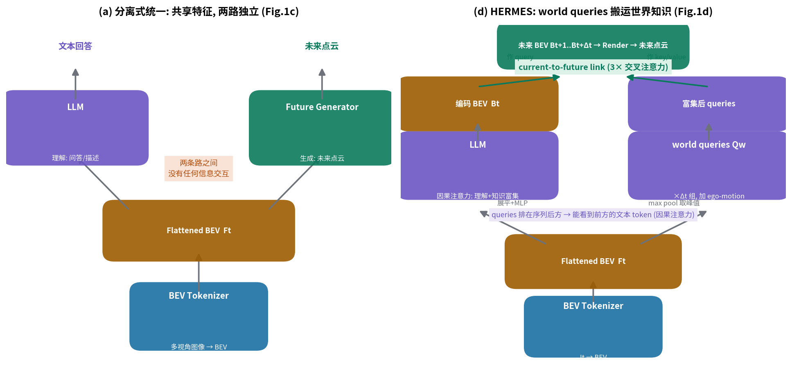
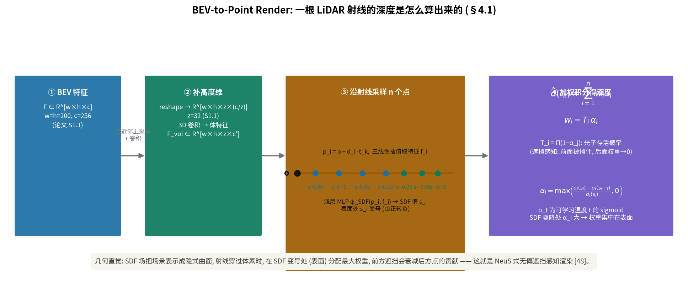
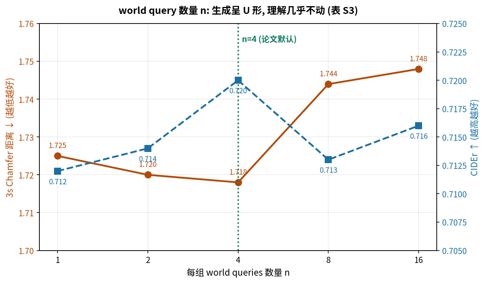

# 让 LLM 既看懂路、又预演未来：HERMES 把"理解"偷渡进"生成"的那座桥

> - **全局编号**：048-WM-hermes
> - **论文标题**：HERMES: A Unified Self-Driving World Model for Simultaneous 3D Scene Understanding and Generation
> - **作者**：Xin Zhou*, Dingkang Liang*†, Sifan Tu, Xiwu Chen, Yikang Ding†, Dingyuan Zhang, Feiyang Tan, Hengshuang Zhao, Xiang Bai（1 华中科技大学，2 旷视科技 MEGVII，3 Mach Drive，4 香港大学；* 共同一作，† 项目负责人）
> - **会议**：ICCV 2025
> - **arXiv**：2501.14729（摘要页 https://arxiv.org/abs/2501.14729；本次下载的是 v3，2025-08-13 修订，共 17 页含附录与参考文献）
> - **代码**：已公开。论文正文写的是 https://github.com/LMD0311/HERMES，实际可用的仓库是 https://github.com/3a1b2c3/hermes（2025-07-14 开源了代码、预训练权重与处理好的数据；已 `--depth 1` 克隆到本目录 `code/` 并核对，见"代码与论文的对照"节）
> - **一句话核心洞见**：HERMES 的赌注是——LLM 在回答"路上有什么"时沉淀下来的世界知识，可以被"偷渡"给未来场景生成器；偷渡通道是因果注意力的位置红利：一组从 BEV 峰值初始化的 world queries 被追加在输入序列末尾，天然能看到前方的全部文本知识，再经 current-to-future link 把知识注入未来 BEV。BEV 在这里同时扮演压缩器与跨模态接口两个角色。

## 世界模型分叉的那条路：为什么"理解"和"生成"在此之前各干各的

自动驾驶的世界模型（DWM）在 2023–2025 年走出两条互不往来的路。一条管生成：GAIA-1 用自回归做视频仿真，ViDAR 用图像预测未来点云，OccWorld 系列做未来 occupancy。它们能往前看，但不会说话——你问它"右后方那辆车在干什么"，它没有为回答这类问题训练过的任何部件。另一条管理解：DriveLM、DriveGPT4、OmniDrive 把 LLM 接到驾驶场景上，能描述、能问答、能推理，但它们的世界在时间上是冻结的：只理解当前帧，不预测下一秒。

两条路各走各的不是偶然。生成要的是几何精度（点云、体素、深度），理解要的是语义与常识（文本空间的世界知识）。把两者硬拼在一起，最直接的想法就是论文 Figure 1(c) 画的那种"分离式统一"：共享一份 BEV 特征，一路进 LLM 做问答，一路进 future generator 做预测。这个设计看起来滴水不漏——特征共享了，两个任务都有了。但它有一个结构性的死结：两路之间没有任何信息交互。LLM 在理解过程中搞明白的"右侧那辆 van 正紧贴着我们、它大概率保持并行"这件事，生成器永远听不到。更糟的是两路分开优化，论文在表 2 里给了证据：分离式统一在 1/4 数据上 3s Chamfer 距离是 1.875，而真正的联合训练是 1.718。共享特征但不共享知识，等于两个人共用一间办公室却从不说话。

HERMES 要解决的正是"知识怎么从理解流向生成"。它的回答分两层。第一层是表示：用 BEV 把六视角图像压成 LLM 吃得下的 token 序列（50×50=2500 个 token，而直接处理多视角大约需要 47000 个 token，附录 S2 给了这个对比），同时 BEV 保留了跨视角的几何关系——这是压缩器。第二层是搬运机制：world queries。这组 query 从 BEV 特征的峰值处初始化（显著物体响应高的位置），被追加在 LLM 输入序列的末尾。因为 LLM 用的是因果注意力，排在后面的 token 能看到前面所有的文本 token，queries 就在"听"完整个理解过程之后，带着被世界知识富集过的表示离开 LLM，再经 current-to-future link 把知识注射进未来 BEV。这是整篇论文唯一真正新的东西，其余都是为它搭的脚手架。

*自绘图。上：分离式统一（论文 Fig.1c），共享 BEV 但两路独立、无交互；下：HERMES（论文 Fig.1d），world queries 经因果注意力搬运世界知识。论文原 Fig.1 见 `paper-page1.png`（第 1 页，2 倍分辨率渲染）。*

## 作者手里的底牌：因果注意力的位置红利

推测作者决定做这件事时的底气（以下为推断，依据附后）。第一张牌是 BEV 的双重身份。BEV 在检测分割里用了多年，但把它当作"LLM 的跨模态接口"是一个当时并不 obvious 的选择：BEV 既把多视角压进 token 上限，又天然保留几何，还能直接渲染成点云做生成的监督。一份表示同时服务理解、生成、监督三个目标，这是设计上最省的一步。

第二张牌是因果注意力的位置红利，这是全篇最漂亮的一个观察。它不需要改任何注意力机制，是 Transformer 的免费午餐：只要把需要"偷看"知识的 token 排在序列后面，它就能看到前面的一切。World queries 不需要新的交叉注意力、不需要对齐损失，排个位置就行。论文 Figure 3 的消融是这张牌硬度的直接证据：去掉 world queries（Figure 3a，未来 BEV 直接由编码 BEV 加 ego-motion 生成），3s 点云预测的 Chamfer 距离上升约 10%；把 queries 拿掉 LLM 处理（Figure 3b，不让它们进 LLM"听课"），生成性能介于两者之间。知识确实是从 LLM 的理解过程里流过去的，而不是 queries 本身带了什么参数红利。

第三张牌是评测的错位竞争。生成侧的基线 ViDAR 用了 3 秒历史帧，而 HERMES 只用当前单帧；理解侧的基线 OmniDrive 用了大量 2D 预训练数据、3D 物体监督和车道线监督。HERMES 在输入更少、监督更干净的条件下两边都赢了（3s Chamfer 1.17 vs ViDAR 1.73，降 32.4%；CIDEr 0.741 vs OmniDrive 0.686，高 8.0%）。这种"以少胜多"的叙事对审稿人很有说服力，尽管里面有一个需要警惕的细节（见"怀疑式审读"：ViDAR 的数字是抄的，输入设置并不完全对齐）。

## 方法是怎么被一步步逼出来的

从失败场景出发，最朴素的尝试是：BEV 进 LLM 做问答，另训练一个 future generator 拿 BEV 预测未来点云。这就是分离式统一。它的问题上面已经说了：生成器吃不到理解的知识。

第二个尝试可能是：让生成器直接读 LLM 的输出。LLM 的输出是文本 token 序列（或者文本空间的隐状态），生成器要的是几何特征，两个空间对不上。硬接一个投影层，等于让生成器从文本隐状态里反解几何，信息瓶颈极大。

HERMES 的走法是换一个搬运对象：不搬文本，搬"被知识富集过的 query"。具体构造如下。输入 LLM 之前，先从展平的 BEV 特征 Ft 上做 max pooling，取 n 个峰值响应作为 query 的初始化 Q ∈ R^{n×(c×4)}。为什么是 max 而不是平均？论文表 4 试了三种池化：attention pooling、平均池化、max 池化，max 在 3s Chamfer 上最好（1.718 vs 1.748/1.741）。作者的解释是 max 抓住峰值响应（显著物体），平均池化会被背景噪声稀释。这个解释合理，但注意三者的差距很小（1.718 vs 1.741，约 1.3%），"max 最好"这个结论的统计硬度一般，论文没有报告方差。

拿到 Q 之后，复制 Δt=3 组（对应预测未来 3 秒，每秒一帧点云）。每组加上两样东西：一是 ego-motion 嵌入 e_{t+i}，编码自车从当前到第 i 帧的规划位姿与航向——这是可控生成的条件（附录 Figure S1 展示了给"stop"和"turn right"两种 ego-motion 会生成不同的未来）；二是 frame embedding FE ∈ R^{Δt×(c×4)}，通过广播机制告诉每一组 query"你负责的是第几帧"。合起来就是论文公式 (2)：

$$Q^w = \mathrm{MLP}(\mathrm{Concat}[Q_i + e_{t+i} \mid i \in \{1,\cdots,\Delta t\}] + \mathrm{FE})$$

各符号的形状与含义见下表。注意 Concat 之后是 (Δt×n) 个 query，每个维度 c×4=1024；加上广播后的 FE，再过一个与 BEV 共享的 MLP 投影到 LLM 的通道维 C，得到 Q^w ∈ R^{(Δt×n)×C}。Δt=3、n=4 时，一共 12 个 query 进 LLM。

| 符号 | 形状 | 含义 |
|---|---|---|
| $Q_i$ | $\mathbb{R}^{n\times(c\times4)}$，n=4，c=256 | 第 i 组 world queries，由 BEV 峰值 max pool 初始化，复制 Δt 次得到 |
| $e_{t+i}$ | $\mathbb{R}^{c\times4}$ | ego-motion 嵌入：自车从当前到第 i 帧的规划位置与航向，控制未来生成 |
| $\mathrm{FE}$ | $\mathbb{R}^{\Delta t\times(c\times4)}$ | frame embedding，广播到每组 query，标记该组负责预测哪一帧 |
| $Q^w$ | $\mathbb{R}^{(\Delta t\times n)\times C}$ | 进 LLM 的最终 queries，12 个，通道对齐到 LLM 隐 dim C |

这 12 个 query 被追加在"展平 BEV + 文本 token"之后，构成 LLM 的完整输入序列。LLM 做一次前向：前半段按常规做理解（next-token prediction 回答用户问题），末尾的 queries 则通过因果注意力"旁听"了整个理解过程。出来之后，编码 BEV Bt 和富集后的 queries 各过一个共享的两层 MLP，把通道从 C 投影回 c×4。

但这里有个实际困难：每组只有 n=4 个 query，是对未来世界的极稀疏采样，直接拿它重建未来场景不现实。于是有了 current-to-future link：3 个交叉注意力块。每个块里，编码 BEV Bt 作 query，world queries 作 key 和 value——注意方向：是当前 BEV 去"查"知识富集后的 queries，把知识注射回稠密的 BEV 网格；之后再过自注意力与 FFN 整理空间信息。输出未来 BEV Bt+1…Bt+Δt。共享的 Render 把 Bt（当前）与未来 BEV 全部渲染成点云 Pt…Pt+Δt，其中当前帧点云预测是辅助任务：它约束 Bt 的几何质量，不增加推理负担（推理时只跑未来分支即可，论文在表 3 最后一行验证了加这个辅助任务未来生成更好）。

## 一根 ray 的一生：BEV-to-Point Render 到底在算什么

Render 的输入是下采样后的 BEV 特征（或 LLM 处理后的编码 BEV），形状约为 R^{(w/4)×(h/4)×(c×4)}。第一步用最近邻插值+卷积上采样回 R^{w×h×c}（w=h=200）。BEV 没有高度信息，第二步 reshape 出一个高度维：R^{w×h×z×(c/z)}，z=32（附录 S1.1）。再过一系列 3D 卷积，得到体特征 F_vol ∈ R^{w×h×z×c′}。

然后按数据集的 LiDAR 配置构造 K 条射线 {r_k}。对每条从原点 o 沿方向 t_k 的射线，采样 n 个点 p_i = o + d_i·t_k（d_i 递增）。每个采样点用三线性插值从 F_vol 取局部特征 f_i，再过一个浅层 MLP φ_SDF 得到 SDF 值 s_i。场景被建模成隐式 SDF 场：表面处 SDF 变号。

渲染深度是加权积分：d̃(r_k) = Σ_i w_i·d_i，权重 w_i = T_i·α_i。T_i = Π_{j<i}(1−α_j) 是"光子存活概率"——前面采样点不透明度高，后面的权重就被压低，这就是遮挡感知。α_i = max((σ_t(s_i)−σ_t(s_{i+1}))/σ_t(s_i), 0)，σ_t 是带可学习温度 t 的 sigmoid。直觉：SDF 沿射线骤降的地方（穿过表面），α_i 大，权重集中在表面附近；这是 NeuS [48] 式的无偏权重，论文直接沿用了这套 machinery，没有自己发明渲染器——明智的选择，渲染不是本文的创新点。

*自绘图。一根 LiDAR 射线从 BEV 特征到深度的完整路径：上采样→补高度维→体特征→沿射线采样→SDF MLP→遮挡感知加权积分。*

## 损失函数：每一项在罚什么

理解侧是标准的 next-token prediction：

$$\mathcal{L}_N = -\sum_{i=1}^{m}\log P(\mathcal{T}_i \mid \mathcal{F}_t, \mathcal{T}_1,\cdots,\mathcal{T}_{i-1}; \Theta)$$

给定 BEV 特征 Ft 和前文，最大化第 i 个文本 token 的似然。m 是回答长度，论文公式里把 m 印成了求和上限的样式但文本提取丢失了，按标准 NTP 理解即可。

生成侧只用 L1 监督各条射线的深度：

$$\mathcal{L}_D = \sum_{i=0}^{\Delta t}\lambda_i\frac{1}{N_i}\sum_{k=0}^{N_i}|d(\mathbf{r}_k)-\tilde d(\mathbf{r}_k)|$$

i=0 是当前帧（辅助任务），i=1..3 是未来。λ_i = 1+0.5i，即 1、1.5、2、2.5——越远的帧权重越大。直觉是远帧误差天然更大，给更大权重防止模型"躺平"只做好近帧。但论文只写了 empirically defined，没有给搜索范围和敏感性分析（见怀疑式审读）。总损失 L = L_N + 10·L_D，系数 10 同样没有依据说明。两项之间存在拉扯：NTP 要 LLM 的表示服务文本，深度损失要它服务几何；10 这个系数决定了天平往哪边倾，论文没有讨论它。

## 一场具体的推演：右侧那辆 van

场景取自论文 Figure 4 的设定，简化如下。自车在城市道路直行，右前方一辆 van 与自车并行、距离很近（论文原图用红圈标出了这辆 van 在未来帧里紧贴自车）。理解任务：用户问"右侧有什么车？当前应该采取什么动作？"生成任务：预测未来 3 秒点云，van 应保持与自车并行。

**基线（分离式统一）走一遍。** BEV 特征同时送进两路。LLM 这路：展平 BEV（50×50=2500 token）+ 问题文本，正常回答"右侧有一辆 van 紧贴，建议保持车道、注意右侧"。理解没问题。Future generator 这路：拿 BEV 加上 ego-motion（直行），直接预测未来 BEV。问题出在分辨率：BEV 下采样了 4 倍，每个 token 覆盖约 2m×2m（200 格覆盖 ±51.2m，每格 0.512m），van 在 BEV 上只占一两个 token，特征微弱；生成器也没有任何渠道知道"这辆 van 会保持并行"这个语义先验，只能按几何外推。结果：未来帧里 van 的位置漂移，3s Chamfer 距离 1.37（表 1 分离式统一行）。

**HERMES 走一遍。** 同样的 BEV，先做 max pool 取峰值：van 所在位置的 BEV token 响应高，被选进初始 queries。12 个 queries 追加在序列末尾进 LLM。在 LLM 前向过程中，queries 通过因果注意力"听到"了理解部分产生的文本知识——包括"右侧 van 紧贴"这个判断。出来之后，current-to-future link 里编码 BEV Bt 作 query 去查这 12 个富集了知识的 queries：相当于稠密 BEV 网格上的每个位置都在问"知识库里有没有关于我这里未来会发生什么的信息"，van 所在位置得到了"保持并行"的先验。未来 BEV 里 van 的运动模式被扶正，Render 出来的未来点云里 van 紧贴自车（论文 Figure 4 红圈处），3s Chamfer 距离 1.17。

**分叉点落在数字上。** 同样的场景、同样的数据（表 1，全量训练），分离式 1.37 → HERMES 1.17，差 0.20，约 14.6%；1/4 数据的表 2 上，1.875 → 1.718，差 0.157。而理解侧 CIDEr 几乎不动（0.745→0.741 / 0.722→0.720），METEOR/ROUGE 也是小数点后三位持平。这组数字说明：知识搬运的红利几乎全部落在生成端，理解端没有被生成任务拖累——"统一"没有以牺牲理解为代价，这是联合训练最难得的一点。

## 超参数与训练：论文说了什么、没说什么

三阶段训练（附录 S1.1，表 S1）：

- **Stage 1**：训练 BEV tokenizer 与 Render，做"当前图像→当前点云"（12Hz 数据，6 epoch，lr 2e-4，batch 1/GPU）。
- **Stage 2**：BEV-文本对齐。先对齐阶段只训练 BEV 的 in-projection 与 out-projection（用 NuInteract 稠密 caption 数据，3 epoch，lr 2e-4）；再精炼阶段解冻全部参数、LLM 用 LoRA 微调（用 OmniDrive-nuScenes 的场景描述数据对齐标注风格，6 epoch，lr 4e-4，batch 4/GPU）。为缓解 BEV 图文数据稀缺，作者做了一个简单增强：随机 mask 掉一个视角，把可见视角的 caption 拼接起来用，多视角图文对从 nuScenes 关键帧扩到约 200K（7 倍）。这个增强没有消融，它到底贡献了多少不清楚。
- **Stage 3**：加入未来生成模块，用 nuScenes 关键帧 + OmniDrive 描述与对话标注联合训练理解与生成（36 epoch，lr 4e-4，batch 4/GPU）。

硬件是 32×NVIDIA H20。论文没有给总墙钟时间，按 Stage 3 的 36 epoch、batch 4/GPU 估算，这不是一个小数目——复现门槛不低。BEV tokenizer 用 OpenCLIP ConvNeXt-L + BEVFormer v2-base（w=h=200，c=256），LLM 用 InternVL2-2B（1.8B 参数；附录表 S2 试了 0.8B/1.8B/3.8B，理解与生成都随规模单调变好，作者选 1.8B 是"trade-off"，3.8B 只好一点点：3s Chamfer 1.718→1.701，CIDEr 0.720→0.730）。

## 怀疑式审读：哪些数字可以信，哪些要打折

**先说做得漂亮的地方。** 一是 Copy&Paste 基线（附录表 S4）：直接把当前帧真值点云复制到未来，1s/2s/3s Chamfer 是 1.27/2.12/2.66，HERMES 是 0.78/0.95/1.17。这个对照排除了"模型只是在复制当前帧"的质疑，干净利落。二是 world query 数量的消融（表 S3，见下图）：n=1/2/4/8/16 都试了，3s Chamfer 呈 U 形（1.725/1.720/1.718/1.744/1.748），n=4 最优且理解端 CIDEr 几乎不动——n=4 不是拍脑袋定的。三是附录 Figure S2 诚实地放了失败案例：大左转+遮挡场景、夜间场景的生成质量明显变差（夜间例子的 1s/2s/3s Chamfer 是 1.76/1.51/1.37），作者在 Limitation 里承认了夜间与复杂场景的问题。

*自绘图，数据来自论文表 S3（1/4 训练数据）。每组 query 数量 n=4 时生成最好，n 继续增大反而变差；理解端 CIDEr 几乎不受影响。*

**再说要打折的地方。**

第一，损失权重的经验主义。λ_i=1+0.5i 与总损失系数 10 都是"empirically defined"，论文没有给任何搜索范围、粒度和选择集合。10 这个系数直接决定 NTP 与深度损失的天平，换一个数据集很可能要重调，论文没有提供敏感性信息。

第二，基线的对齐问题。表 1 里 ViDAR 与 4D-Occ 的数字带 †，明确标注引自原文，是抄数不是重跑。关键是输入不对等：ViDAR 用 3 秒历史帧预测未来，HERMES 只用当前单帧——输入更少反而赢 32.4%，故事很漂亮，但两边的评测设置（数据划分、点云范围过滤 [-51.2,51.2]×[-3,5] 是否完全一致）没有逐项对齐说明。GPT-4o 与 LLaVA-OV 的理解分数引自 DriveMM [18]，OmniDrive 系列是否重跑论文没说（未确认）。严格来说，"降 32.4%"这个数字的比较基准是松散的。

第三，消融与主结果的数据量不一致。正文的消融（表 2–5）多在 1/4 nuScenes 训练数据上做，主结果（表 1）在全量数据上。1/4 数据上的结论（比如 max pool 最好、50×50 BEV 最好）能否外推到全量，论文没有验证——只有一个例外：Figure 3 的 world query 消融明确写了 trained on full data。

第四，缺失的标准信息：随机种子数没有报告（表格数字是单次还是均值未知）；测试集是否参与模型选择没有说明；推理延迟与显存没有给（只有一个 2500 token 的理论分析）。

第五，NuScenes-QA 的 61.9%（表 S5，超 CenterPoint+MCAN 的 59.5%）是在 QA 训练集上 fine-tune 对齐回答风格之后测的，而 LLaVA（47.4%）等基线没有经过同样的对齐，这个对比的公平性要打折扣。不过作者至少诚实地写了 fine-tune 这一步。

第六，范围局限。全部实验在 nuScenes（含 OmniDrive-nuScenes、NuInteract 衍生标注）上，没有跨数据集验证。理解任务的标注本身来自 GPT-4 生成（OmniDrive-nuScenes），存在"用 GPT-4 的标注训练、再用同分布的 GPT-4 标注评测"的循环论证风险，论文没有讨论。

**论文与代码的对照**（已核对官方仓库 https://github.com/3a1b2c3/hermes，`--depth 1` 克隆到本目录 `code/`；另把关键文件单独存于 `code_key/` 备查）。一致的地方：`projects/configs/hermes/stage3.py` 里 `frame_loss_weight=[1.0, 1.5, 2.0, 2.5]` 与论文 λ_i=1+0.5i 完全对应；`loss_cfg.weights.depth_loss=10.` 正是论文总损失 L = L_N + 10·L_D 里那个 10 的来源；`num_learnable_query=4`、`use_max_pool=True`、`num_ego_layers=3`、`InternVL2-2B` + LoRA、`bev_h_=200`/`img_length=50` 都与论文一致。World queries 的初始化确是 `nn.AdaptiveMaxPool1d(num_learnable_query)` 作用在展平的 BEV token 维上；`internlm2_chat.py` 里 `input_ids = torch.cat((input_ids, query_ids), dim=0)` 证实 queries 被追加在序列末尾——"因果注意力的位置红利"在代码里是字面成立的；`down_sample_cross.py` 的 `TransformerCrossLayer` 里 `x = x + cross_attn(norm1(x), norm2(learnable_query))`，编码 BEV 作 query、world queries 作 key/value，与论文 §4.2 的描述一致。

四处论文没写的东西。第一，`hermes_future_render_head.py` 里 queries 在 max pool 之后还加了一个可学习的 `query_pos` 参数（`nn.Parameter(torch.randn(num_learnable_query * len_future, bev_channels))`），论文公式 (2) 里没有它——等于是 max pool 初始化之外又叠了一层可学习位置编码，消融没有隔离这两者的贡献。第二，ego-motion 嵌入在代码里是 `can_bus_mlp` 吃 18 维 nuScenes can_bus 向量（两层 Linear+LayerNorm+LeakyReLU），论文只说"编码规划的未来位置与航向"，实现比描述具体得多。第三，射线采样用 `NeuSSampler`（96 均匀采样 + 42 重要性采样），论文只说"离散成 n 个采样点"，n 的具体值与重要性采样策略都没提。第四，`sensor_depth_truncation=0.1`、`sparse_points_sdf_supervised=False` 等渲染超参数论文未提及。总体评价：核心机制（world queries、current-to-future link、损失权重）论文与代码一致，差异集中在"论文把工程细节抹平了"这类常规简化，只有一处值得记下来——`query_pos` 的存在意味着"world queries 完全来自 BEV 峰值"这个叙事并不纯粹，它有一半是学出来的。

## 读完带走什么

一个可迁移的 trick：因果注意力的位置红利。任何想让某个表示"偷看"前文知识的场景，把它排在序列末尾就行，不需要新机制。HERMES 用它把 LLM 的理解知识搬运给生成器，同样的手法可以用在任何"先理解后行动"的 agent 架构里：把行动 query 排在观察与推理之后。

一个表示层面的判断：BEV 在这里同时是压缩器（2500 vs 47000 token）与跨模态接口（理解、生成、监督三用）。当你需要在 LLM 里同时处理几何与语义时，先找一个能同时被语言描述、被几何监督的中间表示，而不是在两个空间之间硬接投影层。

一个诚实的提醒：这篇论文最强的数字（对 ViDAR 的 32.4%）建立在抄数基线与不对等的输入设置上；它真正硬的证据是分离式统一 vs 联合训练的同条件对比（1.37→1.17）与 world query 的因果消融（去掉 queries 掉 10%）。读论文时把"故事数字"和"证据数字"分开，是这篇教会我们的。

留下的开放问题：理解→生成的知识搬运目前完全是隐式的（注意力权重），能否显式化（比如把文本描述作为生成条件的交叉注意力）？夜间与强遮挡的失效是 BEV 表示的问题还是数据的问题？HERMES++（arXiv:2604.28196，2025-04-30 发布）已经沿着这条线继续走了，值得跟进。

*论文原图：第 1 页 Figure 1（四种范式对比）见 `paper-page1.png`；第 4 页 Figure 2（完整管线）见 `paper-page4.png`；第 7 页 Figure 3（world query 消融）见 `paper-page7.png`；第 8 页 Figure 4（定性结果：理解问答 + 未来点云）见 `paper-page8.png`。以上均为 2 倍分辨率渲染。*
