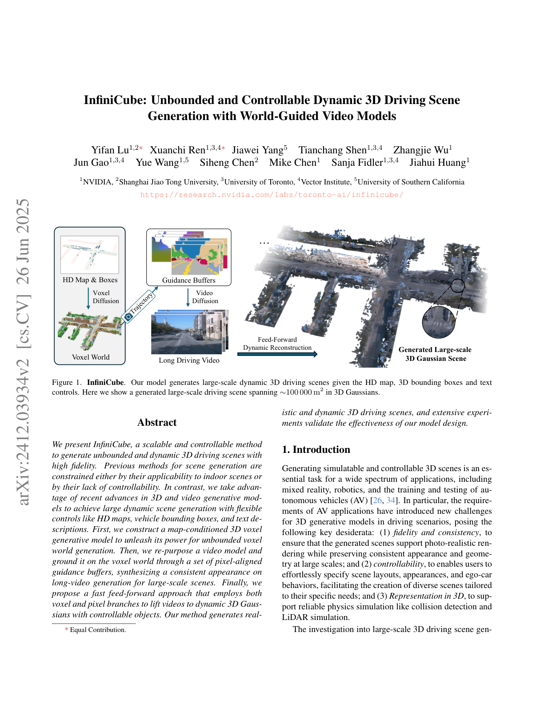
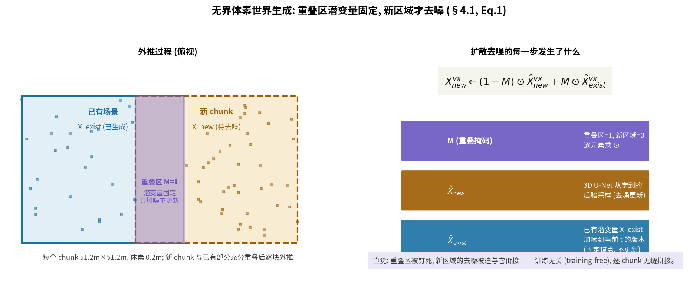
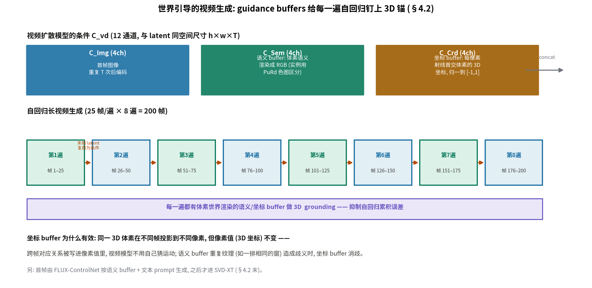

# 把视频生成器钉在 3D 世界里：InfiniCube 用三级流水线绕开"无界又逼真"的死结

> - **全局编号**：049-WM-infinicube
> - **论文标题**：InfiniCube: Unbounded and Controllable Dynamic 3D Driving Scene Generation with World-Guided Video Models
> - **作者**：Yifan Lu*, Xuanchi Ren*, Jiawei Yang, Tianchang Shen, Zhangjie Wu, Jun Gao, Yue Wang, Siheng Chen, Mike Chen, Sanja Fidler, Jiahui Huang（1 NVIDIA，2 上海交通大学，3 多伦多大学，4 Vector Institute，5 南加州大学；* 共同一作）
> - **会议**：ICCV 2025
> - **arXiv**：2412.03934（摘要页 https://arxiv.org/abs/2412.03934；本次下载的是 v2，2025-06-26 修订，共 17 页含附录与参考文献）
> - **代码**：已公开 https://github.com/nv-tlabs/InfiniCube（推理代码、训练脚本均有；但注意文末"代码与论文的对照"节：开源默认的视频模型与论文数字用的不是同一套）
> - **一句话核心洞见**：InfiniCube 不相信任何一个单一生成器能同时搞定"无界 3D 结构"与"照片级外观"，于是把任务拆成三级：体素扩散管无界几何（RePaint 式外推），视频扩散管外观（但每一遍自回归都被体素渲染的语义/坐标 buffer 钉在 3D 世界里），双分支前馈重建把两者抬升成动态 3D 高斯。每一级只做自己擅长的事，级与级之间用可渲染的中间表示衔接。

## 两条死路：3D 生成器没质感，视频生成器没 3D

2024 年想做"可交互的大规模驾驶场景生成"，摆在面前的只有两条路，两条都是死路。第一条是直接学 3D 先验：把场景编码成稀疏体素或神经场，再上扩散模型（XCube、NeuralField-LDM 一脉）。几何是对的，但外观一塌糊涂——3D 生成模型吃的数据量和视频模型完全不是一个量级，渲染出来没有质感。第二条是视频生成模型：SVD、Vista、Panacea 在驾驶数据上微调，能生成以假乱真的街景视频。但有两个结构性缺陷：其一，视频不是 3D，没有真正的三维表示，做不了碰撞检测、LiDAR 仿真这些自动驾驶仿真刚需；其二，视频模型一次只能生成几十帧（SVD-XT 是 25 帧），想覆盖几百米的大场景只能自回归地一遍遍接，误差累积到后面画面就崩了。

InfiniCube 的判断是：不要二选一。让 3D 管 3D，让视频管外观，再加一级把两者缝起来。这就是 Figure 2 的三级管线：HD map + 车辆包围盒 + 文本 → 体素世界（无界）→ guidance buffers → 长视频 → 动态 3D 高斯。论文表 1 把定位说得很直白：Vista 只有视频、15 秒；MagicDrive3D 有 3DGS 但只有 6 秒；InfiniCube 输出视频+体素+3DGS，20 秒（200 帧@10Hz），场景约 100000 m²（300m×400m），且 3DGS 场景里可以无限自由驾驶。

*论文原 Figure 1（第 1 页，2 倍分辨率渲染）：输入 HD map、包围盒与文本，输出约 100000 m² 的动态 3D 高斯场景。完整管线见第 4 页 Figure 2（`paper-page4.png`）。*

## 作者的底牌：自回归的误差累积缺一个"外部锚"

三级管线里每一级用的都是现成 machinery（XCube 的体素 LDM、SVD-XT、SCube/GS-LRM 式的重建），作者真正的赌注只有一个：视频模型的长程自回归误差，可以被"体素世界渲染出来的 guidance buffers"钉住。

这个想法的形状是这样的。训练无关的长视频生成通常这么做：用上一遍生成的最后一帧 latent 当条件，再跑一遍 25 帧。问题是每一遍的输入都来自上一遍的输出，误差是乘性累积的，三遍之后（75 帧）画面就开始漂。但如果每一遍除了"上一遍的末帧"之外，还有一个与 3D 世界严格对齐的、每帧都能渲染出来的条件，误差就被重置了——从乘性变成有界加性。Guidance buffers 就是这个外部锚：语义 buffer（体素语义渲染成 RGB）管"哪里是什么"，坐标 buffer（每像素射线首交体素的 3D 坐标）管"跨帧对应"。

坐标 buffer 的设计是全篇最妙的一笔。同一 3D 体素在不同帧会投影到不同像素位置，但它的像素值（3D 坐标本身）是不变的。于是跨帧的对应关系被直接写进了像素值里，视频模型不需要自己从外观里猜运动对应。语义 buffer 有重复纹理（比如一排相同的窗户、一条长直车道线）造成歧义时，坐标 buffer 消歧。论文 Figure 9b 的消融证实了分工：去掉语义 buffer 掉得最多（它是主力），去掉坐标 buffer 也有可见损失。

作者敢押这一注的工程底气有两张牌。一是同组的 XCube/SCube：稀疏体素的 VAE 编解码与 fVDB 框架已经跑通，体素渲染成 buffer"非常快"（论文原话，§4.2）。二是 SVD-XT 的微调：25 帧、576×1024 分辨率，finetune 时给条件 latent 加高斯噪声增强鲁棒性——这个细节说明作者预见到了"推理时的 buffer 与训练时的 buffer 分布不一致"（体素是生成的不是真值），提前做了防御。

## 第一级：无界体素世界是怎么"长"出来的

输入是 HD map 与车辆包围盒，输出是带语义标签的稀疏体素世界 D_vx。条件体素 C_vx ∈ R^{N³×S} 的构造经历了明显的迭代痕迹，论文把中间踩过的坑写出来了，这很难得。

HD map 条件 C^HD_vx：输入的 HD map 是两组 3D 折线（road edge 界定路界、road line 分隔车道），光栅化成 2 个通道，体素与折线相交处置 1。这是最直接的编码。但作者"empirically find"：局部 chunk 生成时，HD map 可能只含进一部分，模型从残缺的折线里判断不出可行驶区域。于是加了 road surface 条件 C^Road_vx（1 通道）：用 road edge 与 road line 拟合 3D 平面，保留路面部分，直接告诉模型"路在这里"。Figure 7 展示了不加这个条件时模型连地面都找不准——一个诚实的失败展示。

包围盒条件 C^Box_vx：直接体素化 box 占据会丢信息，因为 latent 体素很粗（约 1.6m）。作者的做法是只编码朝向：体素被 box 占据过半时，写入 [sin α, cos α]（α 为朝向角），2 个通道。用正余弦而不用角度本身，避免 0/2π 处的不连续——标准的周期编码常识。

三个分量拼起来：2（HD）+1（Road）+2（Box）=5 个通道。但论文正文写的是"concatenation ... with S = 4"。2+1+2=5 ≠ 4，对不上。这很可能是一处笔误（未确认，待代码核对时验证，见文末）。

单 chunk 生成沿用 XCube [43] 的采样流程：高斯白噪声（R^{N³×C}）在通道维拼上条件 C_vx，3D U-Net 迭代去噪得到潜变量 X_vx，再解码成语义体素。作者明确说不用 XCube 的层级上采样（hierarchical upsampling），因为体素 0.2m、范围 51.2m 时"一次扩散就够了"。

无界靠外推，策略类似 RePaint [40]，训练无关：

$$X^{vx}_{new} \leftarrow (1-M)\odot\hat{X}^{vx}_{new} + M\odot\hat{X}^{vx}_{exist}$$

新 chunk 与已有场景充分重叠。去噪的每一步，重叠区（M=1）的潜变量固定为已有潜变量加噪到当前 t 的版本 X̂_exist，只更新新区域的 X̂_new。直觉：重叠区被钉死，新区域的去噪被迫与它衔接，于是 chunk 之间无缝拼接。采样用 DDIM 100 步、classifier-free guidance 权重 2.0；为避免 VAE 解码引入不一致，所有 chunk 生成融合完之后才统一解码。

*自绘图。RePaint 式外推：重叠区潜变量固定（只加噪不更新），新区域去噪被迫与已有场景衔接；训练无关，逐 chunk 无缝拼接。*

但这里有一个作者自己承认的天花板：外推只保证相邻 chunk 一致，远距离 chunk 之间的一致性会下降（Limitation 原话）。"无界"在严格意义上是"可以一直长"，不是"长多远都全局一致"。

## 第二级：guidance buffers 把 25 帧拉到 200 帧

视频模型用 SVD-XT（25 帧），finetune 到 576×1024。它的条件 C_vd ∈ R^{h×w×T×M}，M=12，拼了三样：C^Img_vd（4 通道，首帧图像重复 T 次后编码——SVD 原生的图像条件）、C^Sem_vd（4 通道，语义 buffer）、C^Crd_vd（4 通道，坐标 buffer）。语义 buffer 把体素语义按固定调色板渲染成 RGB（附录表 S4 给了每个类别的 RGB 值）；为区分同类车辆实例，CAR/TRUCK/BUS/OTHER VEHICLE 用 matplotlib 的 PuRd 色图随机取色——不同饱和度让视频模型在多车重叠时保持各车外观独立。坐标 buffer 取每像素射线首交体素的 3D 坐标，把 T 帧所有 hit 到的体素坐标 gather 起来用一个常数归一化、clamp 到 [−1,1] 以适配预训练编码器（这个"常数"具体是多少，论文没说，未确认）。

长视频靠自回归：上一遍最后一帧的 latent 复用为条件，再跑一遍。论文说做了 3 遍以上的自回归（200 帧 = 8 遍）。首帧从哪来？训练一个基于 FLUX 的 ControlNet，以语义 buffer 为控制图、按文本 prompt 生成首帧——文本控制就是从这里进来的（§4.2 末）。推理时 CFG 权重 3.0、去噪 25 步。

*自绘图。12 通道条件（首帧 4ch + 语义 4ch + 坐标 4ch）喂给 SVD-XT；上一遍末帧 latent 复用为条件，每一遍都有体素渲染的 buffer 做 3D 锚定，8 遍共 200 帧。*

## 第三级：双分支前馈重建——静态走体素，动态走像素

视频再好也只是视频，仿真要的是真 3D。第三级把体素+视频抬升成动态 3D 高斯，前馈、几秒钟完成。现有方案分两派：体素空间推理 Gaussian 属性（如 SCube），几何分布好（有体素脚手架）但体素覆盖不到的中景没办法；像素空间推理（如 GS-LRM），能抓住中景与逐帧运动但几何不稳。InfiniCube 的双分支是把两派拼起来，各管各的：

- **Voxel branch**：输入体素世界+带位姿视频帧。图像特征反投影到体素（max-pool 聚合），3D 稀疏卷积 U-Net 输出每体素 4 个 Gaussian × 14 通道（RGB 3 + 旋转 4 + 尺度 3 + 不透明度 1 + 相对位置 3，相对位置再换算成绝对 3D 中心，沿用 SCube 的约定）。动态物体从图像特征中 mask 掉，这个分支只管静态背景。体素在重建前从 0.2m 细分成 0.1m 以增强细节。
- **Pixel branch**：2D UNet，输入 36 通道（RGB 3 + 随机 mask 的体素深度 Z̃ 1 + Depth Anything V2 特征 32），输出每像素 2 个 Gaussian × 12 通道（RGB 3 + 旋转 4 + 尺度 3 + 不透明度 1 + 深度 1）。关键设计是自监督的深度训练：训练时把体素渲染深度 Z 随机 mask 掉 16×16 的 patch（p=0.5），模拟"体素覆盖不到"的中景，用完整 Z 监督预测的深度——推理时中景的深度就合理了。深度参数化（附录 S.3）：ω=σ(G_depth)，z=(1−ω)·z_near+ω·z_far（z_near=0.5，z_far=300），t=z/cos(ray 方向与视轴夹角)，xyz=o+t·ray_d。几何动作：sigmoid 把网络原始输出压到 [0,1] 当插值权重，在近平面与远平面之间线性插值出深度，再除以 cos 换成沿射线的真实距离。
- **天空**：STORM [2] 式的隐式表示——轻量 transformer 把天空 patch 压缩成 192 维向量 c，AdaLN 调制的 MLP 以视角方向为输入输出 RGB（scale/shift 从 c 线性预测）。

两个分支分开用 photometric loss 训练，pixel branch 多加深度损失。**推理合成**：voxel branch 只作用于静态部分；pixel branch 每 4 帧跑一次，只保留中景像素与动态物体的 Gaussian；动态车辆用语义 buffer 的分割抠出各自的 Gaussian，按位姿变换后聚合进输入包围盒。于是物体的运动完全由包围盒轨迹控制——改轨迹即改运动，这就是"controllable dynamic"的实现方式。注意：模型自己不预测运动，运动来自输入的 box 轨迹。

*自绘图。Voxel branch 管静态背景（每体素 4 Gaussian×14ch），pixel branch 管中景与动态（每像素 2 Gaussian×12ch，masked 深度自监督），推理时合成。*

"Mid-ground"的定义值得单独记住：(1) 与投影体素无重叠、(2) 不属于天空的像素区域（论文 Figure 4）。这是体素表示够不着、但图像里明明有的地方（远处建筑立面、植被），正是单用体素分支会穿帮的地方。

## 一场具体的推演：200 帧长视频，基线在哪一帧开始崩

场景：Waymo 一段 200 帧（20 秒@10Hz）的前视视频，直道接弯道，路上有 3 辆车同向行驶。首帧由 ControlNet 按文本"Daytime, Sunny"生成（两边共享，控制变量）。

**基线走一遍**（论文复现的 Panacea，同一 SVD-XT backbone，HD map 投影到图像平面作条件，无 guidance buffer）。第 1 遍（1–25 帧）：质量好，车道线笔直，3 辆车位置正确。第 2 遍（26–50 帧）：以第 25 帧 latent 为条件，微小误差开始累积，远处建筑纹理轻微糊化。第 4 遍（76–100 帧）：误差已经肉眼可见——弯道处车道线开始漂移，一辆车的前保险杠形状在两遍之间变了（自回归没有外部参考，只能自己编）。第 5–8 遍：漂移加剧。人工评测的数字（表 2，180 样本/帧索引）：第 40 帧 map 对齐正率 76.8%，第 80 帧掉到 54.0%，第 120 帧 53.4%。FID 曲线（Figure 9a）同样在约 100 帧后明显上扬。

**InfiniCube 走一遍**。同样的 8 遍自回归，但每一遍的条件里都有体素世界渲染的 buffers。第 4 遍开始时，条件里的语义 buffer 仍然把弯道车道线画在正确位置（它是体素渲染的，与自回归历史无关）；坐标 buffer 里，弯道那栋楼的 3D 坐标在第 100 帧与第 101 帧的像素值相同，只是投影位置随 ego 运动变了——视频模型被迫把楼画在对的位置，没有自己发挥的余地。第 120 帧 map 对齐正率 84.8%，第 40 帧 84.6%、第 80 帧 83.9%，基本不衰减。

**分叉点落在机制上**。纯自回归的误差是乘性的：$e_{k+1} \approx A\cdot e_k$，每遍以前一遍的输出为条件，$A>1$ 的方向指数放大。Guidance buffer 把递推改写成 $e_{k+1} \approx A\cdot e_k + B\cdot(\text{buffer} - \text{truth})$，其中 buffer 来自独立的体素世界、误差有界且与 k 无关——每遍的误差被"重置"到体素锚上。这就是为什么 Panacea 的曲线随帧数单调变差，而 InfiniCube 的持平。Figure 8 的定性对比（32/64/96/128/160/192 帧）与 Figure 9a 的 FID 曲线是同一结论的两个证据（第 7 页 `paper-page7.png`）。

应用侧的两个演示值得一看：车辆插入（Figure 11）——往体素世界里放一个体素化的车模型、给定轨迹，重跑后两级，插入的车甚至有真实的阴影（视频模型从首帧条件里学到的光照一致性）；天气控制（Figure 12）——同一体素世界，换文本 prompt 生成晴/雪/雾三种外观，3D 高斯的外观跟着变、几何不动。这正是"几何与外观解耦"的红利。

## 怀疑式审读：代价、基线公平性与没说清的地方

**先说做得扎实的地方。** 一是 Panacea 基线的复现方式：原 Panacea 基于 Stable Diffusion 1.5，作者把它复现到同一 SVD-XT backbone 上并采用它的 HD map 条件策略——这比直接抄 Panacea 原文数字公平得多。二是人工评测的设计：63 个视频、每帧索引 180 个样本、评测界面（附录 Figure S17）明确告诉用户红线=路界、绿线=车道线、蓝框=车辆，ours 与 Panacea 共享 ControlNet 生成的首帧，控制了变量。三是双分支的 Figure 10：单 voxel branch 与单 pixel branch 的 artifact 用红框标出来，双分支推理确实消除了它们——"1+1>1"不是口号，有图为证。

**代价是真实的。** 训练：体素 48 GPU-days，视频 192 GPU-days，场景重建（体素+像素分支）32 GPU-days，FLUX-ControlNet 48 GPU-days——合计 320 个 A100 GPU-days。推理（单 A100）：Stage 1 每个 50m×50m chunk 30 秒/20GB VRAM，外推到 30000 m² 约 6 分钟；Stage 2 生成 200 帧视频 8 分钟/75GB VRAM；Stage 3 重建 10 秒/45GB VRAM。作者给了对比：VISTA 生成视频要 12 分钟以上/70GB VRAM；前馈重建比 vanilla 3DGS 优化快 100 倍以上。75GB 的推理显存意味着单卡 A100（80GB）刚好能跑，卡线很紧。

**基线公平性要打折扣的地方。** Vista 不支持解析式 ego 轨迹输入，作者"只用首帧作它的条件"（§5.4.2 原话）——这对 Vista 不公平，Figure 9a 里 ours 与 Vista 的差距部分来自条件不对等，作者虽然写明了，但数字的解读要打折。另外 FID 评测用的是 GT 首帧作条件（§5.4.2："we utilize the ground-truth first frames from 90 test sequences"），测的是"首帧条件生成"而非纯生成；且 FID 只衡量单帧图像质量，不衡量 3D 一致性——而"长程一致"恰恰是论文的核心 claim，这个 claim 主要靠人工评测支撑。人工评测没有报告评分者间一致性（inter-rater agreement），180 样本/帧的结论硬度中等。

**没说清 / 对不上的地方。**

第一，条件通道数 S=4 vs 实际 5（§4.1）：HD 2ch + Road 1ch + Box 2ch = 5，但论文写 S=4。疑似笔误，待代码核对（未确认）。

第二，坐标 buffer"用一个常数归一化"——常数是多少没说（未确认）。

第三，语义 buffer 颜色"适配预训练编码器的值域"——具体缩放没说（未确认）。

第四，视频 finetune 的学习率、batch size、warmup、总步数——论文只给了 CFG 3.0、去噪 25 步、噪声增强，优化细节缺失（未确认）。

第五，数据过滤："remove low-quality voxel grids and sequences with mostly static ego trajectories"——"低质量"与"大多静态"的量化标准没给；618 训练 / 90 评测序列的划分是否与 Waymo 官方划分对应没说。文本标注用 Llama-3.2-90B-Vision-Instruct 按 8 个时间戳×3 视角的缩略图总结天气/时间——这种弱标注的噪声没有讨论。

第六，范围：全部实验在 Waymo Open Dataset 上；动态物体的运动来自输入的 box 轨迹，模型自己不做运动预测——标题里的"Dynamic"指输出表示含动态物体，不是世界模型意义上的"预测动态"。这一点容易误读。

**代码与论文的对照**（已核对官方仓库 https://github.com/nv-tlabs/InfiniCube，`--depth 1` 克隆到本目录 `code/`；关键文件单独存于 `code_key/` 备查）。三处实质性差异。

第一，条件通道数。论文 §4.1 写条件体 C_vx ∈ R^{N³×S} 且 "S = 4"，但按它自己的分量描述是 2（HD 折线）+1（路面）+2（包围盒朝向）=5。代码证实了 5：`voxelgen/configs/diffusion_64x64x64_dense_vs02_map_cond.yaml` 里 `map_types: ['road_edge', 'road_line', 'road_surface']`，`MapEncoder`（`modules/encoders/map_encoder.py`）对每个 map type 光栅化出 1 通道（`use_embedding: false`），得 3 通道；`Box3dEncoder`（`box3d_encoder.py`）`cond_dim=2`（`[sin α, cos α]`，朝向从 box 角点 3→0 的向量经 atan2 求得），得 2 通道。合计 5。论文的 "S = 4" 是一处算术笔误，分量描述本身与代码一致。

第二，视频模型的代际差，这是最重要的一处。论文 §4.2 与 §5.2 的全部数字（FID 曲线、人工评测、192 GPU-days 训练）用的是微调过的 SVD-XT（25 帧、576×1024、CFG 3.0、25 步去噪）。但开源仓库 `infinicube/videogen/inference.py` 的默认推理路径是 Wan2.1-14B（`WanVideoGenerator`，另有 1.3B 选项），把 guidance buffers 编码成 token 加到 noisy tokens 上作条件——README 也明确写了这是重实现。两者不是同一套权重：想复现论文的 FID/人工评测数字，需要按论文自己训练 SVD-XT；直接 clone 下来跑，得到的是 Wan2.1 路径的结果。README 对此是透明的（给了基于 DiffSynth 的 Wan2.1 训练脚本链接），但不细看容易误以为开箱即复现论文数字。

第三，坐标 buffer 的归一化。论文说"用一个常数归一化坐标并 clamp 到 [−1,1]"；代码 `infinicube/utils/buffer_utils.py` 的 `generate_coordinate_buffer_from_memory_global_norm` 用的是跨全部帧的 percentile 归一化（`percentile=0.05`），不是固定常数。论文的描述是简化版，实际实现更鲁棒（自适应场景尺度）。

一致的地方：RePaint 式外推、语义 buffer 的 PuRd 实例配色、双分支重建的通道数（体素分支每体素 4 Gaussian×14 通道、像素分支每像素 2 Gaussian×12 通道）都与论文描述吻合。

## 读完带走什么

一个可迁移的分解：无界几何、外观、3D 抬升三个子问题各用最擅长的模型，中间用"可渲染"的表示衔接（体素→buffer→视频→高斯）。2024–2025 的现实是没有任何单一模型能同时吃下这三件事，硬端到端不如把接口设计好。Guidance buffer 在这里是"几何与外观之间的窄腰"——窄到只剩语义与坐标，宽到足以钉住视频模型。

一个可迁移的技巧：给自回归加外部锚。任何自回归生成的误差累积，都可以用一个与真值（或世界）对齐、每步可得的条件来钉住，把乘性误差变成有界加性。坐标 buffer 把"对应关系"直接写进像素值，是这类锚点设计里最干净的一个实例——它利用了"3D 点不动、投影动"这个几何不变量。

一个诚实的边界：RePaint 式外推的"无界"是"能一直长"，不是"全局一致"；InfiniCube 的"动态"是"表示含动态物体"，不是"预测动态"。以及，想复现论文数字，先准备 320 个 A100 GPU-days 和 75GB 显存——这篇论文的门槛是算力，不是想法。

*论文原图：第 1 页 Figure 1（~100000 m² 生成场景）见 `paper-page1.png`；第 4 页 Figure 2（三级管线）与 Figure 3（体素条件）见 `paper-page4.png`；第 7 页 Figure 8（视频对比）与 Figure 9（FID 曲线）见 `paper-page7.png`；第 8 页 Figure 10（双分支新视角）与表 3 见 `paper-page8.png`。以上均为 2 倍分辨率渲染。*
