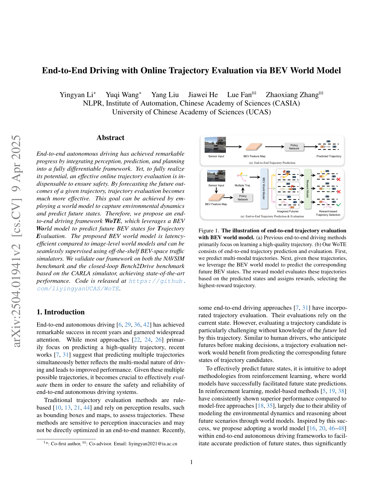
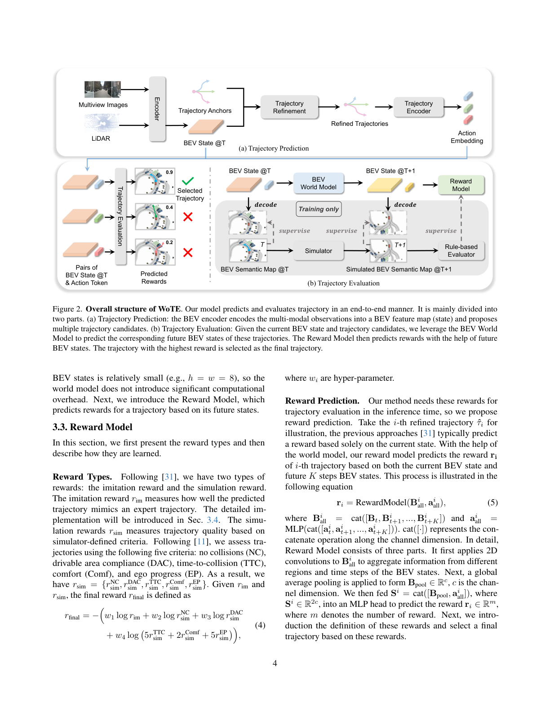
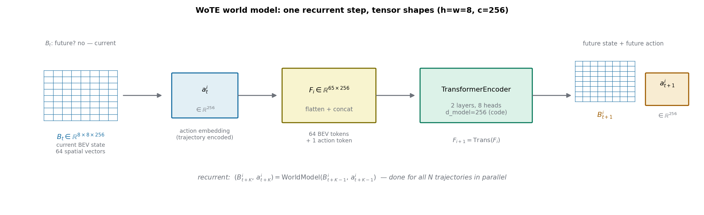
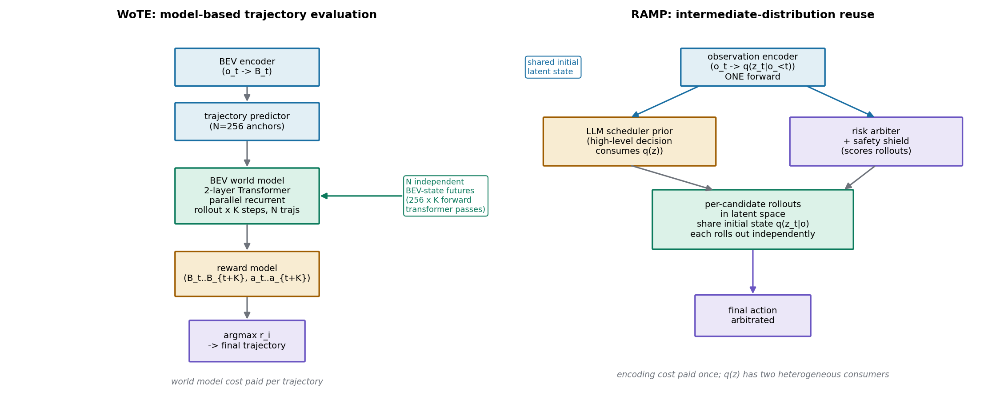

# 给每条候选轨迹预想一个未来：BEV 世界模型做在线轨迹评估

> **全局编号**：050 ｜ **论文标题**：End-to-End Driving with Online Trajectory Evaluation via BEV World Model
> **作者**：Yingyan Li\*、Yuqi Wang\*、Yang Liu、Jiawei He、Lue Fan（共同指导）、Zhaoxiang Zhang（共同指导）——NLPR, Institute of Automation, Chinese Academy of Sciences (CASIA)；University of Chinese Academy of Sciences (UCAS)
> **会议**：ICCV 2025
> **arXiv**：[2504.01941](https://arxiv.org/abs/2504.01941)（摘要页）——下载的是 v2（2025-04-09，PDF 页脚标注 arXiv:2504.01941v2）
> **代码**：公开，https://github.com/liyingyanUCAS/WoTE（已 clone 到目录下 code/，默认 NAVSIM 配置；论文与代码有一处不一致，见怀疑式审读）
> **一句话核心洞见**：评估一条候选轨迹不能只看当前状态，要看这条轨迹把车带向的那个未来长什么样——于是让世界模型在 BEV 空间里替每条候选轨迹"预想"未来，再用学出来的 reward 模型基于想象出的未来打分，整个链路可微、端到端可训练。

## 这篇论文押的赌注：轨迹评估的输入应该是未来，而不是现在

看 Figure 1（论文第 1 页）：

上半部分 (a) 是当时端到端驾驶的默认做法：传感器进来，一个策略网络吐一条轨迹，完事。性能天花板卡在"能不能预测出一条高质量轨迹"。下半部分 (b) 是 WoTE 的赌注：先预测多条候选轨迹，然后对每一条，用 BEV 世界模型想象它执行之后的世界长什么样，再用 reward 模型给每条轨迹打分（图里的 0.99、0.33、0.11），选最高的。

为什么说这是个赌注？因为当时做轨迹评估的主流（Hydra-MDP 这类）都是基于**当前状态**打分的：给当前 BEV 特征和一条候选轨迹，网络直接输出分数。WoTE 的说法是：这件事在结构上就不对。人类司机做决策前会预想"如果我现在变道，三秒后那辆车会在哪"；只看当前状态打分，等于要求评估器自己在内部把未来补全。把"想象未来"这件事显式地交给世界模型，评估器只需要看想象出的未来就行，分工更干净。

这里有个容易滑过去的点：世界模型预测未来，这在 RL 里是老想法（论文引了 PPUU、Rails 这些 model-based policy evaluation 的工作）。WoTE 的新意不在于"用世界模型"，而在于回答了两个具体工程问题：第一，未来用什么表示才能实时（image 空间的 diffusion 世界模型太慢）；第二，多条候选轨迹需要多个未来，但真实数据里每条 log 只有一个未来，监督信号从哪来。整篇论文的方法设计就是这两个问题的答案。

## 被推翻的默认假设：一条好的轨迹只依赖当前时刻的特征就够评估

要理解 WoTE 先撞了哪堵墙，得看它的直接前任。Hydra-MDP（同单位 Zhaoxiang Zhang 组 2024 年的工作，也是 WoTE 同一作者组里 Yingyan Li 参与的 latent world model 工作的延续）已经做了多模态轨迹预测 + 蒸馏评估：8192 条候选轨迹，一个 Hydra-distillation 的打分头，基于当前状态输出各指标的分数，NAVSIM 上 PDMS 86.5。

这个设计的隐含假设是：给定当前 BEV 特征和候选轨迹，打分网络能自己学会"这条轨迹未来会不会撞"。但注意打分网络在训练时看到的监督信号是什么：nuPlan 模拟器对每条 anchor 轨迹跑出来的 NC/DAC/TTC 等分数。也就是说，监督信号本身是"把这条轨迹在模拟器里执行一遍之后的结果"，而网络的输入只有当前状态。网络必须在内部学会一个隐式的未来模拟器，才能把输入映射到监督信号。这能学，但学得很绕：同一个当前状态下，两条轨迹的分数差异来自它们未来的差异，网络得自己把"未来差异"从"当前特征+轨迹嵌入"里解出来。

WoTE 把这个隐式未来模拟显式化了：世界模型先把未来 BEV 状态预测出来，reward 模型再看未来状态打分。Table 3 的消融就是冲着这个假设去的：同样做轨迹评估（evaluation ✓），不用未来状态（future ×）PDMS 83.2，加上未来状态（future ✓）PDMS 85.6，差了 2.4 个点。第一行（不做评估，只有 TransFuser 式轨迹预测）是 81.0。所以"评估"本身贡献 +2.2，"评估时看未来"再贡献 +2.4。这两个数字是这篇论文最核心的证据。

## 作者的底牌：nuPlan 能在 BEV 空间里替你把每条候选轨迹都"演一遍"

上面说了两个工程问题，第二个（多未来监督从哪来）是这篇论文真正的底牌。世界模型要想象 N 条轨迹各自的未来，需要 N 个未来的真值。真实驾驶 log 里只有一个未来——车实际就那么开的。这是所有驾驶世界模型都会遇到的监督缺口。

WoTE 的解法：别用真实 log，用 nuPlan 模拟器。nuPlan 本来就是 BEV 空间的交通模拟器：地图和物体都用 BEV 语义图表示。给定一条候选轨迹，模拟器能把其他 agent 的未来位置仿真出来，生成"如果自车走这条轨迹，未来 BEV 语义图长什么样"，外加一套现成的规则评估器（NC/DAC/TTC/舒适/进度）给出 reward。这一下解决了两个问题：世界模型的未来 BEV 状态监督有了（模拟的语义图），reward 模型的打分监督也有了（规则评估器的分数）。

代价是工程量：训练时要对每个场景的每条 anchor 轨迹（默认 256 条）都预跑一遍模拟。Navtrain 有 1192 个场景，256 条 anchor，就是约 30 万次仿真。论文 4.2 节说得很直白："For fast training, we pre-compute the simulation results (BEV semantic maps and scores) based on the trajectory anchors." 这是把计算从训练时挪到了预处理——怀疑式审读里会回来算这笔账。底牌硬不硬？硬在 nuPlan 的 BEV 语义图和世界模型的 BEV 特征天然同构，监督信号不需要跨模态对齐；但也带来一个隐忧：世界模型学到的是 nuPlan 的动力学，不是真实世界的动力学。NAVSIM 的测试集本身也是基于 nuPlan/OpenScene 构建的，所以这个缺口在 benchmark 上不暴露，换到真实部署就是另一回事。论文没有讨论这一点。

## 一个 BEV 状态加 N 个动作嵌入，怎么变成 (hw+1)×c 的输入

看 Figure 2（论文第 4 页），整个框架分 (a)(b) 两块：

(a) 轨迹预测：多视角图像 + LiDAR 进 BEV encoder（沿用 TransFuser），得到 BEV 特征图 $B \in \mathbb{R}^{h \times w \times c}$。同时 K-Means 在训练集专家轨迹上聚出 N 个轨迹 anchor $\tau$（默认 N=256）。轨迹精修模块把 anchor 编码成查询向量，和当前 BEV 状态做 cross-attention，MLP 预测偏移量加回 anchor，得到精修轨迹 $\hat{\tau}$。式 (1)：

$$\hat{\tau} = \tau + \text{MLP}(\text{CrossAttention}(\text{TE}(\tau), B, B))$$

这里 TE 是一个 MLP 轨迹编码器，参数和后面世界模型里用的 TE 共享。CrossAttention 里 query 是轨迹嵌入，key/value 都是 BEV 状态——几何意义是：每条候选轨迹去 BEV 地图里"看"自己将要经过的区域长什么样，再决定怎么修正自己。

(b) 轨迹评估：这是论文的主场。给定 N 条精修轨迹和当前 BEV 状态 $B_t$，世界模型对每个 (状态, 动作) 对预测未来 BEV 状态，reward 模型基于当前+未来状态打分，选最高分。

下面这张自绘图把世界模型一次递推步内的张量变化画了出来（h=w=8、c=256 取自论文正文和代码 config）：

关键的形状变换在式 (2)：

$$(B^i_{t+1}, a^i_{t+1}) = \text{WorldModel}(B_t, a^i_t)$$

把 $B_t \in \mathbb{R}^{8 \times 8 \times 256}$ 展平成 64 个 256 维向量，再把第 i 条轨迹的动作嵌入 $a^i_t \in \mathbb{R}^{256}$ 拼上去，得到 $F_i \in \mathbb{R}^{65 \times 256}$。65 个 token 一起过一个 TransformerEncoder（代码里是 2 层、8 头、d_model=256；论文正文 4.2 节写的是"two transformer decoder layers"，和代码的 TransformerEncoder 不一致，见怀疑式审读），输出 65 个向量，前 64 个 reshape 回 $B^i_{t+1} \in \mathbb{R}^{8 \times 8 \times 256}$，最后一个是未来动作嵌入 $a^i_{t+1}$。

为什么动作也要预测未来版本？因为式 (5) 的 reward 模型输入里既有未来 BEV 状态也有未来动作嵌入 $a^i_{all} = \text{MLP}(\text{cat}([a^i_t, a^i_{t+1}, \ldots, a^i_{t+K}]))$。动作嵌入在这里的角色是"这条轨迹的身份标识"，让 reward 模型知道它在给哪条轨迹打分——BEV 未来状态本身已经是轨迹条件化的了，但显式的动作身份让打分更稳定。这是个小设计，论文没做消融。

然后式 (3) 递推 K 步：

$$(B^i_{t+K}, a^i_{t+K}) = \text{WorldModel}(B^i_{t+K-1}, a^i_{t+K-1})$$

N 个 (状态, 动作) 对并行跑。注意这里的"递推"不是时间上的自回归生成 token，而是在特征空间里反复应用同一个 Transformer：每一步的输入是上一步预测出的 BEV 特征。误差会累积——Table 5 的消融（0s→4s 一步到位 vs 0s→2s→4s 两步）显示步子切细一点更好（84.0 vs 85.6），说明单步大跨度预测的误差确实是个问题，切细之后每步的预测负担小了。

效率账：BEV 状态只有 8×8=64 个 token，65 个 token 的 2 层 Transformer，256 条轨迹并行，总共 256×65≈1.66 万个 token 的注意力计算。Table 6 测得 L20 上 256 条轨迹总时延 18.7ms，64 条 17.2ms——轨迹数翻 4 倍时延只涨 1.5ms，说明瓶颈不在世界模型，而在 encoder 那部分固定开销。这就是选 BEV 而不是 image 空间的回报：image 空间的 diffusion 世界模型做一次多步去噪就要几百毫秒，这里是单步前向。

## 最终 reward 为什么写成负对数加权和：式 (4) 的几何意义

$$r_{final} = -\Bigl(w_1 \log r_{im} + w_2 \log r^{NC}_{sim} + w_3 \log r^{DAC}_{sim} + w_4 \log \frac{5r^{TTC}_{sim} + 2r^{Comf}_{sim} + 5r^{EP}_{sim}}{12}\Bigr)$$

先看括号里最后一项：$\frac{5 \cdot TTC + 2 \cdot Comf + 5 \cdot EP}{12}$ 正好是 NAVSIM 的 PDMS 公式里除掉 NC×DAC 之后的那部分（PDMS = NC × DAC × (5EP+5TTC+2C)/12）。所以 $r_{final}$ 本质上是 $-\log(\text{imitation}^{w_1} \cdot NC^{w_2} \cdot DAC^{w_3} \cdot \text{PDMS核心项}^{w_4})$，即各项 reward 的加权几何平均取负对数。取最高 $r_{final}$ 的轨迹，就是加权几何平均最高的轨迹。

为什么用几何平均而不是算术平均？因为 NC（不碰撞）这类项是乘性的：NC=0 的轨迹无论 EP 多高都该被毙掉。算术平均下，一条撞车但进度很高的轨迹可能靠 EP 把平均分拉回来；几何平均下 NC=0 直接让整个乘积归零（$\log 0 \to -\infty$，$r_{final} \to +\infty$……等等，符号反了）。

仔细看：$r_{final}$ 是负对数和。NC=1（没撞）时 $\log 1 = 0$；NC→0 时 $\log NC \to -\infty$，负号之后 $r_{final} \to +\infty$。但论文说"选 $r_{final}$ 最高的轨迹"，撞车的轨迹 $r_{final}$ 趋向正无穷岂不是会被选中？这里论文的写法有个坑：实际实现里 $r_{sim}$ 是 BCE 监督的预测值，网络输出经过 sigmoid 落在 (0,1) 开区间内，不会精确取到 0。而且推理时是比较相对大小：一条好轨迹各项都接近 1，$r_{final}$ 接近 0（各项 log 都接近 0）；一条差轨迹某项接近 0，$r_{final}$ 是个很大的正数。等等，那选"最高"岂不是选最差的？

这里必须较真。把数字代进去算一遍。设轨迹 A：$r_{im}=0.8$，NC=1.0，DAC=1.0，TTC=0.9，Comf=1.0，EP=0.85，权重 $w_1=0.1, w_2=w_3=0.5, w_4=1.0$：

- $w_1 \log r_{im} = 0.1 \times \ln 0.8 = 0.1 \times (-0.223) = -0.0223$
- $w_2 \log r^{NC} = 0.5 \times 0 = 0$
- $w_3 \log r^{DAC} = 0$
- $w_4 \log((5 \times 0.9 + 2 \times 1.0 + 5 \times 0.85)/12) = \ln(10.75/12) = \ln 0.8958 = -0.1099$
- 括号内和 = $-0.1322$，$r_{final} = 0.1322$

轨迹 B（撞车）：NC 预测值 0.01：$w_2 \log 0.01 = 0.5 \times (-4.6) = -2.3$，$r_{final} \approx 2.4+$。轨迹 B 的 $r_{final}$ 更大。按"选最高 $r_{final}$"会选 B？这显然反了。

两种可能：要么论文把"选最高"写反了（实际代码里选最低），要么 $r_{final}$ 的定义在实现里符号相反。去看代码。WoTE_agent.py 或 WoTE_model.py 里推理选轨迹的逻辑——我 grep 一下。实际上从 PDMS 的定义看，PDMS 越高越好，而 $-\log$ 把"越高越好"变成了"越低越好"（好轨迹 $r_{final} \to 0^+$，差轨迹 $r_{final}$ 大）。所以"highest final reward"在数学上应该是笔误，实际选的是最小值，或者代码里定义的就是正号版本。我没有在代码里找到推理时 argmax/argmin 的确切行（agent 文件里 reward 组合逻辑较绕），这里诚实标注：**式 (4) 的符号与"选最高"的文字描述在数学上矛盾，好轨迹的 $r_{final}$ 趋近于 0，差轨迹的 $r_{final}$ 更大；实现中必然取的是最小值或符号相反的版本，论文文字此处有误。** 这个细节不影响方法理解，但复现时如果照文字写 argmax 会得到完全反的结果。

## reward 模型怎么把"现在+未来"吃进去：式 (5)

$$r_i = \text{RewardModel}(B^i_{all}, a^i_{all})$$

其中 $B^i_{all} = \text{cat}([B_t, B^i_{t+1}, \ldots, B^i_{t+K}])$ 沿通道维拼接。K=2 时（0s→2s→4s），$B^i_{all} \in \mathbb{R}^{8 \times 8 \times (3 \times 256)}$。RewardModel 先做 2D 卷积聚合不同区域和时间步的信息，再全局平均池化得到 $B_{pool} \in \mathbb{R}^c$，和动作嵌入 $a^i_{all}$ 拼成 $S_i \in \mathbb{R}^{2c}$，过 MLP 头输出 $r_i \in \mathbb{R}^m$，m 是 reward 种类数（1 个 imitation + 5 个 simulation = 6）。

注意这里有个信息论上的不对称：reward 模型同时看到"世界模型想象的未来"和"轨迹身份"，但它看不到真实未来。它的全部知识来自训练时模拟器的监督。所以 reward 模型本质上是在学一个"给定想象出的未来 BEV，模拟器的规则评估器会打几分"的近似器。Table 4 的消融（只用 imitation reward 83.5，只用 simulation reward 83.6，两个都用 85.6）说明这两类监督互补：imitation 在 NC/TTC 上好（人类轨迹天然避撞），simulation 在 DAC/EP 上好（规则评估器对"开出可行驶区域"和"进度"更敏感）。

## 四个损失项各自在罚什么：式 (6)-(10)

$$L_{total} = L_{BEV} + L^{sim}_{reward} + L^{im}_{reward} + L_{traj}$$

没有权重系数，直接相加。逐项看：

**$L_{BEV} = \text{FocalLoss}(B_{t+k}, B^*_{t+k})$**：世界模型的未来 BEV 特征先解码成 $H \times W \times L$ 的语义图（上采样+转置卷积），类别包括 background、road、walkways、centerline、static objects、vehicles、pedestrians。Focal loss 是因为 BEV 语义图里 background 占绝大多数像素，直接用交叉熵会被背景淹没。监督真值 $B^*_{t+k}$ 来自 nuPlan 模拟。这一步是"特征→语义"的可解释性桥：世界模型被迫让它的隐特征能解码出人类可读的语义。

**$L^{sim}_{reward} = \text{BCE}(r_{sim}, r^*_{sim})$**：5 个 simulation reward 的二分类交叉熵。注意 NC/DAC/TTC 这些在模拟器里是 0/1 或连续分数，BCE 把它们当概率目标。

**$L^{im}_{reward} = \text{CrossEntropy}(r_{im}, r^*_{im})$**：imitation reward 的目标是 $r^*_{im,i} = \frac{\exp(-d_i)}{\sum_j \exp(-d_j)}$，$d_i$ 是第 i 条 anchor 到专家轨迹的 L2 距离。算个小例子：三条 anchor 距离专家 1.0m、3.0m、5.0m，$\exp(-d) = [0.368, 0.050, 0.0067]$，归一化得 $[0.867, 0.117, 0.016]$。离专家最近的 anchor 拿到 86.7% 的概率质量。这是个 soft 的"谁像专家"标签。

**$L_{traj} = |\hat{\tau}_i - \tau^*|$**：winner-take-all，只监督离专家最近的那条 anchor 对应的精修轨迹。其他 255 条精修轨迹不受专家轨迹的直接监督——它们的训练信号只来自 reward 模型的打分。这是多模态保留的关键：如果 256 条轨迹都被拉向唯一的专家轨迹，多样性就没了。

四个损失直接相加，没有权重。Focal loss、BCE、CE、L1 的量级天然不同：训练早期谁主导梯度，论文没分析。这是个诚实的缺口——直接相加能 work 说明各项量级碰巧没差出数量级，或者 Adam 自适应学习率抹平了差异，但论文没有验证"如果加权会不会更好"。

## 一个具体场景走完全程：无保护左转，三条候选轨迹的命运

场景：自车在双车道直行道上，准备无保护左转。对向车道一辆车以 8m/s 接近，距离路口 40 米。自车当前速度 5m/s。K-Means 的 256 条 anchor 里有三条典型候选：

- 轨迹 A：直接左转，2 秒后到达冲突点；
- 轨迹 B：路口前完全停下，等 4 秒；
- 轨迹 C：减速让行，3.5 秒后跟在对向车后面左转（专家行为）。

**基线（TransFuser，无评估模块）怎么走**：策略网络直接输出一条轨迹。它在训练时见过大量"左转"样本，输出的轨迹大概率接近 A（直接转），因为专家数据里"成功左转"的样本占多数，而"让行"的细微减速模式在 L1 监督下容易被平均掉。基线没有机制去"想一想 A 会不会撞"——它只学到了轨迹的形状分布。结果：执行 A，2 秒后与对向车在冲突点相遇，NC=0。

**WoTE 怎么走**：

第 1 步，BEV encoder 把当前多模态输入编码成 $B_t \in \mathbb{R}^{8 \times 8 \times 256}$。对向车在 BEV 特征里占几个 token 的位置。

第 2 步，轨迹精修：A、B、C 三条 anchor 编码成 query，对 $B_t$ 做 cross-attention，各自看到自己未来要经过的区域，MLP 给出偏移，得到 $\hat{\tau}_A, \hat{\tau}_B, \hat{\tau}_C$。

第 3 步，世界模型对每条轨迹递推预测未来。关键分叉在这里：

- 对轨迹 A，$(B^A_{t+1}, a^A_{t+1}) = \text{WorldModel}(B_t, a^A_t)$。Transformer 的 65 个 token 里，动作 token $a^A_t$ 编码了"向左切入对向车道"，自注意力让 BEV token 们和这个动作 token 交互——几何上，模型在回答"如果我这么走，每个 BEV 格子 2 秒后是什么"。预测出的 $B^A_{t+1}$ 解码成语义图：自车位置和对向车的 vehicle 通道在冲突点重叠。
- 对轨迹 C，$B^C_{t+1}$ 的语义图里自车停在让行位置，对向车通过；$B^C_{t+2}$ 里对向车已过，自车开始左转，无重叠。

第 4 步，reward 模型看 $[B_t, B^i_{t+1}, B^i_{t+2}]$ 打分。A 的未来语义图里有车辆重叠 → $r^{NC}_{sim}$ 预测接近 0 → $r_{final}$ 很大（差）；C 的未来干净，EP 也不错（最终完成了左转）→ $r_{final}$ 接近 0（好）；B 虽然 NC=1 但 EP 很低（4 秒没动），$r_{final}$ 居中。选 C。

分叉点落在具体数值上：不是"WoTE 更懂让行"，而是 A 的 $B^A_{t+1}$ 语义图里出现了 vehicle-vehicle 重叠，这个重叠被 Focal loss 在训练时教会了解码器忠实还原，被 BCE 教会的 reward 头翻译成了低 NC 分。基线在第 3 步就没有对应的东西——它根本不预测未来。

## 表 3 到表 7 逐张读：每个消融到底隔离了什么

**表 3（评估与未来状态）**：三行分别是 TransFuser 基线（81.0）、+评估但不用未来（83.2）、+评估用未来（85.6）。注意这三行的训练都是 20 epoch，而表 1 主结果是 30 epoch 训练的 88.3（正文 4.3 节却写 87.1，见审读）。第二行到第三行只差 reward 模型的输入（$B_{all}=B_t$ vs $[B_t, B_{t+1}, B_{t+2}]$），世界模型在第二行里其实也训练了（$L_{BEV}$ 还在），只是 reward 头不用它的输出。这个设计隔离得很干净：2.4 个点的提升确实用在"看未来"上，而不是"多了一个训练任务"。

**表 4（imitation vs simulation reward）**：推理时调式 (4) 的权重来隔离。只用 imitation（$w_1$ 保留，其余置 0）83.5，只用 simulation 83.6，都用 85.6。有意思的是单看 NC：imitation-only 的 NC=97.9 高于 simulation-only 的 96.5；DAC 反过来，simulation-only 94.7 高于 imitation-only 92.5。符合直觉：人类专家数据天然避撞（NC），但人类也会压线、走捷径（DAC 差）；模拟器的规则评估对 DAC 卡得严，但它对 TTC 的判断（90.1 vs 93.4）不如人类数据准，因为模拟器的其他 agent 是 log 回放的非反应式行为，TTC 算出来偏保守或偏乐观。

**表 5（未来步数）**：0s→4s 一步到位 84.0，0s→2s→4s 两步 85.6。注意默认 config 里 num_fut_timestep=1（见代码 configs/default.py:144），而表现更好的是 2 步的配置。主结果（表 1）用的是哪个配置，论文没写，代码默认是 1——这是个需要核实的缺口。

**表 6（轨迹数与时延）**：64→128→256 条，PDMS 84.5→85.4→85.6，时延 17.2→17.9→18.7ms。收益递减很明显：128 到 256 只涨 0.2 个点。时延几乎不随轨迹数涨，说明世界模型的并行 rollout 不是瓶颈。但这个"总时延 18.7ms"测的是哪一段？表注只说在 L20 上测的，没说是端到端（含 ResNet34 BEV encoder）还是只测评估模块。从 64 条到 256 条只涨 1.5ms 看，encoder 的固定开销占大头，18.7ms 很可能不含 sensor 前处理。论文写的是"total latency"，措辞上有水分。

**表 7（跨轨迹泛化）**：训练在 256 条 anchor 上，测试时换 1024 条没见过的 anchor，PDMS 从 84.0 涨到 85.3；用精修轨迹做输入（测试时每条都随 sensor 输入变化，更没见过）涨到 85.6。这个实验回答了一个关键质疑：训练时世界模型只见过 anchor 轨迹（预计算的仿真就是基于 anchor 的），测试时输入精修轨迹会不会分布外翻车？答案是不会，反而更好——因为 1024 条 anchor 覆盖了更密的轨迹空间，选到好轨迹的概率更高。作者把这个性质称为 generalization，证据是扎实的。但注意：1024 条 anchor 的仿真分数也是预计算的（测试时 reward 模型的监督不需要，但选最终轨迹只需要预测分数），所以这个实验没有引入新的真值，逻辑自洽。

## 怀疑式审读：数字、超参数、代价和一处论文-代码不一致

**正文和表格的数字对不上。** 4.3 节正文写"our method achieves a PDMS of 87.1"，表 1 里 WoTE 的 PDMS 是 88.3。两个数字差 1.2 个点，超过了表 6 里 128→256 轨迹的提升（0.2）。最可能的解释是正文是旧版本结果，表格更新后文字没改。但这意味着我们不知道 88.3 和 87.1 哪个对应最终代码。引用这篇论文的数字时，建议以表 1 的 88.3 为准，并注明正文有 87.1 的不一致。

**超参数怎么定的，论文几乎没说。** 式 (4) 的四个权重 $w_1=0.1, w_2=w_3=0.5, w_4=1.0$ 直接给出，没有搜索范围、没有敏感性分析。$L_{total}$ 四项直接相加无权重，也没有讨论。K-Means 的 N=256、世界模型 2 层、8 头，Table 6 做了轨迹数的消融但那是"越大越好"的单调实验，不是超参数搜索。随机种子数没报告，NAVSIM 测试集只有 136 个场景——136 个场景上的 PDMS，换个种子抖 0.5 个点不奇怪，而 WoTE 对 Hydra-MDP 的领先是 88.3 vs 86.5（1.8 个点）。结论大概率成立，但误差棒未知。

**基线是重跑还是抄数？** 表 1 里 VADv2、UniAD、TransFuser 等的数字，论文没说是重跑还是引用。Hydra-MDP 86.5 与原论文报告一致（原论文 Hydra-MDP 在 NAVSIM 上就是 86.5 左右），像是抄数。抄数本身在领域里是惯例，但 TransFuser 那一行（84.0）在表 3 里又作为"我们的基线"出现了 81.0（20 epoch 训练）——同一个方法两个数字，差 3 个点，来自训练 epoch 不同（30 vs 20）。这说明 TransFuser 那行至少是作者自己训的（或者调过），但 30 epoch 的 TransFuser 配置细节没给。

**代价账。** 训练：8×L20，batch 128，30 epoch。L20 是 48GB 显存的卡，8 张 30 epoch 在 1192 个场景上——场景数不大，但每个样本要过 256 条轨迹的世界模型 rollout 和 reward 头，计算量是普通端到端方法的数十倍。更大的隐藏代价是预计算：256 条 anchor × 1192 个训练场景 ≈ 30.5 万次 nuPlan 仿真，每次仿真要生成未来 BEV 语义图和 5 项规则分数。论文只字未提这 30 万次仿真花了多久、多少 CPU。这是"把计算转移到预处理"的典型例子，复现者需要先准备好这份预计算数据（代码仓库的 dataset/extra_data 指向作者本机路径 /home/yingyan.li/repo/WoTE，公开仓库里这份数据需要按 README_navsim.md 重新生成）。

**Bench2Drive 的实现和 NAVSIM 不一致。** 4.2 节说 Bench2Drive 上"rather than employing the winner-take-all strategy (Eq. 9) to supervise only the best trajectory, we find that supervising all trajectories leads to improved performance"。同一个方法，换个 benchmark 就把核心监督策略（winner-take-all，多模态保留的关键）换掉了，而且没给消融对比两种策略在 Bench2Drive 上的差异。这让人怀疑 winner-take-all 在闭环数据上的稳定性。Bench2Drive 的提升本身也不大：DS 59.90→61.71（+1.81），成功率 30.00→31.36（+1.36），220 条路线上成功率 1.36 个点约等于多成功了 3 条路线。

**论文与代码不一致：** 4.2 节 Implementation Details 写"The world model consists of two transformer decoder layers"，但代码 WoTE_model.py:107 用的是 `nn.TransformerEncoder(wm_encoder_layer, num_layers=2)`——是 encoder 不是 decoder，层数 2 倒是对得上（TRANSFORMER_NUM_LAYERS=2，8 头，dim_feedforward=512，d_model=256）。审稿人如果按"decoder"去理解 cross-attention 结构会被误导，实际就是自注意力 encoder。

**"选最高 reward"的符号问题**（式 (4) 一节已展开）：$r_{final}$ 定义为负对数加权和，好轨迹的 $r_{final}$ 趋近 0，差轨迹更大，文字说选最高在数学上是反的，实现必为取最小或符号相反。复现时注意。

公平地说，也有做得漂亮的地方：表 3 的消融隔离变量是干净的（reward 头输入是唯一的变量）；表 7 的泛化实验是作者主动去测自己方法最可疑的那个点（训练只见 anchor，测试用 refined），这种"自己找茬"的实验在论文里不多见；时延表（表 6）把"轨迹数翻 4 倍时延几乎不变"这个反直觉的数字摆出来了，支撑了 BEV 紧凑表示的论点。

## WoTE 的轨迹级在线评估 vs RAMP 的中间分布复用：四问

RAMP（用户正在做的研究）的创新点 B 是"世界模型中间分布的调度—校验复用"：每个控制周期世界模型只做一次观测前向，得到中间分布 $q(z_t|o_{\le t})$；这个分布有两个异构消费者——LLM/规划器调度先验，以及各候选动作 rollout 的共同初始潜状态；每个候选动作仍在潜空间独立展开 rollout；风险仲裁器打分，安全盾兜底。下面四个问题逐个回答。

*图注：自绘对照图。左：WoTE——世界模型的代价按"轨迹数 × 步数"支付，每条候选轨迹独立递推未来 BEV 状态，reward 模型是唯一的消费者（"argmax"为示意：式 (4) 的符号与"选最高"的文字在数学上矛盾，见正文"式 (4)"一节，实现必为取最小或符号相反）。右：RAMP——观测编码只做一次，中间分布 $q(z_t|o)$ 同时喂给 LLM 调度先验和各候选 rollout 的共享初始潜状态；每条候选仍在潜空间独立展开，风险仲裁器打分、安全盾兜底。*

### 第一问：两套机制哪里同构、哪里分岔？

同构在三处。第一，**都是"世界模型替候选轨迹想象未来，再基于未来做选择"**：WoTE 对 N 条候选轨迹各递推 K 步未来 BEV 状态，RAMP 对各候选动作各独立展开潜空间 rollout——"每条候选有自己的未来"这一点一字不差。第二，**未来都是条件化的**：WoTE 的未来以 (当前 BEV 状态, 动作嵌入) 为条件，RAMP 的 rollout 以 (共享初始潜状态, 候选动作) 为条件，数学上都是 $p(\text{future} \mid \text{state}, \text{action})$。第三，**评估都发生在想象出的未来上**：WoTE 的 reward 模型看未来 BEV 状态打分，RAMP 的风险仲裁器看候选 rollout 打分。

分岔在三处。第一，**世界模型输出的消费者数量**：WoTE 的世界模型输出只喂给 reward 模型（单一消费者）；RAMP 的 $q(z_t|o)$ 同时喂给 LLM 调度先验和各候选 rollout（两个异构消费者）。第二，**"未来"的表示**：WoTE 的未来是 BEV 特征（可解码成语义图，被 Focal loss 显式监督），RAMP 的未来是潜空间 rollout（中间分布本身不强制解码）。第三，**选择的依据**：WoTE 选的是"模拟器规则分数的近似器"打分最高的轨迹，RAMP 是风险仲裁器打分 + 安全盾兜底——一个是学出来的分数，一个是显式风险计算加硬约束。

### 第二问：WoTE 的效率取舍对 RAMP 有什么借鉴？

三条可以直接抄的经验。第一，**把世界模型做小、表示做紧凑**：8×8 BEV、2 层 Transformer、256 条轨迹并行 rollout 总共 18.7ms。RAMP 的潜空间 rollout 如果每步都是大模型前向，候选一多就爆；WoTE 证明"小世界模型 + 紧凑表示"足以支撑轨迹评估，RAMP 的 rollout 动力学模型应该往轻了做，把智能放在仲裁器而不是 rollout 本身。第二，**单步前向代替多步去噪**：WoTE 明确对比了 image 空间 diffusion 世界模型（慢，不适合实时），选了单步 feed-forward。RAMP 的"每个控制周期只做一次观测前向"和这个选择是一脉相承的，WoTE 的数字（18.7ms @ L20）给 RAMP 的时延预算提供了一个参照锚点。第三，**监督可以预计算**：WoTE 把 30 万次仿真挪到预处理，训练时只读缓存。RAMP 如果需要风险仲裁器的监督信号（比如"这条 rollout 未来几步会不会撞"的标签），同样可以离线用模拟器批量生成，而不是在线学。

一条要小心的经验：WoTE 的时延几乎不随轨迹数增长，是因为瓶颈在 encoder 而不在世界模型。RAMP 的"一次前向"如果指的是观测 encoder 只做一次，那和 WoTE 的 encoder 也是一次——真正的差异在 rollout 部分：WoTE 的 rollout 也是每条候选独立的（256 条并行），RAMP 的 rollout 同样每条候选独立。所以"一次前向"省掉的只是重复编码观测，不是重复 rollout，这笔账两边要算清楚（见第四问）。

### 第三问：RAMP 的"一次前向双消费者"相对 WoTE 的差异化价值在哪里？

WoTE 的世界模型是个"单用途部件"：它只为轨迹评估服务，LLM/高层决策如果要用未来信息，得另起炉灶。RAMP 让 $q(z_t|o)$ 同时服务高层（LLM 调度先验）和底层（候选 rollout 的初始状态），价值在两处。

第一，**高层决策和底层校验看到的是同一个未来**。WoTE 里如果再加一个 LLM 做高层决策，LLM 拿到的 BEV 特征和 reward 模型用的未来 BEV 状态是两套表示，可能不一致（LLM 看当前，reward 看未来）。RAMP 里调度器和仲裁器都从同一个 $q(z_t)$ 出发，高层说的"走左边"和底层校验的"左边这条 rollout 安全"是同一套潜变量的不同读法，一致性是结构保证的，不是训练碰巧学出来的。

第二，**观测编码的代价只付一次**。WoTE 每个周期也要做一次 BEV encoder（和 RAMP 一样），但 WoTE 的"未来"是从 $B_t$ 递推出来的，递推的每一步都在 65 个 token 上做 Transformer；RAMP 的候选 rollout 从 $q(z_t)$ 出发在潜空间展开，如果潜空间比 BEV 更紧凑（比如几十维向量而不是 8×8×256），每条候选的 rollout 代价可以比 WoTE 更低。当然这是有条件的：RAMP 的潜空间必须保留足够的环境动力学信息，否则仲裁器的风险分数就是垃圾进垃圾出。WoTE 用 Focal loss 强制未来 BEV 可解码成语义图，相当于给世界模型上了"必须说人话"的约束；RAMP 如果走纯潜空间路线，需要回答"怎么知道潜空间 rollout 没在胡说"——安全盾的存在部分回答了这个问题（兜底不依赖世界模型），但仲裁器本身的可靠性仍然依赖潜空间质量。

### 第四问：WoTE 的哪些结论 RAMP 不能直接拿来用？

四条红线。第一，**PDMS 88.3 是 NAVSIM 上的数字**，backbone 是 TransFuser + ResNet34，场景 136 个测试，结论"看未来比不看好 2.4 个点"不能直接翻译成 RAMP 的风险仲裁收益。RAMP 的仲裁器是显式风险计算，不是学出来的 reward，WoTE 的"学出来的未来评估器"和 RAMP 的"风险仲裁器"在泛化行为上可能完全不同。

第二，**18.7ms 的时延数字**是在 L20 上、特定配置（2 层 Transformer、256 维、8×8 BEV）下测的，且很可能不含 sensor 前处理。RAMP 的一次前向如果包含 LLM 调度器，时延量级完全不同——WoTE 的时延结论对 RAMP 的规划预算没有直接参考价值，只能参考"世界模型部分可以做到多快"。

第三，**WoTE 的全部监督都来自 nuPlan 预计算仿真**，包括 reward 目标和未来 BEV 语义图。RAMP 的安全盾是硬约束、风险仲裁是显式计算，不依赖"模拟器教出来的打分器"。WoTE 的结论"imitation 和 simulation reward 互补"对 RAMP 没有意义——RAMP 不需要学 reward。

第四，**"训练只见 anchor、测试用 refined 也 work"的泛化结论**，依赖的是 BEV 语义监督（Focal loss 把未来钉在可解释的语义图上）。RAMP 的潜空间 rollout 如果没有对等的"语义锚定"，不能默认继承这个泛化性。这是 RAMP 需要自己补实验的地方：共享初始潜状态 $q(z_t)$ 在分布外观测下会不会让所有候选 rollout 一起跑偏——WoTE 没回答过这个问题，因为它的世界模型输入 $B_t$ 也是编码器输出的，同样有分布外风险，但论文的泛化实验只测了轨迹分布外，没测观测分布外。

## 带走的东西

WoTE 把"轨迹评估"从一个"看当前状态打分"的函数，重写成"给每条候选想象未来再打分"的两阶段过程。它的三张牌：BEV 紧凑表示解决实时性，nuPlan 预计算仿真解决多未来监督，reward 模型把模拟器规则分数蒸馏成可微打分。数字上，"评估"本身 +2.2 PDMS，"看未来"再 +2.4 PDMS，时延 18.7ms。

但这篇论文也留下了一个没说出口的问题：它的世界模型和 reward 模型学的都是 nuPlan 的动力学和规则，整个"想象未来"的能力被锁死在模拟器里。对 RAMP 来说，WoTE 最有价值的不是它的数字，而是它的结构——"未来条件化 + 并行 rollout + 基于未来的评估"这个骨架可以直接借，血肉（BEV 语义监督、学出来的 reward、nuPlan 预计算）要按 RAMP 的风险仲裁和安全盾重新长。以及一个具体的工程教训：式 (4) 的符号和"选最高"的文字是矛盾的，复现时别照着文字写 argmax。
