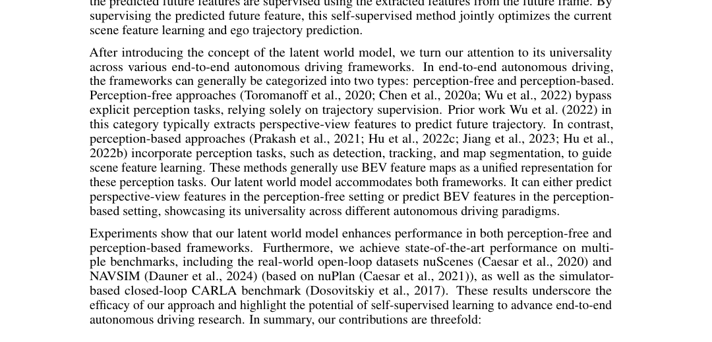
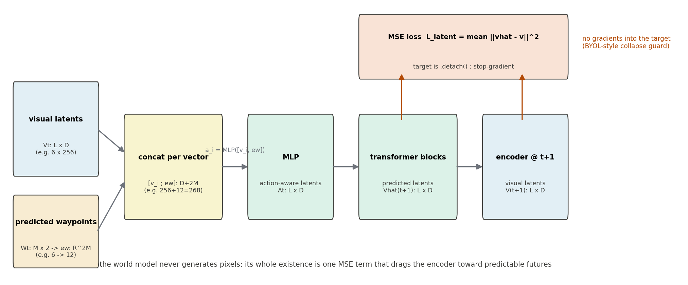
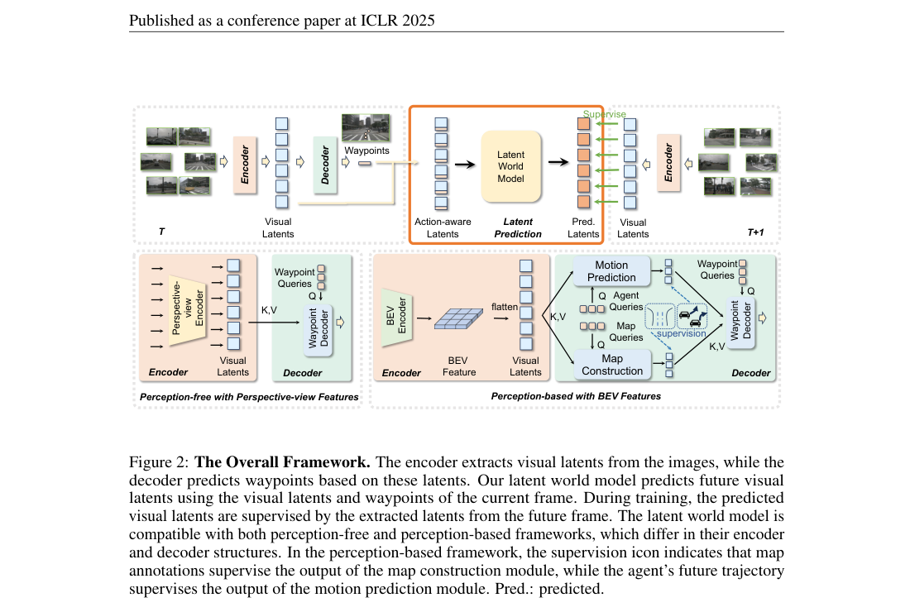
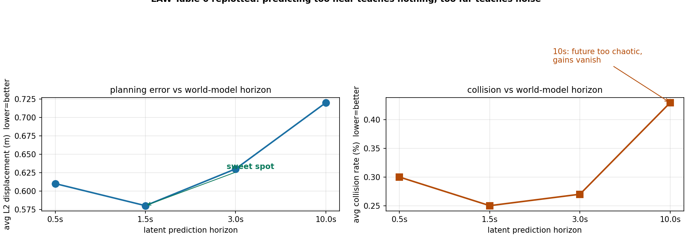

# 未来特征的一次 MSE：LAW 用潜空间预测给端到端规划加自监督

> **全局编号**：051-WM-law
> **论文标题**：Enhancing End-to-End Autonomous Driving with Latent World Model
> **作者**：Yingyan Li、Lue Fan、Jiawei He、Yuqi Wang、Yuntao Chen、Zhaoxiang Zhang、Tieniu Tan（中科院自动化所 NLPR、多模态人工智能系统全国重点实验室 MAIS、国科大未来技术学院）
> **会议**：ICLR 2025
> **arXiv**：2406.08481（[摘要页](https://arxiv.org/abs/2406.08481)；v1 2024-06 提交，v2 2025-02-28（camera-ready），下载的是最新 v2）
> **代码**：已公开并已 clone（https://github.com/BraveGroup/LAW，目录下 code/）。读过模型定义（projects/mmdet3d_plugin/LAW/）、损失与默认配置（projects/configs/law/default.py），论文与代码不一致处见"代码里世界模型的真面目"一节。
> **一句话核心洞见**：端到端规划器不需要更贵的感知标注来学好场景特征——让它用当前特征加自车轨迹去预测下一帧的特征，一次 MSE 自监督就能同时把表示和轨迹都变好；动作条件是这一切成立的关键。

## 端到端规划器真正缺的不是标注，是下一帧

端到端驾驶在 2024 年分成两派。Perception-based 一派（UniAD、VAD）相信：场景特征要好，就拿检测、跟踪、地图分割、occupancy 这些感知任务去"喂"它，标注越贵特征越好。Perception-free 一派（TCP 那一路）相信：只要轨迹监督就够了，感知标注是多余的包袱，省下来。但后一派有个谁都看得见的软肋：只用轨迹监督时，编码器学出的场景特征是"够用就好"的——轨迹损失只关心自车未来几秒走哪，编码器没有任何压力去保留那些"现在用不上、下一秒可能要命"的信息，比如被部分遮挡的前车。

LAW 的切入点是：两派缺的其实是同一个东西，一个不依赖人工标注、又能逼编码器保留动态场景信息的训练信号。图像世界模型（GAIA-1、Drive-WM）本来可以提供这种信号——预测未来嘛，天然要求理解现在。但它们全是扩散模型，生成一张未来图像要几秒钟，做训练时的辅助任务太贵了。于是作者做了一个减法：**不要像素，只要特征**。预测下一帧的潜特征（latent），用 MSE 监督，几毫秒的事。这个减法就是全文的起点，也是 Figure 1 要讲的对比：左边是"标注监督特征"的传统路，右边是"用下一帧监督特征"的 LAW 路。



*论文 Figure 1（第 2 页裁切）：(a) 传统方法用检测/跟踪/地图等感知标注辅助场景特征学习；(b) LAW 的自监督任务——用当前帧特征和预测轨迹预测下一帧的潜特征，再用下一帧真实提取的特征监督。蓝色是端到端规划器的主干。*

## 作者的底牌：自监督在驾驶里为什么偏偏是未来预测

2024 年中，自监督在视觉里最硬的牌是 MAE：遮住一块、重建这一块。但 MAE 是给静态图像设计的，驾驶输入是连续视频，时间维度上最自然的"遮住一块"就是"遮住下一帧"。更重要的是，驾驶的未来不是被动的——自车的动作会改变下一帧的内容（往左打方向，下一帧的路就往右偏）。传统的未来预测自监督（Dense Predictive Coding 那一路）不管动作，等于扔掉了驾驶数据里最强的结构信号。LAW 的底牌是把"动作条件"放进未来预测：预测 $V_{t+1}$ 时同时给 $V_t$ 和自车轨迹 $W_t$。Table 4 证明这张牌是硬的：世界模型只给视觉特征、不给预测轨迹时，perception-free 的 L2 平均只从 0.71 降到 0.68；把预测轨迹也给进去，降到 0.61。动作条件贡献了主要的增益——没有它，这个自监督任务就退化成普通的特征外推。

第二个底气是"通用性"。世界模型接在特征层、不碰编解码器的具体结构，所以同一套机制能同时塞进 perception-free（透视视角特征）和 perception-based（BEV 特征）两套框架。论文在三个基准、两种框架上全报了数：nuScenes 开环、NAVSIM 开环、CARLA 闭环。这种"一个机制处处能用"的写法是投 ICLR 的典型姿势——审稿人最难反驳的就是跨框架一致的增益。

## 公式 (1)：动作是怎么"揉"进特征里的

先把符号的形状一次摆清楚。视觉编码器从第 $t$ 帧图像提特征：

$$V_t = \{v^1_t, \dots, v^L_t\},\quad v^i_t \in \mathbb{R}^D$$

$L$ 是特征向量的个数（perception-free 里是 $N$ 个视角的查询结果，perception-based 里是展平的 BEV 图），$D$ 是通道数。航点解码器输出 $M$ 个未来航点 $W_t = \{w^1_t, \dots, w^M_t\}$，$w^i_t = (x^i_t, y^i_t)$。

**Action-aware latents 构造（公式 1）**：把 $W_t$（形状 $[M, 2]$）展平成一维向量 $ew_t \in \mathbb{R}^{2M}$，然后**每个**视觉特征向量都和这个航点向量拼起来，过一个 MLP：

$$a^i_t = \mathrm{MLP}([v^i_t,\, ew_t])$$

$[\cdot,\cdot]$ 是沿通道维拼接，$a^i_t$ 的形状和 $v^i_t$ 一样是 $\mathbb{R}^D$。几何上这个动作是：拿自车未来轨迹（12 个数，$M=6$ 时）当"调料"，给每个空间位置的特征向量都拌进去。注意是**每个向量都拼同一个** $ew_t$——动作是全局信息，不区分空间位置；区分空间位置的是后面 transformer 的自注意力。

拿一个小实例算一遍。设 $L=3$、$D=4$、$M=2$：$v^1_t = [0.5, -0.2, 0.8, 0.1]$，航点 $W_t = \{(1.0, 0.0), (2.0, 0.3)\}$，展平 $ew_t = [1.0, 0.0, 2.0, 0.3] \in \mathbb{R}^4$。拼接得 $[0.5, -0.2, 0.8, 0.1, 1.0, 0.0, 2.0, 0.3] \in \mathbb{R}^8$，MLP（$8 \to 4$）压回 $\mathbb{R}^4$ 得到 $a^1_t$。三个向量都这样处理，得到 $A_t \in \mathbb{R}^{3 \times 4}$。代码里这个 MLP 是三层（Linear-ReLU-Linear-ReLU-Linear），输入维度写死成 `hidden_channel + 6*2`——6 是 nuScenes 的航点数（3 秒、2Hz），12 是 $2M$。真实配置是 $D=256$、$L$ 为视角/空间 token 数。

## 公式 (2)(3)：世界模型只是一个 MSE

**未来潜预测（公式 2）**：

$$\hat{V}_{t+1} = \mathrm{LatentWorldModel}(A_t)$$

世界模型由 stacked transformer blocks 组成，自注意力在 $L$ 个特征向量之间做。论文 5.4 节还补了一句"利用 deformable self-attention 加速收敛"——但 clone 下来的代码里，世界模型是标准的 `nn.TransformerDecoderLayer`，整个 LAW 目录下没有任何 deformable attention 的实现。这个出入记在后面代码一节。

**未来潜监督（公式 3）**：

$$\mathcal{L}_{latent} = \frac{1}{L}\sum_{i=1}^{L} \|\hat{v}^i_{t+1} - v^i_{t+1}\|_2^2$$

用第 $t+1$ 帧图像**实际提取**的特征 $V_{t+1}$ 当 ground truth。整个"世界模型"的存在就是这一个 MSE：它不生成像素，不 rollout 多步，不输出不确定性。训练时梯度从这个 MSE 流回世界模型、流回 action-aware MLP、流回当前帧的编码器——编码器被迫学出"能预测下一帧"的特征。

这里论文没写、代码里有的一件事：**目标是 detach 的**。`forward_pts_train` 里写的是

```python
loss_rec = self.pts_bbox_head.loss_reconstruction(prev_pred_img_feat, cur_img_feat.detach())
```

`cur_img_feat.detach()` 切断了梯度进目标分支。这是 BYOL 式自监督的标准防塌缩手段：如果目标不 detach，编码器可以把所有帧的特征都输出成同一个常向量——预测和目标恒相等，MSE 为零，什么都没学到。论文公式 (3) 写的是朴素 MSE，一个字没提 stop-gradient。复现的人如果照论文写，大概率会遇到塌缩或训练不稳定；代码里的 detach 才是真正让它 work 的那一行。



*自绘图（fig-latent.py，真跑过）：LAW 世界模型的数据流与形状。注意目标分支的 detach——论文公式里没有，代码里有。*

损失的另外两项按框架拼。Perception-free（公式 4–7）：视角编码器 $v^{pf}_i = \mathrm{CrossAttention}(q^{view}_i, f^i, f^i)$（每个视角一个可学习 query 去捞对应视角的图像特征，PETR 式 3D 位置编码已加进 $f^i$）；解码器 $W = \mathrm{MLP}(\mathrm{CrossAttention}(Q_{wp}, V_{pf}, V_{pf}))$（$M$ 个航点 query）；航点监督是 L1：$\mathcal{L}_{waypoint} = \frac{1}{M}\sum_j \|w_j - \tilde{w}_j\|_1$；总损失 $\mathcal{L}_{pf} = \mathcal{L}_{latent} + \mathcal{L}_{waypoint}$。Perception-based（公式 8–9）：BEV 编码器（仿 Li et al. 2022b，BEV 图展平成 $[K, D]$），解码器按 VAD 的路子先做 motion prediction（$N_{agent}$ 个 query）和 map construction（$N_{map}$ 个 query），航点 query 再 cross-attend 这两路特征；总损失 $\mathcal{L}_{pb} = \mathcal{L}_{latent} + \mathcal{L}_{waypoint} + \mathcal{L}_{perception}$，其中 $\mathcal{L}_{perception} = \mathcal{L}_{agent} + \mathcal{L}_{map}$ 沿用 VAD 的定义。



*论文 Figure 2（第 4 页裁切）：整体框架。上半是潜预测链路（橙框）：当前帧特征 + 预测轨迹 → action-aware → 世界模型 → 预测特征 ← 下一帧真实特征监督。下半是两套框架的编解码器：左为 perception-free（透视视角特征），右为 perception-based（BEV 特征 + 感知任务）。*

## 代码里世界模型的真面目：三处论文没写的事

把 `projects/mmdet3d_plugin/LAW/` 读完，有三处和论文对不上，复现时每一处都踩得疼。

第一，**损失权重**。论文公式 (7) 写 $\mathcal{L}_{pf} = \mathcal{L}_{latent} + \mathcal{L}_{waypoint}$，读起来是 1:1。但 `LAW.__init__` 里 `wm_loss_weight=0.2`，`forward_pts_train` 里 `losses['loss_rec'] = loss_rec * self.wm_loss_weight`，而 `projects/configs/law/default.py` 没有覆盖这个值——所以默认配置下潜预测损失的权重是 0.2，不是 1。论文报的所有数字对应的是哪个权重？按仓库默认是 0.2。MSE 和 L1 的量级本来就不一样，0.2 这个数大概率是调过的，但论文里没有任何关于它的讨论。

第二，**世界模型的网络结构**。论文 5.2 节说"utilizes deformable self-attention for improved convergence"，代码里 `self._wm_decoder = nn.TransformerDecoder(wm_decoder_layer, num_tf_layers)`，`num_tf_layers` 默认 2，是标准的 TransformerDecoderLayer（自注意力 + cross-attention + FFN）。更有意思的是调用方式：`self._wm_decoder(action_aware_latent, action_aware_latent)`——decoder 的 tgt 和 memory 传的是同一份输入，cross-attention 子层退化成对同一组向量的二次注意力，实际起作用的主要是自注意力部分。论文把结构描述成"self-attention and feed-forward"，和代码的行为大体吻合，但"deformable"在代码里不存在。

第三，**潜损失只加在队列的最后一对帧上**。`forward_train` 里，`obtain_history_feat` 把队列里除最后一帧之外的每一帧都过一遍 head（只算航点损失），最后 `forward_pts_train` 用倒数第二帧预测出的潜特征和最后一帧 detach 后的真实特征算一次 `loss_rec`。论文 4.1 节的描述是"用 $t$ 预测 $t+1$"，方向一致，但论文没说一个 batch 里其实只有最后一对相邻帧产生潜损失——时序队列（`queue_length=4`）里前面的帧只贡献航点监督。

还有一处是对得上的：论文 Table 1 注脚说"We do not utilize the historical ego status information"，代码里 `forward_pts_train` 确实把 `ego_his_trajs`、`ego_lcf_feat`、`ego_fut_cmd` 拼成 `ego_info` 传给 head，但 `WaypointHead.forward` 的签名里 `ego_info=None` 之后就再也没用过它——传了，但没用。结论和论文一致，只是写法绕。

## Figure 3 那一幕：VAD 撞上去的那一秒，LAW 的特征里有什么

论文 Figure 3（第 10 页）是全文最有说服力的一张定性图：perception-based 框架下，同一场景，VAD 漏掉了一辆关键的前车（红圈），预测出的自车轨迹一头撞上去（黄圈）；LAW 抓住了那辆车，轨迹绕开。把这一秒放在 LAW 的机制里走一遍，能看出潜预测到底在"教"编码器什么。

设第 $t$ 帧，前车被自车 A 柱部分遮挡，只露出半个车尾。VAD 的编码器在这一帧的训练信号来自三处：检测/跟踪/地图的感知损失、motion 损失、航点 L1。感知损失只要求"检测到"，检测的框可以很粗糙；航点 L1 只关心自车轨迹点的坐标。没有任何一项要求编码器把"前车尾部那几个像素的运动趋势"保留进 BEV 特征——于是这部分信息在某层被平均掉了，BEV 特征里前车的位置是糊的，motion head 外推出的前车轨迹偏了，自车轨迹规划就撞了上去。

同一帧在 LAW 里多了一条梯度通路。编码器输出 $V_t$ 后，航点解码器给出 $W_t$（假设自车保持直行），action-aware 把 $W_t$ 拌进每个 BEV 向量，世界模型输出 $\hat{V}_{t+1}$，MSE 拿它和 $V_{t+1}$ 比。第 $t+1$ 帧里，前车尾部多露出了半米——$V_{t+1}$ 的对应位置有明确的变化。要让 MSE 下降，编码器必须在第 $t$ 帧就把"半个车尾"的信息写进 $V_t$ 的对应向量里，并且世界模型要学会"给定自车直行，这个向量下一帧会往哪个方向变"。这条通路不关心语义标签，只关心"下一帧的特征能不能从这一帧算出来"——它逼编码器保留的是**动态一致性**，而这恰恰是避撞需要的。VAD 漏掉的那辆车，在 LAW 的特征里是因为"预测下一帧需要它"而被留下来的。

这个解释也说明了 LAW 的适用边界：潜预测奖励的是"可预测的变化"。突然窜出的行人（不可预测）不会因此被更好地表示；静止的背景（太可预测）也不会带来增益。Table 6 的 horizon 实验是同一个道理的另一面。

## 预测多远最合适：Table 6 的甜点

nuScenes 上，世界模型预测 0.5s / 1.5s / 3.0s / 10.0s 后的潜特征（对应第 1/3/6/20 个未来关键帧），规划质量如下（L2 平均 / 碰撞平均）：0.5s 得 0.61 / 0.30；1.5s 得 0.58 / 0.25；3.0s 得 0.63 / 0.27；10.0s 得 0.72 / 0.43。



*自绘图（fig-horizon.py，真跑过）：Table 6 重绘。0.5s 处场景几乎没变，自监督学不到东西；1.5s 最好；10s 处未来太混沌，增益消失，L2 甚至比 0.5s 还差。*

论文把这个现象和 MAE 的 mask ratio 类比（太小太大学不到东西），这个类比是成立的：自监督信号的难度要落在"需要理解场景才能解，但又解得出来"的区间里。0.5s 的下一帧和当前帧几乎一样，MSE 不需要任何场景理解就能很小；10s 后的未来有太多不可预测的分叉，MSE 的梯度变成噪声。1.5s 是 nuScenes 数据上这个区间的中心——注意这是数据集相关的结论，换到 2Hz 的 NAVSIM 或城市场景，这个甜点位置会变，论文没有在其他基准上重复这个实验。

架构消融（Table 7）是同一个故事的结构版：Linear Projection（单层）0.70 / 0.42；两层 MLP 0.64 / 0.33；Transformer blocks 0.61 / 0.30。单层连"动作和特征的交互"都做不好；MLP 能做逐向量的非线性变换，但 $L$ 个向量之间没有交互；transformer 的自注意力让不同空间位置的预测可以互相借信息——"前车向量"的下一帧变化本来就和"路面向量"相关。这个排序说明世界模型里真正干活的是**空间交互**，不是单纯的容量。

## 数字的条件：三个基准，两种框架

nuScenes 开环（Table 1，L2 米 / 碰撞 %，1s/2s/3s/平均）：perception-free LAW 为 0.26/0.57/1.01/**0.61**，碰撞 0.14/0.21/0.54/**0.30**；perception-based LAW 为 0.24/0.46/0.76/**0.49**，碰撞 0.08/0.10/0.39/**0.19**。对比 VAD（0.72 / 0.22）和 BEV-Planner（0.55 / 0.59‡，‡是另一种碰撞计算方式，注脚已说明）。perception-based 的 LAW 是全表最好；perception-free 的 L2 0.61 好于 VAD 的 0.72，但碰撞 0.30 差于 VAD 的 0.22——L2 和碰撞的 trade-off 在这里是可见的，论文没有回避，把两个数都摆出来了。

NAVSIM（Table 2，test split，perception-free，ResNet-34）：LAW 的 PDMS 为 **84.6**（NC 96.4、DAC 95.4、TTC 88.7、Comf 99.9、EP 81.7），对比 TransFuser 84.0、PARA-Drive 84.0、UniAD 83.4、Ego Status MLP 65.6、人类 94.8。领先幅度很小（0.6 个点），但消融（Table 5）显示这个框架**不加**潜预测时只有 77.5（NC 94.4、DAC 89.4、EP 75.1），加上后涨到 84.6——7.1 个点的涨幅主要来自 DAC（+6.0）和 EP（+6.6）。也就是说潜预测主要改善的是"车道保持"和"敢往前开"这两项，这和"特征里保留了更多场景结构"的解释是一致的。

CARLA Town05 Long 闭环（Table 3，perception-free，TCP head）：LAW 的 DS 为 **70.1±2.6**（RC 97.8±0.9，IS 0.72±0.03），对比 DriveAdapter 65.9、ThinkTwice 65.0±1.7、TCP 57.2±1.5。注意这里的"perception-free 框架"实际用的是 TCP 的 head（论文 5.2 节写明了 follow Wu et al. 2022），所以 CARLA 的数是"TCP + 潜预测"，不是 4.2 节那个纯 transformer 框架。加潜预测前后（Table 5）：DS 从 67.9±2.1 到 70.1±2.6，RC 反而从 98.6 降到 97.8，涨的是 IS（0.68→0.72）——潜预测让车开得更守规矩，而不是更快。

## 怀疑式审读：哪些能信，哪些缺信息

先说这篇做得扎实的地方。跨三个基准（两个开环一个闭环）、两种框架报数，而且消融是真隔离变量：Table 4 把世界模型的输入拆成"只给视觉特征"和"再给预测轨迹"两档，证明动作条件是增益的主要来源；Table 6、Table 7 分别隔离了 horizon 和网络结构。CARLA 报了 3 次运行的均值方差（±2.6），在这个领域算诚实的。nuScenes 表里两种碰撞计算方式用 ‡ 标出来了，没有混着比。

缺的信息和可疑之处：

第一，**损失权重的不一致**（前面代码一节已展开）：论文公式写 1:1，代码默认 0.2。0.2 很可能是调过的，但论文没有任何敏感性分析。如果 0.2 是尖峰，换数据集就要重调；论文没有给区分平坦还是尖锐的信息。

第二，**随机种子和方差**。只有 CARLA 报了多次运行；nuScenes 和 NAVSIM 的数字是单次还是平均，论文没说。NAVSIM 上 84.6 对 84.0 的 0.6 个点领先，在没有方差的情况下是站不住"SOTA"三个字的——Table 5 里同框架加减潜预测的 7.1 个点才是真正可信的增益。

第三，**perception-based 的两阶段训练**。论文说第一阶段 48 epoch 只训感知、第二阶段 12 epoch 加航点和潜损失。仓库的 `projects/configs/law/` 里只有一个 `default.py`（perception-free，total_epochs=12），两阶段的配置没有公开。这意味着 perception-based 的 nuScenes 最好成绩（0.49 / 0.19）目前照论文是复现不出来的——缺第一阶段的完整配置。

第四，**超参数搜索**。学习率、权重、horizon 的取值都没有给搜索范围。Table 6 的四个 horizon 是等比取的（0.5/1.5/3.0/10.0），1.5s 最优，但 1.0s 和 2.0s 呢？甜点曲线的形状只有一个点撑着。

第五，**nuScenes 评测本身的局限**。L2 和碰撞都是开环指标，而且 nuScenes 被论文自己称为"overly simplistic"（5.1 节原话）——这也是他们加 NAVSIM 的原因。开环 L2 好不等于闭环能开，CARLA 的闭环数是这篇论文里含金量最高的一组。

第六，**训练代价**。nuScenes perception-free：8 张 A6000、batch 8、12 epoch——墙钟时间没写。CARLA：60 epoch、batch 128。复现的总成本论文没有给数。

## 带走的东西

LAW 留下的可迁移想法是：**自监督信号不一定要重建像素，"预测下一帧的特征"是一个便宜到可以随手加的辅助任务，而它的动作条件版本恰好利用了驾驶数据独有的结构**（自车动作决定下一帧）。它和 MAE 的区别在于，它不问"这一帧里有什么"，问的是"给定我打算怎么动，下一帧会变成什么样"——这个问题天然和规划对齐，所以同一个梯度能同时改进表示和轨迹。

这篇论文也留了一个诚实的提醒：读论文时，损失函数的权重、目标分支的 detach、"deformable"这种形容词，都要去代码里验一遍。LAW 的三个关键细节（0.2 的权重、detach 的目标、不存在的 deformable attention）全都不在正文里，但每一个都决定复现的成败。方法论文档里最值钱的部分，常常是作者觉得不值一提的那几行代码。
