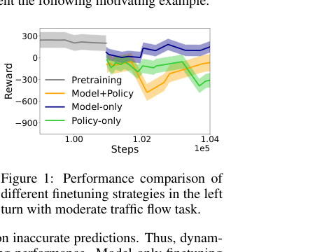
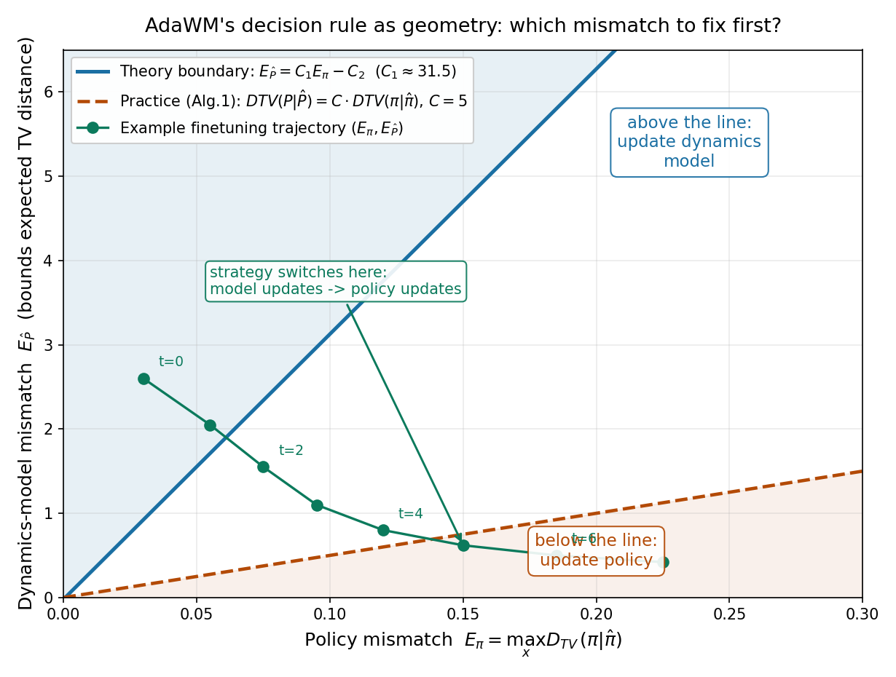
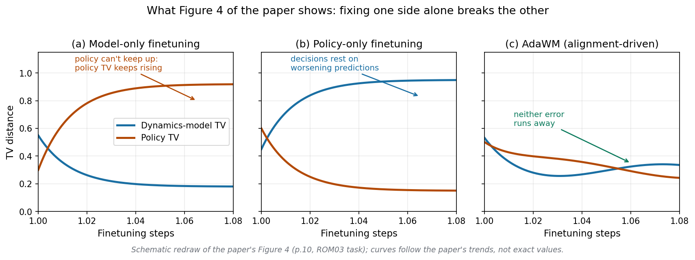
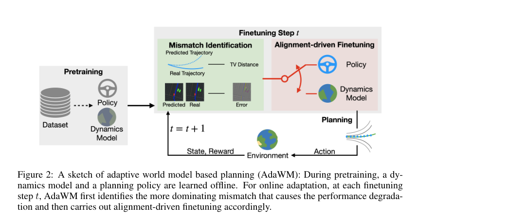

# 微调先问诊：世界模型失配和策略失配，到底哪个在拖后腿

> - 全局编号：052-WM-adawm
> - 论文标题：AdaWM: Adaptive World Model Based Planning for Autonomous Driving
> - 作者：Hang Wang（UC Davis，工作完成于 Bosch Research North America 实习期间）、Xin Ye、Feng Tao、Chenbin Pan、Abhirup Mallik、Burhaneddin Yaman、Liu Ren（均为 Bosch Research North America / Bosch Center for Artificial Intelligence）、Junshan Zhang（UC Davis）
> - 会议：ICLR 2025
> - arXiv：[2501.13072](https://arxiv.org/abs/2501.13072)（v1 2025-01-22，v2 2025-01-23；本次下载并精读的是 v2，即 ICLR 2025  camera-ready 对应的版本）
> - 代码：未找到官方代码。论文正文、附录均未给出仓库链接；Reproducibility Statement 写的是将来时（"we will provide"）；两个收录该论文的世界模型 survey 仓库的 Code 一栏均为留空。可以认为截至 2026-10，作者没有公开实现。
> - 一句话核心洞见：pretrain-finetune 在世界模型 RL 里直接套用会暴跌，暴跌来自两个不同源头（动力学模型不准、策略本身过时），而最有效的微调不是"模型和策略轮流各修一步"，是每一步先量出哪边失配更大、只修失配大的那一边。

## 右转练好的车，左转时为什么"只修模型"比"轮流修"好

论文第 2 页的 Figure 1 是全文的赌注，值得先看三分钟再读别的。

*论文 Figure 1（出自 PDF 第 2 页）：横轴是微调步数（1.00×10⁵ 起），纵轴是 reward。四条曲线：灰色是预训练阶段的 reward 水平（约 300），蓝色 model-only、橙色 model+policy（交替）、绿色 policy-only。*

场景很具体：智能体在预训练里学会了"在四路交叉口右转"，微调任务是"在相似车流下左转"。三条微调曲线开局一起往下掉——分布偏移，谁都躲不过。但随后分叉了：蓝色（只修动力学模型）迅速爬回 0 以上，橙色（模型策略交替修）和绿色（只修策略）在 -100 到 -600 之间挣扎。

这个分叉是反直觉的。直觉上，"两个都修"应该不比"只修一个"差——修得更多，覆盖面更大。但数据说不是。作者的解释是：右转切左转，真正被挑战的是智能体的动力学模型。BEV 里迎面来车的时空关系整个镜像翻转了：预训练里模型学会的是"右侧来车以某种方式接近"，现在来车从左侧接近，模型对"下一秒车在哪"的预测系统性地错。而策略（踩油门还是刹车、打多少方向）本身错得没那么离谱——策略的输入是模型的预测，预测错了，决策自然跟着错。所以这场暴跌里，**动力学模型失配是主犯，策略失配是从犯**。只修模型等于直捣主犯；交替修等于把一半的更新预算花在从犯身上，还顺带把策略往错误预测的方向又推了一把。

这就是全文的起点，也是作者的底牌：微调策略的选择本身，决定了性能恢复的速度。Figure 1 右边那个带框的问题——"何时、如何微调预训练的动力学模型和规划策略，才能缓解分布偏移带来的性能下降"——不是修辞，是这篇论文唯一真正想回答的问题。

## 前人撞墙的地方：pretrain-finetune 在 RL 里不是免费午餐

2025 年初，世界模型做自动驾驶的标准姿势是 DreamerV3 那一套：离线训一个 latent dynamics model，再用它去训策略。Think2Drive（Li et al., 2024）已经证明这条路在 CARLA 上走得通。但从头训一个世界模型太贵了——状态空间大、驾驶场景复杂，于是一个很自然的想法出现了：先在离线数据上预训练，再到新任务上在线微调。监督学习里这套范式是常识，Julian et al. (2021) 在机器人 RL 里也验证过微调有效。

但 RL 里的 pretrain-finetune 有一个监督学习里没有的麻烦：**预训练的模型和策略是耦合在一起的**。监督学习里，backbone 训偏了，finetune 时梯度会把它拉回来，损失函数是诚实的。但在 model-based RL 里，策略是在"世界模型的想象中"训出来的——策略的好坏依赖于模型的预测准不准。如果新任务下模型预测是错的，策略的每一步更新都在拿错误信号训练自己；反过来，如果策略本身过时了（新任务的最优动作变了），光修模型也救不回来。Wexler et al. (2022) 专门研究过 warm-start RL 的性能退化，Uchendu et al. (2023) 的 jump-start RL 也是在处理"预训练初始化反而坏事"的问题。

所有人都默认的一个假设是：**预训练初始化再差，也比随机初始化强，微调总能把它拉回来**。AdaWM 推翻的正是这个假设的后半句——不是"微调能不能拉回来"，而是"**怎么微调**才能拉回来"。Figure 1 说明，同样的预训练起点、同样的微调预算，选错微调策略，恢复速度差出几倍。这是一个结构性的问题，不是调参能解决的：交替更新在逻辑上就不区分"谁是主犯"。

## 作者的底牌：一张把性能差距拆成两项的上界

论文第 2.1 节的 Theorem 1 是全文的承重墙。它的形式是一个性能差距上界：

$$\eta - \hat\eta \le \left(\frac{\gamma^K E_{\max}}{1-\gamma^K} + \Gamma\frac{2\gamma E_{\hat P}}{1-\gamma^K}\right) + \Gamma\left(\frac{4r_{\max}E_\pi}{1-\gamma} + \frac{4\gamma E_\pi}{1-\gamma^K}\right)$$

先把符号一个个落实。$\eta$ 是预训练任务上的期望回报，$\hat\eta$ 是把预训练的模型和策略直接搬到新任务（真实动力学为 $\hat P$）上的期望回报，$\eta - \hat\eta$ 就是 Figure 1 里开局暴跌的那个差距。$E_{\hat P}$ 是动力学模型失配：$\mathbb{E}_\pi[D_{TV}(P\|\hat P)]$ 的上界，即策略 $\pi$ 的访问分布下、学到的转移 $P$ 与真实转移 $\hat P$ 之间的总变差距离。$E_\pi$ 是策略失配：$\max_x D_{TV}(\pi\|\hat\pi)$，预训练策略 $\pi$ 与新任务最优策略 $\hat\pi$ 之间的最大 TV 距离。$\gamma$ 是折扣因子，$K$ 是世界模型做 imagine rollout 的前瞻步数，$r_{\max}$ 是单步奖励上界，$E_{\max}$ 是单步状态预测误差上界（来自附录 Lemma 1 的 RNN 泛化界），$\Gamma$ 是一串 Lipschitz 常数拼出来的系数：$\Gamma := \frac{1-\gamma^{K-1}}{1-\gamma}L_r(1+L_\pi) + \gamma^K L_Q(1+L_\pi)$，其中 $L_Q = L_r/(1-\gamma)$。

这个上界的形状本身就是答案。注意它天然分成两坨：第一坨括号里只有 $E_{\hat P}$ 和 $E_{\max}$（模型的事），第二坨括号里只有 $E_\pi$（策略的事）。作者没有停留在"两项都有贡献"这种正确的废话上，而是问了一个更狠的问题：**什么时候第一坨比第二坨大？** 令第一坨大于第二坨，解出 $E_{\hat P}$ 的条件：

$$E_{\hat P} \ge C_1 E_\pi - C_2,\quad C_1 = \frac{2r_{\max}(1-\gamma^K)}{\gamma-\gamma^2} + 2,\quad C_2 = \frac{\gamma^{K-1}E_{\max}}{2\Gamma}$$

推导过程在附录 B.1，就是把两坨的不等式移项：$\Gamma\frac{2\gamma}{1-\gamma^K}E_{\hat P} \ge \Gamma(\frac{4r_{\max}}{1-\gamma} + \frac{4\gamma}{1-\gamma^K})E_\pi - \frac{\gamma^K E_{\max}}{1-\gamma^K}$，两边同除 $\Gamma\frac{2\gamma}{1-\gamma^K}$ 即得。其中 $\frac{1-\gamma^K}{2\gamma}\cdot\frac{4r_{\max}}{1-\gamma} = \frac{2r_{\max}(1-\gamma^K)}{\gamma(1-\gamma)} = \frac{2r_{\max}(1-\gamma^K)}{\gamma-\gamma^2}$，而 $\frac{1-\gamma^K}{2\gamma}\cdot\frac{4\gamma}{1-\gamma^K} = 2$，正好对应 $C_1$ 的两项；常数项给出 $C_2$。这一步是初等代数，论文没有跳步，附录 B.1 写全了。

这条判据的几何含义是：在 $(E_\pi, E_{\hat P})$ 平面上画一条直线 $E_{\hat P} = C_1 E_\pi - C_2$，点落在线上就修模型，落在线下就修策略。我把它画了出来，还把论文实现里实际用的简化判据也画了上去，对比之下能看出很多东西：

*自绘图：蓝线是理论判据，参数用附录 Table 6 的 DreamerV3 默认值算出（$\gamma=0.997$，$K=15$，取 $r_{\max}=1$，得 $C_1 \approx 31.5$；$C_2$ 需要 $L_r, L_\pi$ 等 Lipschitz 常数，论文未给具体值，图中取示意的小平移量 0.02）。红虚线是 Algorithm 1 实现中实际用的简化判据 $D_{TV}(P\|\hat P) > C\cdot D_{TV}(\pi_t\|\pi_\omega)$，$C=5$（论文 Table 4 最优值附近）。绿色是示意的微调轨迹：起点模型失配主导，逐步下降穿过分界线后切换策略。*

这张图暴露了论文最诚实也最微妙的一处：**理论判据和实现判据差了一个数量级**。$C_1 \approx 31.5$ 意味着，按定理的字面意思，只有当模型失配达到策略失配的 30 多倍时，才值得修模型——这几乎永远在修策略。为什么理论这么保守？因为上界里策略那一项带着 $\frac{1}{1-\gamma}$ 的放大（$\gamma=0.997$ 时这个因子是 333），Lipschitz 界本身就松，松的上界导出的判据自然偏向"别修模型"。作者没有硬用这条线，而是在 Algorithm 1 里把它简化成 $D_{TV}(P\|\hat P) > C\cdot D_{TV}(\pi_t\|\pi_\omega)$，把 $C$ 当成超参数调（Table 4 试了 0.5 到 100，最优在 5~10）。这个处理是务实的，但读者应该清楚：**定理给的是"按失配大小排序"的思想，实现给的是"调一个阈值"的工程**。两者之间的距离，就是理论工作的常态——定理负责指方向，超参数负责落地。论文没有明说这一点，但 Figure 5 和 Table 4 的存在本身就是证据：如果理论常数能直接用，就不需要扫 $C$ 了。

## 从定理到代码：三处不得不做的"缩水"，论文没有细说

判据 $E_{\hat P} \ge C_1 E_\pi - C_2$ 写在纸上很漂亮，但没有一个量是能直接算的。Algorithm 1（论文第 7 页）把它落地时，做了三处替换，每一处都值得停下来看：

**第一处：$E_{\hat P}$ 和 $E_\pi$ 都算不出来，换成能采样的 TV 代理。** $E_{\hat P}$ 的定义里有真实动力学 $\hat P$，$E_\pi$ 的定义里有新任务的最优策略 $\hat\pi$——这两个都是未知量，写进定理可以，写进代码不行。Algorithm 1 第 3 行的做法是：用预训练阶段收集的 replay buffer $B$ 和当前在线采到的样本 $W$，算 $D_{TV}(\pi_t\|\pi_\omega) \approx \max_x \|\pi_t(a|x) - \pi_\omega(a|x)\|$ 作为策略失配，用 $\|P(x,a) - \hat P(x,a)\|_1$ 作为模型失配，并引用 Janner et al. (2019) 说这是"measure state-action visitation distribution"的做法。这里有两个跳步。先说策略这一项：定理里的 $E_\pi$ 是"预训练策略 vs 最优策略"，代码里算的却是"当前策略 $\pi_t$ vs 预训练策略 $\pi_\omega$"，即**策略在微调中的漂移**，不是策略的次优性。这两个量只有在"预训练策略接近最优"的假设下才近似成正比，而这正是微调初期最不成立的时候。再说模型这一项：$\|P - \hat P\|_1$ 里的真实 $P$ 从哪来？论文说"following Janner et al. (2019)"，但 Janner 的 MBPO 论文里并没有直接估计动力学 TV 距离的方法——MBPO 用的是模型集成的不一致性（ensemble disagreement）作为模型误差的代理。AdaWM 到底怎么从样本里算出 $\|P(x,a)-\hat P(x,a)\|_1$，论文没有展开，没有代码可以对证。这是全文最弱的一环：**整个"识别主导失配"的机制，架在一个估计方法语焉不详的代理量上**。Figure 4 的曲线走得符合预期，是这个代理有效的旁证，但不是证明。

**第二处：$C_1, C_2$ 太保守，换成一个可调的 $C$。** 上一节已经算过，理论 $C_1 \approx 31.5$，而 Table 4 扫出来的最优 $C$ 在 5~10 之间。实现里的判据 $D_{TV}(P\|\hat P) > C\cdot D_{TV}(\pi_t\|\pi_\omega)$ 把 $C_2$ 的平移也吞掉了。这意味着论文 Table 4 的 $C$ 消融，本质上是在**重新校准理论判据的斜率**。$C$ 太大（=100）时判据几乎永不成立，退化成 policy-only；$C$ 太小（=0.5）时几乎永远成立，退化成 model-only——Table 4 里这两端的数据（C=100 时 ROM03 上 TTC 1.17/SR 0.45，C=0.5 时 1.23/0.58）正好对应 Table 3 里 policy-only（0.46/0.72）和 model-only（0.95/0.60）的退化水平，逻辑自洽。

**第三处：更新方式也要省钱。** 即使决定了"这一步修模型"，把 77M 参数的 DreamerV3 模型全量微调一小时也是浪费。论文给了两招：

- **修模型：NoLa 式低秩更新。** 论文写的是 $\phi' = (B'Z)^\top\Phi$，微调时只更新 $B$。这是 Koohpayegani et al. (2024) 的 NoLa（论文里写成 "LoRa-based"，疑似笔误，应为 LoRA-based）：标准 LoRA 是给权重加一个可学习的低秩增量 $\Delta W = AB$，NoLa 更进一步——把增量展开在一组**冻结的随机基** $Z$ 上，只学系数 $B$。几何上说，NoLa 假设"有用的权重更新"落在某个随机低维子空间里，微调只在这个子空间里找方向。$Z$ 和 $\Phi$ 在预训练后冻结，每步只动 $B$，可训练参数量从全模型降到 $B$ 的尺寸。论文没有给出 $Z, B, \Phi$ 的具体形状（无代码可查），这是未确认的细节。
- **修策略：凸组合只调权重。** 策略网络 $\omega$ 被写成 $D$ 个子单元的加权凸组合 $\Omega = \sum_{i=1}^D \delta_i \omega_i$，微调时只更新权重向量 $\Delta = [\delta_1,\dots,\delta_D]$，即 $\omega_t = (\Delta')^\top\Omega$。$D$ 个子单元 $\omega_i$ 从哪来？论文没有定义——是预训练的不同 checkpoint？是多个头？还是把网络切成 $D$ 块？都没有说。这是方法部分第二处语焉不详的地方。能确定的是更新量很小（$D$ 个标量），方向是"在已有子策略之间重新分配权重"，而不是从头学动作。

两招的共同点是：**微调只动极少数参数**。这既是效率考虑，也暗合了"别把预训练的底子洗掉"的直觉。

## 带着数字走一遍 Algorithm 1：右转预训练，左转微调的第一步

把上面的东西放在一个具体场景里跑一遍。设定：预训练任务 Pre-RTM03（Town03，中等车流，右转），微调任务 LTM03（Town03，中等车流，左转）——和论文 Table 2 的设置一致。折扣 $\gamma=0.997$，前瞻 $K=15$，阈值取论文默认的 $C=5$。

**第 $t$ 步（微调刚开始）。** 智能体用当前策略 $\pi_t$（≈预训练策略 $\pi_\omega$）和当前动力学模型 $WM_t$ 在 LTM03 里跑，采到一批新样本 $W = \{(x,a,r)\}$。现在算两个失配：

- 模型失配：$D_{TV}(P\|\hat P) \approx \|P(x,a)-\hat P(x,a)\|_1$。直观上，BEV 里左转弯道上，对向来车从左侧接近，而预训练模型预测的是"右侧来车"的模式，状态-动作访问分布对不上。假设算出来是 **0.42**。
- 策略失配：$D_{TV}(\pi_t\|\pi_\omega) \approx \max_x\|\pi_t(a|x)-\pi_\omega(a|x)\|$。微调刚开始，$\pi_t$ 还没怎么动，漂移很小，假设是 **0.05**。

判据：$0.42 > 5 \times 0.05 = 0.25$，成立 → **更新动力学模型**。执行 NoLa 更新：$B' \leftarrow B$（只动系数矩阵），$\phi_t = (B'Z)^\top\Phi$，策略原样不动。

**第 $t+1$ 步。** 模型被修了一步，对左转弯道上来车的预测准了一些，模型失配降到 0.20；但策略还是那个"为右转优化"的策略，在新模型下显得越来越不合拍，策略漂移涨到 0.06。判据：$0.20 > 5\times 0.06 = 0.30$？不成立 → **更新策略**：$\Delta' \leftarrow \Delta$，$\omega_t = (\Delta')^\top\Omega$，模型原样不动。

**第 $t+2$ 步及以后。** 两边交替被"点名"，哪边失配大修哪边。这正是 Figure 4(c) 里两条 TV 曲线都被按住、谁也不失控的由来。而 model-only（Figure 4a）相当于判据永远成立：模型 TV 下降了，但策略 TV 一路从 0.3 爬到 0.9——策略拿着越来越准的预测，却还是那个过时的决策函数；policy-only（Figure 4b）反过来：策略 TV 下降，模型 TV 从 0.45 爬到 0.95——决策函数在修，但它依据的预测越来越错。

*自绘图：按论文 Figure 4（第 10 页，ROM03 任务）的走势重画的示意图。曲线形状复刻论文原图的趋势（非精确数值）：(a) 只修模型，策略 TV 失控上升；(b) 只修策略，模型 TV 失控上升；(c) AdaWM 交替点名，两条曲线都被压住。*

*论文 Figure 2（出自 PDF 第 3 页）：AdaWM 流程草图。左侧预训练得到策略和动力学模型；每个微调步先做 Mismatch Identification（比较预测轨迹与真实轨迹的 TV 距离），再按结果把更新路由到 Policy 或 Dynamics Model；环境返回 state/reward，进入下一步。*

## 实验数字：先看 Table 3，再看 Table 2

论文的实验设计里，Table 2 和 Table 3 回答的是两个不同的问题，顺序不能反。

**Table 3 回答的是论文真正的问题：微调策略选哪个？** 四个任务（ROM03 环岛/中等车流/Town03、RTD12 右转/密车流/Town12、LTM03 左转/中等车流/Town03、LTD03 左转/密车流/Town03）， baseline 是同一个 DreamerV3 预训练模型（即 Table 3 的 "No finetuning" 行），只换微调策略。数字（TTC↑ / SR↑）：

| 任务 | No finetuning | Policy-only | Model-only | Model+Policy | AdaWM |
|---|---|---|---|---|---|
| ROM03 | 0.95 / 0.40 | 0.46 / 0.72 | 0.95 / 0.60 | 0.72 / 0.52 | **2.05 / 0.82** |
| RTD12 | 0.42 / 0.32 | 1.21 / 0.63 | 0.83 / 0.48 | 0.92 / 0.50 | **1.25 / 0.66** |
| LTM03 | 0.25 / 0.28 | 0.21 / 0.61 | 1.39 / 0.68 | 1.09 / 0.60 | **1.32 / 0.72** |
| LTD03 | 0.15 / 0.35 | 0.62 / 0.61 | 1.49 / 0.63 | 1.21 / 0.58 | **1.92 / 0.70** |

AdaWM 在四个任务、两个指标上全胜。几个值得细看的点：第一，**交替更新（Model+Policy）确实不如单修一边**——LTD03 上交替是 1.21/0.58，model-only 是 1.49/0.63，policy-only 是 0.62/0.61，交替卡在中间，印证了 Figure 1 的论点：不加区分地两边都修，等于把更新预算浪费在次要矛盾上。第二，policy-only 在 ROM03 上的 TTC 是 0.46，**比不微调的 0.95 还低**——在这个接近预训练分布的任务上，盲目修策略把安全性修坏了（SR 倒是从 0.40 涨到 0.72，能开到终点，但 TTC 几乎腰斩，开得更险）。这个细节论文没有点评，但它恰恰说明"修策略"不是无害操作。第三，AdaWM 的 TTC 提升幅度（ROM03 上 0.95→2.05，LTD03 上 0.15→1.92）比 SR 提升更夸张，说明它主要修的是**安全性**（TTC 是碰撞前时间），而不是单纯把路线开完。

**Table 2 把 VAD、UniAD 拉进来，回答的是另一个问题：微调有没有用？** 这两个是监督学习方法，用 Bench2Drive 数据集训好的公开 checkpoint，直接在 CARLA 闭环里测，不做微调。结果上 AdaWM 全面碾压（比如 LTD03：AdaWM 1.92/0.70，DreamerV3 0.15/0.35，VAD 0.09/0.10，UniAD 0.03/0.04）。但这个比较的口径是歪的：VAD/UniAD 是离线方法，压根没有为在线微调设计，拿"在新任务上在线微调 1 小时的 AdaWM"去比"零微调的离线 checkpoint"，赢是应该的。这个表的作用是立靶子，不是证方法。论文真正的证据是 Table 3，读者应该把权重放在那里。

**Table 4 是 $C$ 的消融，也顺带暴露了默认 $C=5$。** Table 3 里 AdaWM 在 ROM03 的 2.05/0.82 和 Table 4 里 C=5 行的 2.05/0.82 完全一致，所以论文主结果用的是 $C=5$。C=10 在 ROM03 上甚至更好（2.15/0.85），但在 RTD12 上略降（1.25/0.62 vs C=5 的 1.25/0.66），作者选了折中的 5。$C$ 在 2~50 之间表现都稳，100 和 0.5 两端崩——和上一节的分析一致：两端分别退化成 policy-only 和 model-only。

附录 G 还有五个更难的场景（HC13 高速 cut-in、HE12 高速出口、YE12 礼让救护车、BI12 阻塞路口、VT11 转弯遇行人），AdaWM 同样全胜（Table 7：HE12 上 SR 从 DreamerV3 的 0.52 涨到 0.89；Table 8：VT11 上 SR 从 0.58 涨到 0.88）。Table 9 的策略对比在五个场景下复刻了 Table 3 的结论。

## 怀疑式审读：哪些能信，哪些要打问号

**先说做得好的地方。** 第一，Figure 4 这个消融是整篇论文最有价值的一张图：它没有只报"我们赢了"，而是把"单修一边会把另一边修坏"的机制画了出来，三个面板互相印证，逻辑闭环。第二，附录 E 把 DreamerV3 的超参数表（Table 6）原样贴出来，预训练 12 小时 + 微调 1 小时、单张 V100、77M 参数的 Large 模型，代价交代得清楚。第三，Table 4 对 $C$ 的扫描是诚实的：没有只报最优的 5，而是把 0.5 和 100 两端的崩溃也放出来，让读者看到方法的边界。

**再说问号，按严重程度排。**

第一，**没有随机种子，没有误差棒**。Table 2 到 Table 9 全是单点数字。Figure 1 和 Figure 3 的曲线带阴影（看起来像多次运行的标准差），但正文和附录没有任何地方说明跑了几个种子、阴影是什么。CARLA 闭环评估的方差是出了名的大，SR 0.82 和 0.72 之间差 0.1，如果这是单次运行的数字，结论的稳固性要打折扣。这是全文最大的实验短板。

第二，**TV 失配的实际估计算法没有交代**。Algorithm 1 第 3 行的 $\|P(x,a)-\hat P(x,a)\|_1$ 在真实环境里算不出来（$\hat P$ 未知），论文一句 "following Janner et al. (2019)" 带过。但 Janner 的论文里并没有这个估计器——那篇论文用的是集成方差做 early stopping。没有代码，这一步是黑箱。而整个方法的"自适应"都建立在这一行上。

第三，**两个高效更新的具体形态语焉不详**。NoLa 的 $Z, B, \Phi$ 形状未给；策略的 $D$ 个子单元 $\omega_i$ 怎么来的、$D$ 取多少，未给。这两处是"承重结构"（没有它们，1 小时微调的效率主张不成立），但论文只给了公式名字。

第四，**基线口径问题**（上一节已说）：Table 2 的 VAD/UniAD 是陪跑，真正的对照是 Table 3。论文摘要里 "significantly improves the finetuning process" 的表述如果被理解成"全面超越 SOTA 方法"，Table 2 的口径是撑不起的；它撑得起的是"在同一个预训练起点上，我们的微调策略是最好的"。

第五，**BEV 输入来自特权信息**。附录 E 原话：用 CARLA 提供的 location 和 map topology 等特权信息构建 BEV（128×128 语义分割图），而不是从相机/LiDAR 原始传感器做感知。这意味着世界模型学的是"在真值语义 BEV 上的动力学"，难度比从原始传感器端到端低一档。论文正文第 7 页说观测是 BEV、"unifies the multi-modal information"，没有强调这是特权信息构建的。对自动驾驶读者来说，这是一个需要知道的前提：这篇论文验证的是**规划层面的微调策略**，不是感知层面的。

第六，**奖励函数的六个权重没给**。附录 C 写了 $R_t = w_1R_{safe} + \dots + w_6R_{target}$，六个分量的含义都写了（TTC 安全、jerk 舒适、时间、超速惩罚、朝向、航点跟随），但 $w_1$ 到 $w_6$ 的具体值在正文和附录里都找不到。复现不了奖励，就复现不了 Figure 1 的 reward 曲线。

第七，**几处笔误和记号小毛病**：Algorithm 1 的 "Reply buffer" 应为 "Replay buffer"；正文引用 NoLa 时写成 "LoRa-based"（LoRA 的 A 不应大写，且 NoLa 和 LoRA 是两个方法）；$\Gamma$ 的定义在正文用 $K$、附录 B 用 $L$，前后不一致；Table 3 的表头 "SR,," 有多余逗号。这些不影响结论，但说明成稿比较赶。

第八，**动作空间是离散的**：加速度三档 $[-2, 0, 2]$，方向盘五档 $[-0.6, -0.2, 0, 0.2, 0.6]$，共 15 个离散动作。定理里把策略写成 $L_a$-Lipschitz 的连续映射，实验里却是离散动作空间——理论假设和实验设置之间有一道缝。离散动作下 TV 距离的计算倒是更直接，但论文没有讨论这道缝。

## 能带走的东西

撇开自动驾驶，这篇论文留了一个可以迁移的通用想法：**微调一个耦合系统时，先诊断、再开药**。模型和策略（或者一般的"世界模型"和"决策器"）在预训练里是 co-adapted 的，分布偏移会同时打裂两边，但两边的裂缝不一样大。AdaWM 的贡献不是 NoLa 也不是凸组合——那两招都是现成的——而是把"哪边裂缝大"变成一个每步都算的判据，并且用定理告诉你这个判据长什么样（$E_{\hat P} \ge C_1E_\pi - C_2$），即使最后实现时把它简化成了一个可调阈值。

反过来，这篇论文也给后来人留了两道具体的题。第一道：TV 失配的在线估计到底怎么做才可靠？论文绕过去了，但这是"自适应"三字的地基——地基是泥的，房子再漂亮也要打问号。第二道：判据里的 $C$ 能不能不靠扫参？Table 4 说明 $C$ 在 2~50 之间都 work，这既是好消息（不敏感），也是坏消息（说明判据本身很粗，精细的理论常数 $C_1\approx 31.5$ 根本用不上）。如果有人能把 $C_1, C_2$ 里那些 Lipschitz 常数在线估计出来，让理论判据真正转起来，那才是把这篇论文的许诺兑现了。

*精读所用 PDF：`052-WM-adawm.pdf`（arXiv:2501.13072v2，共 25 页，含附录 A–G）。原图裁切：`paper-fig1.png`（Figure 1，出自第 2 页）、`paper-fig2.png`（Figure 2，出自第 3 页）。自绘图脚本：`fig-decision-plane.py`、`fig-mismatch-evolution.py`（均已运行生成 PNG）。*
