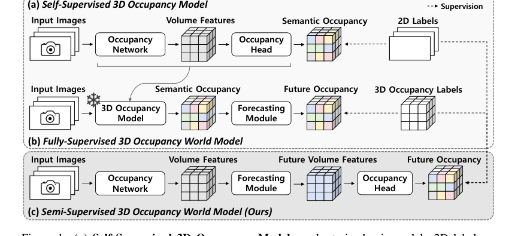
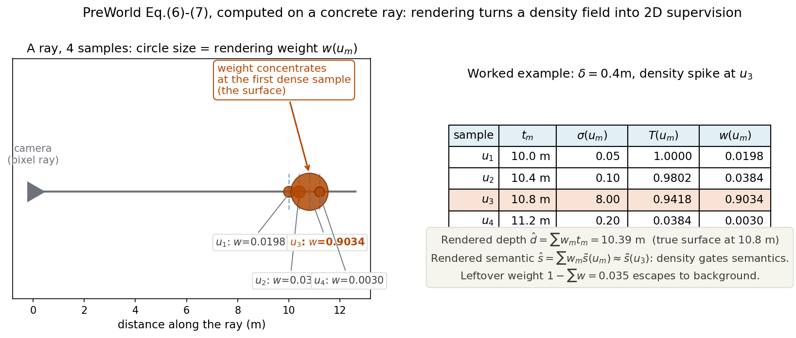
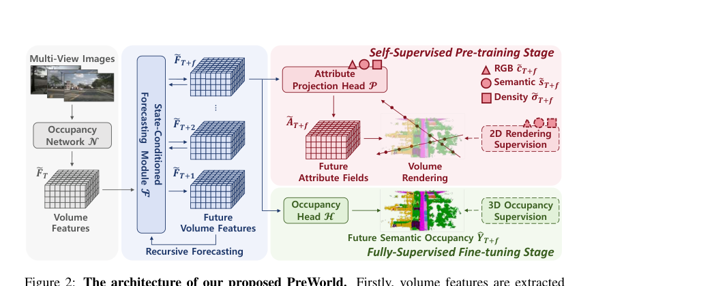
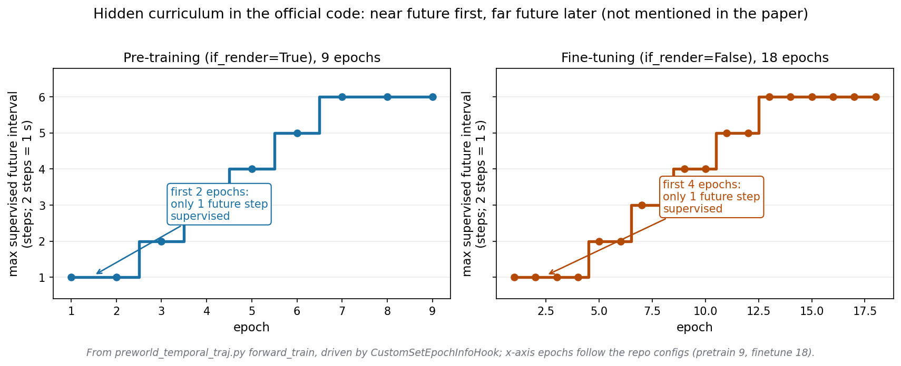

# 别把未来冻成 token：让 2D 渲染监督一路照进未来帧

> - 全局编号：053-WM-preworld
> - 论文标题：Semi-Supervised Vision-Centric 3D Occupancy World Model for Autonomous Driving
> - 作者：Xiang Li、Pengfei Li、Yupeng Zheng、Wei Sun、Yan Wang（通讯）、Yilun Chen（通讯），均为清华大学智能产业研究院（AIR）
> - 会议：ICLR 2025
> - arXiv：[2502.07309](https://arxiv.org/abs/2502.07309)（v1 2025-02-11；截至 2026-10 这是唯一版本，本次下载并精读的就是 v1）
> - 代码：公开，https://github.com/getterupper/PreWorld，已按 `--depth 1` 克隆到本文档目录下 `code/`。下文所有"代码显示"均指该仓库当前 main 分支。
> - 一句话核心洞见：前人预测未来 occupancy 时，先把场景冻成离散 token 再自回归，导致 2D 监督够不着未来帧；PreWorld 把预测直接做在连续的 volume feature 上，未来帧的特征保留了下来，于是体渲染可以把 2D 标签的监督一路打进未来——2D 预训练+3D 微调的两阶段范式才转得起来。

## Figure 1 的三行，道尽了这篇论文的全部动机

*论文 Figure 1（出自 PDF 第 1 页）：(a) 自监督 3D occupancy 模型——只用 2D 标签就能训，但不会预测未来；(b) 全监督 3D occupancy 世界模型——会预测未来，但要经过"冻住的 3D occupancy 模型→tokenizer→自回归→decoder"的间接路线，离不开 3D 标签；(c) PreWorld——端到端，2D 渲染监督直接作用于未来。*

这张图是作者押的赌注，读法是：先看 (a) 和 (b) 各缺什么，再看 (c) 是怎么同时补上两块短板的。(a) 的路线（RenderOcc、SelfOcc、OccNeRF）已经证明：靠体渲染，纯 2D 标签能训出不错的 3D occupancy。但它们都只管当前帧——体渲染的监督来自"当前时刻拍到的照片"，没有时间的概念。(b) 的路线（OccWorld、OccLLaMA）会预测未来，但它们的架构里，第一步永远是"用一个预训练好并冻住的 3D occupancy 模型先把当前帧的 occupancy 算出来"。注意这个"冻住"：预测模块的输入是离散的 occupancy（或离散 token），不是连续特征。于是 2D 监督想够到未来帧，中间隔着 tokenizer 和 decoder 两道编解码，想把梯度传回去，处处是信息损失。作者在第 2 页原话说这种间接路线 "poses challenges in model training, thus necessitating 3D occupancy labels as supervision to yield effective results"。

这里埋着一个所有人都默认的假设：**预测未来之前，必须先得到"当前帧的语义 occupancy"**——一个离散的、每个体素一个类别标签的 3D 网格。OccWorld 把它冻住，是因为联合优化"感知+预测"在当时被认为太难。PreWorld 推翻的正是这个假设：预测未来的输入，不必是离散的 occupancy，可以是还没解码成类别的连续 volume feature。特征是连续的，渲染就能穿过去；渲染能穿过去，2D 监督就能打到未来帧。整篇论文的方法，就是把这句话变成架构。

## 作者的底牌：预测模块只用两个 MLP，恰恰是因为它"不做事"

论文第 5 页的 Figure 3 值得盯着看半分钟：state-conditioned forecasting module $\mathcal{F}$ 的框图里，真的只有两个 MLP（代码里是 `fusion_head = Linear(64→128) → Softplus → Linear(128→32)`，输入输出都是 32 维的体素特征）。没有 attention，没有 tokenizer，没有自回归 transformer。在 2025 年的世界模型论文里，这种"简陋"是需要勇气的——它的底气不在模块本身，而在模块**不做什么**：它不把特征离散化，不把场景压成 token。

公式 (4) 把这条直接路线写得很清楚：

$$\tilde F_T = \mathcal{N}(S_T, S_{T-1}, \dots, S_{T-k}),\quad \tilde F_{T+1} = \mathcal{F}(\tilde F_T),\quad \hat Y_{T+1} = \mathcal{H}(\tilde F_{T+1})$$

$\mathcal{N}$ 是 occupancy network（BEVStereo，只把检测头换成 occupancy head），从过去 $k$ 帧多目图像里提连续体素特征 $\tilde F_T$；$\mathcal{F}$ 递归地推出未来特征 $\tilde F_{T+1}, \dots, \tilde F_{T+f}$；$\mathcal{H}$ 是 occupancy head，只在最后把特征解码成语义 occupancy。对比论文公式 (3) 里 OccWorld 的路线——$O$（冻住）→ $T$（tokenizer）→ $A$（自回归）→ $D$（decoder）——PreWorld 砍掉了 $T$ 和 $D$，把 $O$ 和 $A$ 融成了一个联合优化的整体。

"联合优化"这四个字是关键。OccWorld 的 $O$ 是冻住的，预测模块再强，也只能在 $O$ 给定的 occupancy 质量上做文章；感知错了，预测跟着错，还没法回传梯度去修感知。PreWorld 里 $\mathcal{N}$ 和 $\mathcal{F}$ 一起被 2D/3D 监督端到端地训，感知和预测互相磨合。Table 6 的第 1、2 行是这个论点的直接证据：Copy&Paste 基线（把当前帧最好的 occupancy 预测直接复制到未来，不做任何预测）未来 3 秒平均 mIoU 7.79、IoU 18.12；加上这个"简陋"的预测模块后，mIoU 8.25（+0.46）、IoU 20.35（+2.23）。注意这个不对称：**语义只涨了 0.46，几何涨了 2.23**。预测模块主要修的是"东西在哪"（IoU），而不是"东西是什么"（mIoU）。这很合理：两个 MLP 的递归，本质上是在特征空间里学"场景随时间怎么平移/变形"，几何运动是它最擅长的；语义类别的判定，更多靠 occupancy head 和 3D 标签。这个数字也给论文的叙事降了降温——"简单的预测模块达到 SOTA"这个说法里，模块本身的贡献是 +0.46 mIoU，真正把数字推上 SOTA 的是 ego-state 条件（+1.06）、2D 预训练（再+0.21~0.48）和轨迹联合训练（再+0.49）。后文还会细说。

## 体渲染：把 3D 密度场"拍扁"成 2D，让 2D 标签够得着 3D

预训练阶段的全部魔法都在公式 (5)–(8) 里。先落实符号，论文这里有一个小笔误：式 (5) 下写 $\tilde s \in \mathbb{R}^{X\times Y\times Z\times D}$，$D$ 是体素特征维度（配置里 `voxel_out_channel=32`），但语义场应该是类别维度。代码里 `semantic_mlp` 输出 `num_classes-1 = 17`（18 类减去空类之外的 17 个语义类），所以 $\tilde s$ 的真实形状是 $200\times200\times16\times17$。$\tilde\sigma \in \mathbb{R}^{200\times200\times16\times1}$ 是密度场，$\tilde c \in \mathbb{R}^{200\times200\times16\times3}$ 是 RGB 场。$X=Y=200, Z=16$ 来自 Occ3D-nuScenes 的标注规格：以自车为中心 $[-40,40]\times[-40,40]\times[-1,5.4]$ 米、0.4 米分辨率。

attribute projection head $\mathcal{P}$ 就是三个 MLP（代码里 `density_mlp`/`semantic_mlp`/`color_mlp`，都是 Linear→Softplus→Linear）：把每个体素的 32 维特征分别投成密度（1 维）、语义（17 维）、颜色（3 维）。然后对每条相机光线 $r$ 采样 $M$ 个点，公式 (6) 算每个点的渲染权重：

$$T(u_m) = \exp\left(-\sum_{p<m}\tilde\sigma(u_p)\delta_p\right),\quad w(u_m) = T(u_m)\left(1 - \exp(-\tilde\sigma(u_m)\delta_m)\right)$$

$T(u_m)$ 是累积透射率——光线走到 $u_m$ 还剩多少"没被挡住"；$w(u_m)$ 是该点对最终成像的贡献。几何动作很直观：**密度是"不透明度"，透射率是"还剩多少光能穿过去"，权重是"这一点挡住了多少光"**。公式 (7) 把各点的深度/语义/RGB 按权重加起来，就得到这条光线对应像素的渲染值 $\hat d^{2D}, \hat s^{2D}, \hat c^{2D}$，直接和 2D 的深度图、语义标签、RGB 图算损失。

光看公式容易晕，我用论文的设置（$\delta=0.4$m 体素尺寸）在一条光线上真算了一遍，$M=4$，密度场在第 3 个点处有个尖峰（$\sigma=8.0$，真表面就该这么锐）：

*自绘图：公式 (6)(7) 的具体计算。左：光线穿过 4 个采样点，圆点大小=渲染权重 $w$，权重集中在第一个高密度点（表面）。右：逐步算出的 $T$、$w$，以及渲染出的深度 10.39m（真表面在 10.8m，加权平均略偏向相机侧是正常现象）、语义 $\hat s \approx \tilde s(u_3)$。*

这张图里最值得看的是两件事。第一，$w_3 = 0.9034$ 吞掉了九成权重——**密度场的工作就是把尖峰放在真表面上，语义和颜色只是"搭便车"的**：$\hat s = \sum w_m \tilde s(u_m) \approx \tilde s(u_3)$，渲染出的语义几乎就是表面那一点的语义向量。所以 2D 语义标签的梯度，主要回传到表面体素的语义头；2D 深度标签的梯度，主要回传到密度头"尖峰放哪"。两个头各司其职，这就是为什么 Table 4 里 RGB、depth、semantic 三个属性逐个加上去，mIoU 从 33.95 一路涨到 34.69（+0.16/+0.48/+0.74）——每个属性都在教模型不同的事：RGB 教纹理细节，depth 教几何，semantic 教类别。

第二，$1 - \sum w = 0.035$ 的"剩余权重"逃到了背景。这是 NeRF 渲染的常态：光线没被完全挡住，剩下的透射率对应无穷远。代码里还有一个论文没提的 `weight_entropy_last=0.01` 的损失，专门压这个剩余量 $p_{out}$ 的二元熵，让它趋向 0 或 1——要么这条光线打中东西，要么彻底打空，别含糊。后文"代码揭示"还会说到它。

## 两阶段的数据流：谁在哪个阶段干活

论文 Figure 2 把两阶段画得很清楚，我按代码把数据流再捋一遍，因为论文正文有些地方一笔带过：

*论文 Figure 2（出自 PDF 第 4 页）：多目图像→occupancy network→volume feature→state-conditioned forecasting module 递归推出未来特征；预训练阶段（粉色）走 attribute projection head + 体渲染 + 2D 渲染监督；微调阶段（绿色）走 occupancy head + 3D occupancy 监督。*

- **预训练阶段**：$\mathcal{N}$（提特征）+ $\mathcal{F}$（递归预测未来 $f$ 帧特征）+ $\mathcal{P}$（投成密度/语义/RGB 场）全都参与，$\mathcal{H}$（occupancy head）不参与。监督只有 2D 的：$L_{2D} = \sum_{i=T}^{T+f} (\lambda_{dep}L_{dep} + \lambda_{sem}L_{sem} + \lambda_{RGB}L_{RGB})$，其中 $L_{dep}$ 是 SILog 损失（论文引 Pan et al. 2024，对深度尺度不敏感的对数损失），$L_{sem}$ 是交叉熵，$L_{RGB}$ 是 L1。注意求和是从 $i=T$ 到 $T+f$——**当前帧和未来帧一起被渲染监督**，这正是"2D 监督够到未来"的落点。配置里 `max_ray_nums=38400`，每步采 38400 条光线；`aux_frames=[-3,-2,-1,1,2,3]`，还用自车位姿把前后 3 帧的相机光线变换到当前帧，多视角监督。
- **微调阶段**：$\mathcal{P}$ 退出，$\mathcal{H}$ 接管，直接输出未来 occupancy $\hat Y_{T+f}$，用 3D occupancy 标签监督：$L_{3D} = \lambda_f L_f + \lambda_l L_l + \lambda^{sem}_{scal}L^{sem}_{scal} + \lambda^{geo}_{scal}L^{geo}_{scal}$（focal + lovasz-softmax + 场景-类别亲和损失，沿用 FB-OCC 的做法）。$\mathcal{N}$ 和 $\mathcal{F}$ 继续参与优化——两个阶段之间没有冻结，是"预训练开个好头，微调接着炼"。
- **ego-state 条件**（论文说"可选"，虚线箭头）：代码的时序类 `PreWorld4DTraj` 里，过去 5 帧的速度/加速度/历史轨迹（$3 \times 7 = 21$ 维？代码里 `velocity_dim=3, past_frame=5`，`plan_head` 输入是 `3*(5+2)=18` 维）先过一个 MLP（18→256→256→32）变成 ego 特征，拼到每个体素特征上再过 `fusion_head` 做残差融合；融合后的体素特征下采样后又反哺 ego 特征（`ego_fusion_head`），最后 `traj_head` 输出未来轨迹点。论文表格里带 † 的就是这套。注意：**仓库里时序模型只有这一个类，ego 融合在递归循环里是无条件执行的**——论文 Table 2/3 里不带 † 的 PreWorld 行（不用 ego-state），在公开配置里没有对应的开关，实现路径未确认。这是一个如实记录的缺口。

损失权重上，论文 4.1 节说 "All the hyperparameters $\lambda$ in the loss functions have been set to 1.0"，配置里预训练的 `weight_depth=weight_semantic=weight_color=1.0` 对得上，微调的四个 `weight_voxel_*=1.0` 也对得上。但代码的 NerfHead 里还有两个论文没提的损失：`weight_entropy_last=0.01`（上面说的剩余透射率二元熵）和 `weight_distortion=0.01`（mip-NeRF 360 的 distortion loss，惩罚权重分布拖尾，让密度更集中）。这两个是 NeRF 训练里的标准"让几何干净"的技巧，作者没写进论文，大概率是觉得太细节——但"$\lambda$ 全是 1.0"的说法因此不完全准确。

## 带着 Table 6 走一遍：预测模块、ego-state、预训练各自贡献了多少

论文 4.3 节的 Table 6 是全文最诚实的一张表——它把 PreWorld 拆成零件，逐个量贡献。场景：nuScenes 验证集，预测未来 3 秒（1s/2s/3s 三个时刻平均），指标是 mIoU（语义准不准）和 IoU（几何占位准不准）。

**第 1 行 Copy&Paste：下限。** 拿当前帧最好的 3D occupancy 预测，直接复制三份当作未来 1s/2s/3s 的预测。任何"预测"都不做，纯靠场景变化得慢。结果：mIoU 7.79，IoU 18.12。注意 1s 时刻的 mIoU 有 9.76，3s 掉到 6.23——场景是会动的，复制粘贴越到远处越不准，这是显然的，但它是一个干净的下限：任何预测模块如果连这个都超不过，就是负优化。

**第 2 行 PreWorld（无 ego、无预训练、无轨迹监督）：+0.46 / +2.23。** 只加上两个 MLP 的递归预测。mIoU 7.79→8.25，IoU 18.12→20.35。前面说过，这个不对称很说明问题：递归预测学到的是"特征怎么随时间流"，它把几何位置搬对了（IoU 大涨），但它不知道搬过去的东西叫什么名字（mIoU 微涨）——名字是 occupancy head 的事，head 没见过 3D 标签之前，只能靠 2D 渲染监督里那点语义信号。

**第 3 行 +ego-state：8.85（+1.06）/ 20.87。** 自车速度、加速度、历史轨迹拼进特征。这是最有意思的一跳：+1.06 的 mIoU 涨幅是预测模块本身的两倍多。为什么自车状态对"预测未来 occupancy"帮助这么大？因为自车运动决定了**坐标系本身怎么动**——未来帧的体素网格是建在未来自车位置上的（ego-centric），知道自车往哪开，就知道整个场景相对自车怎么平移。没有 ego-state，预测模块得同时猜"世界怎么变"和"我怎么动"；给了 ego-state，它只需要猜"世界怎么变"。这也解释了 Table 3 里 planning 的诡异现象（后文说）。

**第 5 行 +自监督预训练：9.06 / 20.88。** 在 2D 渲染监督下先训 8 个 epoch（配置里是 9，见后文），再微调。mIoU 再涨 0.21。注意这是在**已经用了 ego-state**的基础上（第 3 行→第 5 行），2D 预训练给的主要是几何和语义的先验：Table 4 显示，光 RGB 就能 +0.16，说明预训练让特征一开始就"知道场景长什么样"，微调用 3D 标签时起点更高。

**第 6 行 +轨迹监督（联合训练 planning）：9.55 / 21.62。** 轨迹的 L2 监督反过来又帮了 occupancy 预测（8.85→9.06→9.55 这两步，论文 4.3 节 Joint Training 段有说明）。Table 7 从 planning 那头看：只用轨迹监督，L2 平均 0.45m、碰撞率 0.67%；加上 2D 标签，L2 掉到 0.31m、碰撞率 0.54%；再加 3D 标签，0.31m/0.53%。**2D 标签把 planning 的 L2 干掉了三成**，而这一步完全不需要 3D occupancy 标注——这就是"2D 标签便宜"的真正含金量。

所以，"简单的预测模块达到 SOTA"这个故事，准确的版本是：**预测模块把路修通（特征保持连续、2D 监督能进未来），ego-state 和 2D 预训练把车开过去**。模块本身 +0.46，路修通之后叠加上来的有 +1.7。作者没有藏这个数字（Table 6 全摆出来了），叙事上稍微把光环往模块上靠了一点，但证据链是完整的，读者自己会算账。

## 代码揭示的三件事：课程、优化器、和论文没对上的 epoch

读代码是这篇精读里最值的部分，因为仓库和论文有四处对不上，全是"论文没写但影响复现"的东西。

**第一，隐藏的课程学习。** `preworld_temporal_traj.py` 的 `forward_train` 里，未来监督的帧数随 epoch 增长：预训练前 2 个 epoch 只监督未来第 1 步，第 3 个 epoch 放开到第 2 步……直到第 7 个 epoch 才监督满 6 步（未来 3 秒）；微调前 4 个 epoch 只监督 1 步，之后每 2 个 epoch 多解锁 1 步。这是一个"先学近、再学远"的课程——早期递归预测还不稳，只让它走一步，监督信号最可靠；后期才让它走远。论文 4.1 节 Implementation Details 只字未提。复现时如果一上来就监督 6 步，训练大概率不稳定，而你根本不知道差在哪。我把两条课程曲线画了出来：

*自绘图：官方代码里随 epoch 增长的未来监督帧数（课程学习）。横轴 epoch 取自仓库配置（时序预训练 9 epoch，时序微调 18 epoch），纵轴是被监督的最大未来步数（2 步=1 秒）。论文正文没有提到这个课程。*

**第二，优化器是 AdamW 不是 Adam。** 论文写 "use Adam as the optimizer"，配置里是 `AdamW(lr=1e-4, weight_decay=1e-2)`。差一个 weight decay，对大模型训练不是小事。

**第三，epoch 数差 1。** 论文说 4D 任务"8 epochs 预训练 + 18 epochs 微调"，时序微调配置 `max_epochs=18` 对得上，时序预训练配置却是 `max_epochs=9`。非时序（3D occupancy 预测）的 6+12 和论文一致。差 1 个 epoch 可能是成稿时的笔误，也可能是最后调参改了配置没同步文档——无论哪种，复现时以配置为准。

**第四，死代码。** `loss_sup` 系列函数里，`loss_[...] = loss_sup * 0.`——乘了 0，是 no-op。预训练阶段当前帧的 3D 监督、未来帧的逐体素 CE 监督都被注释性地关掉了（`loss_sup_occupancy` 里 `* 0.`），实际起作用的是渲染损失和轨迹损失。这说明作者试过"预训练也加一点 3D 监督"，最后关掉了，但代码没清干净。读代码的人如果照着把 `*0` 去掉，会训出一个和论文不一样的东西。

## 实验数字核实：SOTA 的边界在哪

**3D occupancy 预测（Table 1，Occ3D-nuScenes 验证集，mIoU）。** PreWorld+预训练 34.69，超过 OccFlowNet（Boeder et al., 2024）的 33.86（+0.83），也超过不预训练的自己 33.95（预训练贡献 +0.74）。注意 OccFlowNet 那行 GT 是 "2D+3D"，PreWorld 也是 "2D+3D"，口径对齐。17 个类别里，PreWorld 在 car（47.71）、pedestrian（31.29）等动态小物体上领先明显，这和"2D 预训练补了 3D 标签对小物体的监督不足"是一致的——论文 Figure 4 的定性图里，SparseOcc 在杆子、摩托车上的信息丢失，PreWorld 保住了。

但 Table 1 里有两个类别 PreWorld 输给了 RenderOcc：manmade（29.36 vs 17.36？不，等等）。让我看准：PreWorld+预训练 manmade 29.36，RenderOcc 17.36——PreWorld 赢。论文附录 A.1 说的是 driveable surface：PreWorld+预训练 63.71 vs RenderOcc 68.85，输了；sidewalk 37.27 vs 42.01，输了。作者在附录里给了个很漂亮的解释：mIoU 的计算只管 visible 区域内的体素，不管 visible 外；RenderOcc 喜欢把大平面类别预测得厚厚的（thicker surfaces），visible 区域内多对几个体素就涨分，但被遮挡区域的预测是一团乱（Figure 6 最后一列）。换用 RayIoU（SparseOcc 提出的、按射线算、预测厚了要扣分）后，PreWorld+预训练 38.7 对 SparseOcc(16f) 36.1（+2.6），而 RenderOcc 从 mIoU 的 23.93 掉到 RayIoU 19.5，OccFlowNet 从 33.86（mIoU 超 SparseOcc 的 30.90）掉到 RayIoU 32.6（被 SparseOcc 反超）。**这个附录是论文里最见功力的部分**：作者没有回避"某些类别我们输了"，而是论证了 metric 本身在奖励作弊，并用另一个 metric 自证。这比很多论文"只报赢的 metric"的做法高明。

**4D occupancy 预测（Table 2）。** PreWorld+预训练：mIoU 平均 9.55（1s 12.27 / 2s 9.24 / 3s 7.15），IoU 平均 21.62。对 OccWorld-D（8.62/16.53）和 OccLLaMA-F（8.66/22.99）：mIoU 上 PreWorld 是 SOTA（9.55 > 8.66），但 **IoU 上 OccLLaMA-F 的 22.99 高于 PreWorld 的 21.62**。论文正文的措辞是 "achieves the highest mIoU" 和 "sets the new SOTA performance"——前半句精确，后半句如果被理解成"所有指标 SOTA"就不准确。严格的说法：mIoU 的 SOTA，IoU 第二。这个 nuance 论文没有主动点出来，但数字都在表里，读者看得见。

**自监督 setting（Table 13，附录 A.3）。** PreWorld-S（只用 2D 标签，连微调都不做，用密度阈值 $\tau$ 从 $\tilde\sigma$ 直接抠 occupancy，公式 (10)）：mIoU 3.78 vs OccWorld-S 的 0.26，IoU 9.19 vs 5.00。论文写 "over 1300%" 的提升。算术没错（3.78/0.26≈14.5 倍），但 OccWorld-S 的 0.26 基本是个退化解——它的路线是"冻住的自监督 occupancy 模型+自回归"，自监督的 occupancy 本来就很差，再冻住，约等于没有预测能力。拿一个接近 0 的基线算相对提升，倍数很好看，信息量一般。绝对值上看，PreWorld-S 的 3.78 mIoU 离可用的全监督（9.55）还差得远，自监督世界模型这条路还很长。

**Motion planning（Table 3）。** 不用 ego-state：PreWorld+预训练 L2 平均 1.30m、碰撞率 1.27%，和 OccLLaMA-F（1.20/0.70）、UniAD（1.03/0.31）可比。用了 ego-state（†）：L2 0.31m、碰撞率 0.53%，大幅领先。但作者自己在第 8 页点破了天机：这是 "shortcut" 效应（引 Zhai et al. 2023、Li et al. 2024）——输入里给了自车历史状态，模型很大程度上是在"抄"自车运动惯性，而不是从场景理解里推出轨迹。UniAD 的碰撞率 0.31% 其实比 PreWorld† 的 0.53% 低，L2 却是 1.03m——开得准（L2 小）和开得安全（碰撞率低）是两回事。作者没有拿 0.31m 去碰瓷"planning SOTA"，而是把 shortcut 的讨论留作未来工作，这个分寸感是对的。

**数据规模消融（Table 5 + 附录 Table 10/11/12）。** 微调只用 150 个场景时，预训练把 mIoU 从 18.66 拉到 25.02（+6.36）；700 个场景全量时，33.95→34.69（+0.74）。3D 标签越少，2D 预训练越值钱——这正是两阶段范式的存在理由。附录 Table 10 还补了"延长时间能不能抹平差距"：150 场景训到 48 epoch，不预训练 30.26，预训练 31.56，差距还在——说明预训练不只是加速收敛，收敛后仍有增益。Table 12 用 RayIoU 重算后，预训练的增益随 3D 数据量增大而递减（+3.9 → +2.7 → +2.2），趋势干净。这一整套附录实验，是"为审稿人准备的"，但做得比很多正文都扎实。

## 怀疑式审读

**"2D 标签便宜"到底便宜在哪。** 论文的 motivation 建立在"3D occupancy 标注贵、2D 标签便宜"上。但看代码的 `tools/gen_data/`：`gen_depth_gt.py` 是从 LiDAR 点云投影生成深度真值，`gen_seg_gt_from_lidarseg.py` / `gen_seg_gt_from_occ.py` 是从 lidarseg 标注或 occupancy 标注投影生成 2D 语义真值。也就是说，**2D 监督的"深度"和"语义"都间接依赖 LiDAR 和 3D 标注**——depth 来自 LiDAR（nuScenes 自带，不额外花钱），语义来自 lidarseg（nuScenes 也自带，但那是人工标的）。真正省掉的，是"稠密 3D occupancy 体素标注"（Occ3D 那种 200×200×16 每个体素都标）这一道工序。所以"便宜"是相对的：省的是最贵的那道工序，不是零成本。这个话论文没有细说，但做 3D 感知的人都懂——2D 标签的"便宜"，建立在数据集自带 LiDAR+lidarseg 的前提下。换一个只有纯图像、没有 LiDAR 的数据集，这套预训练的深度监督就无米下锅。

**基线 OccWorld-S 的强度。** 上面说过，0.26 的 mIoU 基线让 "1300%" 的相对提升失去了参照意义。更值得看的是绝对值：PreWorld-S 3.78 vs 全监督 9.55，自监督离实用还有距离。论文没有夸大（它报的是和 OccWorld-S 的对比，这是同类方法的公平对比），但读者不应该把 1300% 当成方法的真实分量。

**没有随机种子。** 和 AdaWM 一样，Table 1–7 全是单点数字，无种子数、无误差棒。34.69 vs 33.86 差 0.83 个点，在 occupancy 预测这种任务上不算大裕度。好在 RayIoU 下差距拉到 2.6，metric 换了结论还站得住，稍微让人放心一点。

**算力代价。** batch 16，8×A100；3D occupancy 任务预训练 6 epoch + 微调 12 epoch；4D 任务预训练 9 epoch + 微调 18 epoch。论文没给墙钟时间。按 BEVStereo 系方法的常规体量，全量训完是以"天"计的。复现门槛不低。

**nuPlan 15000 场景。** README 的模型表里有一行 "PreWorld (+ nuPlan Pre-training, 15000 scenes)"，mIoU 19.85（这是 BEV 分割的指标口径，和 Occ3D 的 34.69 不是一个任务），config 和 model 栏都是空的。论文正文完全没提这 15000 场景的实验——scalability 的故事在论文里只讲到 700 场景，README 里多出来的这一行像是后续工作的预告。未确认的增量，不多做解读。

**记号小毛病。** 式 (5) 下 $\tilde s$ 的形状写成 $D}$ 应为类别数（代码证实是 17）；Table 6 的表头 "Avg. reprersents" 拼写错误；"OCCPUANCY"（3.1 节标题）拼写错误；正文 "Aux. Sup." 和 "trajectory supervision" 的缩写 TS 在表注里才定义。这些不影响结论。

**公平地说，做得好的地方。** 第一，Table 6 的零件级消融，敢把预测模块本身的 +0.46 摆出来，这种"自曝"很少见。第二，附录 A.1/A.2 用 RayIoU 重新审视自己的 mIoU，主动态度端正，而且分析是对的（thicker surfaces 刷分这件事，SparseOcc 的原文里有论证，作者引用得当）。第三，planning 的 shortcut 效应自己点破，没有拿 0.31m 去宣称 planning SOTA。第四，Table 10 主动承认小数据实验"训练时间没给够"，然后补了延长时间的对照——很多论文会把 Table 5 的数字直接当结论卖，作者多走了一步。这四件事加起来，说明作者对自己的数字心里有数，读者可以比较放心地引用这篇论文的结论，边界就是上面列的那些。

## 能带走的东西

这篇论文最可迁移的不是"两个 MLP"，而是一个设计原则：**别急着把场景离散化**。OccWorld 把 occupancy 冻成离散网格、再编成 token，每一步离散化都是一道"梯度只能绕行"的墙。PreWorld 把预测做在连续特征上，2D 渲染监督就能穿透到未来帧，整个"2D 预训练→3D 微调"的范式才成立。这个原则放到别处也适用：任何想用 2D 监督训 3D/4D 模型的工作，先问自己——我的中间表示是不是连续可微的？如果中途做了不可微的量化（argmax、离散 token、冻住的模块），2D 监督就够不着了。

第二个可带走的是分工思想：**2D 标签负责"场景长什么样"（几何+纹理+粗语义），3D 标签负责"每个体素叫什么名字"**。Table 4 里 RGB 只加 0.16、semantic 加 0.74，说明 2D 监督的天花板在语义精度；Table 5 里 3D 数据越少 2D 预训练越值钱，说明两者是互补不是替代。做多模态/多任务训练时，这种"便宜监督打底、昂贵监督精修"的分工，值得先画出来再定损失权重。

留下的开放问题也有两个。第一，自监督的 4D 预测（PreWorld-S 的 3.78 mIoU）离全监督（9.55）还差一倍多，2D 渲染监督能不能把动态物体的未来运动学得更准？目前的递归 MLP 对"东西往哪动"建模很浅，显式的运动/流建模（比如 OccFlowNet 的 occupancy flow 思想）可能是个方向——有意思的是，OccFlowNet 恰好是这篇论文在 3D 预测上的主要对手（33.86 vs 34.69），对手的方法论可能是自己的下一步。第二，ego-state 的 shortcut 效应：planning 的 0.31m 有多少是真场景理解、有多少是惯性外推？作者把它留给了未来工作，但任何想把 PreWorld 往 planning 推的人，都得先回答这个问题。

*精读所用 PDF：`053-WM-preworld.pdf`（arXiv:2502.07309v1，共 18 页，含附录 A–B）。原图裁切：`paper-fig1.png`（Figure 1，出自第 1 页）、`paper-fig2.png`（Figure 2，出自第 4 页）。自绘图脚本：`fig-rendering-geometry.py`、`fig-curriculum.py`（均已运行生成 PNG）。官方代码：`code/`（https://github.com/getterupper/PreWorld，depth-1 克隆）；论文与代码的四处不一致（AdamW/0.01 额外损失/9 vs 8 epoch/隐藏课程）已在正文中标出。*
