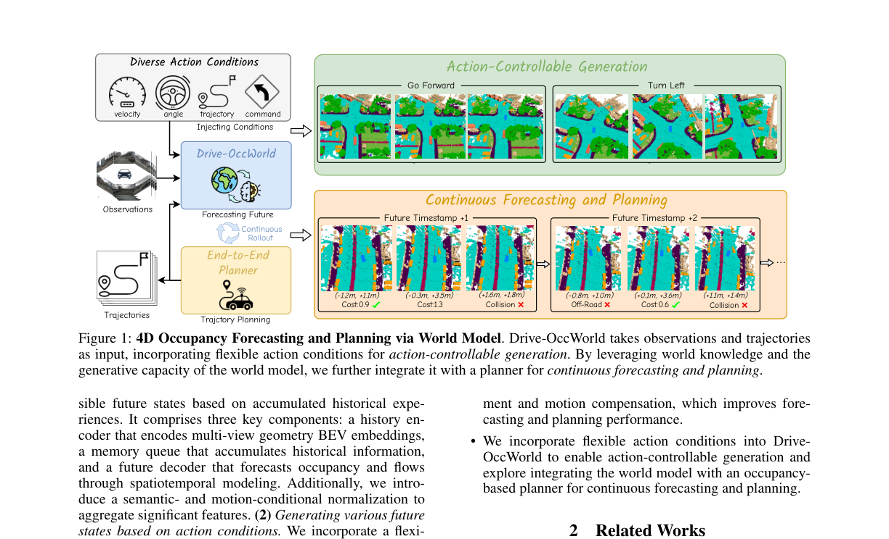
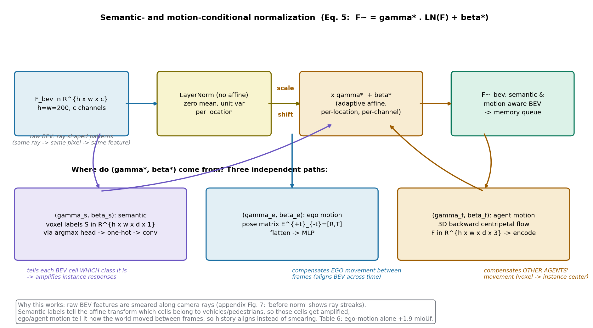
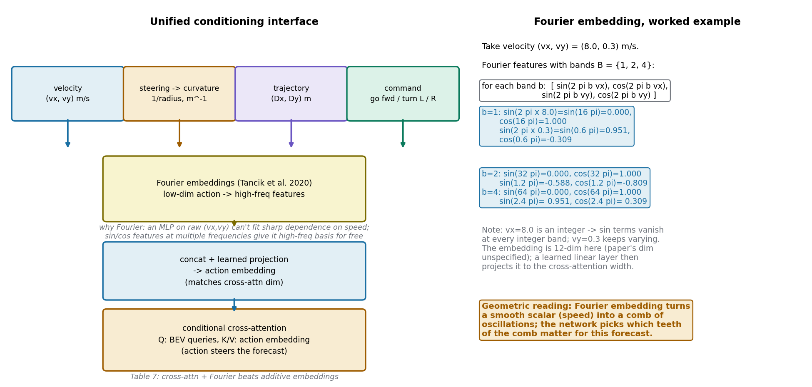
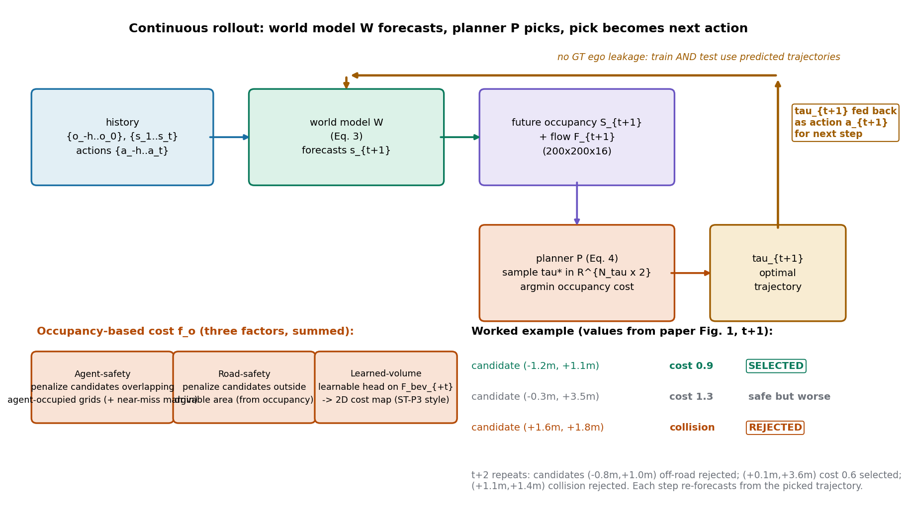

# 世界模型不止能"想"，还能"开"：用 4D 占据预测把生成式世界模型接到规划器上

> **全局编号**：054-WM-drive-occworld
> **论文标题**：Driving in the Occupancy World: Vision-Centric 4D Occupancy Forecasting and Planning via World Models for Autonomous Driving
> **作者**：Yu Yang*、Jianbiao Mei*（共同一作）、Yukai Ma、Siliang Du（通讯）、Wenqing Chen、Yijie Qian、Yuxiang Feng、Yong Liu（通讯）
> **机构**：浙江大学；华为技术
> **会议**：AAAI 2025（Oral）
> **arXiv**：[2408.14197](https://arxiv.org/abs/2408.14197)，下载的是 v3（2025-01-17，AAAI 相机版；v1 2024-08-26，v2 2024-10-12）
> **代码**：公开，https://github.com/yuyang-cloud/Drive-OccWorld（项目页 https://drive-occworld.github.io/）
> **一句话核心洞见**：自动驾驶的世界模型一直被当成"数据生成器"或"预训练器"，这篇论文把它转成了"规划器"：用纯视觉的 4D 语义占据+流预测作为世界状态的表示，让规划器直接在预测出的未来占据上做代价最小化选轨迹，再把选出的轨迹当成下一步的动作条件，形成"预测—规划"的自回归闭环；撑起这一切的是记忆队列里一个轻量的语义/运动条件归一化，它用学出的仿射调制抹掉了 BEV 特征的射线拖尾和跨帧不对齐。

## 世界模型在自动驾驶里的两种旧用法，都没碰"规划"这个正事

2024 年之前，世界模型在自动驾驶里有两条主流用法。第一条是**数据生成**：GAIA-1、DriveDreamer、GenAD、Vista 等，用扩散模型或自回归 Transformer 生成驾驶视频，给下游训练提供更多数据。第二条是**预训练**：ViDAR 用"从历史视觉预测未来点云"这个任务去预训练视觉编码器，UniWorld、DriveWorld 用 4D 占据重建做预训练，然后把编码器拿去做检测、分割。两条路都有一个共同点：世界模型的"预测未来"能力，最终服务的是别的模块（数据、特征），**没有直接用来做决策**。

最接近"用世界模型做规划"的是 Drive-WM（CVPR 2024）：它生成多视角驾驶视频，用一个图像奖励函数给候选轨迹打分、选最优。但 Drive-WM 的规划是 image-based 的——奖励函数看的是生成的 2D 图像，环境的 3D 几何结构没有被真正用起来做规划。这就留下了一个很具体的缺口：**能不能让世界模型预测一种既是"世界状态"又是"规划代价地图"的表示，然后规划器直接在这上面做优化？**

占据（occupancy）正好是这个表示。3D 语义占据栅格告诉你"每个体素是什么、被谁占着"，这既是世界状态（预测的目标），又是天然的代价地图（规划器一看就知道哪里不能去）。Drive-OccWorld 的整个设计就是围绕这个"一石二鸟"展开的：世界模型预测未来的占据和流，规划器在占据上算代价选轨迹，选出的轨迹再作为动作条件喂回世界模型预测下一步。这是一个闭环，而之前的工作都是开环的"预测完就结束"。

## Figure 1：作者的赌注——同一段观测，不同动作，看到不同的未来

论文第 2 页的 Figure 1（下图裁自第 2 页，2 倍分辨率渲染）：



*图注：原图为论文第 2 页 Figure 1。作者想让你相信两件事：第一，世界模型是动作可控的——同样的历史观测，"直行"和"左转"两个条件生成出不同的未来占据；第二，规划是可解释的——每个候选轨迹为什么被选/被拒（代价数值、碰撞、越界）都写在占据图上，不是一个黑箱分数。*

这张图的信息密度值得细读。下半部分的三个候选轨迹在 t+1 的命运各不相同：(−1.2m, +1.1m) 代价 0.9 被选中（打勾），(−0.3m, +3.5m) 代价 1.3 落选，(+1.6m, +1.8m) 直接判碰撞（打叉）。到 t+2：(−0.8m, +1.0m) 越界（Off-Road）被拒，(+0.1m, +3.6m) 代价 0.6 选中，(+1.1m, +1.4m) 碰撞被拒。注意 t+2 的候选是在 t+1 选出的轨迹基础上继续 rollout 的——这就是"连续预测与规划"（continuous forecasting and planning）的含义：不是一次规划 3 秒然后执行到底，而是每一步都重新预测、重新选。

这里藏着论文的一个关键方法论选择：**规划时用的动作条件是预测出的轨迹，而不是真值轨迹**。为什么？因为如果训练时用真值轨迹做动作条件，世界模型会学会"偷看答案"——真值轨迹里包含了人类驾驶员的意图信息（比如提前减速），这就是 ego-status leakage。论文 3.4 节明确写了用预测轨迹做动作条件"不仅防止真值 ego 动作泄漏进规划器，还让模型在训练时就用预测轨迹学习，测试时表现更好"。表 4 的数字支持这个选择：用真值轨迹做条件，规划 L2 更好（0.56 vs 0.85 avg）；但用预测轨迹，占据预测反而更好（表 1、表 2 里 P 变体全面压过 A 变体）。这个 trade-off 很有意思，后面还会回来。

## 作者的底牌：占据表示同时服务预测和规划，不需要两套表示

这篇论文的底气来自三个时间点凑到一起。第一，Cam4DOcc（CVPR 2024）刚刚建立了 camera-only 4D 占据预测的 benchmark，有了"膨胀 GMO + 3D 后向向心流"这套任务定义和评测协议——Drive-OccWorld 直接站在这个 benchmark 上，不需要自己定义任务。第二，OccWorld（2023 年底）已经证明了占据世界模型这条路走得通，但它用的是 LiDAR 输入、没有动作条件、没有规划——Drive-OccWorld 的增量空间是清楚且可见的：换成纯视觉、加上动作可控、再接上规划器。第三，AAAI 的读者里有规划社区的人，"世界模型 + 规划"这个组合在 AAAI 比在 CVPR 更容易被欣赏——投 AAAI Oral 不是偶然。

最硬的一张牌是**表示的统一**：占据栅格同时是世界模型的输出和规划器的输入。对比 Drive-WM 的"生成视频→图像奖励→选轨迹"，Drive-OccWorld 的"预测占据→占据代价→选轨迹"少了一次模态转换——不需要把 3D 几何先渲染成 2D 图像再打分，几何信息没有损失。这个统一表示让整篇论文的逻辑非常顺：3.2 节讲怎么预测占据，3.3 节讲怎么让占据预测动作可控，3.4 节讲怎么在占据上规划——三节是递进的，不是拼盘。

## 记忆队列里的条件归一化：用学出的仿射调制抹掉 BEV 的两个毛病

现在进入方法核心。Drive-OccWorld 有三个部件：历史编码器 W_E（BEVFormer 式的多视角图像→BEV）、记忆队列 W_M（存历史 BEV 特征）、世界解码器 W_D（自回归预测未来 BEV→占据+流）。W_M 里有一个"语义与运动条件归一化"模块，是论文自称"简单却高效"的设计，也是消融表 6 的主角。公式 (5)：

$$\tilde{F}^{bev} = \gamma^* \cdot \text{LayerNorm}(F^{bev}) + \beta^*$$

先讲它要修的两个毛病。第一个毛病是**BEV 特征的射线拖尾**。BEVFormer 这类方法把 2D 图像特征"提"到 BEV 平面时，3D 空间里同一条相机射线上的点会对应到图像上同一个像素，于是提出来的特征沿射线方向被"抹"成一条——附录 Figure 7 的 "Before Norm" 可视化清楚地显示了这种射线状条纹。这种特征对占据预测是灾难：一条射线上的所有 BEV 格子特征都差不多，模型分不清"车到底在射线上的哪个深度"。第二个毛病是**跨帧不对齐**：自车在动、别的车也在动，t−1 时刻的 BEV 和 t 时刻的 BEV 在空间上是对不齐的，直接堆历史特征等于把错位的东西平均了。

条件归一化的做法分两步。第一步，对 BEV 特征做**不带动仿射参数的 LayerNorm**——只做零均值、单位方差，把每个位置的特征先拉到同一个尺度，但不学 γ、β（普通的 LN 会学一对全局的 γ、β，这里故意不学，留给第二步）。第二步，用**从语义和运动标签算出来的 (γ*, β*)** 做逐位置、逐通道的仿射调制。(γ*, β*) 有三路独立来源：

1. **语义路 (γ_s, β_s)**：一个轻量 head + argmax 从 BEV 特征预测体素级语义标签 S ∈ R^{h×w×d×1}（d 是体素高度维），转成 one-hot 再过卷积，得到调制参数。几何含义：告诉每个 BEV 格子"你是什么类别"，属于车辆/行人的格子被放大，背景格子被压住——附录 Figure 7 的 "After Norm" 显示实例物体的响应被明显提亮了。
2. **自车运动路 (γ_e, β_e)**：自车位姿变换矩阵 E^{+t}_{−t} = [R^{+t}_{−t}, T^{+t}_{−t}]（从 −t 到 +t 的旋转和平移），展平后过 MLP 得到调制参数。几何含义：告诉模型"自车在这两帧之间怎么动的"，让历史 BEV 按自车运动做对齐补偿。
3. **他车运动路 (γ_f, β_f)**：预测体素级 3D 后向向心流 F ∈ R^{h×w×d×3}——每个体素指向它在 t−1 时刻所属实例的 3D 中心，编码成调制参数。几何含义：补偿其他交通参与者的运动，细粒度到体素级。

自绘图把这个机制画出来了：



*图注：自绘示意图，对应论文公式 (5) 和 3.2 节。h=w=200 是 BEV 查询的空间分辨率（附录 C.3）。*

拿一个小例子算一遍。假设 BEV 上某个格子 i 的原始特征 F_i = [2.0, 4.0]（c=2 示意），LayerNorm（无仿射）：均值 3.0，方差 1.0，归一化得 [−1.0, +1.0]。语义 head 预测这个格子是"车辆"（one-hot 某维为 1），卷积给出 γ_s,i = [1.5, 1.5]、β_s,i = [0.2, 0.2]（示意值，实际是学出来的）。调制后：[1.5×(−1.0)+0.2, 1.5×1.0+0.2] = [−1.3, 1.7]。如果这个格子是"背景"，γ 可能学成 0.3，特征被压到 [−0.3, 0.3] 量级——实例和背景的区分度就这样被拉开了。这就是"语义增强"的全部机制：不是加了什么新信息，而是**用已知的语义标签去重加权特征**，让该亮的地方亮。

这里要分辨承重结构和装饰。三路调制里，消融表 6 显示**自车运动路是承重的**：单加它，mIoUf 从 26.4 涨到 28.3（+1.9）；语义路单加只 +0.2（26.4→26.6）；他车运动路单加 +0.7。直觉上也合理：BEV 跨帧不对齐主要来自自车运动（自车一动，整个 BEV 坐标系都动），这是全局的、每帧都有的；他车运动是局部的、只影响部分格子。所以"运动补偿"这个名字里，真正干活的是自车那一路。但有一个论文没说的细节：**单加自车运动路时，VPQ*_f 从 33.5 掉到了 32.6**（−0.9）。也就是说，自车运动补偿帮了占据 IoU，却伤了流预测的实例关联质量——占据和流两个目标在这里是轻微打架的。三路全加时 VPQ*_f 回到 34.5（+1.0），是他车运动路把流的质量拉回来的。论文正文只讲了 mIoUf 的 +1.9，没提 VPQ*_f 的 −0.9，叙述是经过挑选的。表是诚实的，解读是选择性的。

还有一个"为什么我想不到"的点：为什么用"归一化+调制"而不是直接把语义/运动特征拼到 BEV 特征后面（concat）？concat 会让通道数膨胀，后续所有层的计算量都上去；而 FiLM 式的仿射调制只引入逐位置的 scale/shift，参数量小、计算量几乎不增加。附录表 9 的延迟数据也佐证了"W_M 和 W_D 的延迟很低"——条件归一化是一个"花小钱办大事"的设计。这就是论文说的"简单却高效"的真实含义：不是理论深刻，是工程上划算。

## 世界解码器：一个自回归的"未来 BEV 生成器"，动作从交叉注意力里进来

W_D 是一个 3 层的自回归 Transformer（每层 256 通道），输入是可学习的 BEV 查询 Q ∈ R^{h×w×c}，输出下一时刻的 BEV 特征 F^{bev}_{+t}。每一层的结构按附录 Figure 6 是：deformable 自注意力（建立 BEV 上下文）→ 时间交叉注意力（从 W_M 的历史特征里取对应特征，deformable 形式以省显存；参考点用自车位姿变换算，保证跨帧对齐）→ **条件交叉注意力**（BEV 查询和动作嵌入做交叉注意力，动作信息在这里注入）→ FFN。预测头用 channel-to-height 操作（FlashOcc 的做法）把 BEV 特征变成 3D 占据和流：(S, F) ∈ R^{200×200×16}——200×200 是 BEV 平面，16 是高度维的 bin 数。

自回归体现在公式 (3)：

$$W(\{o_{-h},...,o_0\}, \{s_1,...,s_t\}, \{a_{-h},...,a_t\}) = s_{t+1}$$

每一步的输入包含"已经预测出的未来状态"s_1..s_t——预测是滚起来的，不是并行的。这和 OccWorld 那种"一次生成整个未来序列"的扩散/自回归不太一样：Drive-OccWorld 的每一步都可以换动作条件，这正是"动作可控生成"需要的——你可以在 t+1 步给"左转"条件，在 t+2 步换成"直行"，看到两条不同的未来。

## 四种动作条件，一个统一接口：Fourier 嵌入 + 条件交叉注意力

3.3 节的动作条件有四种格式：(1) **速度** (v_x, v_y)，m/s；(2) **转向角**——从转向反馈传感器读数，按 VAD 的做法转成曲率（m^{−1}，转弯半径的倒数，考虑了自车几何）；(3) **轨迹** (Δx, Δy)，米，下一时刻的位移，也是规划器 P 的输出格式；(4) **高层命令**：直行 / 左转 / 右转。注意这里有个细节：转向角转曲率而不是直接用角度——曲率 = 1/转弯半径，直接对应车辆运动学的转弯能力，比原始传感器读数更"物理"。

统一接口的做法：每种动作先过 **Fourier 嵌入**（Tancik et al. 2020），再拼接、过可学习的投影，对齐到条件交叉注意力的维度。为什么用 Fourier 嵌入？一个 MLP 直接吃原始的 (v_x, v_y) 很难拟合"对速度的 sharp 依赖"（比如 7.9 m/s 和 8.1 m/s 在某个阈值附近行为突变），而 sin/cos 多频特征免费给了网络一组高频基。拿 (v_x, v_y) = (8.0, 0.3) 算一遍（频带 B = {1, 2, 4} 示意）：

b=1 时，sin(2π×8.0) = sin(16π) = 0，cos(16π) = 1；sin(2π×0.3) = sin(0.6π) ≈ 0.951，cos(0.6π) ≈ −0.309。b=2：sin(32π)=0，cos=1；sin(1.2π)≈−0.588。b=4：sin(2.4π)≈0.951，cos(2.4π)≈0.309。有意思的是 v_x=8.0 是整数，所有整数频带的 sin 项都精确归零——Fourier 嵌入把"8.0"这个光滑标量变成了一把"梳子"，网络自己挑梳子的哪些齿有用。自绘图把这个过程和接口结构画在一起了：



*图注：自绘示意图。Fourier 嵌入的具体频带数和维度论文未公开，右图数值是示意性的；表 7 的结论是交叉注意力+Fourier 优于加法嵌入。*

表 7 的消融验证了两个选择：第一，**交叉注意力优于加法**（把动作嵌入直接加到 BEV 查询上）。加法的问题是动作信息被"抹匀"到所有 BEV 位置，而交叉注意力让每个 BEV 查询自己决定"这个动作跟我这个位置有多大关系"——比如"左转"这个动作，跟左侧车道的 BEV 格子关系大，跟右侧关系小，交叉注意力的权重天然能表达这种空间选择性。第二，Fourier 嵌入比直接用原始值好（28.9→29.0 mIoUc，27.4→27.6 mIoUf，幅度不大但一致）。

表 3 的可控性实验有个值得玩味的结论：**低层动作（轨迹、速度）主要提升未来预测（m̃IoUf），高层命令主要提升当前时刻（mIoUc），对未来影响有限**。直觉上很合理：命令"左转"只告诉模型一个意图，未来 2 秒的具体几何还得靠低层信号；而当前时刻的占据，本来就不需要预测未来，命令提供的意图信息足够把当前帧的语义理顺。这个分工是这篇论文"动作条件"设计的经验证据：不是堆的条件越多越好，不同抽象层级的条件管不同的时间尺度。

## 占据代价规划器：在预测的未来上做"排除法"

3.4 节的规划器 P 是整篇论文的落点。输入是 W_D 预测的未来占据 S_{+t} 和流 F_{+t}，输出是一条轨迹。做法分三步：

第一步，**轨迹采样**：按 ST-P3 的做法，在自车周围的 2D 栅格地图上按高层命令采样 N_τ 条候选轨迹 τ*_{+t} ∈ R^{N_τ×2}。注意是"采样+选优"而不是"直接回归一条轨迹"——这是有意为之，因为代价函数选优是可解释的（Figure 1 里每个候选的命运都写得出来），而直接回归是一条黑箱曲线。

第二步，**占据代价** f_o，三项相加：(1) **Agent 安全代价**：候选轨迹与"被其他交通参与者占据的格子"重叠就罚，离得太近（横向/纵向距离过小）也罚；(2) **道路安全代价**：从占据预测里提取道路布局，轨迹跑出可行驶区域就罚；(3) **学习到的体积代价**：受 ST-P3 启发，在 F^{bev}_{+t} 上学一个 head 生成 2D 代价图，对复杂环境里的占据格子做更全面的评估。规划器选总代价最小的 τ_{+t}。

第三步，**BEV 精修**：把选出的 τ_{+t} 编码成嵌入，和命令嵌入拼成 ego query，与 F^{bev}_{+t} 做交叉注意力，提取细粒度环境表示，再过 MLP 得到最终轨迹。表 8 显示这一步不是装饰：去掉 BEV 精修，L2 avg 从 0.28 涨到 0.37，碰撞率 avg 从 0.09% 涨到 0.20%——精修提供的是"占据栅格之外的连续几何信息"，栅格是离散的、0.2m 分辨率，精修把亚格子精度的信息补回来。

损失函数（附录 B.2，公式 6–8）：总损失 L = L_norm + L_fcst + L_plan，三块端到端一起训。L_norm 是历史语义（交叉熵）+ 历史流（L1）；L_fcst 里占据用三项——交叉熵 L_ce + Lovász 损失 L_lovasz + 二值占据损失 L_bce（表 10 消融：只用交叉熵 28.3/27.2，加上二值占据 28.7/27.9，再加 Lovász 29.4/28.3——三项是叠加的），流用 L1。L_plan = max-margin 损失 + L2 模仿损失 + 碰撞损失（公式 8）：

$$L_{plan} = \max_{\tau^*}[f_o(o,\hat{\tau}) - f_o(o,\tau^*)]_+ + l_2(\tau_o,\hat{\tau}) + l_{coll}(\tau_o, a)$$

max-margin 项的含义：专家轨迹 τ̂ 的占据代价应该比任何候选 τ* 都小，否则就罚——这是 ST-P3 的做法，解决"从离散集合里选最低代价不可微"的问题。l_2 是朴素的模仿学习，l_coll 保证最终轨迹不撞障碍物格子。

自绘图把"预测—规划—反馈"的闭环和 Figure 1 的代价实例画在一起了：



*图注：自绘示意图。训练和测试都用预测轨迹做动作条件，避免真值 ego 动作泄漏（论文 3.4 节）。*

## 一个行人过马路的场景走完全程

场景：nuScenes 验证集，白天路口，ego 以 6 m/s 直行，前方 15 米有两个行人正从右向左过马路。历史输入：2 帧历史 + 当前帧（0.5 秒间隔）。

**第 1 步（t=0 → 预测 t+1，即 0.5 秒后）。** W_E 把三帧多视角图像编码成 BEV 特征（200×200）。W_M 里，语义条件归一化把两个行人所在的 BEV 格子提亮（行人是小目标，原始 BEV 里响应弱，γ_s 把它们放大）；自车运动路补偿自车前进了 3 米带来的 BEV 错位；他车运动路里，行人对应的体素流指向行人实例中心。W_D 自回归：BEV 查询先做 deformable 自注意力，再从 W_M 取历史，然后**条件交叉注意力**——动作条件是上一步规划器给的 τ（初始步用"直行"命令+当前速度）。预测头输出 S_{+1}（200×200×16 占据）和 F_{+1}（流）。占据里，两个行人应该在 0.5 秒后向左移动约 0.7 米（行人步速 ~1.4 m/s）。

**第 2 步（规划）。** 采样器按"直行"命令撒出 N_τ 条候选：有保持 6 m/s 的，有减速到 3 m/s 的，有微左/微右的。占据代价：保持 6 m/s 的那条，0.5 秒后自车前进 3 米，轨迹点落在行人占据格子上——Agent 安全代价把它判死刑；减速到 3 m/s 的那条，轨迹点停在行人身后 2 米，代价低。道路安全代价：所有候选都在可行驶区域内，不触发。学习体积代价：对"行人正在过马路"这个复杂情况给出额外惩罚。argmin 选中减速轨迹。BEV 精修：ego query 与 F^{bev}_{+1} 交叉注意力，把行人位置的亚格子精度信息融进来，MLP 输出最终 τ_{+1}（减速）。

**第 3 步（反馈）。** τ_{+1}（减速轨迹，Δx≈1.5m/0.5s）作为动作条件 a_{+1} 喂回 W_D，预测 t+2。这一步的关键：如果用的是真值轨迹（人类驾驶员可能早就开始减速了），世界模型会"看到"减速意图，预测的行人占据也会更准——但这就是泄漏。用预测轨迹，模型只能靠自己上一步的判断往下滚，误差会累积，但测的是真本事。论文附录 Figure 10 的第四组可视化正是这个场景：ego 减速、停车，等行人通过后再加速——"Stop"和"slow down"的命令切换在占据预测里清晰可见。

**基线（纯端到端，无世界模型）在同一场景的走法。** 以 UniAD 为代表：它也有 BEV 感知和运动预测，但没有"把未来占据显式预测出来再做代价选优"这一步——规划是直接回归的。开环评测下 UniAD 的 L2@1s 是 0.48m，Drive-OccWorldP† 是 0.32m。差距最大的其实在远期（L2@3s：1.65 vs 1.49，相对 9.7%），这符合"世界模型越往未来看优势越大"的直觉：短期规划靠模仿就能做好，长期才需要真的"想"未来。

## 怀疑式审读

**规划评估是开环的，作者知道，而且做了诚实的对照。** 表 5 的规划结果是 nuScenes 开环评测（L2 + 碰撞率）。开环评测众所周知的毛病是"模仿得越像越好"，不代表闭环能开。作者没有回避这个问题：他们引用了 BEV-Planner（Li et al. 2024b）关于 ego status 污染开环评测的讨论，并且加了 ‡* 协议——规划模块用 ego status、碰撞率按 BEV-Planner 的算法算——和 UniAD‡*、VAD-Base‡*、BEV-Planner‡* 公平对比。在这个"大家都用 ego status"的协议下，Drive-OccWorldP‡* 的 L2 avg 0.32m 对 BEV-Planner 的 0.35m，碰撞率 avg 0.29% 对 0.34%，还是赢的，但差距已经很小（L2 只赢 0.03m）。这说明表 5 里 †/‡ 协议下的大幅领先，有一部分来自"我们的模型更会利用非 ego 的信息"，而不是纯粹的规划能力碾压。作者把三种协议全摆出来，读者能看到完整图景——这是加分的诚实。

**摘要和正文的数字有一个对不上。** 摘要说 nuScenes 上 "outperforms previous methods by 9.5% in mIoUf"，正文 4.2 节说 "surpasses Cam4DOcc on m̃IoUf by 9.4%"。表 1：Drive-OccWorldP m̃IoUf = 37.4，Cam4DOcc = 28.0，差值 9.4。摘要的 9.5% 应该是笔误或四舍五入，不影响结论，但说明摘要的数字没有逐字核对正文。

**VPQf 的"5.1%"用的是 A 变体，却写成了 P。** 正文 4.2 节原话："Drive-OccWorldP outperforms previous SoTA methods by 5.1% and 5.2% on VPQf for nuScenes and Lyft-Level5"。核对表 1：nuScenes VPQf，Cam4DOcc 18.6，Drive-OccWorldP 25.1，差 6.5——不是 5.1；Drive-OccWorldA 23.7，差 5.1——对上了。Lyft VPQf：Cam4DOcc 28.2，P 33.4，差 5.2——用的是 P。也就是说，这句话里 nuScenes 的 5.1% 实际用的是 A 变体的数字，Lyft 的 5.2% 用的是 P 变体的，两个数据集各取了对自己最有利的变体，但文字上统一写成了 P。这是一个叙述上的小花招，数字本身没错，但归属错了。较真的话，nuScenes VPQf 应该报 6.5%（P）或注明用的是 A。

**m̃IoUf 和 VPQ*_f 是自造的加权/变体。** m̃IoUf = (1/N_f)Σ_t (1/t) Σ_{k≤t} IoU_k——越近的时间戳权重越大，"因为近处的预测对规划更重要"。这个加权方式是作者自己定的（1/t 这个具体形式没有理论依据，1/t² 也行），好在它对所有方法一视同仁，相对比较是公平的。VPQ*_f 是在 Cam4DOcc 的 VPQf 基础上加了"中心聚类"（NMS 后按相对距离合并重复的实例中心）——这是作者自己的后处理，表 6 的消融用的就是 VPQ*_f。论文把 VPQf（表 1 主结果）和 VPQ*_f（表 3/6 消融）分开用，没有混淆，处理是干净的。

**基线在 Lyft 上"failed"了。** 表 1 里 SPC 和 PowerBEV-3D 在 Lyft-Level5 的 inflated GMO 列直接写着 "failed"。论文没有解释 failed 的具体原因（是跑不通？还是指标算不出来？），但至少没有把跑不出来的基线删掉、假装它不存在。公平地说，Cam4DOcc（最强的基线）在两个数据集上都跑出来了，主结论不依赖那两个 failed 的基线。

**消融的配置和主实验不一致。** 表 6、表 7 的默认配置是"1 帧历史 + 当前帧，预测未来 2 个时间戳（1 秒）"，而主实验是"2 帧历史 + 当前帧，预测 4 个时间戳（2 秒）"。所以消融表里的 baseline（28.7/26.4）和表 1 的主结果（39.8/36.3）不在一个尺度上，不能直接对比。论文在 4.4 节开头说明了消融配置，算交代了，但读者如果拿表 6 的数字去和表 1 对比会得出错误结论。

**"预测轨迹比真值轨迹更好"的解释是推测性的。** 表 3 行 7（用预测轨迹做动作条件）在占据/流预测上全面超过行 2（用真值轨迹），论文解释："规划约束让规划器在轨迹和 BEV 特征间做交叉注意力，把 BEV 特征约束到考虑自车运动，从而提升感知"。原文用的是 "may stem from"——作者自己也知道这是个事后解释。另一个同样合理的解释是：预测轨迹是模型自己生成的，和它的 BEV 特征在分布上更匹配（真值轨迹来自人类驾驶员，分布外），所以条件交叉注意力更容易对齐。两种解释论文都没有实验证据区分。这是一个"有趣的现象 + 开放的解释"，不是定论。

**延迟：406ms，实时性不够，瓶颈在编码器。** 附录表 9（A6000）：0 历史帧 140ms，1 历史帧 269ms，2 历史帧 406ms。作者自己拆了 W_E：图像 backbone 27ms、FPN 13ms、Transformer 编码器 100ms——三帧就是 3×140≈420ms，对得上。W_M 和 W_D "延迟有限"，说明条件归一化和解码器确实轻量。但 406ms 对规划来说太慢了（2.5Hz），作者在附录里承认未来要用 SparseBEV 提速。这是一个诚实的局限：论文的方法在 A100 上训练、在 A6000 上测延迟，离车载实时还有距离。

**代价函数的三项是直接相加，权重没说。** 3.4 节说"总代价是上述代价因子的加和"（summation），但没有给三项的权重——是等权？还是学出来的？Learned-Volume 本来就是学出来的 head，它的尺度和前两项（手工设计的惩罚）怎么对齐，论文没交代。这是一个复现缺口。

**没报告的东西：** 随机种子（几个 seed、报的是均值还是最优）、训练总时长和迭代数（只给了 AdamW、lr 2e−4、cosine annealing、8×A100）、d_min 这类规划阈值。nuScenes 训练/测试序列数给了（23,930 / 5,119），Lyft（15,720 / 5,880），数据划分是清楚的。

## 数字核实（全部来自原文，带上下文）

**表 1，nuScenes inflated GMO（Cam4DOcc benchmark）：** mIoUc 39.8（P）vs 31.3（+8.5pp）；mIoUf（2s）36.3 vs 26.8（+9.5pp）；m̃IoUf 37.4 vs 28.0（+9.4pp——正文数字；摘要写 9.5%）；VPQf 25.1（P）vs 18.6（+6.5pp），23.7（A）vs 18.6（+5.1pp——正文 VPQf"5.1%"用的 A）。Lyft inflated：m̃IoUf 40.6 vs 34.6（+6.0pp ✓）；VPQf 33.4（P）vs 28.2（+5.2pp ✓）。

**表 1，nuScenes-Occupancy fine-grained GMO：** mIoUc 13.6 vs 11.5；mIoUf 12.0 vs 9.7；m̃IoUf 12.4 vs 10.1。

**表 2，fine-grained GMO+GSO（nuScenes-Occupancy）：** mean mIoUf 17.8 vs 13.5（+4.3pp ✓，摘要的 4.3%）；GMO mIoUc 16.9 vs 11.0（+5.9 ✓），mIoUf 14.3 vs 9.2（+5.1 ✓）——正文 4.2 节的"5.9% 和 5.1%"对得上。

**表 5，规划（nuScenes 开环）：** †协议（NoAvg）vs UniAD†：L2@1s 0.32 vs 0.48，相对 (0.48−0.32)/0.48 = 33.3% ✓；@2s 0.75 vs 0.96 = 21.9% ✓；@3s 1.49 vs 1.65 = 9.7% ✓。‡协议（TemAvg）vs Drive-WM‡：L2 avg 0.47 vs 0.80，碰撞率 avg 0.11% vs 0.26%。‡*协议（ego status）：L2 avg 0.32 vs BEV-Planner 0.35，碰撞率 avg 0.29% vs 0.34%。

**表 6，条件归一化消融：** 基线 28.7/26.4/26.8/33.5（mIoUc/mIoUf(1s)/m̃IoUf/VPQ*_f）；+语义 29.0/26.6/27.0/33.2；+自车运动 29.4/28.3/28.5/32.6（mIoUf +1.9 ✓，但 VPQ*_f −0.9，论文未提）；+他车运动 29.3/27.1/27.5/34.4（VPQ*_f +0.9 ✓）；全加 29.4/28.3/28.6/34.5。

**表 7，条件接口消融：** 加法 28.7/26.4/26.8/33.5；交叉注意力 28.9/27.4/28.0/34.2；Fourier（无交叉注意力）28.5/27.1/27.4/33.9；两者都加 29.0/27.6/27.8/35.0。

**表 8，代价因子消融（0.5s/1s/1.5s）：** 去掉 agent 代价，碰撞率 avg 0.09%→0.16%；去掉 BEV 精修，L2 avg 0.28→0.37m，碰撞率 0.09%→0.20%。

**表 9，延迟（A6000）：** (0历史, mem1) 140ms；(1,1) 269ms；(2,2) 406ms；(2,3) 401ms。W_E 内部分解：backbone 27ms + FPN 13ms + Transformer 100ms。

**表 10，语义损失消融：** 只用交叉熵 28.3/27.2/27.5/34.1；+二值占据 28.7/27.9/28.1/34.3；+Lovász 29.4/28.3/28.6/34.5。

**实现细节（附录 C.3）：** 体素空间 [±51.2m]×[±51.2m]×[−5m,3m]，0.2m 分辨率 → 512×512×40；BEV 查询 200×200；W_D 3 层×256 通道；预测头输出 16 通道 → (S,F) ∈ R^{200×200×16}；训练用 2 帧历史 + 当前帧（0.5s 间隔）预测未来 2 秒；AdamW，lr 2e−4，cosine annealing，8×NVIDIA A100。

## 代码核对：公开代码是"预测"部分，规划器默认是关着的

官方仓库已 clone 到 `code/`（mmdetection3d 插件式结构）。通读模型定义、损失、训练配置后，有几个论文没写、甚至和论文说法有出入的地方，值得逐条记下来（以下均给文件位置，可复查）。

**1. "用预测轨迹做动作条件、防真值泄漏"——代码里有个 12 轮的真值热身，论文没提。**

论文 3.4 节原话："we utilize the predicted trajectories as action conditions for both training and testing. This approach not only prevents GT ego actions from leaking into the planner"。但 `projects/mmdet3d_plugin/bevformer/detectors/drive_occworld.py` 第 382 行：

```python
if (not self.turn_on_plan) or (self.turn_on_plan and self.training and self.training_epoch < 12):   # use GT planning during training
    plan_traj = plan_dict['gt_traj'][:, :future_frame_index, :2]
else:
    plan_traj = next_pose_preds
```

也就是说：开规划时，训练的前 12 个 epoch 用的仍然是**真值轨迹**做动作条件（课程学习式的热身），12 轮之后才切换到预测轨迹；测试时才一直用预测的。论文只讲了"训练和测试都用预测轨迹"，没提这 12 轮的真值热身。更关键的是下面这条——

**2. 所有公开配置里 `turn_on_plan = False`，规划器默认是关的。**

6 个公开 config（`projects/configs/{inflated,fine_grained}/*.py`）的 `turn_on_plan` 全是 False。结合第 1 条：跑公开配置时，动作条件**永远**是真值轨迹，规划头（`plan_head.py`、`Cost_Function`）根本不参与训练。论文表 5、表 8 的规划结果（Drive-OccWorldP）对应的是 `turn_on_plan=True` 的 regime，而公开配置跑出来的是纯预测（相当于 A 变体的行为）。想复现论文的 P，需要自己把开关打开——而打开之后前 12 epoch 的真值热身行为，论文也没有说明。

**3. 条件归一化的公开默认配置只开了自车运动路。**

6 个 config 里 `ConditionalNorm` 的参数全是：`sem_norm=False, ego_motion_ln=True, obj_motion_ln=False`。论文表 6 消融的"三路全开"（✓✓✓）并不是公开配置的默认行为。单独看这倒不是问题——消融本来就是要拆开看的——但读者如果直接跑公开配置，得到的是"只有 ego-motion 归一化"的模型。

**4. 他车运动（agent-motion）分支在 `forward()` 里是死代码。**

`projects/mmdet3d_plugin/bevformer/modules/conditionalnorm.py` 的 `forward()` 里，`obj_motion_embeds` 被计算出来（`forward_obj_motion_ln`），但最后的合并逻辑：

```python
if self.sem_norm and self.occ_flow=='occ' and self.ego_motion_ln ...:
    embeds = sem_embeds + ego_motion_embeds
elif self.sem_norm and self.occ_flow=='occ':
    embeds = sem_embeds
elif self.ego_motion_ln ...:
    embeds = ego_motion_embeds
```

`obj_motion_embeds` 在任何分支里都没有被合并——**没有任何超参数组合能让 agent-motion 路径真正生效**。论文表 6 里 agent-motion 单开有 +0.9 VPQ*_f，说明论文实验用的代码版本里这条路是通的；公开版本里它断了。这是最值得警惕的一处论文-代码不一致：想复现"三路全开"的人，按公开代码是跑不出来的。

**5. 自车运动路的 (γ_e, β_e) 是整帧全局的，不是逐位置的；位姿先过了位置编码。**

论文公式 (5) 的写法容易让人以为三路都是逐位置调制。但 `forward_ego_motion_ln` 里，`future2history[:, :3, :]`（3×4 位姿，去掉最后一行）展平得 12 个数，先过 NeRF 式位置编码（6 个对数频带 × sin/cos = 每个数 12 维，共 144 维），再过 MLP（144→256）得到 γ、β——形状是 (B, 256)，**广播到整帧所有 BEV 位置**。也就是说自车运动的调制是"这一帧统一乘一个 scale、加一个 shift"，没有空间选择性。论文只说"flattened and encoded into an embedding processed by MLPs"，位置编码这步没写。几何上这倒是合理的：自车运动对整帧 BEV 的影响本来就是全局刚体变换，不需要逐位置。但论文的符号 (γ_e, β_e) 和语义路的 (γ_s, β_s) 写成一样的形式，容易让人误以为三路都是逐位置的。

**6. 语义路的细节：γ 初始化为 1（恒等），真值标签只在前 12 轮用。**

`forward_sem_norm` 里，语义标签来自一个轻量 head（`sem_raymarching_branch`）对 BEV 特征自身的预测，有真值标签且 `sem_gt_train=True` 时才用真值；`drive_occworld.py` 第 678 行把 `sem_gt_train` 也 gate 在 `training_epoch < 12`——又是 12 轮的课程：前 12 轮用真值语义标签学调制，之后用自己的预测。γ 的卷积权重初始化为 0、bias 为 1（恒等），β 初始化为 0——训练开始时调制是恒等映射，不会一上来就破坏特征。这是个稳妥的初始化，论文没写。

**7. 占据损失是四项，不是论文公式 (7) 的三项。**

论文附录公式 (7)：L_ce + L_lovasz + L_bce。代码 `world_head_v1.py` 第 199–205 行：CE + sem_scal + lovasz + geo_scal，四项权重全是 1.0（config 第 152–156 行）。sem_scal/geo_scal 是 MonoScene 风格的语义/几何缩放损失，论文正文和附录都没有提；论文说的二值占据损失 L_bce 在代码里没有同名项（可能被 geo_scal 覆盖，但名字对不上）。

**8. 代价函数是四项等权相加，论文说三项。**

`projects/mmdet3d_plugin/bevformer/utils/cost.py` 的 `Cost_Function.forward`：`safetycost + headwaycost + rulecost + costvolume`，每项 clamp 到 [0, 100] 后等权相加。论文 3.4 节说的是三项：agent-safety、road-safety、learned-volume。代码里的 headwaycost（"与前方 10 米内实例重叠"惩罚）是论文没提的第四项——可以看成 agent-safety 的细分（safetycost 管"压到"，headwaycost 管"跟太近"），但论文没有交代这个拆分。另外注释掉的 lrdividercost（车道线）、comfortcost（舒适度）、progresscost（进度）说明作者试过更多代价项，最后没用。

**9. 训练配置（论文附录没给全的，config 里有）：** 24 epochs，AdamW lr 2e−4（backbone 0.1 倍），weight_decay 0.01，梯度裁剪 max_norm 35，CosineAnnealing + 500 iter 线性热身；backbone 从 `r101_dcn_fcos3d_pretrain.pth`（FCOS3D 预训练的 ResNet-101）加载；memory_queue_len=1。`ConditionalNorm` 的类 docstring 写着 "Ray marching adaptor for fine-tuning weights pre-trained by DriveGPT"——DriveGPT 的遗留字样，说明这份代码是从另一个项目改过来的，docstring 没清干净。

综合判断：公开代码对"预测"部分（W_E/W_M/W_D、条件归一化、损失）是完整的，甚至比论文更诚实（给了权重、初始化、课程细节）；但对论文的两个招牌声明——"预测轨迹防泄漏"和"规划器"——公开配置是**关掉**的，跑默认配置复现的是 A 变体行为。最硬的发现是第 4 条：agent-motion 分支在公开代码里是断的，论文表 6 的三路全开结果用公开代码跑不出来。

## 能带走的东西

这篇论文最值得带走的是一个**表示选择的洞见**：当你想让世界模型直接服务规划时，不要把"世界状态"和"规划代价"做成两套表示。占据栅格同时是"未来长什么样"和"哪里不能去"——预测和规划在这一个表示上交汇，中间没有模态转换的损耗。Drive-WM 的"生成视频→图像奖励"需要把 3D 先压成 2D 再打分，几何信息在转换中丢了；Drive-OccWorld 的"预测占据→占据代价"全程在 3D 里，规划器看到的是和世界模型看到的一样的东西。这个"表示统一"的原则是可迁移的：任何"预测+决策"的系统，都值得问一句——预测的目标和决策的依据，能不能是同一个表示？

第二个可带走的是条件归一化的工程哲学：**用已知的结构去调制特征，而不是把结构拼进特征**。语义标签、位姿矩阵、流场，这些都是已知量（或可 supervised 的量），FiLM 式的仿射调制用最小的代价（逐位置 scale/shift）把它们的作用写进特征里。附录的延迟表证明了这条路是划算的：W_M 和 W_D 的延迟"有限"，瓶颈全在编码器。以后在 BEV 特征上遇到"射线拖尾"或"跨帧不对齐"，第一个想到的应该是这种轻量调制，而不是加一层 Transformer。

真正值得做的后续问题：第一，规划目前是开环评测的，闭环（比如在 CARLA 或 nuPlan 里跑）下"预测—规划"循环的误差累积会有多大？这是论文完全没碰的。第二，代价函数三项的权重是手工定的，能不能从数据里学（比如 max-margin 框架里把权重也学了）？第三，自车运动路帮占据、伤流的那个 trade-off（表 6 里 VPQ*_f 的 −0.9），说明占据和流两个目标在归一化层面是打架的——能不能给两路各学各的调制，而不是共享一套 (γ*,β*)？第四，NTGM 式的"动作可控"在这里只用到了"换动作条件重预测"，能不能更进一步，让规划器直接对动作条件做梯度优化（比如 CEM），而不是离散采样 argmin？
