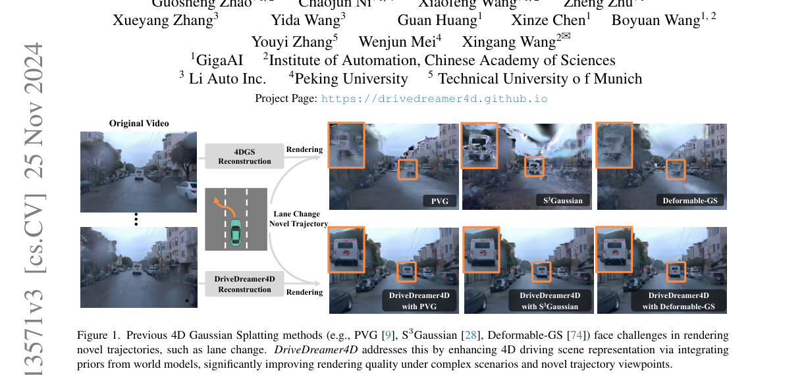
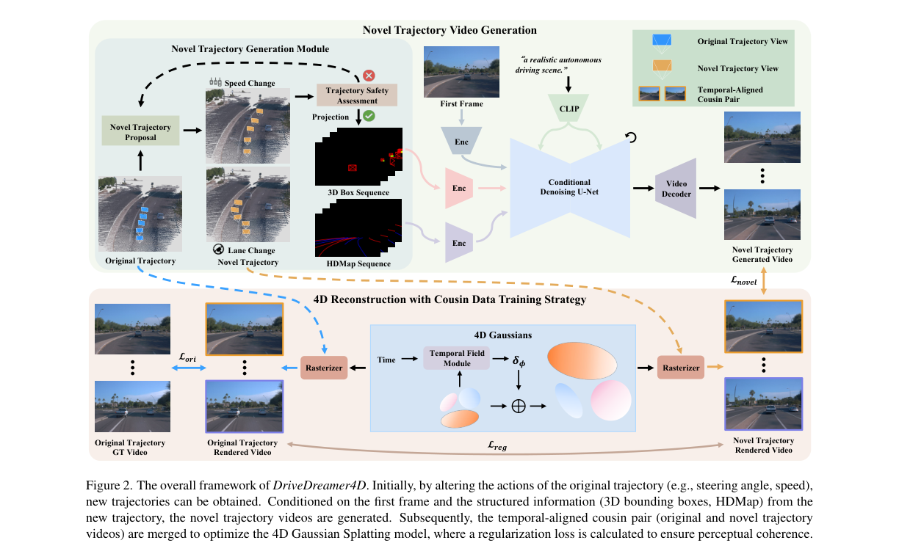
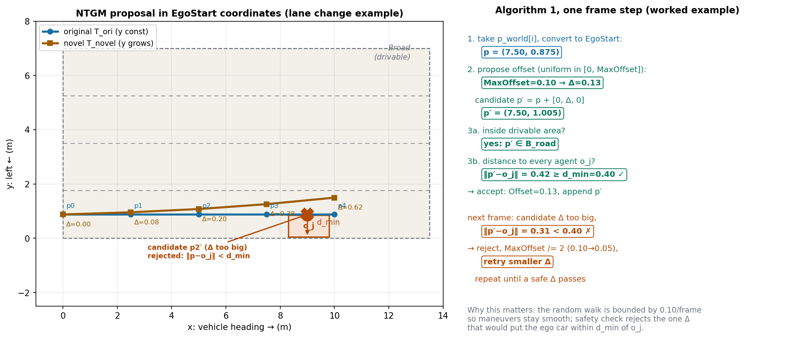
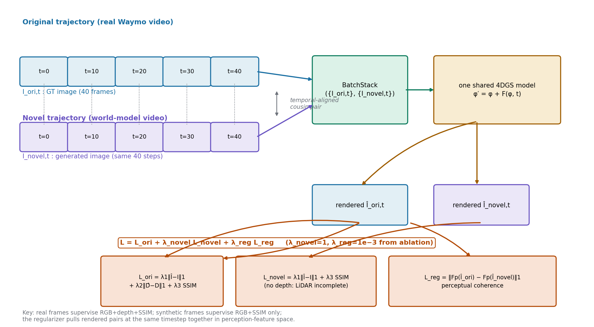
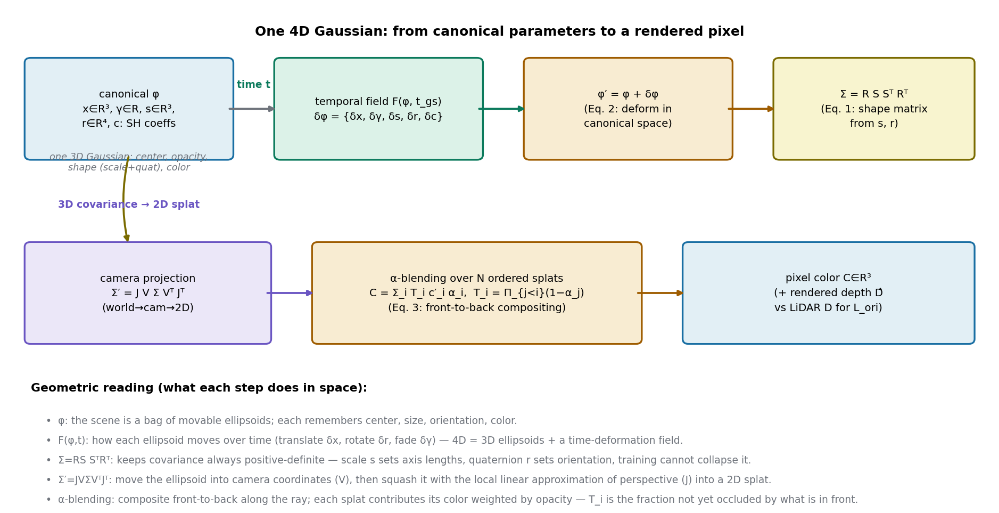
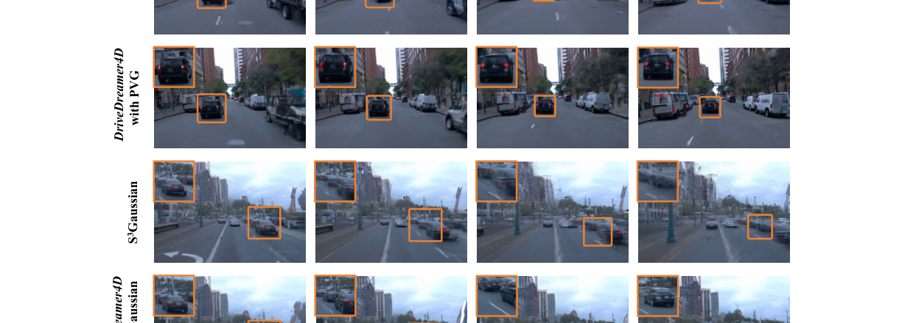
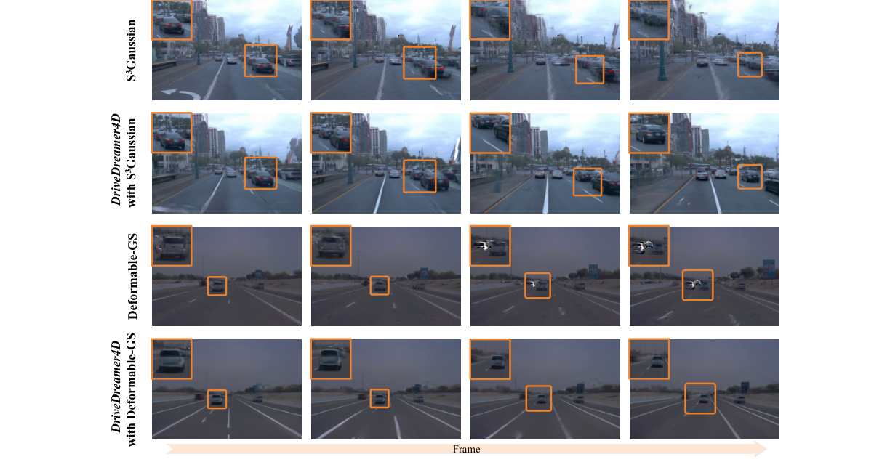

# 把世界模型当"数据机"：用生成的变道视频补齐 4D 重建的视角盲区

> **全局编号**：055-WM-drivedreamer4d
> **论文标题**：DriveDreamer4D: World Models Are Effective Data Machines for 4D Driving Scene Representation
> **作者**：Guosheng Zhao*、Chaojun Ni*、Xiaofeng Wang*（共同一作）、Zheng Zhu（通讯）、Xueyang Zhang、Yida Wang、Guan Huang、Xinze Chen、Boyuan Wang、Youyi Zhang、Wenjun Mei、Xingang Wang（通讯）
> **机构**：GigaAI；中国科学院自动化研究所；理想汽车；北京大学；慕尼黑工业大学
> **会议**：CVPR 2025
> **arXiv**：[2410.13571](https://arxiv.org/abs/2410.13571)，下载的是 v3（2024-11-25，CVPR 相机版；v1 2024-10-17，v2 2024-10-21；v3 主要是图片压缩，13.5MB vs 27MB）
> **代码**：公开，https://github.com/GigaAI-research/DriveDreamer4D（项目页 https://drivedreamer4d.github.io）
> **一句话核心洞见**：4D 高斯重建在变道、加减速等新轨迹视角下崩掉，不是因为重建算法不够强，而是训练数据里根本没有这些视角的观测；作者没有去改 4DGS，而是让一个可控视频世界模型当场"拍摄"新轨迹的视频，把缺的数据补上，再用真实视频和合成视频在时间上严格对齐的"表亲对"去训练同一个 4DGS。

## 闭环仿真真正卡住的地方：不是重建算法，是数据里就没有那个视角

端到端规划的开环评估测不准，这件事到 2024 年已经是共识（论文引了 Zhai 等人和 Li 等人的工作）。想做闭环评估，就得能从任意指定视角取出传感器数据——也就是要有一个 4D 驾驶场景表示，能把动态场景重建出来再任意渲染。NeRF 和 3DGS 这一路在静态场景上已经很成熟，搬到驾驶场景也有 PVG、S3Gaussian、Deformable-GS 等 4D 扩展。但这些方法有一个共同的、结构性的软肋：它们只能在训练数据分布附近渲染好。

训练数据是什么分布？Waymo、nuScenes 的实车采集，绝大多数是直行。直行意味着相机的运动轨迹几乎是一条直线，所有观测都挤在这条线附近。当你要求模型渲染一个"变道"视角——相机横向挪了两三米——这个视角在训练数据里从来没出现过。4DGS 的时间形变场 F(φ, t) 是在直行观测上拟合出来的，它没有理由在没见过的相机位姿下给出正确的几何。结果就是 Figure 1 里展示的：变道渲染时，前景的车跟着相机一起"漂移"，背景布满飞点和鬼影，车道线糊掉。

这里要先纠正一个容易产生的误读：这不是"4DGS 对动态建模不够好"的问题。同样是这批基线，在直行视角的传统划分（训练集里均匀抽帧做验证）下渲染质量是没问题的。失败的场景非常具体——**相机轨迹偏离训练轨迹**。这是一个数据覆盖问题，不是模型容量问题。想通这一点，后面的整个设计就顺理成章了：如果缺的是数据，那就去造数据，而不是去改模型。

## Figure 1：作者押的赌注，一眼就能看明白

论文第 1 页的 Figure 1（下图裁自第 1 页，2 倍分辨率渲染）：

*图注：原图为论文第 1 页 Figure 1。第一行是三个基线在变道视角下的渲染，第二行是各自接入 DriveDreamer4D 之后的渲染。作者想让你相信的是：同一个 4DGS 算法，只是训练数据里多了世界模型生成的变道视频，新视角渲染质量就上来了。*

这张图的信息量其实很大。仔细看基线行的三个失败模式是各不相同的：PVG 的车是"糊成一团"的鬼影，S³Gaussian 的背景有明显的飞点雪花，Deformable-GS 的车道线是花的。这说明三个 4DGS 的内部表示不一样（PVG 用周期振动高斯、S³Gaussian 用时空场、Deformable-GS 用形变网络），但它们在新视角下以各自的方式崩——崩的原因相同：没见过这个视角。而第二行三个"with DriveDreamer4D"的结果，车辆都变实了，背景都干净了。这就是作者的底气所在：**一个与具体 4DGS 算法无关的数据层面的修复**。如果这个修复只对某一种 4DGS 有效，那它可能是个针对性的 trick；对三种内部机制完全不同的 4DGS 都有效，说明它修的是共性病根——数据。

## 作者的底牌：手里有一个现成的、可控的视频世界模型

2024 年下半年，自动驾驶世界模型正处在一个微妙的时间点。GAIA-1、DriveDreamer、Drive-WM、Vista 等工作已经证明：扩散模型可以按动作条件（速度、转向角、3D 框、HDMap、文本）生成还算像样的驾驶视频。但这些工作都停在"生成 2D 视频"——视频是好看了，可它没有 3D 一致性，不能直接拿来做闭环仿真的数据源。另一方面，SGD、GGS、MagicDrive3D 等工作尝试用生成模型给 3D/4D 重建补视角，但补的要么是静态背景，要么是稀疏图像，动态交互场景的时空一致性管不住。

DriveDreamer4D 的作者（GigaAI 团队，DriveDreamer 系列的原班人马）手里正好有两样东西：第一，他们自己训过 DriveDreamer-2，一个结构化条件可控的驾驶视频扩散模型；第二，他们知道这个模型缺什么——缺 3D 一致性。所以这篇论文的真实起点很可能不是"我要发明一种新 4DGS"，而是"我的视频世界模型已经能按轨迹生成视频了，能不能把它当成 4DGS 的数据增强器"。标题里的 "World Models Are Effective Data Machines" 把这个定位说得非常直白：世界模型在这里不是被研究的对象，是被当成一台"数据机"来用的。

这张底牌有多硬？硬在两点。第一，可控性是现成的：DriveDreamer-2 本来就接受 3D 框序列、HDMap 序列、首帧、文本作为条件，生成"沿着某条轨迹开"的视频正是它的本职工作，不需要为这篇论文重新发明条件机制。第二，评估是诚实的：他们没有只在一个自家魔改的 4DGS 上验证，而是把三种公开的、机制不同的 4DGS（PVG、S³Gaussian、Deformable-GS）都接进来，证明数据机是通用的。这种"算法无关"的验证方式，比在一个基线上刷点更难被质疑。

但底牌也有软的一面，后面怀疑式审读会细说：这个"数据机"是他们自己在 Waymo 上重训的（DriveDreamer-2 原版是在 nuScenes 多视角上训的 8 帧 448×256，这里改成前视单目 40 帧 960×640），训了 50K iteration。也就是说，合成数据的质量上限，取决于一个在 Waymo 训练集（798 个视频）上训出来的视频扩散模型。数据机本身也是数据驱动的——它没有从天上掉下来免费的泛化能力。

## 新轨迹从哪来：NTGM 在自车坐标系里做的一次"受控随机游走"

整个 pipeline（论文 Figure 2，第 4 页）分成上下两半：上半是"新轨迹视频生成"，下半是"表亲数据训练 4DGS"。先看上半的第一步——新轨迹本身从哪来。作者设计了 Novel Trajectory Generation Module（NTGM），包含"轨迹提议"和"轨迹安全评估"两步。论文给了 Algorithm 1 的伪代码，值得逐行走一遍，因为它的设计里藏着几个不写出来就看不出的判断。

*图注：原图为论文第 4 页 Figure 2。注意上半部分"3D Box Sequence / HDMap Sequence"是通过 Projection 从新轨迹视角投影得到的——这是保证生成视频时空一致性的关键；下半部分 L_reg 连的是"原始渲染视频"和"新轨迹渲染视频"之间，不是连真实视频。*

先看坐标系的选择。原始轨迹 T^world_ori 是世界坐标系下的 K 个自车位置。NTGM 第一步用公式 (6) 把它变换到**第一帧的自车坐标系**：

$$[p^{EgoStart}_i, 1]^T = M^{-1}_0 \times [p^{world}_i, 1]^T$$

其中 M_0 ∈ R^{4×4} 是从第一帧自车坐标系到世界坐标系的变换矩阵。变换之后，x 轴是车头朝向，y 轴指向车身左侧，z 轴垂直向上。为什么要多这一步？因为在这个坐标系里，"加速/减速"就是调 x，"变道"就是调 y——**机动类型和坐标轴解耦了**。如果直接在世界坐标系里加偏移，你得分辨车头朝哪个方向，加速和变道混在一起。在自车坐标系里，变道就是 y 方向上叠一个增量，加速就是 x 方向上拉开点间距。这是一个典型的"选对坐标系，问题变简单"的例子。

然后是轨迹提议的核心循环（Algorithm 1）。对原始轨迹的每一个点 p（跳过起点），做：从均匀分布 RandOffset(0, MaxOffset) 里抽一个 NewOffset，候选点 p' = p + [0, NewOffset, 0]（注意只动 y，即横向），做安全检查；通过就接受，Offset 累加；不通过就把 MaxOffset 减半，重抽。用一个小例子走一遍：

假设某一帧原始点 p = (7.50, 0.875)（x=7.5 米，y=0.875 米，车道中心）。MaxOffset 初始 0.1。第一次抽到 NewOffset = 0.13（示意值），候选 p' = (7.50, 1.005)。安全检查两项（公式 7）：第一，p' ∈ B_road，可行驶区域内——1.005 米还在车道内，通过；第二，对所有其他交通参与者 o_j，‖p' − o_j‖ ≥ d_min——假设最近的一辆车 o_j 在 (9.0, 0.45)，距离 = √((9−7.5)² + (0.45−1.005)²) ≈ √(2.25+0.308) ≈ 1.60 米 ≥ d_min，通过。接受，Offset 累加到 0.13。

下一帧，抽到一个比较大的 NewOffset，候选点离 o_j 只有 0.31 米 < d_min = 0.40 米——拒绝，MaxOffset 从 0.10 减半到 0.05，重抽一个更小的偏移，直到通过为止。

这个"拒绝就减半重试"的设计有讲究。MaxOffset = 0.1 米/帧是一个很小的数：Waymo 是 10Hz，0.1 米/帧相当于横向速度上限 1 m/s 起步，累积起来几十帧就是一次完整的变道（3 米左右需要 30 帧）。把单步偏移封顶在 0.1 米，保证了提议轨迹的平滑性——不会出现一帧横跳一米的"瞬移"轨迹，这种轨迹喂给世界模型，生成的视频也会是诡异的。而"减半重试"是一个简单的回退策略：这帧实在找不到安全的偏移，就把步子收小，总能找到一个安全的（最坏情况 NewOffset → 0，退化成原始轨迹）。自绘图把这个过程画成了鸟瞰图：

*图注：自绘示意图，数值是示意性的（论文只给了 MaxOffset=0.1、d_min 未公开具体值）。左图展示变道场景下横向偏移的累积；右图展示 Algorithm 1 在一帧上的两种走法。*

这里有一个值得追问的细节：d_min 的具体值论文没有给。安全检查的第二项"‖p − o_j‖ ≥ d_min"里，d_min 是"不同 agent 之间的最小距离"，但正文和附录都没有给出数值。这是一个小缺口——复现时只能自己定（比如按车长+余量取 2~3 米，或者按 BEV 网格分辨率折算）。另外，安全检查只验了"可行驶区域内"和"不撞"，没有验曲率连续性、横向加速度上限这些动力学可行性。0.1 米/帧的封顶在一定程度上兜了底（横向加速度不会太大），但严格来说，生成的轨迹不保证满足车辆运动学。这对"数据机"的定位是可以接受的——它要的是"看起来合理"的视频，不是"能开"的轨迹——但如果有人想把 NTGM 的输出直接拿去当规划真值，就会踩坑。

还有一个设计选择：除了这种程序化提议，论文还提到可以用 text-to-trajectory（DriveDreamer-2 自带的功能）自动生成多样化复杂轨迹，或者手工定制。也就是说 NTGM 的"提议"部分是开放的，真正不可替代的是"安全评估"这一步——没有安全检查，随机游走可能 propose 出压线、撞车、开上人行道的轨迹，世界模型会被迫生成不合理的视频，污染 4DGS 的训练数据。

## 结构化条件：为什么生成视频不会"前景背景各演各的"

新轨迹有了，下一步是让世界模型沿着这条轨迹"拍摄"视频。这里的关键设计是**结构化条件**（structured conditions）：3D 框序列和 HDMap 序列。做法是把原始轨迹视角下的 3D 标注（车辆框、车道线）通过几何投影，变换到新轨迹的相机视角下，得到"从新视角看过去应该是什么布局"，再把这个布局作为条件喂给扩散模型。

为什么这一步不可少？想象一个朴素的替代方案：只给世界模型首帧 + 文本"变道"，让它自由生成。扩散模型确实能生成一段"看起来在变道"的视频，但它没有任何约束去保证第 10 帧里那辆白色轿车的位置，和第 11 帧里的是同一辆车、按物理规律移动的。前景车辆和背景车道线可能各自漂移——这正是论文反复说的"缺乏时空一致性"（spatiotemporal coherence）。而有了从新视角投影过去的 3D 框序列，每一帧里"车应该在哪"都被钉死了；HDMap 序列钉死了"车道线应该在哪"。扩散模型要做的只是把框和地图"渲染"成逼真的像素，而不是自己决定场景布局。

论文 Figure 2 的上半部分特别强调了"前景和背景元素的运动动力学被独立调控"（independently regulate the motion dynamics of foreground and background elements）。这句话的机制含义是：3D 框管前景（车、人这些会动的），HDMap 管背景（车道线、路面这些不动的），两路条件分开编码、分别注入。为什么要分开？因为前景和背景在新轨迹下的运动规律完全不同：背景是纯粹的相机运动（ego-motion）导致的视差，前景还要叠加物体自身的运动。如果混在一起让模型自己学，模型容易把背景的视差错误地解释成物体的运动——这正是基线渲染里"车跟着相机一起变道"的病根。把两路分开，等于告诉模型：背景怎么动只跟相机走，前景怎么动看 3D 框。时空一致性就是这样被"压"出来的。

## CDTS：表亲对训练——合成数据和真实数据在时间上对齐

现在到了论文的第二个核心设计：Cousin Data Training Strategy（CDTS）。世界模型生成了新轨迹视频，怎么用它来训 4DGS？最朴素的做法是把合成视频直接倒进训练集，跟真实视频混在一起训。但这里有个对齐问题：真实视频的第 t 帧和合成视频的第 t 帧，虽然时间戳相同（都是从同一段 40 帧 clip 来的），但相机位姿不同（一个在原始轨迹上，一个在新轨迹上）。如果像普通数据增强那样随机采样、随机拼 batch，模型在一个 batch 里看到的可能是"真实第 5 帧 + 合成第 37 帧"，时间对不上，时间形变场 F(φ, t) 会被迫去拟合混乱的监督信号。

CDTS 的做法是构造"时间对齐的表亲对"作为最小训练 batch（公式 8）：

$$\text{BatchStack}(\{\hat{I}_{ori,t}\}^T_{t=0}, \{\hat{I}_{novel,t}\}^T_{t=0})$$

每个训练步，输入的是同一时间戳 t 下的一对：原始轨迹的真实帧和新轨迹的合成帧。注意公式里写的是 Î（带帽子的渲染值）——BatchStack 堆的是"渲染-监督"对，实际含义是每个 step 同时用原始数据和新轨迹数据做一次前向+梯度更新。自绘图把这个流程画出来了：

*图注：自绘示意图。λ_novel=1、λ_reg=1e−3 取自论文表 4、表 5 的消融最优值。*

然后是总损失（公式 11）：

$$L(\phi') = L_{ori} + \lambda_{novel} L_{novel} + \lambda_{reg} L_{reg}$$

三项各管一摊。L_ori 是原始数据的标准 4DGS 损失（公式 4）：RGB 的 L1 + LiDAR 深度图的 L1 + SSIM。L_novel 是合成数据的损失（公式 9）：只有 RGB 的 L1 + SSIM，**没有深度项**。为什么？论文 3.2.2 节解释得很实在：LiDAR 点云只在原始轨迹上采集过，把这些点投影到新轨迹视角下，因为遮挡关系变了（新视角能看到的东西在原始视角可能被挡住），投影出来的深度图是残缺的、有洞的。拿这种残缺深度图去监督，只会把 4DGS 带偏。所以干脆不用——这是一个"知道什么监督信号不可信就不用"的诚实决定。消融表 6 也证实了：加上深度损失，NTA-IoU 从 0.420 掉到 0.401，FID 从 79.54 恶化到 82.63。

第三项 L_reg 是感知正则（公式 10）：

$$L_{reg}(\phi') = \|F_p(\hat{I}_{ori}) - F_p(\hat{I}_{novel})\|_1$$

F_p 是一个感知特征提取模型（论文引用 [21]，即 Inception 那篇，FID 用的也是它）。注意这里比较的是**两路渲染结果**（Î_ori 和 Î_novel），不是渲染和真值。几何含义是：同一个 4DGS 模型，在同一时间戳 t 下，从原始视角渲染出的图和从新轨迹视角渲染出的图，经过感知网络提取特征后应该接近。它惩罚的具体情形是"换个视角，场景的语义内容就变了"——比如变道视角下某辆车消失了、或者多出来一辆车，两路渲染的感知特征就会对不上，L_reg 把这个差距压回去。这是一个很聪明的约束：它不要求新视角的渲染和某张"真值"像素对齐（因为新视角根本没有真值），只要求**跨视角的语义一致性**。

但 L_reg 也有它的脾气。表 5 的消融显示 λ_reg=1e−3 最好（NTA-IoU 0.428，FID 71.52），而 λ_reg=1e−2 时 FID 直接炸到 119.39——比不用正则（λ_reg=0，FID 79.54）还差一大截，甚至比纯基线 PVG（105.29）还差。这说明 L_reg 在最优值附近非常尖锐：给多了，感知特征对齐的约束会压过 RGB 重建，渲染图为了"特征接近"而牺牲像素 fidelity。论文没有给 λ_reg 的敏感性曲线，只有四个离散点（0、1e−2、1e−3、1e−4），1e−3 像是一个尖峰。换数据集、换基线，这个值很可能要重调——论文没有讨论这一点。

## 公式 1–5：4DGS 的前置知识，每一步在空间里做了什么

论文 3.1 节是 4DGS 的 preliminary，不是作者的创新，但要读懂后面必须把这几个公式讲透。先列张量表（单个高斯的视角）：

| 符号 | 形状 | 含义 |
|---|---|---|
| x | R³ | 高斯中心在世界坐标系的位置 |
| γ | R | 不透明度（opacity），标量 |
| s | R³ | 三个轴的尺度（scale） |
| r | R⁴ | 朝向四元数（quaternion） |
| c | Rᵏ | 球谐函数（SH）系数，视角相关的 RGB 颜色 |
| φ = {x,γ,s,r,c} | — | 单个 3D 高斯的全部可训练参数 |
| t_gs | R | 时间步（temporal field 的输入） |
| δφ = {δx,δγ,δs,δr,δc} | 与 φ 对应 | 时间形变场输出的偏移量 |
| φ′ = φ + δφ | — | t 时刻的 4D 高斯参数 |
| Σ | R³ˣ³ | 3D 协方差矩阵 |
| Σ′ | R²ˣ² | 投影到图像平面的 2D 协方差 |
| J | R²ˣ³ | 透视投影的雅可比矩阵 |
| V | R³ˣ³（旋转部分） | 世界到相机的变换 |

**公式 (1)：Σ = R S Sᵀ Rᵀ。** 直接优化一个 3×3 协方差矩阵是危险的——训练中它可能变成非正定，几何上就不再是椭球了。所以 3DGS 用"尺度+旋转"来参数化：S 是对角阵（对角线是 s 的三个分量），R 是四元数 r 转成的旋转矩阵。R S Sᵀ Rᵀ 恒正定，因为 S Sᵀ 是对角正定阵，旋转不改变正定性。几何动作：s 决定椭球三根轴各多长，r 决定椭球朝哪转。训练时学 s 和 r，Σ 永远是一个合法的椭球。

**公式 (2)：φ′ = φ + F(φ, t_gs)。** 这是"4D"的全部含义：场景在正则空间（canonical space）里是一堆静态的 3D 高斯 φ，时间形变场 F 是一个小网络，输入（φ, t）输出每个高斯在 t 时刻相对正则空间的偏移 δφ。注意 F 的输入包含 φ 本身——不同的高斯在同一时刻可以有不同的运动（车上的高斯往前挪，路面的高斯不动），这是它能表示动态场景的原因。

**公式 (3)：α-blending，C = Σ_{i∈N} T_i c′_i α_i。** 渲染时，对每个像素，把穿过它的高斯按深度从前到后排序。α_i 是第 i 个高斯在该像素的 2D 高斯值乘以它的不透明度 γ′_i——也就是"这个椭球在这个像素有多实"。T_i = Π_{j<i}(1−α_j) 是透射率，表示"前面的高斯还没挡掉的部分还剩多少"。几何动作：沿视线从前往后叠颜色，前面越实，后面贡献越小。拿三个高斯算一遍：α = [0.7, 0.5, 0.3]，颜色 c′ = [红, 绿, 蓝]。T_1 = 1，贡献 1×红×0.7；T_2 = 0.3，贡献 0.3×绿×0.5 = 0.15绿；T_3 = 0.3×0.5 = 0.15，贡献 0.15×蓝×0.3 = 0.045蓝。最终像素 ≈ 0.7红 + 0.15绿 + 0.045蓝 + 背景×0.105。读者可以手算验证：T_i 的连乘保证了所有贡献系数加起来不超过 1。

**公式 (4)：L_ori = λ₁‖Î−I‖₁ + λ₂‖D̂−D‖₁ + λ₃SSIM。** 三项分工：L1 管像素级颜色对齐，深度 L1 管几何（LiDAR 深度图 D 做监督），SSIM 管结构相似性（对光照变化更鲁棒）。λ₁、λ₂、λ₃ 的具体值论文没给，只说"与各基线对齐"（aligned with each baseline）——这是个小缺口，复现时得去翻 PVG/S³Gaussian/Deformable-GS 各自的论文。

**公式 (5)：L_diff = E[‖ε_t − ε_θ(z_t, t, f)‖²]。** 标准的 latent diffusion 去噪损失：视频 v 经 VAE 编码器 E 压成隐变量 z，加噪成 z_t，网络 ε_θ 预测加的噪声。f 是条件特征（参考图、速度、转向角、场景布局、相机位姿、文本）。DriveDreamer4D 自己不训扩散模型的新结构，它直接用 DriveDreamer-2 的训练流程（在 Waymo 前视上重训），所以公式 (5) 在这里是"前置知识"而非创新。

自绘图把公式 (1)–(3) 的参数流画成了一张图：

*图注：自绘示意图，对应论文公式 (1)–(3)。*

## 一个变道场景走完全程：基线在哪一步开始胡说，CDTS 在哪一步把它拉回来

构造一个具体场景：Waymo 验证集的一段 40 帧 clip，直行三车道，ego 在中间车道以 8 m/s 行驶；右侧车道有一辆白色轿车，位置在 ego 前方 12 米、右方 3.5 米。新轨迹：NTGM 提议一次向右变道（y 从 0 累积偏移到 −3.2 米，40 帧完成）。

**基线（纯 PVG，只在原始直行视频上训练）的走法。** 训练时，PVG 的时间形变场 F 只见过"相机沿 x 轴直线前进"的观测。测试时把相机放到新轨迹上（横向挪了 3 米），光栅化时每个高斯的 2D 投影位置 Σ′ = JVΣVᵀJᵀ 变了——V 变了，但高斯的 3D 位置 x 是按直行视角拟合的。对那辆白色轿车：它在直行视角下投影在图像右侧；变道后，相机右移，按几何它应该向图像左侧移动。但 PVG 的形变场学到的是"直行视角下这辆车随时间的变化规律"，它没有"相机横移"这个自由度的监督。实际渲染结果（论文 Figure 3，第一行是 PVG 基线、第二行是 DriveDreamer4D with PVG；下图为原图裁切，出自第 7 页）：

白色轿车没有按几何规律左移，而是糊成一团鬼影，背景出现飞点。NTA-IoU 在这个场景下只有 0.256（表 1，PVG lane change 列）：用 YOLO11 在渲染图上检测到的车框，和把真实 3D 框投影到新视角得到的框，IoU 平均只有 0.256——说明渲染出的车位置是错的。

**DriveDreamer4D 的走法。** 第一步，NTGM 生成变道轨迹并通过安全检查（可行驶区域内、与白色轿车距离始终 ≥ d_min）。第二步，把 3D 框序列和 HDMap 投影到新轨迹视角：白色轿车的框在新视角下应该出现的位置被算出来，作为条件。第三步，世界模型生成 40 帧新轨迹视频：因为条件里已经钉死了"白色轿车在新视角的第 t 帧应该在图像的这个位置"，生成的视频里车的位置是对的。第四步，CDTS 训练：batch 里第 t 步同时看到（真实直行第 t 帧，合成变道第 t 帧）。L_novel 用合成帧的 RGB 监督新视角的渲染，L_reg 要求"直行视角渲染"和"变道视角渲染"在感知特征上一致——如果 4DGS 把白色轿车在新视角下渲染丢了，两路特征就对不上，梯度会把它拉回来。最终 NTA-IoU 0.438（表 1，DriveDreamer4D with PVG lane change 列），相对提升 (0.438−0.256)/0.256 = 71%。分叉点非常具体：**基线在"相机位姿超出训练分布"这一步就没有监督信号，而 DriveDreamer4D 在这一步恰好有世界模型生成的伪真值**。

## 怀疑式审读

**指标是自造的，而且"真值"是另一套模型的输出。** NTA-IoU 和 NTL-IoU 是这篇论文自己发明的指标，因为新轨迹视角下没有传感器真值，PSNR/SSIM 用不了。NTA-IoU 的做法：用 YOLO11 在渲染图上检测车辆框，同时把原始 3D 框做几何变换投影到新视角，算两者的 IoU（中心距离超过 d_thresh 直接记 0）。这里有两个可质疑的点。第一，YOLO11 本身是一个检测器，它的漏检/误检会污染指标——如果渲染图里的车糊到 YOLO11 认不出来，NTA-IoU 记的是"检测失败"，不完全等于"渲染失败"。第二，投影的 3D 框被当作真值，但 3D 框是稀疏的、只覆盖标注的车，YOLO11 可能检测到 3D 框没覆盖的远处车辆，这些会被当成误检拉低分数。论文没有报告 YOLO11 在原始视角真值图上的检测精度作为参照——如果 YOLO11 在真值图上的 NTA-IoU 也只有 0.8，那 0.438 的绝对值就要打折扣看。当然，相对比较（基线 vs 方法用同一套检测器）是公平的，71% 的相对提升是可信的方向性证据，但绝对数值的含金量要打问号。d_thresh 的具体值论文没有给，这是复现的一个缺口。

**FID 的用法非常规，绝对值没有意义，只能看相对。** 常规的 FID 是"生成集 vs 真实集"的分布距离。这里的 FID 是"新轨迹视角的渲染图 vs 原始轨迹的真实图"——注意分母不是新视角的真值（因为没有），而是原始视角的真值。即使渲染完美（把新视角的真实世界分毫不差地画出来），因为视角变了，FID 也不会是 0。所以表 2 里 105.29、71.52 这些绝对值没有"越小越好"的绝对含义，只能在"同一批新轨迹、不同方法"之间横向比较。论文自己也意识到了 FID 的局限：加减速场景下渲染视角和真值分布太接近，FID 区分不开，所以 FID 只报了变道场景。这个处理是诚实的，但反过来说，FID 在这里测的其实是"渲染图离真实照片有多远"，混杂了视角差异和伪影两个因素——一个把变道视角渲染得很干净但视角偏移很大的方法和一个视角准但有伪影的方法，FID 可能打成平手。NTA-IoU 恰好补了"位置准不准"这一维，两个指标搭配着看才是完整的。

**只有 8 个场景，每个 40 帧。** 实验在 Waymo 验证集上选了 8 个"高动态交互"场景（附录表 7 给了 segment ID 和起止帧）。8 个场景 × 3 种新轨迹 × 3 个基线，这是全部的定量评估。样本量很小，而且是作者"精心挑选"的（selection prioritizes scenes that exhibit significant motion dynamics）。挑选本身不是作弊——新轨迹渲染本来就要在复杂场景测——但 8 个场景上没有报告方差、没有多随机种子，表 1 里 0.438 vs 0.256 这种差距看起来很大，可我们不知道换 8 个场景会不会变成 0.40 vs 0.30。论文没有给出任何不确定性估计。

**超参数网格很粗，λ_reg 疑似尖峰。** λ_novel 只试了 {0, 0.5, 1, 1.5} 四个值，λ_reg 只试了 {0, 1e−2, 1e−3, 1e−4}。λ_novel=1 最好，但 0.5（0.405/82.84）和 1.5（0.417/82.10）都接近，说明 λ_novel 在 0.5~1.5 之间比较平坦，这个选择是稳的。λ_reg 则不然：1e−3（0.428/71.52）最好，1e−2（0.411/119.39）直接把 FID 炸穿，1e−4（0.422/75.31）也差一截。从 1e−3 到 1e−2 差一个数量级，FID 从 71.52 跳到 119.39——这是一个尖锐的峰。论文没有画敏感性曲线，也没有讨论换基线/换数据集时要不要重调。对于想复用的人来说，这是一个坑：λ_reg 很可能需要按自己的数据重新搜。

**基线被"加固"过，方向是对作者有利的。** 论文写道 "For a fair comparison, LiDAR supervision is introduced to Deformable-GS"——Deformable-GS 原版是单目（无 LiDAR）的，作者给它加了 LiDAR 深度监督。这是一个改动过的基线。但公平地说，这个改动是**加强**了基线（多了深度监督），而不是削弱。在这种情况下 DriveDreamer4D 还能赢 16.3%（FID）和 15.6%（NTA-IoU），结论是站得住的。真正要问的是另外两个基线 PVG 和 S³Gaussian：论文说超参数"与各基线对齐"、训练策略相同，只是加入了 CDTS——这意味着基线是作者自己重训的（不是抄原论文的数字），训练配置是否完全对齐（迭代数、学习率、densification 策略）只能信任作者。没有报告训练墙钟时间和显存，"高效"之类的词论文倒是没说，这是好的。

**用户研究：72 个对比视频，但人数没说。** 附录说做了 72 个对比视频（8 场景 × 3 轨迹 × 3 基线），随机左右摆放，参与者选"更准确或更真实"的一边。平均胜率超 80%（PVG 对 93.2%、S³Gaussian 对 96.7%、Deformable-GS 对 84.1%）。但**参与者人数、每人看多少个视频、是否允许平局**，论文都没有报告。如果只有 5 个人每人看 72 个，那 80% 胜率的统计效力就很弱。这是一个信息缺口。

**"64K clips"这个数字是自洽的。** 附录说世界模型训练用了 Waymo 全部训练集 798 个视频，切成 40 帧的 clip，得到约 64K 个 clip。粗算一下：798×200 帧 = 159,600 帧，不重叠切分只能得到约 4K 个 clip。但如果用滑动窗口（stride 2）：798×(200−40+1)/2 ≈ 64,239——正好约 64K。所以这个数字对应的是 stride≈2 的重叠切分，不是笔误。论文没有明说 stride，这是个小缺口，但数字本身是能对上的。

**"首个"的声明需要加限定语。** 论文说 "the first to utilize video generation models for improving 4D reconstruction in driving scenarios"。时间线上：MagicDrive3D（2024-05）是 3D 生成、任意视角渲染，但它是静态场景为主；SGD（2024-03）、GGS（2024-09）用扩散先验补的是稀疏图像/静态背景；ReconDreamer（2024-11，同一个 GigaAI 团队，CVPR 2025）做的是"在线修复"的驾驶场景重建，晚了一个月。所以"视频生成模型 + 4D 动态重建"这个交叉点，DriveDreamer4D（v1 2024-10-17）确实是先占住的。但"首个"永远是个脆弱的声明——它依赖于"4D reconstruction"这个限定的划法。如果有人把 MagicDrive3D 也算成 4D（它有动态元素），这个声明就有争议。读的时候把限定语带着就行。

**没有讨论失效模式。** 整篇论文没有一处说"我们的方法在什么情况下不如基线"。从机制上可以推断几个：第一，如果世界模型生成的视频本身是错的（比如新轨迹下某辆车被生成到了错误的位置），CDTS 会把错误的伪真值喂给 4DGS——垃圾进、垃圾出，而 L_reg 只保证跨视角一致，不保证正确。第二，NTGM 的安全检查依赖 3D 框标注的质量；如果标注漏了某个行人，d_min 检查就形同虚设。第三，L_novel 没有深度监督，新视角的几何完全靠 RGB 和世界模型的先验撑着——在纹理稀疏的区域（比如空旷路面、天空）深度可能飘。这些论文都没说，但做后续工作的人需要知道。

## 数字核实（全部来自原文，带上下文）

**表 2，FID（变道场景，Waymo 8 场景平均，越小越好）：** PVG 105.29 → DriveDreamer4D with PVG 71.52，相对降幅 (105.29−71.52)/105.29 = 32.1% ✓；S³Gaussian 124.90 → 66.93，相对 46.4% ✓；Deformable-GS 92.34 → 77.32，相对 16.3% ✓。摘要和引言里的三个百分比与表 2 完全对得上。

**表 1，NTA-IoU / NTL-IoU（三类新轨迹的平均）：** NTA-IoU：PVG 0.349→0.428（+22.6% ✓），S³Gaussian 0.331→0.475（+43.5% ✓），Deformable-GS 0.321→0.371（+15.6% ✓）。NTL-IoU：PVG 52.48→53.43（+1.8% ✓），S³Gaussian 51.04→52.91（+3.7% ✓），Deformable-GS 52.33→53.16（+1.6% ✓）。注意 NTL-IoU（背景车道线）的提升幅度远小于 NTA-IoU（前景车辆）——这符合直觉：车道线是静态背景，基线本来就没那么差；前景车辆的动态才是新视角下崩得最厉害的部分，也是世界模型补得最多的部分。

**表 3，用户研究胜率（行平均）：** vs PVG：lane change 100.0%、acceleration 90.5%、deceleration 89.1%，平均 93.2% ✓；vs S³Gaussian：100.0%、97.9%、92.2%，平均 96.7% ✓；vs Deformable-GS：95.8%、83.5%、72.9%，平均 84.1% ✓。论文说"平均胜率超 80%"，三个平均值（93.2/96.7/84.1）确实都超 80%。

**表 4，λ_novel 消融（基于 PVG，lane change）：** 0 → 0.349/105.29（退化为纯基线）；0.5 → 0.405/82.84；1 → 0.420/79.54（最优）；1.5 → 0.417/82.10。

**表 5，λ_reg 消融：** 0 → 0.420/79.54；1e−2 → 0.411/119.39（FID 恶化超基线）；1e−3 → 0.428/71.52（最优）；1e−4 → 0.422/75.31。

**表 6，CDTS 消融（基于 PVG）：** 深度损失开 → 0.401/82.63；深度关 → 0.420/79.54；+时间对齐表亲对 → 0.423/76.20；+正则 → 0.428/71.52。论文说 CDTS 带来约 10% FID 提升、约 2% NTA-IoU 提升：(79.54−71.52)/79.54 = 10.1% ✓；(0.428−0.420)/0.420 = 1.9% ✓。

**训练配置（附录）：** 世界模型：SVD 权重初始化，AdamW，lr 5e−5，batch 8，50K iter，NVIDIA H20（96GB）——GPU 数量未报告，墙钟时间未报告。4DGS：Adam，学习率 schedule 沿用 3DGS 原文，分辨率 640×960（前视单目），40 帧 clip。

## 代码核对：公开的是 4DGS 训练与评估，数据机本身不在里面

官方仓库已 clone 到 `code/`。通读后的结论是：**公开代码只覆盖了 pipeline 的下半部分**（4DGS 训练、新轨迹渲染、NTA-IoU/NTL-IoU 指标计算），NTGM 轨迹提议、DriveDreamer-2 视频生成、CDTS 的 BatchStack 混合逻辑都不在公开代码里——合成数据和 checkpoint 通过百度盘/Google Drive 链接直接提供。这意味着论文最核心的两个模块（上半部分）是不可复现的，只能信任作者提供的数据。

**与论文一致的地方：**

- 新轨迹数据跳过深度损失：`models/trainers/base.py` 第 754 行，`if not ref_flag and self.depth_loss_fn is not None`——ref_flag 为 True（新轨迹/参考数据）时不加 depth loss。这正是论文 3.2.2 节说的"LiDAR 深度图在新视角下残缺所以不用"的代码实现。对得上。
- 损失权重在 config 里是实的：`configs/pvg_example/*.yaml` 给出 rgb w=0.8、ssim w=0.2、depth w=0.1（inverse_depth=True、l1、mean_on_hw，另有 weight_decay=1.0）。论文公式 (4) 只写了 λ₁、λ₂、λ₃ 没给数值，代码里能查到——复现时以代码为准。
- 训练 30000 iter（`num_iters: 30000`），config 里 `seed: 6666`——论文正文没有报告随机种子，代码里是固定的 6666。
- NTA-IoU 的实现细节补上了论文的缺口：检测用的是 YOLO11x（`yolo11x.pt`），检测前把渲染图 resize 到 480×320；`find_closest_box` 里 `min_distance <= 10`——论文没给的 d_thresh 在代码里是硬编码的 **10 像素**。注意这是 resize 之后 480×320 图像上的 10 像素，折算到 960×640 的渲染图上相当于 20 像素。

**与论文不一致 / 论文没说的地方：**

- **L_reg 感知正则损失在公开代码里没有实现。** 全仓库搜索，没有任何训练损失用到感知特征对齐（`||F_p(Î_ori) − F_p(Î_novel)||₁`）；LPIPS（`LearnedPerceptualImagePatchSimilarity`）只在 `video_utils.py` 里做评估指标用。也就是说，表 6 里"+正则 → FID 71.52"那一行的训练代码没有公开。CDTS 的完整实现（BatchStack 时间对齐采样）也没有——config 里有个 `mix_type: change_lane` 参数，但全仓库没有任何 Python 代码引用它，是个死参数。
- **论文没提的额外损失：** sky mask 的 BCE 损失（w=1.0）、opacity 熵正则（w=0.05）、inverse 深度平滑（w=0.001）。这些是 4DGS 训练稳定的工程技巧，论文公式 (4) 里没有，但实际训练在用。opacity 熵正则的作用是防止高斯的不透明度塌到 0/1 两端之外的中间态？不——熵正则 `-p·log(p)` 是把不透明度往 0 或 1 两端推（最小化熵），让场景更"实"、减少半透明鬼影。这和论文 Figure 1 里要消除的 ghosting 是直接相关的，但论文一个字没提。
- `detect_novel_label.py` 的 argparse 默认值里残留了作者内网路径（`/mnt/data-2/users/zhaoguosheng/...`），不影响运行，说明这部分代码是从内部实验脚本直接搬出来的。
- 深度损失的细节比论文丰富：用的是 inverse depth、reduction=mean_on_hw、weight_decay=1.0（随 step 衰减，`decay_weight = exp(−step/8000 × lidar_w_decay)`）——训练早期深度权重是 0.1，后期指数衰减。论文只说"RGB loss, depth loss and SSIM loss"，这些 schedule 细节都没写。

综合判断：公开代码对"4DGS 怎么训、指标怎么算"这部分是诚实的，甚至补上了论文缺的数值；但对论文真正的创新点（NTGM + CDTS），代码是缺席的。审稿意义上的可复现性打了折扣——你能复现"怎么评估"，不能复现"数据怎么造、怎么混"。

## 能带走的东西

这篇论文最值得带走的不是某个公式，而是一个**问题定位的范式**：当你的重建/感知模型在某种输入下系统性失败时，先问"训练数据里有没有这种输入"，而不是"模型容量够不够"。DriveDreamer4D 把世界模型降格成"数据机"——不指望它有 3D 一致性，只用它的可控生成能力去补数据的视角盲区，再用一个轻量的、对齐良好的训练策略（表亲对 + 感知正则）把合成数据喂给重建模型。这个"生成模型当数据增强器"的思路是可迁移的：任何"缺视角/缺长尾"的问题，只要你能用结构化条件钉住生成内容的正确性，都可以套用。

第二个可带走的是 CDTS 的设计哲学：**合成数据不是倒进训练集就行，对齐方式决定成败**。时间对齐的表亲对、去掉不可信的深度监督、用感知正则代替像素真值——每一步都是在回答"合成数据和真实数据有什么不一样，要怎么分别对待"。做任何"仿真数据训练"的工作，这三问都值得先问一遍。

真正值得做的后续问题：第一，世界模型生成的伪真值错了怎么办——能不能让 4DGS 对合成数据有一个"不确定性加权"，生成质量差的地方少信一点？第二，NTGM 目前只在几何层面做安全检查，能不能把动力学可行性（曲率、加速度）也加进去，让提议轨迹直接可用？第三，λ_reg 的尖锐性暗示感知正则和 RGB 重建在"抢"梯度，有没有更温和的对齐方式，比如只在前景区域加正则？第四，8 个场景的评估太小，能不能在一个更大的、有真值的新轨迹基准（比如用多车协同采集的跨视角数据）上重测一次？
