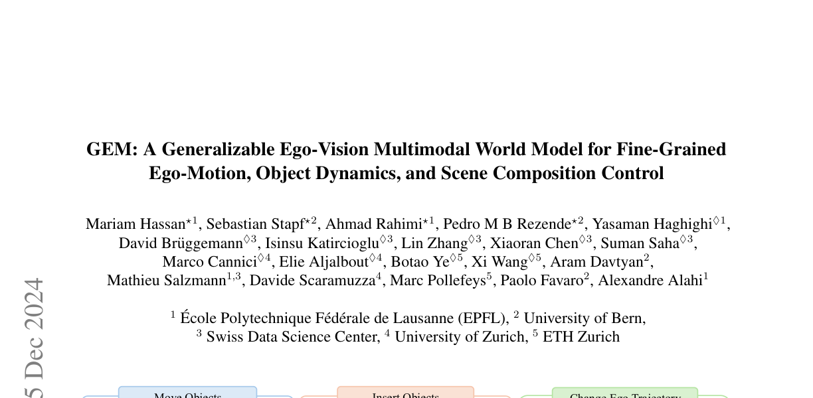
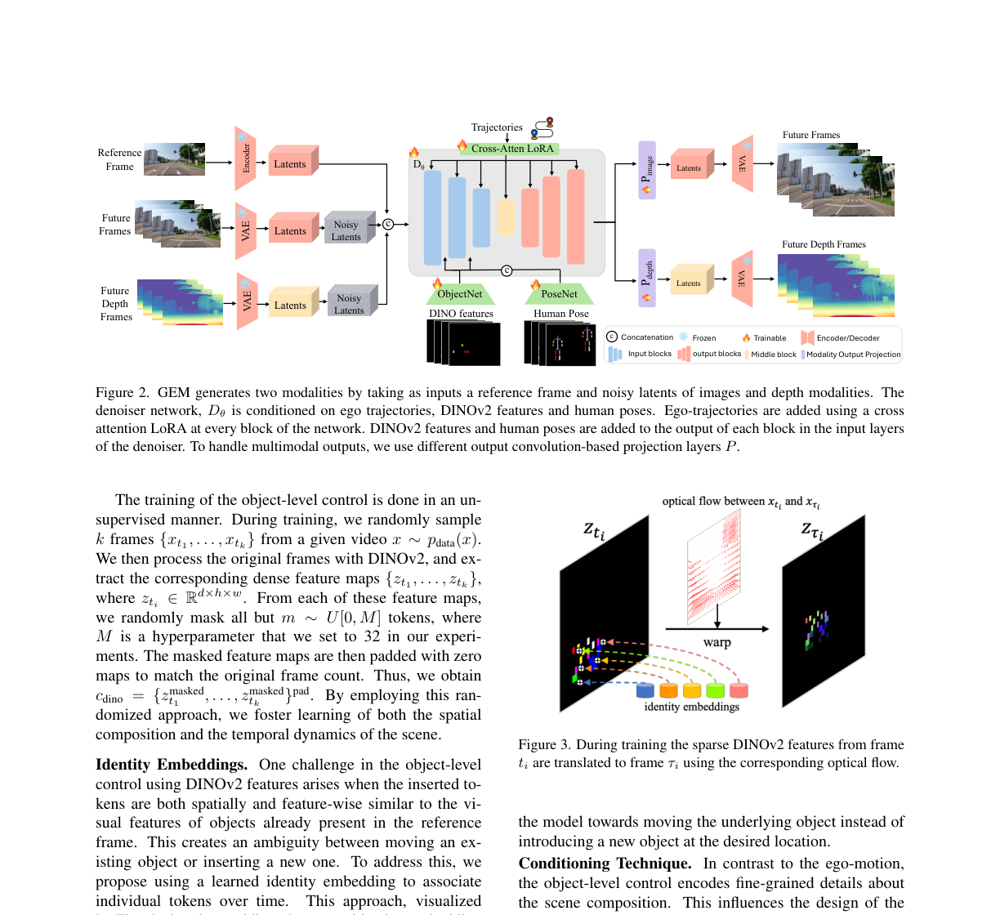
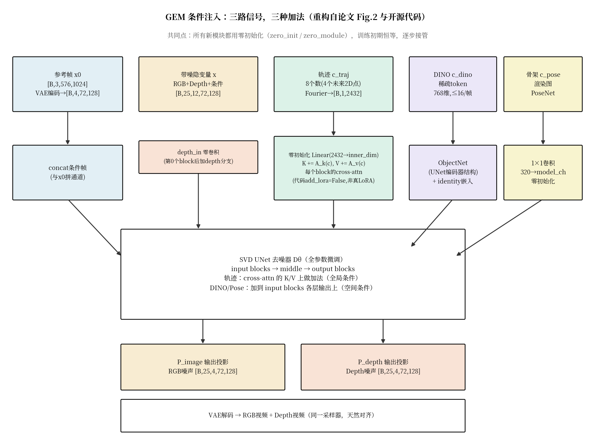
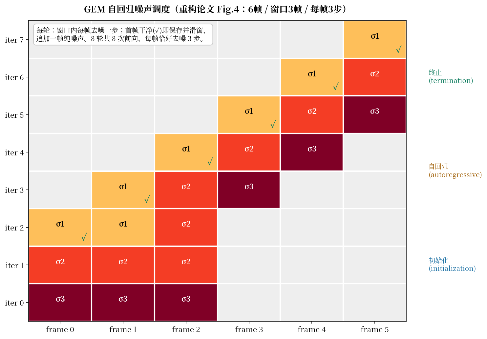

# 稀疏 token 当画笔、轨迹当缰绳：GEM 把视频扩散模型改造成可精细操控的第一人称世界模型

> **全局编号**：056-WM-gem
> **论文标题**：GEM: A Generalizable Ego-Vision Multimodal World Model for Fine-Grained Ego-Motion, Object Dynamics, and Scene Composition Control
> **作者**：Mariam Hassan⋆、Sebastian Stapf⋆、Ahmad Rahimi⋆、Pedro M B Rezende⋆、Yasaman Haghighi♢、David Brüggemann♢、Isinsu Katircioglu♢、Lin Zhang♢、Xiaoran Chen♢、Suman Saha♢、Marco Cannici♢、Elie Aljalbout♢、Botao Ye♢、Xi Wang♢、Aram Davtyan、Mathieu Salzmann、Davide Scaramuzza、Marc Pollefeys、Paolo Favaro、Alexandre Alahi（⋆主要贡献者；1 EPFL、2 伯尔尼大学、3 Swiss Data Science Center、4 苏黎世大学、5 ETH Zurich）
> **会议**：CVPR 2025
> **arXiv**：2412.11198（[摘要页](https://arxiv.org/abs/2412.11198)；2024-12-15 提交，只有 v1 这一个版本，下载的就是 v1）
> **代码**：已公开并已 clone（https://github.com/vita-epfl/gem，目录下 code/）。读过模型定义（gem/modules/diffusionmodules/video_model.py、attention.py）、DINO 条件编码器（gem/modules/encoders/dino_v2_features_id.py）、训练噪声采样（sigma_sampling.py）、采样器（sampling.py 的 EulerEDMSamplerDynamicPyramid）与默认配置（configs/training/stage1.yaml、stage2.yaml）。论文与代码不一致处见"论文没说实话的三个地方"一节。
> **一句话核心洞见**：第一人称世界模型的控制难题在于"自车怎么动"和"场景里别的东西怎么动"纠缠在一起，GEM 的解法是把控制信号按"全局/空间"解耦成三路注入——轨迹只做全局条件去加 cross-attention 的 K/V，DINO 稀疏 token 做空间条件去逐层相加，骨架单独走一路 PoseNet——再用一套逐帧错开的噪声调度，把只在 25 帧上训练的模型外推到 150 帧的稳定生成。

## 现有第一人称世界模型真正缺的不是画质，是"动别人"的能力

2024 年底，驾驶世界模型这条赛道上，Vista（NeurIPS 2024）是标杆：Stable Video Diffusion 微调，加一条自车轨迹条件，能生成高保真驾驶视频，也能按轨迹控制自车怎么走。但它的控制是纯粹"自我中心"的——只能指挥自车。想让它把前面那辆车往右挪一点、或者在路边凭空放一辆新车，它做不到，因为它的条件空间里根本没有"场景里的其他物体"这个维度。

这不是一个"调参能救回来"的问题，是结构性的。视频扩散模型的条件通常是全局向量（轨迹、文本），全局向量没有空间位置，指挥不了"左边的那辆车"。要指挥具体的物体，条件必须长在空间位置上——"在 (x, y, t) 这个位置放这个东西"。GEM 的 Figure 1 把赌注直接押在这里：四格图分别展示移动物体、插入物体、改自车轨迹、改人体姿态，全部是现有方法做不到的精细操控。



*论文 Figure 1（第 1 页裁切）：GEM 的四种操控能力——移动物体、插入物体、改变自车轨迹、改变人体姿态，外加 RGB+Depth 双模态输出和跨域（无人机、第一人称人类活动）。注意这张图是"能力宣言"，不是定量证据；定量证据在 Table 3。*

## 作者的底牌：站在 SVD 肩膀上，用零初始化偷渡新控制

从论文的组织方式看，作者手里有三张牌。

第一张是 Stable Video Diffusion（SVD）。2024 年底这是开源 image-to-video 里质量最高的底座。GEM 没有从零训练视频生成——那需要 GAIA-1 级别的算力——而是把 SVD 拿来做全参数微调，只加控制。这是一个工程上极其务实的选择：视频生成的"画质"部分直接继承，作者只需要解决"控制"这一个问题。

第二张是"零初始化注入"。所有新加的模块——轨迹的 K/V 适配器、ObjectNet、PoseNet 的投影、depth 的输入输出卷积——在代码里全部是零初始化（`nn.init.zeros_` / `zero_module`）。训练刚开始时，这些模块的输出恒为零，模型行为和原版 SVD 一模一样；随着训练进行，它们才逐渐接管。这意味着加控制的代价是渐进的，不会一上来就破坏预训练权重。这张牌在论文里没有被强调，但它是整个方法能work的工程基础——ControlNet 在 2023 年已经证明了这条路，GEM 只是把它用到了三路条件上。

第三张是数据。4000+ 小时（驾驶 3211 小时 + EgoExo4D 1000 小时 + 自采无人机 27.4 小时），全部用伪标注管线打出深度、自车轨迹、人体骨架。伪标注的精度在附录里诚实地报了：轨迹 ADE，用真值做尺度补偿后是 0.48 米，不补偿是 1.63 米（Q2 里写 1.68 米，Table 4 写 1.63 米，正文第 14 页写 1.64 米——三个数字对不上，见后文）。这个精度当控制信号是够的：轨迹控制只需要"大致方向对"，不需要厘米级。

三张牌里最硬的是第二张。零初始化让"给冻结/预训练模型加新控制"变成一个零风险操作，任何人都能在自己的扩散模型上复刻这个模式。第一张（SVD）和第三张（数据）是资源，迟早会被更大的底座和更多的数据替代；第二张是方法，会留下来。

## 三种条件，三种加法：为什么轨迹和 DINO token 不能走同一条路

这是全文机制上最值得细看的地方。论文 3.2 节把控制拆成三路，每一路的注入方式都不一样。附录 Q4 解释了原因：轨迹只提供全局上下文，用 cross-attention 就够了；DINO 和姿态需要精细的空间信息，必须用专门的网络投影后再逐层相加。下面把每一路的真实形状摆出来（形状来自代码，不是论文的文字描述）。

**第一路：自车轨迹 c_traj，走 cross-attention 的 K/V 加法。** 轨迹在数据里是 8 个数：4 个未来 2D 位置（x, z），先减去起点、旋转到规范朝向（`normalize_trajectory`），再展平。编码时，每个数独立过一个 304 维的 Fourier（正弦）时间嵌入，拼起来得到 2432 维向量。2432 = 8 × 304，代码里写成 `nn.Linear(128 * 19, inner_dim)`——128×19 也是 2432，只是换了一种因式分解，别被这个数字迷惑。

然后在 UNet 每个 cross-attention 层里，`k += k_adapter(c)`，`v += v_adapter(c)`，两个适配器都是零初始化的全秩线性层。几何上这是在干什么？Cross-attention 里 Q 是图像空间位置的查询，K/V 原来是参考帧的 CLIP 嵌入。把轨迹信息加到 K 和 V 上，等于给每个"键"和"值"都拌进了一勺"自车未来要往哪走"的调料。Q 查 K 时，注意力分数会偏向那些"和未来轨迹一致"的视觉内容。这就是"全局条件"的含义：轨迹不指定空间位置，它只改变整张图的注意力偏好——往左打方向，整张未来帧的内容就整体往右偏。

这里有一个论文没说实话的地方：正文写的是"通过 cross-attention 层里的额外 LoRA 模块 [31] 融合轨迹"。但代码里 `add_lora=False`，LoRA 的基础设施（`q/k/v/out_adapter`）虽然写在 `attention.py` 里，训练配置里根本没打开。实际用的是上面说的零初始化全秩线性层——这是 ControlNet 式的加法，不是 LoRA（LoRA 要求低秩瓶颈）。名字错了，机制是对的，但读者如果按"LoRA"去复现，会去调 rank 和 scale，全走偏了。

**第二路：物体级控制 c_dino，走空间加法。** 这是全文最精巧的部分，也是 Figure 2 里 ObjectNet 那条线。训练时，从视频里随机采 k 帧，每帧用 DINOv2（vitb14，768 维）提稠密特征图，然后每帧只保留 m 个 token，m ∼ U[0, M]，M=32（正文）——附录 8.1.1 说 stage1 用 ntokens=16、stage2 用 32，代码 stage1.yaml 里 `num_condition_tokens: 16 #32` 对上了。其余位置填零，得到稀疏特征图序列，形状是每帧 [768, h/16, w/16]，只在有 token 的位置非零。

推理时玩法反过来：用户从任意图（甚至无关图片）取 DINO token，放到想要的 (x, y, t) 位置，模型负责把缺失的内容 inpaint 出来——空间上补全被遮挡的部分，时间上补全运动。这就是"场景成分控制"的实质：token 是画笔，位置是画布坐标。

但这里有个真正的歧义：如果用户放的 token 和参考帧里已有的物体长得很像，模型分不清"把那个物体搬过来"还是"在这里新生成一个"。论文的解法是 identity embedding：给跨时间的同一批 token 加上同一个可学习的身份向量。代码里是 `torch.nn.Embedding(128 + 1, 768)`——129 个身份槽位。训练时，随机选源帧的 token，用 RAFT 光流把它搬到目标帧，加上相同的 identity，模型就被教会"相同 identity = 同一个物体在动"。



*论文 Figure 2（第 4 页裁切）：GEM 架构总览。三路条件（轨迹/DINO/姿态）+ 双模态（RGB/Depth）输入输出。注意看三路条件的注入位置各不相同：轨迹走 cross-attention，DINO 和姿态加到 input blocks 的输出上。*

下面是我按论文 Fig.2 和开源代码重构的三路条件注入细节（含真实张量形状）：



*自绘图（fig-conditioning.py）：三路条件各自的编码路径、注入位置和张量形状。核心细节：轨迹的 2432 维来自 8 个数各自的 304 维 Fourier 嵌入（代码里写成 Linear(128*19, ·) 只是因式分解不同）；三个新模块全部零初始化。*

**第三路：人体姿态 c_pose，走 PoseNet。** DINO token 对"部件少"的物体好用，但人有关节，DINO 搞不定。所以把人体骨架画在一张空图上，过一个 CNN（PoseNet），再用 1×1 卷积（`skeleton_context_proj`，320→model_channels，零初始化）投影，加到 input block 第 0 层的输出上。附录 Q4 承认了这是跟着 MimicMotion [81] 的做法——这一路是"别人验证过的技巧拿来用"，不是创新。

三路条件的共同设计哲学：**控制信号按"有没有空间位置"分流**。没有空间位置的（轨迹）走注意力偏好，有空间位置的（DINO、骨架）走逐层特征相加。这个分流是整篇论文方法部分的承重墙——消融虽然没有直接做"轨迹走空间加法会怎样"，但 Q4 明确说试过 cross-attention 加 DINO，效果不行。

## 自回归噪声调度：让 25 帧的模型生成 150 帧

扩散视频模型有个老毛病：训练时只见过 25 帧，推理时想生成 150 帧，直接滑窗会断层、场景突变。GEM 的解法是 3.3 节的"自回归噪声调度"：每一帧的去噪启动时间错开，前面的帧先干净，后面的帧后干净，这样后帧去噪时能看到前帧已经干净的内容，因果关系就被强化了。

训练时，论文给的公式是逐帧时间步：

$$t_i = t_{\text{intercept}} - \left(\frac{i}{N-1} - t_{\text{shift}}\right), \quad i \in \\{0, \dots, N-1\\}$$

先别被符号吓到。$t_{\text{intercept}}$ 是从标准 EDM 分布里采的一个基准噪声水平（$\log \sigma \sim \mathcal{N}(p_{\text{mean}}, p_{\text{std}})$ 再映射到时间步），$t_{\text{shift}} \sim \text{Beta}(\alpha, \beta)$ 是一个偏向小值的随机偏移。注意这个代码库的约定和直觉相反：**$t=1$ 是最干净（$\sigma_{\min}$），$t=0$ 是最噪（$\sigma_{\max}$）**，因为 `t_to_sigma` 里 $t$ 乘的是 $(\sigma_{\min}^{1/\rho} - \sigma_{\max}^{1/\rho})$ 这一项。所以 $t_i$ 随 $i$ 递减 = 噪声随帧序号递增 = 后帧更噪。这正是推理时需要的：前帧先干净。

拿个小实例算一遍。设 $N=25$，采到 $t_{\text{intercept}} = 0.7$，$t_{\text{shift}} = 0.1$。第 0 帧：$t_0 = 0.7 + 0.1 = 0.8$（较干净）；第 24 帧：$t_{24} = 0.7 - (1 - 0.1) = -0.2$，钳到 0（最噪）。中间帧线性过渡。再加一点随机抖动（代码里 `time_noise = randn × 3/num_frames`），转回 $\sigma$。这样训练时模型见过的就是"前干净、后噪"的帧序列，推理时的调度对它来说不是分布外。

但论文的公式只是故事的一半。代码里的 `CustomEDMSampling` 有三条分支：95% 的概率走上面的逐帧调度；其中 15% 再走一个"分块"版本——把 25 帧切成 chunk_size ∈ {1,2,3} 的块，块内同噪声，块间从 $t=0.95$ 递减到 0（论文公式里没有这个分支）；剩下 5% 走标准 EDM（所有帧同噪声）。这个 5% 的"逃生舱"很关键：它保证模型不会忘记普通的同时去噪，推理时如果不用自回归调度也能工作。

推理时的调度矩阵更有意思。`EulerEDMSamplerDynamicPyramid` 里，`scale = 采样步数 // 窗口帧数`——50 步、25 帧窗口时 scale=2，即每帧的去噪启动比前一帧晚 2 步。调度矩阵 $S[m, t]$：第 $m$ 步、第 $t$ 帧的噪声是 $\sigma_{m - 2t}$（$t$ 帧还没轮到时是 $\sigma_0$，已经走完时是 $\sigma_{\min}$）。下图是我按论文 Figure 4 的设定（6 帧、窗口 3 帧、每帧 3 步）重构的完整调度走法：



*自绘图（fig-schedule.py）：自回归噪声调度的完整走法。格内是每轮开始时该帧的噪声等级，✓ 表示该轮结束时该帧被存下。注意读图的顺序是从下往上：初始化阶段三帧同时起步但各走各的步数，首帧先干净。*

这个调度的真正价值在附录 7.2.1 的复杂度分析里：生成 $F$ 帧、每帧 $d$ 步、窗口 $H=25$，总共只需要 $(F + 24)/25 \times d$ 次前向——摊到每帧约 $d/25$ 次，而不是 $d$ 次。因为窗口滑过时，每帧在窗口里待 25 轮，每轮分到 $d/25$ 步，累计还是完整的 $d$ 步。质量没打折（每帧还是去了 $d$ 步噪），计算量降到 1/25。这是"自回归"这个名字的实质：不是逐帧生成，而是在去噪步数这个维度上做流水线。

代价是 Table 5 的数字：在 GH200 上，每次前向约 1 秒，生成 150 帧（每帧 50 步）总共 404 秒——近 7 分钟。这就是"长视频"的真实成本。论文正文 5.2 节的长视频对比只跑了 500 个视频，"due to the computational cost"——500 × 7 分钟 ≈ 58 小时单卡，确实跑不起更多。

## 双模态：Depth 不是后处理，是和 RGB 一起去噪的

3.4 节的多模态设计很干脆：输入从 8 通道变成 12 通道——[RGB 噪声 4 通道，Depth 噪声 4 通道，条件 4 通道]。代码 `video_model.py` 里写得明明白白：

```python
if x.shape[1] == 12:  # RGB + depth 同时去噪
    h = x[:, [0,1,2,3, 8,9,10,11]]       # RGB噪声 + 条件
    h_depth = x[:, [4,5,6,7, 8,9,10,11]]  # Depth噪声 + 条件
```

Depth 分支在第 0 个 input block 之后通过一个零初始化卷积 `depth_in` 加进来，输出端用独立的卷积头 `out_depth` 预测 depth 的噪声。Depth 的编解码直接复用 SVD 的图像 VAE——论文引用 DepthCrafter [32] 的结论说这个 VAE 在 depth 图上重建误差可忽略。附录 Q3 解释了为什么两个模态天然对齐：同一个 VAE、同一个网络同时处理、同一个采样器。

Depth 的训练标签来自 Depth Anything V2-Small 的伪标注。但 Table 7 有个反直觉的结果：GEM 生成的 depth 和更大的 ViT-L 模型估计的 depth 更接近（OpenDV 上 AbsRel 0.13 vs 0.17），尽管训练标签是 Small 模型打的。论文的解释是模型"学到了比输入标签更准的深度"。这个说法要打个折：更可能的是，视频扩散模型的多帧一致性约束起到了时域平滑/去噪的作用——Small 模型逐帧估计的抖动被抹掉了，而 ViT-L 本来抖动就小，所以看起来"更接近 Large"。这不是模型超越了监督信号，而是时序一致性这个归纳偏置在起作用。论文没有做"单帧 depth 生成 vs 多帧"的对照来区分这两种解释。

## 损失函数：标准 EDM 去噪损失，加了一勺论文没提的 offset noise

训练损失就是 EDM 的标准去噪损失，没有花哨的多项加权：

$$\mathcal{L} = \mathbb{E}_{x, \sigma, C}\left[ w(\sigma) \lVert D_\theta(x + \sigma\epsilon; \sigma, C) - x \rVert^2 \right]$$

$D_\theta$ 是去噪器，$\epsilon \sim \mathcal{N}(0, I)$，$w(\sigma)$ 是 EDM 的损失权重，$C = \\{x_0, c_{\text{traj}}, c_{\text{dino}}, c_{\text{pose}}\\

...[truncated 11305 chars]
## 完整推演：把一辆车往右挪，同时在左边插入另一辆车

论文附录 Figure 10 的场景是最好的试金石：参考帧里有一辆车停在画面中央，用户想让它在未来 10 帧里往右开，同时在画面左侧凭空出现另一辆车往左开。Vista 这类只有轨迹控制的模型在这个场景下是结构性失败的——它连"左边那辆车"这个概念都表达不出来。下面带着具体状态量走一遍 GEM 的做法，再看基线卡在哪一步。

**输入准备。** 参考帧 $x_0$ 是 576×1024 的 RGB 图。用户（或评测脚本）做三件事。第一，从 $x_0$ 里把中央那辆车区域的 DINOv2 token 抠出来：DINOv2 vitb14 在 576×1024 图上输出 $(576/14) \times (1024/14) \approx 41 \times 73$ 的 token 网格，每个 768 维。假设车占了约 200 个 token——训练时每帧最多保留 16 个（stage1），推理时用户可以多放，论文没给推理时的上限，这是个未确认的细节。把这 200 个 token 复制两份：一份放在第 0 帧的原位置（$t=0$），一份放在第 10 帧往右平移 150 像素的位置（$t=10$）。第二，从另一张无关图片里抠一辆车的 token，放在第 0 帧和第 10 帧的左侧位置。第三，给中央那辆车的两个时间点的 token 加上同一个 identity 嵌入（比如 ID #7），给左侧新车的 token 加上另一个 ID（比如 ID #12）——或者不加，让模型自己猜。

这就得到了 $c_{\text{dino}}$：25 帧的零特征图序列，形状 $[25, 768, 36, 64]$（stage2 分辨率下 DINO 下采样 16 倍），只在 4 个 (t, x, y) 团块上有非零值。注意第 1–9 帧、第 11–24 帧全是零——模型必须自己 inpaint 出中间的运动。

**前向。** 这 25 张稀疏特征图先过 ObjectNet——一个和 UNet input blocks 同构的小编码器。ObjectNet 的作用是"翻译"：DINO 的特征空间和 UNet 内部的特征空间是两套语言，直接相加效果差（附录 Q4 原话）。ObjectNet 输出的多尺度特征逐层加到 UNet input blocks 的输出上。与此同时，轨迹条件（这里用户没给轨迹，走无条件分支，`ucg_rate=0.15` 训练出的空条件）以 K/V 加法的形式进 cross-attention。

**分叉点：identity 加与不加。** 不加 identity 时，第 0 帧中央的 token 团和第 10 帧右侧的 token 团在特征上相似（同一辆车），但位置不同。UNet 在第 10 帧右侧位置看到 token，它有两个同样合理的解释：A）中央的车开过去了；B）中央的车还在，右侧新出现了一辆很像的车。训练数据里两种情况都存在（随机掩码训练时，token 可能来自同一物体也可能来自不同帧的不同物体），模型只能按先验猜。附录 Table 8 的数字：100 个精选的歧义视频上，COM 误差从 22.4 降到 21.0 像素——只降了 1.4 像素。作者自己也承认 COM 不是衡量 identity 的好指标，真正的证据是 Figure 10 的定性图：加了 identity 之后，移动和插入同时发生时不再串味。

加上 identity（ID #7）之后，$t=0$ 中央团和 $t=10$ 右侧团的每个 token 都多了同一个 768 维向量。UNet 在空间注意力里看到"这两个团块共享一个身份标记"，inpaint 的方向就被钉死了：这是同一个物体在运动，不是两个物体。左侧新车的 ID #12 只在左侧出现，模型就知道那是另一个独立实体。这个机制的本质是**用可学习的槽位给 token 做跨时间的显式关联**，绕开了"特征相似性能否推出身份同一性"这个不可判定的问题。

**基线 Vista 在哪一步失败。** Vista 的条件只有 $C = \\{x_0, c_{\text{traj}}\\

...[truncated 3976 chars]
## 怀疑式审读：数字可信，来源要细看

**基线是重跑的，这是加分项。** Table 2 里 Vista 的数字标了 ⋆，脚注写"our reproduced results using the official code from Vista"。作者没有直接抄 Vista 论文的数字，而是在自己的评测管线（nuScenes 验证集 + 等量 OpenDV 验证视频）里重跑了一遍。这比"抄数"公平得多——FID/FVD 对采样帧数、分辨率、视频长度极其敏感，跨论文抄数基本不可比。但代价是：DriveGAN、DriveDreamer、Drive-WM、GenAD 那几行的数字没有 ⋆，是抄的。GEM 在 nuScenes FVD 上 158.5 对 Drive-WM 的 122.7（抄数）——如果只看抄数行，GEM 并不是 SOTA。论文正文很诚实地只 claim"在 FVD 上超过 Vista"，没有 claim 超过所有方法。nuScenes FID 上 GEM 10.5 输给 Vista 的 6.6，论文的解释是 Vista 最后阶段在 nuScenes 上微调过——这个解释合理，但反过来也说明 GEM 的评测集（nuScenes 验证集）对 Vista 是"主场"，GEM 在客场打平 FVD 已经不错。

**可控性评测的设计有三处软肋。** 第一，ADE 的"真值"来自作者自己的伪标注管线（GeoCalib + DroidSLAM）。评估流程是：用伪标注管线从生成的视频里估计轨迹，再和输入的控制轨迹比 ADE。但控制轨迹本身也是同一条管线从训练视频里估计出来的。管线如果有系统性偏差（比如 consistently 低估转弯半径），偏差在"估计"和"评估"两边同时出现，会互相抵消一部分。这不是造假，但 ADE 数字的绝对值（3.07 米）要打折扣看，相对值（有条件 vs 无条件）更可信。

第二，Nuscenessub——50 个"有歧义"的视频，是作者手动挑的。3.59→2.85 按表里数字算是 20.6% 的提升，论文正文写的是 18%，算术对不上（0.74/3.59=20.6%，不是 18%）。这个提升完全取决于这 50 个视频是怎么挑的。挑选标准没有公开，Appendix 里也没有这 50 个视频的 ID。如果挑的是"直行道上突然有个岔路口"这种轨迹条件最能发挥的场景，提升会被放大。这是一个真实的方法论问题：手动挑选的子集 + 未公开的 ID = 不可复现的数字。

第三，COM 指标。YOLOv11 检测"场景里最大的车"，比较生成视频和真值视频里它的框中心距离。这个指标有三个噪声源：YOLOv11 自己的检测抖动、"最大"这个启发式在遮挡时会跳变、以及生成视频和真值视频内容本来就不同（无条件生成的车可能根本不在那个位置）。38.8→12.2 像素这个差距足够大，方向可信；但 12.2 像素这个绝对值里有多少是控制精度、有多少是检测噪声，分不开。Identity 消融的 22.4→21.0 像素（100 个视频）就更弱了——1.4 像素的差距，YOLO 框本身的抖动可能都不止这个数。作者把真正的证据放在了 Figure 10 的定性图上，这个处理是诚实的。

**人体姿态的数字其实很难看。** Table 3 里 AP@IoU=.5 从 0.00 涨到 0.12。0.12 的 AP 意味着按 COCO 标准，生成的姿态基本不可用。论文正文只说"highlighting the control effectiveness particularly for large human poses"，对 0.12 这个绝对值一笔带过。公允地说，驾驶视频里行人本来就小（AP 在 area=large 上才 0.12），DWPose 在生成视频上的检测本身就不准，这个任务当前就是做不好的。作者把它放进 Table 3 更多是为了"我们有这一路控制"的完整性，而不是真的能用。

**超参数：论文给了值，没给搜索过程。** M=32（每帧保留 token 上限）、ntokens=16/32（两阶段）、$t_{\text{shift}}$ 的 Beta 参数 $\alpha=1.0, \beta=1.5$（代码里）、offset noise 0.02、ucg rates（0.15/0.15/0.2）——正文和附录都没有出现"我们在 {a,b,c} 里搜过"这样的字样。`CustomEDMSampling` 里 `sigma_max = 100 + rand×600`、`rho = rand×6+1` 这些随机化范围也是直接写死的。从代码风格看（多处注释掉的备选值如 `#0.7 #1.0`），作者是手工调参，不是网格搜索。这在扩散模型论文里是惯例，不算硬伤，但读者要知道：换数据集时这些数字可能要重调，论文没给敏感性曲线。

**种子和方差：一个都没报。** 全文没有任何"3 seeds"或误差棒。FID/FVD 本身是分布距离，对采样种子相对不敏感；但 COM、ADE 这种逐视频的指标，单次运行的方差未知。500 个长视频的评测"due to computational cost"只跑了一次——可以理解（58 小时单卡），但要记住这些数字是单次测量的。

**测试集选模型？** 附录 8.1.1 说 stage1"control learning verified as detailed in Sec. 5.4"——5.4 节的评测集是 nuScenes 验证集和 OpenDV 验证集。如果训练过程中的 checkpoint 选择用了验证集指标，那就是轻度的测试集污染。论文没有说明 checkpoint 是按训练 loss 选还是按验证指标选的。按领域惯例，大概率是看验证集 FID 选的——这意味着 Table 2 的数字有轻微的选择偏差。不算学术不端（大家都这么干），但做严格对比时要知道这一层。

**代价。** 训练：H100（论文没说用了多少张，只说 DeepSpeed + activation checkpointing + optimizer sharding），stage1 batch 1024、15k 步，stage2 batch 512、6k 步。按每步的计算量估，stage1 是 15k×1024 = 1536 万个视频片段（25 帧、320×576）——这是大厂级别的训练量，复现门槛极高。推理：150 帧 404 秒（GH200）。"高效"在这篇论文里指的是采样调度的渐进复杂度，不是墙钟时间——404 秒生成 6 秒视频（150 帧按 25fps），离实时差三个数量级，当不了在线规划器，只能做离线数据生成。

**范围与失效模式。** 论文的结论部分承认长视频的"质量和一致性还需要提升"。从机制上能推断出两个失效模式：第一，自回归调度里，后帧依赖前帧已经干净的内容——如果前帧生成坏了（比如 inpaint 出一个畸形的车），错误会向后传播，没有纠正机制。第二，DINO token 控制只在"有 token 的位置"有效，token 稀疏度（M=32 上限）和推理时用户能放多少 token，论文没给上限——放太多会不会退化成"复制粘贴"，未确认。

## 论文没说实话的三个地方（以代码为准）

**第一，"LoRA"不是 LoRA。** 正文 3.2.1："we condition the network on c_traj by fusing them through additional LoRA modules [31] in the cross-attention layers"。代码 `attention.py`：`add_lora=False`（配置文件里），实际生效的是 `k_adapter_action_control = nn.Linear(128*19, inner_dim, bias=False)` 零初始化，`k += adapter(c)`。这是全秩加法，不是低秩适配。LoRA 的引用 [31] 在这里是误引——机制上更接近 ControlNet 的零卷积。审稿人如果按 LoRA 去理解，会误以为有个 rank 超参数可以调，其实没有。

**第二，batch size 和学习率对不上。** 论文附录 8.1.1：stage1 学习率 8e-5、有效 batch 1024。代码 stage1.yaml：`base_learning_rate: 6.e-5`，`batch_size: 2`，`devices: 4`，`accumulate_grad_batches: 1`——有效 batch 是 8，不是 1024。差了 128 倍。这说明开源的 config 不是论文实验的真实配置（可能是单机调试版），论文的真实训练配置没有开源。读者拿这个 config 去复现，batch 差两个数量级，结果必然对不上。这是最影响复现的一个出入。

**第三，identity 训练的采样数对不上。** 附录 8.1.1："0 to 4 source frames randomly selected and 0 to 3 target frames sampled per source frame"。代码 `_process_3d_id_mode`：`num_of_source_frames = torch.randint(0, 2, (1,)).item()`（0 或 1 个源帧），`num_of_target_frames_for_each_source_frames = torch.randint(1, 2, (1,)).item()`（固定 1 个目标帧）。论文写的是 0–4 和 0–3，代码是 0–1 和固定 1。差了好几倍。另外 identity 槽位数论文说"L chosen to be large enough"，代码是硬编码的 129（`Embedding(128+1, 768)`）。

还有两处小的：论文说训练损失是标准 EDM，但代码默认 `offset_noise_level: 0.02`；论文公式里的 $t_{\text{shift}} \sim \text{Beta}(\alpha,\beta)$ 没给参数，代码是 $\alpha=1.0, \beta=1.5$。这些不影响结论，但复现时要照代码的来。

## 结尾：带走的两个可迁移想法，和一个值得做的问题

第一个可迁移的想法是**"控制信号按空间特异性分流"**。全局信号（轨迹、文本）走注意力偏好，空间信号（token、骨架、深度图）走逐层特征相加。这个分流原则不依赖 SVD，任何扩散 backbone 都能用。下次给视频模型加新控制时，先问"这个信号有没有空间位置"，再决定走哪条路——GEM 的 Q4 证明走错路是真的会掉点的。

第二个是**"训练噪声分布要覆盖推理调度"**。自回归调度的推理分布（前干净后噪）如果训练时没见过，模型会外推失败。GEM 的解法是在训练噪声采样里混入 95% 的逐帧调度 + 5% 的标准调度。这个"训练时见过推理时的噪声形状"的原则，对任何自定义采样器都成立。

值得做的一个具体问题：GEM 的 DINO 控制是开环的——用户指定 (x,y,t) 放 token，模型 inpaint。但自动驾驶真正需要的是闭环：给定"让那辆车别撞我"这样的目标，token 应该放在哪？把 DINO token 的放置变成一个可微的优化问题（比如用一个轻量策略网络输出 token 位置，以碰撞风险为奖励），就能把 GEM 从"视频生成器"变成"场景级对抗测试生成器"。论文的 COM 指标已经证明了 token 位置和物体运动之间的可控映射关系，缺的只是一个反向的优化环。这一步做出来，GEM 就从 data engine 变成了 safety validation engine。
