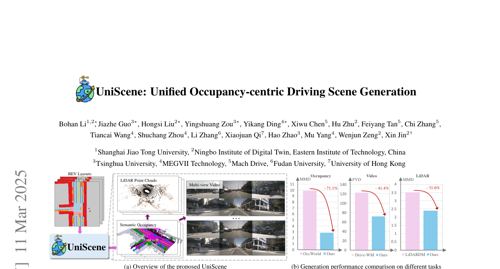
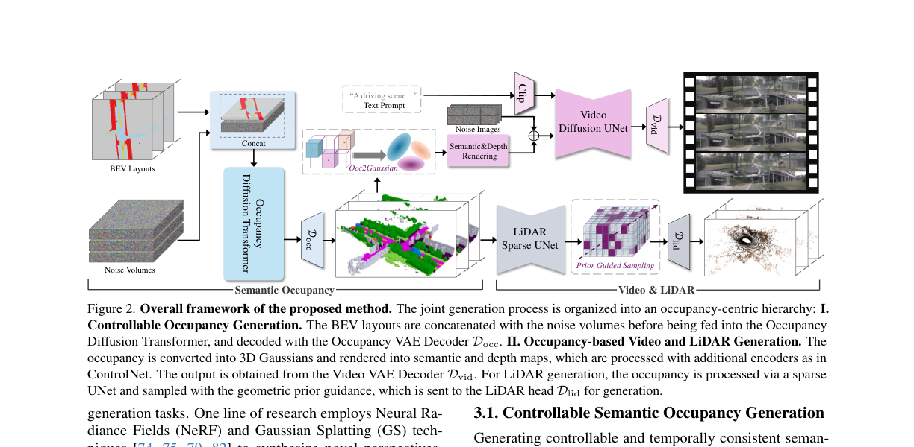
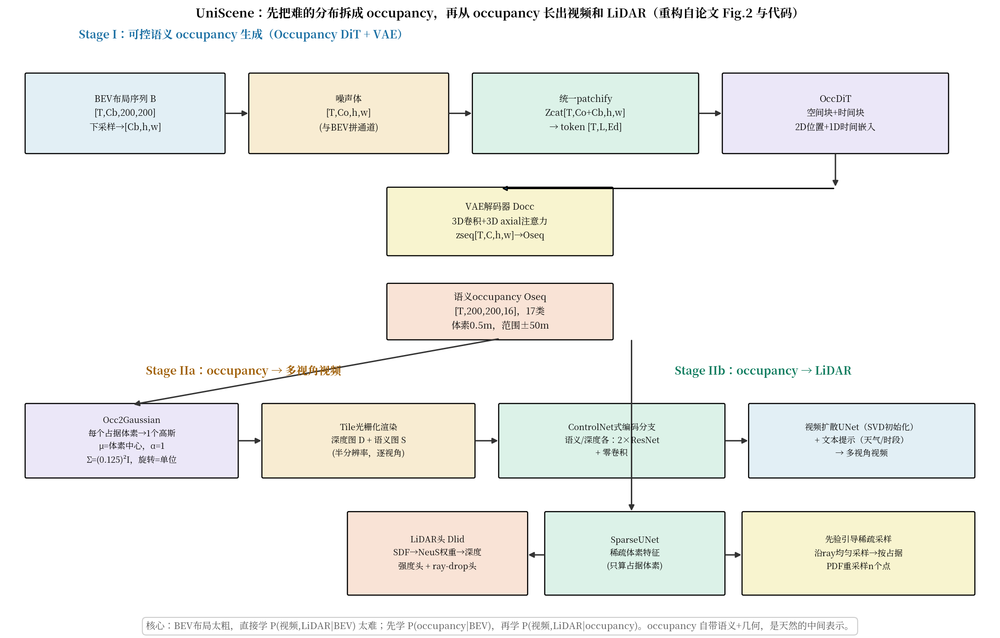
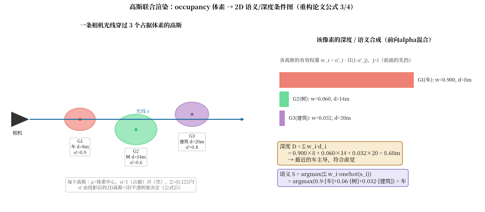

# 先把世界想成 occupancy：UniScene 用语义占据当中间表示，一次生成视频、LiDAR 和标注

> **全局编号**：057-WM-uniscene
> **论文标题**：UniScene: Unified Occupancy-centric Driving Scene Generation
> **作者**：Bohan Li*、Jiazhe Guo*、Hongsi Liu*、Yingshuang Zou*、Yikang Ding*（*共同一作）、Xiwu Chen、Hu Zhu、Feiyang Tan、Chi Zhang、Tiancai Wang、Shuchang Zhou、Li Zhang、Xiaojuan Qi、Hao Zhao、Mu Yang、Wenjun Zeng、Xin Jin†（†通讯作者）。机构：1 上海交大、2 宁波东方理工数字孪生研究院、3 清华、4 旷视、5 Mach Drive、6 复旦、7 港大
> **会议**：CVPR 2025
> **arXiv**：2412.05435（[摘要页](https://arxiv.org/abs/2412.05435)；v1 2024-12-06 提交，v2 2025-03-11（camera-ready 版），下载的是最新 v2）
> **代码**：已公开并已 clone（https://github.com/Arlo0o/UniScene-Unified-Occupancy-centric-Driving-Scene-Generation，目录下 code/）。读过 occupancy 生成（occupancy_gen：VAE/DiT 训练配置与脚本）、视频生成的 Gaussian 渲染（video_gen/gs_render/gaussian_renderer 与 render_train_condition.py）、LiDAR 生成（lidar_gen/pcdet/models/dense_heads/occ2lidar_render.py 与 configs 下的 yaml）。论文与代码不一致处见"超参数与实现细节"一节。
> **一句话核心洞见**：从粗糙的 BEV 布局直接生成视频和 LiDAR 太难了，因为一步要同时学会几何、外观和传感器成像；语义 occupancy 同时携带"是什么"和"在哪"，是天然的中间表示——先学 P(occupancy|BEV) 再学 P(视频,LiDAR|occupancy)，两步都比一步容易，而且 occupancy 自带逐体素标注，生成的数据直接能拿去训下游感知任务。

## 三个"第一"里，真正重要的是哪一个

论文摘要的 claim 是"第一个统一生成语义 occupancy、视频、LiDAR 三种数据的框架"。Figure 1(b) 把三个数字拍在脸上：视频 FVD 比 Drive-WM 低 41.4%，occupancy MMD 比 OccWorld 低 71.1%，LiDAR MMD 比 LiDARDM 低 31.6%。但这三个数字的基线各不相同，放在一张图里容易让人误以为是同一个榜。真正值得问的是：为什么是 occupancy 当中间表示，而不是别的？

2024 年的驾驶生成有两条路。MagicDrive、Drive-WM 那一路是 layout→data 一步到位：BEV 路网图 + 3D 框进去，视频出来。3D 框是稀疏的——一辆车就一个框，车的形状、朝向细节、被遮挡关系，全要模型自己脑补。另一路是 OccSora、OccWorld 那一路：玩 occupancy 本身，但只做无条件的生成或预测，不和视频/LiDAR 打通。两边中间隔着一个没人填的坑：occupancy 恰好同时有语义（这是什么）和几何（在哪、有多大），而视频需要外观、LiDAR 需要几何——occupancy 是唯一一个"两种下游数据都能从它长出来"的表示。

作者的底牌有三张。第一，nuScenes-Occupancy 数据集（2023）在 2024 年已经成熟：34000 个关键帧、17 类逐体素标注，训练 occupancy 生成的数据地基是现成的。第二，Gaussian Splatting（2023）在 2024 年已经工程化：occupancy 体素→高斯→可微渲染成深度/语义图，这条"3D 到 2D 条件"的桥不需要重新发明，diff-gaussian-rasterization 开箱即用。第三，SVD（2023 年底）给了视频生成的底座，NeuS（2022）的 SDF 体渲染给了 LiDAR 深度的数学工具。2024 年 12 月这个时间点，这三样东西恰好都处在"能用"的状态——早半年，GS 的工程化还没跟上；晚半年，别人就先做了。这篇论文的真实分量是"第一个把这三样拼成完整管线的人"，而不是某个单点创新。

*论文 Figure 1（第 1 页裁切）：(a) UniScene 总览——BEV 布局进去，语义 occupancy、LiDAR 点云、多视角视频出来；(b) 三个任务上的性能对比。注意 (b) 里三个柱子的基线各不相同（Drive-WM / OccWorld / LiDARDM），不要当成同一个榜看。*

## Stage I：把 BEV 布局"吹"成 3D 语义 occupancy

整个管线的第一步是 P(Occ|BEV)：给一串 BEV 布局（可编辑的路网+3D框），生成时空一致的语义 occupancy 序列。这一步由 Occupancy VAE + Occupancy DiT 完成。

**Occupancy VAE：连续隐空间打败离散 token。** 输入 occupancy $O \in \mathbb{R}^{H \times W \times D}$（200×200×16，体素 0.5 米），编码器先把每个体素的语义类别换成可学习的类别嵌入（$C'=8$ 维），压成 BEV 表示 $\hat{O} \in \mathbb{R}^{H \times W \times DC'}$，再用 2D 卷积 + 2D axial 注意力下采样到连续隐变量 $Z_{\text{occ}} \in \mathbb{R}^{C \times h \times w}$。解码器反过来：用 3D 卷积 + 3D axial 注意力把 $z^{\text{seq}}_{\text{occ}} \in \mathbb{R}^{T \times C \times h \times w}$ 上采样回 BEV 序列，再和类别嵌入做点积得到每类的 logit，argmax 得重建的 occupancy。

注意一个不对称设计：编码器是 2D 的（逐帧压），解码器是 3D 的（时序一起解）。论文引用 [7] 说这样"更灵活"——实质是编码时不需要时序（每帧独立压成隐变量，DiT 在隐空间里学生成），解码时才需要时序一致性。这个分工让 VAE 的训练可以逐帧做，省显存。

损失是三项（公式 1）：

$$\mathcal{L}^{\text{vae}}_{\text{occ}} = \mathcal{L}_{\text{CE}} + \lambda_1 \mathcal{L}_{\text{LS}} + \lambda_2 \mathcal{L}_{\text{KL}}$$

交叉熵管逐体素分类，Lovász-Softmax 直接优化 IoU（对小物体友好），KL 把隐空间拉向标准正态。$\lambda_1, \lambda_2$ 的值论文没给——正文、附录、代码 config 里都没找到明确数字，这是个未确认的缺口（LiDAR 那边的 $\lambda$ 在代码里找到了，见后文）。

Table 2 是 VAE 的立威之战，也是全文最硬的一张表：同样 512 倍压缩比，UniScene 的连续 VAE 是 72.9 mIoU / 64.1 IoU，OccSora 的 VQVAE 是 27.4 / 37.0。附录 Table 11 更狠：同一套架构，只换压缩方式（VQVAE vs VAE），32 倍压缩下 59.8→92.1，512 倍下 55.8→72.9。这说明离散 token 在这个任务上是真的不行——occupancy 是稠密 3D 结构，VQ 的码本瓶颈把空间细节都吃掉了。连续 VAE 没有码本，隐变量是实数张量，细节保留得多。这个结论很干净，因为 Table 11 控制了架构变量。

**Occupancy DiT：BEV 布局和噪声在通道维直接拼起来。** 第 $i$ 帧的 BEV 布局下采样到 $B^{\text{down}}_i \in \mathbb{R}^{C_b \times h \times w}$，和带噪隐变量 $Z^{\text{occ}}_i \in \mathbb{R}^{C_o \times h \times w}$ 在通道维拼接成 $Z_{\text{cat}} \in \mathbb{R}^{(C_o+C_b) \times h \times w}$，再统一 patchify 成 token $Z \in \mathbb{R}^{L \times E_d}$。DiT 主干是交替的空间块（同一帧内不同位置做注意力）和时间块（不同帧同一位置做注意力），加 2D 位置嵌入和 1D 时间嵌入。

"拼通道"这个选择值得停一下。条件注入有两派：交叉注意力（条件当 K/V）和通道拼接（条件当输入的一部分）。作者选了最粗暴的拼接——BEV 布局和隐变量空间对齐（都是 $h \times w$ 的 BEV 俯视图），拼起来让 DiT 自己学对应关系。消融 Table 8 证明 DiT 的空间注意力是承重墙：去掉它，F3D 从 158.55 涨到 261.03（涨 39.26%）；时间注意力贡献 10.29%；VAE 解码器的 3D axial 注意力贡献 MMD 下降 38.01%。三个消融各自隔离了一个模块，设计得干净。

DiT 的损失是标准的去噪 MSE（公式 2）：

$$\mathcal{L}^{\text{dit}}_{\text{occ}} = \mathbb{E}\left[ \sum_{i=1}^{T} \lVert f^{\text{dit}}_{\theta}(z^{\text{occ}}_i, B_i) - \epsilon^n_i \rVert^2 \right]$$

$z^{\text{occ}}_i$ 是第 $i$ 帧的带噪隐变量，$\epsilon^n_i \sim \mathcal{N}(0,I)$ 是真噪声。没有花哨的加权，就是 DDPM 最朴素的那个目标。

但 Table 3 藏着一个论文没有正面讲的细节。Occupancy 生成（Ours-Gen.）的 mIoU 是 20.51，确实超过 OccWorld 的 17.13；但 F3D 是 205.78（CFG=4）/ 158.55（CFG=1），OccWorld 是 145.65——**F3D 反而输了**。MMD 也是 11.60/10.60 对 9.89，输了。论文正文 4.1 节只强调了 forecasting 变体（Ours-Fore.）"70.39% F3D、71.08% MMD 超过 OccWorld"，对生成变体在 F3D/MMD 上输给 OccWorld 只字不提。公允地说，mIoU 衡量的是"生成的 occupancy 和 BEV 条件对得上不对"（条件一致性），F3D/MMD 衡量的是"生成的分布和真实分布像不像"（分布保真度）。UniScene 是条件生成（有 BEV 兜底，对得准），OccWorld 是预测（无条件外推，分布更真）。两个指标在讲不同的事，论文挑了对自己有利的那个讲。这不是造假，但读者要知道 Figure 1(b) 里那个 -71.1% 的 MMD 柱子，来自的是 forecasting 变体，不是 generation 变体。

*论文 Figure 2（第 3 页裁切）：UniScene 整体框架。左上 BEV 布局 + 噪声体拼通道进 Occupancy DiT，Docc 解码出语义 occupancy；右上 occupancy→高斯→渲染→视频；右下 occupancy→SparseUNet→LiDAR。注意视频和 LiDAR 两条路是并行的，都吃同一个 occupancy。*

下面是我按论文和代码重构的完整管线（含真实张量形状）：

*自绘图（fig-uniscene-pipeline.py）：双层级管线与各阶段张量形状。Stage I 的 BEV+噪声拼通道是全文最关键的一个"粗暴但有效"的选择；Stage II 的两条路共享同一个 occupancy。*

## Stage IIa：occupancy 体素变成高斯，高斯渲染成 2D 条件，条件喂给视频扩散

这一步解决的是"表示鸿沟"：occupancy 是 3D 体素网格，视频扩散模型要的是 2D 图像条件。作者的桥是 Gaussian Splatting——2023 年的 3DGS 在这里不是用来做新视角合成的，而是被 repurposed 成一个"3D→2D 条件"的可微渲染器。

**Occ2Gaussian：每个占据体素变成一个高斯。** 给定语义 occupancy（200×200×16，体素 0.5 米），每个被占据的体素生成一个 3D 高斯 $G_i$，属性按论文公式是：位置 $\mu$ = 体素中心，语义 $s$ = 体素类别， opacity $\alpha$ = 1（占据）或 0（空），协方差 $\Sigma$ = 默认旋转（单位四元数）+ 体素尺寸缩放。代码 `render_train_condition.py` 把这些默认值钉死了：`scale = 0.125`（各向同性，体素 0.5 米的 1/4——高斯比体素小，避免相邻高斯糊成一团），`rot` 全是单位四元数，`opacity = (semantics != 0).float()` 二值。语义用 20 类的 one-hot 当特征（代码里 `color_id` 有 20 个颜色，nuScenes-Occupancy 的 17 类加上 free 等，映射细节在 config/label_mapping/nuscenes-occ.yaml）。

然后按 3DGS 的标准流程：$\Sigma_i = R_i S_i S_i^T R_i^T$，视角变换 $W$ 下 $\Sigma'_i = J W \Sigma_i W^T J^T$（$J$ 是投影的仿射近似雅可比），投影成 2D 高斯，$\alpha'_i = \alpha_i \exp(-\frac{1}{2}(x-\mu)^T {\Sigma'}^{-1} (x-\mu))$。tile-based 光栅化做前向 alpha 混合，得到深度图和语义图（论文公式 3、4）：

$$D = \sum_{i} d_i \, \alpha'_i \prod_{j<i}(1-\alpha'_j), \quad S = \text{argmax}\left( \sum_{i} \text{onehot}(s_i) \, \alpha'_i \prod_{j<i}(1-\alpha'_j) \right)$$

$\prod_{j<i}(1-\alpha'_j)$ 是"透射率"——排在前面的高斯挡住了多少，后面的就按剩下的比例贡献。几何动作就是画家算法的可微版本：从近到远一层层往上盖。深度是各层深度的加权平均，语义是各层 one-hot 的加权投票再取最大。下图拿一个具体数字走一遍：

*自绘图（fig-gaussian-render.py）：一条光线穿过三个高斯，alpha 合成算出该像素的深度 8.68 米、语义"车"。注意 G1 的 α'=0.9 几乎吃掉了全部权重——这就是"最近的占据体素主导"这个直觉的数学形式。*

两个实现细节论文没细说但代码里有。第一，渲染分辨率是相机原图的一半（代码里内参 fx, fy, cx, cy 全除以 2）。渲染图只是条件，不是最终输出，半分辨率够用了，还省算力。第二，训练条件的渲染会先做 LiDAR 可见性过滤：`remove_statistical_outlier` 去离群点，只保留被真实 LiDAR 击中的体素的语义，其余置零。这意味着渲染出的语义/深度图天然带有"LiDAR 视角的遮挡"——被挡住的地方是空的，视频模型学到的是"按真实观测的条件生成"，而不是"按完整 3D 生成"。这个选择很务实，但它也意味着条件图和完整 occupancy 之间有系统性的 missing pattern，模型必须学会补全。

**渲染图进视频扩散：ControlNet 式分支。** 语义图和深度图各走一个编码分支（2 个 ResNet 块 + 零卷积），加到 SVD 初始化的视频 UNet 上。文本提示（"a driving scene..."加天气/时段）走原来的 cross-attention。作者特意强调：没有用 MagicDrive 那种 spatial-temporal attention 来做跨视角一致性，而是保留 SVD 的 vanilla cross-attention，跨视角一致性"由 occupancy 条件保证"——因为六个视角的渲染图来自同一个 3D occupancy，几何上天然一致。消融 Table 9 支持这个说法：把渲染条件换成 spatial-temporal attention（w/. Spatial-temporal Attention），FVD 从 70.52 涨到 110.87，说明 occupancy 渲染条件的跨视角一致性确实比注意力机制硬。

**几何感知噪声先验：采样时给扩散模型一个"运动提示"。** 公式 5 很朴素：

$$\epsilon^i_{\text{vid}} = \lambda z_c + \epsilon^n_i$$

第 $i$ 帧的初始噪声 = $\lambda$ × 参考帧隐变量 + 纯噪声。$z_c$ 是"内容长什么样"的先验，$\epsilon^n_i$ 是多样性。但视频里动态区域大时，静态地把参考帧内容复制到每一帧是错的——车动了，像素位置变了。公式 6/7 用渲染深度图把参考帧 warp 到第 $i$ 帧：

$$p_0 = K \cdot (R_{0,i} \cdot (K^{-1} \cdot p_i \cdot D_i(u,v)) + t_{0,i})$$

读一遍这个式子：像素 $p_i=(u,v,1)^T$ 先用内参逆 $K^{-1}$ 反投影成射线，乘上该像素的渲染深度 $D_i(u,v)$ 得到 3D 点，再用帧间位姿 $[R_{0,i}|t_{0,i}]$ 变换到参考帧坐标系，用 $K$ 投回参考帧的像素 $p_0$。这就是 depth-based reprojection——"第 $i$ 帧的这个像素，在参考帧里对应哪个像素"。warp 后的 $z_c$ 再乘 $\lambda$ 加进噪声。几何意义：扩散模型从第一步去噪起，就知道"这个位置的内容应该长得像参考帧的那个位置"，运动对应关系被显式钉死了。消融：去掉它，FVD 从 70.52 涨到 87.52（Table 9）。注意 $\lambda$ 的值论文没给，是未确认。

视频训练损失（公式 8）是带 mask 的去噪 MSE：

$$\mathcal{L}_{\text{vid}} = \mathbb{E}\left[ \sum_{i=1}^{T} (1-m_i) \cdot \lVert f^{\text{vid}}_\theta(z^i_{\text{vid}}, t, z_c, D_i, S_i) - z^i_0 \rVert^2 \right]$$

$m$ 是选条件帧的 one-hot mask（$(1-m_i)$ 意味着条件帧不计损失），$z_c$ 是随机选的参考帧（"随机选是为了降低对特定条件帧的依赖"——SVD 原生只用第一帧当条件，这里随机化后模型对任意参考帧都鲁棒）。

## Stage IIb：LiDAR 不是渲染出来的，是沿着光线"长"出来的

LiDAR 生成是全文工程上最重的一块，也是和视频路差异最大的地方。视频路用的是"渲染成图再当条件"，LiDAR 路用的是"沿光线采样再体渲染"——因为 LiDAR 点云是 3D 的，不需要先压成 2D。

**先验引导的稀疏采样。** 输入 occupancy 先过 SparseUNet 聚合上下文特征——只在被占据的体素上算，空体素跳过（Table 10：w/o SparseUNet 换成单层子流形卷积，JSD 从 0.072 涨到 0.097，涨 25.77%，显存只多 1.63%——稀疏卷积的性价比很高）。然后沿每条 LiDAR 光线 $r$ 均匀采样一串点 $s$，按占据情况定义 PDF：占据体素内的点概率 1，其余 0，再从这个 PDF 里重采样 $n$ 个点 $r_i = o + s_i v$。几何意义：计算资源只花在"可能有东西"的地方，空旷的天空方向一个点都不浪费。消融：换成 NeuS 的均匀采样，显存从 6.84GB 涨到 16.66GB（涨 143%），JSD 还变差 4%——均匀采样既贵又差，因为 90% 的采样点落在空体素上，MLP 在学"这里是空的"这种无用功。

**SDF → NeuS 权重 → 深度。** 每个重采样点的特征过 MLP 预测 signed distance $f(s)$，再按 NeuS 的公式转成体渲染权重（公式 9、10）：

$$\beta_i = \max\left(\frac{\Phi_s(f(r(s_i))) - \Phi_s(f(r(s_{i+1})))}{\Phi_s(f(r(s_i)))}, 0\right), \quad w(s_i) = \beta_i \prod_{j<i}(1-\beta_j), \quad h = \sum_{i=1}^{n} w(s_i) s_i$$

$\Phi_s(x) = (1+e^{-sx})^{-1}$ 是 sigmoid。$\beta_i$ 的直觉：SDF 从正变负的地方就是表面，$\Phi_s(f)$ 在表面处骤降，相邻两点的差分再归一化，得到"这个点是表面的概率"。$w(s_i)$ 又是老朋友——前向 alpha 混合，透射率连乘。$h$ 是各点深度的加权平均，即这条光线打到的深度。整套数学是 NeuS（2022）的，只是把"RGB 体渲染"换成了"LiDAR 深度体渲染"，输入特征从 MLP 换成了 occupancy 的 SparseUNet 特征。

**强度头和 ray-drop 头：LiDAR 和相机的本质区别。** 相机每个像素都有值，LiDAR 的光线可能"打出去没回来"——镜面反射、太远、被吸收。论文加了两个头：反射强度头（预测每条光线的回波强度，$\sum w_i u_i$ 加权特征再过 MLP）和 ray-dropping 头（预测这条光线"丢失"的概率，结构和强度头一样）。Figure 4(b) 显示 ray-drop 头能去掉预测点云里的噪点。消融 Table 10：去掉 ray-drop 头，MMD 从 1.53 涨到 3.25（涨 112%，论文写"降低 25.92%"——这个数字和表对不上，实际算出来是 52.9%，见后文怀疑式审读），JSD 从 0.072 涨到 0.100。ray-drop 是 LiDAR 生成里承重的一个部件。

LiDAR 训练损失（公式 11）：

$$\mathcal{L}_{\text{lid}} = \mathcal{L}_{\text{depth}} + \lambda_1 \mathcal{L}_{\text{inten}} + \lambda_2 \mathcal{L}_{\text{drop}}$$

$\lambda_1, \lambda_2$ 论文正文没给，但代码的 config 文件名直接写着答案：`occ2lidar_sparseunet_renderv2_s_priorsampler_p54_r200_intenw10_raydropw02.yaml`，yaml 里 `intensity_loss: 10.0`、`raydrop_loss: 0.2`。所以 $\lambda_1=10$，$\lambda_2=0.2$，depth 权重是隐式的 1。强度损失权重是 depth 的 10 倍——这个比例说明强度预测比深度难学得多，需要更大的梯度。论文把这两个数字藏在了代码里，正文只说"balancing coefficients"，复现的人如果按 1:1:1 去配，强度头可能训不动。

**一个被低估的设计：光线图案可配。** 因为 LiDAR 头是"给定光线算深度"的函数，推理时可以任意改光线的方位角/俯仰角配置——附录 Figure 16 展示了同一场景生成 16/32/64 线的结果，而真值是 32 线。不需要重训。这是"基于物理成像过程建模"相对"端到端学点云分布"的结构性优势：LiDARDM 那种 mesh+asset 拼装的方案换线数要重训，UniScene 改个采样配置就行。

## 完整推演：从 BEV 布局里删掉一辆车，三种数据跟着变

附录 C.1 给的 BEV 编辑流程是检验"occupancy 中间表示"成色的最好场景。设定：nuScenes 某帧，BEV 布局 $B_{\text{ori}}$ 里 (x=12m, y=-3m) 处有一个 3D 框（一辆停着的车），用户把它删掉得到 $B_{\text{new}}$。要求：视频里那辆车消失、LiDAR 点云里那辆车的点消失、其余场景不动。

**第 1 步：DDIM 反演拿回噪声。** 对已生成的 occupancy $O_{\text{ori}}$（形状 200×200×16，17 类），用 DDIM inversion 在 $B_{\text{ori}}$ 条件下反推噪声隐变量 $\epsilon_{\text{ori}}$。这一步的实质是"找到当初生成这个 occupancy 的那组随机数"——扩散模型的生成是确定性 ODE 轨迹，反演就是沿轨迹倒着走回去。代价：一次完整的反向扩散，和生成一样贵。

**第 2 步：换条件重去噪。** 从 $\epsilon_{\text{ori}}$ 出发，条件换成 $B_{\text{new}}$，重新去噪得到 $O_{\text{new}}$。因为起点噪声相同，大部分体素的生成轨迹不变，只有 3D 框区域的条件变了——那辆车对应的体素从"车"类变成"空"，周围被它挡住的路面体素从"被遮挡"变成可见。这里的关键是 occupancy 的空间对齐：BEV 布局和 occupancy 都是 BEV 俯视图，拼通道进 DiT，删掉的框在 $(x,y)$ 位置上精确对应一片体素。DiT 不需要"理解"删车，它只需要在那个位置的条件下把类别从车改成空/路面。

**第 3 步：occupancy 长出视频和 LiDAR。** $O_{\text{new}}$ → Occ2Gaussian：原来那辆车占的体素现在是空，$\alpha=0$，渲染时不再产生高斯——深度图和语义图里那个位置变成路面。视频 UNet 以新的渲染图为条件，那辆车就从六个视角的视频里同时消失，而且六个视角是一致的（同一个 3D occupancy 渲染的）。LiDAR 路：那辆车体素的 PDF 从 1 变 0，重采样不再在那里放点，SDF 预测那里是空，点云里那辆车消失。

**基线 MagicDrive 在哪一步掉链子。** MagicDrive 是 layout→video 一步到位：3D 框通过交叉注意力进 UNet。删掉一个框，模型"知道"那里不该有车，但它没有 3D 中间表示来保证"车原来挡住的路面现在长什么样"——inpaint 路面的任务和"别画车"的任务纠缠在同一个注意力里。更致命的是跨视角：六个视角各自的注意力是独立的，左前视角可能把车删干净了，右前视角还留个车屁股。UniScene 的解耦把"删车"这个语义操作钉死在 3D occupancy 里（删得干干净净），"长出像素"只是渲染+扩散的体力活。Figure 20 的定性结果展示的就是这个：几何编辑后三模态一致地变。

这个推演也暴露了管线的阿喀琉斯之踵：**误差只向下游传，没有回头路**。如果第 2 步的 $O_{\text{new}}$ 里那辆车没删干净（比如只删了一半，留了几个"车"体素），视频和 LiDAR 会忠实地把那半辆车渲染出来——下游没有任何"这不合理"的校验。Table 4 里 Ours (Gen Occ) 71.94 vs Ours (GT Occ) 70.52 的 FVD 差距只有 1.42，说明当前 occupancy 生成质量下，这个误差传递还不致命；但如果把 occupancy 生成换成更差的模型，下游会跟着塌。两阶段训练（先固定 occupancy 模型，再训视频/LiDAR）也意味着下游模型是在"GT occupancy"上训的，推理时吃的是"生成 occupancy"——训练推理分布不一致，论文没有量化这个 gap。

## 怀疑式审读：最强的数字和最弱的数字

**Table 4 的 Vista* 是一个"作者自己改的基线"。** 原版 Vista 只支持单视角视频生成。为了公平对比多视角，作者"implement the multi-view variant of Vista* with spatial-temporal attention following [15, 72]"。问题是：这个 multi-view Vista 是原作者调过的最优实现吗？Spatial-temporal attention 的配置（头数、层数、学习率）有没有和 UniScene 的视频模型对齐调参？论文没说。Vista* 的 FVD 是 112.65，Ours 是 71.94——差距大到即使基线调得糙一点，结论也大概率成立；但"公平对比"这个词要打折扣。更干净的对比其实是 MagicDrive（16.20 FID，原生多视角）：Ours 6.45 对 16.20，这个差距是实打实的。

**下游任务的提升里藏着一个循环。** Table 6：用 UniScene 生成的数据训 CONet 做 occupancy 预测，Camera 配置下 IoU 从 20.1 涨到 28.6（+8.5）。听起来很强，但想一想数据是怎么来的：生成数据的"标注"就是 Stage I 生成的 occupancy 本身。评测任务是 occupancy 预测，训练数据的标签和评测目标是同一个分布、同一个生成器——这相当于用自己的输出当老师。提升里有多少是"数据多样性"，有多少是"标签和评测同分布"，分不开。BEV 分割和 3D 检测（Table 7）稍微好一点，因为它们的标签（分割 mask、检测框）是从 occupancy 派生的，不是直接复制。但即便如此，生成数据的场景多样性上限就是 occupancy 生成器的多样性——Table 6 的 +8.5 里，模型学到的可能是"nuScenes-Occupancy 分布本身"，而不全是"生成"的功劳。一个更干净的对照是：用同等数量的真实数据训，看提升差多少——论文没做。

**Ray-drop 消融的数字算术对不上。** Table 10：w/o Ray-dropping Head 的 MMD 是 3.25，Ours 是 1.53。正文说"the ray-dropping head reduces MMD and JSD by 25.92% and 25.00%"。实际算：(3.25-1.53)/3.25 = 52.9%，(0.100-0.072)/0.100 = 28.0%。两个都对不上论文的 25.92%/25.00%。论文在这里**低估**了自己的提升——可能是改表时忘了更新正文，也可能是用了别的归一化。这不是学术问题，是写作事故，但它提醒读者：这篇论文正文里的百分比最好自己按表验算一遍。我验算过的其他几个（FVD -41.4%、MMD -31.6%、F3D -70.39%、MMD -71.08%、38.01%、10.29%、39.26%、34.66%、31.15%、25.77%、4.00%）都是对的，只有这一处对不上。

**超参数：关键的几个都没给搜索过程。** VAE 损失的 $\lambda_1, \lambda_2$（公式 1）——论文、附录、代码都没找到；视频噪声先验的 $\lambda$（公式 5）——没给；DiT 的 CFG 值——Table 3 试了 1 和 4，选了 4 报 mIoU（20.51 vs 19.44），但 F3D 在 CFG=1 时更好（158.55 vs 205.78）——论文报的是 mIoU 最优的配置，F3D 最优的配置没当主结果。这是一种温和的 cherry-picking：两个指标的最优 CFG 不一致，作者选了对故事有利的那个报。LiDAR 的 $\lambda_1=10, \lambda_2=0.2$ 藏在代码文件名里，正文不提。

**F3D/MMD 的评测器本身不透明。** 附录 E 说 F3D 是"3D 版 FID"，用"a pre-trained occupancy auto-encoder"提特征，MMD 也在同一特征空间算。但这个 auto-encoder 是哪个、在什么数据上训的，论文没说。如果它和 UniScene 的 VAE 是同一个（或同分布），那 F3D/MMD 对 UniScene 有主场优势。这是未确认的缺口，审稿人应该问，论文没答。

**种子、方差：零报告。** 全文无 seed、无误差棒。600 epoch 的 DiT、200 epoch 的 VAE，只报单次结果。Table 3 里 CFG=1 和 CFG=4 的 F3D 差 47 个点（205.78 vs 158.55）——CFG 这种推理超参都能带来这么大的波动，训练本身的方差只会更大。数字的方向可信，绝对值要留余量。

**代价。** 附录 F：A100 上训。Occ VAE batch 16、lr 1e-3、200 epoch；Occ DiT batch 16、lr 1e-4、600 epoch；Stage II 视频+LiDAR 联合 batch 96、lr 1e-5、90 epoch。600 epoch 的 DiT 是全文最贵的单项——occupancy 序列 8 帧，DiT 在隐空间跑 600 个 epoch，这个量级和训练一个中型视频扩散模型相当。推理：LiDAR 0.25 秒一帧（Table 10，GT occupancy），视频没给单帧时间——按 SVD 的常规速度，8 帧 256×512 的视频扩散也要几十秒。整条管线是离线数据工厂，不是实时模型。论文结论的 limitation 也承认了"unifying... is challenging and resource-intensive"。

**没选的基线。** LiDAR 生成只比了 LiDARDM 和 Open3D（硬光线投射，1960 年代的图形学）。没比 Copilot4D（2024，离散扩散做 LiDAR 世界模型）——Copilot4D 是更强的当代基线。视频没比 Panacea 的多视角 FVD（Table 4 里 Panacea 只有 FID 16.96，FVD 是"-"，因为原论文没报多视角视频的 FVD——这倒是情有可原）。

## 超参数与实现细节：代码里才有的东西

**渲染的真实参数。** 论文公式 (13)-(16) 是 3DGS 的标准推导，但具体数值只在代码里：高斯 scale 全是 0.125（各向同性，体素 0.5 米的四分之一），旋转全是单位四元数（论文说的"default rotation"就是这个），opacity 二值（占据 1/空 0），渲染分辨率是相机原图的一半（内参除以 2）。这些数字决定了渲染条件的"锐度"：scale 如果设成 0.5（体素全尺寸），相邻高斯严重重叠，渲染出的语义图是糊的；0.125 让每个高斯只占体素中心一小团，边界清晰。论文没讨论这个权衡，代码直接写死了。

**LiDAR 采样的真实配置。** config 文件名 `..._p54_r200_...`：p54 和 r200 可能是采样点数/光线数的配置（未完全确认，yaml 里 ray_sampler 相关字段需要再读）。`use_predefine_rays` 选项支持预定义光线图案——这就是附录 Figure 16 里 16/32/64 线切换的实现：推理时换一套光线定义，不用重训。

**Forecasting 变体的训练 trick。** 附录："the conditional occupancy latent frames are concatenated directly with the BEV layouts without the addition of noise"——预测变体里，条件帧的隐变量不加噪，直接和 BEV 拼起来当 DiT 的输入，只有未来帧加噪去噪。这是条件生成的标准做法（和图像 inpainting 的思路一样），但论文把它藏在了附录一段话里。Table 12 显示 2 个参考帧比 1 个好（31.76 vs 27.33 mIoU），符合直觉。

**12Hz occupancy 标签的制造链。** 附录 D：nuScenes 原生只有 2Hz 的 occupancy 标注。作者用 ASAP 的插值标注 + 全场景 LiDAR 点云拼接 → NKSR 重建 mesh → 顶点按 LiDARseg 语义打标签 → 体素化成 12Hz occupancy。这个链条里，动态物体的 12Hz 标注质量取决于 ASAP 插值的精度——插值错了， occupancy 里就有"鬼影车"。论文没量化 12Hz 标签的质量，这是训练数据的源头风险。

## 结尾：带走的两个可迁移想法，和一个值得做的问题

第一个可迁移的想法是**"中间表示的选择标准"**。UniScene 的成功不在于"用了 occupancy"，而在于 occupancy 恰好同时携带了下游任务需要的全部信息模态：视频要语义+几何，LiDAR 要几何+语义，occupancy 两种都有。下次设计生成管线时，问的应该是"我的下游数据需要哪些信息模态，哪个中间表示能一次给全"，而不是"哪个表示最时髦"。BEV 图只有几何没有语义（所以 MagicDrive 要额外补 3D 框），纯点云只有几何没有语义——occupancy 是 2024 年自动驾驶里唯一"语义+几何"双全的稠密表示，这是它当选的实质原因。

第二个是**"把图形学当可微桥梁，而不是当 baseline"**。Open3D 的硬光线投射在 Table 5 里是垫底的 baseline（MMD 8.15 对 1.53），但可微渲染（3DGS、NeuS 体渲染）却是管线里承重的部件。同一个数学工具，当 baseline 是"手工规则"，当桥梁是"可微模块"——差别在于梯度能不能流过去。以后看到"传统方法被深度学习打败"的结论，先问一句：它的可微版本试过吗。

值得做的一个具体问题：UniScene 的 occupancy 是"生成的"，它的质量上限就是 DiT 的质量。但 nuScenes-Occupancy 的真值是 2Hz 插值到 12Hz 的，源头就有噪声。一个更激进的路线是反过来——**不要生成 occupancy，直接从视频反推**：用单目 3D 重建（DUSt3R 那一路）从真实视频得到伪 occupancy，再用它当条件训视频生成。这样管线就不需要 12Hz 的 occupancy 真值，数据可以扩展到任意驾驶视频（OpenDV 那种 1700 小时的）。代价是伪 occupancy 的噪声，但 GEM 已经证明了伪标注（深度、轨迹）在这个量级上是够用的。UniScene 的 Stage II 架构原封不动，只换 Stage I 的数据来源——这可能是把这条路从 nuScenes 扩展到全网驾驶视频的最短路径。
