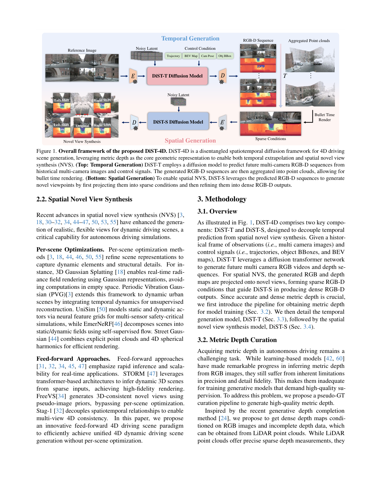
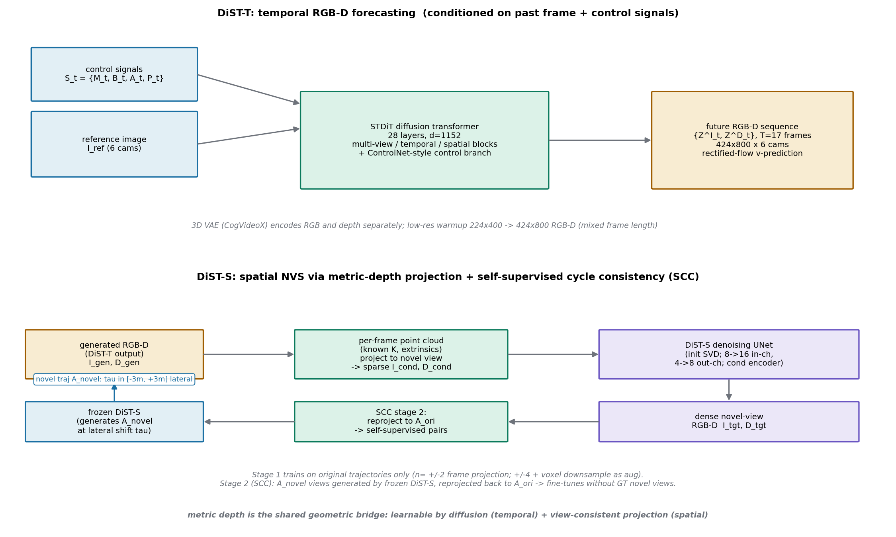
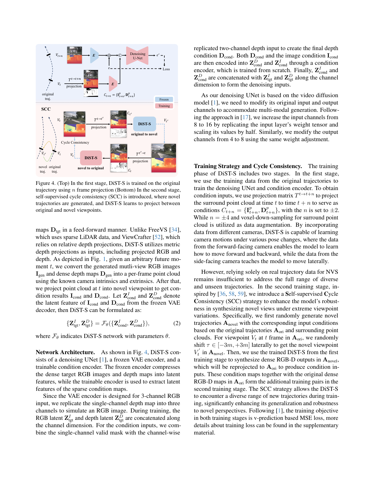

# 用 metric depth 把时间和空间两个扩散模型缝起来：解耦的 4D 驾驶场景生成

> **全局编号**：058 ｜ **论文标题**：DiST-4D: Disentangled Spatiotemporal Diffusion with Metric Depth for 4D Driving Scene Generation
> **作者**：Jiazhe Guo\*、Yikang Ding\*（项目 lead）、Xiwu Chen、Shuo Chen、Bohan Li、Yingshuang Zou、Xiaoyang Lyu、Feiyang Tan、Xiaojuan Qi、Zhiheng Li、Hao Zhao——1 清华（THU）、2 旷视（MEGVII）、3 Mach Drive、4 上交（SJTU）、5 港大（HKU）
> **会议**：ICCV 2025
> **arXiv**：[2503.15208](https://arxiv.org/abs/2503.15208)（摘要页）——下载的是 v1（2025-03-19，PDF 页脚标注 arXiv:2503.15208v1）
> **代码**：公开，https://github.com/royalmelon0505/dist4d（2025 年 7 月随权重一起发布；已 clone 到目录下 code/，含 DiST_T、DiST_S、depth_process 三部分，与论文结构对应）
> **一句话核心洞见**：同时做到"预测未来"和"换视角看"需要一个既能被生成模型学会、又足够做几何投影的表示——逐帧的 metric depth 正好卡在这个位置，于是把 4D 生成拆成两个扩散模型：DiST-T 管时间（生成未来 RGB-D），DiST-S 管空间（用深度投影做新视角），cycle consistency 解决新视角没有真值的训练难题。

## 为什么 4D 生成首先是一个表示问题

论文表 1 把当时的驾驶场景生成方法摆成一张对照表，结论很锋利：没有一种方法能同时做到 temporal extrapolation（预测未来）和 spatial NVS（新视角合成）还不用 per-scene optimization。视频生成那一派（MagicDrive、Vista、Drive-WM）能往未来走，但被绑死在预设轨迹上，换不了视角；重建那一派（EmerNeRF、StreetGaussian、UniSim）新视角质量好，但每个场景都要单独优化，慢到不可用；feed-forward 那一派（FreeVS、STORM、Stag-1）能前向推理，但只会重建看到的时刻，不会预测未来。

作者的诊断是：这不是模型容量问题，是表示问题。一个能同时支撑"时间外推"和"空间新视角"的 4D 表示必须满足两个要求：第一，每个时间步的几何信息要足够做 NVS，否则就得靠 per-scene 重建把几何补回来；第二，这个表示要能被生成模型学会，否则预测不了未来。两个要求缺一个，整件事就做不成。

然后作者说：逐帧的 metric depth 同时满足这两条。第一条，depth + RGB + 已知相机内外参 = 点云，点云投影到新视角就是新视角的稀疏条件，这是纯几何操作，不需要学习。第二条，depth 是 2D 图像（单通道），diffusion 模型学 depth 和学 RGB 没有本质区别（论文引 GeoWizard 这类工作证明 diffusion prior 能做好几何估计）。这个"既是几何又是图像"的双重身份，就是整篇论文的支点。

为什么不是 occupancy？UniScene 那派用 3D occupancy 做统一表示，但 occupancy 是 3D 体素，生成模型学起来贵，且 occupancy 到新视角 RGB 还要过渲染。为什么不是相对 depth？ViewCrafter 用相对深度，但相对深度没有尺度，投影到新视角时几何对不齐——metric（带真实尺度）是能做"把 t 时刻点云投影到 t+n 时刻视角"这个操作的前提。论文 3.4 节明确说 DiST-S 用 metric depth 投影而不用相对深度，区别就在这里。

## 深度伪真值流水线：每一步在修 LiDAR 的哪块短板

DiST-T 和 DiST-S 都要吃 dense metric depth 做监督，但 nuScenes 的 LiDAR 点云稀疏得可怜。论文 3.2 节 + 附录 A 给了一条四段式伪真值流水线，每一段都在修上一段的短板：

第一段，**多帧 LiDAR 聚合**。取前后 3 帧的 LiDAR 点，用 3D 框把动态点去掉，拼成稠密一点的点云。修的是"单帧太稀"。

第二段，**MVS 静态重建**。TransMVSNet 从多视角图像重建静态场景点云，最大深度设 100 米，voxel 下采样 0.1 米去冗余，语义分割（OneFormer）去掉动态物体和天空，只保留 LiDAR 高度以上的点去地面噪声。修的是"LiDAR 照不到的地方"——论文原话：高楼的上半部分（离地面远，LiDAR 线束够不着）和远处物体。合并时 LiDAR 优先，只在 LiDAR 没覆盖的区域用 MVS 点。

第三段，**hidden point removal + 最近邻插值**。把遮挡点剔掉（Katz 等人的直接可见性算法），然后最近邻插值得到初始稠密 depth prompt。修的是"点云投影到图像上有空洞和遮挡伪影"。

第四段，**生成式深度补全**。DepthLab（diffusion-based depth completion）吃 RGB + 不完整的 depth prompt，输出最终的 dense metric depth。天空区域用语义分割定死 100 米，保证表示一致。

这条流水线的输出质量在附录表 7 里验证：伪真值对多帧 LiDAR GT 的 Abs Rel 是 0.13/0.20（带/不带 median scaling），RMSE 3.46/3.31，明显好于 SurroundDepth（0.27/0.28）和 M2Depth（0.25/0.26）。注意这里有个微妙的循环论证风险：伪真值本身是用 LiDAR 参与构建的，再用 LiDAR GT 去评它，分数天然占优。论文用"多帧 LiDAR GT"做评测基准，比单帧公平一点，但"伪真值比纯估计方法好"这个结论里，有一部分是"我见过答案"的成分。好在表 4 里 DiST-T 生成的 depth 是直接对 LiDAR GT 评的（没经过伪真值），那组数字是独立的。

代价：这条流水线要对 nuScenes 700 个训练视频（12Hz 插值后）逐帧跑 MVS + DepthLab + 语义分割。论文没给具体耗时，但光 DiST-T 的训练就花了 13 天（见下节），数据准备是另一笔没写进论文的大账。

## DiST-T：STDiT 怎么把四种控制信号吃进去

*图注：论文第 3 页 Figure 1。上半是 DiST-T：参考图像 + 控制信号进扩散模型，输出未来多视角 RGB-D 序列，再聚成点云做 bullet-time 渲染；下半是 DiST-S：把 RGB-D 投影到新视角形成稀疏条件，扩散模型补成稠密 RGB-D。*

DiST-T 的任务形式化为式 (1)：

$$\{Z^I_t, Z^D_t\} = G_\theta(\{S_t, I_{ref}\})$$

$I_{ref} = \{I_{ref,c}\}^C_{c=1}$ 是 6 个相机的参考帧（C=6），$S_t = \{M_t, B_t, A_t, P_t\}$ 是 t 时刻的控制信号：$M_t \in \{0,1\}^{w \times h \times s}$ 是 BEV 语义地图（s 个类别），$B_t = \{(c_i, b_i)\}^N_{i=1}$ 是 3D 框（$b_i \in \mathbb{R}^{8 \times 3}$ 是 8 个角点，$c_i$ 是类别），$A_t$ 是自车轨迹（t 帧相对首帧的变换），$P_t \in \mathbb{R}^{c \times 4 \times 4}$ 是 6 个相机位姿。输出是未来 T=17 帧的 RGB 隐变量 $Z^I_t$ 和 depth 隐变量 $Z^D_t$。

网络结构（论文图 3）：3D VAE（CogVideoX 预训练的）把 RGB 视频和 depth 视频**分别**编码，时间空间双压缩；主干是 STDiT（Open-Sora 的 diffusion transformer），28 层、hidden 1152。三种 block 分工：multi-view block 管 6 个相机之间的交互，temporal block 管同一相机的时间交互，spatial block 管单帧空间交互。控制分支是 ControlNet 式的：BEV map $M$ 和参考图 $I_{ref}$ 编码后注入 control block；轨迹 $A$、框 $B$、位姿 $P$ 同时进 basic block 和 control block。

自绘的架构总览把两路的关系画了出来：

训练策略是课程式的：先训 224×400 的纯 RGB 视频生成（7 天），再扩展到 224×400 的 RGB-D（3 天），最后 424×800 的 RGB-D 高分辨率（3 天，mixed-frame-length 策略）。全部在 8×H20 上。先 RGB 后 RGB-D 的道理：RGB 的 diffusion prior 好训，depth 的分布（分段平滑、边缘跳变）和 RGB 差很多，直接从零训 RGB-D 联合模型收敛慢。用 RGB 训好的权重做初始化，等于把"场景长什么样"先学会，再学"场景的几何长什么样"。

## 补充材料式 (3)(4)：rectified flow 的 v-prediction 目标到底在拟合什么

$$z_t = (1-t)x_0 + t\epsilon, \qquad L = \mathbb{E}_{\epsilon \sim \mathcal{N}(0,I)}\left\lVert G_\theta(z_t, t) - \frac{1}{1-t}(z_t - \epsilon)\right\rVert^2_2$$

$t \sim \text{LogNormal}(0,1)$。这里 $x_0$ 是数据（干净隐变量），$\epsilon$ 是噪声。$z_t$ 是两者之间的线性插值：t=0 时是纯数据，t=1 时是纯噪声——注意这和 DDPM 的记号是反的（DDPM 里 t=0 是数据、t=T 是噪声，这里的 t 直接就是插值系数）。

训练目标 $\frac{1}{1-t}(z_t - \epsilon)$ 是什么？把 $z_t$ 代进去：

$$\frac{1}{1-t}\big((1-t)x_0 + t\epsilon - \epsilon\big) = \frac{1}{1-t}\big((1-t)x_0 - (1-t)\epsilon\big) = x_0 - \epsilon$$

所以网络 $G_\theta$ 在拟合的是 $x_0 - \epsilon$，也就是从噪声指向数据的向量取负——或者说，沿着路径 $z_t$ 的速度是 $\frac{dz_t}{dt} = \epsilon - x_0$，网络学的是速度的反方向。推理时从噪声出发，沿着 $-G_\theta$ 的方向走（或者等价地把 $G_\theta$ 理解为"去噪方向"），就走回数据流形。这就是 rectified flow：不用 DDPM 那套方差 schedule，直接在"数据—噪声"直线段上学一个速度场。v-prediction 的名字来自 Salimans & Ho，但在这里 v 就是 $x_0 - \epsilon$。

$t$ 从 LogNormal(0,1) 采样而不是均匀采样：LogNormal(0,1) 的中位数是 1，均值是 $e^{0.5} \approx 1.65$，但 t 显然被截断到 [0,1] 区间内（论文没写截断，SD3 的 rectified flow 实现里是这么做的）。这个分布把更多训练权重放在中间 t 值——两端（接近纯数据/纯噪声）的去噪任务太平凡，中间最难。这个选择是抄 Stable Diffusion 3 的，论文没做消融，属于"前人验证过就直接用"的工程决定。

## DiST-S：稀疏条件从哪来，UNet 的通道数为什么从 8 变 16

DiST-S 的任务是式 (2)：

$$\{Z^I_{tgt}, Z^D_{tgt}\} = F_\theta(\{Z^I_{cond}, Z^D_{cond}\})$$

给定 t 时刻的 RGB-D（DiST-T 生成的，或者真实视频+伪真值 depth），用已知相机内外参反投影成逐帧点云，再投影到新视角，得到稀疏的 $I_{cond}, D_{cond}$。"稀疏"是因为点云投影到新视角会有空洞（遮挡、视野外）。DiST-S 的工作就是把稀疏条件补成稠密的新视角 RGB-D。

网络：denoising UNet 从 Stable Video Diffusion 初始化，一个 frozen 的 VAE encoder（压目标 RGB-D），一个从零训的 condition encoder（提稀疏条件的特征）。几个脏活细节：

第一，VAE encoder 是给 3 通道 RGB 设计的，单通道 depth 先 replicate 成 3 通道"假装"是 RGB。这是直接抄 Marigold（[17]）的做法，depth 的三个通道完全一样，VAE 会把它当成灰度图编码——信息没丢，但 VAE 的权重是为自然图像学的，对 depth 的分段常数分布是次优的。能 work，但不是为 depth 定制的编码器。

第二，RGB 隐变量和 depth 隐变量沿通道维拼接。SVD 的 UNet 输入原来是 8 通道（4 通道 noisy latent + 4 通道条件），现在要吃 RGB latent（4）+ depth latent（4）+ RGB 条件（4）+ depth 条件（4）= 16 通道。做法：把 conv_in 的权重 tensor 复制一份、数值减半——这样初始化时期望输出和原来 8 通道时一致，是个保持激活量级的标准技巧。输出从 4 通道改到 8 通道（同时输出 RGB 和 depth 的去噪结果），同样处理。

第三，depth 条件还要拼一个单通道 valid mask（标记投影有效的像素），所以 depth 条件输入是"2 通道 depth（replicate 后取？论文写的是 single-channel valid mask + channel-wise replicated two-channel depth input）"。表 6 的消融显示 valid mask 很重要（作者称 FID 降 15.8%），道理直观：不给 mask，网络分不清"这个像素是黑的"和"这个像素没投影到"，补洞时会把空洞当内容。

训练分两阶段。Stage 1 只在原始轨迹上训：用投影矩阵 $T_{t \to t+n}$ 把 t 时刻的点云投影到 t+n 时刻当条件，n=±2；数据增强用 n=±4 和点云 voxel 下采样。前视相机的帧间投影教会模型"前后平移"，侧视相机的投影教会"横向平移"——用真实轨迹的自然运动覆盖尽可能多的相机运动模式。

## SCC：没有新视角真值时，拿自己生成的当老师

这是论文最巧妙的一段，值得慢慢走一遍。问题：DiST-S 要在"没见过的视角"上 work，但真实数据里相机永远走在记录轨迹 $A_{ori}$ 上，新视角没有真值。朴素的想法是只训 stage 1，但真实轨迹的视角变化有限（车基本沿车道走），泛化到横向偏移 2-4 米的视角就崩。

SCC（self-supervised cycle consistency）两步走：

第 1 步，随机生成新轨迹 $A_{novel}$：在 $A_{ori}$ 的每个视点 $V_t$ 上横向平移 $\tau \in [-3m, +3m]$，得到新视点 $V'_t$。用 stage 1 训好的 DiST-S（frozen）在 $A_{novel}$ 上生成稠密 RGB-D——这份生成结果没有真值，但几何上是通过点云投影约束的，大结构是对的。

第 2 步，把 $A_{novel}$ 上生成的 RGB-D 再投影回 $A_{ori}$ 的原始视点，得到"从新视角看回旧视角"的稀疏条件；配上 $A_{ori}$ 上真实的稠密 RGB-D（这个有真值！），组成新的训练对，继续训 DiST-S。

妙处在于：cycle 的一端（$A_{ori}$）永远有真值，另一端（$A_{novel}$）的真值是缺的，但通过"去程用 frozen 模型生成、回程投影回有真值的地方"，模型被迫学会"从任意横向偏移的视角渲染"的映射。对 DiST-S 来说，训练时见过的视角分布从"记录轨迹"扩展到了"记录轨迹 ±3 米"。表 5 显示 +SCC 后 FID 在 ±1m/±2m/±4m 上从 20.64/25.08/33.56 降到 16.40/19.50/25.16（DiST-4D 行，用生成条件），作者称 FID 降约 20%。

但要看清 SCC 的边界：它没有创造新信息。$A_{novel}$ 视角下被遮挡的内容（比如一栋楼后面），在 $A_{ori}$ 里也看不到，frozen 模型生成的那部分是 hallucination，再投影回去当训练信号，等于用自己的幻觉教自己。Cycle consistency 保证的是"去程回程几何一致"，不保证"去程看到的东西是真的"。在 ±3 米这个量级上，大部分内容在 $A_{ori}$ 里可见，幻觉成分小，所以 work；如果偏移到 ±10 米，这个机制会崩。论文没测更大偏移，表 5 最大只到 ±4m。

*图注：论文第 5 页 Figure 4。上半 stage 1 在原始轨迹上训；下半 SCC：随机新轨迹上用 frozen DiST-S 生成，再投影回原始视角形成自监督训练对。*

## 表 2 到表 7 逐张读

**表 2（RGB 视频生成）**：DiST-T 的 FID 6.83、FVD 22.67。FVD 22.67 是断层领先（上一行 UniScene 71.94，Vista 89.40）——FVD 测的是视频级时序一致性，DiST-T 的 17 帧多视角视频在这个指标上把所有对手甩开，说明 STDiT 的 temporal block + depth 联合建模确实让时序更稳。FID 6.83 接近但没超过 UniScene 的 6.45。Ours-D（参考图从纯 RGB 换成 RGB+depth）反而更差：FID 7.40、FVD 25.55。作者承认"incorporating reference depth has certain side effects on RGB forecasting"。为什么加了 depth 参考，RGB 反而变差？一个合理的解释：depth 参考来自伪真值流水线，有噪声和伪影，条件里的噪声污染了 RGB 生成；而纯 RGB 参考是干净的传感器数据。这个负结果其实挺有信息量：伪真值的质量还没到"能当条件"的地步，只能当监督。

**表 3（下游任务）**：用 UniAD 在生成的视频上测感知和规划。检测 NDS 32.44 vs 真实数据的 49.85，mAP 15.63 vs 37.98——生成视频上的感知比真实数据差一大截，说明 FID/FVD 好看不等于感知模型觉得好看。BEV 分割倒是接近（lane 26.80 vs 31.31，drivable 60.32 vs 69.14）。规划 L2：0.56/1.11/1.91 vs 真实 0.51/0.98/1.65，确实接近。作者的措辞是"outperforms baselines in perception and segmentation while maintaining competitive planning accuracy"——"competitive"是真的（和 MagicDrive 的 0.57/1.14/1.95、DriveArena 的 0.56/1.10/1.89 相比），但和真实数据的 gap（NDS 差 17 个点）论文没有正面讨论。读的时候要分清：这个表证明的是"比别的生成器好"，不是"可以替代真实数据"。

**表 4（生成 depth 的质量）**：DiST-T 同时生成未来 RGB 和 depth，只用一帧参考图；对手 SurroundDepth/M2Depth 是"拿真值图像估计 depth"（更简单的任务）。即便如此，Ours 在单帧 LiDAR GT 上 Abs Rel 0.25/0.39（带/不带 median scaling）vs M2Depth 0.24/0.26——不带 scaling 时差得明显（0.39 vs 0.26），说明生成 depth 的绝对尺度不如专门的估计模型准；带 median scaling 对齐尺度后就接近了。Ours-D（有 depth 参考）全面超过对手：0.21/0.27。这组对比是诚实的：它承认了"生成"比"估计"难，也展示了瓶颈在尺度而不在结构。

**表 5（NVS）**：DiST-S（用真实视频+伪真值 depth 做条件）在 ±1m 上 FID 12.00，StreetGaussian 是 32.12——feed-forward  beating per-scene optimization，视觉上图 7 也确实干净。但注意 DiST-4D 行（条件来自 DiST-T 生成的 RGB-D）：FID 20.64/25.08/33.56，比 DiST-S 差一大截。也就是说，"第一个 feed-forward 4D 生成框架"这个 claim 的端到端版本，质量比"用真实数据做条件"的版本低 40-70%。两阶段误差累积是真实存在的：DiST-T 生成的 depth 有噪声，投影出的稀疏条件就脏，DiST-S 再怎么补也回不来。

**表 6（DiST-S 消融）**：四行 (a) RGB-only 无 mask 无增强 26.33/33.54，(b) 30.31/32.80，(c) 26.19/29.69，完整 DiST-S 25.51/27.75（FID@1m / FID@2m，前视单相机子集）。论文文字说：(a) vs (b) 多模态（加 depth）FID 轻微下降；加 valid mask 降 15.8%；数据增强再好 2.5%。这里有个小疑问：(a) 到 (b) 的 FID@1m 是 26.33→30.31（变差），FID@2m 是 33.54→32.80（变好），"轻微下降"只在 2m 上成立。表格的行列对应在 PDF 提取里有些模糊（(b)(c) 行的列对齐不完全清晰），我按论文文字的解读转述，原始数字如上，读者可自行核对。核心信息是：valid mask 的贡献最大，depth 模态本身的贡献是轻微的——这和"metric depth 是核心几何表示"的叙事有个张力：depth 最大的价值可能不在"让 DiST-S 生成更好看"，而在"让投影这个几何操作成为可能"（没有 metric depth 就没有稀疏条件，DiST-S 根本无从谈起）。论文没有点破这一层，但这是更准确的理解。

## 怀疑式审读：评估协议、伪真值循环和没写进论文的账

**NVS 评估协议有个结构性弱点。** 表 5 的 FID/FVD 是"新视角合成图"和"原始视角真值图"之间算的——注意，真值是另一个视角的！论文沿用了 FreeVS [34] 的做法：横向偏移 ±1/2/4m 后，没有真值，只能拿原始视角的图当参照分布。FID 测的是两个图像集合的分布距离，不是几何正确性。一个模型如果在新视角上渲染出一张"看起来像 nuScenes 但几何全错"的图，FID 照样可以很低。这个协议能筛掉"糊成一片"的坏结果（PVG 的 FID 84.50 确实糊），但区分不了"好看但几何错"和"好看且几何对"。作者没有讨论这个局限，而 DiST-4D 的核心卖点恰恰是几何（metric depth）——用不测几何的指标来证明几何方法的优势，证据和 claim 之间有错位。更直接的评测应该是用 depth 估计的一致性（比如新视角 depth 反投影回原始视角的重投影误差），论文没做。

**伪真值的循环论证。** 附录表 7 说伪真值比 SurroundDepth/M2Depth 准（Abs Rel 0.13 vs 0.27）。但伪真值是用多帧 LiDAR 聚合+MVS 构建的，评测基准也是 LiDAR（多帧 LiDAR GT）——构建时见过答案，评测时再考同一份答案，分数有水分。论文用这个表想证明的是"我们的监督信号质量高"，但"高"的参照系被污染了。干净的做法是留出一部分 LiDAR 帧完全不参与构建、只做评测，论文没做。不过表 4（DiST-T 生成 depth 直接对 LiDAR GT）是独立的，那组数字可信。

**种子、调参、选择集：都没写。** DiST-T 的学习率 8e-5（config 文件）、训练 10 epoch（config 第 240 行），但超参数搜索范围、随机种子数、在验证集还是测试集上选的模型，论文和代码都没说。SCC 的 $\tau \in [-3m, +3m]$ 为什么是 3 米不是 5 米，没给依据。表 5 的 ±4m 评测超出了训练的 ±3m 范围——这反而成了个无意的泛化测试，±4m 上 +SCC 依然最好，算是因祸得福的证据。

**没写进论文的账。** DiST-T 训练 13 天（8×H20），DiST-S 1 天 + SCC 1 天。但这只是训练。数据准备：700 个训练视频 × 12Hz × 6 相机，逐帧跑 TransMVSNet + DepthLab + OneFormer，还要做多帧 LiDAR 聚合和 hidden point removal——这个量级的离线计算论文只字未提。以及 nuScenes 插值到 12Hz 的标注（advanced_12Hz_trainval 来自 MagicDrive），控制信号（3D 框、BEV map）依赖现成的标注。复现这篇论文，真正的门槛不在模型代码（已公开），在把这套数据流水线跑通。

**"首次"的 claim 基本站得住，但要加限定。** "第一个同时做到 temporal extrapolation 和 spatial NVS 且 feed-forward 的框架"——表 1 的对照表里确实没有 prior work 同时勾选这两列。但端到端版本（DiST-4D 行）的 NVS 质量比用真实条件的 DiST-S 差很多，实际用的时候很可能还是"DiST-T 生成视频→离线→DiST-S 做新视角"的两段式，而不是一个统一的前向。这不影响论文的贡献，但影响读者对"4D 生成"的想象：它现在是两个模型拼起来的 4D，不是单个模型内生的 4D。

**和代码的对照。** 代码结构和论文一致：DiST_T（STDiT 训练脚本 train_dist_mm_onlyRGBcondition.py，ColossalAI 分布式）、DiST_S（SVD UNet 微调 train_svd_nus_mm.py，v_prediction MSE loss）、depth_process（伪真值流水线）。论文里"输入通道 8→16（复制权重减半）、输出 4→8"的细节在 unet_spatial_temporal_condition_custom.py 里能对上（in_channels=16）。补充材料的 rectified flow 公式和训练脚本的 loss 实现一致。没发现论文-代码矛盾——这点比 WoTE 干净。

## 带走的东西

DiST-4D 回答的是一个表示问题：metric depth 是唯一同时"能被 diffusion 学会"和"能做几何投影"的表示，抓住它，时间和空间就可以解耦成两个扩散模型。它的方法论贡献有三块是实心的：四段式伪真值流水线（LiDAR+MVS+生成式补全的分工）、SCC 用"回程投影到有真值处"解决新视角无监督训练、以及"先 RGB 后 RGB-D"的课程训练。但它的评估协议（NVS 用错位视角的 FID）和伪真值的循环论证是两个真实的软肋，读数字时要打折扣：FVD 22.67 的断层领先可信（时序一致性是分布级指标，协议没问题），NVS 表里"比 StreetGaussian 好 3 倍"要打个问号——好的那部分可能来自生成先验的"好看"，不全是几何的"对"。

对做世界模型的人来说，这篇论文留下的最值得偷的东西不是 DiST-T/S 本体，而是那个判断：**选表示的时候，同时问"生成模型学得会吗"和"下游的几何操作够用吗"，两个都答 yes 的表示才值得押。** WoTE 押的是 BEV（紧凑、可微、模拟器可监督），DiST-4D 押的是 metric depth（可生成、可投影），RAMP 押的是潜分布 $q(z_t|o)$（紧凑、双消费者）。三篇押的东西不一样，但做判断用的是同一套标准。
