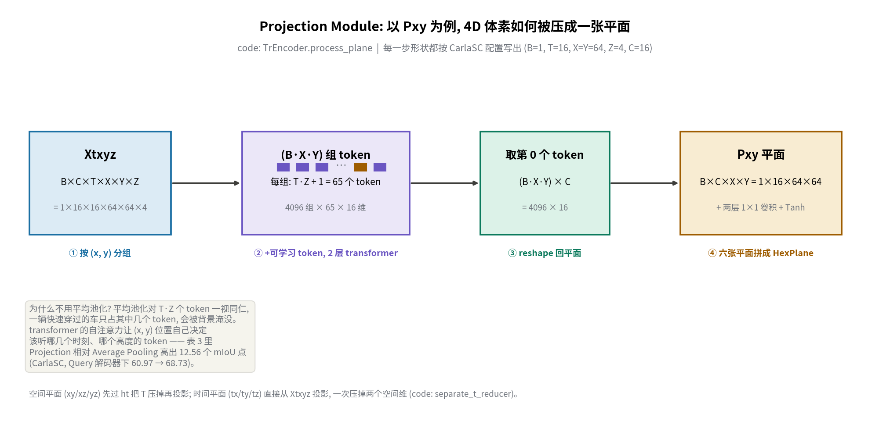
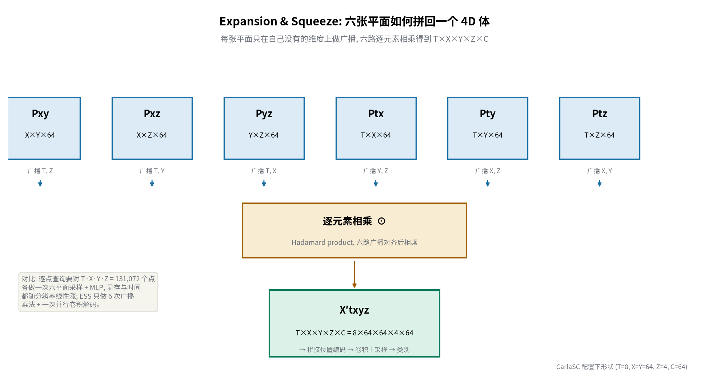
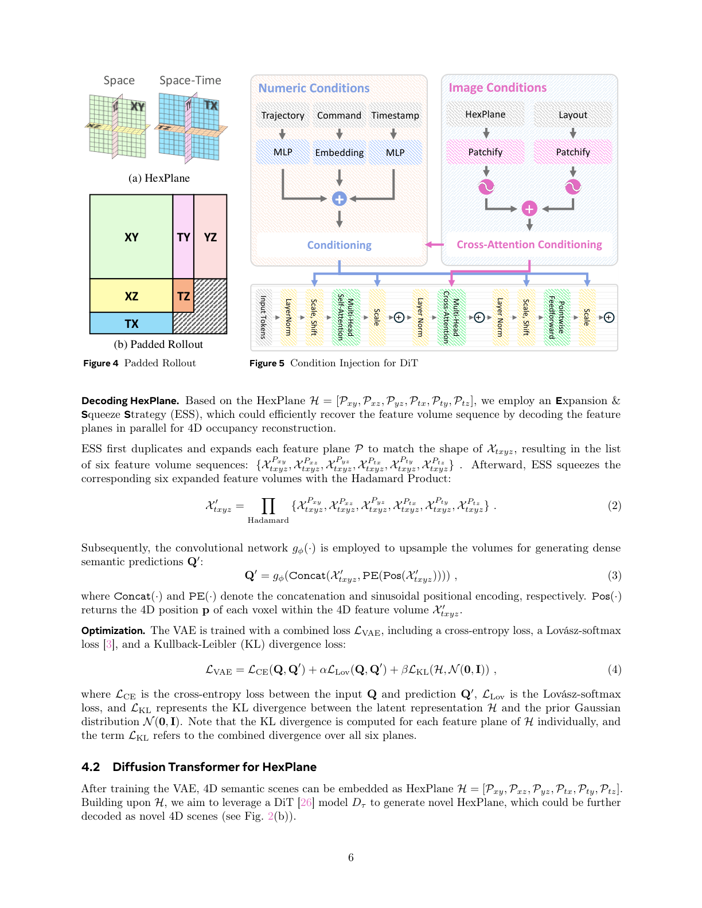
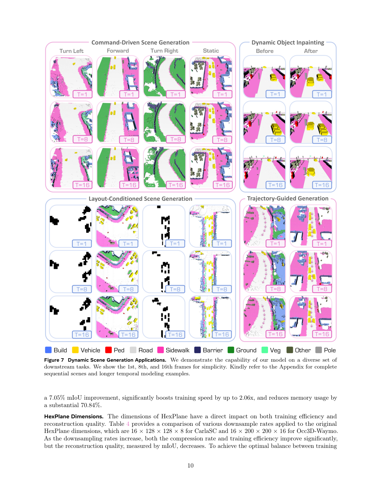

# 把六张平面拼成一张正方形图, 再让 DiT 像画画一样生成 4D 城市

> **全局编号**: 059-WM-dynamiccity
> **论文标题**: DynamicCity: Large-Scale 4D Occupancy Generation from Dynamic Scenes
> **作者**: Hengwei Bian（上海 AI 实验室 / CMU, 实习期间完成）, Lingdong Kong（上海 AI 实验室 / NUS）, Haozhe Xie（南洋理工 S-Lab）, Liang Pan（上海 AI 实验室, 通讯作者 / 项目负责人）, Yu Qiao（上海 AI 实验室）, Ziwei Liu（南洋理工 S-Lab）
> **会议**: ICLR 2025
> **arXiv**: [2410.18084](https://arxiv.org/abs/2410.18084), 下载的是 v3（2025-12-03）
> **代码**: 已公开, https://github.com/3DTopia/DynamicCity, 已克隆到本目录 `code/`
> **一句话核心洞见**: 4D occupancy 生成真正的难处不在扩散模型, 而在 4D 体素序列根本装不进任何逐点操作的管线 —— 作者把场景压进六张 2D 平面（HexPlane）, 压缩端用 transformer 投影代替平均池化、解压端用广播乘法代替逐点查询, 然后把六张平面按共享维度拼成一张正方形"图片", 让 DiT 直接在这张图上做扩散。

## 一个 200×200×16×16 的体素序列到底有多大

先算一笔账, 这是整篇论文的起点。Occ3D-Waymo 的一个场景是 200×200×16 个体素, 覆盖自车周围 80×80×6.4 米, 每个体素一个语义类别。16 帧就是 200×200×16×16 = 1024 万个体素。K-Planes 那套做法 —— 对每个 3D 点查六张平面、过一个小 MLP 预测属性 —— 在 4D 上意味着每帧 64 万次查询、16 帧 1024 万次查询, 每次查询还要做六次双线性插值。训练时一个 batch 进来, 显存直接爆炸。OccSora（2024 年 5 月的 arXiv 工作, 这篇论文的主要基线）的做法是把 4D 序列压成 token 喂给 DiT, 但它的压缩是粗暴的: 表 1 显示, 序列拉长到 32 帧时 OccSora 在 CarlaSC 上的重建 mIoU 从 41.01 跌到 28.91, 在 Occ3D-nuScenes 上只有 13.41 —— 它的表征根本装不下长时序的动态细节。

所以作者面对的不是"扩散模型不够强"的问题, 而是"4D 数据没有一个便宜又保真的表征"的问题。HexPlane（Cao & Johnson, CVPR 2023; 想法源头是 K-Planes）恰好是为动态场景设计的便宜表征: 一个 4D 点 p = (t, x, y, z) 的信息被拆到六张 2D 平面上 —— 三张空间平面 Pxy、Pxz、Pyz, 三张时空平面 Ptx、Pty、Ptz —— 查询时从六张平面各取一个特征向量拼起来。这篇论文的贡献不在 HexPlane 本身, 而在**怎么把 HexPlane 学出来、又怎么把它生成出来**这两件事上各做了一个关键替换。

## 压缩端真正的敌人: 平均池化在哪个体素上栽跟头

给定 4D 场景 Q ∈ R^{T×X×Y×Z×C}, VAE 先用一个共享的 3D 卷积 fθ 对每一帧提特征、下采样, 得到特征体序列 Xtxyz ∈ R^{T×X×Y×Z×C}。接下来要把这个 4D 体压成六张 2D 平面。最朴素的做法 —— 也是所有人第一反应 —— 是平均池化: Pxy[x, y] = Xtxyz[:, :, x, y, :].mean( over t, z )。论文表 3 告诉你这个朴素做法的代价: 在 CarlaSC 上, Average Pooling + 逐点查询解码器只有 60.97 mIoU, 而换成 Projection Module 后是 68.73（同一解码器下）; 在 Occ3D-Waymo 上差距拉到 49.37 vs 61.93, 差了 12.56 个点 —— 这就是摘要里 "up to 12.56 mIoU gain" 的出处, 落在 Waymo 那一行。

为什么平均池化输这么多? 构造一个具体位置看。CarlaSC 配置下, 编码器把空间下采样 2 倍后 X=Y=64、Z=4, T=16。看俯视图上的一个 (x, y) 格子, 它对应 T×Z = 64 个 token（16 个时刻 × 4 个高度）。假设一个行人从这个格子穿过, 只在其中 3 帧、2 个高度层出现, 剩下 58 个 token 全是路面和背景。平均池化给 64 个 token 相同的 1/64 权重, 行人的信号被稀释成原来的不到 1/5, 解码时这个格子大概率被判成路面。动态物体越小、出现时间越短, 被淹没得越彻底 —— 而这正是 4D 场景里最有价值的信息。

Projection Module 的回答是: 别平均, 让这个 (x, y) 位置自己决定听谁的。具体做法（公式 1, 代码 `TrEncoder.process_plane`）分四步。第一步 reshape: 把 Xtxyz ∈ R^{B×C×T×X×Y×Z} 重排成 (B·X·Y) 个组, 每组 (T·Z) 个 token, 每个 token C 维 —— 对 Pxy 就是 4096 组、每组 64 个 token。第二步, 每组前面拼一个可学习的 token（形状 1×1×C）, 加上位置编码, 过一个 2 层、2 头、头维 16 的小 transformer。第三步只取第 0 个 token 的输出 —— 那个可学习 token 在自注意力里看过全部 64 个 token 之后的状态, 就是这一组的信息摘要。第四步 reshape 回 B×C×X×Y, 再过两层 1×1 卷积加 Tanh。

用几何语言说, 这个模块做的事情是**按位置做一次内容相关的加权投影**: 注意力权重是每个 (x, y) 格子根据局部内容自己算出来的, 行人出现的 6 个 token 可以拿到高权重, 背景 token 被压低。平均池化是它的特例 —— 所有权重固定为 1/64。表 3 的 12.56 个点, 就是"内容相关"相对"内容无关"的价值。

*自绘图: Projection Module 四步的数据流。注意空间平面先过 ht 把 T 维压掉（代码 `separate_t_reducer=True`）, 时间平面直接从 Xtxyz 出发一次压掉两个空间维。*

公式 (1) 的记号本身有点绕, 值得拆一下。h_{Sr}(·) 的下标 Sr 表示"被约掉的维度集合"。输入 X_in 的维度被分成两拨: 保留的 D^k（上标 k = keep）和约掉的 D^r（上标 r = reduce）。对 Pxy, keep = {x, y}, reduce = {t, z}; 对 Ptx, keep = {t, x}, reduce = {y, z}。Sk = 乘起来的保留维总数, Sr = 乘起来的约掉维总数。整个公式就是"把约掉的维展平成 token 序列, transformer 压成一个向量, 再折回保留维的形状"。理解了这一句, 公式 (1) 的上下标游戏就只剩记号了。

还有一个代码里有、论文里一笔带过的细节: 时间维度的二次下采样。配置里 `hex_down_t=1`, 对应 `PlaneDownsampler` 里对 T 做一次 stride-2 的卷积 —— 三张时空平面 Ptx、Pty、Ptz 的 T 维再被压一半（16→8）。这就是论文说的 "latent HexPlane 被压到输入 Q 每个维度的一半"。注意这不是 transformer 压的, 是一个可学习的 stride 卷积, 放在投影之后。

## 解码时为什么不逐点查: ESS 的广播乘法在几何上是什么

编码器把场景压成了六张平面, 解码要把它涨回 T×X×Y×Z 的体素。K-Planes 的原始做法是逐点查询: 对每个 (t, x, y, z) 从六张平面双线性采样、拼成特征、过 MLP。CarlaSC 上这就是 8×64×64×4 = 13 万次查询（latent 分辨率下）, Waymo 上是 8×100×100×8 = 64 万次 —— 每次查询六次插值加一次 MLP, 训练时既慢又吃显存。

Expansion & Squeeze Strategy（ESS, 公式 2–3）把"逐点"换成了"整张平面一起算"。第一步 Expansion: 每张平面 unsqueeze 出自己没有的维度, 广播到完整的 T×X×Y×Z×C。比如 Pxy 是 X×Y×C, 就在 T 和 Z 维上广播, 变成 T×X×Y×Z×C；Ptx 是 T×X×C, 在 Y 和 Z 维上广播。六张平面各广播一次, 得到六个同样形状的 4D 特征体。第二步 Squeeze: 六个体逐元素相乘（Hadamard 积）, 压成一个 X′_{txyz}。第三步把这个体和每个体素的正弦位置编码拼起来, 过卷积上采样网络 gφ, 输出每个体素的类别概率 Q′。

这个乘法在几何上是什么? 想象你要重建 (t, x, y, z) 处的一个体素。Pxy[x, y] 说"这个俯视位置像路面", Ptx[t, x] 说"这个时刻这个 x 像车道线", 六张平面各投一票, 乘法就是"六票都要同意"。它是一个**乘性融合**: 任何一张平面在该位置输出接近零的特征, 整个乘积就被拉向零 —— 相当于六个因子的逻辑与。这比加法融合更 sharp, 但也更脆弱: 某张平面学坏了会拖累全局。代码里留了一个开关 `hadamard: True`, 备选是加法（`summation_op`）, 默认配置用乘法, 论文没有报告加法 vs 乘法的对比, 这是一个缺掉的消融。

代码实现上有一个比论文文字更聪明的细节。论文说"先复制展开成六个体素序列再相乘", 真这么干要 materialize 六个 T×X×Y×Z×C 的大张量。代码 `DecoderBase.forward` 里是把每张平面 unsqueeze 成 B×1×T×X×Y×Z×C 的形状（某个维度为 1）, 然后直接做 reduce 乘法 —— 靠广播语义完成, 中间不需要六份完整拷贝。论文的文字描述是概念版, 代码是工程版, 数学结果一样。

*自绘图: ESS 的数据流。注意解码前平面已由 HexplaneConvBlock 从 16 通道升到 64 通道（`query_channels=64`）, 乘法在 64 维特征上做。*

表 3 里 ESS 的三个 "up to" 数字, 出处各不相同, 值得逐个验算。mIoU +7.05: CarlaSC 上 Average Pooling 编码器下, Query 解码 60.97 → ESS 解码 68.02, 差 7.05。训练加速 2.06x: Occ3D-Waymo 上 Average+Query 每步 1.563 秒 → Average+ESS 0.758 秒, 比值 2.06。显存 −70.84%: 同样 Waymo 那一行, 69.66G → 20.31G, (69.66−20.31)/69.66 = 70.84%。三个数字都是"固定编码器、只换解码器"的隔离对比, 消融是干净的。代价是 ESS 的解码质量仍然依赖编码器: Projection+Query（68.73）vs Projection+ESS（74.22）在 CarlaSC 上, ESS 还是赢了 5.49 个点, 说明两处改进是叠加的。

## 损失函数三项各惩罚什么, KL 为什么按平面独立算

VAE 的总损失（公式 4）是三项相加:

L_VAE = L_CE(Q, Q′) + α·L_Lov(Q, Q′) + β·L_KL(H, N(0, I))

第一项交叉熵是体素级分类的主力, 每个体素预测 C 类上的分布, 和真值算 CE。代码里还开了 `ce_class_weight=True`, 按数据集里类别频率给权重 —— CarlaSC 的类别极不均衡（Free 体素 37.6 亿, Other 类只有 36 万, 差四个数量级）, 不加权的话模型全判 Free 也能把 CE 降得很低。

第二项 Lovász-softmax 是直接对 mIoU 的可微代理。CE 只关心每个体素各自的对错, 不关心类别层面的交并比；小类别（行人、杆子）在 CE 里贡献小, 但在 mIoU 里和大类别平起平坐。Lovász 项把优化目标从"体素准确率"拧向"类别 IoU", α=1, 和 CE 同权重。

第三项 KL 把六张平面的隐变量分布往标准正态上拉, β=0.005（论文值）。注意 KL 是**对每张平面独立算再加总**的, 不是把六张平面拼成一个大向量算一次。为什么? 六张平面的统计特性不一样: Pxy 是俯视布局（大片连通的路面/建筑）, Ptz 是时空切片（稀疏的运动轨迹）。拼在一起算 KL, 方差大的平面会主导 KL 项, 方差小的被忽略；独立算等于给每张平面各自的正则预算。代码 `HexPlaneVAE` 里对六张平面各有一个独立的 `fc_mu_logvar` 线性层, 结构上也是分开的, 和论文一致。

这里埋着论文与代码的第一处出入: **KL 权重在论文里是 0.005, 代码默认配置里是 0.0015**（`conf/vae/model/vae.yaml` 的 `loss_weights: {ce: 1., lovasz: 1., kl: 0.0015}`）。差了三倍多。KL 权重直接决定隐空间被压得多紧, 进而影响第二阶段 DiT 的生成质量 —— 0.005 和 0.0015 训出来的 HexPlane 分布方差不在一个量级。是论文写错了还是代码没同步? 从现有材料判断不了, 复现时必须二选一实测。这是全篇最需要小心的超参数出入。

## DiT 怎么读懂六张平面: PRO 把共享维度摆在一起

VAE 训好后, 每个 4D 场景变成六张平面。第二阶段要训一个 DiT 来**生成**六张平面。直接的想法是把六张平面各 patchify 成 token 拼成一个序列喂给 DiT。但 DiT 的自注意力有个强归纳偏置: 位置相近的 token 被认为语义相关。如果 token 序列是六张平面简单首尾拼接的, 序列中相邻的两个 token 可能一个来自 Pxy 的左上角、一个来自 Ptz 的右下角 —— 它们在 4D 空间里毫无关系, 自注意力的局部性偏置全用错了地方。

Padded Rollout Operation（PRO, 论文图 4b, PDF 第 6 页）的做法是: 把六张平面按**共享的维度**摆成一张大的正方形图, 摆不下的角落填零。具体排布（代码 `hexplane_to_rollout`）是三行: 第一行 XY | XZ | TXᵀ, 第二行 TY | TZ | 0（T×T 零块）, 第三行 YZᵀ | 0（Z×Z）| 0（Z×T）。行总高 X+T+Z, 列总宽 Y+Z+T。看共享关系: XY（X 行 × Y 列）和 TY（X 行 × T 列）在行方向都按 X 对齐、左右相邻 —— 共享 X 维度的两块平面在图上就是左右挨着的；XZ 和 TXᵀ共享 X, 也是左右相邻。于是 DiT 的自注意力在图上看到的局部邻域, 大部分对应 4D 空间里真正相邻的坐标。这是 PRO 全部的 clever 之处: **不改 DiT 一行代码, 只靠排版让 2D 局部性偏置去服务 4D 结构**。

*原图引用: 左为 Figure 4（Padded Rollout 排布）, 右为 Figure 5（条件注入的两条分支）。出自 PDF 第 6 页, 2 倍分辨率渲染。*

正方形边长为什么是 X/dX + Z/dZ + T/dT? 行是 X+T+Z, 列是 Y+Z+T, 两者相等要求 X=Y。CarlaSC 里 X=Y=64（下采样后）, Waymo 里 X=Y=100 —— 两个数据集都满足, 所以图是正方形。这是一个隐含条件: 论文的公式只在 X=Y 时成立, X≠Y 的数据集上 PRO 拼出来是长方形, DiT 照样能训, 只是"正方形"的说法不成立。

然后 patchify: patch 大小 p=2, token 数 N = (边长/2)²。CarlaSC: 边长 76, 38² = 1444 个 token；Waymo: 边长 116, 58² = 3364 个 token。注意 3364 个 token、18 层、768 维的 DiT, 自注意力是 O(N²) —— 这就是为什么论文要用 FlashAttention, 也是 DiT 训练 batch 128 需要 8 张 A100 的原因之一。

## 一个 token 到底装了哪张平面的信息: patch 网格与平面边界对齐的隐含条件

论文说 "p 被选择为每个 token 只包含一张平面上的信息"（each token holds information from one feature plane）。这句话成立需要一个条件: 平面块的边界必须落在 patch 网格线上, 即 X、Y、Z、T 都能被 p=2 整除。CarlaSC: 64、64、4、8, 全是偶数, 块边界（64、68、72、76）都是 2 的倍数 —— 成立。Waymo: 100、100、8、8 —— 成立。但论文正文没有点明这个整除要求, 换一个 X=200（未下采样）配 p=2 仍然成立, 配 p=4 就不成立了（块边界 64 不是 4 的倍数? 64 是 4 的倍数, 成立；但 T=8、Z=4 配 p=8 就不行）。这是个小而真实的约束, 复现时如果改 patch 大小或下采样率, 必须先检查边界对齐, 否则一个 token 会横跨两张平面, PRO 的局部性设计就破了。

Padding 的 token 怎么处理? 代码里做了两件事（`dit_trainer.py`）: 第一, 前向时用 `patch_mask` 把 padding 的 token 直接从序列里**删掉**（`x[mask].view(bs, -1, dim)`）, transformer 根本看不到它们；第二, 损失计算时用 `rollout_mask` 把 padding 区域的损失置零。论文说 "padding 区域的 token 被排除在扩散过程之外", 代码的删除操作比这句话更彻底 —— 不是 mask 掉注意力, 是物理删除, 还省了计算量。

表 5 是 PRO 存在的全部理由。三种组织 token 的方式在 CarlaSC 上的生成质量: Direct Unfold（六张平面直接展平拼接）FID2D 205.0, Precision 和 Recall 都是 0.000 —— 模型完全崩了, 生成的场景不在真实分布附近；Vertical Concat（竖着拼, 不对齐维度）FID2D 12.79；PRO 10.96, 且 3D 指标全面最好。Direct Unfold 的崩溃值得细想: token 顺序和 4D 坐标没有任何对应关系, DiT 的位置编码给出的"相邻"全是假的, 自注意力学到的局部模式全是噪声 —— 这就是"归纳偏置用错地方"的实证。0.000 的 Precision/Recall 说明这不是"差一点", 是分布完全对不上。

## 条件怎么塞进 DiT: 两条分支, 一条加法一条注意力

DiT 的条件注入分两条路（论文图 5, 右侧原图）。第一条是数值条件: 轨迹（traj ∈ R^{T×2} 过 MLP）、命令（4 类: STATIC/FORWARD/TURN LEFT/TURN RIGHT, 做 embedding）、时间戳, 三者加起来, 经 adaLN-Zero 生成每层的 scale 和 shift, 在注意力和 FFN 前后做调制 —— 这是 DiT 原论文的标准做法。第二条是图像条件: HexPlane 条件和 Layout 条件（BEV 车辆布局图）各自 patchify、加位置编码, 然后走一个**新增的 cross-attention 块**, 让主分支的 token 去 attending 条件 token。

代码里有一个论文没细说的实现选择: 数值条件和图像条件在进入 DiT block 之前是**相加**的（`c = t + trajectory + command + hexplane + layout`）, 不是拼接。相加意味着所有条件被压缩到同一个 D 维向量里, 条件之间会互相干扰 —— 好处是 block 接口不变, 坏处是加的条件多了之后可能打架。Cross-attention 分支用的 context 是 `hexplane + layout` 的 token 序列（也是相加）。论文图 5 画的是两条箭头分别注入, 代码层面它们先求和再注入, 效果等价但细节不同。

用这套条件机制, 论文展示了五个下游应用（论文图 7, PDF 第 10 页）: 命令驱动（转弯/直行/静止）、轨迹引导、布局条件（BEV 草图控制车辆摆放）、动态 inpainting（mask 掉 HexPlane 的 XY 区域, 采样时按公式 13 把未 mask 区域钉住）、以及附录里的 outpainting（空间外扩）和单帧条件生成。Inpainting 能work, 恰恰说明 HexPlane 的 2D 结构是"显式"的 —— mask 在 XY 平面上的一个矩形, 对应 3D 空间里的一根柱体, 这种可解释的编辑是逐点隐式表征做不到的。

*原图引用: Figure 7, 出自 PDF 第 10 页。展示 T=1/8/16 三帧, 完整 16 帧序列见附录。*

## 表 1 和表 2 的数字: 哪些是硬的, 哪些要打问号

先说硬的部分。重建表（表 1）上 DynamicCity 对 OccSora 是全方位碾压: CarlaSC 16 帧 74.22 vs 33.40, Occ3D-Waymo 16 帧 68.18 vs 36.38, Occ3D-nuScenes 16 帧 56.93 vs 13.70。40 个点的差距不是调参能抹平的, 是表征容量级的差距 —— OccSora 的 token 压缩在长序列上丢失动态细节, 这是结构性的。生成表（表 2）的 FID3D: CarlaSC 上 354.2 vs 1559, Waymo 上 1806 vs 3140, 也是同一量级的差距。附录的逐类别 IoU（表 7）显示提升遍布所有 10 个类, 没有靠某一个大类刷分；最小的提升在 Road（+4.7, 因为基线本来就有 93.9）, 最大的在 Other（+62.3, 基线只有 6.6）—— 恰恰是小类别、难类别上差距最大, 和 Projection Module 救回小物体的机制解释吻合。

然后是问号。第一, **OccSora 的数字是作者用官方代码重跑的**（表注 "Other scores are reproduced using the official code"）, 只有 17 类 32 帧那一行标了 † 引自 OccSora 原文。重跑时 OccSora 的训练配置（训练帧数、epoch、学习率）是否和原论文一致, 正文和附录都没说。OccSora 表 1 里随帧数拉长单调下跌（41.01→28.91）, 而 DynamicCity 自己的 VAE 配置里 `sequence_length=16` —— 表 1 的 4/8/16/32 帧四行, 是训了四个 VAE 还是一个模型测四种长度? 全文没有交代。如果 DynamicCity 是每个长度单独训的、OccSora 是拿一个 16 帧模型测 32 帧, 对比就不对等。这个信息缺失让表 1 的帧数外推部分打了折扣。

第二, 随机种子和重复次数全篇没有报告, 表 2 的生成指标（FID/KID/Precision/Recall）都是单次采样的结果。扩散模型采样的方差不小, FID 12.94 vs 28.55 的差距足够大、不怕方差, 但 Precision 0.307 vs 0.224 这种差距, 没有误差棒就不好说有多稳。

第三, 评估器是自己训的。2D 指标用的 InceptionV3 和 VGG-16 是在"语义配色渲染图"上**从零训的**（附录 7.2）, 3D 指标用的 MinkowskiUNet 自编码器也是自己训的。这意味着 FID/KID 的数值没有任何跨论文可比性 —— 只能在这篇论文内部比较两种方法, 好在作者对两种方法用了同一套评估管线, 内部公平性成立。但这也意味着, 别人无法拿着 12.94 这个数字去和别的工作对比。

第四, IS（Inception Score）这个指标在这篇论文里是废的。表 2 里 IS2D: OccSora 1.030, Ours 1.040；表 5 里三种 token 组织方式的 IS2D 全是 2.49x —— 10 个类别、语义渲染图这种低多样性数据上, IS 几乎饱和, 没有区分度。论文把它列出来, 更多是为了"指标齐全", 读者应该直接忽略 IS 看 FID/KID。

第五, 附录表 15 和 SemCity 的对比里, 有一个作者没有强调的反例: 3D Recall 上 SemCity 是 0.787, DynamicCity 是 0.170 —— 差了四倍多。正文说 "outperforms SemCity on most metrics" 是实话（"most"这个词用得很小心）, 但 3D Recall 的惨败值得一个解释: 可能的原因是 DynamicCity 的生成更多样但更发散, 落在真实分布高密度区的比例低。这和表 2 里 R2D 只有 0.018（绝对值很低）是同一个信号: **生成质量（Precision/FID）强, 分布覆盖（Recall）弱**。做数据增强用的时候, 这个 trade-off 很重要。

第六, 用户研究（表 9）: 42 个志愿者、20 个样本、840 个打分, 四个维度全是 DynamicCity 4.0 左右 vs OccSora 2.1 左右。差距大到不需要统计检验, 但实验协议（是否盲测、样本顺序是否随机、志愿者背景）一个字没写, 只能当定性佐证。

第七, "up to 128 frames" 的说法。图 1 宣称支持最长 128 帧的时序建模, 但附录 9.2 展示的自回归长序列只有 64 帧（4 个 16 帧接起来）, 128 帧没有直接展示。HexPlane 条件自回归在理论上可以无限接, 但作者自己也承认"生成很长序列时可能不稳定"（附录 7.5）。128 这个数字目前是一个架构上限, 不是实测结果。

第八, CarlaSC 只有 6 个训练场景（×3 种交通密度）。DynamicCity 在 CarlaSC 上最漂亮的数字（79.61 mIoU）, 是在一个极小的数据集上拿到的, 过拟合风险比 Waymo（798 个场景）高得多。好在 Waymo 和 nuScenes 上的趋势一致, 结论不只靠 CarlaSC 撑着。

## 代码与论文对不上的五处

把 `code/` 读完, 和论文逐项对, 有五处值得记下来, 复现时每一处都要做选择。

第一, **优化器**。论文 5.1 节说 "AdamW is used as the optimizer for all models"。代码里 VAE 用的是 `Adam`（`optimizer_type: 'adam'`, `weight_decay: 0`）, 只有 DiT 用 AdamW。VAE 训练 100 个 epoch、学习率 1e-3 配 MultiStepLR（50/60/70/80/90 epoch 处乘 0.7）—— 这个 scheduler 论文里完全没提。

第二, **KL 权重**。论文公式 (4) 下方: α=1, β=0.005。代码默认配置: `kl: 0.0015`。三倍多的差距, 直接影响隐空间的紧致程度和 DiT 的训练难度。Lovász 权重两边都是 1, CE 权重都是 1, 只有 KL 对不上。

第三, **DiT 训练轮数**。论文只给了 batch size（128）和学习率（1e-4）, 没给 epoch/iteration 数。代码 CarlaSC 配置是 `num_epochs: 1200`。1200 个 epoch 的 DiT 训练, 按表 3 的速度估算, 是 VAE 训练时间的数倍 —— 论文 5.1 节"实验在 8 张 A100 上进行"没有给总墙钟时间, 复现预算时要按 1200 epoch 估。

第四, **类别数**。论文表 1 说 CarlaSC 10 类、Waymo 9 类、nuScenes 11 类；代码 `num_classes: 12`（含 Free, 另含一个在 CarlaSC 里没有样本的 Bicycle 类, `semantic_map` 里根本没有映射到 11）。mIoU 计算时 Free 是否排除、空类怎么处理, 要看 `metrics.py` 的具体实现, 论文没写。这是小事, 但复现时 mIoU 差一两个点往往就出在这里。

第五, **结论里的笔误**。第 6 节结论把 PRO 写成了 "Masked Rollout Operation", 全文其他地方都是 "Padded Rollout"。小事, 但说明这个名字是后期改的 —— 结合附录里 "mask 掉 padding token" 的机制, 作者最初可能叫 Masked, 后来改成了 Padded。考据癖可以记一笔。

另外两个"论文没说、代码说了"的细节, 复现时有用: 一是 `separate_t_encoder=True` + `one_hot_time=True`, 时间编码器是独立的一套 3D 卷积, 输入还拼了 T 维 one-hot 时间编码；二是 DiT 的条件向量是**相加**不是拼接（`c = t + trajectory + command + hexplane + layout`）, 条件一多可能互相干扰, 这是调条件权重时的一个隐形旋钮。

## 读完带走的两个想法和一个值得做的问题

第一个可迁移的想法是**"投影-重构"的对偶设计**: 把高维数据压进低维平面集时, 压缩端和解压端要用匹配的"聪明"操作。DynamicCity 的压缩端是内容相关的（transformer 投影）, 解压端是并行的（广播乘法 + 卷积）, 两端都不做逐点/逐体素的笨操作。这个模式可以搬到任何"高维序列 → 紧凑表征 → 高维序列"的管线里: 压缩时让每个输出位置自己决定听哪些输入（注意力学投影）, 解压时用广播+并行算子一次性涨回去。逐点查询在 NeRF 时代是标准答案, 但在生成管线里, 它是被并行解码替代的那个旧答案。

第二个想法是**把结构化隐变量"排版"成 DiT 友好的 2D 布局**。PRO 的本质是: 不改模型, 只改数据的排版, 让模型的归纳偏置（2D 局部性）去服务数据的真实结构（4D 邻接）。这个 trick 的适用面很广 —— 任何能分解成"若干共享维度的低维因子"的表征（triplane、hexplane、甚至多视角特征）, 在喂给 DiT/UNet 之前都值得按共享维度排一次版。表 5 里 Direct Unfold 的 FID 205 就是不排版的代价, 这个数字应该钉在每个做 latent diffusion for 3D 的人的墙上。

值得做的问题: HexPlane 的六张平面是**乘性融合**的, 任何一张平面学坏都会拖累全局, 而 KL 是按平面独立算的 —— 有没有可能某张时空平面（比如 Ptz, 最稀疏的那张）在 KL 约束下直接塌成常数, 靠其他五张平面"代偿"? 表 7 的逐类别 IoU 没有按平面分解, 论文也没有可视化单张平面的重建贡献。如果 Ptz 塌了, 模型的时序外推能力就是空中楼阁, 而 64 帧自回归生成里的时间一致性可能全靠 Ptx/Pty 撑着。验证方法很直接: 推理时把某一张平面置零/置随机, 看重建 mIoU 掉多少 —— 六张平面各做一次, 就是一张"平面重要性"的消融表。论文没做, 留给读者了。
