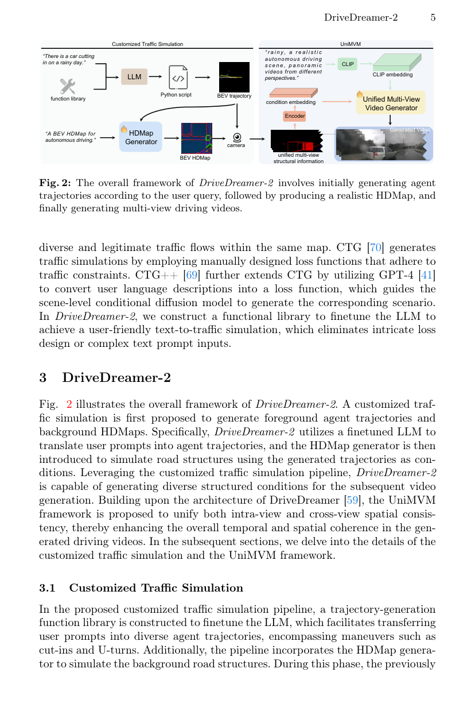
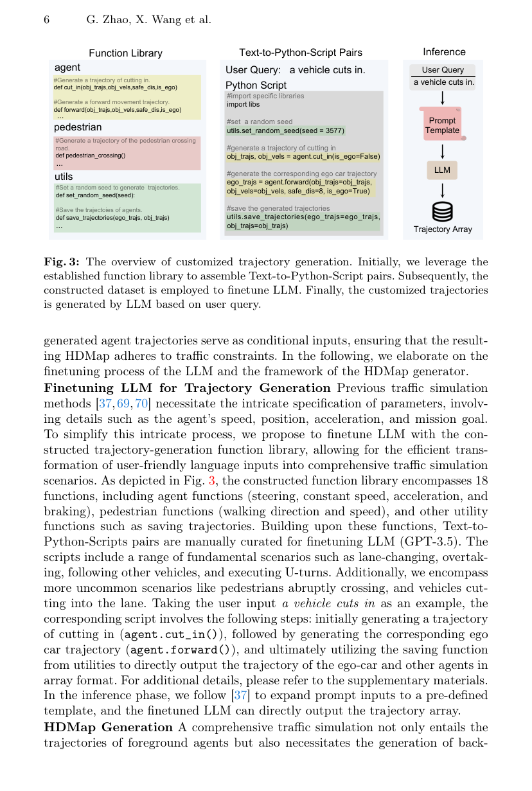
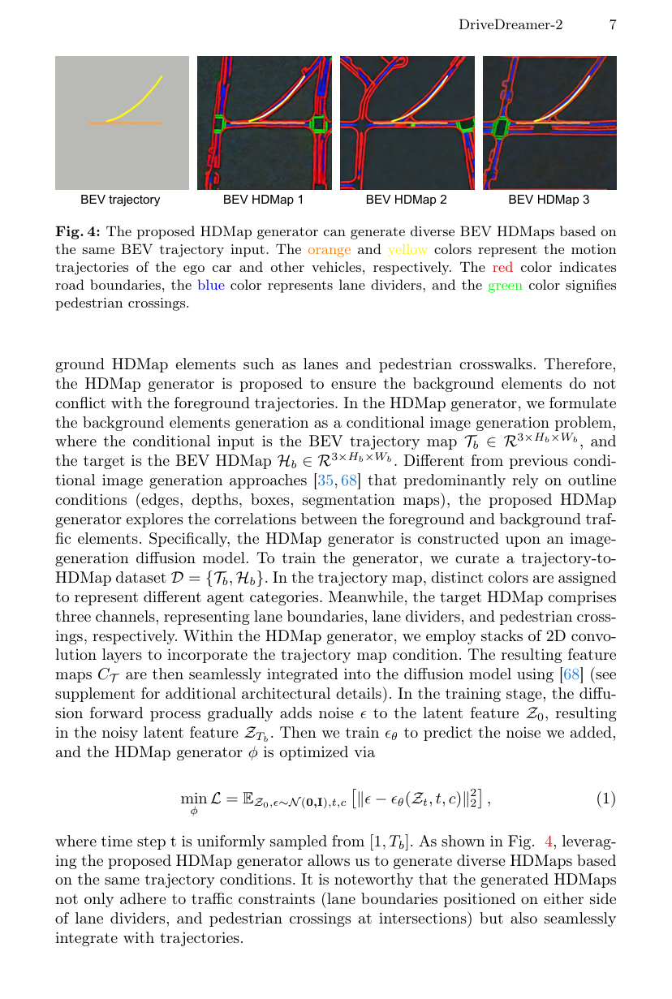
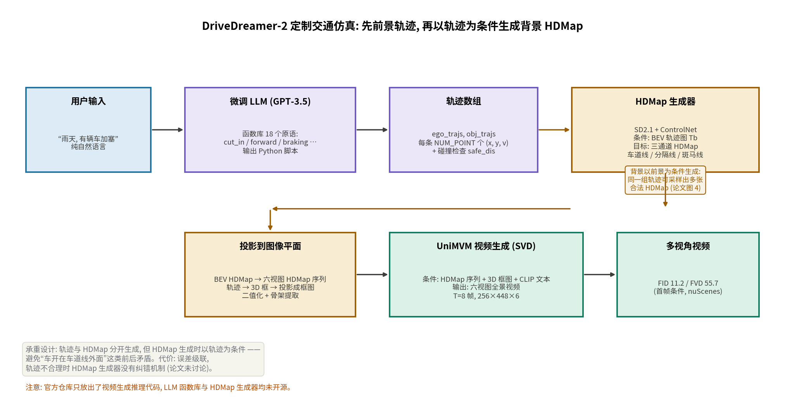
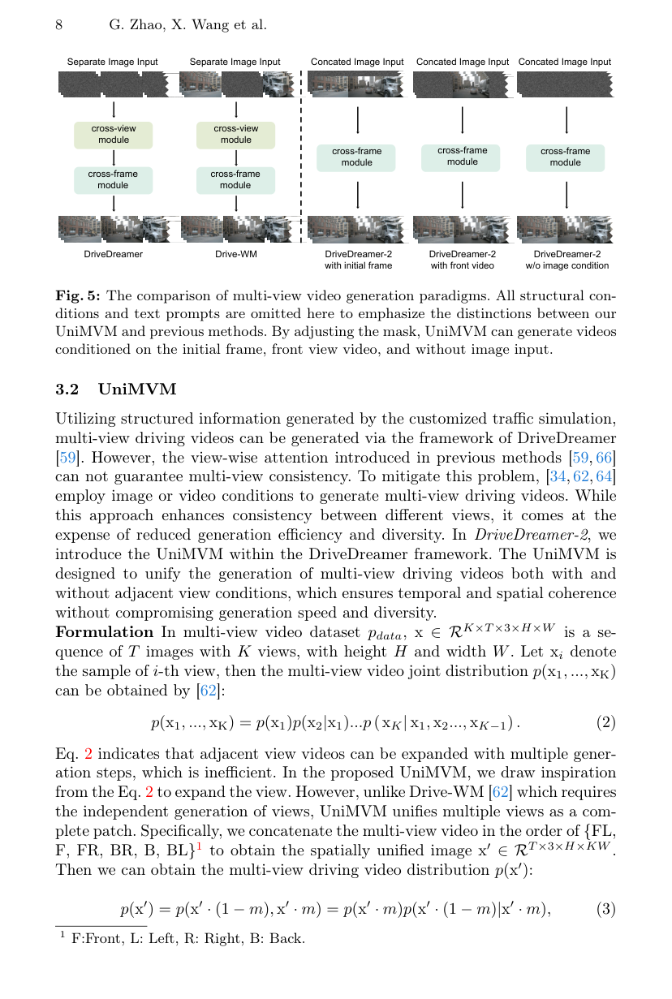
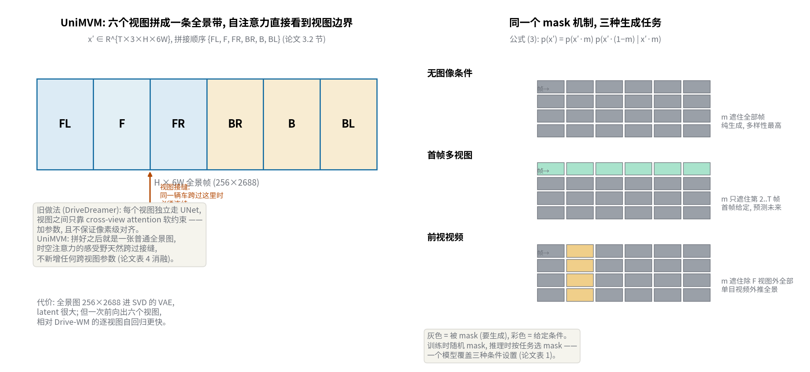

# 先让 LLM 写 Python 脚本编交通, 再让扩散模型画视频: DriveDreamer-2 的"用户友好"到底是怎么实现的

> **全局编号**: 060-WM-drivedreamer-2
> **论文标题**: DriveDreamer-2: LLM-Enhanced World Models for Diverse Driving Video Generation
> **作者**: Guosheng Zhao¹\*、Xiaofeng Wang¹\*、Zheng Zhu²\*（\* 共同一作, Zhu 为通讯作者）、Xinze Chen²、Guan Huang²、Xiaoyi Bao¹、Xingang Wang¹（通讯作者）。¹ 中国科学院自动化研究所, ² GigaAI
> **会议**: AAAI 2025
> **arXiv**: [2403.06845](https://arxiv.org/abs/2403.06845), 下载的是 v2（2024-04-11）
> **代码**: 部分公开, https://github.com/f1yfisher/DriveDreamer2 —— 仓库里只有视频生成的推理管线（SVD 底座 + 测试配置）, 论文 headline 的 LLM 轨迹生成函数库与 HDMap 生成器均未开源, 训练代码标注 "will be released soon"
> **一句话核心洞见**: 前人把"结构化条件"当输入要, DriveDreamer-2 把"结构化条件"本身也变成生成目标 —— 用微调过的 LLM 把用户的一句话变成 Python 交通脚本（前景轨迹）, 再用一个以轨迹为条件的扩散模型生成配套的 HDMap（背景）, 最后把六个视角拼成一条全景带、用一个 mask 机制统一三种生成任务, 一次前向输出多视角视频。

## DriveDreamer 们真正的瓶颈不是画质, 是条件给不出来

2024 年初, 驾驶世界模型这个赛道已经很挤了: DriveDreamer、MagicDrive、Panacea、Drive-WM、GAIA-1 全是扩散模型画多视角驾驶视频。它们的画质在涨, 但用法全都卡在同一个地方 —— **条件**。要生成一段视频, 你得先给出 3D 框、HDMap、光流, 或者直接给一张真实图像做初帧。这些结构化条件从哪来? 从数据集的标注里来。于是"生成多样化数据"这个美好愿景撞上一堵墙: 你能生成的场景, 恰好就是你已经有标注的场景。长尾场景（雨夜加塞、行人突然横穿）之所以长尾, 恰恰是因为它们没有标注。

作者的赌注是: 别跟用户要结构化条件, 让模型自己把条件编出来。用户只说一句话 —— "雨天, 有辆车加塞" —— 系统先编出这句话对应的交通状况（谁在哪、怎么走、路长什么样）, 再根据编好的交通状况画视频。这个"先编条件、再画视频"的两级结构, 是全文所有设计的上游决定。

但"编条件"有个容易被忽视的约束: **前景和背景不能各编各的**。如果轨迹生成器让一辆车变道, HDMap 生成器画的车道线却在另一个位置, 视频生成器拿到自相矛盾的条件, 画出来的就是车在车道线外面开。所以论文 3.1 节的真正承重设计不是"用了 LLM", 而是**解耦 + 条件化**: 轨迹（前景）和 HDMap（背景）分开生成, 但背景的生成以轨迹为条件。用概率语言说, 不是学联合分布 p(轨迹, HDMap), 而是学 p(轨迹)·p(HDMap | 轨迹)。这个分解保证了两者的一致性, 代价是误差级联 —— 轨迹编得不合理, HDMap 生成器没有纠错机制, 只会跟着错下去。论文对此没有讨论, 后面会回到这一点。

*原图引用: Figure 2, 出自 PDF 第 5 页。注意图中 "BEV trajectory" 到 "HDMap Generator" 的箭头, 这就是 p(HDMap | 轨迹) 的条件边。*

## LLM 在这里做的不是物理推理, 是程序合成

论文标题里的 "LLM-Enhanced" 容易让人以为 LLM 在直接生成轨迹坐标 —— 不是。3.1 节的管线是: 先手写一个**函数库**（18 个函数: 车辆的 cut_in、forward、加减速、刹车, 行人的行走方向和速度, 加上 set_random_seed、save_trajectories 等工具函数）, 然后人工编写一批"用户描述 → Python 脚本"的数据对, 用这批数据对微调 GPT-3.5。推理时用户输入一句话, 先套进一个 prompt 模板（函数签名 + 指令, 附录图 9）, 微调过的 LLM 输出一段 Python 脚本, **运行这段脚本**才得到轨迹数组。

这个设计值得停下来想一想它为什么是这样的。直接让 LLM 输出轨迹坐标（NUM_POINT 个 (x, y, v) 点）有两个麻烦: 一是 LLM 不擅长输出长串精确数字, 坐标漂移、抖动很难避免；二是轨迹要满足物理和交通约束（不撞车、速度连续、加塞时必须比目标车快）, 这些约束用自然语言很难一次讲清。转成"写程序调用原语"之后, 约束被**编译**进了原语的实现里, LLM 只需要做高层的组合决策 —— "这个场景要先调 cut_in 再调 forward, 自车保持 8 米安全距离"。LLM 做的不是物理推理, 是程序合成；智能在原语里, 不在 LLM 里。这个分工是诚实的, 也是聪明的: 它把最难的连续控制问题外包给了手写代码, LLM 只解决离散的组合问题。

## 跟着 cut_in() 走一遍: yaw 分段、safe_dis、速度钳制

附录贴出了 `cut_in` 的完整实现, 这是理解"智能在原语里"的最好材料。函数签名是 `cut_in(obj_trajs=None, obj_vels=None, safe_dis=10, is_ego=False)`, 返回 `agent_trajs`（形状 1×NUM_POINT×3）和 `agent_vels`（1×NUM_POINT×1）。

先初始化起点: 非自车时 x 起点随机落在 [0, 10], y 起点随机落在 ±Y_RANGE（`multi_factor` 随机取 ±1 决定从左还是从右侧切入）, 目标是 y=0（自车道）。然后逐点递推, 每一时刻的 yaw（航向角）按三个阶段分段控制:

- **切入阶段**（还没接近目标车道中线的一半）: yaw 被限制在 ±20° 以内、朝目标方向偏（`yaw_range=[-0.1, 0]` 或 `[0, 0.1]` 弧度）, 车斜着往目标车道走；
- **回正阶段**（接近目标车道但还没完全进入）: yaw 范围收紧到 ±10°, 让车头逐渐摆正；
- **直行阶段**（已进入目标车道）: yaw 只在 ±1° 内微调, 沿车道走。

每一时刻还有两处"安全钳制"。第一处是 `utils.update_yaw(yaw, safe_dis, agent_trajs, obj_trajs)`: 如果和其他智能体的轨迹距离小于 safe_dis, 就修正 yaw 避让 —— 碰撞避免不是学出来的, 是每步检查的几何规则。第二处是速度: `v_range = [obj_vels[0,t,0]+0.5, V_RANGE[1]+0.5]`, 加塞车辆的速度被强制**比目标车快至少 0.5**（单位未在论文中说明, 未确认是 m/s）, 注释写得很直白: "guarantee the generated velocity surpasses the other vehicle to realize cutting in"。另外每一步给速度和 yaw 加一个小随机扰动（±2 的速度扰动、yaw_range 内的随机采样）, 增加多样性。

看明白这个函数, 就看明白了整套"定制交通仿真"的成色: 场景的多样性来自随机种子和参数采样, 合理性来自手写的分段规则和钳制。LLM 的贡献是把"a vehicle cuts in"映射到"调 cut_in(is_ego=False) 再调 forward(is_ego=True, safe_dis=8)"这个调用序列（论文图 3 的例子）。这很实用, 但读者要清楚: **换一批手写原语, 整个系统的行为就换了**；论文没有评估原语库之外的场景（比如环岛、施工改道）LLM 会怎么反应, 也没有给出 text-to-script 数据对的数量和覆盖度。这是第 12 节要展开的第一个大问号。

*原图引用: Figure 3, 出自 PDF 第 6 页。注意左下角的推理示例脚本: `agent.cut_in(is_ego=False)` 接 `agent.forward(..., safe_dis=8, is_ego=True)`。*

## 公式 (1): HDMap 生成器的条件长什么样

轨迹有了, 接下来生成背景。HDMap 生成器被写成一个条件图像生成问题（公式 1）:

min_φ L = E_{Z0, ε∼N(0,I), t, c} [ || ε − εθ(Zt, t, c) ||² ]

这是标准的 latent diffusion 训练目标, 逐项看。Z0 是真实 BEV HDMap 过 VAE 编码后的隐变量；ε ∼ N(0, I) 是采样的噪声, 和 Z0 同形状；t 是从 [1, Tb] 均匀采样的扩散步数（注意这里的 Tb 和前面的"轨迹图 Tb ∈ R^{3×Hb×Wb}"撞了记号 —— 同一个符号在同一节里指两样东西: 一个是 BEV 轨迹图, 一个是扩散总步数, 读的时候要自己分开）；Zt 是 Z0 加噪到第 t 步的结果；εθ 是要训的去噪网络；c 是条件。φ 是生成器的参数（论文说用 ControlNet 的方式把条件注入 SD2.1, 可训练的是 ControlNet 那部分参数）。

关键在 c 里装了什么。条件输入是一张 **BEV 轨迹图** Tb ∈ R^{3×Hb×Wb}: 把上一步生成的轨迹画在俯视图上, 不同颜色代表不同类别的智能体（论文图 4 里橙色是自车轨迹、黄色是其他车辆）。目标是一张 BEV HDMap Hb ∈ R^{3×Hb×Wb}, 三个通道分别是车道边界（红色）、车道分隔线（蓝色）、人行横道（绿色）。训练数据 D = {Tb, Hb} 是从 nuScenes 的标注里构建的: 真实轨迹画成轨迹图、真实 HDMap 当目标。

所以这个生成器学的是**"给定这些车的走法, 路应该长什么样"**。论文图 4（PDF 第 7 页）展示了同一组轨迹输入能采样出多张不同的 HDMap, 且都满足交通规则（边界在线的两侧、人行横道在路口）。这个"一对多"正是条件生成该有的样子: 轨迹只约束了"车在哪开", 没约束"路有几条车道、路口在哪", 剩下的自由度由扩散模型的随机性填。

*原图引用: Figure 4, 出自 PDF 第 7 页。这是 p(HDMap | 轨迹) 这个条件分布的直接可视化证据。*

实现细节（论文 4.1 节）: 底座是 SD2.1, ControlNet 参数可训练, 训 55K iterations, batch 24, 分辨率 512×512。HDMap 生成器的学习率论文没有给（只说了视频生成器用 AdamW 5e-5）, 未确认。BEV HDMap 生成之后, 还要经过后处理才能给视频生成器用: 二值化 + 骨架提取取出车道线, 再投影到六个相机的图像坐标系（附录 6 节）。这一步是纯几何操作, 没有学习成分。

*自绘图: 从用户 query 到多视角视频的完整管线, 标出每个阶段的输入输出形状与已知的训练配置。*

## 公式 (2) 只是链式法则, 真正的动作是拼全景

3.2 节的 UniMVM（Unified Multi-View Model）是论文的第三个贡献。先看公式 (2):

p(x₁, ..., x_K) = p(x₁) p(x₂|x₁) ... p(x_K|x₁, ..., x_{K−1})

这就是链式法则, 把联合分布写成条件连乘, 没有任何新信息。Drive-WM 的做法是按这个式子字面意思来: 先生成一个视角的视频, 再以它为条件生成下一个视角, K 个视角要做 K 次生成 —— 慢, 且误差逐视角累积。论文说"从公式 (2) 获得灵感", 这个"灵感"的实在内容只有一句话: **别逐个生成视角, 把 K 个视角拼成一张图一次生成**。

具体拼法: 六个视角按 {FL, F, FR, BR, B, BL}（前左、前、前右、后右、后、后左）的顺序在宽度方向拼接, 得到空间统一的全景图 x′ ∈ R^{T×3×H×6W}。nuScenes 单视角 256×448, 拼完是 256×2688 的一条带子。然后公式 (3):

p(x′) = p(x′·(1−m), x′·m) = p(x′·m) p(x′·(1−m) | x′·m)

m 是一个 mask。训练时随机 mask, 模型学的是"给定未被 mask 的部分, 补全被 mask 的部分" —— 一个全景图上的 inpainting 任务。推理时换 mask 就切换任务（论文图 5, PDF 第 8 页）:

- m 遮住全部帧 → 无图像条件纯生成；
- m 只遮住第 2..T 帧 → 首帧多视角图像条件, 预测未来；
- m 遮住除前视（F）之外的五个视角 → 前视单目视频条件, 外推全景。

为什么拼全景比 cross-view attention 好? DriveDreamer 的做法是每个视图独立走 UNet, 视图之间加 cross-view attention 模块做软约束。软约束的问题是: 它只"鼓励"一致, 不"保证"一致, 还要新增参数。拼成全景之后, 视图的接缝变成了全景图内部的普通像素邻接 —— 同一辆车从 F 视图开到 FR 视图, 在全景图上就是连续的一片像素, 时空注意力的感受野天然跨过接缝, 不需要任何新增参数。表 4 的消融把这件事量化了: 同样 SVD 底座, 带 cross-view 模块是 FID 17.2 / FVD 94.6, 换成 UniMVM 是 11.2 / 55.7。

*原图引用: Figure 5, 出自 PDF 第 8 页。注意 UniMVM 三列都没有 cross-view 模块, 这是"不引入跨视图参数"的图示证据。*

*自绘图: 左为 {FL,F,FR,BR,B,BL} 拼接顺序与视图接缝, 右为公式 (3) 的 mask 在三种任务下的具体形状。*

这里有一个诚实的技术注脚: 全景图 256×2688 进 SVD 的 VAE, latent 非常大；论文没有报告推理显存和墙钟时间。一次前向输出六个视图, 在范式上比 Drive-WM 的逐视角自回归更快, 但论文没有给出两者的实测墙钟对比, 具体快多少未确认。

## SVD 底座 + 结构条件: 3D 框为什么直接投影而不用 embedding

视频生成器建在 Stable Video Diffusion（SVD）之上, 全部参数微调（200K iterations, batch size 1, 8 帧 × 6 视角, 256×448, AdamW 5e-5, A800）。条件有三路: HDMap 序列 {Hi}、3D 框序列 {Bi}、CLIP 文本 embedding。

和 DriveDreamer 的一个关键区别在 3D 框的用法。DriveDreamer 把 3D 框的位置和类别做成 embedding 向量, 需要额外的控制参数；DriveDreamer-2 直接把 3D 框**投影到图像平面**上画成框图, 当作 control condition 拼进输入。几何上这更直接: 框在图像上的位置和大小就是它该出现的位置和大小, 不需要模型再学一个"embedding → 像素位置"的映射。代价是框图是稀疏的线条, 模型要自己从线条里读出深度和朝向 —— 不过有 HDMap 和文本配合, 够用了。开源代码的 transform 里能看到这一步的具体实现（`generate_canvas_box`, 线宽 10 像素, 按距离排序由远及近画）。

训练目标是 denoising score matching（附录公式 5）:

E_{(yI, c)∼pdata, (σ,n)∼p(σ,n)} [ λσ || Dθ(yI + n; σ, c) − yI ||² ]

yI 是图像隐变量, n 是方差 σ² 的高斯噪声, Dθ 是要学的去噪器, c 是条件（HDMap 特征 yH、框条件 yB、文本 embedding cp）。λσ = (1+σ²)σ^{−2} 是噪声水平的加权。去噪器按 EDM 的 preconditioning 参数化（附录公式 6）:

Dθ(y; σ) = c_skip(σ)·y + c_out(σ)·Fθ(c_in(σ)·y; c_noise(σ))

其中 c_skip = 1/(σ²+1), c_out = −σ/√(σ²+1), c_in = 1/√(σ²+1), c_noise = 0.25·log σ。这组系数的几何意义是: σ 很大时（噪声主导）, c_skip→0、c_out→−1, 去噪器主要靠网络 Fθ 猜；σ→0 时（接近干净图像）, c_skip→1、c_out→0, 去噪器直接透传输入 y, 网络只做小修正。这就是 EDM preconditioning 的标准设计 —— 让网络在不同噪声水平下看到的输入输出都在合理的数值范围内, 训练稳定。论文照搬了 Karras 等人的公式, 没有改动, 附录里重写一遍主要是为了自包含。

## 表 4: FVD 的大头是换 backbone 给的, 不是 UniMVM

表 4 是全文最值得细读的消融, 它把两个改进（换 SVD 底座、加 UniMVM）拆开了, 三行数字分别是:

- DriveDreamer（SD1.4 + cross-view 模块）: FID 14.9 / FVD 340.8
- DriveDreamer-2（SVD + cross-view 模块）: FID 17.2 / FVD 94.6
- DriveDreamer-2（SVD + UniMVM）: FID 11.2 / FVD 55.7

（以上是首帧多视角图像条件设置, nuScenes 验证集。）

先看 backbone 这一刀: FVD 从 340.8 砍到 94.6, 降了 72%。SVD 是在海量视频上预训练的视频扩散模型, 自带时序先验；SD1.4 是图像模型, 时序要靠后加的模块硬学。72% 的 FVD 下降里, 绝大部分是"视频预训练"这个底座红利, 不是这篇论文的方法创新。论文 4.4 节诚实地写了 "almost 70% improvement in FVD" 来自 SVD, 这个态度是对的。

再看 UniMVM 这一刀: FVD 94.6 → 55.7（降 41%）, FID 17.2 → 11.2（降 35%）。这才是 UniMVM 自身的贡献, 幅度健康但不是翻天覆地。摘要里 "FID 和 FVD 相对提升 ~30% 和 ~50%" 是拿 11.2/55.7 去比 Drive-WM 的 15.8/122.7（表 1, 三视角视频条件）: FID 降 29%, FVD 降 55% —— 对得上, 基准选的是 Drive-WM 而不是 DriveDreamer, 读者要看清分母是谁。

还有一个论文诚实报告的负面信号: 换 SVD 底座后 **FID 反而变差了**（14.9 → 17.2）。作者的假设是 cross-view 模块破坏了 SVD 学好的空间特征。这个细节很重要, 因为它恰好反衬了 UniMVM 的价值: 去掉 cross-view 模块、换成全景拼接后, FID 回到 11.2, 比原来还好。也就是说, cross-view attention 和 SVD 的视频先验是互斥的, 而全景拼接和它是兼容的 —— 这是 UniMVM 设计合理性的一个旁证, 比单纯的数字对比更有说服力。

表 1 的三种条件设置也值得横着看。无图像条件时 FID 25.0 / FVD 105.1, 首帧条件时 11.2 / 55.7 —— 条件越强分数越好, 符合直觉。但论文图 8 展示了一个反直觉的现象: 无图像条件生成的视频, 车的颜色、街道背景和真值"差异巨大"（多样性最高）, 首帧条件生成的则紧贴真值。条件越强, 多样性越低, 这是生成模型的标准 trade-off, 论文没有藏着。

## 下游任务: 为什么无图像条件的增益反而更大

表 2 和表 3 用生成的视频做数据增强, 训 StreamPETR 做 3D 检测和多目标跟踪。基线（只用真实数据）: mAP 31.7, NDS 43.5, AMOTA 28.9。加生成数据后分两种情况:

- 有首帧图像条件: mAP 32.6（+2.8%）, NDS 45.2（+3.9%）, AMOTA 31.2（+8.0%）；
- 无图像条件: mAP 32.9（+3.8%）, NDS 45.4（+4.4%）, AMOTA 31.3（+8.3%）。

（百分比是相对基线的相对提升, 和摘要的 "~4% / ~8%" 对得上。）

反直觉的是**无图像条件的那一行增益更大**。按常理, 有首帧条件生成的视频更贴近真值分布, 应该对下游任务帮助更大。但论文图 8 告诉我们: 无图像条件生成的视频和真值差异巨大 —— 车的颜色、背景都变了, 多样性最高。检测器吃的就是多样性: 同样的 3D 框标注, 配上不同的外观, 等于免费的数据增强。首帧条件把外观锁死了, 增强效果反而打折。这个现象和"生成质量 vs 下游效用"的常见误解正好相反: FID 最好的设置（首帧条件 11.2）, 下游增益不是最高的。做数据增强的人应该记住这个 trade-off。

但也要看到绝对幅度: mAP +1.2 个点（31.7→32.9）, AMOTA +2.4 个点（28.9→31.3）。这是真实的提升, 但不大。论文没有报告多次运行的方差, 也没有做显著性检验 —— 检测指标 1 个点的波动在不同随机种子下是常见的。结论应该是"有正向信号", 而不是"确立了增强范式"。

另外, 生成数据的标注（3D 框、HDMap）是**直接沿用**生成条件的真值（"we employ all structured conditions in the nuScenes training set to generate driving videos"）, 不是从生成视频里重新估计的。这里有一个隐含假设: 生成的视频和输入的条件严格对齐, 框画在哪车就长在哪。如果视频生成器"画偏了"（比如车比框大一圈）, 增强数据就带进了标注噪声。论文没有量化条件对齐度（比如在生成视频上跑检测器看框的 IoU）, 这是一个缺掉的检查。

## 怀疑式审读: LLM 与 HDMap 生成器没有任何定量评估

这是全文最硬的批评, 也是读者最容易忽略的: 论文 headline 的两个贡献 —— LLM 定制轨迹、HDMap 生成器 —— **没有任何定量评估**。轨迹的质量（和真实轨迹分布的距离、碰撞率、交通规则违反率）没有指标；HDMap 的质量（车道拓扑正确率、与轨迹的一致性）没有指标；LLM 生成脚本的成功率（多少比例的用户 query 能生成可运行的脚本、多少比例的脚本满足语义）没有数字。全文对这两部分的证据只有定性图（图 4、图 6）和文字描述。

具体缺的信息: text-to-python 微调数据对有多少条、覆盖多少种场景、GPT-3.5 微调的超参数是什么 —— 全都没写。18 个函数的函数库, 附录只贴了 cut_in 一个, 其余 17 个的实现质量无从判断。用户 query 稍微超出函数库覆盖范围（比如"环岛掉头"）, LLM 是会组合出近似脚本、还是胡编一个不存在的函数调用, 论文没有测试。这意味着"user-friendly"的宣称目前只在几个 hand-picked 的例子上成立。

HDMap 生成器这边, 训练配置给了 55K iterations、batch 24、512×512, 但学习率、优化器、ControlNet 的具体注入方式（附录说"see supplement for additional architectural details", 但 supplement 里并没有更细的架构描述 —— 我通读了附录, 这句话指向的内容不存在, 是一个悬空引用）。评估只有图 4 的三张定性图。

视频生成部分的评估相对扎实: 三种条件设置、和四个基线的对比、SVD/UniMVM 的隔离消融、FID/FVD 都在 150 个验证视频上按 4Hz×8 帧的标准流程算。但种子数、多次运行方差依然没报。还有一处正文和附录对不上的地方: 4.1 节说 StreamPETR 在 256×448 分辨率下训练, 附录 6 节说 "retrained at a resolution of 512×256 instead of the 704×256 in original baseline" —— 256×448（H×W）和 512×256（W×H 写成 H×W 是 256×512）对不上, 448 和 512 是两个不同的宽度。哪一处写错了, 从现有材料判断不了, 标为未确认。

"首个能生成定制驾驶视频的世界模型"这个宣称, 范围要收窄到"世界模型（视频生成）"才成立。LCTGen（2023）和 CTG++（2023）已经用 LLM 做过语言到交通场景的生成, 只是它们输出的是交通仿真（轨迹/场景参数）而不是视频。DriveDreamer-2 的"first"是"第一个把 LLM 定制做到视频世界模型里", 不是"第一个用 LLM 生成交通"。论文引言引用了 LCTGen 和 CTG++, 没有夸大, 但读者自己要把这个边界划清楚。

## 代码只放出一半: 仓库里有什么、缺什么

`code/` 是 https://github.com/f1yfisher/DriveDreamer2 的浅克隆, 读完之后情况是这样的。

**有的**: 完整的推理管线。`dreamer-models` 里有基于 diffusers 的 `DriveDreamer2Pipeline`（SVD 的 UNetSpatioTemporalConditionModel + EulerDiscreteScheduler + CLIP）, `dreamer-train/projects/DriveDreamer2/` 里有三个测试配置（`drivedreamer2_img_cond` / `video_cond` / `wo_img`）, 对应论文表 1 的三种条件设置；数据管线（nuScenes 转换、可视化、3D 框投影画布 `generate_canvas_box`）都在。README 说推理代码和模型权重（百度网盘链接）在 2024-12-18 放出, AAAI 2025 在 2024-12-10 接收。

**缺的**: (1) 训练代码 —— `DOCS/trainval.md` 第一句就是 "The training code will be released soon", 200K iterations 的视频生成器训练脚本不在仓库里；(2) LLM 函数库和 GPT-3.5 微调代码 —— 全仓库 grep 不到 `cut_in`、`function_library`、GPT 相关的任何文件, 定制交通仿真管线完全没有开源；(3) HDMap 生成器的训练和推理代码 —— 同样缺失；(4) 配置文件里全是作者内网路径（`/mnt/data-2/users/zhaoguosheng/...`, `/mnt/pfs/datasets/...`）, 直接跑不起来, 要自己改。

所以这个仓库的实际价值是: 可以加载作者放出的权重、跑三种条件设置的推理、复现表 1 的生成质量数字；但论文最核心的"LLM 定制"部分不可复现, 训练管线也不可复现。信息块里"部分公开"的定性就是这么来的。对比之下, 同系列的 DynamicCity 放出了 VAE+DiT 的完整训练代码, 两者的开源完整度差了一档。

## 读完带走的两个想法和一个值得追问的问题

第一个可迁移的想法是**"条件解耦生成"**: 当生成任务的条件本身难以获取时, 把条件拆成前景和背景两级, 先生成约束强的那一级（轨迹）, 再以它为条件生成另一级（HDMap）。这个 p(前景)·p(背景|前景) 的分解, 保证一致性的方式不是靠联合训练, 而是靠生成顺序。这个模式可以搬到任何"结构化条件缺失"的生成任务里: 先生成最难伪造、约束最多的部分, 再让相对自由的部分去适配它。

第二个想法是**用"排版"代替"加模块"来解决多视图一致性**。UniMVM 没有发明新的注意力机制, 它只是把六个视图拼成一张全景图, 让已有的时空注意力去处理视图接缝。效果（FVD −41%、FID −35%, 相对 cross-view 基线）和"加一个 cross-view 模块"的思路相当甚至更好, 但零新增参数。这是一个方法论层面的提醒: 当你想加一个模块来解决"跨 X 一致性"时, 先问一句 —— 能不能把 X 拼进数据里, 让已有的归纳偏置去解决?

值得追问的问题是**级联误差**。整个管线是 LLM → 轨迹 → HDMap → 视频, 前一级的错误会被后一级当成真值。如果 LLM 生成的轨迹本身不合理（比如切入角度太大、或者函数库覆盖不到的场景下 LLM 硬凑了一个脚本）, HDMap 生成器会给这条不合理的轨迹配一张"合法"的路, 视频生成器再把它画出来 —— 错误在每一级都被"合理化"了, 没有任何一级负责纠错。论文的所有定性例子都是管线 work 的情况, 没有展示失败 case。要验证这个系统的鲁棒性, 该做的一个实验是: 故意给 LLM 一个超出函数库覆盖的 query（比如"车辆在环岛逆行"）, 看三级管线分别输出什么 —— 是优雅降级, 还是每一级都一本正经地错下去。这个实验论文没做, 但它决定了"用户友好"到底是真友好, 还是只在演示 query 上友好。
