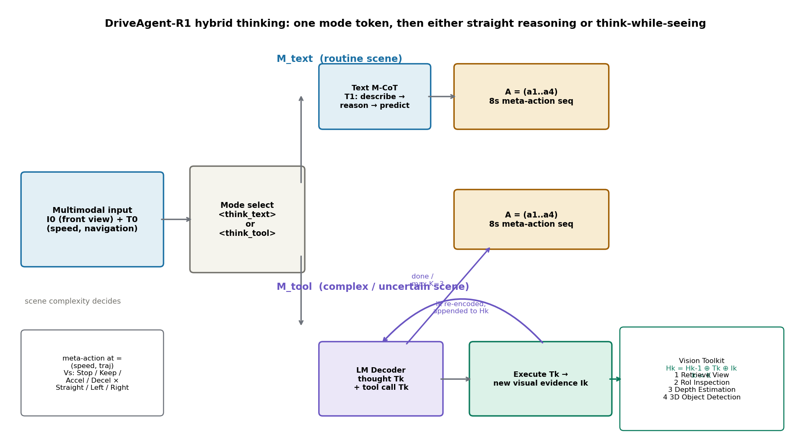
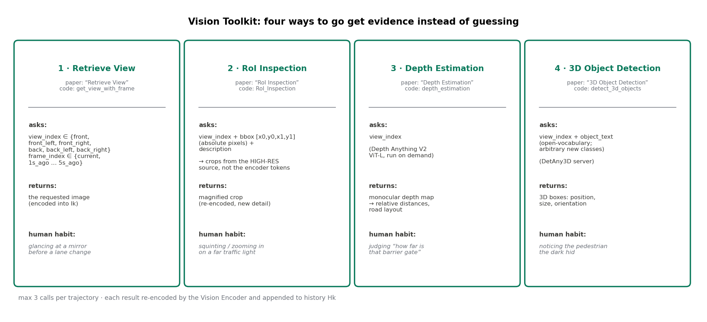
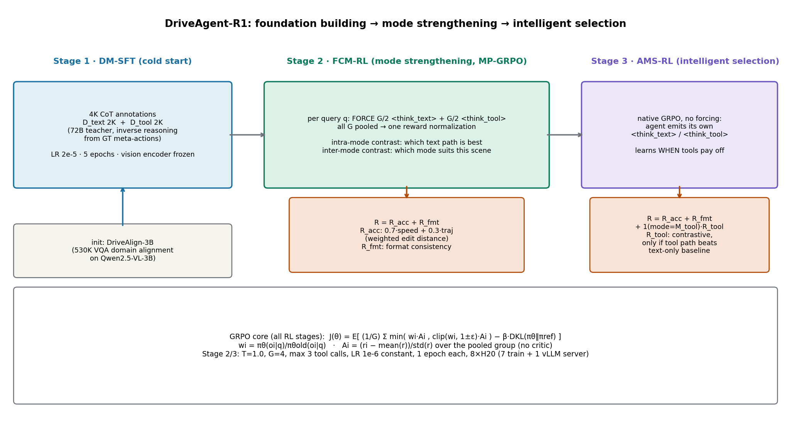
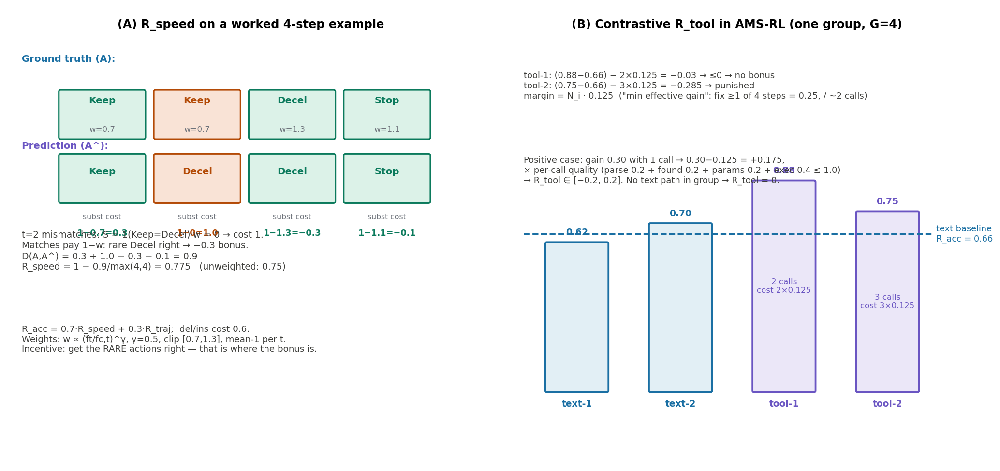

# 让 3B 小模型学会"先看清楚再下结论"：DriveAgent-R1 的主动感知与混合思考

> **信息块**
>
> - **标题（原文）**：DriveAgent-R1: Advancing VLM-Based Autonomous Driving with Active Perception and Hybrid Thinking
> - **作者**：Weicheng Zheng*, Xiaofei Mao*, Nanfei Ye, Pengxiang Li, Kun Zhan, Xianpeng Lang, Hang Zhao（* 共同一作；单位：上海期智研究院、理想汽车、同济大学、清华大学）
> - **会议**：ICLR 2026（arXiv:2507.20879，v3 为终版，2026-04-20；v1 2025-07-28）
> - **链接**：https://arxiv.org/abs/2507.20879 · 项目页 https://tsinghua-mars-lab.github.io/DriveAgent-R1/
> - **代码**：已公开，https://github.com/Zwc2003/DriveAgent-R1（含训练代码 tool-rl、DetAny3D 检测工具、Depth-Anything-V2 深度工具；训练好的 3B 模型权重标注为 pending company approval，尚未发布）。注：本机 git clone 完整仓库因网络吞吐多次超时，code/ 目录下保留了逐文件拉取的关键代码（三阶段训练脚本、grpo.py 奖励函数、vllm_grpo_trainer_modified.py 训练器、tools/ 工具实现、README），论文与代码的对照均基于这些文件核实。
> - **一句话核心洞见**：工具调用本身不值钱，值钱的是"什么时候值得花代价去看"这个决策——三阶段训练（尤其是 MP-GRPO 把两种思考模式的样本倒进同一个池子做归一化）就是让一个 3B 小模型在"看"与"不看"之间学会算账。

---

## 给 3B 模型递上工具，它反而考砸了：工具为什么是双刃剑

先看一个反直觉的数字。论文表 1 里，Qwen2.5-VL-3B 在 Drive-Internal 测试集上做 8 秒元动作规划：不给工具，首帧联合准确率 24.06%；给了视觉工具箱，反而掉到 23.64%。7B 版本更惨：27.58% 掉到 24.01%，掉了 3.57 个点。v1 版本的论文里这个数字更刺眼：3B 模型给了工具之后联合准确率掉了 42.1%（相对值）。

同一个工具箱交到 GPT-4.1 手里，首帧准确率从 39.99% 涨到 43.18%（+3.19）；交到 DriveAgent-R1（同样是 3B 参数，同一个 Qwen2.5-VL-3B 底座）手里，从 45.27% 涨到 51.34%（+6.07）。工具箱没变，变的是拿工具的手。

这个对比是整篇论文的起点，也是它最诚实的一张牌。作者没有把"工具增强"包装成一个无脑增益，而是先承认：工具调用是一个需要学习的高级技能。未经训练的模型拿到工具，会被工具返回的新信息带偏——多出来的图像、多出来的文本，把原本还能蒙对的推理搅乱了。论文 5 节的结论里有一句自我批评与此呼应：在复杂路口，agent 会过度信任工具返回的新证据，把行人红灯误认成自己的信号灯，推翻自己一开始正确的判断（附录 A.11 的失败案例）。

所以这篇论文真正要解决的问题不是"给 VLM 接工具"，而是两个更难的问题：第一，怎么让模型学会在**合适的时候**调工具（太早是浪费，太晚是添乱）；第二，怎么让模型在两种思考方式之间**自己选**——简单场景直接想，复杂场景再调工具。前者是 active perception（主动感知），后者是 hybrid thinking（混合思考）。论文的标题把两者并列，但读完全文会发现主动感知是赌注，混合思考是让赌注落地的工程手段。

*图 1：DriveAgent-R1 的混合思考架构。输入 I₀（前视图像）+ T₀（车速、导航指令）之后，模型先输出一个模式 token：<think_text> 走上面的直路，一次文本推理直达 8 秒元动作序列；<think_tool> 走下面的循环，每轮生成思考 Tₖ 和工具调用 Tₖ，工具返回的新视觉证据 Iₖ 被视觉编码器重新编码后拼进历史 Hₖ = Hₖ₋₁ ⊕ Tₖ ⊕ Iₖ，直到输出动作或达到上限 K=3。*

## 分辨率瓶颈：注意力再集中，也看不见被下采样吃掉的红灯

在讲工具箱之前，先回答一个读者一定会问的问题：为什么不用提示词让模型"仔细看"？比如加一句"请特别注意画面中央的红绿灯"。附录 A.13 专门做了这个对照实验，结论值得单独拎出来，因为它点破了被动感知范式的一个结构性缺陷。

标准的 VLM 把输入图像过一遍固定尺寸的视觉编码器，变成一串视觉 token。这个过程有下采样，高频细节在这个过程中就丢了。一个远处的红绿灯，在全局特征图里可能只占一两个 token，它的颜色信息在压缩时已经被抹平。文本指令"请注意红绿灯"只能在**已经压缩过的特征空间**里调整注意力权重——它能让模型多看那一两个 token，但那一两个 token 里本来就没有颜色信息，再怎么看也看不出来。

RoI Inspection 工具做的是另一件事：它回到**无损的原始图像**上，按模型给出的 bbox 裁一块高分辨率区域，重新编码。信息是新进来的，不是被重新加权的。论文把前者叫 attention on compressed features，后者叫 resolution amplifier（分辨率放大器）。数字上，在 Drive-Internal 测试集上，文本注意力提示把首帧准确率从 45.27% 提到 46.72%（+1.45），而主动 RoI 检查提到 48.81%（+3.54）。提示词有用，但上限不高，因为它突破不了信息论的界：丢掉的信息，靠"更用力地看"是找不回来的。

这个区分也解释了为什么作者坚持把工具做成"推理中途调用"而不是"输入前预处理"。预处理（比如把所有视角都拼进来）的问题在表 7 里：Passive-SV（被动输入六个环视视角）序列准确率 43.10%，而只允许用 Retrieve View 工具的 DriveAgent-R1（Retrieve View Only）拿到 44.39%。两者信息上限完全一样（同一个六视角池子），差别只在于是**按需取**还是**全量灌**。全量灌进来，冗余视角的噪声会稀释关键线索，还多花了 20% 以上的推理延迟（表 8：8.50s vs 6.74s）。

## 工具箱里的四件套：每一件都在补全局编码丢掉的那类信息

Vision Toolkit 有四个工具。论文附录 A.2 给了每个工具的调用格式，我对照代码仓库（`tool-rl/src/r1-v/src/open_r1/tools/base_tools.py`）核实了实现，发现论文里的工具名和代码里的函数名对不上——论文叫 "Retrieve View"，代码里叫 `get_view_with_frame`；论文叫 "3D Object Detection"，代码里叫 `detect_3d_objects`。功能一致，只是命名两套。下文用论文名，括号里标注代码名。

*图 2：Vision Toolkit 的四个工具。每个工具解决一类"全局编码看不清"的问题：Retrieve View 按需取视角（含 5 秒历史帧），RoI Inspection 回原始高分辨率图上裁放大，Depth Estimation 按需跑单目深度，3D Object Detection 开放词汇查 3D 框。*

**Retrieve View**（代码：`get_view_with_frame`）。参数是 `view_index`（六个视角之一）和 `frame_index`（"current" 或 "1s_ago" 到 "5s_ago"）。设计里最有想法的是那个 5 秒历史记忆池：以 1Hz 缓存所有视角过去 5 秒的图像。人类司机变道前会瞥一眼后视镜，确认后车距离；等红灯时会回想"刚才黄灯闪了没有"。这个工具就是把"回头看"做成可调用的：不用把连续视频帧全塞进上下文，只在需要判断动态趋势（信号灯变化、旁边车的运动方向）时取一帧。代码里有个细节：`view_index` 为 "front" 时"not recommended"，因为前视已经是默认输入，再取一次是浪费。

**RoI Inspection**（代码：`RoI_Inspection`）。参数是 `view_index`、`bbox`（绝对像素坐标 [x0,y0,x1,y1]）、`description`（一句话描述感兴趣区域）。这是四个工具里论文着墨最多的，也是 A.13 对照实验的主角。实现上有个关键细节：代码会**优先用高分辨率原图**——如果样本带了 `vid`，工具按 `vid` 拼出高分辨率图像在磁盘上的路径（`HIGHRES_IMAGE_ROOT/pre/back_view.jpg`），直接从原图裁；找不到才回退到上下文里的图像字典。这就是"分辨率放大器"的工程落地：bbox 坐标是模型在**低分辨率输入坐标系**下预测的（代码用 processor 动态算模型输入尺寸来校验 bbox），但裁图发生在**原始高分辨率**上。论文里那句"direct manifestation of the model's Inherent Localization Ability"（内在定位能力的直接体现）听着像公关腔，但机制本身是实在的：模型先在小图上框个大概位置，工具去大图上把那块抠出来重新编码。

**Depth Estimation**（代码：`depth_estimation`）。参数只有一个 `view_index`。后端是 Depth Anything V2（ViT-L，`depth_anything_v2_vitl.pth`），按需运行。补的是单目 2D 感知缺的那一维：自车和障碍物的相对距离、路面结构。论文图 12 的案例是过栏杆机：深度图先确认栏杆很近（减速），同时看到栏杆后面路面开阔（过了之后加速）——一个工具调用支撑了一个"先减速后加速"的两段式计划。

**3D Object Detection**（代码：`detect_3d_objects`）。参数是 `view_index` + `object_text`（开放词汇，比如 "barrier"）。后端是 DetAny3D（仓库里单开了一个目录，含 GroundingDINO 等依赖），以服务形式跑。开放词汇是关键：检测类别不是写死的，模型可以根据场景临场指定要找什么。论文图 11 的案例是夜间窄路：初始视角看到公交车但没看到黑暗中的行人，调 3D 检测把行人揪出来，计划从"减速直行"改成更谨慎的减速。

四个工具的上限是每条轨迹最多调 3 次（训练和推理一致）。3 次这个数不是拍脑袋：附录 A.5 推导单次调用成本 C_tool = 0.125 时，用的就是"中位数 2 次、范围 1–3 次"这个先验。

## 动作空间：8 秒 4 步的元动作，标签从轨迹里怎么长出来

DriveAgent-R1 不直接回归连续轨迹。它的输出是一个 4 步的元动作序列 A = (a₁, a₂, a₃, a₄)，每步管 2 秒，一共覆盖未来 8 秒。每步 aₜ = (sₜ, jₜ) 是两个 token 的组合：速度 token sₜ ∈ {Accelerate, Keep Speed, Decelerate, Stop}，轨迹 token jₜ ∈ {Straight, Right Turn, Left Turn}。4×3 = 12 种组合，每步 12 选 1。

为什么不直接让 VLM 回归轨迹点？论文引言里给的理由很实在：VLM 是在离散 token 上训练出来的，让它做连续物理量的回归，是用它的短板；让它做高层语义决策，是用它的长板。低层轨迹可以交给一个轻量执行器（3.3 节那个 MLP 运动头就是干这个的：输入元动作 one-hot + 视觉 token + 自车状态，输出未来 3 秒、2Hz 的路点）。

标签怎么来的？附录 A.7 写了一套"规则生成 + VLM 纠偏"的流水线，细节值得看，因为标签质量直接决定 RL 奖励能走多远：

1. **滑动窗口**：以当前帧为中心，窗口覆盖前后各一段（历史 1 秒 + 未来 2 秒，共 3 秒），每次往前滑 2 秒，滑 4 次，得到 4 个片段。
2. **纵向映射**：看窗口内的平均速度和加速度。速度 < 0.5 m/s → Stop；|加速度| > 0.3 m/s² → Accelerate/Decelerate；否则 Keep Speed。
3. **横向映射**：看片段起终点方向向量的夹角。< 15° → Straight；否则按符号分 Left/Right Turn（包括变道这种小角度修正）。
4. **双反馈调阈值**：0.5、0.3、15° 这三个数不是拍出来的，是拿 GPT-4.1 当裁判迭代调出来的——给 GPT-4.1 看 BEV 轨迹可视化 + 规则生成的标签，让它打一致性分数；同时人工抽查算错标率；两个目标一起优化到收敛。
5. **难例精修**：规则实在拿不准的边界 case，再喂给 GPT-4.1 做最后一遍修正。

这套流程的诚实之处在于它承认了纯规则的边界：运动学阈值能分清"停"和"走"，但分不清"路口前减速让行"和"堵车蠕行"在语义上的区别。VLM 纠偏补的就是这一层。

## 先有地基：DriveAlign-3B 的 530K 问答对在修什么毛病

三阶段训练开始之前，作者先干了一件"看起来跟 RL 无关"的事：拿 530K 个自动驾驶 VQA 问答对，把 Qwen2.5-VL-3B 全参数微调了一遍，得到 DriveAlign-3B，作为后面所有训练的统一初始化。

为什么要多此一举？论文 2.2 节点名了一个现象：**visual neglect**（视觉忽视）/ shortcut tendency（走捷径倾向）。好几个研究（Li et al. 2025c; Chen et al. 2025; Wang et al. 2025a）都观察到，通用 VLM 做驾驶规划时，会依赖低维度的文本线索（车速、导航指令），把高维的图像输入晾在一边。直觉上这不难理解：文本 token 又短又干净，图像 token 又长又 noisy，模型偷懒走文本捷径是损失函数默许的。

DriveAlign-VQA 的构造流水线（附录 A.3）是：100 万真实驾驶帧 → CLIP embedding 聚类保证场景多样性 → Qwen2.5-VL-72B 出题（70% 模板题 + 30% 自由出题，覆盖场景描述、交通实体识别、关键目标定位、交通常识四类）→ Doubao-Seed-1.6 当裁判逐条打分，只保留满分 → 再用 Doubao 改写问题增加语言多样性。最后 530K 对。

效果在表 4 和表 5 里。表 4：DriveAlign-3B 在自家 VQA 测试集上 84.6（+11.7，相对 3B 底座），8 个通用 VLM 基准平均 66.4（+2.0）——领域对齐没把通用能力搞坏。表 5 更有说服力：拿掉图像输入，基于 DriveAlign-3B 的 agent 序列准确率掉 15.8%，而基于原版 3B 的只掉 11.0%。掉得越多，说明它越依赖图像做决策——作者把"去掉图像后掉得多"当成"视觉接地"的证据，这个论证方向是对的，但要小心它的另一面：如果模型对图像的依赖里混进了对噪声的依赖，掉得多也可能是脆弱。我在怀疑式阅读一节会回到这一点。

## 三阶段训练：冷启动 → 分模式练强 → 学会自己选

*图 3：三阶段渐进训练。Stage 1 用 4K 双模式 CoT 数据冷启动；Stage 2 用 MP-GRPO 强制两种模式各生成 G/2 条轨迹、混在一起归一化算 advantage；Stage 3 去掉强制，让模型自己输出模式 token，用对比式工具奖励学会"什么时候调工具"。底座是 DriveAlign-3B。*

**Stage 1：DM-SFT（Dual-Mode SFT）冷启动**。目标是让模型先学会两种思考模式的**格式和语义边界**——什么时候该输出 <think_text>，什么时候该输出 <think_tool>，工具调用的文本格式长什么样。数据是 4K 条高质量 CoT（D_text 2K + D_tool 2K），来自附录 A.4 的三步自动流水线：

1. **必要性划分**：先用轻量的 Qwen2.5-VL-3B 跑一遍，M_text 模式下准确率 > 0.9 的样本划入 D_text（简单到不需要工具）；剩下的用 72B 裁判：只有在 M_tool 模式下相对 M_text 有明显提升的，才划入 D_tool（工具是真有用）。卡在中间的模糊样本不进 SFT，留给后面的 RL 做探索（D_explore）。
2. **模式内 CoT 标注**：72B 当老师，从**真值元动作反推**思考过程（inverse reasoning）。这个设计有讲究：让老师先知道答案再编推理，保证推理和最终动作自洽；再用一个独立的 judge 模型给每条 CoT 的逻辑一致性打分（s ∈ [0,1]），低于阈值 τ 的打回重写。另外有个 **Dynamic Tool Preference Guidance** 机制，防止 D_tool 里老师偏爱某一个工具（比如逢事就调 RoI），保证工具使用分布均衡。
3. **规则清洗**：格式标准化、内容纠错（最终预测和真值对不上就修）、工具调用归一化（限制调用频率、删冗余调用）。

训练超参数：v1 论文写的是 LR 2.0e-5、batch 256、78 个 iteration、vision encoder 冻结、cosine 退火；代码仓库的 `train_stage_1.sh` 写的是 LR 2.0e-5、5 epochs、per_device_batch 2、gradient_accumulation 4、max_seq_length 5120、packing、bf16、flash_attention_2。两处 batch size 对不上（256 vs 2×4×8=64），可能是 v1 到 v3 训练配置有调整，论文正文没更新——这是第一处论文与代码/旧版对不上的地方，记下来。

**Stage 2：FCM-RL（Forced Contrastive Mode RL）**。这是整个工作的算法核心，单独开一节讲。

**Stage 3：AMS-RL（Adaptive Mode Selection RL）**。去掉 Stage 2 的强制，模型自己生成开头的模式 token，自己选路。奖励函数在 Stage 2 的基础上加一项 R_tool，只在选了 M_tool 的轨迹上生效。这一节的重点在奖励设计里讲。

数据规模：D_explore 从 D_tool/D_text 之外采样 15K 条，保证每个时间步的动作分布均衡。RL 阶段采样温度 1.0（鼓励探索），评测时 0.7。组大小 G=4。每条轨迹最多 3 次工具调用。8 张 H20：7 张训练 + 1 张跑 vLLM 推理服务（在线生成 rollout）。LR 1e-6，constant schedule，各训 1 epoch。

## MP-GRPO：把两种模式的样本倒进同一个池子归一化，得到什么

先把 GRPO 的标准形式摆出来。DeepSeek-R1 带火的这个算法，核心改动是**不要 critic 模型**：对每个 query q，从旧策略采样一组 G 个输出 {o₁…o_G}，用组内奖励的均值和标准差算 advantage：

$$J_{GRPO}(\\theta) = \\mathbb{E}\\left[\\frac{1}{G}\\sum_{i=1}^{G} \\min\\left(w_i A_i,\\ \\text{clip}(w_i, 1\\pm\\epsilon)A_i\\right) - \\beta D_{KL}(\\pi_\\theta \\| \\pi_{ref})\\right]$$

其中 $w_i = \\pi_\\theta(o_i|q)/\\pi_{\\theta_{old}}(o_i|q)$ 是重要性采样比，$A_i = (r_i - \\text{mean}(r))/\\text{std}(r)$ 是组内归一化的 advantage。

拿一个小实例算一遍，感受一下"组内归一化"在干什么。设 G=4，四个输出的奖励 r = [0.8, 0.6, 0.9, 0.3]：均值 0.65，标准差约 0.22。Advantage = [0.68, −0.23, 1.14, −1.59]。注意奖励本身的绝对值不重要，重要的是**你在组里排第几**：0.9 分的输出 advantage 是 +1.14，会被推高概率；0.3 分的 −1.59，会被压低。GRPO 把"绝对分数"问题转化成了"组内排名"问题，这就是它不要 critic 也能 work 的原因——baseline 直接从组里来。

MP-GRPO（Mode-Partitioned GRPO）的改动只有一处，但很要害：**强制**每个 query 生成 G/2 条 <think_text> 开头和 G/2 条 <think_tool> 开头的轨迹（代码里 `force_tool_use = (j % 2 == 0)`，j 是组内序号，奇偶交替），然后把**全部 G 条倒进同一个池子**做奖励归一化和 advantage 计算。

为什么要强制？因为如果不强制，模型会迅速坍缩到当前更强的那个模式上。训练初期，M_text 一定比 M_tool 强（工具调用链长、格式容易错、返回的图像可能引入噪声），原生 GRPO 会发现"选 text 的奖励期望更高"，于是越来越不选 tool，tool 模式永远练不出来——这就是论文里说的"bias against an initially weaker thinking mode"。强制各生成一半，相当于给弱模式上了个"保护期"。

为什么要混在一起归一化，而不是两个模式各算各的 advantage？混在一起之后，advantage 同时携带两种对比信号：

- **intra-mode（模式内）**：两条 text 路径，哪个推理更好——练的是每个模式内部的执行质量；
- **inter-mode（模式间）**：tool 路径整体是不是比 text 路径好——让模型初步形成"这个场景适合哪种模式"的感觉，为 Stage 3 的自主选择打底。

如果分开归一化，每个模式内部排第一的 advantage 都是正的，模型就学不到"这个场景下 tool 模式整体不如 text 模式"这个跨模式信息。混在一起，一个场景下如果 2 条 tool 路径奖励是 [0.85, 0.80]、2 条 text 是 [0.50, 0.45]，归一化后 tool 全正、text 全负，梯度同时在说"tool 内部 0.85 比 0.80 好"和"这个场景就该用 tool"。这就是论文里 "multi-dimensional contrastive learning signal" 的实质。

表 6 的消融验证了这个设计的分工：Variant-2（只加 FCM-RL）在强制模式下更强（M_tool 44.30% vs Variant-4 的 43.78%，M_text 42.20% vs 41.64%）——FCM 练的是**执行**；Variant-4（只加 AMS-RL）的 MSA 更高（57.55% vs 56.64%）——AMS 练的是**选择**。两者级联（FCM→AMS）拿到 45.42% 和 68.52%，超过了单阶段训两倍 epoch 的对照（Variant-3/5）。这个"功能互补"的论证是干净的。

## 奖励函数：加权编辑距离在奖什么、罚什么

*图 4：(A) R_speed 的工作实例：4 步速度序列，真值 [Keep, Keep, Decel, Stop]，预测 [Keep, Decel, Decel, Stop]。权重按真值动作查（Decel 稀有 → 1.3），匹配项代价为 1−w（稀有动作答对给负代价，即 bonus），t=2 未匹配代价为 1。D = 0.9，R_speed = 0.775。(B) AMS-RL 里 R_tool 的对比机制：工具路径的准确率必须超过组内纯文本路径的平均，再扣掉每次调用 0.125 的成本，才有正奖励。*

Stage 2 的总奖励：R = R_acc + R_fmt。Stage 3 再加一项：R = R_acc + R_fmt + 1(mode=M_tool)·R_tool。逐项拆开：

**R_acc = 0.7·R_speed + 0.3·R_traj**。速度权重是轨迹的两倍多——论文的理由是"emphasize safety"（速度错了更容易出事）。R_speed 和 R_traj 都用同一个套路算：加权 Levenshtein 距离转相似度，R_seq = 1 − D(A,Â)/max(m,n)。

Levenshtein 距离在这里的含义：把预测序列变成真值序列最少要多少"编辑操作"。删除/插入代价 C_del = C_ins = 0.6，替换代价 C_sub = 1 − S。其中 S(â, a, t) = 1(â=a)·w_{a,t}：预测和真值在该位置**完全相等**才给分，分值是位置-动作权重 w。

权重 w 的设计是整套奖励里最细的一处，附录 A.5 给了完整公式，分三步：

1. 原始权重：w'_{c,t} = ((f̄_t + ε)/(f_{c,t} + ε))^γ，γ = 0.5。f_{c,t} 是训练数据里 t 时刻动作 c 的频率。直觉：某个时刻大家都在 Keep Speed（高频），Decel 稀有，分母小 → 权重 > 1。γ=0.5 是开平方，压一压极端值，别让权重飞了。
2. 裁剪到 [0.7, 1.3]。
3. 每个时刻归一化到均值 1：Σ_c w_{c,t}/|V| = 1。这一步保证加权不改变该时刻奖励的整体尺度——只调**动作之间的相对重要性**，不调时间步之间的。

图 4(A) 的实例算出了关键性质：**权重只奖励"把稀有动作答对"**。t=3 真值 Decel（w=1.3），预测对了，替换代价 1−1.3 = −0.3，是负的——答对稀有动作直接给 bonus，D 被往下拉。但注意这个设计的另一面：t=1 真值 Keep（w=0.7），预测对了，代价是 1−0.7 = +0.3——答对高频动作反而**加**了正代价。因为权重均值归一到 1，完美预测时 Σ(1−w_i) = 0，D=0，R=1，不受影响；但在不完美预测里，模型被推向"把稀有动作搞对"，代价是"高频动作答对的边际收益变低"。这正是作者想要的：数据里 Stop、Left Turn 这种关键少数派，平时被 Keep/Straight 淹没，模型容易学个"永远 Keep" 的偷懒策略。权重把偷懒的收益结构改了。

还要诚实地指出两处实现细节。第一，**训练时的匹配是精确匹配**，没有评估指标里的 Relaxed Speed Matching（评估时预测比真值"更安全一档"给 0.5 分、两档给 0.2 分；训练奖励里没有这个，â=a 才给分）。论文正文没强调这个差别，是我从代码 `speed_element_match_scorer` 里看到的（base=1.0 只在 `pred_speed == true_speed` 时）。第二，代码里 DP 的 base 行初始化用 `dp[i][0]=i, dp[0][j]=j`（按 1.0/单位），但 DP 递推里删除/插入代价是 0.6——base 和递推用的单位代价不一致。这是个小瑕疵，对 4 步等长序列（m=n=4 的主流情况）没影响，因为最优路径不会绕经 base 行；只在预测序列长度≠4 时有轻微扭曲。

**R_fmt**：格式一致性奖励。罚的是结构错误和模式误用（比如在 M_text 里调了工具）。代码实现是：think 标签 + meta actions 结构对上 → 0.4；description/reasoning/prediction 每出现一个 +0.2（上限 0.6）；三段都有且顺序正确 → 1.0；最后**整体乘 0.2**。所以 R_fmt 实际落在 {0, 0.08, 0.12, 0.16, 0.2}。论文正文写 R = R_acc + R_fmt，没提这个 0.2 的缩放——第二处论文与代码对不上的地方。影响是：格式奖励的最大值 0.2，相对 R_acc（0–1）是个小量级，模型不会为了凑格式牺牲准确率，这个缩放其实是合理的，只是没写进论文。

**R_tool**：对比式工具奖励，Stage 3 的核心，下一节单独讲。

## R_tool：一次工具调用要"赚回" 0.125 才算没白打

Stage 3 的 R_tool 只在模型**自己选了** M_tool 的轨迹上生效。它的逻辑是一句话：在**同一组** G 个输出里，算所有纯文本路径的准确率均值 R̄_acc^text（组里一条纯文本路径都没有 → 这一项直接置零，因为没法对比），工具路径的奖励是：

$$R_{tool} = (R_{acc,i} - \\bar{R}_{acc}^{text}) - N_i \\cdot C_{tool}$$

再裁到 [−0.2, 0.2]。C_tool = 0.125，N_i 是这条轨迹的工具调用次数。

这个公式的每一部分都在回答"什么时候调工具才划算"：

- **(R_acc,i − R̄_acc^text)**：工具路径必须**比同一题的纯文本路径做得更好**。注意比较对象不是全局 baseline，而是同一组、同一输入下的文本路径——这就把"题目难易"这个混杂因素消掉了。难题上大家都低，工具路径只要相对好就行；简单题上文本路径已经 0.9，工具路径得做到 1.0 才有正收益。
- **−N_i·C_tool**：每次调用固定扣 0.125。附录 A.5 讲了这个数的来历，推导过程值得复述因为它体现了一种"第一性原理定价"：4 步序列里纠正 1 个元动作 = 准确率涨 0.25，这是"主动感知值得出手"的最小有效增益；中位数调用 2 次分摊 → 0.25/2 = 0.125。调了 2 次工具，准确率涨不到 0.25，净收益就是负的。**工具调用在这里第一次有了明码标价**。
- **裁到 [−0.2, 0.2]**：防止某一组的极端差值主导梯度。

代码实现（`vllm_grpo_trainer_modified.py` 的 `_calculate_adaptive_tool_rewards`）比论文公式多了一层：adjusted_diff > 0 时，还要乘以 **individual_quality**——这条轨迹每次工具调用的平均"执行质量"。执行质量是工具调用当场打的分（`tools/utils.py` 的 `execute_tool_call`）：解析出工具调用格式 +0.2，找到这个工具 +0.2，参数校验通过 +0.2，执行成功 +0.4，满分 1.0。所以同样是"涨了 0.3 的准确率"，调用格式写得利索、一次成功的路径，拿到的 R_tool 比磕磕绊绊调了 3 次才成的路径高。这个乘法把"调得漂亮"和"调得有效"绑在了一起。

还有个 Stage 2 里就存在的配套机制：**模式不一致惩罚**。在 mixed（强制）模式下，被强制用 tool 却一次没调 → −0.2；被强制不用 tool 却调了 → −0.2。−0.2 和 R_tool 的裁剪上界一样大，说明作者把"听话"看得和"调得好"同等重要——SFT 冷启动的格式服从性，要在 RL 里用真金白银的负奖励守住。

训练动态上，R_tool 会塑造出一个可预期的行为：简单题上，文本路径已经接近它的极限，工具路径的 (R_acc − R̄_text) 很难超过 N·0.125，R_tool 期望为负 → 模型学会在简单题上选 <think_text>；长尾难题上，文本路径集体抓瞎，工具路径靠新证据拉开差距 → 选 <think_tool>。这就是"hybrid thinking"里"自适应"的全部机制——**没有一个分类器在判断场景复杂度，复杂度判断是从奖励差里长出来的**。

## 基线在哪一步失败：把图 14 和图 15 的三个模式放在同一个场景里走一遍

论文附录 A.10 的图 14 和图 15 是全篇最有教学价值的两张图：同一个场景，三个模式（M_text / 强制 M_tool / M_adaptive）各走一遍，失败点精确到步。我把场景还原成文字，方便在组会上讲。

**场景一（图 14）：复杂路口，远处一辆白车从交叉方向接近。**

- **M_text**：description 写"道路直、无障碍"，因为默认分辨率下远处的白车根本不在视觉 token 里。reasoning 基于"路况清晰"推出 Keep Speed。错在**第一步**：输入信息就不全，后面推理再严密也没用。这是被动感知的结构性失败——不是推理错了，是该看的东西没看到。
- **强制 M_tool**：模型被逼着调工具，但它没有"我要确认什么"的意图，调了一个泛泛的 front-left 视角。返回的图像里依然没有白车的特写，reasoning 还是基于模糊信息，最后减速但没做对（AC 2/10）。错在**意图缺失**：工具调用了，但调用的是"为了调用而调用"，没有指向不确定性的具体问题。
- **M_adaptive**：模型先识别出不确定性（"远处路口有东西但看不清"），主动选 <think_tool>，调 RoI Inspection 对准路口区域放大——白车出现了。grounding 之后的 reasoning 给出减速让行（AC 10/10）。

**场景二（图 15）：路况清晰，一辆白车正切入自车道，需要立即减速。**

- **强制 M_tool**：这回工具调用走向了反面。模型调了 3D Object Detection，但目标对准了一个不相干的交通标志。返回的一堆检测框把注意力从"正在切入的白车"上引开，最后输出 Keep Speed——在需要刹车的时候选择不刹车，这是三个模式里最危险的一次失败。错在**工具滥用**：不该调的时候调了，调的还是错的目标，噪声淹没了原本清晰的信号。
- **M_adaptive**：判断初始视觉上下文足够，直接选 <think_text>，注意力全在切入车辆上，正确输出减速。

两个场景合在一起，hybrid thinking 的必要性就不是口号了：M_text 在场景一翻车（该看没看），强制 M_tool 在场景二翻车（不该看瞎看），只有"自己决定看不看"的 M_adaptive 两个都过了。表 6 的 MSA（模式选择准确率）68.52% 就是在量化这个"选得对不对"的能力——定义是：对每个样本，哪个强制模式准确率高，哪个就是该样本的"最优模式"；自适应选择的模式和它一致的比例。

**还有一个基线失败值得单独说：Qwen 拿到工具反而变差**。表 1 里 3B/7B 的 w/ Tools 列全面低于 w/o Tools。机制上的解释是：工具返回的新图像和 <tool_result> 文本是**分布外输入**——底座模型在预训练里没见过"推理中途突然多出一张图"的格式，它的注意力会被新信息带偏，又没有 R_tool 这样的奖励告诉它"这次调用是赚是赔"。v1 论文里这个效应用"reasoning quality"指标量化过：给了工具，3B 模型的推理质量掉了 21.4%。这组数字是 DriveAgent-R1 做 RL 的最硬理由：**工具能力不是 prompt 出来的，是 reward 塑造出来的**。

## 和纯 SFT、纯提示工程的本质区别：前者记忆答案，后者探索策略

读者到这里可能会问：Stage 1 的 SFT 已经有 4K 条双模式 CoT 数据了，为什么还要折腾两阶段 RL？附录的消融给了直接答案：Variant-1（纯 SFT）在 Drive-Internal 上序列准确率 42.02%，加上两阶段 RL 后到 45.42%（表 6）。但数字之外，有个更本质的区别。

SFT 学的是** imitation**：72B 老师从真值反推出来的推理路径，学生照着背。学生背会的是"在**这个**场景下调 RoI 看红绿灯"，背不会的是"**什么样**的场景值得调工具"。D_tool 里 2K 条样本覆盖的长尾场景再多，也只是长尾分布上的点，学生学到的是点到点的映射。遇到训练没见过的长尾（比如附录里那只横穿的动物），SFT 模型没有"不确定时去看一眼"的通用策略——因为它从来没被奖励过"探索"这个行为本身。

RL（尤其是 Stage 3 的 R_tool）学的是**策略**：奖励不关心你调了哪个工具、推理文本写得漂不漂亮，只关心"调了之后是不是比不调好"。这是一个**结果导向**的信号，模型可以在 D_explore 的 15K 样本上自己试错，自己发现"路口场景调 RoI 经常赚，高速直行调深度图经常赔"。SFT 给的是"标准答案"，RL 给的是"算账的方法"。表 6 里 Variant-4（SFT+AMS-RL，不加 FCM）MSA 到 57.55%，超过纯 SFT 的基线，说明"什么时候调"的判断力确实可以从奖励里长出来，不需要老师一条条教。

和提示工程的区别在 A.13 已经讲透，这里补一句：提示工程（instruction-guided attention）的信息上限是**编码器已经压缩过的特征**，它的上限由信息论决定；RL 训练的工具调用的信息上限是**原始高分辨率图像**，它的上限由物理决定。一个在压缩域里做选择，一个在信息增量上做决策——这是两种不同的游戏。

还有一个常被忽略的区别：**RL 阶段模型在"在线"环境里和工具交互**。SFT 数据里的工具返回是 72B 老师标注时"演"出来的（静态数据）；RL 的 rollout 里，工具是真跑的（Depth Anything V2 真推理、DetAny3D 真检测），返回可能出错、可能超时。`execute_tool_call` 的 0.2/0.2/0.2/0.4 打分里，执行成功才给最后 0.4——模型在 RL 里学会了处理工具失败（比如 bbox 格式写错被退回），这是任何静态 SFT 数据都给不了的鲁棒性。

## 表 1 到表 8：数字逐个过一遍，看看每个声明的证据有多硬

**表 1（主结果）**。先看 DriveAgent-R1 自己的行：Drive-Internal 首帧 45.27 → 51.34（+6.07），序列 43.29 → 45.42（+2.13）；nuScenes 首帧 52.58 → 52.96（+0.38），序列 44.43 → 47.10（+2.67）。两个现象：第一，工具增益在 Drive-Internal（长尾场景多）远大于 nuScenes（常规场景多），+6.07 vs +0.38——工具的价值集中在长尾，这和"简单场景不调工具"的设计自洽。第二，首帧增益大于序列平均增益：工具解决的是**当前帧的不确定性**（红绿灯颜色、前车意图），对 6–8 秒后的动作帮助递减，合理。

再看"对标 GPT-5 和人类"的声明。Drive-Internal 首帧：DriveAgent-R1 51.34，人类 49.59，GPT-5 56.48——GPT-5 还领先 5 个点，"competitive"在这里是"接近但没超过"。nuScenes 序列：DriveAgent-R1 47.10，GPT-5 45.14，人类 48.24——这里确实超过了 GPT-5，接近人类。摘要里"competitive with GPT-5 and human drivers"的措辞是挑着说的：两个数据集、两个指标里各有胜负，摘要取了最好看的组合。诚实度 7/10，不算夸大，但读者要自己看表。

还有个评估设计细节：闭源模型是"no-thinking"模式下测的（官方 API，不让它们展开长推理，保证输出格式结构化）。这对 GPT-5 这类靠长思考的模型是不利的——相当于让短跑选手穿着皮鞋跑。作者的理由是格式一致性，但这个选择确实压低了闭源基线的上限。记下来。

**表 2（DriveBench）**。Perception 34.07，对 DriveLM 的 16.85 是翻倍；Behavior 43.69 第一。但 Prediction 32.85 低于 DriveLM 的 44.33——论文正文只字未提这一列。DriveBench 的 Prediction 测的是对其他交通参与者未来状态的预测，DriveAgent-R1 的工具箱全是**自车视角**的信息获取，没有"预测别人"的工具，短板在这里是结构性的。

**表 3（nuScenes 开环运动规划）**。MLP 头 + 冻结的 DriveAgent-R1，平均 ADE 0.28m，超过 DriveVLM-Dual 的 0.31m，碰撞率 0.14% 和最好的一档相当。这个实验的真正信息是：**高层元动作推理的质量可以向下传导**——一个只在高层语义上训练过的模型，配个 MLP 就能在低层轨迹上打平专门的端到端模型。VAD-Base 这类纯端到端在 ADE 上（0.37）反而落后，说明语义推理对轨迹精度的贡献是实的。

**表 6/图 4（渐进训练消融）**。关键对照是"单阶段训 2 epoch vs 两阶段各 1 epoch"：Variant-3（FCM×2）序列 43.89 / MSA 57.32，Variant-5（AMS×2）44.19 / 60.30，完整版（FCM→AMS）45.42 / 68.52。总 epoch 数一样，级联赢——说明赢的不是"练得久"，是"先分模式练强、再学选择"这个顺序本身。MSA 从 56.64（纯 SFT）到 68.52，每一步都在涨，没有哪一步是白加的。

**表 7（主动 vs 被动感知）**。Retrieve View Only（44.39）> Passive-SV（43.10）> Passive-FV（42.70）。"去掉图像后的相对跌幅"那一列（−7.2% → −9.5% → −12.6% → −15.8%）作者解读为"越主动越依赖视觉"，论证成立，但有个反例藏在 A.11：失败案例里 agent 恰恰是因为**过度**依赖新视觉证据，把行人红灯当成自己的灯——依赖视觉和正确利用视觉是两回事，跌幅大只能证明前者。

**表 8（效率）**。M_adaptive 延迟 6.74s、265.57 token；M_tool 7.91s、314.45 token；Passive-SV 8.50s、210.77 token。注意 Passive-SV 的 token 数最少（210.77）但延迟最高（8.50s）——因为 6 张图的视觉 token 编码是延迟大头，文本 token 反而便宜。这组数字把"效率"的真实构成说清楚了：省延迟主要靠**少看图**，不是少说话。以及，所有延迟都是 H20 单卡 batch=1 下 vLLM 测的，离车端部署还差得远（作者自己也承认这是"deployment-friendly"的方向，不是现状）。

## 七处论文没说透的地方（含三处论文与代码对不上的）

**1. 模式 token 的名字，论文和代码是两套。**论文通篇写 <think_text> / <think_tool>，代码（trainer + format_reward 的正则）里是 <think_with_tools> / <think_no_tools>。功能一致，命名不一致。推测是论文写作时做了"美化"，代码保留了早期命名。复现时以代码为准。

**2. R_fmt 被乘了 0.2，论文没写。**论文公式 R = R_acc + R_fmt，代码 `rewards.append(score*0.2)`。格式奖励实际最大值 0.2。这个缩放让格式项在总奖励里占小头，是合理的工程选择，但论文的公式读者会以为 R_fmt 和 R_acc 同量级。

**3. 位置-动作权重的 γ，论文写 0.5，代码默认 1.0。**`_build_pos_class_weights_from_freq` 的签名是 `gamma: float = 1.0`，而附录 A.5 写 γ=0.5。调用处用 `ScriptArguments.pos_class_gamma` 传入（metadata 写着"将频率转换为权重时的指数gamma"），训练脚本里没看到显式传值——如果用的是默认值 1.0，那实际训练的权重比论文描述的更激进（平方 vs 开方）。这是最值得作者澄清的一处。

**4. 编辑距离 DP 的 base 初始化与递推代价不一致。**`dp[i][0]=i, dp[0][j]=j` 按 1.0/单位初始化，递推里删除/插入按 0.6。等长序列不受影响，不等长时有轻微扭曲。小问题，但说明这块代码是"先写对大逻辑、细节没抠"。

**5. MSA 的"最优模式"定义有循环论证的风险。**m*_i 定义为"该样本下哪个强制模式准确率高"，MSA 衡量自适应选择与它的对齐度。但强制模式的准确率本身是**同一个模型**跑出来的——模型在 M_tool 下强，不代表 M_tool 是该样本的"真最优"，可能只是模型碰巧在 tool 模式下拟合得好。用模型自己的能力定义最优，再用最优评价模型的选择，这个指标的上界是被模型自身能力锁死的。更干净的做法是用人类标注"这个场景需不需要工具"，但成本高，作者没做。

**6. Drive-Internal 数据集和模型权重都不公开。**35K 长尾视频是理想汽车内部数据，论文的全部主结果都跑在上面；nuScenes 上的结果可复现，但核心的"长尾增益 +6.07"别人验不了。README 里模型权重标注 pending company approval。这意味着这篇论文目前是一个"方法可学、数字难验"的状态——三阶段训练的 recipe 是全的（代码+超参都在），但复现需要自己攒长尾数据。

**7. 人类基线只有 49.59%。**三位有两年以上驾龄的司机，在 Drive-Internal 上首帧联合准确率 49.59%。这个数字首先说明任务本身极难（4 步×12 种组合，精确匹配才算对， relax 机制只给更安全的预测部分分）。但也说明"接近人类水平"的含金量要打折扣：人类司机看单帧前视图+车速+导航指令做 8 秒规划，本来就不是人类擅长的任务（人类开车靠连续反馈，不是靠单帧开环预测）。把开环单帧预测的准确率当"驾驶水平"，这个评价范式本身就有利于"背下数据分布"的模型。

## v1 到 v3：从 CVPR 投稿到 ICLR 录用，审稿人改了什么

版本历史：v1（2025-07-28，5.2MB）→ v2（2025-09-26，13.9MB）→ v3（2026-04-20，20.6MB，ICLR 终版）。我把 v1 的源码（arXiv e-print）和 v3 逐节对照，变化最大的几处：

- **投稿目标变了**：v1 用的是 cvpr.sty 模板（CVPR 投稿），v3 是 ICLR 终版。时间线上 v1 是 2025 年 7 月，正好赶上 CVPR 2026 投稿周期；转投 ICLR 后中了。
- **对标对象换了**：v1 摘要里对标的是 Claude Sonnet 4（"outperforming even leading proprietary models such as Claude Sonnet 4"），v3 换成了 GPT-5 + 人类司机。v1 的表里 3B 模型给工具后掉了 42.1%（相对值），v3 改成了绝对百分点表述。基线阵容从"Anthropic 系"换成"OpenAI 系+人类"，推测是审稿人要求更强的 baseline。
- **新增实验**：v3 多了 DriveBench 对比（表 2）、MLP 运动规划头（表 3，3.3 节）、A.13 的"主动感知 vs 指令引导注意力"对照实验、A.11 的失败案例分析、A.12 的动态模式切换序列。这些全是"审稿人会问"的标准问题：和现有 agent 比怎么样？高层推理能落地到轨迹吗？和 prompt baseline 的区别？失败案例呢？v2 到 v3 的体积翻倍（13.9MB→20.6MB）主要是附录里塞了大量定性可视化（图 8–19）。
- **核心方法没变**：三阶段训练、MP-GRPO、奖励公式从 v1 到 v3 基本稳定。说明审稿人认可了方法，改的是证据的完整度。这是个好信号：方法的"承重结构"在第一版就立住了。

## 带走的想法

这篇论文留下的最可迁移的东西，不是四个工具，也不是三阶段这个具体数字，而是一个**设计模式**：当你想让模型学会"按需获取信息"时，别去教它"什么场景调什么工具"（那是 SFT 的思路，教的是点），而是给"信息"定价，让模型在奖励里自己算账（教的是算账的方法）。R_tool = (acc_gain) − N·0.125 这个公式的形状是通用的：增益项用**组内对比**消掉题目难度，成本项用**最小有效增益**做先验定价，裁剪防极端值。这套形状搬到任何"调用外部资源有代价"的 agent 场景（检索、代码执行、仿真器调用）都能用。

第二个可迁移的点是 MP-GRPO 的"强制+混合归一化"。多模式/多策略的 agent 训练里，弱策略被强策略饿死是通病。解法不是调 loss 权重，而是**在采样层面强制配额、在归一化层面混合对比**：配额保住弱策略的训练机会，混合归一化让 advantage 同时说清"策略内谁好"和"策略间谁更适合这个输入"。这个技巧和具体任务无关。

第三个是作者诚实面对的那个失败：**主动感知会放大"看错"的代价**。A.11 里 agent 把行人红灯当成自己的灯，推翻了正确的初始判断。工具给了模型"第二次看的机会"，但也给了它"第二次犯错的机会"，而且第二次的错误更难纠正——因为新证据在推理链条的下游，天然有权重优势。任何做主动感知的系统都要回答：当新证据和旧判断冲突时，信谁？这篇论文把问题摆出来了，没解决，留给了 future work。这是它最有价值的未竟之处。

最后回到那个 3B 的数字。一个 3B 模型在长尾驾驶规划上摸到 GPT-5 和人类的边，靠的不是参数，是**把"何时看"这个决策本身变成了可学习、可定价的行为**。在"大力出奇迹"之外，这是一种"把小模型的每一分算力花在刀刃上"的工程哲学——对做端侧部署的人，这个哲学比这篇论文的具体数字更值得带走。
