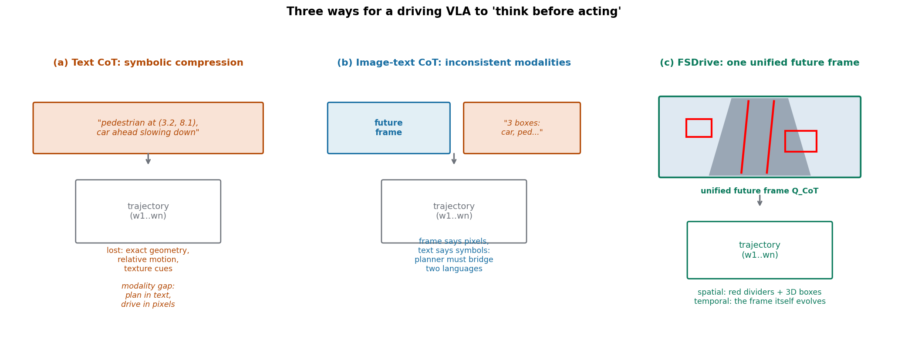
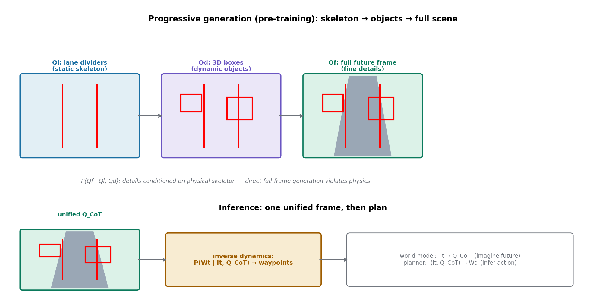
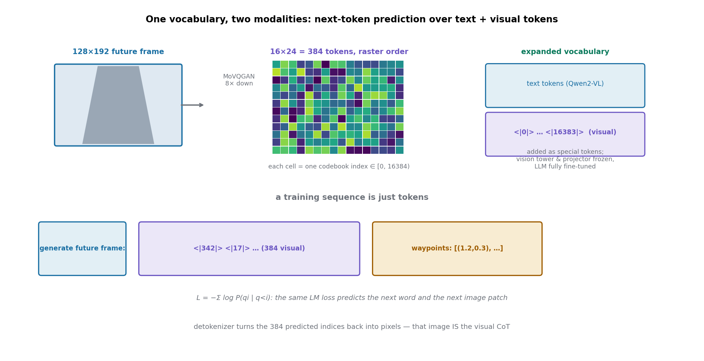

# 别把未来翻译成文字，直接把未来画出来：FSDrive 的视觉时空思维链

> **信息块**
>
> - **标题（原文）**：FutureSightDrive: Thinking Visually with Spatio-Temporal CoT for Autonomous Driving（框架名 FSDrive）
> - **作者**：Shuang Zeng*（西交，实习于高德）, Xinyuan Chang, Mengwei Xie, Xinran Liu, Yifan Bai, Zheng Pan, Mu Xu, Xing Wei†, Ning Guo（* 实习期间完成；单位：西安交通大学、阿里高德、达摩院）
> - **会议**：NeurIPS 2025 Spotlight（arXiv:2505.17685，v3 为终版，2025-11-11；v1 2025-05-23）
> - **链接**：https://arxiv.org/abs/2505.17685
> - **代码**：已公开，https://github.com/MIV-XJTU/FSDrive（833 stars；含 LLaMA-Factory 训练框架、MoVQGAN、数据构造脚本、评测与可视化工具；未发布训练好的模型权重）
> - **一句话核心洞见**：VLA 的"思考"不该是把图像压缩成文字再推理，而应该是先在像素空间里把未来"画"出来、再看着这幅想象出来的未来图做决策——一张统一未来帧同时装下空间结构（红车道线+3D 框）和时间演化（帧本身），就是全部的思维链。

---

## 先看一个尴尬的对比：7B 的生成式 VLA，为什么在规划上输给了 2B

Doe-1（arXiv:2412.09627）和 FSDrive 是同一条赛道上的两个选手：都想让 VLA 拥有"生成未来"的能力，都拿 nuScenes 做开环轨迹规划。Doe-1 的底座是 Lumina-mGPT 7B，一个正经的视觉生成大模型；FSDrive 的底座只是 Qwen2-VL-2B。按参数量，Doe-1 本该占优。

论文表 1 的数字反过来了（无 ego 状态，ST-P3 / UniAD 两套指标）：L2 平均误差，FSDrive 0.53 / 0.96，Doe-1 0.70 / 1.26；碰撞率，FSDrive 0.19 / 0.40，Doe-1 0.21 / 0.53。2B 赢了 7B，而且是在人家更擅长的"生成"这个维度所支撑的任务上赢的。

作者的解释一针见血：Doe-1 用的 VQ-VAE 离散视觉 token 缺乏语义信息（Show-o、VILA-U 等工作都报告过这个问题），生成能力是有了，理解能力掉了——拿生成换理解，是一笔亏本买卖。FSDrive 的赌注是另一条路：**不动 MLLM 的架构**（ViT 编码器、理解能力原样保留），只把 VQ-VAE 的码本"借"进来扩进词表，用极小的数据量（自称此前方法的 0.3%）把"画图"的能力激活出来，理解和生成两手都要。

这个赌注背后有一个更大的判断：自动驾驶 VLA 的推理，不该学 LLM 的"文字思维链"，而该学人类司机的"视觉想象"——司机变道前脑子里过一遍的不是一句话，而是一幅动态的画面。论文引言里那句反问（"should their thinking process more closely resemble simulation and imagination of world, rather than merely relying on logical deduction of language?"）是全文的文眼。

*图 1：三种 CoT。(a) 文本 CoT 把视觉信息做有损符号压缩，精确几何和相对运动在转成文字时就丢了；(b) 图文混合 CoT 让规划器同时读两种语言，模态不一致；(c) FSDrive 的视觉时空 CoT：一张统一未来帧，空间关系画在红车道线和 3D 框里，时间关系就藏在"帧本身是未来"这一点里。*

## 文本 CoT 到底丢了什么：一次具体的符号压缩

"符号压缩造成模态鸿沟"这句话在论文里出现了好几次，值得把它落到一个具体例子上。假设当前帧里，一个行人站在右侧路缘，前车在 8 米外减速，刹车灯亮起。

文本 CoT 会写成："pedestrian at (3.2, 0.5), vehicle ahead decelerating"。这句话丢了什么？第一，**空间关系的精度**：(3.2, 0.5) 是个点，但行人的朝向、身体姿态（他是面向马路还是背对？）、他和路缘的距离——这些决定他会不会突然迈出来的信息，在坐标化之后就没了。第二，**时间关系的连续性**："decelerating"是个离散标签，但前车是"轻点刹车"还是"急刹"，减速度的曲线长什么样，文字给不出。第三，**细粒度视觉线索**：刹车灯的亮度、前轮的角度、路面的反光，这些像素级的东西根本进不了词表。

更深一层的问题是：规划器最后输出的是**连续轨迹**（BEV 下的路点坐标），它的输入如果是文字描述，模型要在内部做一次"文字→空间"的反变换。这个反变换是没有监督的——训练信号只在最后的轨迹误差上，中间那步"把 (3.2, 0.5) 还原成空间关系"靠模型自己悟。这就是论文说的 modality gap：感知活在像素里，规划被迫用文字想，最后输出又回到空间。

图文混合 CoT（比如 EMMA 那种"未来帧 + 文本感知结果"）也没解决问题：帧是像素语言，感知结果是符号语言，规划器要同时做两种语言的对齐，跨模态转换的语义损失还在，只是换了个地方。

FSDrive 的回答是：**别转换了，直接在像素里想**。思维链本身就是一张图。

## 统一未来帧：一张图里装下空间和时间

视觉时空 CoT 的具体形态是一张"统一未来帧"（unified future frame），128×192 分辨率。它用两种视觉元素分别编码空间和时间：

- **空间**：画在帧上的**红色车道线**和**红色 3D 检测框**。车道线是静态骨架，定义可行驶区域；3D 框是动态关键物体的位置、尺寸、朝向。这两个都是"粗粒度"的——不需要像素级精确，但必须物理上合理（框不能画在天上，车道线不能穿过建筑物）。
- **时间**：帧本身。这一帧是**未来**（代码里是 0.5 秒后，`create_data/pretrain_data.py` 从 sweeps 里按时间戳找 0.5 秒后的 CAM_FRONT），画面内容相对当前帧的动态变化——前车近了、行人挪了——直观地刻画了时间的演进。

这个设计的巧妙之处在于它把"感知输出"和"世界预测"统一成了**同一个表示**：传统管线里，感知输出是框和线（符号），世界模型输出是未来帧（像素），规划器要融合两者；这里框和线直接画进未来帧，规划器只需要读一张图。论文管这叫"end-to-end visual reasoning pipeline"，名字起得大，但机制是实在的：**把融合做在像素空间，而不是特征空间**。

## 渐进生成：先画骨架，再画物体，最后补细节

直接让模型一张一张生成完整未来帧，会出什么问题？论文引用了 VLIPP 等工作的观察：**违反物理规律**——车画在人行道上、车道线扭曲、物体凭空消失。为什么？因为自回归生成是逐 token 往下写的，模型在写第 300 个 token 时，早就忘了第 10 个 token 定的车道走向；局部纹理的似然和全局物理结构之间没有约束通道。

FSDrive 的解法是"由易到难"的渐进生成，公式 (5)：

$$P(Q_f \\mid Q_l, Q_d) = \\prod_{i=1}^{h\\cdot w} P_\\theta(q_i \\mid q_{<i}, Q_l, Q_d)$$

训练时，模型先生成车道线的视觉 token 序列 Q_l（静态骨架：路在哪、能开的地方在哪），再生成 3D 框的 token 序列 Q_d（动态物体：谁在哪、朝哪），最后才生成完整未来帧 Q_f——而且生成 Q_f 时，Q_l 和 Q_d 作为**条件上下文**一直放在前面。几何直觉：先定骨架，细节就有了锚点；模型在画第 300 个 token（比如一辆车的前保险杠）时，前面 Q_d 里那个 3D 框还在上下文里按着它，不让它画飞。

*图 2：预训练时的渐进生成。Q_l 定静态骨架（可行驶区域），Q_d 定动态物体，Q_f 在前两者约束下补全细节。推理时为了效率不再分三步走——模型直接生成一张已经"长"好了红线框的统一帧，再基于它规划轨迹。*

推理时为了效率不再分三步：模型直接生成**一张**统一帧（红线框已经画在上面了——这是渐进预训练教会的"一次成型"能力），然后基于当前观测 + 这张未来帧规划轨迹，公式 (6)：

$$P(W_t \\mid I_t, Q_{CoT}) = \\prod_{i=1}^{n} P_\\theta(w_i \\mid w_{<i}, I_t, Q_{CoT})$$

论文把这两个角色命名为 **world model**（I_t → Q_CoT，想象未来）和 **inverse dynamics model**（(I_t, Q_CoT) → W_t，看着未来反推动作）。"逆动力学"这个词是借来的：正向动力学是"状态+动作→下一状态"，逆动力学是"当前状态+未来状态→动作"。这里的翻转在于：未来状态不是观测到的，而是**想象出来的**；规划器做的就是"为了到达我想象的那个未来，我现在该怎么走"。这个命名有点浪漫，但它准确地抓住了和传统"感知→规划"管线的区别：传统管线从**现在**推出未来，这里的规划器从**想象的未来**倒推现在该做什么。

## 词表扩张：给 MLLM 接上"画图"能力最便宜的办法

*图 3：实现机制。(1) MoVQGAN 把 128×192 未来帧 8 倍下采样成 16×24=384 个离散 token；(2) LLM 词表扩进 <|0|>…<|16383|> 共 16384 个视觉特殊 token；(3) 训练就是普通的 next-token 预测，文本 prompt、384 个视觉 token、路点文本排成一个序列，同一个 LM loss 一起优化。*

技术实现上，这是全文最"工程"也最值得细看的部分。分四步：

1. **离线 token 化**：用预训练好的 MoVQGAN（270M，码本 16384）把 nuScenes 的未来帧（resize 到 128×192）编码成离散 token，存成 `gt_indices_*.json`。注意**token 化是离线一次做完的**，训练时 LLM 看到的直接是 `<|342|><|17|>…` 这样的 token 串，不是在线过 VQ-VAE。这个选择把训练管线简化成了纯文本训练——LLaMA-Factory 都不用改模型代码。
2. **词表扩张**：`configs/sft.yaml` 里 `new_special_tokens` 从 `<|0|>` 一直加到 `<|16383|>`。LLM 的 embedding 矩阵多了 16384 行，LM head 多了 16384 列，除此之外**架构零改动**。
3. **冻结与微调**：vision tower（ViT 编码器）和 multimodal projector 冻结，只全量微调 LLM 参数。理解能力的载体（ViT 特征）不动，生成能力长在 LLM 的新词表行上——这就是"不伤理解"的工程保证。预训练 32 epoch、LR 5e-4；SFT 12 epoch、LR 1e-4（论文正文里这两处数字排版乱了，"12 −4 epochs"和"1×10 learning rate"，以代码 config 为准）。
4. **混合序列训练**：一条训练样本就是"文本 prompt + 384 个视觉 token + 路点文本"，loss 是普通的自回归 LM loss（公式 2/4）。**预测下一个词和预测下一块图像，用的是同一个 loss、同一套参数**——"统一"在这里不是口号，是字面意义。

"0.3% 数据"这个数字要拆开看：论文说此前方法（Janus 等）用 1 亿量级数据从头训练，他们只用了约 20 万（表 7：~200k）。但这个对比有个类别上的不对等——Janus 是通用图文大模型，FSDrive 是驾驶域专用；拿域内 20 万对比通用 1 亿，省数据的功劳里有一部分是"任务变窄了"。更诚实的表述是：**站在现成 MLLM 的肩膀上激活生成能力，不需要从头训练**——这个结论本身是硬的，表 7 的 FID 从 29.4（无预训练）降到 10.1 就是证据。

## 表 1 到表 7：数字逐个过一遍

**表 1（nuScenes 开环规划）**。作者同时报了 ST-P3 和 UniAD 两套计算口径（两家算 L2/碰撞率的方式不一样：UniAD 按每个时间步算，ST-P3/VAD 按之前所有步的平均），这个"双口径"报告是诚实的，避免了挑口径。无 ego 状态下，FSDrive（Qwen2-VL-2B）对 Doe-1：L2 0.53 vs 0.70、0.96 vs 1.26，碰撞 0.19 vs 0.21、0.40 vs 0.53——四个数全赢。有 ego 状态（FSDrive*）也超过了同用 ego 的 SOTA。换 LLaVA-7B 底座同样 work（L2 0.60/1.09），说明方法不绑死某一个 MLLM。

但要注意表 1 里非自回归的传统方法（VAD*、UniAD*、BEV-Planner*）在**用 ego 状态**时 L2 能到 0.35–0.46，比 FSDrive* 的 0.28–0.45 是一个量级。作者引用 BEV-Planner 的发现（ego 状态带来虚高的提升），主动把"无 ego"作为主比较口径——这个选择值得肯定，因为开环评测里 ego 状态（当前速度、加速度）是最强的"作弊"特征之一。

**表 2（NAVSIM）**。PDMS 85.1，超过 LAW 的 84.6 和 PARA-Drive 的 84.0。NAVSIM 采用非反应式仿真做评测，比纯开环 L2 更接近真实驾驶。分项看：NC（无碰撞）98.2、DAC（可行驶区域）93.8、TTC 93.3、舒适度 99.9 都是最高一档，EP（ego progress，行驶效率）80.1 相对弱一点——**安全分拉满，效率分平平**，这和"视觉 CoT 让模型更保守"的直觉一致：想得越远，越不敢激进。

**表 3（生成质量 FID）**。FSDrive 10.1，GEM（扩散模型）10.5，Doe-1 15.9。注意**分辨率**那一行：FSDrive 是 128×192，GEM 是 576×1024，Doe-1 是 384×672。FID 对分辨率敏感——低分辨率图像天然更容易拿到低 FID（细节少，出错空间小）。把 128×192 的 10.1 和 576×1024 的 10.5 并列比较，是这张表最大的阅读陷阱。诚实的读法是：**在 128×192 这个分辨率下**，自回归的 FSDrive 打平了扩散模型 GEM 在高分辨率下的水平，且远超同为自回归的 Doe-1（15.9）。"competitive"成立，但"超越扩散模型"不成立。

**表 4（DriveLM 理解）**。Final Score 0.57 vs OmniDrive 0.56、SimpleLLM4AD 0.53。0.01 的优势——"advancing scene understanding"的说法有点满。更准确的表述是：**加了生成能力之后，理解能力没有掉**（对比 Doe-1 那种掉了理解的），还蹭了 0.01。这张表真正的价值是"无害证明"，不是"提升证明"。

**表 5（预训练消融）**。纯 VQA 预训练"negligible effects"（作者原话，诚实）；未来帧生成预训练带来 L2 −16.4%、碰撞 −15.8%——**世界模型预训练是最大的单一增益**；3D 检测和车道线预训练"moderate gains"。这张表其实回答了"渐进三步里哪步最值钱"：Q_f（未来帧）最值钱，Q_l/Q_d 是锦上添花。

**表 6（CoT 消融）**。L2 变化都不大（0.96–0.98），但**碰撞率**分化明显：无 CoT 0.40 → 文本 CoT 0.53（相对 −8.6%？注意论文写的是"8.6% improvement"，基数是 0.58→0.53）、图文 CoT 0.50（"insignificant gains"）、视觉时空 CoT 0.40（−31%）。L2 不动、碰撞率大动——说明视觉 CoT 改善的不是"轨迹拟合精度"，而是"对未来碰撞风险的预判"。这个分化恰恰是"想象未来→避险"机制的证据：它让你在该刹车的地方刹车，而不是让整条轨迹更贴合真值。

**表 7（生成消融）**。无预训练 29.4 → 100k 数据 16.2 → 200k 数据 12.7 → +渐进方法 10.1。数据量和渐进方法各自独立贡献，曲线单调，没有反转——干净。

**图 3 的定性实验**值得单独说：给模型**错误的导航指令**，但规划时仍用正确指令做 CoT，结果模型靠"看未来帧"纠正了错误指令，避免了偏航和碰撞。这是"逆动力学"最生动的展示：规划的依据是**观测到的未来**，而不是**听到的指令**。但这只是一个 cherry-picked 的例子，论文没有量化"指令错误鲁棒性"这个指标，读者不要把它当成普适结论。

## 六处论文没说透的地方

**1. 红线框的真值是怎么画出来的，代码里没有。**这是全文最大的论文/代码 gap。论文 3.3 节说统一帧上画着"红色车道线和 3D 检测框"，3.2 节说预训练时先生成 Q_l（车道线 token）再生成 Q_d（3D 框 token）。但仓库里 `MoVQGAN/sft_data.py` 和 `MoVQGAN/pretrain_data.py` 都是**直接把原始未来帧编码成 token**，没有任何"把标注投影到图像上画红线"的步骤；`create_data/` 里也只有未来帧预测和 SFT 数据脚本，没有 Q_l/Q_d 的数据构造脚本。也就是说，**渐进预训练里最关键的"物理先验"数据是怎么造的，开源代码里没有**。复现者需要自己写：把 nuScenes 的地图标注和 3D 框投影到前视相机、画红、再 token 化。论文的方法描述是完整的，但代码只开源了"最小可跑"的部分。

**2. FID 表的分辨率陷阱。**上面表 3 一节讲过了：128×192 的 10.1 和 576×1024 的 10.5 不能直接比。作者把分辨率写在表里了，没有藏，但也没有提醒读者这个可比性问题。严格的比较应该把所有方法统一到同一分辨率下测。

**3. "逆动力学模型"的命名是借来的，不是字面意义。**控制论里的逆动力学模型是从（状态、下一状态）到动作的**显式映射**，通常有明确的物理结构。这里的"逆动力学"只是一个比喻：以想象的未来为条件输出轨迹。比喻是贴切的（确实是从未来反推现在），但读者如果按字面去找"动力学"，会找不到。

**4. 只生成前视。**Limitation 里作者自己承认了：为了实时效率，只生成前视未来帧。环视的统一帧（6 个视角 × 384 token = 2304 个视觉 token）对自回归生成的延迟是灾难性的。这是视觉 CoT 目前最硬的工程约束：**想得越全，算得越慢**。DriveAgent-R1 用"按需调工具"绕开了这个问题，FSDrive 用"只看前面"绕开了——两条路都没真正解决。

**5. 0.3% 数据的对比口径。**200K（驾驶域）vs 100M（通用图文）——分母是 Janus 这种通用模型的训练量。这个数字的修辞效果大于科学含义。真正有信息量的对比在表 7 内部：200K vs 100K vs 无预训练，FID 单调下降——**在域内，数据量翻倍仍有增益**，说明 200K 还没到性能平台期，"minimal data"更多是"够用"，不是"最优"。

**6. 实现细节在正文里排版乱了，以代码为准。**4.1 节的"12 −4 epochs"和"1×10 learning rate"是 PDF 转换 artifact；`configs/pretrain.yaml` 写的是 32 epochs / LR 5.0e-4，`configs/sft.yaml` 是 12 epochs / LR 1e-4。另外论文说"fully fine-tune the LLM parameters while freezing all encoders"，config 里 `freeze_vision_tower: true`、`freeze_multi_modal_projector: true`、`finetuning_type: full`——对得上。

## v1 到 v3：曾用名 DriveCoT，NAVSIM 是录用后加的

版本历史：v1（2025-05-23）→ v2（2025-10-29）→ v3（2025-11-11，NeurIPS 终版）。对照 v1 的源码：

- **曾用名**：v1 的 tex 里注释掉了一行 `\title{DriveCoT: Visual Chain-of-Thought Reasoning with Unified Future Generation for Autonomous Driving}`——这篇论文差点叫 DriveCoT。改名可能是为了避开当时已有的 DriveCoT 相关工作（重名在审稿时是减分项）。
- **NAVSIM 是 v2/v3 加的**：v1 全文 0 处提到 NAVSIM，v3 有了完整的表 2（PDMS 85.1）。NeurIPS 投稿是 2025 年 5 月，v2 是 10 月底——NAVSIM 实验是**录用后**补的 camera-ready 加强。说明审稿人对开环 nuScenes 评测不太满意（开环 L2 在领域内公认有 ego-status 作弊和分布偏移问题），作者用 NAVSIM 的仿真评测补了一块证据。
- **核心方法从 v1 起就没变**：统一预训练、渐进生成、视觉时空 CoT 的公式和结构在 v1 里已经齐了。v1 到 v3 的变化全是证据侧（NAVSIM、更多的定性图），方法侧零改动——和 DriveAgent-R1 一样，承重结构在第一版就立住了。

## 带走的想法

第一个可迁移的想法是**词表扩张这个动作本身**。想给一个现成的 MLLM 加一个新模态，最便宜的路不是改架构、不是加 adapter，而是把新模态的离散 token 直接扩进词表，然后全量微调 LLM。FSDrive 证明了这条路在"理解不掉、生成激活"上是走得通的，代价只是 16384 行 embedding 和 20 万条域内数据。这个模式搬到任何"LLM + 新模态"的问题上都成立：先离散化，再扩词表，最后用 LM loss 一起训。它的前提是新模态能被合理离散化（VQ-VAE 这类），以及你有一个现成的强 MLLM 当底座。

第二个是**先骨架后细节的渐进生成**。P(Q_f|Q_l,Q_d) 这个条件结构，本质上是在自回归生成里**手工植入一个 coarse-to-fine 的归纳偏置**：物理结构（车道线、物体位置）是低频、全局、难错的；纹理细节是高频、局部、易错的。让难错的东西先进上下文，按住易错的东西。这个思想不只适用于驾驶：任何"生成结果要满足物理/结构约束"的任务（分子生成、版图布局、建筑平面图），都可以先生成约束的显式表示，再以它为条件生成细节。它和 classifier-free guidance 是同一家族的思路，只是把"条件"做成了同一序列里的前文。

第三个是**视觉 CoT 的真正含义**：思维链不一定要是语言。CoT 的原始定义是"一系列中间推理步骤"，语言只是它的默认载体。FSDrive 把载体换成图像，得到的是一个**可微、可监督、可可视化**的推理过程——你能直接看到模型"在想什么"（那张未来帧），而文本 CoT 的"想"永远隔着一层语言的解释。这对可解释性是质的差别：审计一个驾驶决策时，看一张带红框的未来帧，比读一段"因为行人在 (3.2, 0.5) 所以减速"要直观得多，也更难被语言的美化所掩盖。

最后是一个提醒：这篇论文的短板（只做前视、FID 分辨率口径、红线框数据构造未开源）都指向同一个现实——**视觉思维很贵**。384 个 token 一张帧，自回归逐个生成，延迟和显存都摆在那。FSDrive 用 128×192 的小图、只看前视，换来了"能跑"；但要上车，还差得远。视觉 CoT 的方向是对的，工程化的路还长。
