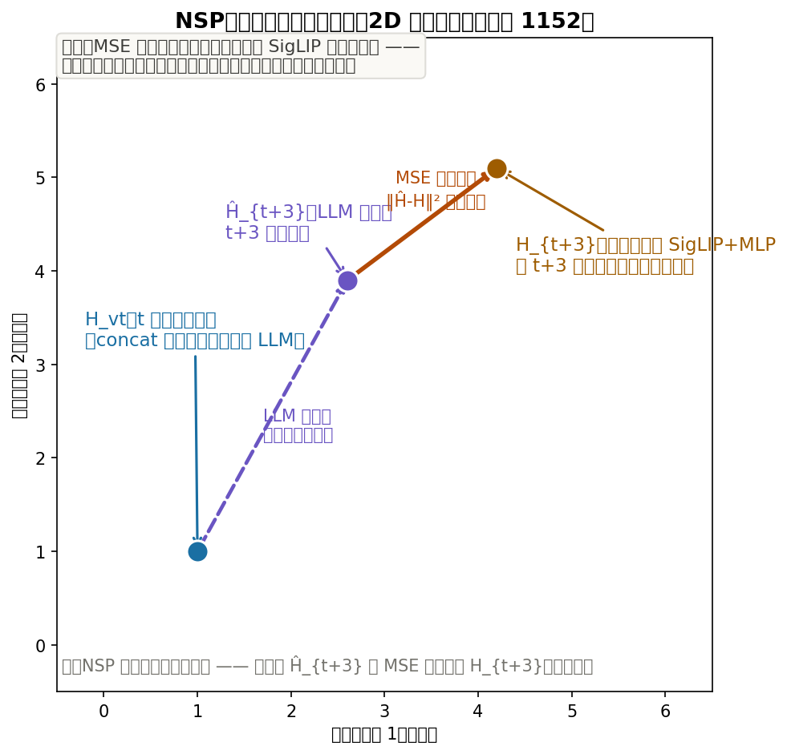
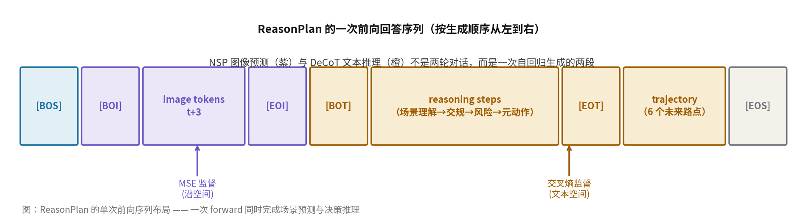
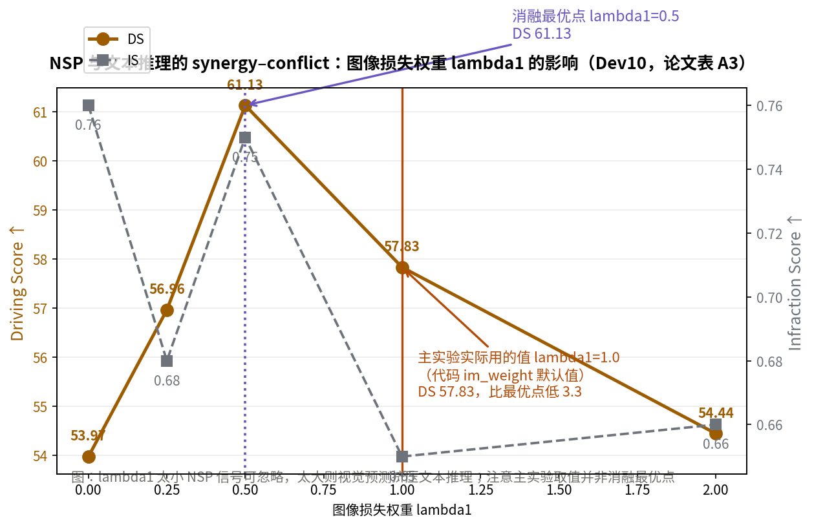

# 让 MLLM 在闭环里第一次赢过模仿学习：ReasonPlan 的场景预测与决策推理链

> **信息块**
>
> - **论文标题**：ReasonPlan: Unified Scene Prediction and Decision Reasoning for Closed-loop Autonomous Driving
> - **作者**：Xueyi Liu, Zuodong Zhong, Junli Wang, Yuxin Guo, Zhiguo Su, Qichao Zhang, Yun-Fu Liu, Yinfeng Gao, Yupeng Zheng, Qiao Lin, Huiyong Chen, Dongbin Zhao（中科院自动化所 SKL-MAIS / 国科大 / EACON / 北京科技大学）
> - **会议**：CoRL 2025（第九届 Conference on Robot Learning，首尔）
> - **arXiv**：2505.20024，v1 2025-05-26，v2 2025-09-22（camera-ready 版，本文按 v2 精读）
> - **链接**：https://arxiv.org/abs/2505.20024
> - **代码**：公开，https://github.com/Liuxueyi/ReasonPlan（含训练脚本、闭环评估 agent、PDR 数据集已发布于 HuggingFace）
> - **一句话核心洞见**：MLLM 在闭环驾驶里打不过纯模仿学习，不是因为推理能力弱，而是因为视觉特征从来没有被"未来"约束过——加一个自监督的下一场景预测任务，让视觉 token 先学会往 3 秒后的样子靠，再让 LLM 在这个被未来校准过的表示上做显式的四步决策推理，闭环分数就超过了当时的模仿学习最强基线。

2025 年中，自动驾驶领域有一个公开的尴尬：多模态大语言模型（MLLM）在开环问答、场景描述上说得头头是道，可一旦放进 CARLA 闭环里实际开车，分数还不如 UniAD、VAD 这些"只会模仿"的端到端模型。DriveVLM、Senna 走的是双系统路线——MLLM 只出高层意图，真正的轨迹另有小模型负责；VLP、DiMA 走的是蒸馏路线——把 MLLM 的推理能力蒸进轻量规划头。没有人让 MLLM 自己端到端地在闭环里开好车。ReasonPlan 的作者把这句话反过来说：不是 MLLM 不行，是之前的用法没有把 MLLM 的两个本事——看懂画面、讲清道理——同时用在规划上。

## 之前的方法到底在哪里撞墙

引言列了三条挑战，值得一条条看它们是不是真问题。

第一，视觉信息用得不够。之前的做法要么只用文本监督感知和决策（视觉只当输入、损失只落在文字上），要么直接拿预测出的图像当下一步的输入。后者的问题很具体：图像预测的误差会一帧一帧累积，闭环里跑几十秒就漂了。这是一个结构性问题，不是调参能解决的——只要你把"生成像素"放在决策链条里，复合误差就不可避免。

第二，没有显式的推理过程。Reason2Drive、TOKEN 这些工作用多轮 QA 微调 LLM，问一堆"这是什么标志""前面有什么车"，但这些 QA 是散的，模型从来没有被要求走完"看到→判断→决策"的完整链条。QA 能教会模型认东西，教不会模型做决定。

第三，缺规划导向的高质量推理数据。开环的 QA 数据集回答不了"这么开对不对"，因为开环没有执行、没有后果。

这三条里第一条是方法上的赌注，第二条是监督形式的选择，第三条是数据工程。论文的两个核心设计正好一一对应：NSP（Next Scene Prediction）回答第一条，DeCoT（Decision Chain-of-Thought）回答第二条，PDR 数据集回答第三条。结构很干净，干净到让人怀疑是不是先有了答案再凑的问题——但读完实验部分会发现，这个对应关系至少在消融表里是成立的。

## 作者手里的底牌是哪几张

推测作者在 2025 年初手里有三张牌，硬度不一样。

最硬的一张是**空白**：在 Bench2Drive 这个闭环基准上，还没有 MLLM 方法明确赢过主流的模仿学习方法。UniAD-Base 的 DS 是 45.81，MomAD 是 47.91。只要 ReasonPlan 能干净地超过这个线，"MLLM 闭环驾驶"这个方向就立住了。目标会议是 CoRL——机器人学习会议，审稿人关心的是"这个东西在闭环里真转起来了吗"，不是"语言模型又大了多少"。所以论文把最重的实验（Bench2Drive 闭环 220 条路线）放在最前面，这个选择是写给 CoRL 审稿人看的。

第二张是**自动化标注管线**。PDR 数据集的 203,353 个训练样本不是人标的，是从 Bench2Drive 自带的真值（3D 框、地图拓扑、红绿灯状态）用规则转写成四步推理文本，再经过人工抽查。证据在附录 A：标注流程的每一步都对应 simulator 能直接给出的真值（HD 地图的车道连通性、3D 框的位置速度、RL 专家轨迹的几何偏差）。这张牌的硬度在于可复制——别人想跟进，不需要雇标注团队。

第三张是**NSP 这个任务形式本身**。预测未来在视频领域是老想法，但把它做成"潜空间向量预测 + 只预测前视"，并且和文本推理拼在一次前向里，这个组合是新的。硬度一般，更多是一个工程判断。

## NSP 到底在算什么：把三个公式拆开

先看输入。t 时刻的多视角 RGB 图像记为 $X^v_t \in \mathbb{R}^{N \times W \times H \times 3}$，$N=6$ 个视角，原始分辨率 $1600 \times 900$。处理方式是 LLaVA-NeXT 的 AnyRes：前视图切成 4 个空间格子，其余 5 个视图各 1 个格子，一共 10 个 $384 \times 384$ 的格子。每个格子过 SigLIP（so400m-patch14-384），每个格子出 $L_v=729$ 个 token、维度 $D_v=1152$，再过两层 MLP 投影到语言维度 $D_p=1024$。这就是式 (1)：

$$Z^v_t = \text{SigLIP}(\text{AnyRes}(X^v_t)), \quad H^v_t = \text{MLP}(Z^v_t)$$

$Z^v_t$ 是视觉编码器输出，形状 $(10 \times 729) \times 1152$；$H^v_t$ 是投影后，形状 $(7290) \times 1024$，可以直接和文本 token 拼在一起进 LLM。

式 (2) 是上下文编码器，把自车状态嵌成向量：

$$H^c_t = \text{MLP}(v, a, \text{cmd})$$

$v$ 是纵向速度，$a$ 是纵向加速度，cmd 是导航指令（比如 turn left）。这是一个两层 MLP，作用是把三个异构的标量/离散量压成一个和 $H^v_t$ 同维度的向量。为什么需要它：同一张前视图像，自车速度 5 m/s 和 20 m/s 时 3 秒后的画面完全不同；没有 $v, a$，预测未来就是不可解的。cmd 更关键——在路口，同样的当前帧，"直行"和"左转" 3 秒后的画面天差地别，cmd 把驾驶意图作为条件喂进去，预测才有确定答案。

式 (3) 是 NSP 的核心：

$$\hat{H}^v_{t+3} = \text{LLM}(\text{Concat}(H^c_t, H^v_t)), \quad L_{\text{image}} = \|\hat{H}^v_{t+3}[:\text{front}] - H^v_{t+3}[:\text{front}]\|_2^2$$

LLM 读入拼接后的上下文向量和视觉 token，输出对 $t+3$ 秒时刻视觉嵌入的预测 $\hat{H}^v_{t+3}$。真值 $H^v_{t+3}$ 是把 $t+3$ 秒的真实图像走**同一套** SigLIP+MLP 编出来的——注意是同一套参数，不是另一个编码器，所以这是一个自监督任务，不需要任何人工标注。损失是均方误差，只算前视部分（$[:\text{front}]$），但输入是全视角。

*图：NSP 在潜空间的几何动作。LLM 从当前嵌入 $H^v_t$ 出发（受上下文 $H^c_t$ 引导）预测 $\hat{H}^v_{t+3}$，MSE 把预测点拉向真值 $H^v_{t+3}$。1152 维降到 2D 示意，数值为示意。*

## 为什么预测的是潜空间向量，而不是像素

这是 NSP 设计里最值得停下来想的一步。最朴素的尝试是预测未来图像的像素（像视频生成那样），或者预测未来的语义分割。作者没有这么做，原因有三层。

第一层是**代价**。预测 $384 \times 384$ 的像素需要解码器，训练慢、推理用不上（推理时 NSP 的预测图像 token 直接丢弃，不进决策）。潜空间 MSE 只需要 LLM 多输出 $4 \times 729$ 个 1024 维向量（前视 4 个格子），没有解码器。

第二层是**监督的紧度**。SigLIP 的潜空间是视觉-语言对齐过的，两个在潜空间里距离近的向量，语义上也近。MSE 拉近的是语义距离，不是像素距离。一辆 50 米外的车在像素上只占几十个像素，对像素 MSE 的贡献微乎其微，但在 SigLIP 潜空间里它是一个完整的语义实体。这就是为什么 NSP 能"增强场景表示"——它逼着视觉 token 去编码那些对未来有影响的语义内容，而不是纹理细节。

第三层是**和 DeCoT 的分工**。NSP 只负责让视觉表示"有未来感"，真正的决策推理留给文本空间的 DeCoT。两个损失各管一段序列，互不抢地盘（见下面的序列布局图）。如果 NSP 去预测像素，LLM 的容量会被迫分给纹理生成，附录 D 的表 A3 已经显示了这种挤压真实存在。

## 只预测前视：一个省算力的判断，对吗

论文说前视图像包含对轨迹规划最关键的语义信息，附录 D 的表 A2 给了证据：只预测前视，Dev10 上 DS 57.83；预测全视角，DS 58.95。差 1.12，作者认为"相当"（on par），于是全用前视以省算力。

这里要打一个问号。1.12 的 DS 差距在 Dev10 这种小子集上（10 条路线）可能就是一两条路线的成败，不能算"没有差别"。更重要的是，前视-only 的选择有一个隐含假设：所有需要预测的未来都发生在车头前方。变道时后视镜里的车、路口横向来车，恰恰是前视看不见但对决策致命的。作者的回答是输入仍保留全视角特征（只在损失上取前视），LLM 在预测前视未来时能看到后视信息——这个设计是聪明的：监督信号便宜，条件信息完整。但严格来说，"前视预测 ≈ 全视角预测"这个结论只在 Bench2Drive 的场景分布下成立，换到频繁变道的高速场景可能会不一样。论文没有做这个实验。

## DeCoT：四步推理链，一次前向走完

DeCoT 是监督的文本推理过程。给定视觉 token 和文本指令，模型按固定四步生成推理，再输出轨迹：

1. **Scene Understanding（场景理解）**：基于 HD 地图拓扑，描述可达车道、可选路线。比如"有一条车道可以通过左变道到达，该车道方向与自车相反"。
2. **Traffic Sign Recognition（交通标志识别）**：红绿灯三态、警告牌、施工牌。比如"前方有事故警告牌"。
3. **Critical Object Identification for Risk Assessment（关键目标识别与风险评估）**：从真值 3D 框里筛出有交互可能的障碍物，给类别、距离、运动状态。比如"最近的障碍物是 car，距离 9.39 米，动态"。
4. **Meta Action（元动作）**：横向六选一（跟车道、左/右变道、左/右转、直行）× 纵向四选一（加速、减速、停止、急刹）。比如 KEEP_SPEED + FOLLOW_LANE。

然后输出 6 个未来路点（3 秒）。

关键设计是**单次前向**：整个回答序列是

`[BOS] [BOI] {image tokens}_{t+3} [EOI] [BOT] {reasoning steps} [EOT] {trajectory} [EOS]`

NSP 的图像预测段和 DeCoT 的文本推理段是**一次自回归生成**里的两段，不是两轮对话。MSE 只监督 `[BOI]–[EOI]` 段，交叉熵只监督 `[BOT]–[EOT]` 段和轨迹段。六个特殊 token（`[BOI]/[EOI]` 标图像段，`[BOT]/[EOT]` 标推理段）是新加进词表的。

*图：ReasonPlan 的单次前向序列布局。NSP（紫）与 DeCoT（橙）共用一次自回归，两种损失各监督各的段。*

为什么不用多轮 QA（像 Reason2Drive 那样问完一轮再问一轮）？多轮 QA 每轮都要重新编码图像 token，慢；而且轮与轮之间没有梯度直通，推理链是断的。单次前向里，轨迹 token 的生成能直接 attend 到前面的推理 token 和 NSP 预测的图像 token，梯度一条线传到底。代价是序列变长——推理文本平均 195 词，加上图像 token，训练时 batch size 只能设 16（8 卡 L20）。

式 (4) 就是标准的自回归交叉熵，写出来只是为了说明目标分布 $X_a$ 包含推理步骤和轨迹：

$$p(X_a|X_v,X_p) = \prod_{i=1}^{L} p(x_i|X_v, X_p, X_{a,<i}), \quad L_{\text{text}} = -\log p(X_a|X_v,X_p)$$

$X_{a,<i}$ 是当前 token 之前的所有答案 token——包括前面的推理步骤。这意味着轨迹的生成是以推理文本为条件的：模型先把自己"说服"了，再输出路点。这是 DeCoT 和纯行为克隆的本质区别。

## 跟着一个真实例子走完四步推理

用论文图 4 / 附录图 A1 的那个完整 PDR 样本走一遍。场景：自车速度 7.72 m/s，纵向加速度 -0.96 m/s²（在减速），目标点在前方 44 米，导航意图是跟车道。

**第 1 步，场景理解**。系统从 HD 地图读出拓扑：左侧有一条可通过左变道到达的车道，但方向与自车相反（对向车道）；右侧没有可变道空间。输出文本大意：存在左变道选项但方向相反，变道时注意对向交通；右方无车道。注意这里的"可达车道枚举"完全来自地图真值，不是模型看图猜的——PDR 的这部分标注是规则生成的，可靠性高。

**第 2 步，交通标志识别**。真值里前方有一个事故警告牌（accident warning sign）。标注文本：自车应根据标志内容随时准备响应。这一步的价值在图 5 左案例里得到了验证：基线方法在绿灯亮起时误判信号变化、停在路口不动，ReasonPlan 正确识别信号切换通过路口。

**第 3 步，关键目标与风险评估**。按与自车的距离筛出最近的三个障碍物：最近的是一辆 car，距离 9.39 米，动态；另一辆 car，距离 27.94 米，动态；左邻车道前方无障碍物。每个障碍物配一句风险推理："变道时可能阻碍自车后续行驶，自车应提前谨慎决策避免碰撞"。这里的"风险"没有量化分数，是文字描述——和 RAMP 那种定量风险打分是两条路线（对照节细讲）。

**第 4 步，元动作**。综合以上：KEEP_SPEED（纵向）+ FOLLOW_LANE（横向）。注意纵向选的不是 DECEL——虽然加速度已经是 -0.96（在减速），但元动作标注的是"意图"，当前减速可能是跟车流，前方 9.39 米的车是动态同向的，不需要额外减速。

**最后，轨迹**：(0.00, 4.02), (0.00, 7.99), (0.00, 11.87), (-0.00, 15.89), (-0.00, 19.52), (-0.00, 23.30)。6 个点，3 秒，基本沿当前车道直线向前，横向全 0——和 FOLLOW_LANE 一致。7.72 m/s × 3 s ≈ 23 米，纵向距离对得上。

这个例子暴露了 PDR 标注的一个特点：四步文本是**模板化的规则转写**，不是 LLM 自由发挥的。好处是 21 万条的一致性有保证；代价是推理文本的多样性低，模型学到的"推理"可能部分是在背模板。附录 A.2 的词频统计印证了这点：最高频词是 vehicle（231 万次）、ego（220 万次）、lane（123 万次）——典型的模板语言分布。

## 两阶段训练与总损失：λ1 的取值有一个说不通的地方

总损失是加权和，式 (5)：

$$L_{\text{total}} = \lambda_1 \cdot L_{\text{image}} + \lambda_2 \cdot L_{\text{text}}$$

论文正文说 $\lambda_1 = \lambda_2 = 1.0$。训练分两阶段：第一阶段只训投影层和上下文编码器（NSP 和推理都关掉，做视觉-语言对齐），1 个 epoch 约 6 小时；第二阶段在 PDR 上联合微调投影层、上下文编码器和 LLM（Qwen-0.5B），3 个 epoch 约 23 小时。8 卡 L20。

我核对了开源代码，`scripts/train_stage1.sh` 里 `nsp_enable=False, reasoning_enable=False`，`train_stage2.sh` 里 `nsp_enable=True, reasoning_enable=True, im_weight=1.0`，`llava/train/llava_trainer.py` 第 294 行是 `outputs.loss + im_weight * image_pred_loss`。代码和论文一致。

但附录 D 的表 A3 藏着一个矛盾。消融显示 $\lambda_1=0.5$ 时 Dev10 上 DS 61.13，是最好的；$\lambda_1=1.0$ 时 DS 57.83，低了 3.3 个点。附录正文甚至写了"setting the image weight to 0.5 provides a balanced trade-off, yielding the best overall performance"。可主实验用的是 1.0。也就是说，**论文报告的主结果（DS 64.01）并不是在消融最优点上取得的**，按附录的逻辑，换成 0.5 可能更高。一种解释是主实验跑在前、消融做在后，来不及重跑；另一种可能是 0.5 在完整 Bench2Drive 上的表现不如在 Dev10 上。论文没有说明，读者只能看到这个缺口。

*图：图像损失权重 lambda1 的 synergy–conflict 曲线（论文附录表 A3，Dev10）。lambda1 太小 NSP 信号可忽略，太大则视觉预测挤压文本推理；注意主实验取值 1.0 并非消融最优点 0.5。*

这个现象本身倒是有意思：NSP 和 DeCoT 之间存在先协同后冲突的关系。$\lambda_1=0$ 时 DS 53.97（纯 DeCoT）；加到 0.5，DS 涨到 61.13（NSP 提供了有用的视觉上下文）；继续加到 2，DS 跌回 54.44（LLM 的容量被视觉预测吃掉，文本推理质量下降）。这是一个真实的权衡，不是装饰性消融。

## 实验数字逐项核对

**开环+闭环主表（表 1，Bench2Drive 220 条路线）**。ReasonPlan：L2 0.61（全场最低，次低是 UniAD-Base 的 0.73），DS 64.01，SR 34.55%，效率 180.64（全场最高），舒适度 25.63，平均能力 36.66%。

摘要里"16.44% L2"是对 UniAD-Base 的 0.73 → 0.61，相对降幅正好 16.4%；"16.1 driving score"是对 MomAD 的 47.91 → 64.01。两个数字的对标基线不是同一个，摘要没点破，但都算数。最该细看的是 DriveAdapter：DS 64.22，比 ReasonPlan 高 0.21，但它是带星号的——用了专家特征蒸馏（privileged distillation），训练时能看到真值特征。ReasonPlan 没用蒸馏还打到 64.01，这个对比是论文最硬的成绩。

**舒适度 25.63**是全场低的（MomAD 51.20，UniAD-Base 43.58）。论文的解释是轨迹激进与平滑的权衡，建议后处理平滑。这个数字说明 ReasonPlan 的驾驶风格偏"猛"——效率 180.64 全场最高与舒适度全场偏低是同一枚硬币的两面。审稿人如果揪住安全，会问激进驾驶在 DS 里是不是占了便宜（RC 高但 IS 被扣分，DS=RC×IS，64.01 的 DS 配 0.65 左右的 IS，意味着 RC 很高）。

**零样本 DOS（表 2）**。四个遮挡推理场景，ReasonPlan 平均 DS 78.02（论文 Average 列原值），超过 UniAD-Base 的 71.09 和 LMDrive 的 64.53。DOS 的场景（停放车辆后突然窜出行人、跟车时前车急刹、左转被大卡车遮挡、闯红灯车辆被卡车遮挡）正好是"需要推理全局上下文"的场景，DeCoT 的四步链条在这里是吃香的。这个零样本结果是论文"泛化能力"声明的主要证据，四个场景全赢，可信度不错。不过这里有一个小的数字瑕疵：四个场景的 DS（67.77、91.65、80.57、77.85）算术平均是 79.46，不是表里的 78.02；其他方法（UniAD-Base、VAD、MomAD、LMDrive）的 Average 列都能和四个值对上，只有 ReasonPlan 这一行对不上。报低了 1.44，不影响"全赢"的结论，但说明表格是手工填的，至少这一格没有公式校验。

**消融（表 3，Dev10）**。只加 NSP（ID 2）：RC 95.03 全场最高，但 IS 掉到 0.54——车敢开了，但违章也多。只加 DeCoT（ID 3）：IS 0.76，DS 53.97。两个都加（ID 4）：DS 57.83 最好。这组消融讲了一个完整的故事：NSP 给勇气（敢开），DeCoT 给规矩（守规矩），缺一不可。表 3b 显示去掉任一步推理都会掉分，去掉 Meta Action 掉得最多（DS 57.83 → 42.61）——元动作是推理链和轨迹之间的最后一环，去掉它等于让模型直接从场景描述跳到路点，跨度太大。

## 怀疑式阅读：七个值得记下来的点

**1. 基线里没有 SimLingo 和 CarLLaVA 的闭环数。**相关工作里提到了 SimLingo（CVPR 2025，基于 CarLLaVA 的纯视觉闭环语言驾驶），但实验基线没有它。SimLingo 也是 MLLM 闭环，"首次在 Bench2Drive 上赢过模仿学习的 MLLM"这个声明的对手盘里缺了一个最直接的对手。可能的原因是 SimLingo 的代码/模型当时还没公开，或者它的评估协议对不上。论文没解释。

**2. Qwen-0.5B 到底是哪个模型。**正文写"adopt Qwen-0.5B"，引用的是 Qwen2-VL 的论文。Qwen2 系列确实有 0.5B 档，所以大概率是 Qwen2-0.5B（的语言部分）。0.5B 的 LLM 做 CoT 推理——放在 2025 年看是偏小的，Limitations 里自己也承认 7B 实时部署困难。这是一个诚实的取舍：用小模型换闭环可跑。

**3. 3.3 节把 PDR 写成了 PDM。**"we employ the collected PDM dataset"——笔误，全文只出现一次。说明这段是赶工写的。

**4. NSP 的真值有一个隐含的数据泄露风险。**$H^v_{t+3}$ 来自同一条专家轨迹的未来帧，而训练数据本身就是专家开的。NSP 学到的"未来"是在专家行为分布下的未来。闭环测试时如果模型开偏了（off-distribution），NSP 预测的未来是基于"我还在专家轨迹上"的假设，可能会给出误导性的视觉上下文。论文没有讨论这一点。DeCoT 的文本监督同理——都是离线模仿，没有 DAgger 那样的纠偏。

**5. 推理文本是模板转写的，195 词的平均长度里有多少是有效信息。**附录词频显示高度模板化。模型在"推理"时可能只是在复述模板句式，真正的决策信息集中在元动作那几个词上。表 3b（去掉 Meta Action 掉 15 个点 DS）支持这个怀疑：前面三步的散文可能主要是给审稿人看的，承重的是最后一步。

**6. 失败案例是诚实的（附录 E）。**两个失败：识别到近处障碍物但没躲开；检测到后方来车但变道没在时限内完成。作者把原因归于纯离线微调、缺交互反馈，建议 RL 后训练。没有藏着，这是加分项。

**7. 效率 180.64 的含义。**效率定义是自车速度相对周围车辆平均速度，大于 100 意味着比周围车快。180 说明开得相当激进。结合舒适度 25.63，ReasonPlan 的驾驶风格是"快但不平顺"。在 Bench2Drive 的 DS 计算里，激进只要不违章就是赚的——这是基准本身的激励结构，不全是方法的功劳。

## 与 RAMP 的对照

RAMP 是在研的以 Agent 为中心的自动驾驶架构，两个核心：(1) 风险加权自适应衰减情景记忆——记忆权重 $w_i(t)=\exp[-\lambda_i(t-u_i)]$，衰减速率 $\lambda_i=\lambda_0(1-r_i)^\alpha$ 由记忆的风险评分 $r_i$ 调制，高风险经历衰减慢；检索命中刷新 $u_i$；检索分数 = 语义相似度 × 衰减权重。(2) 世界模型单次观测前向的中间分布 $q(z_t|o_{\le t})$ 同时服务两个消费者：LLM 调度器（生成异构多规划器调度的先验）和候选动作 rollout 的共同初始潜状态（各候选动作仍分别独立展开做定量风险校验）。外加异构多规划器池、LLM 调度、风险仲裁、安全盾，在 Bench2Drive 闭环验证。

把 ReasonPlan 和 RAMP 放在一起，最容易混淆的是"预测"这个词——两边都在预测未来，但预测的**用途**完全不同。

**预测的用途差异：语言式 CoT 推理 vs 定量风险打分。**ReasonPlan 的 NSP 预测的是"3 秒后的画面在潜空间里长什么样"。这个预测段落在序列里排在推理段之前，通过因果注意力对后续的推理和轨迹生成可见，起到表示层面的上下文作用——但它**不直接产生任何决策分数**。它的主要作用是训练时的表示约束：逼视觉 token 编码对未来有用的语义，让后面的 DeCoT 有更好的表示可用。RAMP 的世界模型中间分布 $q(z_t|o_{\le t})$ 恰恰相反——它是决策的**起点**：每个候选动作都从这个分布采样初始潜状态、独立展开，算出定量的风险分数，仲裁器按分数选动作。ReasonPlan 的预测是"为了让推理更顺"的辅助信号，RAMP 的预测是"为了给每个选项打分"的计算 substrate。一个是表示学习，一个是决策计算。

**决策结构的差异：单规划器内决策 vs 多规划器调度选择。**ReasonPlan 从头到尾是一个 LLM：一次前向，先 NSP 段、再推理段、再轨迹段，输出一条轨迹。它的"智能"全部在单个模型的权重里。RAMP 的智能在**结构**里：异构规划器池（比如激进型、保守型、规则型各一个），LLM 只做调度（选哪个规划器主导），最后还有风险仲裁和安全盾。ReasonPlan 回答的是"这一步怎么开"，RAMP 回答的是"这一步让谁来开"。前者是 monolithic，后者是 mixture-of-planners。

**监督信号的差异：自监督预测 + 文本模仿 vs 风险校验。**ReasonPlan 的两个损失都是"拟合"：NSP 拟合未来的潜表示（自监督），DeCoT 拟合专家转写成的推理文本（有监督模仿）。它没有"这个动作有多危险"的显式信号——风险只存在于文字描述里（"应注意避免碰撞"），没有数值。RAMP 的风险校验是定量的：候选动作 rollout 后算风险分数，仲裁按分数选。这意味着 ReasonPlan 的"谨慎"来自模仿专家文本的风格，RAMP 的"谨慎"来自对每个候选动作的实际验算。前者在分布外场景下更脆弱——专家没写过的场景，文本风格模仿就没有锚点。

**诚实的互补点，不踩一捧一。**这两个设计不是互斥的，至少有三处可以互相借东西。第一，ReasonPlan 的 DeCoT 四步推理链（场景理解→交规→风险→元动作）正好是 RAMP 的 LLM 调度器缺的东西：RAMP 的调度先验目前来自世界模型分布，缺一个可读的中间推理层，把 DeCoT 接在调度器前面，仲裁决策就有了可解释的文本依据。第二，RAMP 的风险加权情景记忆可以补 ReasonPlan 最缺的一块：ReasonPlan 是无记忆的（每帧只看当前观测 + 短历史），DeCoT 的"风险评估"只能看当下；如果把高风险历史经历按 $w_i(t)$ 检索出来拼进 prompt，推理的上下文就有了纵深。第三，ReasonPlan 的 NSP 潜空间预测任务可以直接拿来预训练 RAMP 的世界模型编码器——让 $q(z_t|o_{\le t})$ 的表示先被"未来"约束过，rollout 的起点质量会更高。反过来，RAMP 的定量风险校验也可以给 ReasonPlan 的 DeCoT 提供第五步：把"风险文字描述"换成"候选轨迹的风险分数"，推理链就从风格模仿变成了数值 grounded 的决策。这两篇放在一起看，最大的启发是：**预测（未来建模）和推理（语言链条）是正交的两个轴**，ReasonPlan 占了推理轴，RAMP 占了预测-校验轴，完整的 Agent 驾驶架构可能需要两根轴都有。

## 可以带走的想法

**第一个想法：自监督的未来预测是视觉-语言对齐的便宜替代品。**MLLM 驾驶的一个老困难是视觉 token 和语言 token"各说各话"——投影层把维度对上了，语义没对上。ReasonPlan 的做法是：别去标数据，让模型预测 3 秒后的潜表示，未来自己会把语义压进视觉 token。这个技巧的可迁移之处在于它不依赖任何标注，只要有视频流就能用。任何"视觉编码器 + LLM"的系统（不只是驾驶，机器人操作也一样），都可以在微调时加一个潜空间未来预测头，代价只是一次前向和一个 MSE。附录的权重消融给出了使用说明：权重 0.5 左右，别太大。

**第二个想法：推理链的承重部分可能只有最后一步，设计时就该这么假设。**表 3b 显示去掉 Meta Action 掉 15 个点 DS，去掉其他三步掉得少。这提示一个务实的设计原则：显式推理链的前面几步可以写得便宜（模板、短文本），把监督的火力集中在"决策瓶颈"那一步上。反过来，如果你的推理链每一步都一样长、一样贵，很可能是在为可读性付超额的训练代价。

**第三个值得做的具体问题：NSP 的分布外失效。**NSP 的真值来自专家轨迹的未来，模型一旦在闭环里开偏，NSP 的预测就建立在"yet I am still on the expert's path"的错误假设上。一个直接的改进是让 NSP 以**候选动作**为条件（condition on action）：预测"如果我执行动作 a，3 秒后看到什么"，而不是"3 秒后会看到什么"。这就把 NSP 从表示学习变成了世界模型，而这正是 RAMP 那条路线的起点。ReasonPlan 停在了表示学习，往前一步就是动作条件的世界模型——这一步的实验结果会很有信息量。

---

*精读信息：PDF 为 arXiv v2（2025-09-22，CoRL camera-ready），18 页正文+附录，全文已读；官方代码已 clone（github.com/Liuxueyi/ReasonPlan），训练脚本与论文的超参数（im_weight=1.0、两阶段开关）已核对一致；原图 Fig.2 已按 2 倍分辨率渲染存档于 paper-fig2.png；自绘图 3 张（fig-sequence.py、fig-nsp-geometry.py、fig-weight-tradeoff.py）均已真实运行生成 PNG。*
