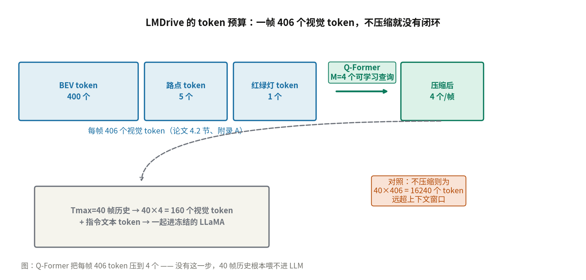
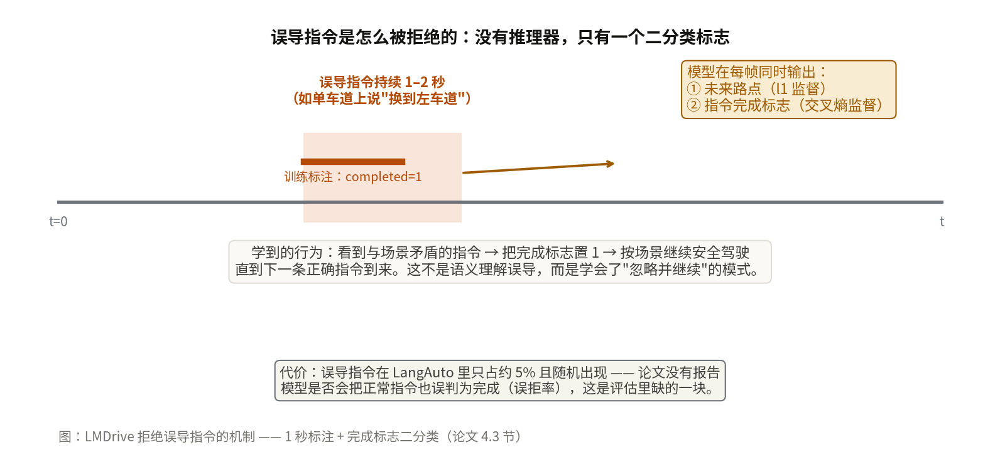
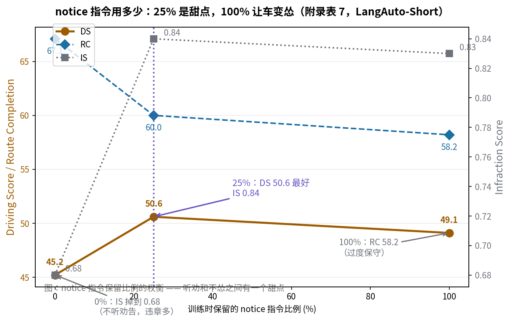

# 第一个让 LLM 在闭环里真正开车的系统：LMDrive 的指令跟随与完成标志

> **信息块**
>
> - **论文标题**：LMDrive: Closed-Loop End-to-End Driving with Large Language Models
> - **作者**：Hao Shao, Yuxuan Hu, Letian Wang, Guanglu Song, Steven L. Waslander, Yu Liu, Hongsheng Li（商汤 / 港中文 MMLab / 上海人工智能实验室 / 多伦多大学）
> - **会议**：CVPR 2024（pp. 15120–15130）
> - **arXiv**：2312.07488，v1 2023-12-12，v2 2023-12-21（小幅修订，本文按 v2 精读）
> - **链接**：https://arxiv.org/abs/2312.07488
> - **代码**：部分公开，https://github.com/opendilab/LMDrive —— 有视觉编码器预训练、数据解析工具、闭环评估 agent 和 LangAuto benchmark 代码，**缺 LLM 指令微调的核心训练代码**（模型定义与微调脚本不在仓库里，权重放 OpenXLab），见正文怀疑式阅读一节
> - **一句话核心洞见**：2023 年底所有人都在用 LLM 做开环问答时，LMDrive 把 LLM 冻住、只训输入输出两头的适配器，让 LLM 每帧同时输出未来路点和一个"指令完成了吗"的二分类标志——这个标志位，而不是什么推理链，是它能在闭环里按自然语言指令开车的真正机关。

## 先把时间坐标摆正：2023 年 12 月，LLM 进驾驶的第一年

读这篇论文不先还原 2023 年底的坐标，会误判它的分量。那时 GPT-4 发布不到一年，LLaVA-1.5 是 2023 年 10 月刚出来的。驾驶领域里 LLM 的玩法有三种，全是开环的：DriveGPT4（2023-10）拿多模态 LLM 生成对人类提问的回答并预测控制信号，但没有导航指令输入——它不知道你要去哪；GPT-Driver（2023-10）把场景转成文字喂给 GPT 做运动规划，开环评测；LanguageMPC 让 LLM 输出高层决策再调参数矩阵转成控制量。共同点：动作生成了，但**不在环境里执行**，没有累积误差、没有和环境交互、动作的时间一致性没人管。

LMDrive 的问题意识就一句话：LLM 能不能在闭环里开车——指令进来，车在 CARLA 里真跑，跑偏了自己纠回来。这在当时是没有人的领地。它的"first"声明（据我们所知第一个把 LLM 用于闭环端到端驾驶）放在 2023 年 12 月是站得住的，因为引用的同期工作确实全是开环。

## 当时有三堵墙，LMDrive 绕过了哪几堵

第一堵墙是**开环评测的幻觉**。开环 L2 小不代表闭环能开，2023 年已有论文（AD-MLP 那篇"rethinking open-loop evaluation"）指出开环指标和闭环表现经常脱钩。LMDrive 的回应是直接建一个闭环 benchmark（LangAuto），所有数字都在 CARLA 里跑出来。

第二堵墙是 **token 预算**。一帧 406 个视觉 token，一个指令要执行几百帧，全塞进 LLM 上下文是不可能的。这是架构上最实在的一个约束，LMDrive 用 Q-Former 解决（下一节细讲）。

第三堵墙是 **LLM 不会开车**。LLaMA 是文本模型，没见过驾驶数据。LMDrive 的选择是把 LLM **完全冻住**，只训练视觉侧的 Q-Former 和输入输出的两个 MLP adapter，外加一个专门为驾驶预训练的视觉编码器。这个选择的含义是：不指望 LLM 学会驾驶的物理直觉，只借用它的两样东西——对自然语言指令的理解，和把多帧历史信息整合成连贯输出的序列建模能力。驾驶的"知识"其实装在被冻住的视觉编码器（预训练时学过检测、路点、红绿灯）和输出的路点头里。

## 视觉编码器：先当感知模型训，再冻住当眼睛

视觉编码器的结构（论文图 5）是 InterFuser 风格的：4 个 RGB 相机（前、左前、右前、后）过 ResNet-50，点云过 PointPillars（pillar 0.25m×0.25m，PointNet 聚合成 $C \times H \times W$，$C=256, H=W=50$），再用一个 $K_{dec}=3$ 层的 transformer BEV decoder 融合。Decoder 的 query 有三组：$H \times W = 2500$ 个 BEV query（论文写 400 个 BEV token，附录 A 说喂给 Q-Former 的是 400 BEV + 5 路点 + 1 红绿灯 = 406——BEV 的 50×50 在某处被下采样或选取到 400，论文没有明说这一步，记为未说清的细节），$N=5$ 个可学习的路点 query，1 个红绿灯 query。

预训练时挂三个头：CenterPoint 做 3D 检测、BEV token 过 GRU 预测未来路点（带导航路点做条件）、两层 MLP 给红绿灯分类。三个损失：检测损失（同 InterFuser）、路点 l1、红绿灯交叉熵。预训练完把头扔掉，编码器冻住。这一步的代价不小：3M 帧数据、35 个 epoch、AdamW + cosine、前 5 epoch warmup。但消融表证明这钱花得值——去掉视觉预训练，DS 从 36.2 掉到 16.9（表 3），是四个消融里掉得最多的。**视觉预训练是这篇论文真正的承重结构**，比 Q-Former（掉 4.5 个点）和 BEV token（掉 2.3 个点）都重要。这个结论反直觉：标题讲的是 LLM，但实验说最管用的是视觉编码器的预训练。

## 406 个 token 怎么进 LLM：Q-Former 不是装饰

每帧 406 个视觉 token，$T_{max}=40$ 帧历史，不压缩就是 16240 个 token——2023 年的 7B 模型上下文根本装不下。LMDrive 照搬 BLIP-2 的 Q-Former：每帧用 $M=4$ 个可学习 query 做交叉注意力，从 406 个视觉 token 里"问"出 4 个，再过两层 MLP adapter 对齐到语言维度。

*图：Q-Former 把每帧 406 个视觉 token 压到 4 个。没有这一步，40 帧历史根本喂不进 LLM。数字来自论文 4.2 节与附录 A。*

$M=4$ 是"经验上表现不错"的值，论文没有给 $M$ 的敏感性曲线（2、8 会怎样不知道）。消融只对比了"不用 Q-Former、直接把 BEV 下采样到 4×4"（DS 36.2 → 31.7），说明可学习的压缩比硬下采样好，但 $M$ 本身是不是最优、4 个 query 有没有信息瓶颈，论文没回答。

训练时还有一个细节：**对每一帧历史都做预测**（不只是最新帧），推理时只执行最新帧的预测。这是对抗闭环累积误差的老办法——强迫模型在每个历史时刻的输出都合理，而不是只在当前时刻合理。配合每 2 帧采样一次、随机前后平移（temporal augmentation，平移量小于采样间隔），都是为了让模型对时间抖动鲁棒。

## 指令跟随是怎么做成的：四种指令，一个完成标志

这是论文最有新意的部分。指令分导航指令（follow / turn / others 三类）和 notice 指令（一类，乘客或辅助系统的实时提醒，比如"注意前面的行人"）。56 种指令类型，每种用 ChatGPT 改写成 8 种说法。训练数据是 2.5k 条路线、8 个镇、21 种环境条件下用规则专家（InterFuser 的专家）跑出来的 3M 帧，解析成 64K 个 clip（每个 2–20 秒，配一条导航指令），外加 464K 条 notice。

模型每帧的输出是两样：**未来路点**（l1 损失监督）+ **指令完成标志**（二分类交叉熵）。这个标志位是整套指令跟随机制的机关：

- 导航是**分段**的。一条路线被切成 20 多段（LangAuto 平均 20.3 条导航指令），模型开完一段、把完成标志打成 1，系统就喂下一段指令。没有这个标志，模型不知道"左转"这个动作什么时候算做完。
- 连续指令（"先右转再直行再右转"，占 10% 合并成一条长指令）考验的是模型对"哪段做完、哪段没做完"的时间感知，表 5 显示 DS 从 36.2 掉到 34.0——掉得不多，说明标志位机制基本管用。
- **误导指令**（约 5%、持续 1–2 秒，比如单车道上让"换到左车道"）的处理靠一个训练技巧：误导指令出现约 1 秒后，把这段数据的完成标志标成 1。模型学到的是"看到矛盾指令 → 打完成 → 按场景继续安全开"。图 6 的例子：误导指令"前方右转"（实际是只许左转的车道），模型输出减速的安全路点，无视指令。

*图：LMDrive 拒绝误导指令的机制——约 1 秒的"已完成"标注 + 完成标志二分类（论文 4.3 节）。这不是语义层面的理解误导，而是学会了"忽略并继续"的模式。*

我核对了开源的评估 agent 代码（`leaderboard/team_code/lmdriver_agent.py`）：误导指令以 0.2 的概率在有候选时触发、持续 20 帧（10Hz 下约 2 秒），和论文的"约 5%、1–2 秒"量级一致；完成标志的 softmax 概率超过 0.75 就切下一条指令；视觉特征 buffer 超过 400 帧清空。代码和论文对得上。

## LangAuto：第一个语言指令闭环 benchmark

LangAuto 覆盖 CARLA 8 个镇、16 种环境组合（7 种天气 × 3 种光照，论文写 16 种）。三条 track：

- **LangAuto**：路线 >500 米（平均 635.8 米，20.3 条导航指令），指令按位置实时下发；
- **LangAuto-Short**（150–500 米）、**LangAuto-Tiny**（<150 米）：短路线，区分度更高；
- **LangAuto-Notice**：在 LangAuto 基础上加 notice 指令，模拟乘客实时提醒；
- **LangAuto-Sequential**：10% 的连续 2–3 条指令合并成一条长指令。

指标沿用 CARLA Leaderboard：RC（路线完成度，偏离太远直接判失败终止）、IS（违章扣分）、DS = RC × IS。注意 RC 的计算里"每段路线对应一条导航指令"，偏离路线=违反指令——指令跟随本身就是指标的一部分。

## 实验数字：LLM 的哪部分在起作用

**表 2，六种 7B LLM backbone**。随机初始化：DS 10.7（不会开）；LLaMA 31.3；LLaMA2 32.8；Vicuna 33.5；Vicuna-v1.5 34.0；LLaVA-v1.5 36.2。排序恰好是"语言预训练 < 指令微调 < 多模态预训练"，作者的结论是多模态预训练的 LLM 更适合。这组对比是干净的：同样的视觉编码器、同样的数据，只换 LLM。但注意 LLaVA-v1.5 本来就见过图像，它的 36.2 里有多少是"见过图像"的功劳、多少是"指令理解"的功劳，分不开。

**表 3，模块消融**（前面已讲）：视觉预训练 > Q-Former > BEV token。去掉 BEV token 主要掉的是 IS（0.81 → 0.72），说明 BEV token 管的是"别撞、别违章"，路点 token 管的是"往哪开"——分工在消融里是可见的。

**表 4，notice 的效果**。LangAuto-Notice 上 IS 从 0.81 升到 0.87（LLaVA），车辆碰撞从每公里 0.33 降到 0.17。notice 真的有用，而且主要体现在少撞车。但这里有个微妙之处：notice 是**按对抗事件触发**的（行人窜出、前车急刹时系统给提醒），模型在这些时刻本来就该刹车。IS 的提升里，有多少是"听懂了提醒"，有多少是"提醒本身就是一个刹车信号"（不管内容是什么，收到 notice 就减速也能少撞），论文没有做"随机 notice"对照实验来区分。

**附录表 7，notice 用多少**。训练时 75% 的 notice 被随机删掉（防过度保守），剩下每个 clip 最多留 1 条。消融显示保留 25% 最好（DS 50.6），0% 时 IS 掉到 0.68（不听劝告违章多），100% 时 RC 掉到 58.2（太怂不敢开）。

*图：notice 指令保留比例的权衡（附录表 7，LangAuto-Short）。25% 是甜点：0% 违章多，100% 过度保守。*

**附录表 6，采样间隔**。每 2 帧采 1 帧最好（DS 50.6），间隔 1 时 49.5（太密，temporal augmentation 施展不开），间隔 4 时 46.0（太疏）。这个消融是实在的工程经验。

## 怀疑式阅读：六个要记下来的点

**1. 仓库里没有 LLM 微调的核心代码。**我拉了仓库的文件树：有 `vision_encoder/train_pretrain.py`（视觉预训练）、`tools/data_parsing/`（数据解析）、`leaderboard/team_code/lmdriver_agent.py`（推理评估），但**没有 LLM + Q-Former 指令微调的模型定义和训练脚本**。论文的核心贡献恰恰是第二阶段。权重放在 OpenXLab 可下载，但训练过程不可复现。信息块里我写了"部分公开"，这是准确的说法——读者如果想复现指令微调，只能自己写。

**2. 不是"直接输出控制信号"。**摘要说"直接生成车辆控制信号"，实际结构是：LLM 输出未来路点 → 两个 PID 控制器（照搬 LBC）分别跟踪航向和速度 → 油门/刹车/方向盘。LLM 的输出是路点，不是控制量。PID 层的存在意味着闭环表现里有一部分是控制器的功劳，论文没有做"换控制器"的对照。

**3. 延迟没有报告。**7B 的 LLM，每帧要处理 160 个视觉 token + 文本、输出路点和标志位，闭环跑在多少 Hz？论文一个字没提。2023 年底 7B 模型在车载硬件上实时推理是主要障碍，ReasonPlan 两年后用 0.5B 模型才敢谈实时。LMDrive 的评估是在工作站上跑的，延迟数字的缺席让"闭环"的含金量打了折扣——仿真可以等模型算完再走下一步，真实部署不行。

**4. 误导指令的误拒率没报告。**论文证明了模型能拒绝 5% 的误导指令，但没有报告它有没有把**正常指令**也当成误导拒绝掉。完成标志是一个二分类器，它的 precision/recall 曲线论文没给。如果模型偏向保守（宁可打完成），RC 会 quietly 受损。表 5 里 Sequential 的 RC 从 46.5 掉到 43.7，可能部分与此有关，但论文没往这个方向分析。

**5. 专家是规则专家，性能上界锁死了。**3M 帧数据来自 InterFuser 的规则专家（有真值特权）。行为克隆的性能上界就是专家水平，而规则专家在 CARLA 里的 DS 也就 70 上下。LMDrive 的 36.2 离这个上界还差得远，差的部分里有多少是 LLM 的锅、多少是数据/专家的锅，分不开。论文没有报告专家在 LangAuto 上的分数——这是本可以给、但没给的一个参照系。

**6. "第一个"的声明在当时成立，但 benchmark 是新的。**LangAuto 是新 benchmark，没有历史基线，36.2 这个数字无法和 Transfuser、InterFuser 的闭环分数直接比（不同路线、不同协议）。论文也没有把任何一个非 LLM 的端到端方法跑在 LangAuto 上。所以"LLM 闭环驾驶有效"的结论是自洽的（随机初始化 10.7 → 36.2，消融都支持），但"比传统方法好还是差"这个问题，论文没有回答，也没法回答。

## 可以带走的想法

**第一个想法：完成标志位是"指令"与"控制"之间的最小接口。**LMDrive 最值得借鉴的不是 Q-Former 也不是冻结 LLM，而是一个二分类头解决的三个问题：分段导航的切换、连续指令的时间感知、误导指令的拒绝。一个输出头、一个交叉熵损失，换来了整套指令状态机。做任何"语言指导的序列决策"系统（不只是开车），都值得问一句：我需不需要一个显式的"当前子任务完成了吗"信号？很多系统的时序混乱，根子上就是缺这个 bit。

**第二个想法：冻住大模型、只训两头，是 2023 年的务实选择，2025 年已经反过来了。**LMDrive 冻 LLM 是因为 7B 全量微调贵、且怕洗掉语言能力；ReasonPlan（2025）用 0.5B 小模型做全量微调。两条路线对应两个假设：LMDrive 假设"驾驶知识在视觉编码器里，LLM 只出序列建模和语言理解"；ReasonPlan 假设"小模型也可以在驾驶数据上从头学会推理"。如果你在 2026 年做类似系统，选择取决于你的模型大小——7B 以上冻住划算，1B 以下全量微调可能更好。论文的表 2（随机初始化 7B 完全不会开）是冻住策略的反面证据：大模型的先验是必需的，不能从零训。

**第三个值得做的具体问题：notice 的内容到底起没起作用。**表 4 显示 notice 减少碰撞，但"收到提醒就减速"和"理解提醒内容再决策"是两回事。一个干净的对照实验：把 notice 文本随机打乱（内容与场景不匹配），看 IS 还提不提升。如果还提升，说明模型只是在利用"有提醒=危险"的相关性，那 notice 机制的真实价值就比论文声称的小。这个实验不贵，但论文没做——后来做语言指导驾驶的人应该补上。

---

*精读信息：PDF 为 arXiv v2（2023-12-21），14 页正文+附录，全文已读；官方仓库已通过 GitHub API 核验文件树（git clone 与 codeload 在本机网络下超时，改用 API + raw 文件逐个核验），确认缺 LLM 指令微调核心代码，评估 agent（lmdriver_agent.py）中误导指令触发逻辑与完成标志阈值已与论文核对一致；原图 Fig.4 已按 2 倍分辨率渲染存档于 paper-fig4.png；自绘图 3 张（fig-token-budget.py、fig-instruction-flag.py、fig-notice-ablation.py）均已真实运行生成 PNG。*
