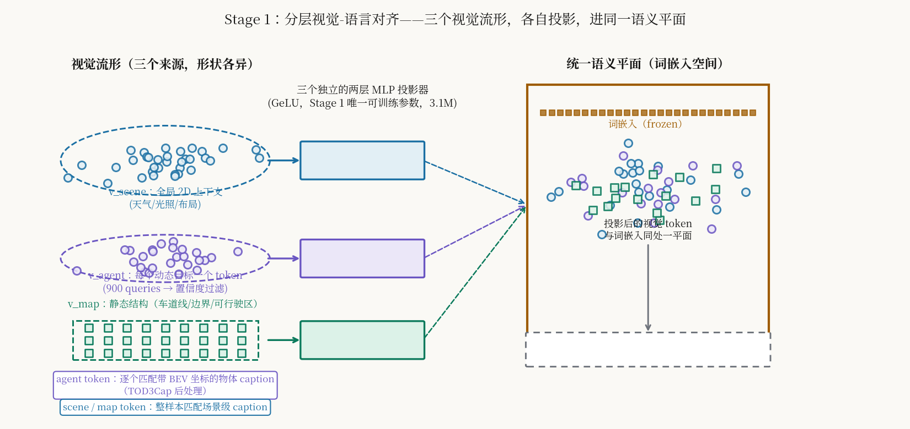
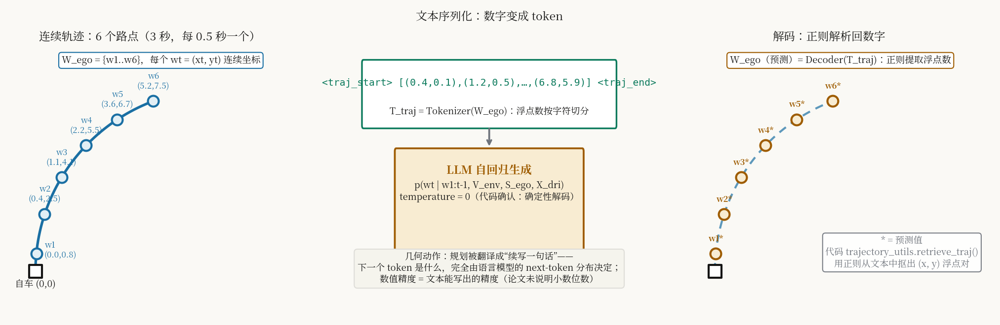
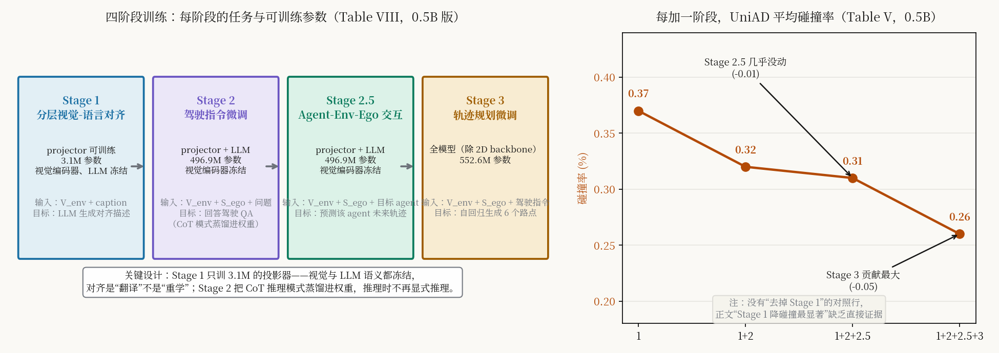
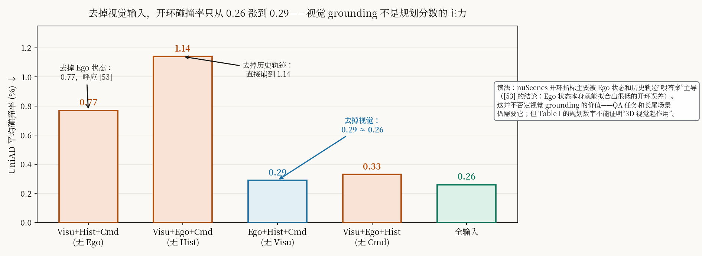

# 把 3D 视觉翻译成 LLM 能读的语言，再让轨迹预测给规划当家教：OpenDriveVLA 的分阶段对齐

> **信息块**
>
> - **论文标题**：OpenDriveVLA: Towards End-to-end Autonomous Driving with Large Vision Language Action Model
> - **作者**：Xingcheng Zhou（通讯）、Xuyuan Han、Feng Yang、Yunpu Ma、Volker Tresp、Alois Knoll —— 慕尼黑工业大学（TUM）、慕尼黑大学（LMU）
> - **会议 / 年份**：AAAI 2026；arXiv:2503.23463（v1 2025-03-30，v2 2025-11-21 为 AAAI 录用版，本文按 v2 解读）
> - **链接**：论文 <https://arxiv.org/abs/2503.23463> ｜ 项目页 <https://drivevla.github.io>
> - **代码是否公开**：部分公开。官方仓库 <https://github.com/DriveVLA/OpenDriveVLA> 已发布环境配置、推理代码和 0.5B 权重（2025-11-14 上架 Hugging Face）；**训练脚本尚未发布**（README 的 TODO 列表里 "Release training scripts" 仍未勾选）。复现训练流程目前做不到，只能复现推理。
> - **一句话核心洞见**：OpenDriveVLA 不相信 2D VLM 能直接开车——它先把驾驶场景拆成三类结构化 token（场景 / 动态目标 / 静态地图），用三个独立投影器逐一把它们"翻译"进 LLM 的词嵌入空间，再用一个条件式 agent 轨迹预测任务给自回归规划注入物理先验；整个 VLA 对齐不是端到端学出来的，是四个阶段一层层"教"出来的。但开环评测数字主要靠 ego 状态和历史轨迹撑着，视觉 grounding 的真实贡献体现在问答和长尾理解上，不在规划分数里。

## 先看作者自己承认的一次幻觉

论文附录 Fig 8 里有一句很诚实的话：模型在场景级描述中"hallucinates that there are no pedestrians visible in the right-front view, despite the presence of one pedestrian in the image"——右前视野明明有一个行人，模型说没有。

把这句话放在开头，是因为它是整篇论文的赌注所在。作者在引言里点名了两个前人撞墙的地方：第一，现有的 VLM 基本是为静态 2D 图文任务优化的，拿到动态 3D 驾驶环境里空间推理很差；第二，instance-agnostic（不区分实例）的 VLM 容易产生幻觉，而且是"incorrect yet overconfident"——错得自信，这在驾驶里是要命的事。作者押的赌注是：**幻觉的根子是视觉 token 没有实例结构**，一张图打平成一堆 patch token，LLM 根本不知道哪个 token 对应哪个车；如果先把场景做成"每个动态目标一个 token、每块地图元素一个 token"的结构化表示，再对齐到语言空间，幻觉就能被压住。

这个赌注下得对不对，整篇论文都在回答。但有意思的是，附录里那次行人幻觉恰恰发生在场景 token 的描述上——也就是最"全局"、最不结构化的那一路 token 上。作者没有展开讲这一点，但证据自己说话了：结构化程度最高的地方（agent token）最不容易幻觉，最不结构化的地方（scene token）还是会幻觉。这个观察值得记下来，后面读消融表时会回来。

## "Open"到底开放了什么

标题里的 "Open" 容易让人以为是"全开源"。对照仓库实际状态，开放的是三样东西：

1. **环境配置**——作者把 mmcv、mmdet3d 等依赖针对 PyTorch 2.1.2、Transformers、DeepSpeed 做了魔改，放在 `third_party/` 里。这是真金白银的工程工作，没有它别人连环境都装不起来。
2. **推理代码**——`drivevla/inference_drivevla.py`、`eval_drivevla.py`，以及评测脚本。实测代码里解码温度写的是 `temperature=0`，和论文"确保确定性轨迹生成"的说法一致。
3. **0.5B 权重**——2025 年 11 月 14 日上架 Hugging Face（`OpenDriveVLA/OpenDriveVLA-0.5B`）。3B 和 7B 的权重在仓库里没有见到。

没开放的是**训练脚本**。README 的 TODO 四项里前三项（环境、推理代码、checkpoint）打了勾，第四项"Release training scripts"空着。这意味着：论文里四阶段训练流水线的具体实现（数据怎么拼 batch、prompt 模板怎么组装、三个投影器怎么初始化）外面看不到。解读时凡是涉及"训练时到底怎么做的"细节，只能以论文正文和附录为准，代码帮不上忙——这是本文多处标注"论文未说明"的由来。

顺带说，仓库的 `drivevla/utils/trajectory_utils.py` 里有个 `retrieve_traj()` 函数，用正则表达式从生成的文本里抠出 `(x, y)` 浮点数对。这证实了论文公式（6）的 `Decoder` 不是什么神经网络解码器，就是字符串解析。细节后面讲公式（5）（6）时展开。

## 作者的底牌：先把战场画成四格，再把自己放进第四格

论文图 2 是全文最重要的一张图，也是作者底气的来源。它把"VLM 用在自动驾驶"分成四个范式：

- (a) VLM 只当附加的 caption / QA 头，给驾驶模型加解释性；
- (b) VLM 当高层决策者，输出方向指令或抽象机动，再由独立的规划模块翻译成底层控制（DriveVLM、Senna 都在这格，常做成快慢双系统）；
- (c) 原生 2D VLM 直接端到端输出驾驶动作（DriveGPT4 一类）；
- (d) 3D 空间感知的 driving VLA——作者自己这一格。

这张图的潜台词是：(b) 的问题是两套系统联合优化难，(c) 的问题是 2D token 没有实例和 3D 结构所以会幻觉，(d) 是唯一同时解决"联合优化"和"空间 grounding"的位置。分类本身是公允的——DriveVLM 确实是 VLM 出高层语义、另起规划器；Senna 确实是快慢双系统。但读者要意识到，这种"前三格都有病、第四格是解药"的画法是作者的事后梳理。2025 年初的真实情况是：(c) 类方法在 2D 上已经能跑出不错的开环数字，(d) 的 3D 结构化表示要不要做、当时的共识并不明确。作者敢押 (d)，底气来自 UniAD 那套现成的 3D 感知流水线——视觉编码器直接沿用 UniAD 的多任务预训练（3D 检测 + 跟踪 + BEV 全景分割），等于把感知这部分外包给了 2023 年已经验证过的结构。这是一个聪明的选择：不重新发明感知，只解决"感知 token 怎么进 LLM"这一个问题。

## 为什么是三个投影器，而不是一个

这是 Stage 1（分层视觉-语言对齐）的核心设计，也是全文公式最密集的地方。先看它要解决什么问题。

视觉编码器吐出来三类 token，形状和语义完全不同：

- **v_scene**：对 6 个相机视图的 2D 特征做自适应最大池化，压成每视图 3×5 的网格，共 90 个 token。它编码的是全局上下文——天气、光照、路口布局、车流，语义是"整幅画面的感觉"。
- **v_agent**：TrackQFormer 从 BEV 特征图里用 900 个 learnable query 解码动态目标，每个 token 对应一个检测到的 agent，编码位置、类别、运动。语义是"一个一个的车/人"。
- **v_map**：MapQFormer 从 BEV 解码静态结构（车道线、边界、可行驶区），最多 300 个 token。语义是"路长什么样"。

如果只用一个投影器把三者一起映射到语言空间，会发生什么？一个两层 MLP 要同时学会三种完全不同的"翻译"：把"天气的感觉"、"第三辆车的位置"、"车道线的形状"都压进同一个词嵌入空间。这在几何上相当于要求一个仿射变换同时对齐三个形状各异的流形，容量全花在"区分这三类东西"上了。作者的做法是给每类配一个独立的两层 MLP（Φ_scene、Φ_agent、Φ_map，GeLU 激活），三个翻译官各管一类，目标都是同一个词嵌入空间。图里画的就是这个意思：三个形状各异的点云，各自经过自己的投影器，落进同一张语义平面。

*图 1：Stage 1 的几何动作。三个来源的 token 住在不同的视觉流形里，三个独立的两层 MLP 投影器（Stage 1 唯一可训练的参数，共 3.1M）把它们分别"翻译"进 LLM 的词嵌入空间。agent token 逐个匹配带 BEV 坐标的物体 caption，scene / map token 整样本匹配场景级 caption。*

关键细节在训练时的"冻结"策略：Stage 1 里视觉编码器和 LLM 都冻结，只有三个投影器可训练（3.1M 参数）。这意味着对齐是"翻译"不是"重学"——视觉语义和语言语义都保持预训练的样子，投影器只学一本双语词典。为什么敢冻结 LLM？因为 Qwen2.5-Instruct 的语言空间已经足够好，3.1M 参数的词典学起来又快又稳。反过来想：如果这时解冻 LLM，1B 级别的参数会在 caption 数据上把预训练的语言能力洗掉一部分，得不偿失。这是一个"不增加大麻烦"的设计，后面 Stage 2 才解冻 LLM。

## 公式（1）（2）：两种粒度的 caption 匹配

对齐的前向过程写成：

$$\hat{X}_k = \text{LLM}(\Phi_k(v_k)), \quad k \in \{\text{scene}, \text{map}\} \tag{1}$$

$$\hat{X}^i_{\text{agent}} = \text{LLM}(\Phi_{\text{agent}}(v^i_{\text{agent}})), \quad i = 1, \dots, N_a \tag{2}$$

符号形状一次说清：$v_k$ 是某一类视觉 token（维度 $D$，BEV 特征的隐层维度 256 经投影器映射到 LLM 的词嵌入维度）；$\Phi_k$ 是该类的两层 MLP；$\hat{X}$ 是 LLM 自回归生成的 caption 文本。

两种粒度的区别是这节的重点。**agent 走逐实例匹配**：每个被检测到的 agent token $v^i_{\text{agent}}$，单独配一条物体 caption $X^i_{\text{agent}}$。这条 caption 不是随便写的——作者把 TOD3Cap 的 2D 外观描述拿过来，后处理时把每个物体的 BEV 坐标拼进去，变成"一辆银色轿车，位于 (x, y)"这样的文本。几何意义是：LLM 被迫学会"这个 token 的位置"和"文本里的坐标数字"之间的对应，空间 grounding 就发生在这一步。**scene 和 map 走整样本匹配**：整个场景的 token 序列配一段场景级描述（nuCaption 的多视角描述合并成的摘要），map token 配由真值标注转写成的结构化描述（车道线、斑马线、边界）。

为什么 agent 用逐实例、scene/map 用整样本？因为粒度要对得上：agent token 本来就是"一个目标一个 token"，caption 自然也该是一条目标一条描述；scene token 是 90 个全局池化 token 的集合，硬拆成实例没有意义。附录 Fig 6、Fig 7 可视化了这种匹配：绿框是实例 token caption，黄框是 map，红框是 scene。三色框各管各的，互不串味——这就是"分层"（hierarchical）这个词的来历。

## Stage 2.5：让轨迹预测给规划当家教

公式（4）是全文最有想法的一处，值得慢下来：

$$\max \prod_{t=1}^{T} p(w^i_t \mid w^i_{1:t-1}, \mathbf{V}_{\text{env}}, \mathbf{S}_{\text{ego}}, \Phi_{\text{agent}}(v^i_{\text{agent}})) \tag{4}$$

读法：给定场景 token、地图 token、ego 状态和第 $i$ 个 agent 的投影 token，LLM 自回归地预测这个 agent 未来 $T$ 个路点 $W^i_a = \{w^i_1, \dots, w^i_T\}$。注意预测的是**别人的轨迹**，不是自车的。这是一个辅助任务，发生在 Stage 3（自车轨迹规划）之前。

为什么要多此一举？作者的判断是：LLM 天生没有 3D 空间归纳偏置，它在 2D 图文上学到的"空间"概念是像素级的。直接让它预测自车轨迹，它只能靠语言先验瞎猜。但如果先逼它学会"给定场景，预测每个 agent 未来怎么走"，它就被迫在内部建立"车道往哪拐、两辆车会不会撞、跟车要保持距离"这类物理直觉。Stage 3 再学自车规划时，这些直觉已经在那了。用作者的词，这叫"隐式"（implicit）的 agent-env-ego 交互建模——隐式的意思是：推理时没有显式的交互图、没有碰撞检查模块，交互知识全蒸馏在 LLM 权重里。

这个设计有一个很漂亮的对偶性：Stage 2.5 的输入输出和 Stage 3 几乎同构，只是把"自车"换成了"第 i 个 agent"、把"驾驶指令"换成了"目标 agent token"。训练时模型在"预测别人"上练手，推理时把这套本事用在"规划自己"上。附录 Fig 10、Fig 11 展示了 Stage 2.5 的预测效果——但 Fig 10 也暴露了一次失败：夜晚路口，模型预测自车前方的白车向右打弯，而根据车道几何左转才合理。作者诚实地把这个失败放进了附录，说明条件式预测并没有真正"理解"车道语义，至少在低光照下没有。

怀疑者会问：Stage 2.5 到底贡献了多少？看 Table V（0.5B）：Stage 1+2 的 UniAD 平均碰撞率是 0.32，加上 2.5 变成 0.31——只降了 0.01，L2 几乎不动（0.69→0.68）。也就是说，这个"最有想法"的设计，在开环数字上几乎量不出来。它的价值可能在分布外场景，但论文没有给出那样的评测。这是全文"想法很漂亮、证据很单薄"的一个缩影。

## 公式（5）（6）：规划被翻译成"续写一句话"

Stage 3 的自车轨迹规划写成：

$$\hat{T}_{\text{traj}} = \arg\max_{T_{\text{traj}}} \prod_{t=1}^{T} p(w_t \mid w_{1:t-1}, \mathbf{V}_{\text{env}}, \mathbf{S}_{\text{ego}}, \mathbf{X}_{\text{dri}}) \tag{5}$$

$$\hat{W}_{\text{ego}} = \text{Decoder}(\hat{T}_{\text{traj}}) \tag{6}$$

$W_{\text{ego}} = \{w_1, \dots, w_6\}$ 是 6 个路点，每个 $w_t = (x_t, y_t)$ 是自车坐标系下的连续坐标，3 秒 horizon、每 0.5 秒一个。$T_{\text{traj}} = \text{Tokenizer}(W_{\text{ego}})$ 是关键一步：把连续坐标**序列化成文本 token**，格式是论文附录 system prompt 里写的 `<traj_start>[(x1,y1),(x2,y2),...,(x6,y6)]<traj_end>`。LLM 做的事就是自回归地"续写"这句话，$\mathbf{X}_{\text{dri}}$ 是驾驶指令（比如"turn right"）。生成完，$\text{Decoder}$ 用正则表达式把浮点数抠回来——代码里的 `retrieve_traj()` 干的就是这事。

*图 2：公式（5）（6）的几何动作。连续的 6 个路点被写成一串文本 token，规划变成语言模型的 next-token 预测；推理时 temperature=0（代码确认），解码是确定性的；最后用正则把数字抠回来。*

这里有三个值得追问的细节，论文都没说：

第一，**浮点数写几位小数**？Tokenizer 是按字符切分的，"(1.234, 5.678)" 和 "(1.23, 5.68)" 切出来的 token 序列长度不一样，数值精度直接决定 token 预算。论文和代码里都没找到明确的小数位数说明。这是一个复现时会踩的坑。

第二，**坐标归一化**。BEV 坐标系下 x、y 的量级（几十米）和文本 token 的分布（常见数字）之间有没有做缩放？附录 system prompt 只说"All coordinates are in meters"，没提归一化。

第三，**误差累积**。自回归生成 6 个路点，前面的路点错了后面的跟着错，这是文本生成的通病。论文用 temperature=0 压住随机性，但系统性偏差压不住。开环评测里 3 秒 horizon 的平均 L2 是 0.33 米（7B，ST-P3），这个数字里有多少是自回归漂移贡献的，论文没有分析。

## 四个阶段的数据和超参：每阶段只训 1 个 epoch

训练数据的规模（附录 Table XI）是理解这篇论文的另一把钥匙：

| 阶段 | 任务 | 数据来源 | 样本数 |
|---|---|---|---|
| Stage 1 | 分层特征对齐 | TOD3Cap、nuScenes、nuCaption（2D/3D caption、场景描述） | 536k |
| Stage 2 | 驾驶指令微调 | nuCaption、nuScenes-QA、nuX（驾驶 QA） | 566k |
| Stage 2.5 | Agent-Env-Ego 交互 | nuScenes（轨迹） | 459k |
| Stage 3 | 轨迹规划 | nuScenes（轨迹） | 28k |

注意 Stage 3 只有 28k 样本——nuScenes 训练集的关键帧大致就是这个量级。规划头只在 28k 个样本上训 1 个 epoch，这解释了为什么 0.5B 和 7B 的规划分数几乎一样：**瓶颈在数据，不在模型容量**。附录 VIII.D 的讨论自己也承认了这一点，还给了三个理由：大模型需要更多样的数据才能发挥容量；大自回归模型更依赖语言先验，会削弱视觉 grounding；大模型对超参更敏感、容易过拟合到训练集的主导模式。这段自我分析写得坦率，是附录里最有价值的几段之一。

超参（附录 Table VIII，0.5B 版，已从原文渲染核实）：四个阶段各训 1 个 epoch；投影器学习率 Stage 1 是 1×10⁻⁴，之后 LLM 相关的学习率全是 1×10⁻⁵；视觉编码器（ψ_vision）只在 Stage 3 以 1×10⁻⁵ 参与训练，2D backbone 全程冻结。每 GPU batch size 全阶段都是 1（4 张 H100，0.5B 版约训两天）。bf16 混合精度 + 梯度检查点。这些数字说明训练成本是可控的——0.5B 版两天训完，一个普通实验室也能负担。

*图 3：左：四个阶段的任务、可训练参数（附录 Table VIII）。右：0.5B 版每加一个阶段的 UniAD 平均碰撞率（Table V）。Stage 3（轨迹规划微调）贡献最大（-0.05），Stage 2.5 几乎没动（-0.01）；注意表格里没有"去掉 Stage 1"的对照行。*

## 主结果：数字本身，以及数字是怎么来的

Table I 的开环规划结果（nuScenes 验证集），按 ST-P3 / UniAD 两套指标报告。先把作者自己模型的数字摆出来（平均 L2 / 平均碰撞率）：

- OpenDriveVLA-0.5B：ST-P3 下 0.35m / 0.09%；UniAD 下 0.68m / 0.26%
- OpenDriveVLA-3B：ST-P3 下 0.33m / 0.10%；UniAD 下 0.66m / 0.30%
- OpenDriveVLA-7B：ST-P3 下 0.33m / 0.10%；UniAD 下 0.66m / 0.25%

对比的基线：GPT-Driver（ST-P3 0.44m / 0.17%，UniAD 0.84m / 0.44%）、RDA-Driver（0.40m / 0.10%，0.80m / 0.32%）、DriveVLM（0.40m / 0.27%）、EMMA（ST-P3 0.32m，基于 Gemini）。0.5B 版在 ST-P3 平均 L2 上（0.35m）已经超过了除 EMMA 之外的所有自回归基线，7B 版（0.33m）追平 EMMA（0.32m）。

读这张表要注意三件事。第一，**基线数字是抄的**。表注原话是 "We refer to the result summary from [35], [37]–[39]"——基线没有重跑，是从 InsightDrive、GPVL、GPT-Driver、RDA-Driver 各自的论文里摘的。不同论文的评测设置（比如是否用 ego 状态、历史轨迹长度）不完全一样，直接并表比较是有水分的。作者没有隐瞒这一点，但读者要自己打折。

第二，**0.5B 和 7B 的差距小到反常**。ST-P3 平均 L2 都是 0.33m，碰撞率都是 0.10%。14 倍的参数量换来零提升，这在正常情况下不应该发生。附录的自我分析（数据不够、语言先验依赖、过拟合）是合理的，但还有一个更直接的解释，藏在下一节的消融表里。

第三，**"best-in-class among open-source"这个定语**。EMMA 是闭源 Gemini 做的，0.32m 比 7B 的 0.33m 好一点点。作者 claim 的是开源模型里最好，这个限定是准确的。

QA 任务的结果（Table II、III）反而更能说明视觉 grounding 的价值。nu-Caption 上 BLEU-4：0.5B 25.2、3B 26.1、7B 27.6，比 LiDAR-LLM 的 19.3 高出 8.3 个 BLEU-4 点。Nu-X 数据集上 0.5B 的 CIDEr 32.3，比 Hint-UniAD 的 21.7 高出一大截，而且**0.5B 反超 7B**（26.2）——小模型在受限监督下视觉-语言耦合更紧，这个现象和附录的分析自洽。QA 分数是实打实的：caption 和问答任务里没有 ego 状态可以"喂答案"，视觉 grounding 的贡献藏不住。

## 怀疑式阅读：Table IV 是全文最诚实的一张表

现在回到最关键的证据。Table IV（0.5B，输入模态消融，UniAD 平均碰撞率，已从原文第 9 页渲染核实）：

| 输入组合 | 碰撞率 |
|---|---|
| Visu + Hist + Cmd（无 Ego） | 0.77 |
| Visu + Ego + Cmd（无 Hist） | 1.14 |
| Ego + Hist + Cmd（**无 Visu**） | 0.29 |
| Visu + Ego + Hist（无 Cmd） | 0.33 |
| 全输入 | 0.26 |

*图 4：Table IV 的 UniAD 平均碰撞率。去掉视觉输入（0.29）只比全输入（0.26）差一点；去掉 Ego 状态（0.77）或历史轨迹（1.14）则直接崩。开环 nuScenes 指标主要被 Ego+历史主导。*

第三行是整篇论文最值得盯着看的数字：**把视觉输入整个拿掉，只留 Ego 状态 + 历史轨迹 + 驾驶指令，碰撞率 0.29，只比全输入的 0.26 差 0.03**。而去掉 Ego 状态（0.77）或去掉历史轨迹（1.14），模型直接崩掉。这说明在 nuScenes 开环评测下，规划分数的主力是"Ego 状态 + 历史轨迹"这两个"喂答案"的输入——自车当前速度、加速度加上过去 2 秒的轨迹，外推未来 3 秒本来就不难，视觉只是锦上添花。这正是参考文献 [53]（"Is ego status all you need?"）的结论，作者在正文里也引用了它，但没有把这层意思点破。

公平起见，要把话说全：这个消融**不否定**视觉 grounding 的价值。它否定的是"Table I 的规划数字证明了 3D 视觉起作用"这个推论。视觉的真实贡献在 QA 分数（上一节）和长尾场景理解里——那些任务里没有 ego 状态可以抄。但凡是读这篇论文想做 follow-up 的人，都应该先想清楚：你的改进如果只在开环规划数字上体现，很可能只是在"更好地利用 ego 状态"，而不是"更好地理解场景"。作者自己在附录 VIII.D.3 里也承认了开环评测会"overestimated robustness"，并呼吁做闭环评测——这是一个诚实的作者。

Table V 还有一处文字与数字对不上的地方。正文写"the most notable reductions in collision rate observed after Hierarchical Vision-Language Alignment"（分层对齐后碰撞率下降最显著）。但表里根本没有"去掉 Stage 1"的对照行——Stage 1 单独是 0.37，加 Stage 2 到 0.32（-0.05），加 2.5 到 0.31（-0.01），加 Stage 3 到 0.26（-0.05）。边际贡献最大的是 Stage 2 和 Stage 3（各 -0.05），不是 Stage 1。严格来说，"Stage 1 降碰撞最显著"这个说法在表里找不到直接证据。可能是作者想表达"从无到有引入对齐"的意思，但表没这么设计，话就说过了。

再补几个附录里的诚实记录：Fig 10 的 agent 运动预测把白车预测成右转、而车道几何要求左转；Table IX 的推理延迟 0.5B 是 1.36 秒/样本、3B 是 1.85 秒、7B 是 1.74 秒——**7B 比 3B 还快一点**，这个反常说明延迟测量有噪声，或者 batch 内部的动态行为不一致，论文没有解释；1.36 秒的延迟本身离车载实时（几十毫秒）差两个数量级，作者在 limitations 里承认自回归解码是瓶颈。

## 代码对照：论文没写的，代码说了；代码没有的，只能认

官方仓库对照下来，几处关键点：

- **temperature=0 确认**。`inference_drivevla.py` 第 106 行解码参数 `temperature=0`，和论文"确保确定性轨迹生成"一致。旁边注释掉了一行 `temperature=0.1`，说明作者试过 0.1 又改回 0——这种小痕迹是真实的。
- **特殊 token 表**（附录 Table VII）和代码 `llava/constants.py` 对得上：`<SCENE>`、`<TRACK>`、`<MAP>`、`<EGO>`、`<COMMAND>`、`<traj_start>`/`<traj_end>` 等占位符，以及每段的起止定界符。输入序列的固定格式是 `<SYSTEM><SCENE><TRACK><MAP><EGO><COMMAND>`，视觉 token 替换掉前三个占位符，ego 状态和指令填后两个。
- **轨迹解码就是正则**。`trajectory_utils.retrieve_traj()` 用正则从文本里提取 `(x, y)` 浮点对，没有任何神经网络参与。这意味着公式（6）的 Decoder 是确定性后处理，规划的全部"智能"都在 LLM 的 token 生成里。
- **训练脚本缺失**。仓库里没有 Stage 1–3 的训练入口，只有推理和评测。论文里"four H100, batch size 1, two days"这些训练细节无法从代码验证。任何想复现训练的人，目前只能按论文描述自己搭。

还有一处论文和代码都语焉不详的：浮点数的小数位数。`<traj_start>[(x1,y1),...]` 里坐标写几位小数，直接决定 token 序列长度和数值精度，论文正文、附录、代码里都没找到明确说明。这是复现时第一个会踩的坑。

## 可以带走的东西

**第一个可迁移的想法：多源异构 token 进 LLM 时，给每类配独立的投影器。** OpenDriveVLA 的 Stage 1 证明了一件事：当视觉 token 来自三个语义完全不同的源头（全局 2D 上下文、实例级动态目标、BEV 静态地图），不要用一个 MLP 硬压，用三个小的各管一类，目标对准同一个词嵌入空间。这个模式不依赖驾驶：任何"多种传感器/多种表征要进同一个 LLM"的任务（具身智能的多视角+触觉+语言，医疗的多模态影像+报告）都能套用。代价很小（这里 3.1M 参数），训练时冻结两边、只学"词典"，稳定又便宜。

**第二个可迁移的想法：用"预测别人"当"规划自己"的家教。** Stage 2.5 把条件式 agent 运动预测做成辅助任务，让 LLM 在预测他人轨迹时内化多智能体交互先验，再迁移到自车规划。这个"同构任务预热"的思路是通用的：凡是 LLM 要在一个它没有归纳偏置的领域做决策（3D 空间、物理动力学、博弈），都可以先让它在该领域的一个预测任务上练手，再切到决策任务。OpenDriveVLA 的教训是：辅助任务的贡献要用消融表诚实地量出来（这里只有 -0.01），不要只靠故事。

**第三个值得做的具体问题：开环评测的"喂答案"审计。** Table IV 暴露的方法论问题比这篇论文本身更大：nuScenes 开环规划里，ego 状态和历史轨迹的泄漏让视觉方法的真实贡献无法分辨。一个值得做的具体工作是设计一套"泄漏审计"协议——对任何开环规划论文，强制报告"无视觉"基线的分数（就像 Table IV 第三行那样），低于这个基线的视觉改进不算数。这件事不需要新模型，只需要社区形成规范，但它能让一大批论文的 claim 重新接受检验。

最后回到开头那个行人幻觉。OpenDriveVLA 的赌注——"实例级 3D grounding 治幻觉"——在 agent token 这路赢了，在 scene token 这路没完全赢。附录里那次幻觉恰恰说明：只要还有一路 token 是"全局池化"的、没有实例结构，幻觉就会从那路漏进来。一个自然的 follow-up 是把 scene token 也实例化（比如按语义区域切分），或者干脆承认全局描述天然容易幻觉、给它加一个不确定性估计。论文没有往这个方向走，但证据已经摆在附录里了。
