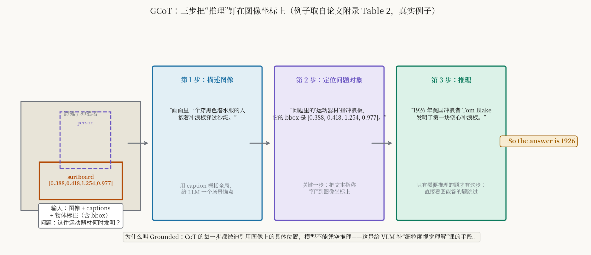
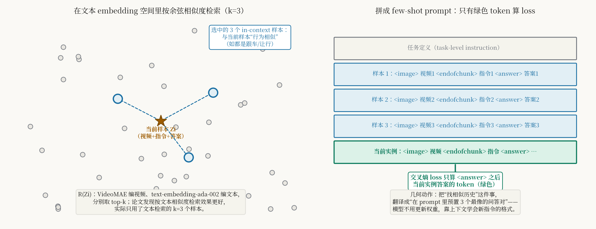
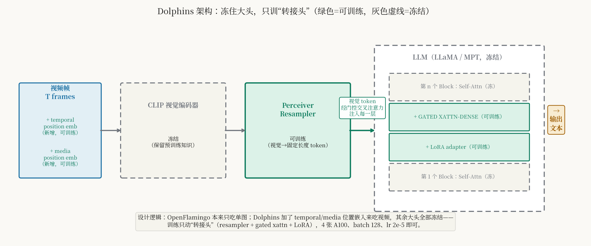
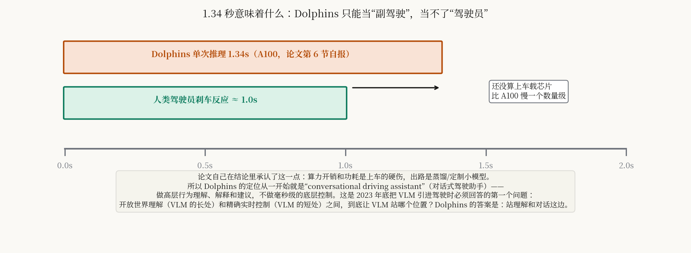

# 2023 年底第一个认真回答"VLM 在驾驶里站哪边"的工作：Dolphins 把 VLM 放在理解和对话这边

> **信息块**
>
> - **论文标题**：Dolphins: Multimodal Language Model for Driving
> - **作者**：Yingzi Ma、Yulong Cao、Jiachen Sun、Marco Pavone、Chaowei Xiao —— 威斯康星大学麦迪逊分校、NVIDIA、密歇根大学、斯坦福大学
> - **会议 / 年份**：ECCV 2024；arXiv:2312.00438（v1 2023-12-01，全文只有一个版本，本文按 v1 解读）
> - **链接**：论文 <https://arxiv.org/abs/2312.00438> ｜ 项目页 <https://vlm-driver.github.io>
> - **代码是否公开**：公开（MIT 协议），官方仓库 <https://github.com/vlm-driver/Dolphins>。推理代码和 checkpoint 在 2024 年 7 月 11 日发布；论文里训练代码和 benchmark 写的是 "TBD"（待发布）。
> - **一句话核心洞见**：Dolphins 是 2023 年底第一个把"VLM 在驾驶系统里到底该站哪个位置"这个问题想明白的工作——它不让 VLM 去碰毫秒级的底层控制，而是把它放在"理解场景、解释行为、和人对话"的位置上，用 Grounded Chain of Thought 把细粒度推理钉在图像坐标上，用检索式上下文样本让模型不更新权重也能适应新指令；代价是 1.34 秒的推理延迟和一篇几乎全是定性展示的论文。

## 先把时间坐标钉死：2023 年 12 月 1 日

读 Dolphins 不先还原时间坐标，就会误判它的分量。2023 年 12 月 1 日是什么时候？GPT-4V 发布才两个月，LLaVA 论文（2023.4）刚满半年，MiniGPT-4（2023.4）、InstructBLIP（2023.5）、Otter（2023.5）都是当年上半年的事。视觉指令微调（visual instruction tuning）这个概念本身才 7 个月大。自动驾驶这边，DriveGPT4（2023.10）刚把 LLM 引进驾驶没两个月，GPT-Driver（2023.10）刚用 GPT-3.5 做运动规划，DriveLM（2023.12）和 Dolphins 几乎同时挂上 arXiv。

在那个时间点，把 VLM 引进驾驶要回答的第一个问题不是"怎么做"，而是"**VLM 到底该站在驾驶系统的哪个位置**"。这个问题的两面是：VLM 的长处是开放世界理解——常识、长尾场景、解释；短处是精确、实时的控制——自回归生成慢、数字不精确、幻觉要命。2023 年底的几条路线分别是：DriveGPT4 让 VLM 直接输出控制（站控制侧），HiLM-D 给 VLM 加高分辨率和检测模块（站感知侧），Dolphins 让 VLM 当"conversational driving assistant"（站理解和对话侧）。Dolphins 的选择在当时是反共识的：别人都在想办法让 VLM "开车"，它说 VLM 应该"坐在副驾驶上说话"。

这个定位判断是全文真正的起点。后面所有的设计——GCoT、四个 AV 任务、in-context 学习——都是为"副驾驶"这个定位服务的。读的时候要不断回来问：这个设计是在帮 VLM 更好地理解和对话，还是在偷偷让它干控制的活？

## 前人真正撞墙的地方：ADS 的三宗罪

论文引言列了现有自动驾驶系统的三条罪状，值得一条条看，因为它们定义了 Dolphins 要补的课：

**第一，整体理解（holistic understanding）缺失。** 论文举的例子很具体：一个球滚到马路上，接着一个小孩追着球跑出来。人类司机瞬间能推出危险——球后面可能跟的是小孩。但数据驱动的 ADS 没见过足够多的"球+小孩"样本就反应不过来。这不是"数据不够多"的问题，是长尾的本质：长尾场景按定义就是凑不够数据的。VLM 的出路是常识迁移——它在互联网图文里见过无数"小孩追球"的叙述，不需要驾驶数据。

**第二，即时学习（instant learning）缺失。** 人类见一两次新障碍物就会绕，ADS 要见几百次。VLM 的出路是 in-context learning：给几个例子，不更新权重就会了。

**第三，反思纠错（reflection）缺失。** ADS 是前馈的，开错了不会自己纠正；人类开错路口会立刻调整。VLM 的出路是多轮对话：给它反馈，它能重新推理。

这三条里第一条是"为什么用 VLM"，第二条是"怎么低成本适应"，第三条是"对话形态的价值"。论文的两个能力维度（holistic understanding + human-like capabilities）就是从这三条长出来的。注意作者没有 claim VLM 能解决规划控制——三条罪状全是关于"理解"和"适应"的，这和"副驾驶"定位是自洽的。

## GCoT：三步把推理钉在图像坐标上

Grounded Chain of Thought 是论文的第一个技术贡献。先看它要解决什么：当时的 VLM（包括 OpenFlamingo）做的是粗粒度图文对齐，缺细粒度视觉理解——模型能说出"图里有车"，但说不清"哪辆车、在哪、和自车什么关系"。HiLM-D 的解法是喂高分辨率图+加检测模块，但受限于驾驶数据的标注质量。Dolphins 的解法是换一条路：**不在架构上加东西，在数据上补课**——用 ChatGPT 给通用 VQA 数据生成"带坐标的三段式推理"，先让模型在通用图像上学会"定位再推理"，再迁移到驾驶。

三步的具体内容（附录 Table 2 的真实例子，论文原样给出，我带你走一遍）：

输入是一张海滩照片、一组 caption、一组带 bbox 的物体标注（surfboard: [0.388, 0.418, 1.254, 0.977]，person: [0.431, 0.222, 0.941, 1.362]，坐标是 0–1 归一化的左上/右下角），问题是"这件运动器材是何时发明的"，参考答案是 1926。

- **第 1 步**：用 caption 写一句话描述图像——"画面里一个穿黑色潜水服的人抱着冲浪板穿过沙滩。" 这是给 LLM 一个场景锚点。
- **第 2 步**：找到问题中的对象。如果它在标注物体里，就写一句描述它和它的 bbox——"问题里的'运动器材'应该指冲浪板。"如果不在，就找最相关的一个。这是关键一步：**把文本指称钉到图像坐标上**。
- **第 3 步**：如果需要推理，写出推理过程——"1926 年美国冲浪者 Tom Blake 发明了第一块空心冲浪板。"如果看图能直接答（比如"熊是什么颜色"），这步跳过。

三段拼起来，末尾加一句 "So the answer is 1926"，就是一条 GCoT 训练样本。

*图 1：GCoT 的几何动作。第 2 步是承重的那一步——它强迫每一次推理都先引用图像上的具体坐标，模型不能凭空推理。这是给 VLM 补"细粒度视觉理解"课的数据手段。*

为什么叫 Grounded？因为 CoT 的每一步都被迫引用视觉证据。普通的 CoT（"逐步思考"式提示）在 VLM 里容易变成"一步步编"——语言先验太强，模型会编出图像里没有的东西。第 2 步的 bbox 引用是一个硬约束：推理链里必须出现真实坐标，编不出来就露馅。

为什么不在驾驶数据上直接做 GCoT？论文说得很实在：驾驶领域没有"带空间标注的视频问答"数据，BDD-X 只有行为描述和理由，没有 bbox。所以作者先在通用 VQA 数据（VQAv2、OK-VQA、GQA、TDIUC，共 9,645 条 GCoT 样本，加上 LLaVA-instruct-80k 和 SVIT，第一阶段共约 10.7k 样本）上把能力"种"下去，再用驾驶指令数据迁移。这是一个"先补通识课、再学专业课"的课程设计（curriculum），在 2023 年底数据稀缺的条件下是务实的选择。但代价是：GCoT 的答案是 ChatGPT 生成的，质量没有人工校验——9,645 条样本里有多少推理是 ChatGPT 编的，论文没说。这是一个诚实的缺口。

## 四个 AV 任务：把感知、预测、规划翻译成问答

第二阶段的数据是基于 BDD-X 构建的驾驶指令集。BDD-X 本来有约 7,000 个视频、切分成约 25,000 个片段，每个片段有行为描述（"车停了"）和行为理由（"因为红灯"）。Dolphins 从中设计了四个任务：

1. **行为理解**：看视频，描述自车在干什么（BDD-X 的 action description）。
2. **行为推理**：解释自车为什么这么干（BDD-X 的 justification）。
3. **控制信号预测**：给历史控制信号（速度、油门、转角），预测下一秒的速度和转角。这是四个任务里唯一碰"数字"的。
4. **详细对话**：用 ChatGPT 把前三个任务的短答案扩写成 detailed response，讲交通规则、潜在风险、驾驶注意事项，一共 11k 条。

总数 32k 个"视频-指令-答案"三元组，其中 21k 来自 BDD-X 标注，11k 是 ChatGPT 生成的详细对话。注意任务 3 的措辞：预测的是"下一秒的速度和转角"，horizon 只有 1 秒，而且论文在 5.1.2 节承认，由于缺乏地图、目的地等信息，规划"still limited to a brief period in the future"。这再次印证"副驾驶"定位——Dolphins 不打算做完整的轨迹规划，只做到"下一秒大概怎么动"这个粒度。

## RICES：把"找相似历史"翻译成"在 prompt 里预置答案格式"

公式（1）–（3）是 in-context 指令微调的核心，值得逐项拆开：

$$R(Z_i) = \{\text{Top}_k \cos(E_{\text{Image}}(X^v_i), E_{\text{Image}}(X^v)),\ \text{Top}_k \cos(E_{\text{Text}}(X^t_i), E_{\text{Text}}(X^t))\} \tag{1,2}$$

$$= \{\hat{Z}^1, \dots, \hat{Z}^{2k}\} \tag{3}$$

$Z_i = (X^v_i, X^t_i)$ 是第 $i$ 个样本（视频 $X^v_i$ + 文本 $X^t_i$，文本是"指令-答案"对）。$E_{\text{Image}}$ 是 VideoMAE，$E_{\text{Text}}$ 是 text-embedding-ada-002，分别把视频和文本映到 $d$ 维向量。$R$ 是检索流程：对每个样本，在视频 embedding 空间找余弦相似度最高的 $k$ 个、在文本 embedding 空间找 $k$ 个，合起来 $2k$ 个候选。

然后论文做了一个关键的取舍：**实际只用了文本检索的 $k=3$ 个样本**。理由是作者之前的研究发现，按文本相似度检索比按图像相似度检索更能保留 VLM 的 in-context 学习能力。这个判断的直觉是：决定"该怎么回答"的更多是任务的语义（文本），而不是画面的像素相似。视频检索选出来的可能是"画面很像但任务无关"的样本，文本检索选出来的是"行为/任务相似"的样本。

检索到的 3 个样本拼成 few-shot prompt（论文 Table 1 的模板）：任务定义开头，然后每个样本是 `<image> 视频 <endofchunk> 指令 <answer> 答案`，最后接当前实例。训练时**只有绿色 token 算 loss**——即当前实例 `<answer>` 之后答案部分的 token，in-context 样本本身不产生 loss（它们是只读的上下文）。

*图 2：左：在文本 embedding 空间按余弦相似度找 top-3 最像的样本。右：拼成 few-shot prompt，只有当前实例答案的 token（绿色）算交叉熵 loss。几何动作是把"适应新指令"翻译成"给模型看三个最像的问答对"。*

这个设计的漂亮之处在于它回答了引言的第二条罪状（即时学习）：新指令来了，不用重新训练，去样本库里捞三个最像的问答对塞进 prompt，模型"看"会了。Fig 20 展示了零样本泛化到没见过的指令格式（"What if" 式问题），Fig 21 展示了通过 in-context 样本学会回答"未来假设"问题。

但怀疑者要追问一句：**文本检索会不会泄漏答案**？如果检索是按"指令-答案"对的文本相似度找的，那么找出来的 3 个样本的答案很可能和当前样本的答案文本高度相似（比如都是"the car stops because the traffic light is red"）。模型要做的可能不是"理解视频"，而是"抄最像的那个答案"。论文没有做"检索到的样本答案 vs 当前答案"的相似度分析，也没有"随机检索"对照。这是一个真实的方法论缺口——in-context 学习的效果里，有多少是检索泄漏，有多少是真泛化，分不开。

## 架构：冻住大头，只训"转接头"

Dolphins 基于 OpenFlamingo（Flamingo 的开源复刻）。架构三部分：CLIP 视觉编码器、perceiver resampler、LLM（LLaMA/MPT）每层插入的门控交叉注意力（gated cross-attention）。OpenFlamingo 原生只支持单图，Dolphins 加了两组学到的隐向量：**temporal position embeddings**（对抗"多帧特征聚合时全局时间信息消失"）和 **media position embeddings**（给 few-shot prompt 里的多个视频/文本块提供顺序信息）。论文说加了这两组嵌入后视频理解能力"noteworthy enhancement"，但没有给消融数字——这是又一个"说了但没量"的地方。

*图 3：绿色实线=可训练，灰色虚线=冻结。训练只动 perceiver resampler、门控交叉注意力、LoRA 和两组新增的位置嵌入——典型的"转接头"微调，4 张 A100 就能跑。*

冻结策略是全文最务实的一处：视觉编码器和 LLM 的自注意力全部冻结，只训练 perceiver resampler、gated cross-attention 和加在 LLM 上的 LoRA。训练配置：AdamW（β₁=0.9，β₂=0.999，weight decay 0.01），4 张 A100，总 batch 128，第二阶段学习率 2×10⁻⁵，序列长度 1024，BF16。这个量级的训练在 2023 年底是一个普通实验室能负担的——这也是 Dolphins 能快速产生影响的原因之一：别人拿去就能训。

## 能力展示：走一遍"尾灯反思"的例子

论文第 5 节是 24 张定性展示图（Fig 5–28），没有定量指标。挑一个最能说明"反思纠错"的例子走完——Fig 25：

场景：自车在城市街道跟车，前方一辆黑色轿车的右尾灯在闪。第一轮，Dolphins 预测黑车会继续直行——错了，尾灯闪烁通常意味着转向或变道。然后人类给了一条反馈："闪烁的尾灯表示转向或变道"（交通规则）。第二轮，Dolphins 修正预测：黑车要右转。

这个例子的机制值得拆开：第一轮的错误不是"没看见尾灯"，而是"看见了但没连上规则"；反馈给的是一条**显式规则**，不是正确答案；模型用这条规则重新解释了同一个视觉证据，得出正确结论。这正是论文想展示的"human-like reflection"——和人类司机被副驾驶提醒"他打右灯了"之后修正判断的过程同构。Fig 26（窄路会车不必要的让行被纠正）、Fig 27、28 是同类。

但同一节里也有作者自曝的幻觉：Fig 6 和 Fig 9 的图注里，被删除线划掉的词（`<s>Words</s> means hallucination`）就是模型编出来的内容。论文没有藏着掖着，用删除线标出来了。这说明即使经过 GCoT 训练，细粒度幻觉依然存在——GCoT 降低了幻觉率，但没有根除。结合 OpenDriveVLA 的观察（结构化 token 抗幻觉、全局 token 易幻觉），可以拼出一个更完整的图景：2023–2025 年的 VLM 驾驶工作，是在用不同的方式给同一个问题打补丁。

## 怀疑式阅读：这篇论文没有数字

Dolphins 全文**几乎没有定量实验**。唯一的性能数字是结论里自报的：在 DriveLM 数据集上，A100 上平均推理时间 1.34 秒。没有在任何公开 benchmark 上的分数，没有和 DriveGPT4、HiLM-D 的对照表，没有消融表（temporal/media embedding 的效果只有定性描述、没有数字；RICES 用文本检索而不用视频检索的结论引用的是"之前的研究"而非本文实验）。2023 年底的 VLM 驾驶论文大多如此——任务定义本身（"像人一样理解"）就很难量化，但读者要清楚：这篇论文的证据全是"我选的例子"，例子是作者挑的，挑的就是能讲故事的。

几个具体的缺口：

- **1.34 秒意味着什么**（图 4）。A100 是数据中心卡，车载芯片慢一个数量级；人类刹车反应约 1 秒。1.34 秒的延迟决定了 Dolphins 只能做"副驾驶"——论文结论自己也承认算力和功耗是上车的硬伤，出路是蒸馏/定制小模型。这是诚实的，但也意味着论文的"human-like responsiveness"这个说法要打折：理解可以像人，反应速度不行。

*图 4：论文自报的 1.34 秒（A100）vs 人类刹车反应。这个数字是 Dolphins"对话助手"定位的物理依据——它从一开始就没打算做实时控制。*

- **训练代码 "TBD"**。论文挂出时（2023.12）仓库只有推理相关的占位，训练代码写"下个月发布"，实际到 2024 年 7 月才放出推理代码和 checkpoint。GCoT 数据生成、RICES 检索、两阶段微调的完整流程，外界在论文发表后半年多都无法复现。学术上这不是大问题（ECCV 2024 录用了），但做 follow-up 的人要注意：论文里的训练细节（比如 in-context 样本在训练时的具体采样方式）只能信文字描述。
- **BDD-X 的规模**。7,000 个视频、25,000 个片段，相对今天动辄百万级的驾驶数据很小。32k triplets 里 11k 是 ChatGPT 生成的详细对话——这 11k 的"详细"有多少是 ChatGPT 的驾驶常识、有多少是编的，无从得知。论文用 BDD-X 的行为描述做"行为理解"任务，但 BDD-X 的标注本身是众包的、粒度粗（"the car stops"这种），能达到的上限不高。
- **检索泄漏**（前面已讲）：RICES 按"指令-答案"文本相似度检索，in-context 样本的答案可能和当前答案高度重合，few-shot 效果里混进了"抄答案"的成分。缺随机检索对照。

公平地说，论文也有做得漂亮的地方：附录 A 把 GCoT 的数据构造、ChatGPT prompt（system message 全文）、正负例处理（GQA 缺 caption 怎么办、MSCOCO 物体缺位置信息拿 Visual Genome 补）写得非常细，细到别人能照着重做；Fig 6/9 用删除线自曝幻觉而不是藏起来；结论主动承认延迟和功耗问题并指了蒸馏的方向。这些都是"作者心里有数"的表现。

## 时间坐标的意义：它定义了"VLM 当副驾驶"这条线

把 Dolphins 放回 2023 年底的时间线：同期挂出的 DriveLM（2023.12）做的是图问答式的驾驶推理，DriveMLM（2023.12）做的是行为规划状态对齐，DriveGPT4（2023.10）已经展示了 VLM 直接输出控制。这几条线后来分化得很清楚：DriveGPT4 那条"VLM 直接开车"线，后来被证明延迟和可靠性都过不了关，逐渐式微；Dolphins 这条"VLM 当副驾驶"线，变成了今天 VLA 驾驶里"语言负责理解和指令、另起规划器负责控制"的快慢双系统（比如 Senna、DriveVLM 都可以看作这个思想的后代）。

Dolphins 的另一个历史贡献是方法论上的：**GCoT 证明了"用数据补课"可以替代"在架构上加模块"**。HiLM-D 当时的思路是加高分辨率、加检测模块——重架构；Dolphins 说不用，给 ChatGPT 写个三步 prompt，生成 9,645 条带坐标的推理数据，训一下就行。这个"数据大于架构"的判断在 2023 年底是需要勇气的，后来被反复验证（今天几乎所有的 VLM 驾驶工作都在做数据）。

## 可以带走的东西

**第一个可迁移的想法：GCoT 式的"先定位、再推理"数据构造法。** 任何需要 VLM 做细粒度视觉推理的任务（医疗影像报告、工业质检、遥感解译），都可以套用这个三步模板：先让模型描述全局，再强迫它把问题对象钉到坐标上，最后才允许推理。第 2 步是承重的——它是一个可验证的硬约束，推理链里必须出现真实坐标，编不出来。Dolphins 的教训是：生成数据的 LLM（这里是 ChatGPT）本身会编，所以 GCoT 数据的质量上限就是生成器的水平，关键样本值得人工抽查。

**第二个可迁移的想法：检索式 few-shot 是低成本领域适应的通用手段。** RICES 的模式——"embedding 检索最像的 k 个问答对 → 塞进 prompt → 不更新权重"——不依赖驾驶。今天任何一个"有历史问答库、有新指令要适应"的场景（客服、代码助手、具身智能的技能复用）都能用。Dolphins 的教训是：检索用的相似度（文本 vs 视觉）要和任务的决定因素对齐，而且必须做"随机检索"对照，否则 few-shot 的效果里混着答案泄漏。

**第三个值得做的具体问题：VLM 驾驶的"理解-控制"分工协议。** Dolphins 在 2023 年底凭直觉选了"副驾驶"定位，OpenDriveVLA 在 2025 年把 VLM 推到了"直接输出轨迹"。这两年间 VLM 的延迟降了、精度涨了，但"理解"和"控制"之间的分工线到底该画在哪，依然没有系统性的回答。一个值得做的具体工作是：在同一个场景集上，系统性地测"纯 VLM 端到端" vs "VLM 理解 + 传统规划器" vs "VLM 高层指令 + 学习型规划器"三条线的延迟-精度-可解释性 trade-off，给出分工线的经验位置。Dolphins 和 OpenDriveVLA 分别是这条线两端的早期证据，但中间的地带还是空的。
