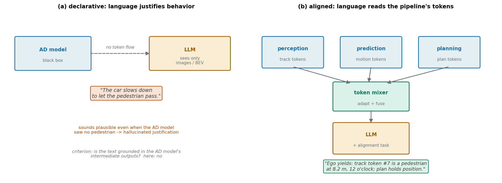
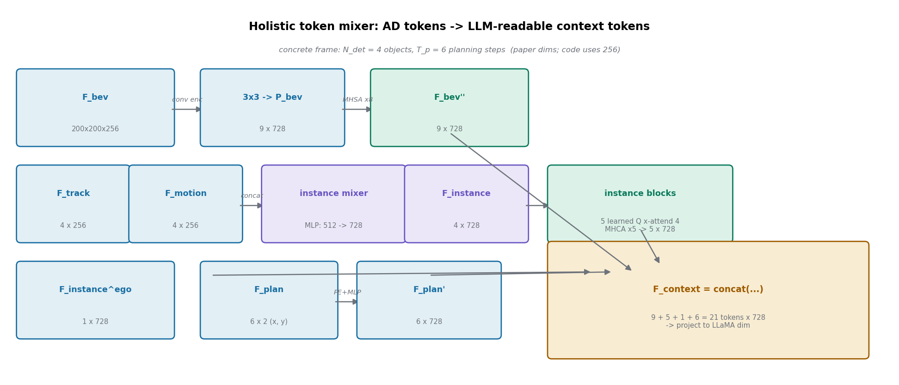
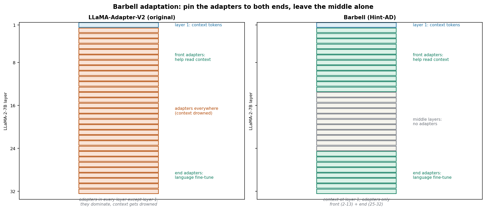
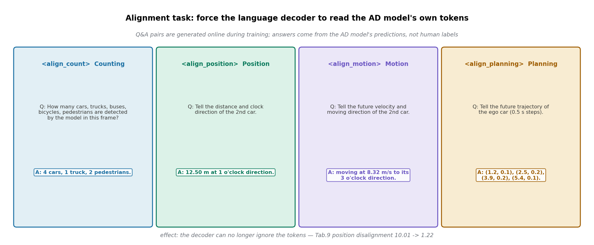

> **标题**：别让语言模型现编理由——让它逐字读懂感知、预测、规划的中间 token
>
> **论文**：Hint-AD: Holistically Aligned Interpretability in End-to-End Autonomous Driving
>
> **作者**：Kairui Ding, Boyuan Chen, Yuchen Su, Huan-ang Gao, Bu Jin, Chonghao Sima, Wuqiang Zhang, Xiaohui Li, Paul Barsch, Hongyang Li, Hao Zhao（清华 AIR / 奔驰中国 / 上海 AI Lab OpenDriveLab；通讯作者 Hao Zhao）
>
> **会议**：CoRL 2024
>
> **arXiv**：[2409.06702](https://arxiv.org/abs/2409.06702)（只有 v1）
>
> **代码**：公开，但有两个仓库：[AIR-DISCOVER/Hint-AD](https://github.com/AIR-DISCOVER/Hint-AD) 只是项目主页，实现代码在 [Robot-K/Hint-AD](https://github.com/Robot-K/Hint-AD)（含 Hint-UniAD 与 Hint-VAD 两个实现）。已 clone 并对照正文核验，发现数处论文与代码不一致，见怀疑式审读一节。
>
> **一句话核心洞见**：解释驾驶行为的语言不能看着传感器画面现编理由，而必须逐字对齐自动驾驶模型自己的中间产物——感知、预测、规划各阶段的 token；对齐靠两招：一个把 AD token 翻译成 LLM 能读的形状的 token mixer，和一个训练时在线生成的"阅读理解"问答任务，逼语言解码器真正读懂每个 token 里装的是什么。

## 先纠正一个误解："Hint"不是人类给的提示

从标题看，"Hint-AD"很容易被理解成"人类给自动驾驶系统提示（hint），系统照着做"——比如人类接管信号、语言指令引导。这篇论文里的 hint 不是这个意思。通读全文 24 页，"hint"没有展开成任何缩写，也没有任何一处表示人类提示。它就是个项目名，意思更接近"AD 模型在推理中途掉落的线索（hint）"——那些中间 token。人类指令在这篇论文里只以一种形式出现：语言任务的 prompt（比如"解释当前驾驶行为""预测驾驶命令"），而不是进入决策环的提示信号。

这个纠正很重要，因为它决定了这篇论文在你研究版图里的位置：它不做"人类如何指挥车"，它做"车如何向人类解释自己"。方向是反的——不是 instruction following，而是 interpretable generation。但别急着把它归档到"解释性"抽屉里吃灰：它的技术内核（让 LLM 读懂另一个模型的中间 token）恰恰是 agent 式自动驾驶里最缺的一环，后面会细说。

## 作者到底在跟谁较劲：declarative 和 aligned 的划分

论文开篇（图 1）先立了一个二分法，这是全文的组织骨架，值得认真对待，因为它既是作者的底牌，也是最容易被质疑的地方。

**Declarative interpretability**：语言模型直接看传感器数据（或 BEV 特征），生成一段解释驾驶行为的话。它不读 AD 系统的任何中间输出。ADAPT、DRAMA、TOD³Cap、DriveLM 都属于这一类。问题在于，生成的文本和 AD 系统的内部状态之间没有任何约束关系——模型完全可以编一段听起来合理的理由，而这个理由和车真正的决策依据毫无关系。用论文的话说，这是 mere justification，不是 explanation。

**Aligned interpretability**：语言必须和 AD 模型的内部状态对上。这条线最早是 Kim 等人 2018 年在 ECCV 的工作（把 AD 模型的注意力状态和语言解码器对齐），后来有 DriveMLM（对齐行为规划状态）。但论文指出，之前的工作都只对齐了"一部分"内部状态（注意力、或决策状态），没有人把**完整的感知-预测-规划链条**全部拿来对齐。

这个二分法作为修辞是漂亮的，但作为分类是有水分的。"Declarative"这个筐里装的东西差异很大：ADAPT 是专门为解释任务训练的 transformer，GPT-4o 是 6-shot 提示的通用大模型，把它们都叫"declarative"并放在同一张表里比，输的一方（GPT-4o 们）其实没得到公平的对待——它们连 AD 模型的存在都不知道。更诚实的基线是 BEV+Adapter：同样的 LLaMA-Adapter-V2 解码器、同样的 BEV 输入，唯一的区别就是**有没有喂中间 token**。好在论文确实做了这个基线，而 Nu-X 上 +3.8 的 CIDEr（20.4%）正是从它身上挣来的。这个数字是全文最硬的一块证据，后面会验算。

## 从 AD 模型里能掏出什么：四种 token 的形状

Hint-AD 挂在两个现成的端到端 AD 模型上：UniAD（rasterized 表示）和 VAD（vectorized 表示），分别叫 Hint-UniAD 和 Hint-VAD。选这两个是为了证明方法的通用性——一个是密集 BEV，一个是稀疏向量，token 长得不一样，mixer 都能接。

从一次前向推理里，论文掏出四种东西（记号按正文 3.2 节，论文附录表 7 有几行是错位的，以正文为准）：

- **BEV token** $F_{\text{bev}} \in \mathbb{R}^{H_b \times W_b \times C}$：BEV 特征图，$200 \times 200 \times 256$。这是场景的密集表示，每个格子是一个 256 维向量。
- **Track token** $\{F^i_{\text{track}}\}_{i=1}^{N_{\text{det}}} \subset \mathbb{R}^D$：每个被检测到的物体的 query，装着位置和历史轨迹信息，$D = 256$。$N_{\text{det}}$ 随帧变化。
- **Motion token** $\{F^i_{\text{motion}}\}_{i=1}^{N_{\text{det}}} \subset \mathbb{R}^D$：同一个物体的预测未来轨迹，同样 $256$ 维。
- **Planning token** $F_{\text{plan}} \in \mathbb{R}^{T_p \times 2}$：自车未来轨迹点，$(x, y)$ 坐标序列。

注意 track 和 motion 是**按物体配对**的：第 $i$ 个物体的过去（track）和未来（motion）是同一个 $i$。这个配对关系是 instance mixer 存在的前提。

这些 token 对 LLM 来说是天书：256 维的 query 向量里，哪个维度表示"这辆车在 12 米外"，没有任何先验可循。LLM 是在文本上训练出来的，它读不懂。Token mixer 就是翻译官。

## Token mixer：把 AD 的 token 翻译成 LLM 能读的形状

Holistic token mixer 干三件事，分别对应三种 token 的脾气。拿一个具体帧走一遍：假设某帧检测到 $N_{\text{det}} = 4$ 个物体，规划步数 $T_p = 6$。

**第一路：BEV。** $200 \times 200 \times 256$ 的特征图先过一个多层卷积编码器，压到 $3 \times 3$，再过 MLP 投影 $P_{\text{bev}}$ 把通道从 256 投到 $D_{\text{embed}} = 728$（论文表 7 的数；代码里实际用 256，见后文）。得到 $F'_{\text{bev}}$：9 个 token，每个 728 维。然后过 **BEV blocks**：8 个 transformer encoder block，每个 16 头自注意力 + MLP（hidden 3072），9 个 token 互相看一遍，出来 $F''_{\text{bev}}$，形状不变。为什么 BEV 需要自注意力？因为卷积压到 $3 \times 3$ 之后，每个 token 只看到局部，MHSA 让 9 个格子交换全局上下文——"左前方格子有辆车"和"右后方格子有行人"之间的关系在这里建立。

**第二路：instance。** 这是设计上最用心的一路。先过 **instance mixer**：

$$F^i_{\text{instance}} = P_{\text{instance}}(\text{Concat}(F^i_{\text{track}}, F^i_{\text{motion}})), \quad i = 1, \dots, N_{\text{det}}$$

每个物体，过去（256 维）和未来（256 维）拼成 512 维，过一个 MLP 投到 728 维。几何意义：track 告诉你"它在哪、从哪来"，motion 告诉你"它要去哪"——拼起来再投影，就是"这个物体的完整时空画像"。代码里的 `multi_query_fuser` 证实了这个结构：`Linear(512→512) → LayerNorm → ReLU → Linear(512→256)`（代码用 256 维）。

然后是 **instance blocks**：5 个 transformer decoder block。麻烦在于 $N_{\text{det}}$ 每帧不一样（这帧 4 个，下帧 7 个），LLM 的 prompt 需要固定长度。解法是引入 $N_{\text{ins-adapt}} = 5$ 个**可学习的 query token**（论文 3.2 节和附录 B.1 说是 5 个；代码默认 `ins_query_len=10`，又一处不一致），让它们去 cross-attention 那 $N_{\text{det}}$ 个 instance token：

$$F'_{\text{instance}} = \text{MHCA}(F_{\text{ins-adapt}}, F_{\text{instance}})$$

5 个 query 当"采访者"，4 个物体 token 当"受访者"，每轮 cross-attention 采访者从受访者那里提取信息。出来固定 5 个 token，每个 728 维。这招是从 DETR 的 object query 那学来的：用固定数量的可学习 query 去"打捞"数量不定的输入。

**第三路：planning。** $F_{\text{plan}} \in \mathbb{R}^{6 \times 2}$ 是 6 个 $(x, y)$ 坐标。先做 sinusoidal positional encoding，再过 MLP 投到 728 维。为什么坐标也要 PE？因为 $(1.2, 0.1)$ 和 $(2.5, 0.2)$ 这两个点之间的"先后关系"和"距离关系"，MLP 直接吃原始坐标学得很慢；sinusoidal PE 把连续坐标展开成一组不同频率的正弦/余弦，相对距离变成了相位差，MLP 好学得多。这是 transformer 位置编码的老技巧，用在这里是因为轨迹点本质上是个序列。

最后全部拼起来：

$$F_{\text{context}} = \text{Concat}(F''_{\text{bev}}, F'_{\text{instance}}, F^{\text{ego}}_{\text{instance}}, F'_{\text{plan}})$$

$9 + 5 + 1 + 6 = 21$ 个 token，每个 728 维，再投影到 LLaMA 的维度（4096），作为 prompt token 喂进语言解码器。那个 $F^{\text{ego}}_{\text{instance}}$ 是自车自己的 instance token——自车在 UniAD 里也被当成一个被跟踪的"物体"，它的 track+motion 同样过 instance mixer。

消融表 3 说明哪块承重：去掉 instance mixer，TOD³Cap 的 CIDEr 从 342.6 掉到 220.4；去掉 instance blocks，掉到 259.4。Instance mixer 是最承重的一块——它负责把"过去+未来"拼成"物体画像"，没有它，track 和 motion 就是两团互不相干的向量。表 2 则说明哪种 token 对哪种任务重要：去掉 track token，TOD³Cap 从 342.6 崩到 120.3（3D dense captioning 本质上是"描述每个物体的位置和状态"，没有 track token 就瞎了）；去掉 planning token，command 预测从 83.0 掉到 79.1（命令预测需要知道自车打算怎么走）。

这里有个反常的数字，论文没有讨论：Nu-X 上，**去掉 motion token 的 CIDEr 是 22.3，反而比全量 token 的 21.7 高**。Motion token 对驾驶解释任务可能是噪声——解释"车为什么这么开"时，别车的预测轨迹未必有用，加进来反而让解码器分心。作者没提这一行，但它暗示 holistic（全都要）未必总是最优，token 的选择应该按任务来。

## Barbell adaptation：为什么 adapter 不能到处插

语言解码器用的是 LLaMA-2-7B（32 层），微调方法选的是 LLaMA-Adapter-V2。原版的策略是：context token 插在第 1 层，可学习的 adapter 插在剩下的 31 层。作者观察到一个现象：adapter 是为"语言微调"服务的，它太强势了，会把 adaptation 的主导权抢走，导致 context（也就是 AD token）和语言之间的对齐被削弱。用大白话说，解码器忙着学"怎么说话"，没空学"看懂 AD token"。

Barbell（杠铃）的解法是把 adapter 只钉在两头：

- 第 1 层：只放 context token；
- 第 $[2, N_{\text{front}}+1]$ 层：front adapter（论文说 $N_{\text{front}} = 12$，即第 2–13 层）；
- 第 $[N - N_{\text{end}} + 1, N]$ 层：end adapter（论文说 $N_{\text{end}} = 8$，即第 25–32 层）；
- 中间第 14–24 层：什么都不插，让 LLaMA 原生的权重自己处理。

设计 rationale 是：front adapter 帮模型"读懂 context"，end adapter 负责"语言微调"，中间层不插手，让预训练的推理能力自然流淌。Adapter 本体是 LLaMA-Adapter 的标准做法：作为额外的 key 和 value 插进注意力层，**零初始化**——训练开始时 adapter 的注意力权重是 0，对模型输出没有任何影响，然后慢慢学。这就是为什么它比 LoRA 稳定：LoRA 直接改权重矩阵，遇到全新模态（AD token）时梯度容易炸。附录表 8 给了实锤：LoRA（r=16）在约 2.3K 步梯度爆炸，DoRA 在 3.1K 步，而 adapter 用仅 0.014% 的参数稳定训练超过 20K 步。

表 4 的消融：Nu-X 上 barbell 的 CIDEr 是 21.7，early fusion（原版，到处插）16.9，pyramid（只插前 $N_{\text{front}}$ 层）15.3，hammer（只插最后 $N_{\text{end}}$ 层）14.7。Barbell 赢得干净。但有个例外作者如实写了：TOD³Cap 上 early fusion 的 CIDEr 是 350.4，**比 barbell 的 342.6 还高**，Rouge 也是 89.3 vs 85.4。3D dense captioning 这个任务更依赖"把物体描述清楚"的语言能力，adapter 到处插反而有帮助——这说明 barbell 的"读懂 context 优先"假设不是放之四海皆准的，任务越偏向语言生成，adapter 越多越好。

代码核验发现一个实在的不一致：`llama_adapter.py` 的默认值是 `pre_adapter_layer=8`（front）、`adapter_layer=12`（end），而论文表 7 写的是 $N_{\text{front}} = 12$、$N_{\text{end}} = 8$——**前后端的层数在代码和论文里是反的**。配置文件没有覆盖默认值，所以开源代码实际跑的是 8 层 front + 12 层 end。这个差异不影响 barbell 思想的成立，但说明论文里的超参数表不能直接拿来复现。

## Alignment task：训练时在线出的"阅读理解题"

Token mixer 解决了"形状对得上"，但还有个更深的问题：LLM 凭什么要理这些 token？Decoder 完全可以无视 context token，靠语言先验编出通顺的解释——这正是 declarative 模式的老毛病。作者的解法是在训练时加一套**在线生成的对齐问答**，逼解码器逐个 token 读懂。

训练的每一帧，系统用 AD 模型自己的中间输出自动生成问答对（代码 `caption_head.py` 里以 `<align_count>`、`<align_position>`、`<align_motion>` 为特殊前缀标记）。四种题型：

- **Counting**：根据 track token，回答"这帧检测到几辆车、几个行人"。答案来自 AD 模型的检测头。
- **Position**：给一个 instance token，回答这个物体的距离和时钟方向（代码里用 `get_distance_and_clock_direction`，比如"12.50 米，1 点钟方向"）。
- **Motion**：解码 instance token 里的速度信息（"以 8.32 m/s 向 3 点钟方向移动"）。
- **Planning**：输出 planning token 里的未来轨迹点。

关键细节：**答案的 ground truth 来自 AD 模型的预测，不是人工标注**。这是"aligned"的准确含义——语言和 AD 模型的内部信念对齐，而不是和客观世界对齐。如果 AD 模型把一个影子误检成行人，对齐的语言解码器会忠实地报告"有个行人"，而不是纠正它。这个设计选择是自洽的（可解释性的对象是模型，不是世界），但读者要清楚它的边界：aligned interpretability 保证的是"诚实转述模型在想什么"，不保证"模型想的是对的"。

效果上，附录表 9 的四个 disalignment 指标就是照着这四种题型定义的：CD（数量差异的平方均值）、PD（位置的平均距离）、MD（速度的平均距离）、PLD（2 秒处轨迹点的平均距离）。Aligned 的 Hint-UniAD 对 declarative 的 Hint-UniAD：2.36 vs 5.82、1.22 vs 10.01、0.51 vs 1.98、2.98 vs 10.12。位置对齐从 10.01 米降到 1.22 米，说明解码器真的学会从 token 里读位置了。

但这里有个循环论证的味道要指出来：alignment task 训练的就是"从 token 读位置"，disalignment 指标测的也是"从 token 读位置"。表 9 与其说是证明"解释更可信"，不如说是证明"alignment task 完成了它的训练目标"。真正的下游证据在表 1 和表 2：加了对齐之后，Nu-X、TOD³Cap 这些**真正的语言任务**分数涨了，那才是 alignment 有用的硬证据。论文把两套证据都摆出来了，但没有点明它们之间的主从关系。

## 跟着一帧走完全程：从 token 到一句话

把上面的部件串起来，走一个完整的推理。场景：nuScenes 一帧，UniAD 检测到 4 个物体（3 辆车、1 个行人），自车正在路口减速。

**AD 前向**：UniAD 跑完，掏出 $F_{\text{bev}}$（$200 \times 200 \times 256$）、4 个 track token、4 个 motion token、$F_{\text{plan}}$（6 个轨迹点）。AD 模型的参数全部冻结——第二阶段训练只更新 token mixer 和 adapter，共 87M 参数。

**Mixer**：BEV 压成 9 个 token；4 对 track+motion 拼成 4 个 instance token；5 个可学习 query 去 cross-attention 这 4 个，打捞出固定 5 个；自车 token 1 个；planning 6 个点过 PE+MLP。拼成 21 个 context token，投影到 4096 维。

**解码**：prompt 是 context token + 文本指令（比如"解释当前驾驶行为"）。第 1 层，context token 和文本一起进注意力；第 2–13 层，front adapter 以零初始化的额外 K/V 参与，帮模型把"第 7 个 token 是行人、8.2 米"这样的信息揉进表示；中间层原生推理；第 25–32 层，end adapter 微调语言风格。输出："The car is decelerating. To yield to the pedestrian crossing ahead."（Narration + Reasoning，Nu-X 的格式）。

**训练时的另一面**：同一帧还会生成对齐问答。"How many pedestrians are detected?"——解码器必须数 track token 里行人类别的个数，答"1"。"Tell the distance and clock direction of the pedestrian."——从它的 instance token 里读出"8.20 米，12 点钟方向"。答错了，cross-entropy loss 照样罚。这就是 alignment task 的日常：每帧几道题，逼着解码器把每个 token 的"使用说明书"背下来。

## 表 1 的数字怎么读：哪里是真提升，哪里是基线太弱

主表（表 1）四个任务，逐个看。

**Nu-X（驾驶解释）**：Hint-VAD 22.4、Hint-UniAD 21.7 的 CIDEr，对 BEV+Adapter 的 18.6。$22.4 - 18.6 = 3.8$，$3.8 / 18.6 = 20.4\%$——摘要里的"20.4%"就是这么来的，基准是 BEV+Adapter（同样的解码器、同样的 BEV 输入，只差中间 token）。这是全文最干净的一个对比：中间 token 对驾驶解释的净贡献就是 +3.8 CIDEr。GPT-3.5 打分（G）Hint-VAD 7.44 对 6.27，也涨了，但 GPT-3.5 当裁判的可靠性见下文。

**TOD³Cap（3D dense captioning）**：Hint-UniAD 342.6 的 CIDEr。摘要说"185%"，基准是 TOD³Cap 方法本身的 120.3：$342.6 - 120.3 = 222.3$，$222.3 / 120.3 = 184.8\%$。这个涨幅里有一部分是基线太弱——TOD³Cap 原方法是 detect-then-describe 的老架构（110.1 的 Vote2Cap-DETR 同理）。对同代的 Gemini-1.5（169.7），涨幅是 102%，依然很大。Track token 是这里的承重墙（表 2：去掉 track 直接掉回 120.3）。但注意 Hint-VAD 只有 263.7——附录 C.3 诚实地解释了：VAD 的感知范围是 $60\text{m} \times 30\text{m}$，TOD³Cap 的物体经常超出这个范围，检测不到就没法描述。这是 VAD 本体能力的上限，不是 mixer 的问题。

**NuScenes-QA**：Hint-VAD 50.5 对最好的基线 BEVDet+MCAN 49.9，+0.6 个点。摘要里的"1.2%"是相对值：$0.6 / 49.9 = 1.2\%$。**Command 预测**：Hint-VAD 82.3 对 BEV+Adapter 81.1，+1.2 个点；Hint-UniAD 83.0。这两个任务的提升都很小——VQA 和命令预测主要靠 BEV 里本来就有的信息，中间 token 的边际贡献有限。论文摘要把四个数字并列，读起来像"全面 SOTA"，但实际的提升分布是：captioning 类任务大胜，问答和命令任务小胜。读者应该按这个权重来理解这篇工作的分量。

**代价**：附录 A 给了实在的数字。第二阶段训练，Hint-UniAD 在 8 张 A100 上 3 个 epoch 要 13 小时（Hint-VAD 7 小时）。推理时语言解码器是瓶颈：batch=1 时 UniAD 的 AD 部分 0.43 秒、语言部分 1.23 秒。整车实测（表 6）：RTX 4090 离线，Hint-UniAD 总耗时 0.89 秒（AD 0.27 + LLM 0.62），"交互延迟"（第一个 token 流出来）0.27 秒。结论里作者自己承认了：LLaMA 解码器太慢，实时性是未解决的问题。这套系统目前是"事后解释器"，不是"车上实时解说员"。

## 怀疑式审读

**论文与代码的多处不一致。** 对照 Robot-K/Hint-AD 实现代码，发现三处：(1) $D_{\text{embed}}$：论文表 7 写 728，代码的 caption head 全程用 `query_dim=256`；(2) barbell 层数：论文 $N_{\text{front}}=12$、$N_{\text{end}}=8$，代码默认 `pre_adapter_layer=8`、`adapter_layer=12`，前后端反了；(3) 可学习 instance token 数：论文 5 个，代码默认 `ins_query_len=10`。附录表 7 还有几行明显的错位（$F_{\text{plan}}$ 写成 $N_{\text{det}} \times 256$，$F^{\text{ego}}_{\text{instance}}$ 和 $F_{\text{instance}}$ 的描述串了）。这些不推翻结论，但说明论文的附录是赶工出来的，复现时要以代码为准。

**Nu-X 数据集的"人类标注"要打引号。** 附录 D.1 的流程是：5 个标注员花 126 小时标出每段视频的驾驶行为和原因（narration 平均 8.29 词、reasoning 平均 11.25 词）→ GPT-4v 看多视图图像生成场景描述 → GPT-4v 按人类标注的意思"改写扩写"出多样化的表达 → 人工检查。最终训练和测试用的文本是 **GPT-4v 改写过的**，不是人类原话。所有模型学的都是"GPT-4v 风格的驾驶描述"。更微妙的是评估：除了 CIDEr 等 n-gram 指标，论文还用 GPT-3.5 按一套多标准 prompt 打分（附录 C.6）。GPT 家族的裁判给 GPT 家族改写的文本打分，风格偏好是顺方向的。CIDEr 的提升（n-gram 匹配人类/GPT-4v 参考）是实的，但 G 分数的含金量要打折。

**没做的消融。** Alignment task 的四个子任务（counting/position/motion/planning）没有单独消融——不知道哪个最承重。Token mixer 和 alignment task 的交互也没有拆开：表 9 的 declarative Hint-UniAD 其实同时保留了 token mixer（只是没做 alignment task），所以表 9 隔离的是 alignment task 的净效果，这点做得对；但反过来"有 alignment task、没 token mixer"的配置不存在，mixer 的必要性全靠表 3 支撑。逻辑链条是完整的，只是不对称。

**基线选择。** 7 个基线里，ADAPT、TOD³Cap、Vote2Cap-DETR 是按附录 C.4 的描述"适配"到 BEV 输入和混合数据集训练的——是重跑的，不是抄数字，这点值得肯定。但 GPT-4o 和 Gemini-1.5 只用了"图像 + 6-shot 示例"的提示，没有给它们 AD 中间输出（给了它们也读不懂，这是方法决定的），所以它们在 TOD³Cap 上的 160.8/169.7 和 Hint-UniAD 的 342.6 不是同一起跑线。论文没有藏着掖着（表头写了输入类型），但摘要里的"185%"不读表注会产生误导。

**时间坐标。** 2024 年 9 月的 arXiv，CoRL 2024。当时 LLM 驾驶解释这条线上，DriveGPT4、DriveLM、DriveMLM 都已出现，Hint-AD 的差异化就是"holistic"这个词——把感知、预测、规划的 token 全喂进去，外加在线对齐任务。这个增量是实的，但也要看到它的边界：它没有改进 AD 模型本身的任何能力，只是给 AD 模型配了个"翻译"。87M 可训练参数、13 小时 8×A100 的训练成本，换来的是一个解释器。值不值，取决于你认不认为"可解释性"是端到端自动驾驶落地的卡点——作者显然是认的（引言第一段就把 human-AI trust 摆出来），奔驰中国的作者名单也暗示了工业界的兴趣。

## 可以带走的想法

这篇论文和你的课题（Agent 为中心的自动驾驶、LLM 调度多规划器执行开放式自然语言指令）有一个直接的咬合点：**你的 LLM 调度器早晚要向人类（或向其他 agent）解释"为什么选了这个规划器、为什么这么开"，而解释的依据不能是现编的，必须是世界模型和规划器真正的中间输出。** Hint-AD 给了这件事的一个完整施工图：

**第一，"对齐"是可以被训练出来的，不靠 prompt engineering。** 很多人做 LLM+AD 的解释，做法是把 BEV 图像一扔、让 LLM 自由发挥——那就是 declarative。Hint-AD 证明了一个更硬的做法：构造在线问答任务，用 AD 模型自己的输出当答案，逼解码器学会读 token。这个"用模型的输出监督另一个模型读懂它"的套路是通用的：你的世界模型输出未来预测分布、情景记忆输出检索到的片段，都可以如法炮制一套对齐问答，让调度器的每一句解释都有据可查。这比事后加一个"解释模块"可信得多。

**第二，token mixer 是"异构表示翻译"的通用模式。** AD 的 query token（256 维、无先验语义）和 LLM 的文本 token 生活在两个世界，中间需要一座桥：instance mixer（按语义配对再投影）、可学习 query 打捞变长输入（DETR 式）、BEV 自注意力补全局上下文。这三招在你的架构里都用得上——世界模型的中间分布、记忆检索的片段，喂给 LLM 调度器之前同样需要这么一层"翻译"。

**第三，barbell 的教训是关于"微调目标冲突"的。** Adapter 到处插会让"学说话"压过"读懂 context"，这个现象在任何"LLM + 新模态"的微调里都会出现。你的调度器如果要微调，大概率也会遇到"学指令格式"和"学场景理解"抢容量的问题——barbell 的思路（按层分工：前端读 context、后端调语言）是一个现成的参考答案，尽管它的最优层数（论文和代码还打架）需要你自己搜。

最后记一个诚实的问题，论文没有回答：aligned 的解释"忠实于模型"，但如果模型本身是错的（误检、漏检），解释会一本正经地复述错误。在你的多规划器 agent 里，这意味着解释模块需要接一个**不确定性通道**——当世界模型对某个预测没把握时，解释里应该体现这种没把握，而不是把它翻译成斩钉截铁的话。Hint-AD 的框架里没有这个位置，留给你来补。
