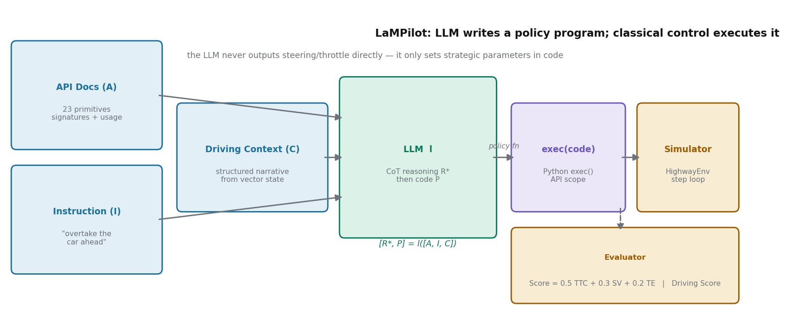
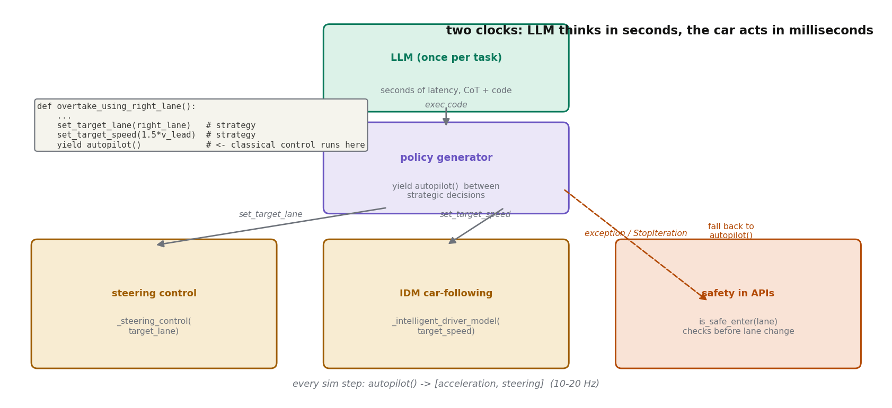
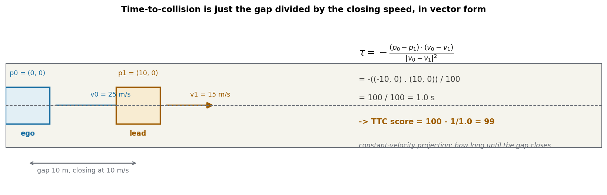
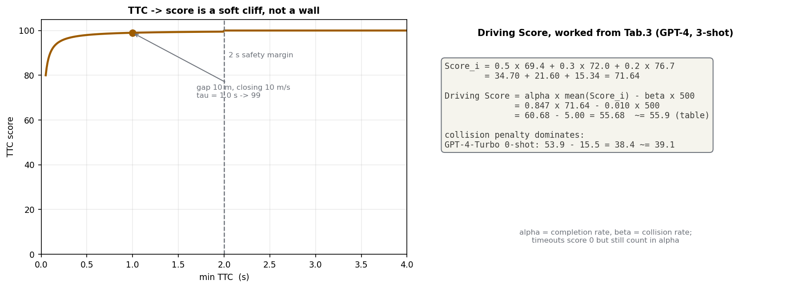

> **标题**：LLM 不碰方向盘——让大模型当写代码的战略家，让经典控制器当开车的司机
>
> **论文**：LaMPilot: An Open Benchmark Dataset for Autonomous Driving with Language Model Programs
>
> **作者**：Yunsheng Ma, Can Cui, Xu Cao, Wenqian Ye, Peiran Liu, Juanwu Lu, Amr Abdelraouf, Rohit Gupta, Kyungtae Han, Aniket Bera, James M. Rehg, Ziran Wang（UIUC / Purdue / Toyota InfoTech Labs / UVA）
>
> **会议**：CVPR 2024（pp. 15141–15151）
>
> **arXiv**：[2312.04372](https://arxiv.org/abs/2312.04372)（v2 为 CVPR 正式版。注：任务清单里写的 2405.15158 经核实是另一篇蛋白质功能预测论文 ProtFAD，编号有误；本文按实际的 LaMPilot 编号精读）
>
> **代码**：公开，[PurdueDigitalTwin/LaMPilot](https://github.com/PurdueDigitalTwin/LaMPilot)（已 clone 到 `code/` 并对照正文核验）
>
> **一句话核心洞见**：LLM 不该输出方向盘转角，而该输出一段调用经典规划控制原语的 Python 策略代码——把"听懂人类指令"的长处和"毫秒级安全控制"的短处拆开，让两边各做自己擅长的事，中间用一层带安全约束的 API 隔开。

## 先纠正一个误解：这篇论文不是"让 LLM 开车"

第一次听说 LaMPilot 的人，很容易把它理解成"又一个 LLM 开车的工作"——给大模型看传感器画面，它吐出油门和方向。这篇论文恰恰是反着来的。它的起点是一个具体的工程判断：**自回归 LLM 生成长文本有秒级延迟，根本进不了毫秒级的控制环**。碰撞避免这种事，等 LLM 把 200 个 token 吐完，车已经撞上了。

所以作者把问题重新切了一刀。自动驾驶里真正需要 LLM 的，不是"这 50 毫秒方向盘打几度"，而是"用户突然说'超前面那辆车'，系统得听懂这是一个多步机动：确认右车道存在、确认安全、变道、加速、确认超过、回到原速"。前者是控制，后者是策略。控制有成熟的经典算法（IDM 跟车、车道保持），策略需要理解和推理——这正是 LLM 擅长的。LaMPilot 的全部设计，就是把 LLM 钉死在策略层，用代码当它的动作空间。

这个时间坐标值得说一下。v1 挂到 arXiv 是 2023 年 12 月，v2（CVPR 正式版）是 2024 年 4 月。当时 LLM 驾驶正处在"什么都往 LLM 里塞"的阶段：GPT-Driver 让 GPT 输出轨迹点，LMDrive（同届 CVPR）让 LLM 直接输出控制信号，DiLu（ICLR 2024）搞知识驱动的推理记忆循环。LaMPilot 继承的是另一条线——机器人领域的 Code as Policies（ICRA 2023）：LLM 写代码调机器人 API。它是第一批把"代码即策略"搬到驾驶、并且配上可量化 benchmark 的工作。

## LLM 在这套架构里到底干什么：只写代码，不碰控制

整个框架可以写成论文式 (1)：

$$[R^*, P] = \ell([A, I, C])$$

$\ell$ 是 LLM 本体（GPT-4、Llama 2 等，开箱即用，不微调）。输入三件套：$A$ 是 API 文档（23 个原语的签名、用法说明和底层逻辑描述），$I$ 是用户指令（比如"从右侧超车"），$C$ 是驾驶上下文——注意，**不是原始传感器数据**，而是一个结构化语言生成器把仿真器里的向量状态转写成的叙述文本，例如"我当前车速 31.1 m/s，在双车道高速的最右侧车道，前方 44.9 米有一辆车，车速 31.1 m/s"。输出两件套：$R^*$ 是 chain-of-thought 推理步骤，$P$ 是一段 Python 策略代码。



LLM 的工作到"交出代码"就结束了。后面发生的事跟 LLM 一点关系没有：代码被 `exec()` 在一个只包含 API 的作用域里执行（代码实现见 `code/projects/lampilot/dt/cg_agent.py`：用正则从 markdown 的 ```python 块里抠出代码，再过一遍 `ast.parse` 做语法检查），得到一个策略函数；这个函数在 HighwayEnv 仿真器里跑；跑完由 evaluator 打分。

关键的分工细节在代码的执行方式里。策略函数通常是一个**生成器**（generator）：它调 `set_target_speed()`、`set_target_lane()` 设定战略参数，然后 `yield autopilot()` 把控制权交还给底层。仿真器的每一步调用 `next()` 推进这个生成器，而真正的加速度和转向角由 `autopilot()` 算出来：

- 纵向：`_intelligent_driver_model(target_speed)`——经典 IDM 跟车模型，目标速度只是它的自由流速度参数；
- 横向：`_steering_control(target_lane)`——车道保持转向控制。

也就是说，LLM 写的代码能决定的，只有"目标车速是多少、目标车道是哪条"这类战略量，以及"什么时候检查、什么时候切换"的条件逻辑。油门和方向盘的每一毫秒，都由写死在代码里的经典控制器算。万一策略函数抛异常、或者生成器耗尽（`StopIteration`），系统直接 `reset_policy()` 回到纯 autopilot——这是代码里写明的 fail-safe（`vehicle_dt.py` 的 `act()` 方法）。



这个"两层时钟"是整篇论文最值得带走的设计直觉。LLM 的延迟（秒级）只付一次——每个任务开始时生成一段代码；之后几十秒的仿真里，车按 10–20 Hz 跑经典控制，零 LLM 调用。延迟问题不是被解决了，而是被**绕过去了**：让慢的东西只做慢的事。

## 为什么是代码，而不是轨迹或控制信号

论文 3.2 节把动机说得很直白，但值得展开一层。让 LLM 输出轨迹点（GPT-Driver 的做法）或控制信号（LMDrive 的做法），有三个具体的麻烦：

第一，**时间尺度对不上**。轨迹点要 10 Hz 往外吐，LLM 自回归生成做不到；就算做到，一次幻觉就是一次失控。代码是"写一次、跑很久"的东西，天然匹配 LLM 的慢节奏。

第二，**代码自带层次结构和条件逻辑**。超车不是一条光滑曲线，而是一串带分支的决策：有右车道吗？安全吗？超过去了吗？用 `if`/`while` 写出来，比用 60 个轨迹点隐式表达更接近人类下达指令的方式。论文的例子（表 1）里，`while True: if is_safe_enter(right_lane): ... break; yield autopilot()` 这种"等到安全再动"的逻辑，用轨迹表示法是写不出来的——轨迹是开环的，代码是带反馈的。

第三，**安全可以写进 API，而不是寄托在 LLM 的自觉上**。这是受 RSS（Responsibility-Sensitive Safety）启发的设计：`is_safe_enter(lane, safe_decel=5)` 在变道前做一次类 MOBIL 的安全检查；IDM 本体的跟车间距项保证纵向不追尾。LLM 再怎么幻觉，也只能通过这 23 个带约束的原语影响车辆，够不着原始执行器。

当然，这里的"安全"是打了折扣的，后面怀疑式审读会细说。

## 跟着一条超车指令走完全程

把论文表 1 的例子展开，配上代码里的真实执行路径，走一遍。场景：高速双车道，ego 在右车道（从右数第 2 条），车速 31.1 m/s；前方 44.9 米有一辆车，车速也是 31.1 m/s——两车相对静止，跟车距离稳定。用户说："Go around the car in front of you using the right lane."

**第 1 步：组装 prompt。** System 消息里塞进 API 文档（23 个原语的签名和用法说明）加回复格式要求；Human 消息里是 `Command: ...` 加 `Context Info: ...` 那段叙述文本。注意 LLM 看到的世界是纯文本的：它不知道像素长什么样，只知道"右车道存在、前车 44.9 米、同速"。这个上下文生成器引的是文献 [4] 的结构化语言方法，论文没展开讲——这是个黑盒，复现时得自己写。

**第 2 步：LLM 先推理，再写代码。** CoT 写出 7 步：查右车道→查前车→查安全→设目标车道→监控距离→加速到前车 1.5 倍速→循环直到前车落到后面。然后生成 `overtake_using_right_lane()`。注意代码里 `distance_to_target = get_distance_between_vehicles(ego_vehicle, target_vehicle)`，注释写"负值表示目标车还在前面"——距离函数的符号约定是"前车为正、后车为负"，这是 API 文档里必须交代、LLM 必须遵守的约定，也是这类系统最容易出 bug 的地方：LLM 搞错符号，`while` 循环的条件就反了。

**第 3 步：exec 执行，生成器接管。** `exec(code['new_code'], apis, local_vars)`，取出 `policy = overtake_using_right_lane()`。仿真步进开始：每一步 `next(policy)`——第一次推进到 `while True: if is_safe_enter(right_lane)`，不安全就 `yield autopilot()`，这一步车辆按原目标车速/车道跑 IDM+车道保持；安全了，`set_target_lane(right_lane)`，底层转向控制器开始往右道切；第二个 `while` 里每一步 `set_target_speed(1.5 * get_speed_of(target_vehicle))`，IDM 的目标速度被抬到前车的 1.5 倍，车开始加速；直到 `distance_to_target < 0`（前车落到后面），`break`，生成器结束。

**第 4 步：兜底。** 生成器耗尽后 `act()` 捕获 `StopIteration`，`reset_policy()`，车辆回到纯 autopilot：按当前车道和车速巡航。如果中途代码抛异常（比如 LLM 写了个不存在的 API 名），同样走这条路。车不会因为 LLM 写错代码就失控，它只会变回一个"听不懂指令但会跟车"的普通 autopilot。

**基线走同一条路会怎样？** IDM/MOBIL 根本不看指令：IDM 只会跟车，MOBIL 只在"新车道更优且安全"时变道——在这个两车同速的场景里，MOBIL 的激励条件不满足，车永远跟在后面，任务失败。这就是为什么论文把规则基线称为"按随机概率运行"：它们的策略和指令无关，20.4% 的完成率纯粹是运气好碰上指令恰好符合默认行为的场景。

## 23 个 API 与"两层安全"：到底保了什么

代码里 `prompts/apis.py` 的 23 个原语分四类，和论文 3.2 节的分类一致：

- **Ego 类**：`get_ego_vehicle()`、`get_target_speed()`、`get_speed_of(veh)` 等，读自身状态；
- **Perception 类**：`detect_front_vehicle_in(lane, distance=100)`、`get_distance_between_vehicles()`、`detect_stop_sign_ahead()` 等，读环境；
- **Navigation 类**：`turn_left_at_next_intersection()` 等，路口级路径规划；
- **Control 类**：`set_target_speed()`、`set_target_lane()`、`autopilot()`，把策略翻译成底层控制。

论文 5.4 节宣称有两层安全。第一层是"LLM 在生成代码前先推理安全性，不安全的指令会被识别并生成替代动作"。第二层是"API 实现里带硬安全约束"。第一层要打个问号：0-shot 下 GPT-4 的碰撞率是 4.1%、GPT-4-Turbo 3.1%、PaLM 2 3.1%（表 3），说明 LLM 的自我安全检查并不可靠——"能识别不安全指令"这个说法，数据并不完全支持。第二层是实的：`is_safe_enter` 在变道前检查减速度约束，IDM 的间距项保证纵向安全。但要注意一个微妙的漏洞：**没有任何机制强制 LLM 在变道前调用 `is_safe_enter`**。API 文档"建议"它这么做，示例代码里也这么写，但 LLM 完全可以写出 `set_target_lane(right_lane)` 不检查的版本。这时横向安全就只剩转向控制器本身——它会把车开向目标车道，不管旁边有没有车。所以"硬约束"的硬度，取决于 LLM 是否自觉调用检查函数。这与其说是安全保证，不如说是安全脚手架。

## 评分公式里藏着的激励

Evaluator 的公式值得逐项算一遍，因为它决定了"什么样的策略算好"，而这个定义本身是有立场的。

先看 TTC（time-to-collision）。$n+1$ 辆车里，对每辆车 $i$：

$$\tau_i = -\frac{(p_0 - p_i)\cdot(v_0 - v_i)}{\|v_0 - v_i\|^2}$$

几何意义很直观：分子是"位置差在相对速度方向上的投影"取负，分母是相对速度的平方。匀速假设下，这就是两车间隙被"闭合速度"吃掉所需的时间。算个具体数：ego 在 $(0,0)$ 以 25 m/s 前进，前车在 $(10,0)$ 以 15 m/s 前进。$(p_0-p_1)\cdot(v_0-v_1) = (-10)(10) = -100$，分母 $100$，$\tau = 1.0$ 秒。



$\tau_{\min}$ 取所有车辆、所有时间步里最小的正值。打分是分段函数：$\tau_{\min} > 2$ 秒得 100；$0 < \tau_{\min} \le 2$ 时得 $\max(0, 100 - 1/\tau_{\min})$；$\le 0$ 得 0。注意这个曲线在 $\tau \to 0^+$ 时是 $100 - 1/\tau \to -\infty$ 再被钳到 0——也就是说，**只要发生碰撞（$\tau \le 0$），TTC 项直接归零**，没有任何中间地带。2 秒是个经验阈值，论文没给它的来源。

再看总分。单个样本：$\text{Score} = 0.5\cdot\text{TTC} + 0.3\cdot\text{SV} + 0.2\cdot\text{TE}$，权重 0.5/0.3/0.2 在代码 `evaluator/base.py` 里写死。SV 是速度方差项，$\text{SV} = \max(0, 100(1 - \sigma_0/\sigma_{\text{safe}}))$，$\sigma_{\text{safe}}$ "由经验确定"——论文和代码里我都没找到这个常数的具体值，这是个缺口。TE 是时间效率，$100(1 - T/T_{\text{limit}})$，$T_{\text{limit}} = 60$ 秒。

最后的 Driving Score：

$$\text{Driving Score} = \frac{1}{N_s}\sum_{i=1}^{N_s} \alpha \cdot \text{Score}_i - \beta \cdot P_{\text{collision}}$$

$\alpha$ 是成功率，$\beta$ 是碰撞率，$P_{\text{collision}} = 500$。只有成功的样本参与平均，再乘以成功率；超时的样本得 0 分但计入 $\alpha$ 的分母。用表 3 的 GPT-4（3-shot）验算：$\text{Score} = 0.5\times69.4 + 0.3\times72.0 + 0.2\times76.7 = 71.64$；$\alpha = 0.847$，$0.847 \times 71.64 = 60.68$；$\beta = 0.010$，减 $5.00$，得 $55.68$，表里是 $55.9$——对上了（小数点后差异来自逐样本平均的舍入）。IDM 那行也能对上：$0.204 \times 84.87 = 17.3$，分毫不差。



这个公式的激励结构值得琢磨。碰撞惩罚项 $\beta \times 500$ 是压倒性的：GPT-4-Turbo（0-shot）完成率 74.5% 比 Llama 2（3-shot）的 63.3% 高出一截，但因为碰撞率高 2.1 个点（$2.1\% \times 500 = 10.5$ 分惩罚），Driving Score 反而更低（39.1 vs 39.6）。公式在说：**宁可完不成，也别撞**。这对自动驾驶是对的价值排序，但也意味着 Driving Score 主要由 $\alpha$ 和 $\beta$ 决定，TTC/SV/TE 的 0.5/0.3/0.2 权重在总分里的实际影响力很小——一个把权重调成 0.8/0.1/0.1 的变体，排名可能几乎不变。论文没有做权重敏感性分析。

## 表 3 的数字怎么读

表 3 是论文的底牌，值得逐行读。

**规则基线**：IDM 完成率 20.4%、碰撞 0%、Driving Score 17.3；MOBIL 15.3%、0%、11.7。零碰撞是因为它们根本不冒险——IDM 只跟车，MOBIL 的变道条件苛刻。它们的 TTC/SV 分数反而是全场最高的（IDM 的 TTC 92.8、SV 80.9），因为"不动"就是最安全的。这组基线的作用不是竞争，而是标定"不听指令"的下限：任何 LLM 方法如果完成率超不过 20%，就说明它连指令都没听懂。

**0-shot LLM**：GPT-4-Turbo 完成率 74.5%、碰撞 3.1%、Driving Score 39.1；GPT-4 是 72.4%、4.1%、28.5；ChatGPT 40.8%、1.0%、27.8；Llama 2 只有 20.4%——和 IDM 持平，说明 70B 的 Llama 2 在 0-shot 下基本没学会用这套 API。PaLM 2（code-bison）35.7%。注意 GPT-4 的碰撞率 4.1% 是全场最高的：它最敢做事，也最容易把事情搞砸。0-shot 的结论很干净：LLM 确实能把指令变成代码并显著提高完成率，但没人教它 API 的用法习惯时，它会写出不安全的代码。

**3-shot**：加 3 个手写示例后，所有模型完成率大涨——Llama 2 从 20.4% 到 63.3%（+42.9），ChatGPT 到 83.7%，GPT-4 到 84.7%。碰撞率有升有降（GPT-4 从 4.1% 降到 1.0%，ChatGPT 从 1.0% 升到 4.1%）。这说明示例主要教的是"API 怎么用"，而不是"怎么开安全车"——安全性和任务完成度在这里是两个正交的轴。

**Human feedback**：在 100 个非测试样本上做人机循环——人看 LLM 生成的代码，满意的就存进 Chroma 向量库（key 是 LLM 生成的函数描述，value 是代码），下次遇到相似场景检索出来当示例。这是抄 Voyager 的做法。GPT-4 达到 92.7% 完成率、64.0 分，是全场 LLM 最好，接近人类驾驶员的 84.6。但"人类满意"的标准是什么，论文没说；100 个样本的交互成本也没量化。这个数字的含金量取决于标注质量，而这部分是黑盒。

**人类驾驶员**：98% 完成率、0 碰撞、84.6 分。但人类用键盘看画面开车，输入是连续的视觉流加实时反馈；LLM 拿到的是一段文字描述、输出是一段开环代码。两者面对的任务难度根本不在一个量级，这个"人类水平"的参照系是宽松的。

## 怀疑式审读

**"第一个 benchmark"的成色**。LaMPilot-Bench 确实是第一个专门评测"LLM 写驾驶策略代码"的基准，4,900 个场景、500 个测试样本、程序化打分，这些是实的。但它的世界是高度符号化的：LLM 看到的上下文是结构化文本，不是传感器数据；场景是 HighwayEnv 的合成车流加自定义路口。4,900 个场景"半人工标注"——"半"的那一半是怎么生成的，论文没有细说（表 2 只给了统计：指令平均 7.6 个词，最长 14 个词）。这个 benchmark 测的是"在符号世界里把指令变成代码"的能力，离"在真实传感器流上开车"还隔着感知这一整层。论文标题里的 "Open Benchmark Dataset" 名副其实，但读者要清楚它 benchmark 的是哪个环节。

**安全声明的水分**。5.4 节的"两层安全"：第一层（LLM 自己把关）被 0-shot 下 1–4% 的碰撞率证伪了一半——更准确的说法是"LLM 有时会拒绝不安全指令"，而不是"能识别"。第二层（API 硬约束）如前所述，取决于 LLM 是否自觉调用 `is_safe_enter`。真正硬的 fail-safe 其实是第三层——异常就回退到 autopilot，而这层论文正文里只是一笔带过，代码里才是实的。安全叙事的重心放错了地方。

**评分公式的权重没有论证**。0.5/0.3/0.2 和 $P_{\text{collision}} = 500$、2 秒 TTC 阈值、$\sigma_{\text{safe}}$ 的经验值，全是作者拍的。Driving Score 对碰撞惩罚极度敏感（1 个点的碰撞率 = 5 分），对 TTC/SV/TE 的相对权重几乎不敏感。换一组权重，表 3 的排名大概率不变——这意味着那些小数点后的"提升"，可能只是公式选择的副产品。做 benchmark 的论文，评分公式本身应该做敏感性分析，这里缺了。

**Human feedback 基线的可复现性**。100 个样本的人机交互，"满意"的标准、交互轮次、检索库的大小和命中率，全都没报告。Voyager 式的方法对"人"的质量极度敏感，这部分不透明，64.0 这个数字别人很难复现。

**没选的基线**。2024 年初已经有 DriveMLM、DriveGPT4、RAG-Driver 等 LLM 驾驶工作，论文一个都没比——理由是"动作空间不同"（它们输出轨迹/控制，这篇输出代码）。这个理由成立，但也让"LLM 写代码比 LLM 直接控制更好"这个核心主张缺少直接证据：全文没有任何一个实验让同一个 LLM 在同一个场景下分别输出代码和控制信号做对比。分工的动机是论证出来的，不是测出来的。

**v1 到 v2 的变化**。v1（2023-12）和 v2（2024-04，CVPR 正式版）之间，公开记录里主要是篇幅和措辞的调整，核心方法、公式和表 3 的数字没有结构性变化——说明审稿人没有要求补关键实验，这套"框架+benchmark"的故事在 CVPR 审稿人那里一次就通过了。

## 可以带走的想法

这篇论文和你的研究方向（以 Agent 为中心的自动驾驶、LLM 调度多规划器执行开放式自然语言驾驶指令）咬合得很紧，有三个具体的可迁移点。

**第一，动作空间的设计是一切。** LaMPilot 最大的贡献不是 benchmark 本身，而是证明了"代码"可以作为 LLM 驾驶员的动作空间：它比轨迹更富表达力（带分支、带循环、带反馈），又比控制信号更安全（够不着执行器）。如果你的 LLM 调度器要指挥多个规划器，"让 LLM 输出调用规划器 API 的代码"和"让 LLM 输出轨迹点"是两条路线，这篇论文是前者的存在性证明。它的 23 个 API 分类（Ego/Perception/Navigation/Control）可以直接拿来当你设计调度器工具集的起点。

**第二，两层时钟是处理 LLM 延迟的通用模式。** 慢模型做战略（秒级、一次性），快控制器做执行（毫秒级、持续），中间用"战略参数 + 条件逻辑"衔接。你的"世界模型中间分布复用"和"场景驱动动态模块旁路"本质上也是在做延迟预算的重新分配——LaMPilot 的切法（按时间尺度切，而不是按模块切）是另一个值得对照的维度。

**第三，benchmark 设计的方法论。** LaMPilot-Bench 把"听懂指令"变成了可程序化打分的东西：任务完成标准（变道成功的判定是"在目标车道且航向对齐"）、安全指标（TTC）、效率指标（TE）。这种"自然语言任务 → 程序化判定"的思路，可以迁移到你评估"开放式自然语言驾驶指令执行"时——Bench2Drive 测的是驾驶能力，而指令跟随度需要另一套打分。它的教训也要吸取：评分公式的权重必须做敏感性分析，否则小数点后的差距没有意义；人类基线的输入条件要和模型对齐，否则"接近人类水平"是个空话。

还有一个值得记的问题，论文留给了未来：它的 LLM 是纯文本的，看不见画面。作者在 5.4 节把多模态列为未来工作。两年后的今天回头看，VLM 写代码调 API 这条路（比如后来的一些 VLA 工作）正在被验证——LaMPilot 的框架几乎不用改，把 $C$ 从结构化文本换成视觉 token 就行。它的寿命比很多同期工作长，原因就在于分工切得干净：感知怎么变，策略层都不用动。
