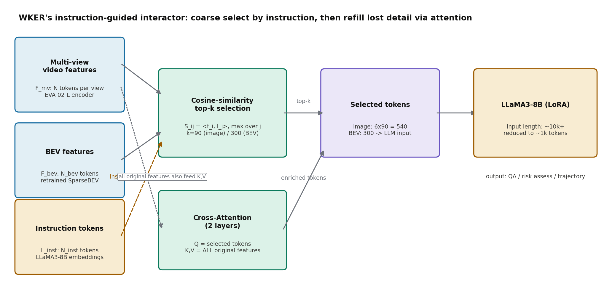
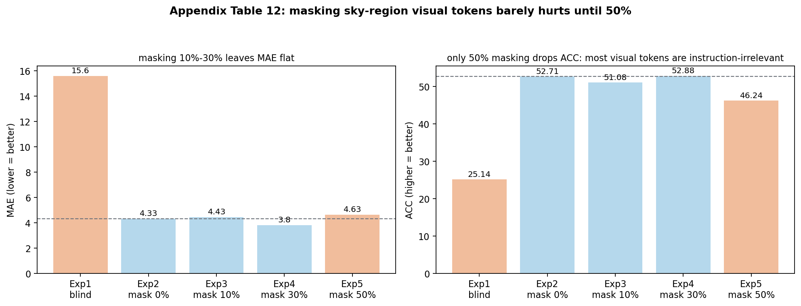

# 先按指令把视觉 token 筛掉九成，再用注意力把丢掉的信息捞回来

> 信息块
>
> - **论文**：World Knowledge-Enhanced Reasoning Using Instruction-guided Interactor in Autonomous Driving（WKER）
> - **作者**：Mingliang Zhai, Cheng Li, Zengyuan Guo, Ningrui Yang, Xiameng Qin, Sanyuan Zhao, Junyu Han, Ji Tao, Yuwei Wu, Yunde Jia（北京理工大学 / 深北莫 / 重庆长安）
> - **会议**：AAAI 2025；arXiv:2412.06324（下载的是 v3，2025-01-02；v1 为 2024-12-09）
> - **链接**：https://arxiv.org/abs/2412.06324
> - **代码**：公开，https://github.com/zmling22/kad（仓库名 KAD），已克隆到本目录 `code/`。训练/推理代码有，评估代码缺（README 的 Todo 里 eval 未勾选）
> - **一句话核心洞见**：多视图视频塞进 LLM 的真正瓶颈不是"模型不够强"，而是"和当前指令无关的视觉 token 太多"——WKER 用指令做一次余弦相似度 top-k 粗筛（图像 k=90，BEV k=300），再让筛出的 token 以 cross-attention 把被筛掉的信息从原始特征里补回来，用一个纯工程手段让 LLM 的上下文窗口装下多视角输入。

---

## 为什么偏偏盯着"感知受限区域"？先看清前人撞墙的那个具体场景

论文图 1 摆了两个场景，值得先看五秒钟。(a) 一辆行驶中的公交车把视线挡得严严实实，公交车后面藏着一辆黑色轿车；(b) 工地大门挡住了门后的工人。两个场景的共同点不是"看不见"，而是"看不见但必须做决策"——传统自动驾驶管线只在感知到的区域里规划，被遮挡的地方直接当作不存在。公交车后面那辆轿车如果突然变道出来，系统连"它可能存在"这个假设都没有。

引言里把当时的 MLLM 驾驶工作分成三类，这个分类是诚实的：(1) 直接微调 MLLM 做预测和规划；(2) 快慢双分支解耦实时性；(3) 免训练的思维链。作者说这三类在"看得见的区域"都做得不错，真正的缺口在感知受限区域——那里需要的不是更强的感知，而是**感知能力 + 世界知识的联合推理**：你没看见公交车后面，但你知道"公交车后面可能藏着车/人"，这种先验不在传感器里，在 LLM 的世界知识里。

这里要先纠正一个容易产生的误读。论文标题里的 "world knowledge" 听起来像是 LLM 背下来的常识在发光，实际的机制要朴素得多：模型被喂了 400 万条驾驶相关的图文对齐数据和 20 万条风险问答，所谓"世界知识"至少有一半是**这批数据里反复出现的驾驶模式**，而不是 LLM 预训练时学到的通用常识。后文读到 ORA 数据集那节会看到，这个区分不是咬文嚼字，它决定了你怎么评价这篇论文的泛化能力。

## 这篇论文的底牌是什么？一张图先看明白

作者押的赌注在论文图 3，也就是 interactor 模块。把它的输入输出先算清楚，整篇论文的工程逻辑就通了。

输入有三路。第一路是 6 个视角的视频特征 $\mathbf{F}_{mv}$，每个视角 $n$ 帧，EVA-02-L 编码后投影到语言维度 $D$。第二路是 BEV 特征 $\mathbf{F}_{bev} \in \mathbb{R}^{N_{bev}\times D}$，来自重训的 SparseBEV。第三路是指令 token $\mathbf{L}_{inst} \in \mathbb{R}^{N_{inst}\times D}$。

如果把这三路直接拼起来喂给 LLaMA3-8B，序列长度是灾难性的：6 个视角 × 每视角几百个 patch token，再加上 BEV 和视频帧数，轻松上万。LLaMA3 的上下文窗口是 8k，装不下；就算装下，注意力也是平方复杂度，训练和推理都贵。已有的两种做法各有代价：拼成一张大图再编码会丢分辨率（细节没了，小目标和遮挡物恰恰需要细节）；逐视角编码再拼接会把序列拉爆。

作者的回答分两步，都写在公式 (2)(3) 里。第一步**按指令筛选**：对每个视觉 token，算它和指令 token 的余弦相似度，取 top-k 留下。第二步**用注意力补信息**：被选中的 k 个 token 做 query，全部原始视觉特征做 key 和 value，做一次 cross-attention，把第一步可能筛掉的关键信息"吸"回来。



上图把这个管线画了出来。关键在那个虚线箭头：**原始特征并没有被扔掉**，它以 K、V 的身份参与了第二步。所以 top-k 筛选的真正作用不是"过滤"，而是"压缩"——LLM 只需要看 540（图像）+ 300（BEV）个 token，但这 840 个 token 每一个都已经在 cross-attention 里"看"过了全部原始特征。这就是摘要里 "highly aggregated visual embeddings" 的实际含义。

## 公式 (1)–(3) 到底在算什么？把每个符号的形状摆出来

论文的公式 (2) 排版有些乱（$\mathbb{K}$ 和相似度算子混在一起），先把它整理成能读的样子。

**公式 (1)：整体架构**

$$\mathbf{L}_{resp} = f_{LLM}\left(\mathbf{L}_{inst},\, f_{interact}(\mathbf{F}_{mv}, \mathbf{F}_{bev}, \mathbf{L}_{inst})\right)$$

形状：$\mathbf{L}_{inst} \in \mathbb{R}^{N_{inst}\times D}$ 是指令 token，$\mathbf{L}_{resp} \in \mathbb{R}^{N_{resp}\times D}$ 是回答 token，$D$ 是语言隐藏维度（LLaMA3-8B 是 4096）。视觉编码器输出先过一个 2 层 MLP（ReLU 激活）把维度投影到 $D$，这一步是常规操作，不值得多停留。

**公式 (2)：选择操作**

对每个视角的视觉特征 $\mathbf{F}^i_{mv}$ 和 BEV 特征 $\mathbf{F}_{bev}$，分别做：

$$\mathbf{F}^{i\prime}_{mv} = \mathbb{K}\left(\mathbf{F}^i_{mv}, \mathbf{F}_{inst}\right), \quad \mathbf{F}^{\prime}_{bev} = \mathbb{K}\left(\mathbf{F}_{bev}, \mathbf{F}_{inst}\right)$$

其中 $\mathbb{K}$ 是 top-k 算子，"$\otimes$" 是相似度计算。论文正文写明用的是**余弦相似度**。代码（`code/src/model/arch.py` 的 `topk_with_similarity`）把实现钉死了：

1. 文本嵌入和视觉特征都做 L2 归一化；
2. 相似度矩阵 $S = \hat{V}\hat{T}^\top$，形状是 $[N_{vis}, N_{text}]$；
3. 对每个视觉 token 取它和**所有指令 token 的最大相似度**（`similarity.max(dim=2)`），得到每个视觉 token 的"指令相关度"分数；
4. 取分数最高的 top-k 个视觉 token。

第 3 步值得停一下：为什么取 max 而不是 mean？因为指令里通常只有一个或两个词是真正定位视觉内容的（比如"公交车后面"里的"公交车"），mean 会被 "the"、"is" 这些停用词的低相似度稀释，max 让每个视觉 token 只需要和指令里最相关的那个词对上就行。这是一个小但对的选择。

**公式 (3)：交互操作**

$$\mathbf{I}_{mv} = \text{CrossAttn}(\mathbf{F}^{\prime}_{mv}, \mathbf{F}_{mv}, \mathbf{F}_{mv}), \quad \mathbf{I}_{bev} = \text{CrossAttn}(\mathbf{F}^{\prime}_{bev}, \mathbf{F}_{bev}, \mathbf{F}_{bev})$$

标准 cross-attention，参数顺序是 (query, key, value)。Query 是被选中的 k 个 token，Key 和 Value 是**全部**原始特征。代码里是 2 层、8 头的 TransformerDecoder（`CA_interactor.forward_outer`）。$\mathbf{I}_{mv}$ 和 $\mathbf{I}_{bev}$ 拼起来喂给 LLM。

### 一个小实例：5 个视觉 token，指令是"公交车后面有什么"

假设 $D=4$（示意），指令 token 有 3 个（"公交车"、"后面"、"有什么"），视觉 token 有 5 个（分别对应：天空、公交车身、公交车后方阴影区、路面、远处建筑）。归一化后的余弦相似度矩阵 $S \in \mathbb{R}^{5\times3}$ 可能是这样：

| token | 公交车 | 后面 | 有什么 | max |
|---|---|---|---|---|
| 天空 | 0.02 | 0.01 | 0.05 | 0.05 |
| 公交车身 | 0.91 | 0.12 | 0.08 | 0.91 |
| 后方阴影区 | 0.45 | 0.78 | 0.30 | 0.78 |
| 路面 | 0.10 | 0.22 | 0.15 | 0.22 |
| 远处建筑 | 0.06 | 0.18 | 0.11 | 0.18 |

取 k=2，留下"公交车身"和"后方阴影区"。注意"后方阴影区"这个 token 本身可能只是几个暗 patch，分类器单独看它什么也说不出来——但 cross-attention 里它作为 query 去 attend 全部特征时，会从"公交车身" token 那里吸到"这是一辆正在行驶的公交车"的上下文，从"路面" token 那里吸到几何位置。输出的增强 token 就携带了"公交车后方阴影"这个组合概念。这就是为什么第二步不是多余的：**top-k 解决的是"看哪里"，cross-attention 解决的是"看懂"**。

### 代码和论文对得上的地方，以及对不上的两处

先说对得上的。`build_interactor` 构造的 `CA_interactor` 确实是 2 层 TransformerDecoder、8 头；`topk_with_similarity` 默认 topk=90，和论文"图像 k=90"一致；训练脚本里三阶段管线的参数冻结逻辑和正文 Figure 4 的表格（Stage 1/2 解冻 MLP 和 interactor、冻结 LLM 用 LoRA）一致。

两处对不上，值得记下来。

第一，论文正文写 BEV 的 k=300，但代码里 BEV 走的是同一行：`topk_with_similarity(cur_question_embeds, bev_feature.unsqueeze(0), topk=getattr(self.config, 'topk_similarity', 90))`——默认也是 90。`topk_similarity` 这个配置项在仓库的训练脚本里我没有找到显式设置，所以实际跑起来 BEV 用的很可能就是 90 而不是 300。论文表 10 的参数分析只扫了图像的 k（30/60/90/120），BEV 的 k 没有消融。这意味着"BEV k=300"这个数字在正文里可能是个计划值，或者某次实验的配置，没有被代码默认配置覆盖。读论文的人如果想复现，应该以代码为准。

第二，`topk_with_similarity` 里有一行可疑代码：

```python
vis_norm = F.normalize(vision_features, p=2, dim=2)
vis_norm = F.normalize(vision_features[0:7], p=2, dim=2)
```

第二行把第一行覆盖了，而且取的是 `vision_features[0:7]`——前 7 个元素。如果 `vision_features` 是 6 个视角的列表，`[0:7]` 切出来还是 6 个，无害；但如果它是别的结构，这行就是形状隐患。它看起来像一次调试残留。相似度计算用的是被覆盖后的 `vis_norm`，而后面 `new_vision_features[i] = vision_features[i, top_indices[i]]` 用的是原始 `vision_features`。当视角数恰好 ≤7 时结果正确，否则 top-k 的索引和实际特征可能错位。这不是定论（我没有跑通训练），但这是一个真实的代码卫生问题，复现时要先看这一行。

另外，`CA_interactor.forward`（非 outer 版）实现的是"每个视角的 top-k token 去 attend **其他视角**的 top-k token"的跨视角融合，但 `arch.py` 里调用的是 `forward_outer`，`forward` 对应的那行被注释掉了。也就是说论文图 3 里"跨视角预融合"的那个味道，实际跑的代码里走的是更简单的"被选 token attend 全部原始特征"。装饰和承重在这里分得很清楚：承重的是 outer 版。

## 三阶段训练：每一段到底在解决什么问题，不解决会怎样

论文 Figure 4 的训练管线分三段，每段的"不做会怎样"可以从附录表 11 的消融里直接读出来。

**Stage 1：单视角预训练**（caption + grounding，1.8M 数据：1700k grounding + 100k caption）。目标是在图像级别、区域级别、物体级别建立视觉-语言对齐。表 11 里 `FT`（直接微调）对比 `PT1+FT`：OmniDrive 上 CIDEr 从 70.2 涨到 94.6，NuScenes-MQA 上 BLUE4 从 6.73 涨到 26.07——单视角预训练是地基。但附录的文字里作者自己承认了一个细节：**Stage 1 对语言分数的提升不明显**（BLUE 从 41.66 到 40.71 甚至略降），它的作用是打好物体感知底子，让后面的多视角 grounding 能立住。这是一个诚实的注脚：预训练解决的是"看得见"，不是"说得好"。

**Stage 2：多视角对齐预训练**。把 Stage 1 的数据扩展到多视角，加入 BEV 特征提供全局语义。BEV 编码器在这个阶段是冻结的（重训好的 SparseBEV 直接用）。表 11 里 `PT1+FT` 到 `PT1+PT2+FT`：OmniDrive CIDEr 94.6→92.1（微降），NuScenes-MQA BLUE4 26.07→26.75（微涨）。单看数字，Stage 2 的增益很小——但它的作用不在这些 caption 指标上，而在 mAP 上：表 8 里 `+TS`（三阶段）让 mAP 从 0 直接到 10.41。**没有 Stage 2，模型根本做不了多视角 grounding**，mAP 是 0 不是接近 0。这说明 Stage 2 解决的是能力的有无，不是分数的高低。

**Stage 3：任务指令微调**。把四个开源数据集（NuScenes-QA、NuScenes-MQA、OmniDrive-NuScenes、NuInstruct）清洗统一成 LLaVA 格式，加上自建的 ORA 数据，总共 230 万训练 / 47.8 万测试。LoRA 微调 LLaMA3-8B，学习率 1e-5，batch size 8，8 张 A100 跑 8 小时。预训练阶段是 32 张 A100 跑 3 天——这个算力在 2024 年底的高校/企业联合团队里是正常水平，不算夸张。

训练策略的消融（表 8）是全文最有信息量的一张表之一，值得逐行读：

| 配置 | ACC | CIDEr | BLUE4 | mAP |
|---|---|---|---|---|
| Base | 64.2 | 70.2 | 36.4 | 0 |
| +三阶段训练 | 71.9 | 92.1 | 36.8 | 10.41 |
| +BEV | 73.3 | 93.6 | 36.7 | 11.66 |
| +Interactor（无 top-k） | 74.1 | 101.2 | 41.69 | 13.01 |
| +Selection（完整） | 74.4 | 103.9 | 49.08 | 16.66 |

三件事跳出来。第一，**三阶段训练策略本身是最大的单一贡献**（ACC +7.7，mAP 从 0 到 10.41），比 interactor 模块的增量大得多。论文标题和摘要把光环给了 interactor，但数字说训练策略和数据才是承重墙。第二，BEV 对 grounding（mAP 10.41→11.66）有用，对 caption（CIDEr 92.1→93.6）几乎没用——作者在正文里明确写了这一点，判断准确：BEV 提供的是几何位置先验，描述场景用不上。第三，interactor 即使去掉 top-k（只做 cross-attention 交互）也有明显提升，说明"指令引导的特征交互"本身有价值；top-k 再往上加一层，主要收益在 BLUE4（41.69→49.08）和 mAP 上——序列变短之后 LLM 的注意力更集中了。

## 400 万数据是怎么攒出来的？ORA 的构造和它藏着的循环论证风险

数据集是这篇论文的另一半工作量，值得细看构造过程，因为它直接决定实验结论的可信度。

**对齐数据**：170 万 grounding 数据来自用预训练好的 Grounding-DINO（在交通场景上训过）在单视角图像上抽物体——车辆、行人、交通标志、红绿灯；20 万物体级 caption（物体、风险、天气等）；加上四个开源数据集的清洗，总共约 400 万。清洗步骤在附录里写得很细：区分长短答案、删掉不准的框、把小数转整数（单位换算或四舍五入）、统一 `<ref>`、`<box>`、`<|camera front|>` 这类 tag、统一轨迹表示。这是脏活累活，也是这类工作真正的门槛。

**ORA（Object-level Risk Assessment）数据集**：20 万 QA（训练 166k / 测试 35k），专门用来测"感知受限区域的推理"。构造分两步，全是 GPT-4o 家族干的：

- Step 1：把图像 + 物体信息（类别、相对自车方向、距离）喂给 **GPT-4o**，让它按四类风险（视线遮挡、碰撞可能、违反交规、潜在风险）输出每个物体的风险评估，JSON 格式。高风险物体的位置直接拿来做 grounding 真值，框坐标归一化到 0–999。
- Step 2：**GPT-4o-mini** 把 Step 1 的原始风险描述整理成多样化的 QA 对，覆盖六类问题：Exist（有没有风险）、Level（低/中/高）、Category（四类之一）、Object（风险源类别）、Reason（原因）、Grounding（风险源位置）。

附录表 14、15 把 prompt 和输入输出样例都贴出来了，这一点做得好——读者能自己判断数据质量。样例里 GPT-4o 的回答是像样的："16 米左前方的车，碰撞风险 High，原因是处在自车转弯路径上"。

但这里有一个必须指出的**循环论证风险**：ORA 的"真值"是 GPT-4o 生成的，WKER 的训练数据里也有 ORA（166k 训练集），然后在 ORA 测试集（35k，同一管线生成）上报告分数。这测的到底是"模型学会了风险推理"，还是"模型学会了模仿 GPT-4o 的说话方式"？论文没有做任何人类标注的一致性校验，也没有报告 GPT-4o 生成的风险标签和人类驾驶员判断的一致率。表 3 里 Full 模型在 Exist 上 70.07、Level 上 89.87——这些数字的上限其实是"GPT-4o-mini 生成 QA 时的自洽程度"，不是客观真值。读这张表的时候要把这一点放在心里：它证明的是"模型能稳定复现这套风险话语体系"，至于这套体系本身对不对，论文没有证据。

还有一个细节：基线 Bunny-Llama3 在 ORA 的 mAP 上是 0。不是它完全定位不准，而是它输出的文本里根本解析不出框——mAP=0 测的是"能不能按格式输出坐标"，不是定位精度。拿它当 grounding 基线有点胜之不武，正文里没有说明这一点。

## 表格里的数字：哪些站得住，哪些要打折

先说站得住的。OmniDrive-NuScenes 上 CIDEr 从 68.6 到 **103.9**，相对提升 51.4%，和正文说法一致，基线 OmniDrive 是原论文作者自己的方法（Wang et al. 2024a），不是稻草人。NuInstruct 上 BLUE4 从 35.2 到 **69.85**，提升 98.4%，一致。NuScenes-MQA 上 ACC 到 74.4，mAP 到 16.66，开环规划碰撞率平均 0.18（带 ego 状态）确实是表 9 里最低的。

再说要打折的三处。

**第一，百分比的口径。** 正文写 NuScenes-MQA "10.6% improvement"、NuInstruct "20.23% improvement in the ACC metric"。对着表 4 和表 6 算：74.4 − 63.8 = 10.6，52.71 − 32.48 = 20.23——这两个都是**百分点（percentage points）**，不是相对百分比。写成 "10.6%" 会让读者以为是相对提升 10.6%，实际相对提升是 16.6%（MQA）和 62.3%（NuInstruct）。数字本身没错，但表述有误导性。审稿人没抓这个，算作者运气。

**第二，NuScenes-QA 没赢。** 表 7：Ours 58.4，对手 MSMDFusion+MCAN 60.4（用了激光雷达，标了 †）、OmniDrive 59.2。正文的措辞是 "comparable performance"，这是实话，但和摘要里 "extensive experiments validate effectiveness" 的整体语气放在一起，读者容易忽略这一张没赢的表。公平地说，MSMDFusion 用了 lidar，多一个模态，输 2 个点不丢人；但论文没有做"去掉 lidar 的 MSMDFusion"这个对照，所以不知道差距里有多少是模态带来的。

**第三，mAP 15.68 的绝对值仍然很低。** ORA grounding 的 mAP 从 0（Bunny）到 15.68（Full），相对进步很大，但 15.68 的绝对值意味着风险源定位还远没到可用。论文没有讨论这个绝对值，这是一个选择性的沉默。



上图是附录表 12 的重绘，作者用它论证"视觉 token 大量冗余"。Exp1（blind，视觉输入换成随机值）MAE 15.6 / ACC 25.14，证明视觉特征确实在起作用；Exp3/Exp4 遮掉 10%/30% 的天空 token，指标几乎不动；Exp5 遮到 50% 才掉点。这个实验设计是聪明的：它直接回答了"top-k 筛掉那么多 token 会不会丢信息"这个质疑——答案是，至少天空这种区域的 token，丢 30% 也没事。但要注意，这个实验遮的是**天空**，天空和指令的相关性天然最低；如果遮的是随机区域，掉点会早得多。作者没有做随机遮挡的对照，所以"冗余"的结论只对"低指令相关性区域"成立，而这恰好是 top-k 本来就要筛掉的部分——论证是自洽的，但覆盖面比标题暗示的窄。

## 开环规划那张表：ego 状态编码的 trick 与作者的诚实

表 9 的开环规划用了 VAD 的评测实现，指标是 1/2/3 秒的 L2 误差和碰撞率。WKER 的做法是把自车状态转成自然语言喂给 LLM："lateral velocity is 0 cm/s; longitudinal velocity is 418 cm/s; ... The ego car will TURN LEFT. Output planning results." 注意单位换算：**米转厘米再四舍五入成整数**，这是为了让 LLM 的 tokenizer 好切分（"418" 比 "4.18" 的 token 化更干净）。

这里作者引用了 BEV-Planner（Li et al. 2024）的结论：给 ego 状态是开环评测里公认的加分项，BEV-Planner 的实验里所有方法吃了这个状态分数都往上走。所以表 9 里带 ego 状态的那几行（Ours L2 平均 0.33、碰撞率平均 0.18）和其他方法的同条件行是可比的，作者没有拿自己的"带 ego 状态"去打别人的"不带 ego 状态"——对照是齐的。这一点值得肯定，因为开环规划的论文里偷换对照条件是重灾区。

但 qualitative 那节有一段需要打问号。图 5 的两个例子显示模型在开阔环境倾向于加速，而真值是减速，作者的解释是"在开阔环境保持或提高速度往往更安全、更高效，所以我们的加速策略是 deliberate 且更合理的"。这个论证是**事后合理化**：开环评测的 L2 本来就是和人类轨迹比，你偏离真值就是偏离人类行为，用"更合理"来解释偏离，等于同时主张"人类司机开得不够好"和"我们的模型比人类好"，但没有任何证据支持后者。更诚实的说法应该是：L2 惩罚的是和真值的偏离，而真值（人类减速）本身可能是保守驾驶；碰撞率低说明偏离没有带来危险。这能说的都说到了，"更合理"三个字是多余的。

## 作者自己承认的短板：附录 Discussion 是全篇最老实的一页

附录最后的 Discussion 明确写了两条没做的事：(1) 没有在 CARLA 或 NuPlan 上做闭环测试；(2) 没有验证 3D grounding，因为 2D-3D 转换依赖精确的相机参数，而相机参数很难 token 化。第二条尤其值得玩味——它暴露了"一切都转成语言 token"这条路线的结构性代价：几何精度在 token 化里被磨平了。这对后来做 VLA 和世界模型的人是一个提醒：语言是好的接口，但不是好的几何载体。

## 可迁移的想法

**第一个想法：top-k 筛选 + cross-attention 补回是一个通用的"长上下文压缩"模式。** 它的适用条件很清楚：输入里有大量与当前查询无关的内容，且"相关性"可以用一个廉价分数（余弦相似度）近似。任何"检索式"的多模态输入——多视角、多帧、多传感器——都可以套用。k 的选择有明确的 trade-off 曲线（表 10：k=30 丢信息 mAP 13.01，k=90 最优 16.66，k=120 冗余回升 12.5），调参时直接扫 30/60/90/120 四档就够了，不用玄学。

**第二个想法：把"模仿谁"写进评测，是数据驱动论文的必修课。** ORA 用 GPT-4o 生成真值、用 GPT-4o-mini 生成问题，整个评测闭环在同一个模型家族里打转。这篇论文的价值因此上限被锁死在"GPT-4o 的风险话语体系"。如果你要做类似的数据集，至少要留 500–1000 条人类标注的测试集，报告人和 GPT 的一致率，否则所有的"提升"都可能是拟合了生成器的偏好。

**第三个值得做的具体问题：** interactor 的筛选是**静态**的——一次 top-k 定终身。但驾驶是指令随时间演化的任务（"超过前面那辆车"执行到一半，相关的视觉区域变了）。把 top-k 做成每 N 帧按最新指令/状态重算一次，k 甚至可以按场景复杂度动态调整（高速空旷 k=30，路口遮挡 k=150），这是一个论文里完全没碰、但工程上很自然的下一步。代价是筛选本身的计算量，但余弦相似度是矩阵乘法，在 GPU 上几乎免费。
