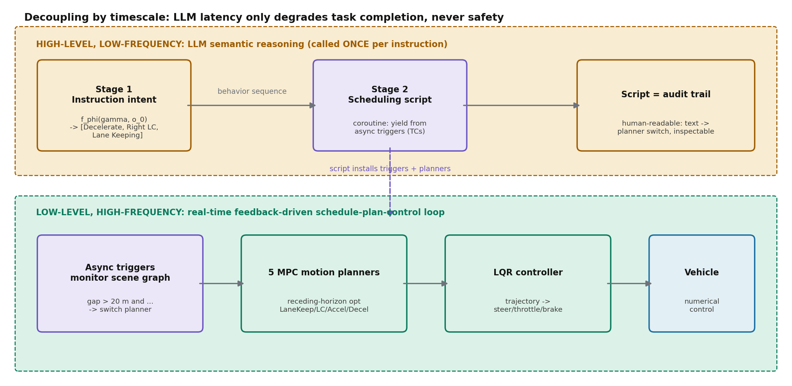
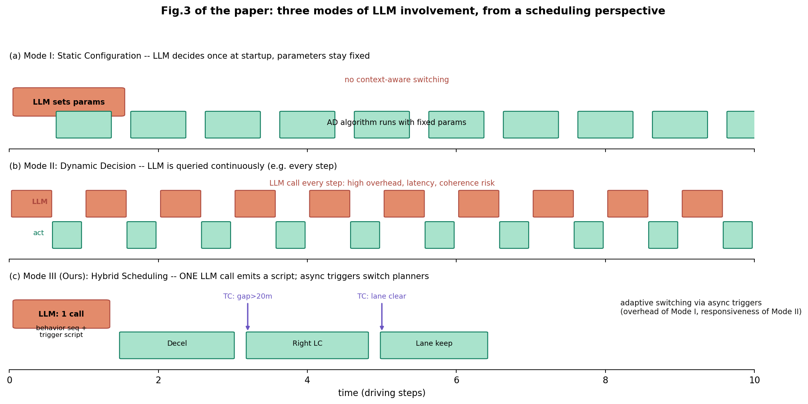
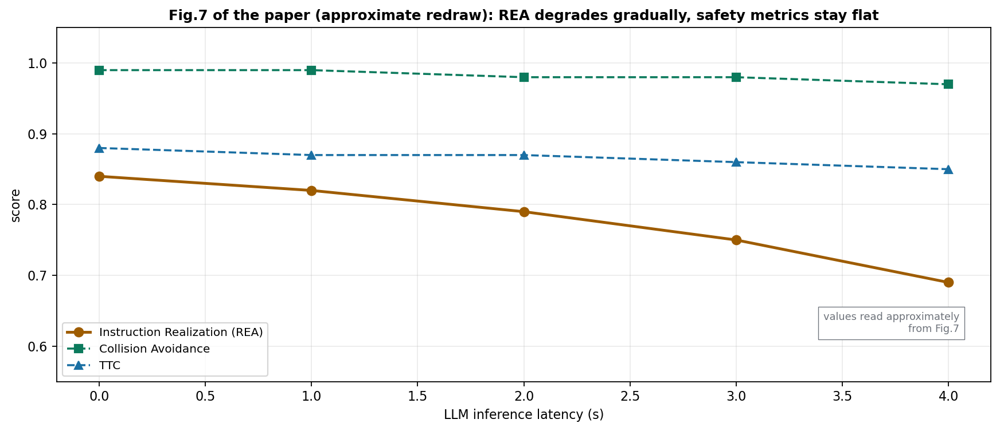

# LLM 只编译一次脚本，MPC 高频执行：用时间尺度分离把开放式指令变成可追溯的驾驶行为

> 信息块
>
> - **论文**：Open-Ended Instruction Realization with LLM-Enabled Multi-Planner Scheduling in Autonomous Vehicles
> - **作者**：Jiawei Liu, Xun Gong, Fen Fang, Muli Yang, Bohao Qu, Yunfeng Hu, Hong Chen, Xulei Yang, Qing Guo（吉林大学 / A*STAR / 同济大学 / NKIARI / 南开大学）
> - **会议**：CVPR 2026；arXiv:2604.08031（v1，2026-04-09；目前只有一个版本）
> - **链接**：https://arxiv.org/abs/2604.08031；项目页 https://point-scheduling.github.io/
> - **代码**：未找到官方代码（论文正文、附录、项目页均未给出仓库链接；项目页只有论文和演示）
> - **一句话核心洞见**：LLM 只在 t=0 被调用一次，把乘客的开放式指令"编译"成一份带异步触发器的调度脚本，之后的安全和高频适应完全交给 MPC 规划器与触发器构成的快回路——用时间尺度分离让 LLM 的延迟只损伤任务完成率、永远碰不到安全。

---

## 先看一个具体的谜题：一句"我感觉不安全"，车到底该做什么

论文图 1(b) 和图 6(a) 是同一个例子，值得从头跟一遍。乘客说："I feel unsafe behind that truck."（跟在这辆卡车后面让我觉得不安全。）车载系统要输出的不是一句话安慰，而是一串控制信号：方向盘转多少、油门刹车踩多深。

这句话里没有任何驾驶术语。它没有说"变道"，没有说"加速"，没有说"保持车道"。但一个人类司机会立刻听懂：乘客想离这辆卡车远一点，合理的做法是先减速拉开距离，再找机会变到隔壁车道，最后正常跟车。用论文的术语，这句话对应一个**驾驶行为序列**：[Decelerate, Right Lane Change, Lane Keeping]。

这里的难点分两层。第一层是**理解**：把开放式、口语化、甚至情绪化的表达映射到驾驶行为上。"There is an emergency!"（图 1a，车外行人喊话）要理解成让行；"We are about to turn, don't miss it." 要理解成 [Decelerate, Right Lane Change, Lane Keeping]。第二层是**执行**：每个行为的目标不一样，减速和变道不能用同一个规划器；而且切换时机取决于实时路况——"间隙超过 20 米再变道"这个条件在 t=0 时是不知道的。论文的三个 Challenge（A 开放式机动指令未被研究、B 缺乏高效的行为调度、C 缺乏高保真闭环评测）就是这两层难点的展开。

## 问题形式化那一节：POMDP 的衣服下面是什么

第 3 节把问题写成一个指令引导的 POMDP：$\langle S, A, O, T, O, \Gamma, R \rangle$。先挑一个记号毛病：$O$ 出现了两次，一次是观测空间、一次是观测模型，标准写法里观测模型通常写成 $\Omega$ 或 $Z$。$T(s\mid s, a')$ 的写法也有笔误嫌疑，应该是 $T(s'\mid s, a)$。这些不影响理解，但说明这一节是"叙事性数学"——它的作用是给审稿人一个形式化的锚，而不是真的要去解这个优化问题。

真正有内容的是奖励函数的定义。记 $k_t \in \{0, \dots, m(\gamma)\}$ 为 t 时刻已完成的行为数，$\bar{s}_t = (s_t, k_t)$ 是增广状态：

$$R(\bar{s}_t, a_t, \bar{s}_{t+1}) = \begin{cases} r_{k_t+1}, & k_{t+1} = k_t + 1 \\ 0, & \text{otherwise} \end{cases}$$

$$k_{t+1} = \begin{cases} k_t + 1, & s_{t+1} \in C_{k_t+1} \\ k_t, & \text{otherwise} \end{cases}$$

每个行为 $c_i$ 有一个**完成集** $C_i \subseteq S$，自车状态进入 $C_{k_t+1}$ 才算完成当前行为、拿到奖励 $r_{k_t+1}$。这是一个稀疏的、阶段式的奖励：只有"行为完成"这个离散事件才给分，中间过程一分没有。目标函数 (4) 是最大化期望累积奖励，同时满足安全约束 $P[\forall t \le \delta(\gamma): s_t \in S_{safe} \mid b_0] \ge 1 - \epsilon$。

读到这里要清醒：**这篇论文并没有求解公式 (4)**。LLM 是冻结的（用的是现成的 Qwen/DeepSeek），脚本是生成的不是优化出来的，$r_{k}$ 的具体数值论文根本没给，$\epsilon$ 也没给。公式 (4) 的真实作用是两个：第一，把"行为完成集 $C_i$"这个概念合法化——后面的异步触发器本质上就是在判断 $s_t$ 是否进入了 $C_i$；第二，告诉审稿人"我们考虑了安全约束"，尽管安全实际上是由 MPC 规划器的设计保证的，不是从这个约束里解出来的。把叙事性数学和求解性数学分开，是读这篇论文不被带偏的关键。

## 三个阶段：从一句话到方向盘转角，每一步经谁的手

论文图 2 是全文押注的那张图，三个阶段的分工是理解一切的基础。

**Stage 1：指令理解（What to do?）**。LLM 作为解释器 $f_\phi$，输入是指令 $\gamma$ 和**文本化的**交通场景描述 $o_0$，输出是行为序列 $f_\phi(\gamma, o_0) = \{c_i\}_{i=1}^{m(\gamma)}$。原子行为只有 5 个：lane keeping、left lane change、right lane change、accelerate、brake（正文 4.1 节；注意 4.2.2 和表 2 里写的是 Deceleration，同一个东西两种叫法）。文本场景描述 $o_0$ 的作用是消歧：同样一句"超过去"，在最右车道和中间车道的合法行为不一样，"不允许从最右车道右变道"这种约束就靠 $o_0$ 提供。

**Stage 2：调度脚本生成（How to do?）**。同一个 LLM（注意：还是**同一次调用**，论文强调 single LLM invocation）再输出一份可执行的 Python 风格脚本。脚本里用协程机制（`yield from lambda ...`，引用的是 Lua 协程的那篇经典文献）定义每个行为的**触发条件**（Trigger Condition, TC）：比如"当间隔超过 20 米且右侧车道空闲时，从减速切换到右变道"。脚本是人类可读的文本，这是全文"可追溯性"主张的载体：从"LLM 说了什么"到"车做了什么"，中间有一份审计员能看懂的文档。

**Stage 3：闭环规划执行**。脚本安装好触发器之后，LLM 就退场了。每个行为对应一个**专用的 MPC 规划器**（5 个行为 5 个规划器），做 receding-horizon 轨迹优化；轨迹再交给 LQR 控制器转成方向盘/油门/刹车。触发器在高频下监控场景图（scene graph），条件满足就切换规划器。

上图把时间尺度分离画了出来，这是全文真正漂亮的设计决策。LLM 工作在"分钟级"（一次调用管整段行程），触发器+MPC 工作在"毫秒级"。**LLM 的幻觉和延迟被关在了一个笼子里**：LLM 只能决定"行为序列是什么"和"切换条件怎么写"，它永远碰不到方向盘。即使 LLM 写错了触发条件，最坏的结果是任务完不成（比如一直等一个永远不会出现的 20 米间隙），而不会是车去撞墙——因为每个原子规划器本身是安全约束的 MPC。这就是第 7 节那句"passenger/LLM-in-the-loop safety mechanism"的实际含义。

### 跟着跑一轮："We are about to turn, don't miss it."

拿论文图 2 的例子走完全程。t=0，乘客说"We are about to turn, don't miss it."，文本场景描述 $o_0$ 写着：自车在中间车道，时速 40km/h，前方 200 米处路口需右转，右侧车道有慢车。

Stage 1：LLM 推理——"about to turn" + 右转路口 → 需要先减速、再右变道、然后保持车道。输出行为序列 [Decelerate, Right Lane Change, Lane Keeping]。

Stage 2：LLM 生成脚本，大意是：

- 安装 Deceleration 规划器，触发器 TC1：`yield from lambda: right_gap > 20 and right_lane_clear`；
- TC1 满足 → 切换到 Right Lane Change 规划器，触发器 TC2：`yield from lambda: in_target_lane`；
- TC2 满足 → 切换到 Lane Keeping。

Stage 3：车开始减速。触发器每帧检查场景图：第 5 秒右侧出现 25 米间隙 → TC1 触发 → MPC 右变道规划器接管，优化出一条变道轨迹 → LQR 执行。进入目标车道 → TC2 触发 → 车道保持。全程 LLM 没有再被调用过。

如果拿 Mode II 的方法（比如 DiLu++）跑同一个场景：LLM 每秒被查询一次，每次重新看历史、重新决定"现在该干嘛"。论文的实验显示它偶尔会"忘记"自己刚才已经决定变道，输出冗余的变道指令——**决策不连贯**。而 Mode I（启动时设一次参数）根本处理不了"何时变道"这种条件切换。这就是下面要讲的分类学的由来。

## Mode I/II/III：这篇论文给领域立的一个分类学，本身就有价值

4.2.1 节把现有的 LLM 驾驶方法按"LLM 何时介入"分成三类，图 3 画得很清楚。这个分类不只是为了衬托自己，它确实抓住了 LLM 上车的核心矛盾：**LLM 越频繁介入，适应性越强，但延迟、成本和不可预测性也越高**。

- **Mode I**（静态配置）：LLM 在启动时设几个参数（比如"开得小心点"→ 把安全项权重调高），之后参数冻结。适合偏好设置，不适合机动指令。
- **Mode II**（动态决策）：LLM 持续参与驾驶决策，每步或每秒调一次。适应性强，但论文的实验指出两个代价：频繁查询的延迟和成本，以及行为序列执行中的决策不连贯。
- **Mode III**（混合调度，本文）：LLM 单次调用输出脚本 + 异步触发器。触发器是关键——它把"条件判断"从 LLM 手里拿出来，放到快回路里。LLM 只在 t=0 做一次开环的语义编译，之后所有的适应性都由触发器条件驱动。

这个分类的诚实之处在于，作者把两个基线（DiLu+、DiLu++）明确标成 Mode II，把 Diffusion-ES 标成 Mode III（它的 LLM 改写目标函数，属于同类）。分类学立住之后，实验对比就不是"我们打败了某某"，而是"Mode III 打败了 Mode II"——结论的抽象层次提高了，但也更可信了。

## POINT benchmark：1050 对指令-场景，8 个指标，补上了领域缺的一块

Challenge C 说 기존评测都是开环（Argoverse、nuScenes 数据集）或游戏式仿真器（Highway、CARLA），没有"高保真闭环 + 开放式指令"的测试床。POINT 的回答是：基于 nuPlan 混合仿真器（1300 小时真实驾驶数据重建的城市交通），配 1050 对指令-场景。

指令的构造过程值得细看：先收集真实世界的指令，再用商用 LLM（ChatGPT、Gemini）大规模生成，最后**人工筛选**。生成 prompt 的要求是"口语化表达，压制显式的意图陈述"——也就是说故意不让指令里出现"变道""超车"这种词，逼模型做真正的理解。图 4 的意图分布显示约 70% 的指令涉及高风险横向机动（变道、超车、靠边停车），评测是往难处去的。

8 个指标分四组：任务相关（意图识别率、指令实现率）、安全相关（无碰撞率、最小 TTC）、合规相关（可行驶区域时间比、限速遵守时间比、方向一致性时间比）、效率相关（相对人类专家的行驶进度）。这个指标设计是周到的：**它把"听懂了"（意图识别）和"做到了"（指令实现）分开测**，前者是纯 LLM 能力，后者是端到端系统能力。

基线分两拨。专用 AD 方法（LogReplay、IDM、PDM-Closed）负责走人类轨迹，不执行指令——它们的作用是给安全和合规指标定一条参照线。指令实现方法（Diffusion-ES、DiLu++，以及作者自建的 DiLu+）才是真正的对手。

## 数字核查："64%–200%"是怎么算出来的，哪些数字要打折

表 1 的核心行：

| 方法 | 实现率 | 无碰撞 | TTC | 可行驶区 | 限速 | 方向 | 进度 |
|---|---|---|---|---|---|---|---|
| DiLu++ | 0.51 | 0.92 | 0.73 | 0.96 | 0.97 | 1.00 | 0.87 |
| Diffusion-ES | 0.28 | 0.82 | 0.80 | 0.80 | 0.99 | 1.00 | 0.77 |
| Ours | **0.84** | **0.99** | **0.88** | 0.97 | **1.00** | **1.00** | 0.82 |
| PDM-Closed | – | 0.97 | 0.86 | 0.98 | 1.00 | 1.00 | 0.92 |

"64%–200%"：(0.84−0.51)/0.51 = 64.7%，(0.84−0.28)/0.28 = 200%。口径是相对提升，对手是两个指令实现基线，算得没错。但要注意分母是**作者自己建的或自己选的基线**：DiLu+ 和 DiLu++ 是这篇论文为了当基线而写的（DiLu+ 把 DiLu 改成 1Hz 选规划器，DiLu++ 再加历史信息），Diffusion-ES 是 CVPR 2024 的工作。没有拿任何一个独立的、第三方调优过的开放式指令基线来打——因为这个任务是新定义的，第三方基线根本不存在。这是新 benchmark 论文的结构性困境：第一个搭台子的人，台上的对手都是自己请的。作者至少做到了两点诚实：所有 LLM 基线用同一个 DeepSeekV3 backbone、同一套行为序列；Diffusion-ES 的原文超参照搬。

安全指标那列是全文最强的声明：无碰撞 0.99，追平甚至超过专用方法 PDM-Closed 的 0.97，同时指令实现率 0.84（专用方法不执行指令，这项是空）。"执行高风险指令的同时保持专用方法的安全水平"——这个成绩如果站得住，就是 Mode III 架构最有力的证据。它的机制解释是可信的：安全不依赖 LLM，依赖 MPC 快回路。

图 5（意图识别 vs 模型规模）是另一个诚实的数据点：只有 Qwen-2.5-72B、DeepSeekV3、DeepSeek-R1 三个大模型超过 85%，小模型明显掉队。**理解开放式指令是真的难**，不是 prompt 写得好就能解决的。这对部署是坏消息：车载端侧跑不动 72B 模型，云端调用又有延迟——而延迟实验（图 7）恰好证明延迟只损伤实现率不损伤安全，两张图互相咬合。

上图是论文图 7 的近似重绘（数值从原图曲线读出，为近似值）。LLM 延迟从 0 加到 4 秒，实现率从 0.84 缓降到约 0.69，而无碰撞率和 TTC 几乎不动。这个实验设计抓住了要害：**它证明了时间尺度分离的承诺是真的**——慢回路的延迟不穿透到快回路。

表 2 的消融有两行值得单独说。第一行：去掉交通上下文 $o_0$，意图识别从 0.86 掉到 0.78。说明消歧确实依赖场景，光靠指令文本不够——这也反过来说明 Stage 1 的输入设计（指令 + 文本场景）是承重的。第二组：单个规划器跑全程，实现率只有 0.12–0.18（意料之中，一个行为干不完整个序列），但它们的无碰撞率大多还在 0.95 以上——**单个 MPC 规划器本身是安全的，调度解决的是"完成任务"**。这个对照把"安全"和"任务完成"两个贡献源分开了，是全篇实验设计里最干净的一处。

## 怀疑式审读：单次调用的代价、自建基线、和没说的事

**"单次 LLM 调用"是优点，也是最大的赌注。** 脚本在 t=0 写死，之后零 LLM 参与。如果场景演化超出了触发器的表达能力（比如右侧车道突然出现施工封路，而触发器只写了"间隙>20米"），系统没有重问 LLM 的机制——它会一直等那个永远不会出现的间隙，或者按字面条件执行一个已经不合适的切换。作者在第 7 节的未来工作里承认了"触发器表达能力"是瓶颈，并提到 trial-and-error 学习和自适应重调用是方向。这等于承认：Mode III 的适应性上限 = LLM 在 t=0 时能预见到的条件分支的丰富程度。这是一个真实的 trade-off，不是免费午餐。

**安全约束的数学是叙事，不是求解。** 第 3 节的 $1-\epsilon$ 约束没有任何 $\epsilon$ 取值，没有验证过程。真正的安全来自 MPC 的设计（约束优化本身保证不碰撞），论文把"设计保证"包装成了"优化约束"。这不算错，但读者要清楚：公式 (4) 的 s.t. 那一行没有被任何算法执行过。

**nuPlan 闭环的"高保真"是相对的。** 相对 Highway/CARLA 游戏式仿真，nuPlan 基于真实数据重建，保真度确实高；但它没有车载视角的图像渲染（作者自己在未来工作里承认了，并提到 3D Gaussian Splatting 是方向），背景车是非反应式的 log 回放为主。0.99 的无碰撞率是在这个仿真器里测的，sim-to-real 的 gap 论文没有讨论。

**1050 对指令-场景，人工筛选但无一致性报告。** 指令用 ChatGPT/Gemini 生成、人工筛，评测用 Qwen/DeepSeek——"生成与评测模型分离"这个设计是好的（引用了 LLM 偏爱自己生成内容的文献 [28]）。但人工筛选的标准、筛选者之间的一致率都没有报告。1050 的规模对于"开放式"这个词来说是小的，好在作者没有声称覆盖全部开放域。

**没选的基线。** 2025–2026 年有不少 VLA 工作（如 LMDrive、AutoVLA）被放在相关工作里，但没有进实验对比。作者的理由是隐含的：那些工作做的是标准化导航指令，不是开放式乘客指令，任务对不上。这个理由成立，但读者应该知道：这篇论文没有证明 Mode III 比 VLA 端到端更强，它证明的是"在开放式指令任务上，Mode III 比 Mode II 强"。

## 与 RAMP 的对照：两种"LLM 调度多规划器"的不同答案

这一节是应要求写的对照。RAMP 是在研的以 Agent 为中心的自动驾驶架构：异构多规划器池 + 每周期 LLM 调度器（输入含世界模型中间分布 $q(z_t\mid o_{\le t})$ 作为调度先验）+ 候选轨迹的世界模型 rollout 风险校验 + 风险仲裁 + 安全盾 + 风险加权自适应衰减情景记忆，在 Bench2Drive 闭环验证。下面逐项对比。

**调度粒度：整段行程一次 vs 每周期一次。** 这是两者最根本的分歧。080 的 LLM 在 t=0 被调用一次，输出行为序列和触发器脚本，之后完全退场；行程中的适应性由触发器条件驱动。RAMP 的 LLM 调度器是**每周期**运行的，根据当前场景和指令重新选择或组合规划器。080 把"适应"编译进了脚本（开环的适应），RAMP 把"适应"留在了 LLM 回路里（闭环的适应）。代价也很对称：080 的 LLM 查询成本是 O(1)，但 t=0 没预见到的情况就处理不了；RAMP 的适应性强，但每周期都要付 LLM 推理的延迟和成本。论文图 7 的延迟实验恰好是 080 为自己的选择准备的辩护：延迟只降实现率不降安全。

**规划器池构成：行为原语 vs 异构机制。** 080 的 5 个规划器是**同构**的——都是 MPC，区别只在目标行为（跟车道/左变道/右变道/加速/减速）。"多"的是行为种类。RAMP 的规划器池是**异构**的——不同的规划器用不同的机制、各有所长，"多"的是机制种类。080 的第 7 节有一个值得 RAMP 借鉴的论证：任务空间按"触发器 × 规划器 × 时序组合"组合增长，小规划器集可以覆盖大指令空间。这对 RAMP 是一个直接的提示：规划器池不一定需要"多而异构"，5 个行为原语 + 表达力好的触发器/调度条件，可能是更便宜的覆盖方式。

**开放式指令如何映射到调度决策。** 080 是 $f_\phi(\gamma, o_0)$：指令 + **文本化**的交通场景描述，一次性映射到行为序列，再编译成触发器脚本。消歧完全依赖文本上下文（表 2 证明去掉 $o_0$ 掉 8 个点）。RAMP 的调度器输入含世界模型中间分布 $q(z_t\mid o_{\le t})$——潜变量里带**未来预测**的信息，调度决策是预测性的（"未来 3 秒右侧会有空隙，现在开始准备变道"），而 080 的触发器是反应式的（"间隙>20米**现在**成立才切换"）。这是两者在"智能"来源上的本质差异：080 的智能在 LLM 的语言理解里，RAMP 的智能部分在世界模型的预测里。

**校验/仲裁/安全兜底：有 vs 无，这是 080 最薄的一环。** 080 没有独立的风险校验层：没有 world-model rollout，没有风险仲裁器，没有安全盾。它的安全论证是**构造性**的——"每个原子规划器本身是安全约束的 MPC，LLM 永远碰不到控制量，所以系统安全"。这个论证成立的前提是：触发器切换本身不会制造危险（比如在 19 米间隙时不切换、在 21 米时切换，而 21 米在当前相对速度下其实不够）。MPC 保证"执行中的轨迹安全"，但不保证"切换决策明智"。RAMP 的风险校验 + 仲裁 + 安全盾正是补的这一块：**验证性**的安全。所以公平的说法是：080 用架构把 LLM 的风险关在了门外，但门内的切换逻辑是没有第二双眼睛的；RAMP 允许 LLM 每周期参与，但给它配了校验和兜底。两种安全哲学，没有高下，只有 trade-off。

**评估：都是闭环，这是 080 相对同期工作的最大优点。** 080 在 nuPlan 混合仿真上做闭环评测（1050 指令-场景对，8 个指标含任务完成率/安全/合规），RAMP 计划在 Bench2Drive 上闭环验证。两者都超越了开环数据集评测，这是 2025–2026 年 LLM-AD 论文里少见的共同点。但指标口径不同：080 的核心指标是**指令实现率**（0.84），RAMP 的核心指标会是 Bench2Drive 的驾驶分数/成功率——两者解决的问题不完全一样（080 是 HMI 的乘客指令执行问题，RAMP 是通用驾驶决策架构），**拿 0.84 去对比 Bench2Drive 分数是没有意义的**，这里先打一个预防针。

**080 相对 RAMP 的差异化价值（不硬踩一捧一）。** 第一，**成本模型**：单次 LLM 调用的 O(1) 查询成本 + "延迟不碰安全"的实验证据，是 080 给"LLM 上车"这个工程问题的最强论证，RAMP 的每周期调度在这一点上是贵的。第二，**可追溯的脚本接口**：人类可读的调度脚本是天然的审计产物，ISO 26262 这类标准要的就是这个；RAMP 每周期 LLM 调度的决策轨迹更难审计。第三，**任务空间的组合论证**对 RAMP 的规划器池设计有直接参考价值。反过来，RAMP 补上了 080 缺的三块：预测性调度先验（世界模型）、切换决策的独立校验、跨任务的情景记忆（080 每次指令独立，没有记忆）。如果让我给 RAMP 提一个从 080 学来的具体改动：**把 RAMP 每周期调度的输出也落成一份人类可读的"调度记录"**（选了哪个规划器、为什么选、触发条件是什么），080 的脚本证明了这种中间表示几乎是免费的，但对调试和审计的价值很大。

## 可迁移的想法

**第一个想法：时间尺度分离是 LLM 进入安全关键回路的通用设计原则。** 080 的真正贡献不是那 5 个 MPC 规划器，而是"慢语义/快控制"的解耦论证：LLM 的延迟和幻觉被限制在只影响任务完成率的慢回路里，快回路用传统控制保证安全。任何 LLM-in-the-loop 的系统（机器人、工业控制）都可以套用这个论证框架，而图 7 那种"延迟-实现率缓降、安全指标持平"的实验是证明解耦有效的标准动作。

**第二个想法：让 LLM 输出可执行的中间表示，而不是直接输出动作。** 调度脚本是人类可读、可检查、可复现的，它把"LLM 说了什么"和"系统做了什么"之间的鸿沟变成了一份文档。这比事后解释（"模型为什么这么开"）便宜得多，因为解释是在决策之前就写好的。对 RAMP 这类每周期调度的架构，这个想法的落地形态是"调度日志"：每个周期记录选了哪个规划器、依据的状态是什么。

**第三个值得做的具体问题：触发器的自动习得。** 080 的触发器是 LLM 在 t=0 一次写死的，这是它适应性的上限。下一步很自然：让系统在仿真里 trial-and-error，学出"什么条件下切换成功率高"，把学到的条件回填成触发器；或者在触发器长期不满足时**自适应地重问 LLM**（Mode III 与 Mode II 的混合）。论文第 7 节已经点名了这两个方向，但都没有做——这是一个拿得到、写得出的增量。
