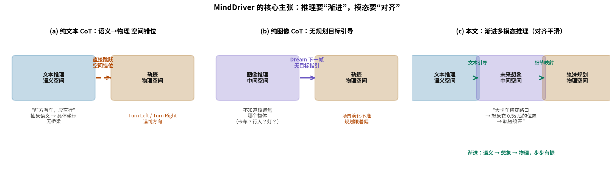
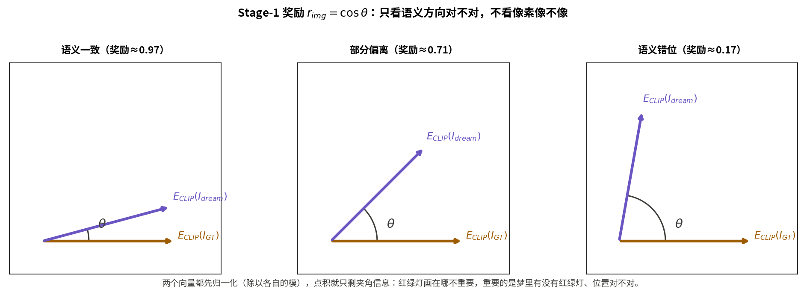
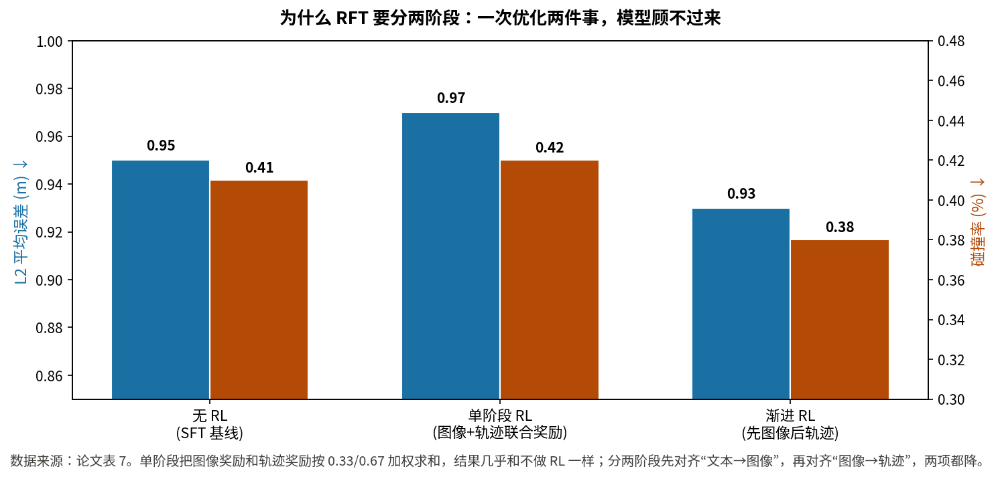

# 先想明白，再想象出来，最后才动手：MindDriver 的渐进多模态推理

> **论文**：MindDriver: Introducing Progressive Multimodal Reasoning for Autonomous Driving
> **作者**：Lingjun Zhang, Yujian Yuan, Changjie Wu, Xinyuan Chang, Xin Cai, Shuang Zeng, Linzhe Shi, Sijin Wang, Hang Zhang, Mu Xu（阿里高德 Amap；共同一作：Lingjun Zhang、Yujian Yuan）
> **会议**：CVPR 2026 ｜ **arXiv**：2602.21952（v1，2026-02-25；本解读基于该版本全文 18 页，含附录）
> **链接**：https://arxiv.org/abs/2602.21952
> **代码**：已公开，https://github.com/hotdogcheesewhite/MindDriver（2026-04 放出标注与训练代码，2026-06 放出 checkpoint；本解读已 clone 核对）
> **一句话核心洞见**：文本 CoT 活在语义空间、轨迹活在物理空间，中间缺一座桥；这篇论文把"按规划意图想象未来画面"做成自回归序列里的一个正式步骤，用文本引导想象、用想象约束轨迹，并用两阶段 GRPO 把每一段对齐关系分别奖出来。
>
> **防混淆声明**：本文解读的是 CVPR 2026 的 **MindDriver**（Progressive Multimodal Reasoning，arXiv 2602.21952，阿里高德团队）。旧库 `paper-xray-40/vla-driving/minddrive-xray/` 中另有一篇名字相近的 **MindDrive**（arXiv 2512.13636，ECCV 2026，VLA 端到端驾驶方向），与本文是两篇完全不同的论文。本文中的一切数字、结论和方法描述都只属于 MindDriver（2602.21952），不涉及那篇 MindDrive。

## 纯文本推理错在哪，纯图像推理又错在哪

论文的图 1 把两种现有路线的失败画得很直白，值得先看懂，因为整个方法是被这两个失败逼出来的。

第一种是纯文本 CoT（AutoVLA 这类）。模型先写一段语义分析——"前方有车，应该直行"——然后直接输出轨迹坐标。问题在于，"应该直行"这句话活在语义空间里，而轨迹的每个点是物理空间里的 (x, y)。从一句话跳到一串坐标，中间没有任何表示能同时承载"语义上想干什么"和"物理上怎么走"。论文把这叫空间错位（space misalignment）。图 1a 的例子很说明问题：文本推理说"应该直行"，最后输出的却是左转（Turn Left）——文本和轨迹各说各的，推理过程对最终输出没有约束力，解释成了摆设。

第二种是纯图像 CoT（FSDrive 这类，也就是本团队自己的前作）。它用"想象下一帧画面"代替文本做中间推理。图像确实同时带有语义和物理信息，看起来是座天然的桥。但麻烦在另一头：想象未来画面这件事本身没有规划目标的指引。模型要决定画面里哪个物体的运动最值得算准——是横穿路口的大卡车，还是路边停着的车，还是红绿灯的状态？没有文本先把"这次决策的关键是什么"定下来，想象就成了无的放矢的视频预测，场景演化稍有不准，轨迹跟着偏。图 1b 里模型梦到了"右转"的场景，真实意图却是直行。

所以这篇论文的起点可以一句话概括：**文本推理有方向但没有物理落点，图像推理有物理落点但没有方向；把两者按"先想、再想象、最后动手"的顺序串起来，让文本给想象定目标，让想象给轨迹定细节。** 这就是标题里 "Progressive" 的第一层意思。

## "渐进"到底渐进在哪：三层含义

"Progressive" 这个词在论文里出现了几十次，但它不是装饰词。我读下来，它至少有三层具体所指，分别对应推理、训练、数据三个环节。把这三层分开，论文的结构就清楚了。

**第一层是推理模态的渐进。** 一次前向推理走完三个阶段：语义理解（文本 CoT：场景分析、潜在风险评估、行为推理、动作决策）→ 语义到物理的想象（生成未来场景图像）→ 物理空间轨迹规划（基于想象出的图像输出轨迹）。关键在顺序不能反：文本必须在想象之前，因为文本负责告诉想象"这次要盯住哪个物体、它的运动趋势是什么"；想象必须在轨迹之前，因为轨迹要从想象出的物理细节里"看"出可执行的坐标。论文的消融表 4 专门验证了顺序：同样的文本+图像，先文本后图像（T2I）的 L2 平均误差是 0.95，先图像后文本（I2T）是 1.01——顺序反了，效果就掉。这和人类开车的顺序一致：先判断"那个卡车要横过来了"，脑子里过一遍它 0.5 秒后会在哪，最后脚才知道怎么踩。

**第二层是训练的渐进。** 监督微调（SFT）之后，接了两阶段的强化微调（RFT）：Stage 1 只奖"梦出的图像和文本推理在语义上对不对得上"，Stage 2 只奖"轨迹和真值在几何上差多少"。为什么不能把两个奖励加权求和一次优化完？表 7 给了答案：单阶段联合优化（权重 0.33/0.67）的 L2 是 0.97、碰撞率 0.42，几乎和不做 RL（0.95/0.41）没区别；分两阶段做，L2 降到 0.93、碰撞率降到 0.38。一次优化两件事，模型顾不过来——图像生成和轨迹预测的梯度信号互相拉扯，分开之后每一段的对齐关系才学得动。

**第三层是数据对齐的渐进。** 训练数据不是一次标注完的，而是一个"生成→三道过滤→带错误反馈重标注"的迭代管线，最多迭代 3 轮。每一轮没通过的样本，会带着"错在哪"（格式缺了哪部分、决策和真值哪里不一致、逻辑链哪里断了）回去重新生成。这三层"渐进"其实是同一个思想在不同环节的落地：**对齐不是一次到位的，是分段、分步骤逼近的。**

## 一个自回归序列装下三种模态：公式 (1) 到底在算什么

要让"文本→图像→轨迹"在一個模型里端到端地跑，作者借鉴了 FSDrive 的做法：把 VQ-VAE（具体实现用的是 MoVQGAN）的视觉 codebook 扩展进 LLM 的词表，让图像也变成离散 token。于是文本 token、图像 token、轨迹 token 在同一个自回归序列里排队，训练目标就是最普通的语言模型损失：

$$L = -\sum_{i=1}^{X} \log P_\theta(y_i \mid y_{<i}), \quad (1)$$

其中 $y_i$ 是第 $i$ 个 token（文本或视觉 token），$\theta$ 是 LLM 参数，$X$ 是序列总长度。

这个公式本身没有新东西——就是逐 token 的负对数似然。值得讲的是它**为什么在这里够用**。通常的直觉是：文本和图像是两种差异很大的信号，硬塞进同一个 softmax 头里，模型会不会顾此失彼？作者的回答藏在数据格式里。附录公式 (8) 给出了训练序列的真实样子：

$$\text{<t> TokText </t><d> TokImg </d><a> TokTraj </a>}$$

`<t>`、`<d>`、`<a>` 是三个特殊 token，分别对应 `<think>`（文本推理）、`<dream>`（未来想象）、`<answer>`（轨迹）。序列的顺序是写死的：先想（文本），再梦（图像），最后答（轨迹）。自回归的因果注意力保证了"梦"能看到"想"，"答"能看到"梦"——**模态的渐进顺序不是靠 prompt 约束的，是靠 token 的排列顺序和因果 mask 硬保证的**。这就是为什么公式 (1) 这种"朴素"的目标能work：结构信息不在损失里，在数据排布里。

推理时，VQ-VAE 的 decoder（detokenizer）把预测出的 vision token 映射回像素，得到"梦"出的未来图像。注意这里的一个工程细节：推理只生成**前视**图像（limitation 部分承认了只考虑前视），输入则是 6 个环视摄像头当前帧 + 前视连续 4 帧历史视频，外加驾驶指令（Turn Left 等）和自车状态（速度、加速度）。

小结一下这一节：统一序列这件事本身不是创新（FSDrive 已经做了），创新在于序列里**多了一段有规划目标引导的文本**，并且文本排在图像前面。

## 训练数据从哪来：把一次标注走通给你看

渐进推理最大的训练难题是数据：nuScenes 只有图像和轨迹真值，没有"文本推理→未来想象→轨迹"这种对齐好的多模态推理链。作者没有去雇人标注，而是搭了一条全自动管线：用 Qwen2.5-VL-72B 生成原始 CoT，用三道过滤器筛，再用错误反馈迭代重标。附录图 10 给了一个完整样本，我把它从头到尾走一遍——这是理解整篇论文数据观的关键。

**场景**：阴天，路面湿滑，能见度因雨略降；路口红灯；一辆大卡车正在缓慢横穿路口，占据了直行和左转车道；右侧车道相对空旷；导航目标是直行（FORWARD）。

**第 1 步，Qwen2.5-VL-72B 生成原始 CoT。** prompt（附录图 9）要求按四部分输出：场景分析、潜在风险评估、行为推理、动作决策。注意 prompt 里有个容易被忽略但很重要的设计：它要求模型**先提三个候选行为组合再选最优**，而不是直接给答案。这是为了逼模型把"为什么不选别的"写出来。

**第 2 步，三道过滤器。**

- **格式过滤器**（规则式）：检查四部分是否齐全，动作决策是否同时包含方向和速度。这一步是纯字符串匹配，拦的是"缺胳膊少腿"的输出。
- **决策过滤器**（规则式）：把生成的动作决策和"从真值轨迹反推的 GT 决策"对比。这里有个值得停下来看的细节：GT 决策是怎么来的？附录第 6 节写了，作者对数据集里所有未来轨迹做了聚类（试过 7、10、49 个簇），发现簇数太少会导致分布极不均衡，最后用"30/60 百分位"阈值把加减速、左右转切成细粒度类别（附录表 8 列出了全部元动作：方向 5 类、速度 6 类）。也就是说，**"正确决策"的定义是从真值轨迹统计反推出来的**。这一步有循环论证的味道：用真值轨迹定义什么是对，再用这个"对"去筛 CoT，最后用筛过的 CoT 训练预测轨迹。作者没有讨论这个循环，好在决策类别足够粗（5×6 种组合），过滤器拦的主要是方向性错误（比如红灯路口还选加速），而不是在细粒度上过拟合真值。
- **逻辑过滤器**（模型式）：用 Qwen3-235B-A22B-Instruct 检查推理链的逻辑。**为什么不用同一个 Qwen2.5-VL-72B 自己检查自己？** 论文引用了 [55]，理由是 self-checking bias——自己检查自己的推理，倾向于放过。换一个更强的纯文本模型做逻辑审查，是管线里一个实在的设计。附录图 8 给了它抓到的典型错误：原始 CoT 在红灯场景下结论是"保持当前速度"（maintain current speed），Qwen3 指出这违反交规——红灯下应该是"停下等待"，而"保持速度"是绿灯亮起之后的事，原始推理把两个阶段混为一谈了。这种"因果链断裂"靠前两个规则过滤器是抓不到的。

**第 3 步，错误反馈重标注。** 没通过的样本不会被直接丢掉，而是把"错在哪"（缺了哪部分 / 方向决策错了还是速度决策错了 / Qwen3 总结的逻辑错误）连同原始 CoT 一起喂回去，让模型针对性重写，最多 3 轮。附录表 9 列出了反馈的三种类型和示例。

**第 4 步，拼接成多模态序列。** 通过的文本 CoT 和**真值未来图像**、**真值轨迹**按 `<t>…</t><d>…</d><a>…</a>` 拼起来。这里有个微妙之处：训练时"梦"的目标是真值未来图像——也就是说，SFT 阶段模型学的是"在给定文本推理的条件下，复现真实的下一帧"。这为 Stage 1 的 RFT 埋下了伏笔。

表 6 说明这条管线不是摆设：直接用 Qwen2.5-VL-72B 的原始 CoT 训练（Raw CoT），L2 平均误差是 2.48——**比不用 CoT 的基线（0.99）差了一倍多**。未经过滤的大模型 CoT 里充满逻辑和决策错误，硬吃进去是有毒的。加三道过滤器后回到 0.98，再加错误反馈重标到 0.96。数据质量是这篇论文真正的承重墙之一，消融表把这一点钉得很死。

*自绘图：论文图 1 的机制重述。(a) 纯文本 CoT 从语义直接跳到物理坐标，中间无桥梁；(b) 纯图像 CoT 的想象没有规划目标指引，不知道该聚焦哪个物体；(c) 本文按"文本→想象→轨迹"渐进推进，每一步的输入都是上一步的输出。*

## 两阶段 RFT：为什么 Stage 1 只看语义、不看像素

SFT 之后，模型已经会走"想→梦→答"的完整流程，但三个环节之间的对齐是松的：文本说"卡车横穿"，梦出的图像里卡车可能画在了错误的位置，轨迹再基于这张错位的图去规划。SFT 的 token 级监督对"对齐"无能为力——它只关心每个 token 的似然，不管整张图在语义上对不对。于是作者上了两阶段 GRPO，每阶段只奖一段对齐关系。

**Stage 1：梦出语义一致的图像。** 奖励是梦出图像与真值图像的 CLIP 余弦相似度：

$$r_{img} = \frac{E_{CLIP}(I_{dream}) \cdot E_{CLIP}(I_{GT})}{\|E_{CLIP}(I_{dream})\|\,\|E_{CLIP}(I_{GT})\|}, \quad (2)$$

其中 $I_{dream}$ 是模型基于前文文本 CoT 生成的图像，$I_{GT}$ 是真值未来图像，$E_{CLIP}(\cdot)$ 是 CLIP 的图像编码器。

把这个公式翻译成几何动作：CLIP 编码器把两张图各变成一个高维向量；先各自除以模长（归一化到单位球面上），再做点积——点积就只剩下**两个向量的夹角余弦**。夹角 0° 时奖励为 1，90° 时为 0。重点在于：**它完全不比较像素**。梦出的卡车画得粗糙一点、颜色差一点，都不扣分；但如果文本推理说"卡车在横穿"，梦出的图像里卡车出现在错误的位置、或者干脆没有卡车，CLIP 嵌入的方向就会偏，奖励掉下来。Stage 1 奖的是"语义方向对不对"，不是"像素像不像"——这正好对应它的职责：保证"想"和"梦"之间不断线。

*自绘图：$r_{img}$ 是两个归一化嵌入向量的夹角余弦。语义一致时夹角小、奖励接近 1；语义错位时夹角大、奖励趋近 0。像素级差异不影响这个奖励。*

**Stage 2：预测精确的轨迹。** 奖励换成几何的 L2 距离：

$$r_{L2} = \alpha \cdot \lambda^{-ADE}, \quad ADE = \frac{1}{T}\sum_{t=1}^{T}\|\hat{t}_y - y_t\|_2, \quad (3)$$

其中 $\hat{t}_y$ 是预测轨迹，$y_t$ 是真值轨迹，$T$ 是时间步数，$ADE$ 是平均位移误差；$\lambda=10$（论文称之为最大位移误差），$\alpha=6$ 是缩放因子。

这个奖励的形状值得算一遍。$ADE=0$（完美预测）时 $r_{L2} = 6$；$ADE=0.5$ 米时 $r_{L2} = 6 \times 10^{-0.5} \approx 1.90$；$ADE=1$ 米时 $r_{L2} = 0.6$；$ADE=2$ 米时只剩 $0.06$。指数衰减意味着：**误差从 0.5 米降到 0 米，奖励翻三倍；但从 2 米降到 1 米，奖励只涨 0.54**。奖励函数把优化压力集中在"已经比较准、还能更准"的区间，而不是在"错得离谱"的区间——这是一个 deliberate 的选择：Stage 2 的起点是已经能开车的 SFT 模型，RFT 要做的是精修，不是重学。

这里要指一个记号问题：公式 (3) 里的 $\lambda$（最大位移误差，取 10）和公式 (7) 里 $\lambda_1, \lambda_2$（格式奖励的权重，也取 10）是**同一个符号、两个完全不同的意思**。论文没有换符号，读的时候需要自己分开。附录确认了：$\lambda_1 = \lambda_2 = 10$，格式奖励 $r_{format}$ 检查输出里是否解析出 6 个轨迹点（是则 1，否则 0）。

**GRPO 的目标函数**是标准的：

$$J_{GRPO}(\theta) = \mathbb{E}_{q, o_i \sim \pi_{\theta_{old}}}\left[\frac{1}{G}\sum_{i=1}^{G} J_i^R - \beta D_{KL}(\pi_\theta \| \pi_{ref})\right], \quad (4)$$

$$J_i^R = \min\big(\rho_i A_i,\, \text{clip}(\rho_i, 1-\epsilon, 1+\epsilon) A_i\big), \quad (5)$$

$$\rho_i = \frac{\pi_\theta(o_i|q)}{\pi_{\theta_{old}}(o_i|q)}, \quad A_i = \frac{r_i - \text{mean}(\{r_j\}_{j=1}^G)}{\text{std}(\{r_j\}_{j=1}^G)}. \quad (6)$$

$q$ 是一个场景输入（传感器图像、自车状态、驾驶指令），$G$ 是每题采样的候选数，$A_i$ 是组内归一化的优势。拿一个小实例走一遍：设 $G=4$，四个候选的 Stage-2 奖励是 $[1.90, 0.60, 2.40, 0.30]$（对应 ADE 约 0.5、1.0、0.4、1.3 米）。均值 $1.30$，标准差约 $0.83$，于是 $A = [0.72, -0.84, 1.33, -1.20]$。最好的候选（ADE 0.4 米）拿到 +1.33 的优势，最差的拿到 −1.20——**奖励的绝对值不重要，重要的是在同一组里的相对排名**。这就是 GRPO 相对 PPO 的省事之处：不需要训练一个 value 网络来估计基线，组内均值就是基线。KL 项（$\beta=0.04$）把新策略拽住，不让它离 SFT 得到的 $\pi_{ref}$ 太远。

两阶段的总奖励写作：

$$r = \begin{cases} r_{img} + \lambda_1 \cdot r_{format}, & s=1 \\ r_{L2} + \lambda_2 \cdot r_{format}, & s=2 \end{cases} \quad (7)$$

$s=1$ 时只优化"文本→图像"的对齐，$s=2$ 时只优化"图像→轨迹"的对齐。注意训练细节（附录）：RFT 阶段 vision encoder 冻结，LLM 用 LoRA（rank 32）微调；学习率 $3\times10^{-6}$，batch 16；nuScenes 上 Stage 1 跑 700 步、Stage 2 跑 500 步，Bench2Drive 上是 1400/1000 步；采样温度 1、top-p 1、top-k 0（最大化多样性）。16 张 H20 上跑完。

*自绘图：论文表 7 数据。单阶段联合优化（图像+轨迹奖励按 0.33/0.67 加权）几乎无提升；分两阶段先对齐"文本→图像"再对齐"图像→轨迹"，L2 和碰撞率都下降。*

## 数字怎么读：开环、闭环、生成质量三张表

**nuScenes 开环（表 1）。** 论文同时报了 ST-P3 和 UniAD 两种 L2/碰撞率计算口径（两者对时间步的处理不同），这个做法本身值得肯定——很多论文只挑对自己有利的口径报。看 ST-P3 口径、带 ego 状态的一组：MindDriver 平均 L2 0.33 米、碰撞率 0.12%，对比同基座（Qwen2.5-VL-3B）的 FSDrive 是 0.35 米、0.14%。**提升是真实的，但幅度不大**：L2 降了 0.02 米，碰撞率降了 0.02 个百分点。不带 ego 状态时差距稍大一些（0.53 vs 0.55，碰撞率 0.17 vs 0.21）。解读这个数字要放在时间坐标里看：这是在 FSDrive（本团队 NeurIPS 2025 的前作）之上加了一段文本推理换来的，0.02 米的 L2 改进说明"文本引导"对开环拟合精度的贡献是边际的，它的主要价值在碰撞率和下面要说的闭环上。

**未来帧生成（表 2）。** FID 9.4，对 FSDrive 的 10.1，确实是同分辨率（128×192）下的最好。但表格里还列了 Drive-WM（15.8，192×384）、GEM（10.5，576×1024）等扩散模型，并暗示"超过了专用扩散模型"。这里要打个问号：**FID 对分辨率敏感，128×192 的 FID 和 576×1024 的 FID 不是直接可比的**。低分辨率下图像细节少，Inception 特征的分布距离天然容易更小。公平的说法是"在同等低分辨率自回归路线里最好"，而不是"超过扩散模型"。论文没有做同分辨率下的对照，这是一个缺口。

**Bench2Drive 闭环（表 3）。** 这是论文最硬的一张表：Driving Score 65.48，Success Rate 39.55%，**没有用 ego 状态**，超过了用 ego 状态 + 特权专家蒸馏的 DriveAdapter（64.22 / 33.08）和 ReasonPlan（64.01 / 34.55）。表里 AutoVLA 的 78.84 / 57.73 看起来更高，但作者用 ‡ 明确标注了它是在大得多的数据集（nuPlan、CARLA-Garage 等）上训练的，不可比——这个标注是诚实的。闭环上的领先比开环大得多，这符合方法的直觉：文本推理带来的主要是对长尾场景的理解和风险预判，这些在开环 L2 里体现不出来，在闭环的成功率里能体现出来。

**消融表里谁是承重的（表 4–7）。**

- 表 4（CoT 类型）：纯文本 0.96、纯图像 1.06、T2I 0.95、I2T 1.01（L2 avg）。两个结论：第一，**纯图像 CoT 不如不用 CoT**（1.06 vs 0.99）——没有规划目标引导的想象是负资产；第二，顺序 matter，T2I 优于 I2T。这直接支撑了"渐进"的第一层含义。
- 表 5（梦多远的未来）：0.5 秒最好（0.95），1 秒和 1.5 秒更差。作者给了两个解释：与历史视频 0.5 秒/帧的采样间隔对齐，以及远期预测不确定性更大。第二个解释更平实——预测越远越难，这几乎是同义反复。真正的信息是：**想象的时间跨度是一个需要调的超参数**，不是越远越好。
- 表 6（数据过滤）：前面已经讲过，Raw CoT 2.48 vs No CoT 0.99 是全表最扎眼的一行。
- 表 7（RFT）：渐进两阶段 0.93/0.38 优于单阶段 0.97/0.42 和无 RL 0.95/0.41。这里有个瑕疵：**表里最右一列 "Score"（9.8 / 9.7 / 9.4 ↓）在正文和表注里都没有定义**。从数值量级和"越小越好"的方向看，它很可能是生成图像的 FID，但论文没有明说。读者只能猜，这是写作上的疏漏。

**几个怀疑式阅读的注脚**，按分量排序：

1. **决策过滤器的循环论证。** GT 决策从 GT 轨迹聚类反推，再用它筛 CoT，最后用筛过的 CoT 训练预测轨迹。这个循环里，"正确"的定义完全来自真值轨迹的统计分布。如果某个场景的真值轨迹本身是次优的人类驾驶（nuScenes 里不少），过滤器会把"比人类开得更好"的推理当成错误筛掉。论文没有讨论真值质量对管线的影响。
2. **基座只有 3B。** 全文实验都基于 Qwen2.5-VL-3B，没有更大基座的扩展性实验。文本推理的质量高度依赖基座 LLM 的能力，3B 模型的推理上限决定了这套方法的上限——方法在 7B/72B 上是否还有增益，论文没有回答。
3. **实时性。** Limitation 承认推理速度约 1 Hz（RTX 4090），且高度依赖 GPU。自回归生成图像 token 是主要开销：128×192 的图像经 VQ-VAE 编码后仍有上千个 token，逐个生成就是慢。这是"把想象做成序列步骤"要付的代价，论文诚实地写出来了，但没有给出优化路线。
4. **记号复用。** 前面提过的 $\lambda$ 一符两义，审稿时会被挑，读者读的时候自己分开即可。

**代码核对。** 官方仓库已公开（README 写明 2026-02 放论文、2026-04 放标注与训练代码、2026-06 放 checkpoint）。`create_data/` 下有完整的标注管线脚本（`sft_data.py`、`prompt_message.py` 等），`MoVQGAN/` 对应论文中视觉 codebook 扩展的实现，`tools/` 下有评测脚本。仓库结构与论文描述的方法环节一一对应，没有发现论文声称有、代码里缺的核心模块。训练本身需要 16×H20，本机未实际运行。

## 可以带走的三个想法

**第一，把"中间步骤"做成序列里的正式公民。** 很多 CoT 工作把中间推理当成 prompt 技巧，MindDriver 的做法是把它变成 token 序列里的一段，用特殊 token 定界、用因果顺序定依赖。这个手法的通用价值在于：当你希望第 N 步严格依赖第 N−1 步的输出时，最可靠的约束不是写更长的 prompt，而是让第 N 步在物理上只能看到第 N−1 步已经生成的 token。自回归的因果 mask 是免费的、硬性的依赖 enforcement。

**第二，对齐可以分段奖，不要一次奖到底。** 单阶段 RFT 几乎零提升、两阶段有提升，这个对比的启示超出自动驾驶：当一个任务的推理链很长、且不同段的"好坏"要用不同尺子量（语义一致 vs 几何精确）时，把奖励按段切分、逐段优化，比设计一个面面俱到的联合奖励更实际。联合奖励的权重（0.33/0.67）本身又引入新的超参数，而分阶段天然避开了权重搜索。

**第三，未过滤的大模型 CoT 是有毒的。** 表 6 那行 2.48 vs 0.99 应该贴在每个做"LLM 生成推理数据"的团队墙上：大模型生成的推理链看起来头头是道，但里面的逻辑错误和决策错误会直接污染训练。MindDriver 的三道过滤器（格式→决策→逻辑）加错误反馈重标，本质上是一个"用便宜模型生成、用贵模型/规则验证"的不对称管线——生成的成本低，验证的标准严。这个不对称设计比"用 72B 生成"本身更值得借鉴。

**留下的真问题**：1 Hz 的推理速度是这套方法上车前必须过的坎。自回归逐 token 生成未来图像是瓶颈所在——能不能只生成"与规划相关的稀疏区域"（比如文本推理点名的那 1–3 个风险物体周边），而不是整帧？论文的文本引导已经给出了"该看哪里"的信息，但生成阶段没有用上，这是后续工作最自然的切入点。
