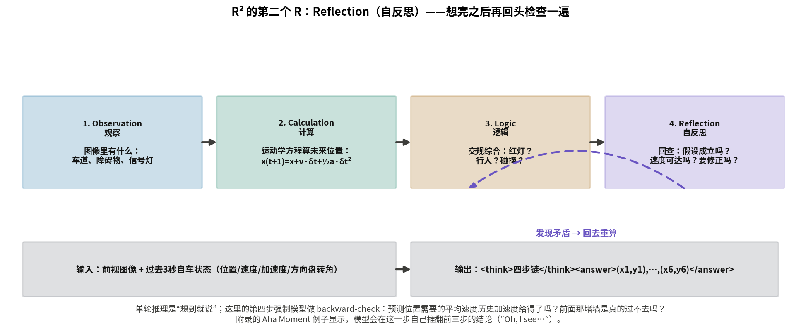
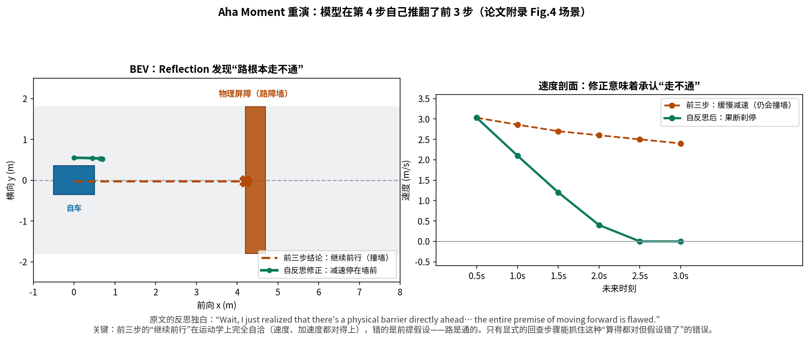
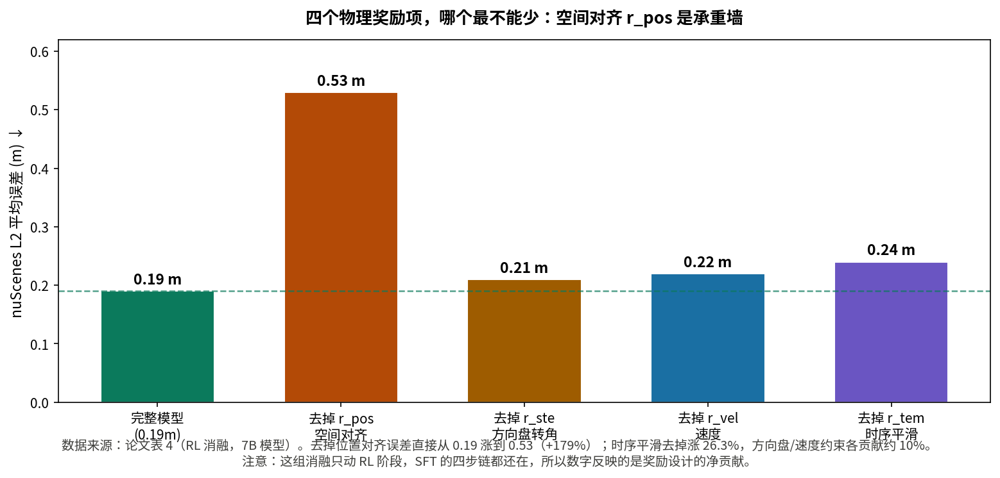

# 第二个 R 是回头看：AutoDrive-R² 的自反思

> **论文**：AutoDrive-R²: Incentivizing Reasoning and Self-Reflection Capacity for VLA Model in Autonomous Driving
> **作者**：Zhenlong Yuan, Chengxuan Qian, Jing Tang, Rui Chen, Zijian Song, Lei Sun, Xiangxiang Chu, Yujun Cai, Dapeng Zhang, Shuo Li（阿里高德 AMAP；共同一作：Zhenlong Yuan、Chengxuan Qian；项目负责人：Lei Sun；通讯作者：Dapeng Zhang）
> **会议**：ICLR 2026 ｜ **arXiv**：2509.01944（v3，2026-04-17；本解读基于该版本全文 22 页，含附录 A–E）
> **链接**：https://arxiv.org/abs/2509.01944
> **代码**：已公开，https://github.com/AMAP-ML/AutoDrive-R2（另有 HuggingFace 上的 7B checkpoint 与 nuScenesR²-6K 数据集；本解读已 clone 核对）
> **一句话核心洞见**：R² 的第二个 R 是 Reflection（自反思）——在"观察→计算→逻辑"的单轮推理之后，强制加一段回查：用历史运动学数据验证预测是否可达、用场景常识验证前提假设是否成立；RL 阶段再用空间对齐、车辆动力学、时序平滑三组物理奖励，把反思中"算得对"的东西固定成策略。

## R² 的第二个 R 到底是什么

先排除两个望文生义的误读。R² 不是"推理两轮"（two-round reasoning），也不是"两个推理器"。论文标题的全称写得很清楚：Incentivizing **Reasoning and Self-Reflection** Capacity——第一个 R 是 Reasoning（推理），第二个 R 是 **Self-Reflection（自反思）**。标题里的"²"是个文字游戏：上标 2 既表示"平方/增强"，也表示有两个 R。

那自反思和推理的区别在哪？论文把它落成了一个四步逻辑链：

**Observation（观察）→ Calculation（计算）→ Logic（逻辑）→ Reflection（自反思）**

前三步是单轮推理：看图里有什么、用运动学方程算未来位置、结合交规做逻辑综合。第四步是回头看：**检查前三步的假设成不成立、算出的数对不对得上、要不要修正**。关键在于，Reflection 不是"再想一遍"，而是"检查一遍"——它的输入是前三步的结论，它的输出是"维持"或"推翻"。附录的 Aha Moment 例子（后面完整重演）显示，模型会在这一步写出 "Wait, I just realized…" 然后推翻自己前三步的结论。这种"自己纠正自己"的能力，就是这篇论文要 incentivize（激励）的东西：先用 SFT 把四步链的格式和习惯装进模型，再用 GRPO 的奖励把"反思出正确修正"的行为强化下来。

相对单轮推理的增量，论文用消融表 4 量化了：去掉自反思（w/o Self.）L2 从 0.19 米涨到 0.23 米（+21.1%）；去掉整个四步结构（w/o Four.）涨到 0.25 米（+31.5%）。所以自反思这一步单独贡献约 2 个百分点的误差下降（0.25→0.23 是结构的其他部分，0.23→0.19 是反思本身），增量真实但不算大头——大头是"结构化推理"这件事本身。这个比例关系后面还会回来。

## VLA 的轨迹为什么会"物理上不可行"

论文引言点了 VLA 在自动驾驶里的两个结构性失败，值得先看懂，因为四步链和物理奖励分别是冲着这两个去的。

**失败一：直接生成的轨迹经常开不出来。** VLM 直接输出文本形式的航点坐标时，没有任何机制保证这串坐标是车能走出来的。论文举的例子很实在：要求"无限扭矩的急打方向"才能走的轨迹，或者加速度曲线乘客根本受不了的轨迹。更麻烦的是"模型崩塌"（model collapse）——直接回归坐标时，模型倾向于输出训练集里的平均轨迹，遇到分布外场景就输出一条谁也开不了的折中路线。

**失败二：加中间表示会破坏端到端。** 已有工作用元动作（meta-action）或隐动作 token 来约束输出，但这等于在 VLM 后面又接了一套解码器，违背端到端优化的初衷，还增加了复杂度。作者的选择是：**不改架构，改训练**——输入输出格式保持"图像+文本→文本航点"的纯 VLM 范式，把物理约束放进 RL 的奖励里，让模型自己学会"只输出开得出来的轨迹"。

这个"不改架构、改训练"的选择，就是作者的底牌之一：它意味着任何现成的 VLM（这里是 Qwen2.5-VL-7B）都能零成本接入这套流程，不需要重新设计 tokenizer 或解码头。代价是训练变两阶段、超参数变多，后面会细看。

## 四步链里每一步到底在算什么

拿论文附录图 4 的真实样本走一遍四步链。场景输入：前视图像 + 过去 3 秒自车状态（每 0.5 秒一个点，共 7 个点：位置、速度、加速度、方向盘转角）。输出：未来 3 秒 6 个航点。

**第 1 步 Observation（观察）。** 模型看图说话：车辆直行、方向盘转角很小（0.05–0.06 rad）、附近无行人无车辆、没有可见信号灯、路面有物理屏障（路障墙）封住整条车道。注意这一步的输出是**自然语言描述**，不是结构化标签——它的作用是给后面的计算和逻辑提供"场景事实"。

**第 2 步 Calculation（计算）。** 用运动学方程把历史状态外推。论文附录 D 给了 prompt 里强制的计算模板：

- 平均加速度：$a^{avg}_x = (\sum a_{xi})/N$，$a^{avg}_y = (\sum a_{yi})/N$
- 速度预测：$v_x = v_0 + a^{avg}_x \cdot \delta t$，$v_y = v_0 + a^{avg}_y \cdot \delta t$
- 位置预测：$x(t+1) = x_0 + v_x \cdot \delta t + 0.5 \cdot a^{avg}_x \cdot \delta t^2$
- 横向偏移：$\Delta y = v \cdot \tan(\theta)$

拿样本里的数算一步：7 个点的 $a_x$ 是 $[-0.06, -0.13, 0.11, 0.08, -0.37, -0.40, -0.92]$，平均 $a^{avg}_x \approx -0.24$ m/s²；当前速度 $v_0 = 3.03$ m/s。$\delta t = 0.5$ s 时，$v_x = 3.03 + (-0.24)(0.5) \approx 2.91$ m/s，$x(0.5) = 0 + 2.91 \times 0.5 + 0.5 \times (-0.24) \times 0.25 \approx 1.42$ m。论文样本里模型算出来的是 $x \approx 1.39$ m——量级一致（小数差异来自模型用的平均方式略有不同）。**这一步的本质是：用中学物理把"车在减速"翻译成"0.5 秒后在哪"。** 它不聪明，但它把预测锚定在物理上，而不是让 LLM 自由发挥编坐标。

**第 3 步 Logic（逻辑）。** 安全检查三问：会闯红灯吗？会撞上前车吗？会撞到行人吗？→ 结论"继续前行"。**注意：这一步的结论是错的。** 前面观察里明明写了"物理屏障封住整条车道"，但逻辑综合时模型只检查了"红灯/前车/行人"三项，没有检查"路通不通"，于是得出了"继续前行"的结论。前三步各自都自洽，但合起来是错的——错在**前提假设**（路是通的），不在计算。

**第 4 步 Reflection（自反思）。** 回查：预测位置 $x=1.39$ 需要的平均速度 2.86 m/s，历史加速度给得了吗？→ 给得了。然后模型写出了那段关键的独白："Wait, I just realized that there's a physical barrier directly ahead blocking the entire lane; the vehicle cannot possibly navigate around it… the entire premise of moving forward is flawed."（前方有物理屏障封住整条车道，继续前行的整个前提是错的。）修正：按历史最大减速度约 $-0.92$ m/s² 从 3.03 m/s 刹停，约 1.5 秒停住，输出航点 $[0.45,-0.01],[0.65,-0.02],[0.70,-0.03],\ldots$——车在屏障前停下。

*自绘图：论文图 1 管线的机制重述。前三步是单轮推理，第四步 Reflection 对前三步做回查，发现矛盾时沿虚线返回重算。这是 R² 中第二个 R 的全部含义。*

*自绘图：论文附录 Fig.4 场景的 BEV 重演。左：前三步的"继续前行"在运动学上完全自洽，但会撞上路障墙；自反思发现"路根本走不通"，修正为减速停住。右：两种决策的速度剖面对比。*

这个例子把自反思的价值说透了：**它抓的不是"算错了"，而是"假设错了"**。前三步的每一步单独看都没毛病——观察写了有屏障，计算用的公式是对的，逻辑检查的三项也都通过了。错误发生在步骤之间：观察到的"屏障"没有进入逻辑检查的清单。没有显式的回查步骤，这种跨步骤的遗漏是抓不到的。这就是为什么作者坚持把 Reflection 做成独立的第四步，而不是把它合并进 Logic——检查清单本身也需要被检查。

## nuScenesR²-6K：6000 条数据的"生成—验证"管线

SFT 阶段需要冷启动数据：图像—轨迹对之上，还要有四步链的推理文本。作者从 nuScenes 训练集里挑了约 8000 个图像—轨迹对，用 Qwen2.5-VL-72B 按附录 D 的结构化 prompt 生成初始 CoT，再用**闭源的 Qwen-VL-Max 做专家验证**，打分审查每条链，有事实错误或逻辑不一致的直接丢弃，最后剩 6000 条高质量样本。这就是 nuScenesR²-6K。

管线里有两个值得注意的设计。第一，prompt 明确鼓励模型在反思部分使用自然的自我对话表达（"let me think"、"wait"、"oh, I see" 等）——Aha Moment 里那种口语化的自我纠正不是偶然冒出来的，是 prompt 诱导的文体。模型在 SFT 阶段见过大量"先下结论、再自我质疑、再修正"的文本模式，RL 阶段才有机会把这种模式强化成稳定的行为。第二，验证用的是**比生成更强的模型**（Qwen-VL-Max 审 Qwen2.5-VL-72B 的输出），和 MindDriver 用 Qwen3 审 Qwen2.5-VL 是同一个不对称验证思想：生成可以便宜，验证必须严。

这里要记一个前后矛盾：正文 2.1 节写的是"generate-then-validate"自动管线，而 Reproducibility Statement 里写的是 "6,000 **manually annotated** image-trajectory pairs"（6000 个人工标注样本）。两者对不上——按正文的方法描述，这 6000 条是模型生成+模型验证的，人工最多参与了 prompt 设计和抽查。把自动管线说成人工标注，要么是措辞不严谨，要么是想强调质量。读者应当按正文的方法描述来理解数据的真实来源。

## 物理接地奖励：四个公式逐项算一遍

RL 阶段的总奖励是 $r_i = r^{acc}_i + r^{format}_i$。格式奖励是 0/1 二值的：输出严格符合 `<think>…</think><answer>(x1,y1),…</answer>` 则为 1，否则 0。真正干活的是物理接地精度奖励：

$$r_{acc} = \lambda_{pos} r_{pos} + \lambda_{ste} r_{ste} + \lambda_{vel} r_{vel} + \lambda_{tem} r_{tem}, \quad (8)$$

四个 $\lambda$ 在实验里**全设为 1**（论文说它们是"可学习的系数"，但实际是写死的超参数，没有学习过程——措辞与实现不符，记一笔）。

**$r_{pos}$：空间对齐。** 预测航点与真值航点的均方欧氏距离：

$$r_{pos} = \frac{1}{N}\sum_{i=1}^{N}\big[(x_i - x^{gt}_i)^2 + (y_i - y^{gt}_i)^2\big]. \quad (4)$$

这是最朴素的一项：整条轨迹在几何上跟真值差多少。注意它是**误差**（越小越好），而在 GRPO 里它被当作奖励用——组内归一化之后，误差小的候选拿到正优势，误差大的拿到负优势，所以符号不影响优化方向，只影响优势的相对排序。

**$r_{ste}$：方向盘转角约束。** $\frac{1}{N}\sum_j (\theta_j - \theta^{gt}_j)^2$，预测转角序列与真值转角序列的均方差。**$r_{vel}$：速度约束**，同理 $\frac{1}{N}\sum_k (v_k - v^{gt}_k)^2$。这两项是把"车辆动力学"翻译成奖励：转角和速度是执行器真正关心的量，只奖位置对齐的话，模型可能输出一条"位置都对但方向盘要左右乱打"才能走出来的轨迹。

**$r_{tem}$：时序平滑。** 惩罚相邻时刻控制量的跳变：

$$r_{tem} = \frac{1}{N}\sum_{j=1}^{N}(\theta_j - \theta_{j-1})^2 + \frac{1}{N}\sum_{k=1}^{N}(v_k - v^{k-1})^2. \quad (7)$$

拿一个小实例算：设某候选的 6 个转角是 $[0.10, 0.12, 0.11, 0.30, 0.32, 0.31]$ rad（第 4 个点有个跳变），速度恒为 5 m/s。转角差分平方是 $[0.0004, 0.0001, 0.0361, 0.0004, 0.0001]$，均值约 $0.0074$；速度项为 0。所以 $r_{tem} \approx 0.0074$。如果转角是平滑的 $[0.10, 0.14, 0.18, 0.22, 0.26, 0.30]$，差分平方全是 $0.0016$，$r_{tem} = 0.0016$。**那个 0.19 的跳变（约 11°）在平方后被放大了 20 多倍**——平方惩罚的几何意义就是：小幅连续调整几乎不扣分，突变被重罚。这正好对应附录里的运动学论证：急打方向要求超过轮胎摩擦极限的侧向加速度（$a_c = v^2/R \le \mu g$），还会产生超过人体耐受（约 2.5 m/s³）的 jerk。

公式 (7) 有个边界小问题：$j=1$ 时 $\theta_0$ 没有定义。论文没说 $\theta_0$ 取什么（历史最后一个转角？还是 0？）。这是实现细节，论文没交代，复现时要自己定——代码仓库里应该有答案，本解读未逐行核对奖励实现的边界处理，记为缺口。

附录 C 还列了最小转弯半径 $R_{min} = L/\sin(\delta_{max})$、jerk 定义 $j(t) = da/dt$、悬架二阶微分方程 $m\ddot{x} + c\dot{x} + kx = F(t)$。坦率说，这几个公式在正文的奖励里**都没有直接用到**——$r_{tem}$ 惩罚的是差分平方，不是 jerk；悬架方程更是纯背景。附录 C 的作用是给"物理接地"这个说法提供物理学背书，属于装饰性内容，不影响对方法的理解。把装饰认成承重，是读附录时要避免的。

*自绘图：论文表 4 数据。去掉空间对齐 $r_{pos}$ 误差从 0.19 涨到 0.53（+179%），是最不能少的一项；时序平滑、速度、转角约束各贡献约 10–26%。*

## GRPO：组内排名代替价值网络

GRPO 的目标函数和优势定义是标准的 DeepSeek-R1 路线：

$$A_i = \frac{r_i - \text{mean}(\{r_j\}_{j=1}^G)}{\text{std}(\{r_j\}_{j=1}^G)}, \quad (1)$$

$$L_{GRPO}(\theta) = -\mathbb{E}\left[\frac{1}{G}\sum_{i=1}^G \min\left(\frac{\pi_\theta(o_i|q)}{\pi_{\theta_{old}}(o_i|q)}A_i,\, \text{clip}(\cdot)A_i\right) - \beta D_{KL}(\pi_\theta\|\pi_{ref})\right]. \quad (2)(3)$$

每个输入采样 $G=6$ 个候选回答，按总奖励算组内均值和标准差，得到每个候选的优势 $A_i$。走一个小实例：6 个候选的总奖励是 $[2.1, 1.8, 2.4, 1.2, 2.0, 0.9]$，均值 $1.73$，标准差约 $0.52$，优势约为 $[0.71, 0.13, 1.29, -1.02, 0.52, -1.60]$。最好的候选获得 +1.29 的梯度加权，最差的 −1.60。**模型学到的不是"奖励 2.4 有多好"，而是"在这个输入下，2.4 比同组其他候选好多少"**——这就是 group-relative 的含义，也是它不需要 critic 网络的原因。

超参数（表 5 消融）：KL 系数 $\beta = 0.04$ 最优（0.02 太松、0.06 太紧，分别对应 0.21 和 0.20 米）；采样数 $G=6$ 最优，$G=8$ 不再提升（0.19 持平）——采样更多候选对优势估计的边际收益递减，6 是个算力与效果的平衡点。训练配置：两阶段学习率都是 $5\times10^{-7}$，累计 batch 8，最大补全长度 4096 token，RL 跑 750 iterations、1 个 epoch、18 小时，TRL 框架，8×H20。

这里有个**直接矛盾**要指出：正文 3.1 节写的是 "750 training iterations and 1 epoch"，附录 A.1 却写 "The training process ran for **750 epochs**"。750 个 iteration 和 750 个 epoch 差了三个数量级，不可能是笔误之外的任何东西。按 18 小时、batch 8、6000 样本来算，1 个 epoch 约 750 个 iteration——所以正文是对的（750 iterations ≈ 1 epoch），附录的 "750 epochs" 是错的。读者以正文为准。

## 数字怎么读：0.19 米是怎么攒出来的

**nuScenes 开环（表 1）。** AutoDrive-R² 7B 的 L2 是 0.13 / 0.19 / 0.25（1s/2s/3s），平均 0.19 米；碰撞率 0.00 / 0.07 / 0.12，平均 0.07%。论文强调的两个降幅都算得上：相对基座 Qwen2.5-VL-7B（平均 1.45 米）降了 86.9%，相对 EMMA+（平均 0.29 米）降了 34.5%。但读这张表要注意三件事。第一，**增量的大头来自 SFT，不是 RL**：表 4 显示，纯 SFT 已经把 1.45 米干到 0.27 米（降 81.4%），RL 只负责 0.27→0.19。标题强调的 R²（推理+反思的 RL 激励）是真实增量，但故事的主角其实是 nuScenesR²-6K 这 6000 条四步链数据。第二，EMMA+ 用 103k 场景的内部数据训练，本文只用 6k+6k 样本（约 11.65%）就超过了它——样本效率是真优势，但 EMMA+ 的数据不公开，它的基线强度无法独立验证，这个对比的含金量要打折扣。第三，3B 模型是 0.49 米平均 L2，7B 是 0.19 米——**基座规模的影响比方法本身大**，7B 相对 3B 的提升（0.30 米）超过了 RL 相对 SFT 的提升（0.08 米）。

**Waymo 零样本（表 2）。** 7B 平均 0.20 米，相对 Qwen2.5-VL-7B 的 2.13 米降了约 90.6%（论文写 90.7%，四舍五入差异），相对 DriveVLM 的 0.42 米降了一半多。模型只在 nuScenes 上训练，直接测 Waymo——跨数据集的泛化是成立的。不过表 2 中间几行的提取有些错乱（EMMA/EMMA+/Imprompt-VLA 几行的数字归属不明），本解读只引用能确认的行：Qwen2.5-VL-3B（5.14）、Qwen2.5-VL-7B（2.13）、DriveVLM（0.42）、AutoDrive-R² 7B（0.20）。归属不明的行不引用，这是数字诚实的要求。

**NAVSIM 闭环（表 3）。** PDMS 89.1，超过 Para-Drive 的 84.0达 5 个点以上；NC 98.5、DAC 95.9、TTC 95.4、Comfort 100、EP 82.7 全线最高。开环 L2 准、闭环 PDMS 高，两者是一致的——物理奖励里的平滑项直接对应 Comfort 和 PDMS 里的人性化评分。

**消融的权重排序（表 4、表 5）。** SFT 阶段：四步结构（0.25→0.19 贡献 0.06）和自反思（0.23→0.19 贡献 0.04）——结构是 1.5 倍于反思的贡献。RL 阶段：$r_{pos}$（0.19→0.53）是承重墙，$r_{tem}$（→0.24，+26.3%）第二，$r_{ste}$、$r_{vel}$ 各约 10%。纯 RL 不做 SFT 是 0.33，比 SFT 的 0.27 差 22.2%——RL 在没有冷启动的情况下连推理格式都探索不出来，这和 DeepSeek-R1-Zero 的观察一致，也是两阶段设计的实证依据。

**怀疑式阅读的汇总注脚**：(1) 750 epochs vs 750 iterations 的矛盾（已在前文指出，以正文为准）；(2) "manually annotated" vs 自动管线的矛盾；(3) $\lambda$ 号称可学习实际写死为 1；(4) $r_{tem}$ 在 $j=1$ 处的边界未定义；(5) 附录 C 的运动学公式多为装饰；(6) 附录 E 声明 LLM 只做了语言润色——考虑到全文行文的规整度，这个声明是可信的，但也意味着解读时要把"漂亮话"和"硬证据"分开看，本文档正是这么做的。

**代码核对。** 官方仓库 AMAP-ML/AutoDrive-R2 已公开，`src/r1-v` 是基于 R1-V 框架的 GRPO 实现（含配置文件 `qwen2vl_sft_config.yaml`、`ddp.yaml`），HuggingFace 上有 7B 和 SFT 阶段的 checkpoint 以及完整数据集。仓库结构与论文的两阶段流程对应。奖励函数的边界处理（$r_{tem}$ 的 $\theta_0$）在代码里应有定义，本解读未逐行审计奖励实现，记为缺口——复现者应以代码为准。

## 可以带走的三个想法

**第一，把"检查"做成独立的步骤，而不是合并进推理。** 这篇论文最值得偷的不是四个奖励公式，而是"Reflection 作为第四步"的设计直觉。Aha Moment 的例子证明了一类错误的特殊性：每一步都对，但步骤之间漏了信息——观察到了屏障，逻辑检查却没把它列入清单。这种错误只有"检查清单本身也被检查"才能抓住。把它独立成一步，SFT 才能给它足够的样本权重，RL 才能单独奖励"推翻自己且推翻对了"的行为。任何多步骤 agent 流程（检索→综合→回答、规划→执行→验证）都可以问自己：最后有没有一段只负责回查、不负责产出的步骤？

**第二，物理约束可以放在奖励里，不必改架构。** VLA 输出"开不出来的轨迹"是个真问题，但作者没有去设计新的动作 tokenizer 或解码头，而是把转角、速度、平滑约束写成 GRPO 的奖励。这个选择的通用价值在于：**当你有一个已经很强的预训练模型时，改训练目标比改架构便宜得多**，而且约束是软性的——模型在真值附近可以自由探索，只要别违反物理。这种"奖励即约束"的思路，适用于任何"输出必须满足外部物理/规则约束"的生成任务。

**第三，对"物理接地"这个名字保持警惕。** 四个奖励项里，$r_{pos}$、$r_{ste}$、$r_{vel}$ 三个都是"和真值比"，只有 $r_{tem}$ 是不依赖真值的内在约束。严格说，这套奖励的大部分仍是"真值对齐"，真正的"物理"只有平滑项和附录里的运动学论证。如果未来有人想在没有真值轨迹的场景下用这套方法（比如纯仿真探索），能直接用的只有 $r_{tem}$ 和格式奖励——那才是"物理接地"这个名字下真正可迁移的部分。名字的分量和机制的分量不完全对等，读论文时把这一点分开，能避免高估方法的适用范围。

**留下的真问题**：四步链里的 Calculation 用的是最简运动学——匀加速直线外推（$x = x_0 + v\delta t + \frac{1}{2}a\delta t^2$）。这对"前方路障刹停"够用，但对 cut-in、环岛、交互式博弈场景，这种运动学外推会系统性低估他车意图的影响。自反思能抓住"假设错了"，但如果计算模型本身太简陋，反思也只能在小误差范围内修修补补。下一步自然是：Calculation 这一步能不能也升级——比如引入简单的交互预测模型，而不只是单车运动学？那会是 R³ 吗？可能，但名字不重要，重要的是"计算"这一步的精度上限，决定了整个四步链的精度上限。
