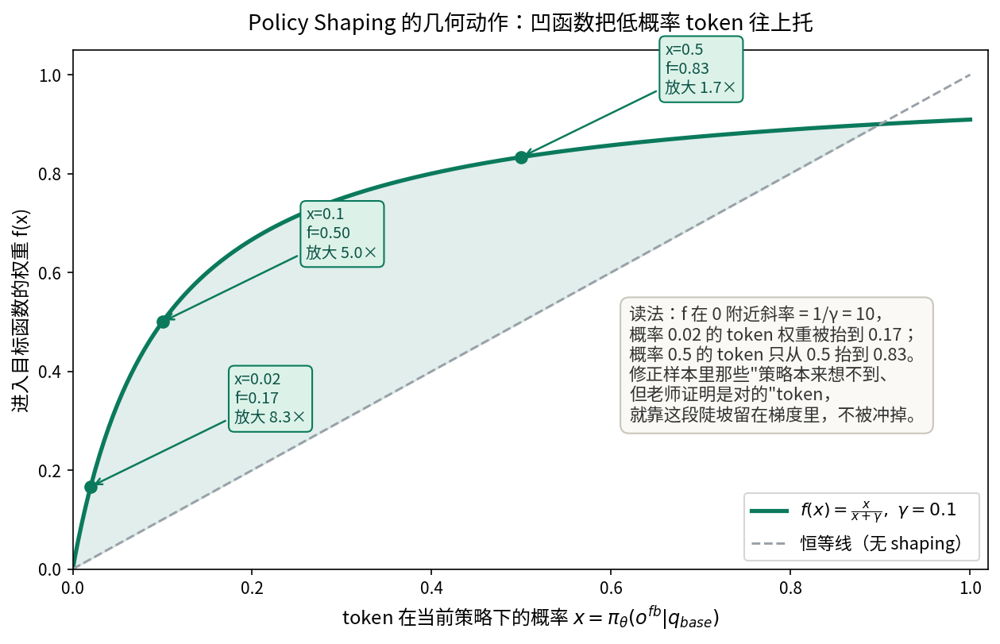
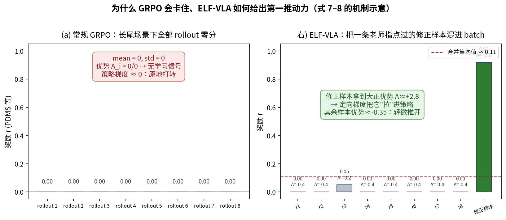

# 把"正确答案"翻译成"自己能学会的答案"：ELF-VLA 如何用结构化失败诊断打破 VLA 强化学习的零奖励僵局

> **全局编号**：83（Agent 迁移应用 81–85 系列）\
> **论文**：ELF-VLA: Unleashing VLA Potentials in Autonomous Driving via Explicit Learning from Failures\
> **作者**：Yuechen Luo、Qimao Chen、Fang Li（共同一作）、Shaoqing Xu、Jiaxin Liu、Ziying Song、Zhi-xin Yang、Fuxi Wen（清华大学、澳门大学、北京交通大学）\
> **会议/年份**：CVPR 2026（官方代码仓库 2026-02-21 公告接收；arXiv 仅 v1，2026-03-01 提交，无后续版本）\
> **链接**：arXiv https://arxiv.org/abs/2603.01063\
> **代码是否公开**：官方仓库 https://github.com/luo-yc17/ELF-VLA 已建立，但截至 2026-10-09 只有 README 与 assets，训练/推理代码与 checkpoint 的 checkbox 均未勾选——**实质未公开**，本文所有判断只来自论文正文 8 页 + 附录 7 页。\
> **一句话核心洞见**：GRPO 在长尾场景里卡住，不是因为探索不够，而是探索到的全是零分样本、组内优势恒为零；ELF-VLA 让一个更强的老师看一眼真值后写出结构化诊断，学生照着诊断自己走出一条高分轨迹，再把这条"自己走出来的正确答案"混进 GRPO 批次——配合 policy shaping 解决条件错配，让零奖励的僵局第一次产生可学习的梯度。

先看论文图 1 上下两排的对比，这是全文的赌注。上排：常规 RL 微调的 VLA，在某些场景里 n 条 rollout 的 PDMS 全是为零，不管采多少次都一样，策略原地打转。下排：ELF-VLA 在同一个场景里请老师给一份结构化反馈，策略照着反馈重新走一条修正轨迹，得了高分，僵局被打破。

这个对比之所以值得押注，是因为它点出了一个 GRPO 在驾驶里特有的死结。GRPO 的学习信号是组内相对优势：同一条 query 采 n 条回答，用这 n 条的奖励均值和标准差做归一化，谁高于均值谁被加强。如果 n 条全是零分，均值是零，标准差也是零，优势 $A_i=(r_i-\text{mean})/\text{std}$ 在数学上是 0/0，实践中就是没有梯度。注意这和"奖励稀疏"不是一回事：奖励稀疏是好样本少但还有，模型慢慢能撞上；这里是**结构性全零**——SFT 之后的策略在长尾场景（无保护左转、紧急避让）里根本走不出一条像样的轨迹，再多采样也只是在零分堆里打转。论文 4.2 节的图 4 把这个现象量化了：常规 GRPO 训练中，有 2.73% 的样本是"全灭"（所有 rollout 的 PDMS 都低于阈值 $s$）。

读到这里，一个自然的疑问是：为什么不直接给这些场景加更多监督数据？答案是 SFT 的分布偏置：训练集里常见场景占绝对多数，安全关键的长尾场景本来就稀少，SFT 后的策略在这些场景上连"错得有信息量"都做不到——错得千篇一律，全是零分。RL 本来是用来突破 SFT 分布的工具，但在这里 RL 的第一步就被 SFT 的局限焊死了。这就是作者要解决的那个具体的失败场景。

## 作者手里的三张牌

从论文的组织方式反推，作者决定做这件事时，手里大概有三张牌。

第一张是**想法的来源干净**。用自然语言反馈指导 LLM 推理，在 LLM 文献里已经有人做过（论文引的 [3] Learning from Natural Language Feedback 和 [39] Critique-GRPO），把"老师写诊断、学生照着改"这套流程搬到驾驶 VLA 上，审稿人不需要被说服"这想法从哪来"。第二张是**奖励可验证**。PDMS 是 NAVSIM 官方指标，由仿真器算出来，不需要学 reward model，老师诊断的质量可以用"修正后轨迹的 PDMS 是否真提高了"来检验——反馈好不好，有一把现成的尺子。第三张是**对照实验的设计**。论文没有只和常规 GRPO 比，而是加了两个非常针对性的基线：GT-GRPO（直接把真值轨迹塞进 GRPO 批次）和 Rule-GRPO（用规则生成反馈再修正）。这两个基线恰好隔离了"信息"和"机制"：GT-GRPO 有真值信息但没有"自己走出来"的机制，Rule-GRPO 有"再走一遍"的机制但没有真值信息。ELF-VLA 赢了这两个基线（91.0 对 89.2、89.6），说明起作用的既不是单纯的信息，也不是单纯的重采样，而是"真值信息 + 在策略分布内重新生成"这个组合。三张牌里最硬的是第三张：它让 2.0 个点的提升有了一个可归因的解释。

## 老师到底看到了什么：GT 是作弊吗

这是全篇最需要诚实面对的一个问题。算法 1 第 3 行写得明白：老师模型的输入是 `(q_base, o_w, o_gt)`——**老师看得到真值轨迹**。所以"学生从失败中学到东西"这个故事要打一个折：学生学到的，是老师把真值翻译成自然语言诊断之后、再自己走出来的东西。从信息论的角度，GT 的信息确实通过老师的手进了训练批次。

但把这叫"作弊"就错过了真正的技术点。关键在 GT-GRPO 这个基线的下场：直接把真值轨迹 $o_{gt}$ 塞进 GRPO 批次，只拿到 89.2，比常规 GRPO 的 89.0 高 0.2，基本没动。为什么有真值信息却学不动？因为真值轨迹在当前策略 $\pi_\theta$ 下的概率趋近于零。GRPO 的目标函数里每一项都乘着概率比 $c_i(\theta)=\pi_\theta(o_i|q)/\pi_{old}(o_i|q)$ 和优势 $A_i$，一个策略根本采样不出来的回答，即使奖励再高，对梯度的贡献也被它自身的低概率掐死了。这就是"正确答案"和"自己能学会的答案"的区别：**前者是信息，后者是信息加上"在当前策略分布内可达"**。

ELF-VLA 的完整链条是这样把真值变成可达的：老师看 $(q_{base}, o_w, o_{gt})$ 写出五段结构化诊断——(1) 元动作分析，(2) 思考过程分析，(3) 安全失效分析，(4) 效率失效分析，(5) 可执行的修正（含横向和纵向分量）；学生拿到诊断后，用**自己的**生成器从 $q_{fb}$ 里采样出修正轨迹 $o_{fb}$。这条轨迹是策略自己采样出来的，所以它在 $\pi_\theta$ 下的概率不是零；同时因为它是在真值指导的诊断下生成的，它的奖励大概率高于原来 n 条里的最高分。于是这条样本同时满足"奖励高"和"概率不为零"，混进批次后拿到大正优势，梯度第一次有了方向。图 1 下排那个"突破"，翻译成数学就是这么一件事。

式 (1) 把反馈输入的构造写得很清楚，值得把两种情况分开看：

$$q_{fb} = \begin{cases} \langle q_{base}, o_c, f_{rule} \rangle & \text{if } o_c \text{（PDMS} \geq s\text{）} \\ \langle q_{base}, o_w, f_{teacher} \rangle & \text{if } o_w \text{（PDMS} < s\text{）} \end{cases}$$

对判对的回答，配的是规则生成的正反馈 $f_{rule}$（"你做对了，继续保持"一类模板）；对判错的，才请老师写诊断。这个不对称设计是合理的：已经做对的样本不需要花 32B 老师的推理预算，只需要一个"别改"的信号；预算要花在刀刃上——$r_{traj} < s=0.8$ 的样本。但这里有一个论文没有讨论的隐含假设：$f_{rule}$ 对"做对"样本的强化，会不会让策略在这些样本上过度自信、挤掉探索？从消融表 6 看，$k=1$ 时整体是正向的，但这个机制层面的拉扯论文没有展开。

## 式 (4)–(9)：目标函数里每一项在干什么

先列出符号表，后面不再回头找：

| 符号 | 形状/含义 |
|---|---|
| $q_{base}$ | 基础输入：前视图像 $I_{cam}$ + 导航指令 $q_{com}$ + 自车状态 $q_{ego}$ + 过去 3 帧历史轨迹（2Hz） |
| $o_i$，$i=1..n$ | 策略从 $q_{base}$ 采样的 n 条原始回答（每条 = CoT 思考 + 轨迹），$n=8$ |
| $r_i = r_{traj,i}+r_{fmt,i}+r_{goal,i}$ | 第 i 条的总奖励，三项直接相加，无权重 |
| $s=0.8$ | 划分对错的 PDMS 阈值 |
| $o^{fb}_j$，$j=1..k$ | 从反馈输入 $q_{fb}$ 采样的修正回答，$k=1$ |
| $r_{union}$ | $\{r_i\}_{i=1}^n \cup \{r^{fb}_j\}_{j=1}^k$，共 $n+k$ 个奖励 |
| $c_i(\theta)$ | 标准概率比 $\pi_\theta(o_i\|q_{base})/\pi_{old}(o_i\|q_{base})$ |
| $f(x)=x/(x+\gamma)$，$\gamma=0.1$ | policy shaping 函数，只用于反馈分支 |

目标函数是式 (4)：

$$J(\theta) = \mathbb{E}\left[ \frac{1}{n}\sum_{i=1}^{n} J_i + \frac{1}{k}\sum_{j=1}^{k} J^{fb}_j - \beta D_{KL} \right]$$

它把一个 batch 拆成两拨人，用不同的规则更新。原始的 n 条走标准 GRPO：$J_i = \min(c_i(\theta)A_i, \text{clip}(c_i(\theta),1-\epsilon,1+\epsilon)A_i)$，该 clip 的 clip。修正的 k 条走 $J^{fb}_j = f(c^{fb}_j(\theta)) A^{fb}_j$，**不 clip，而是过一个 shaping 函数**。为什么区别对待？因为修正样本有一个原始样本没有的问题：条件错配。

修正样本 $o^{fb}_j$ 是在 $q_{fb}$（带老师诊断的输入）条件下采样出来的，但优化目标是 $q_{base}$ 条件下的策略。$q_{fb}$ 比 $q_{base}$ 长得多、信息多得多，一条在 $q_{fb}$ 下很自然的回答，在 $q_{base}$ 下的概率可能极低。如果对它用标准 clip，概率比 $c^{fb}_j = \pi_\theta(o^{fb}_j|q_{base})/\pi_{old}(o^{fb}_j|q_{base})$ 会是一个很小的数，乘上优势之后梯度贡献趋近于零——我们好不容易造出来的"自己能学会的答案"，又在数学上学不动了。更糟的是，token 级别的概率比方差极大，有梯度爆炸的风险。

Policy shaping $f(x)=x/(x+\gamma)$ 就是为这个问题准备的。先看它的几何形状（见下图）：

$f$ 是凹函数，在 $x=0$ 处斜率是 $1/\gamma=10$。一个在当前策略下概率只有 0.02 的 token，权重被抬到 0.17，放大 8.3 倍；概率 0.5 的 token 只从 0.5 抬到 0.83。**越是低概率的 token，被托得越狠**。修正样本里恰恰是那些"策略本来想不到、但老师证明是对的"token 概率最低——shaping 让这部分 token 留在梯度里，而不是被条件错配冲掉。注意式 (9) 的写法有一个细节：分母是 $\pi_\theta(o^{fb}_j|q_{base}) + \gamma$，不是 $\pi_{old}$。这不是通常的"概率比"，它甚至不依赖旧策略；它就是一个只关于新策略概率的单调压缩，把 $(0,\infty)$ 压到 $(0, 1/(1+\gamma))$。论文把它记作 $f(c^{fb}_j(\theta))$，这个记号有误导性——它不是对概率比做 shaping，而是直接对新策略概率做 shaping。效果上，它奖励"让修正样本在 $q_{base}$ 下变得更可能"，且边际收益递减（凹函数的性质），避免策略为了一条修正样本把整个分布扭过去。

优势的计算是式 (7)(8)：把原始奖励和修正奖励拼成一个集合 $r_{union}$，用它的均值和标准差做归一化。这个选择很关键：修正样本被选中的条件是 $r^{fb}_{traj} > \max(r_{traj})$（算法 1 第 8 行），所以它在合并集里一定是最高分，归一化后拿到最大的正优势；原来的 n 条里即使有零分，它们的负优势也被修正样本这个高分"衬托"得有限。下图把这个机制走了一遍：

如果修正样本不够 k 条（比如 n 条里本来就有高分，修正没超过最高分），算法用"达到最高分的那条原始回答"复制补齐。这个细节说明作者把 $k$ 当作一个固定的"修正预算"：batch 里永远有 k 个位置留给"比原来最好的还好"的东西，实在没有就拿原来的最好顶上，保证目标函数第二项的形状稳定。

KL 项 $-\beta D_{KL}$ 是 GRPO 的标准配置，锚定 SFT 初始模型 $\pi_{ref}$。但论文正文只说 $\beta$ 是超参数，**没有报告它的取值**。附录表 7 有一行 "Weight ratio 0.05"，含义不明——可能是 KL 系数，也可能是别的损失权重。这是下面怀疑式阅读要记的一笔。

## 一个左转场景走完全程：老师的诊断到底改了什么

论文 4.4 节的图 5 给了一个具体的左转场景，数字难得地完整，值得把每一步摆出来。这是一个复杂的无保护左转，初始的错误轨迹（红线）会导致潜在碰撞。

**第 1 步：策略采样。** 策略从 $q_{base}$ 采出 $n=8$ 条轨迹，每条包含 CoT 思考和轨迹点。假设这是长尾场景，8 条的 PDMS 全在 0.3 以下——全部判错（$<s=0.8$），没有一条能用。常规 GRPO 到这里就结束了：8 条零分，优势全零。

**第 2 步：老师诊断。** 老师拿到 $(q_{base}, o_w, o_{gt})$。注意老师能看到真值 $o_{gt}$，所以它不是在"推理"，而是在"对照"。它的诊断里最关键的一句是思考过程分析：策略的 CoT 里把关键障碍物估计在"前方 15.57 米、左侧 8.11 米"，而老师根据真值和场景给出更准确的位置——"前方 11.43 米、左侧 4.11 米"。误差是 4 米多的纵向和 4 米的横向，在左转场景里这就是"撞"和"不撞"的区别。老师进一步把这个感知误差归因到"思考过程"这一层（而不是元动作选错或轨迹执行抖动），并给出可执行修正：目标横向位置和纵向速度分别调多少。

**第 3 步：学生修正。** 策略拿到 $\langle q_{base}, o_w, f_{teacher} \rangle$，重新采样。修正后的轨迹（蓝线）绕开了障碍物。论文展示的修正后 CoT 里，"关键障碍物分析"一段已经用上了修正后的位置——**诊断不仅改了轨迹点，还改了中间的推理文字**。这一点很重要：如果只是轨迹点被改对而 CoT 还是错的，模型学到的就是"背答案"；CoT 一起被改对，梯度才能同时加固"怎么想"和"怎么做"。

**第 4 步：混入批次。** 修正轨迹的 $r_{traj}$ 超过原来 8 条的最高分，被选入最终的 $n+k=9$ 个样本，在合并归一化后拿到最大正优势。梯度更新时，shaping 函数保证那些低概率但正确的 token 不被条件错配冲掉。

同一个场景如果走 GT-GRPO：直接把真值轨迹（绿线）塞进批次。它的奖励是最高的，优势也是正的，但它在 $\pi_\theta(\cdot|q_{base})$ 下的概率极低——策略自己根本走不出这条线。梯度想把它"拉"进来，但概率比 $c_i(\theta)$ 把贡献压到接近零。表 3 的数字（GT-GRPO 89.2，只比 GRPO 高 0.2）就是这句话的实证。Rule-GRPO（89.6）好一点，因为它的修正样本是策略自己在规则反馈下重走的，概率不为零，但规则反馈只有"对/错"二值信息，指导太粗，修正质量上不去。

所以三条路线的排序 91.0 > 89.6 > 89.2 > 89.0 恰好对应"信息×可达性"的二维拆解：ELF-VLA 两者都有，Rule-GRPO 只有可达性，GT-GRPO 只有信息，常规 GRPO 两者都没有。这个消融设计是全文最漂亮的地方——它把方法的增量归因做干净了。

## k=1 最优：为什么多条修正反而有害

表 6 的消融显示，$k=1$ 时 91.0，$k=2$ 掉到 89.7，$k=4$ 掉到 89.0——**加修正样本加到和常规 GRPO 一样差**。论文的解释是"多条反馈响应会分散策略注意力"，这个说法比较含糊。更具体的机制可能是这样的：修正样本的优势来自"它是合并集里的最高分"。$k=1$ 时，这个最高分是唯一的，梯度方向明确——"往这条修正轨迹靠"。$k$ 增大时，算法从所有超过 $\max(r_{traj})$ 的修正里随机选 k 条（算法 1 第 8 行的 Select 是随机的），这 k 条修正轨迹之间可能差异很大（不同的修正路径），它们的优势都被拉高，梯度被扯向 k 个不同的方向。更糟的是，如果可选的修正不足 k 条，剩下的位置用"原来的最高分"复制补齐——复制出来的样本和原始 n 条里的某一条完全相同，在合并归一化里被重复计算，人为放大了那条样本的权重，相当于给 batch 加了噪声。

这个现象给了一个可迁移的教训：**往 RL 批次里注入外部指导时，"质"比"量"重要得多**。一条高质量的修正样本提供的是方向，多条质量参差的修正样本提供的是方差。$k$ 不是越大越好，它的上限是"修正样本之间的一致性"。

去掉 Policy Shaping（$k=1$，PS=✗）掉到 89.3，掉了 1.7。论文说这"证实 PS 对防止训练崩溃和格式错误至关重要"。1.7 个点的掉幅确实大，但"训练崩溃"这个词需要打折：表 6 只给了最终 PDMS，没有给训练曲线，我们看不到"崩溃"长什么样（是 loss 发散，还是格式奖励归零，还是 PDMS 震荡）。从机制上推测，没有 shaping 时反馈分支的 token 级概率比方差极大，梯度噪声淹没有用的信号——这更可能是"学不动"而不是"崩溃"。论文在这里的措辞比证据强，记一笔。

## 85k→24k：数据筛选扔掉了什么

3.3 节的数据筛选是容易被忽略但很实在的一步。用 SFT 模型对每条 query 采 N 条 rollout（**N 的具体值正文没写**，训练阶段用的是 8，但筛选阶段是否也是 8 不得而知），算奖励的均值和方差，扔掉"高均值低方差"的样本——也就是模型已经稳定做对的简单场景。85k 剩 24k，扔掉了 72%。

表 5 的结果：全量 85k 是 89.1，随机抽 24k 是 88.9，筛选后的 24k 是 91.0。随机 24k 和全量基本一样（88.9 vs 89.1），说明数据量本身不是瓶颈；筛选版高出 2.1，说明瓶颈是**简单样本稀释了梯度**。机制上：简单样本的 n 条 rollout 奖励都高，组内优势接近零，对梯度没贡献还占 batch 位置；难样本（低均值低方差，全灭）和模糊样本（高方差）才有学习信号。这个筛选和 ELF 的反馈机制是乘法关系：筛选把 batch 的位置留给"值得教"的样本，反馈给这些样本造出"教得动"的梯度。

但筛选标准里有一个微妙之处："低均值低方差"（难样本）和"高方差"（模糊样本）都被保留，而"高均值低方差"被扔掉。"低均值高方差"的样本呢？按字面它属于高方差，被保留。分类的边界在论文里没有形式化定义——"高/低"的阈值是多少？这部分的实现细节在附录里也没有。这是复现时的一个缺口：筛选阈值的选择可能显著影响 24k 的构成。

## 怀疑式阅读：论文没说清和说得太满的地方

**奖励函数的权重是拍脑袋的。** 式 (3) $r = r_{traj} + r_{fmt} + r_{goal}$，三项直接相加，无权重。其中 $r_{traj}\in[0,1]$（PDMS），$r_{fmt}\in\{0,1\}$（格式：0.5 分给 `<think>/<answer>` 标签，0.5 分给轨迹点语法），$r_{goal}\in[0,1]$（终点 L1 距离的分段函数，式 (10)：2 米内 1 分，15 米外 0 分）。三个问题：第一，正文说"four designed reward components"（四个），式子里只有三个——多出来的一个去哪了？很可能是写作时的残留，附录 7.1 也是三项。第二，格式奖励占整整 1 分，和 PDMS 同量级。训练早期 PDMS 普遍低时，格式分主导总奖励，策略可能先学会"写对格式"而不是"开对车"——这本身没问题（格式是解析的前提），但论文没有展示两项奖励此消彼长的曲线。第三，三项等权重没有任何敏感性分析。$r_{goal}$ 的分段阈值（2/4/6/10/15 米）同样没有依据。

**超参数报告有缺口。** KL 系数 $\beta$ 在正文只叫"超参数"，附录表 7 的 "Weight ratio 0.05" 含义不明（KL 系数？损失权重？）。$\epsilon$（clip 范围）的值没有报告。训练用了几个随机种子、表 1–6 的数字是单次还是均值，全部没写。NAVSIM 是固定测试集，方差主要来自训练随机性——2.0 个点的提升（89.0→91.0）是否显著，无法判断。

**记号有几处笔误。** 算法 1 第 9–10 行的 $\{q^{final}_i\}^{n+1}_{i=1}$ 应该是 $n+k$；式 (9) 的 $o^{fd}_j$ 应该是 $o^{fb}_j$；式 (8) 第二个优势的下标写成 $A^{fb}_i$ 应该是 $A^{fb}_j$。都不影响理解，但说明公式部分赶工痕迹明显。

**表 1 的引用标错了。** DriveVLA-W0-3B 在表 1 标为 [36]，但参考文献 [36] 是 GoalFlow；DriveVLA-W0 的正确引用是 [16]（表 2 标对了）。GoalFlow 和 DriveVLA-W0 在表 1 是相邻的两行（90.3 对 90.3），标错引用不影响数字，但审稿人会注意到。

**s=0.9 的解释是事后诸葛。** 表 10 显示阈值 $s=0.9$ 时掉到 89.8，论文解释"0.8–0.9 分的样本已经足够好，强行修正引入噪声"。这个解释合理，但它是看到结果后编的——事前没有任何理论说 0.8 是"修正"和"噪声"的分界。阈值 $s$ 的本质是"老师预算"和"修正覆盖"的权衡：$s$ 越高，请老师的次数越多，32B 老师的推理成本越高。论文没有报告老师调用的实际开销（占训练时间的比例），而这是这个方法实用性的关键数字：32 张 H20 跑 18 小时的 RL 里，Qwen3-VL-32B 的诊断占了多少？

**结论里承认的两个局限是诚实的。** 第一，学生被老师的能力封顶——老师看得到真值都只能做到 91.0，换更弱的老师会怎样，论文没试（"未来工作"）。第二，所有实验在 NAVSIM 上，它是**非反应式**仿真：周围车辆不 reacting，自车开得再离谱也不会引发连锁反应。PDMS/EPDMS 再高，也只是开环指标的高级版。论文在结论里把这两点都写了，没有藏，这是加分的。

**SOTA 的含金量要打折看。** NAVSIMv1 上 91.0 对 DriveVLA-W0-3B 的 90.3（+0.7），v2 上 87.1 对 86.1（+1.0），都是 vision-only 设置。但 DriveVLA-W0 用的是 3B 模型，ELF-VLA 用的是 8B——参数量差了近三倍。InternVL3-8B-SFT 基线是 87.4，RL 后到 91.0，方法本身的增量（+3.6 over SFT，+2.0 over GRPO）是干净的；但和外部 SOTA 比的时候，模型规模的差异要放在心里。

## 可以带走的想法

这篇论文真正可迁移的不是"请老师写诊断"这个流程——那太贵了，32B 老师给 8B 学生当家教，不是每个任务都请得起的。可迁移的是它解决的那道数学题：**当你的 RL 批次里出现"高奖励但零概率"的样本时，怎么让它产生梯度**。

GT-GRPO 的失败是一个普适的教训：在任何用策略梯度做微调的场景里（RLHF、RFT、机器人学），直接把专家演示塞进 on-policy 算法的批次，都会被概率比掐死。标准的回答是"用离线 RL"或"做行为克隆"，但 ELF-VLA 给了第三条路：**让策略自己在外部指导下重新生成一遍，把离线样本"洗"成在线样本**。这个"洗"的动作——用更强的模型/规则/检索结果当条件，让当前策略重采样——比样本本身更重要。Policy shaping $f(x)=x/(x+\gamma)$ 则是这条路上的一个具体技巧：当新旧条件错配导致概率比失效时，用一个凹函数直接托住低概率 token 的权重。它从 LUFFY 借来，但用在"反馈修正"这个场景是贴切的：修正样本的价值恰恰集中在那些策略原本想不到的 token 上。

另一个值得带走的是 $k=1$ 的教训：往 RL 里注水，宁可一条高质量的修正，也不要多条参差的。优势归一化是相对的，batch 里最高分的唯一性和纯度决定了梯度的方向感。这个原则在做任何"混合批次"（人工标注+模型采样、检索增强+自生成）时都成立。

最后，这篇论文的时间坐标值得记一笔：2026 年初，VLA+RL 已经从"能不能做"进入"怎么做得动"的阶段。Drive-R1、AutoVLA、ReCogDrive（都是 2025 年中）证明了 GRPO 能用在驾驶 VLA 上，ELF-VLA 回答的是下一个问题——当 GRPO 在长尾上停转时怎么办。它的答案是"把真值翻译成策略能用的语言"，而不是"找更多的真值"。这个思路的下一步，应该是去掉对真值的依赖：老师不看 $o_{gt}$，只看 $o_w$ 和场景，能不能写出同样有效的诊断？论文没有做这个实验，但它可能是这个方向真正的试金石。
