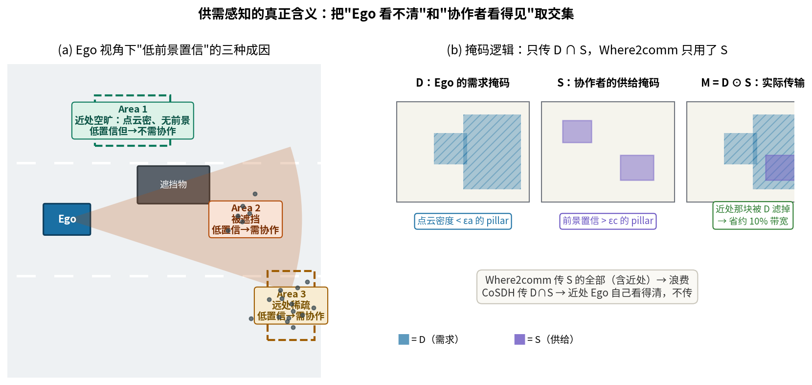
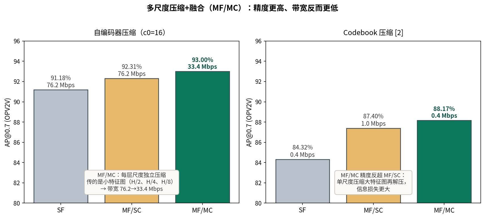
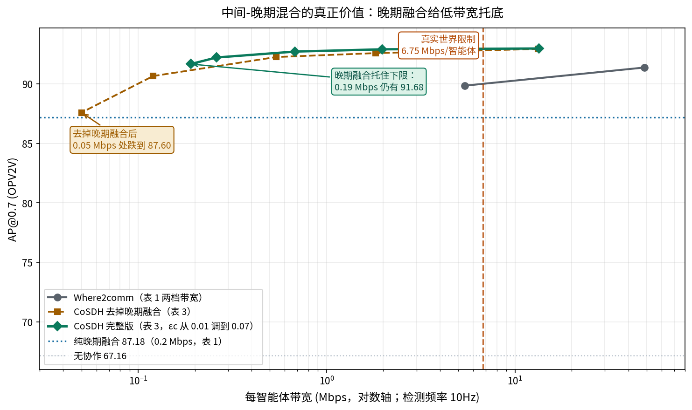

# 低带宽下别再只"传特征"了：CoSDH 如何用供需掩码和中间-晚期混合守住协作感知的精度下限

> **全局编号**：84（Agent 迁移应用 81–85 系列；多智能体协同驾驶相关）\
> **论文**：CoSDH: Communication-Efficient Collaborative Perception via Supply-Demand Awareness and Intermediate-Late Hybridization\
> **作者**：Junhao Xu、Yanan Zhang（共同一作）、Zhi Cai、Di Huang（北京航空航天大学复杂关键软件环境全国重点实验室、合肥工业大学）\
> **会议/年份**：CVPR 2025（arXiv 仅 v1，2025-03-05 提交，无后续版本；缩写 CoSDH 在正文未展开）\
> **链接**：arXiv https://arxiv.org/abs/2503.03430\
> **代码是否公开**：已公开 https://github.com/Xu2729/CoSDH，基于 OpenCOOD 框架。已核对配置文件 `opencood/hypes_yaml/opv2v/lidar_only/pointpillar_cosdh.yaml`：`req_points_threshold: 4`（对应 $\epsilon_a=4/32$）、`communication.threshold: 0.01`（对应 $\epsilon_c$）、`compression: 16`（对应 $c_0$）、`confidence_beta: 0.9`、`confidence_threshold: 0.3`（对应 $\beta$、$\epsilon_l$）——关键阈值与论文一致，代码可信。\
> **一句话核心洞见**：中间协作的精度-带宽曲线在低带宽段会跌破晚期融合的水平线；CoSDH 一边用"需求∩供给"掩码把中间特征传得更少，一边在带宽不够时直接传检测框做晚期补偿，让整条曲线的下限被晚期融合托住。

论文图 1a 是全文的赌注，值得先盯着它看。横轴是带宽，纵轴是 OPV2V 上的 AP@0.7。Where2comm 的曲线从高带宽往左走：27 Mbps 处掉约 1.5%，5 Mbps 处掉约 7.5%，1 Mbps 处掉约 14.5%。而一条几乎水平的虚线——纯晚期融合，只用约 0.7 Mbps——在 5 Mbps 以左**反超**了 Where2comm。一个只传检测框的"笨办法"，在带宽受限时打赢了精心设计的中间协作。这个反直觉的现象就是整篇论文的起点：如果中间协作在低带宽下注定崩，为什么不把晚期融合接在后面当安全网？

但先埋一个钩子：图 1a 的数字和论文自己的表 1 对不上。表 1 的"带宽受限"一栏里，Where2comm 在 5.4 Mbps 下是 89.86，只比无限制的 91.39 低 1.5%，而不是图 1a 说的 7.5%。这个矛盾后面怀疑式阅读会展开，这里先记住：**图 1a 可能是示意性的，或者来自不同的配置**，它的作用是讲清动机，不是呈现实测。

## 27 Mbps 的上限从哪来

脚注 1 交代了这个数字的来源：车路协同里常用的 DSRC（IEEE 802.11p）技术，传输速率约 27 Mbps。这是**所有协作车辆共享**的总带宽。论文假设 Ego 最多和 4 个协作者通信（OpenCOOD 的默认设置，`max_cav: 5`），于是每个协作者的带宽上限是 $27/4 = 6.75$ Mbps。表 1 的下半部分"BD≤6.75 Mbps"就是按这个算的：所有中间协作方法被强制压缩/筛选到每智能体 6.75 Mbps 以内，再比精度。

这个设定把"通信高效"从一个模糊的形容词变成了硬约束。看表 1 上半部分（无限制）就知道为什么需要它：V2VNet 在 OPV2V 上要 5,280 Mbps，DiscoNet 2,640 Mbps——是 DSRC 上限的几十到上百倍。这些方法在论文里精度再高，现实中也传不动。Where2comm（48.7 Mbps）是之前唯一接近实用的，但还是超了 6.75 的上限。CoSDH 无限制档是 13.4 Mbps，仍然超了，但它的曲线可以一路调到 0.19 Mbps 而精度几乎不掉——这是它和 Where2comm 的本质区别：**不是在某一个带宽点上赢，而是整条精度-带宽曲线的位置不一样**。

## Area 1/2/3：低前景置信的三种成因

3.3 节的核心论点是：Where2comm 这类方法用"对称的供需关系"选区域——协作者传它看得见的前景（supply），Ego 要它看不见的区域（demand），而"Ego 看不见"被简单等同于"前景置信低"。作者认为这个等同是粗糙的。从 Ego 的视角看，低前景置信有三种成因（论文图 1b）：

- **Area 1**：近处空旷路面。点云密，看得清，只是因为没有前景物体所以置信低。**不需要协作**。
- **Area 2**：被遮挡的区域。有前景物体但被挡住了，点云没有。需要协作。
- **Area 3**：远处稀疏区域。点云太少，看不清。需要协作。

三种区域在 Ego 的置信图上长得一样（都是低置信），但只有后两种值得花带宽。Where2comm 的选区逻辑是"协作者的前景置信高就传"，它会连 Area 1 对应的区域也传——协作者在 Ego 近处看到的前景，对 Ego 来说是已知信息，传了也白传。

CoSDH 的回答是把"需求"和"供给"拆成两个独立的掩码再取交集。需求掩码 $D_i$ 只看 Ego 自己的点云密度：把每个 pillar 里的点数归一化到 $[0,1]$ 得到 $A_i$，点数少于阈值 $\epsilon_a$ 的 pillar 标为 1，即 $D_i = A_i < \epsilon_a$。供给掩码 $S_j$ 沿用 Where2comm 的做法：检测头输出的空间置信图 $C_j$，高于 $\epsilon_c$ 的标为 1。最终的选择掩码是逐元素相乘：$M_{j\to i} = D_i \odot S_j$。

下图把这个逻辑画了出来：

$\epsilon_a = 4/32 = 0.125$ 这个数字的由来值得说一下：PointPillar 编码时每个 pillar 最多取 32 个点（`max_points_per_voxel: 32`），少于 4 个点的 pillar 被认为"看不清"。代码里的 `req_points_threshold: 4` 与之一致。这是一个基于传感器物理特性的阈值，不是搜出来的——4 个点以下的 pillar，连拟合一个平面都不够，确实没有信息量。

但这里有一个论文自己放在附录 B 里、却削弱了主故事的数据：在 OPV2V 的大感知范围（$x\in[-140.8, 140.8]$ 米）下，Ego"看得清"的区域只占约 4%，$D_i$ 覆盖了绝大部分区域。Area 1 在实际数据里很小，需求掩码能滤掉的也就是那 4%。表 2 的消融证实了这一点：加上 supply 掩码带宽降 95%（36.09→1.99 Mbps），再加上 demand 掩码只降 10%（1.99→1.82 Mbps），精度几乎不动（92.62→92.60）。**供需故事里真正干活的是 supply 那一半，demand 是个小优化**。论文把两者并列为核心创新之一，从消融数字看是夸大了 demand 的分量。诚实地说，$D_i$ 的更大价值可能不在省带宽，而在"避免协作者的特征污染 Ego 本来就看得清的区域"——论文 3.3 节提了一句"避免干扰"，V2XSim 上"带宽降低精度反而先升后降"的现象（7.2 节）侧面支持了这一点：传得少，有时反而准，因为掺进来的噪声少了。

## 式 (1)–(6)：从带宽约束到多尺度压缩融合

问题定义是式 (1)(2)，写得比一般的感知论文更"系统"：

$$\xi_\Phi(B) = \arg\max_\theta \sum_{i=1}^{N} g(\Phi_\theta(X_i, \{P_{j\to i}\}_{j=1}^{N}), y_i), \quad \text{s.t. } \sum_{j=1}^{N} |P_{j\to i}| \le B$$

$X_i$ 是第 $i$ 个智能体的原始点云，$P_{j\to i}$ 是智能体 $j$ 发给 $i$ 的消息，$|P_{j\to i}|$ 是它的通信量，$g$ 是 3D 检测指标（AP）。目标是在总带宽预算 $B$ 下最大化所有智能体的检测精度总和。这个形式化的价值在于它把"通信高效"从"越少越好"的口号变成了约束优化问题——后面的所有设计（掩码选区、自编码器压缩、float16）都是在解这个带约束的问题。论文没有真的去解这个优化（没有拉格朗日对偶，没有理论界），它只是用这个形式来组织工程选择。这是可以接受的，但读者要知道式 (1) 是个"姿态"，不是"结果"。

消息压缩与融合是式 (3)–(6)，按一次前向的顺序走：

$$Z'^{(l)}_{j\to i} = f^{(l)}_{encode}(Z^{(l)}_{j\to i}) \in \mathbb{R}^{\frac{C_l}{c_0}\times H_l \times W_l} \tag{3}$$

$$F^{(l)}_{j\to i} = f^{(l)}_{decode}(Z'^{(l)}_{j\to i}) \in \mathbb{R}^{C_l\times H_l \times W_l} \tag{4}$$

$$F'^{(l)}_{j\to i} = f_{transform}(F^{(l)}_{j\to i}, \xi_{j\to i}) \tag{5}$$

$$\tilde{F}^{(l)}_i = \max\left(F^{(l)}_i, \{F'^{(l)}_{j\to i}\}_{j\ne i}\right) \tag{6}$$

逐项看。$Z^{(l)}_{j\to i}$ 是被供需掩码选过的稀疏特征（只在 $M_{j\to i}=1$ 的 pillar 有值，其余为零）。式 (3) 用第 $l$ 层专用的自编码器把通道数从 $C_l$ 压到 $C_l/c_0$，$c_0=16$（OPV2V/DAIR-V2X）或 8（V2XSim）。传输时先转 float16，再只传非零部分及其坐标——稀疏性在这里变现为带宽：零值不传。式 (4) 在 Ego 端解码恢复通道数。式 (5) 用坐标变换矩阵 $\xi_{j\to i}$ 把协作者的特征对齐到 Ego 坐标系。式 (6) 用 max fusion 融合：每个位置取所有智能体特征的最大值。

Max fusion 的选择值得停一下。论文给了两个理由：计算简单（复杂度随智能体数线性增长）、取最大实现信息互补。但还有一个没说的理由：**max 对稀疏传输是友好的**。因为只传了非零部分，Ego 端解码后的特征图在大部分位置是零（或接近零），max 操作天然地"只在有信号的位置取协作者的值"，不需要额外的注意力权重。这是一个工程上的巧合：稀疏传输 + max 融合，两者的简单性互相成全。如果用的是注意力融合，Ego 还得知道每个位置"该信谁"，又要多传权重。

多尺度压缩是 3.4 节相对 CoAlign [26] 的改进。CoAlign 的做法（图 3b）是多尺度融合、但只压缩 PFE 之后的大尺度单层特征——大特征图（$H\times W$）即使压了通道，空间维度大，带宽还是高。CoSDH（图 3c）给每个尺度配独立的自编码器，压的是已经下采样的小特征图（$H/2$、$H/4$、$H/8$）。附录表 A 的数字很说明问题（OPV2V，无供需选择、传完整 BEV）：

自编码器压缩下，MF/MC（93.00%）比 MF/SC（92.31%）精度更高，带宽反而从 76.2 降到 33.4 Mbps。精度反超的原因论文解释为"压缩后立刻融合"，我的理解是：MF/SC 用一个自编码器压大特征图，压缩的信息损失集中在一处且无法被其他尺度补偿；MF/MC 每个尺度独立压缩，小特征图的绝对信息量小，解压误差也小，而且三路并行、各管各的尺度。这是一个"分而治之"的胜利，不是"压缩算法"的胜利。

## 晚期融合托底：精度曲线的下限从哪来

3.5 节是论文的第二个核心，但它的动机比技术更值得讲。朴素的晚期融合（各传各的检测框，Ego 端合并后做 NMS）在 OPV2V 上能做到 87.18% AP@0.7，只用 0.2 Mbps。但它有两个毛病：第一，协作者的低置信框会混进来拉低精度；第二，NMS 合并时，协作者的"次优框"可能压掉 Ego 自己的"优质框"——因为 NMS 只看置信度分数，不看框是谁的。在 DAIR-V2X（真实数据，噪声大）上，这个问题严重到朴素晚期融合的 AP@0.7（50.47%）**不如不协作**（55.46%）。附录图 B 的 PR 曲线把机制画得很清楚：朴素晚期融合在低召回区引入大量次优框，精度显著下降，这些框还可能在 NMS 阶段挤掉好框，连累召回。

Confidence-aware late fusion 的修复是两步：先按 $\epsilon_l=0.3$ 过滤掉协作者的低置信框；再把剩下的协作者框的置信度乘以 $\beta\in(0,1)$（OPV2V/V2XSim 取 0.9，DAIR-V2X 取 0.8），**人为压低外来框在 NMS 里的优先级**，保证"Ego 自己的框优先"。这个 $\beta$ 的几何意义很直白：NMS 是按分数排序的贪心算法，给外来框的分数打九折，等于告诉 NMS"同样的框，优先留 Ego 的"。DAIR-V2X 上 $\beta$ 取 0.8（压得更狠），因为真实数据的协作者框质量更差——$\beta$ 按数据集调，说明它是个"数据噪声旋钮"，不是普适常数。

表 3 量化了晚期融合在不同带宽下的补偿效果（OPV2V，调 $\epsilon_c$ 控制中间带宽）：

| $\epsilon_c$ | 不带晚期融合 AP@0.7 / 带宽 | 带晚期融合 AP@0.7 / 带宽 | 补偿代价与收益 |
|---|---|---|---|
| 0.01 | 92.95 / 13.26 Mbps | 92.99 / 13.40 Mbps | +0.14 Mbps，+0.04 |
| 0.03 | 92.27 / 0.54 Mbps | 92.73 / 0.68 Mbps | +0.14 Mbps，+0.46 |
| 0.07 | 87.60 / 0.05 Mbps | 91.68 / 0.19 Mbps | +0.14 Mbps，+4.08 |

规律很干净：中间带宽越低，晚期融合的补偿价值越大。在 $\epsilon_c=0.07$（中间只剩 0.05 Mbps，基本传不动特征了）时，多花 0.14 Mbps 传框，AP@0.7 从 87.60 拉回 91.68。这就是"托底"的数学含义：**晚期融合的带宽成本是固定的（只和框的数量有关），而它的收益在中间协作失效时最大**。两种协作模式的成本-收益曲线是互补的，混合之后整条包络线被抬起来了：

注意这张图里只画了表 1、表 3 中可核实的数字。CoSDH 的完整曲线（绿线）从 13.4 Mbps 到 0.19 Mbps 只掉了 1.3 个点，而去掉晚期融合的版本（橙虚线）在 0.05 Mbps 处跌到 87.60——分叉点就在 0.5 Mbps 以下，正是 DSRC 现实带宽（6.75 Mbps/智能体，红线以左一大片）覆盖不到、但未来更拥挤的 V2X 网络可能面对的区间。

## 表 1 的数字逐项验算

论文声称"在带宽受限下 AP@0.7 比之前最好的方法高 3.06%/2.34%/3.75%"，逐个验算（BD≤6.75 Mbps 一栏）：

- **OPV2V**：CoSDH 92.92（2.0 Mbps），之前最好是 Where2comm 89.86（5.4 Mbps）。$92.92-89.86=3.06$ ✓，且带宽还少了 63%。
- **V2XSim**：CoSDH 86.31（1.1 Mbps），之前最好是 CoAlign 83.97（4.0 Mbps）。$86.31-83.97=2.34$ ✓。
- **DAIR-V2X**：CoSDH 63.76（1.4 Mbps），之前最好是 CoAlign 60.19（3.8 Mbps）。$63.76-60.19=3.57$，**不是 3.75**。差了 0.18。可能是作者用未舍入的原始数字算的（比如 63.755−60.005），从印刷版数字无法复现 3.75。这不是大问题，但说明摘要里的"3.75%"至少有一位小数是不可验证的。

"带宽降低 80–85%、精度降不到 0.3%"的验算：OPV2V 上 CoSDH 从无限制档（13.4 Mbps，92.99）到受限档（2.0 Mbps，92.92），带宽降 85%，精度降 0.07 ✓；DAIR-V2X 从 7.1 Mbps/63.85 到 1.4 Mbps/63.76，带宽降 80%，精度降 0.09 ✓。Where2comm 同期从 91.39 掉到 89.86（降 1.53），对比是成立的。

DAIR-V2X 无限制档有一个不起眼的细节：CoSDH 的 AP@0.5（76.75%）**低于** CoAlign（78.06%），但 AP@0.7（63.85%）高于 CoAlign（63.09%）。论文正文提了一句"AP@0.5 略低但 AP@0.7 更高"，没有解释。我的推测（标为推测）：AP@0.5 对框的位置误差容忍度高，CoAlign 传完整特征在大误差框上占优；AP@0.7 要求 IoU≥0.7，定位精度更重要，CoSDH 的供需选择滤掉了干扰特征，框更准。这个反差恰好说明供需掩码的作用是"去噪"而不仅是"省带宽"。

## 三轮通信只多花 3ms：延迟的账

附录 D 讨论了 CoSDH 需要传三样东西：demand 掩码（Ego→协作者）、中间特征、检测框（协作者→Ego）。直觉上三轮通信比一轮慢，但论文算了一笔并行账：在 OPV2V 上实测 $t_B=15$ms（backbone）、$t_{DG}=1$ms（demand 生成器）、$t_{SG}=3$ms（supply 生成器），通信按 $t_C=20$ms 估。Ego 生成 demand 掩码（$t_{DG}$）和协作者跑 backbone+supply 生成器（$t_B+t_{SG}=18$ms）是并行的，合流只需要等 $t_{DG}+t_C=21$ms，所以 demand 掩码的传输只增加了 $21-18=3$ms。检测框和中间特征一起传，不增加轮次——总共还是两轮通信。

这个账算得机灵，但有两个前提：第一，$t_C=20$ms 是"粗略估计"（论文原话 "roughly"），引的是文献 [1] 的 802.11p 性能评估，不是实测；第二，整个分析假设通信是同步的、没有丢包重传。附录图 C 的鲁棒性实验显示 100ms 延迟下 CoSDH 依然最好，但 200ms 时几乎所有协作方法都不如不协作——**延迟超过 200ms，协作就是负收益**。这个阈值对 V2X 部署是硬约束，论文把它放在附录是可惜的，它其实是"中间-晚期混合"的另一个论据：晚期融合传的是小数据（框），对延迟更不敏感。

## 怀疑式阅读

**图 1a 和表 1 的矛盾是全文最大的数字问题。** 图 1a 说 Where2comm 在 5 Mbps 下 AP@0.7 掉约 7.5%（即从 ~91.4 掉到 ~84.5），1 Mbps 下掉 14.5%（~78）。但表 1 带宽受限档显示 Where2comm 在 5.4 Mbps 下是 89.86，只掉了 1.5%。同一个方法、同一个数据集、相近的带宽，两个数字差了 6 个点。可能的解释：图 1a 来自早期实验或示意性绘制，表 1 是最终重跑的结果（表注说"for intermediate collaboration methods with information selection, the selection ratio is adjusted"，即表 1 的受限档是调选择比实现的，而图 1a 可能用了另一种限带宽方式）。论文没有交代这个差异。动机图和实测表对不上，会让细心的审稿人对全文数字都打个问号——这是写作上的失误，不是方法的问题，但值得记一笔。

**表 2 和表 3 的 $\epsilon_c$ 对不上。** 表 2 的消融（supply+demand 行）带宽是 1.82 Mbps，对应表 3 里 $\epsilon_c=0.02$ 的那一行（1.82 Mbps），但表 2 的表注没有写 $\epsilon_c$ 的取值。读者需要自己交叉比对才能发现。这 again 是写作粗糙，不是造假。

**$\beta$ 按数据集调，$\epsilon_l$ 固定。** $\beta=0.9$（OPV2V/V2XSim）、$0.8$（DAIR-V2X），论文的理由是"DAIR-V2X 更难"。翻译一下：真实数据的协作者框噪声更大，所以外来框要压得更狠。这是个合理的数据依赖调参，但它意味着换一个新数据集就要重调 $\beta$。$\epsilon_l=0.3$ 在三个数据集上通用，相对省心。两个超参数都没有敏感性曲线。

**训练轮数论文和代码不一致。** 正文 4.1 说"训练 40 个 epoch"，而代码仓库里 `pointpillar_cosdh.yaml` 写的是 `epoches: 30`。可能是论文写完后代码又调过，也可能是笔误。复现时以哪个为准，需要试。

**没有报告随机种子和方差。** 表 1 里 CoSDH 和 CoAlign 在 OPV2V 无限制档的 AP@0.7 差 0.36（92.99 vs 92.63），这个量级的差距在没有多次运行的情况下很难说显著。带宽受限档的差距（3.06/2.34/3.57）足够大，结论是稳的；但无限制档的"SOTA"要打折看。

**位姿噪声没有测试。** 协作感知的一个经典难题是车辆间相对位姿有误差，CoAlign [26] 就是为此设计的（论文引用了它）。CoSDH 全文没有任何位姿噪声下的实验。供需掩码和 max fusion 对位姿误差是否敏感？直觉上，$M_{j\to i}=D_i\odot S_j$ 要求两辆车的 BEV 网格对齐，位姿一偏，交集就错位——可能比传完整特征的方法更脆弱。这是未来工作里最值得补的一个实验，论文没有提。

**需求掩码的实际贡献被主故事夸大了。** 如前所述，附录 B 承认 Ego 看得清的区域只占约 4%，表 2 显示 demand 只省 10% 带宽。论文把"供需感知"列为两大创新之首，但从数字看，真正的精度-带宽优势来自 supply 掩码（省 95%）和晚期融合（托底）。Demand 更像是一个"正确但不大"的改进。审稿人如果细看附录，会问为什么它值得和晚期混合同等篇幅。

**FCooper 压缩后变好的解释是事后的。** 7.2 节注意到 FCooper 在 V2XSim 上加了自编码器压缩后精度反而上升，解释是"自编码器增加了参数量，增强了表达能力"。这个解释 plausible，但没有对照实验（比如加一个同等参数量的 MLP 看精度是否也升）。严格来说，这是一个未经验证的猜测，论文应该标出来。

公允地说，论文也有做得漂亮的地方。附录 D 的延迟分析是很多协作感知论文直接跳过的，作者不仅算了并行账，还给了 100ms/200ms 的鲁棒性曲线——这是为部署考虑的证据。表 3 把晚期融合的补偿效果按 $\epsilon_c$ 逐档展开，而不是只报一个最优点，这种"把机制的可调性摊开给你看"的写法值得肯定。V2XSim 上"带宽降低、精度先升后降"的反常现象，作者没有藏着掖着，而是正面解释为"选择减少了干扰"——一个愿意报告反常数据的作者，可信度更高。

## 可以带走的想法

这篇论文最可迁移的不是供需掩码——那是个 10% 带宽的小优化。可迁移的是它对"精度-带宽曲线形状"的判断：**中间协作和晚期融合的成本-收益曲线是互补的**。中间协作在高带宽区精度高（特征信息量大），但曲线在低带宽区陡峭下跌（Where2comm 在 1 Mbps 下掉 14.5%）；晚期融合的精度上限低（87.18 vs 92.99），但曲线几乎是水平的（0.2 Mbps 就够）。把两者混合，不是在"两个方法里选一个"，而是让整条包络线取两者的上确界。这个"用便宜模式的水平线给贵模式的陡峭曲线托底"的思路，可以搬到任何"质量-成本"权衡的系统里：比如大模型推理里用小模型做兜底、传感器融合里用低成本传感器的粗检给高成本传感器的精检划定 ROI。

第二个可迁移的是 $\beta$ 压制背后的通用原则：**融合多方结果时，给"外来"的低一档信任**。NMS 只看分数不看来源，CoSDH 给协作者的框乘 0.9，等于在分数之外引入了一个"来源先验"。这个技巧不只适用于检测框——任何多智能体投票、集成学习、众包标注的场景，"谁说的"都应该进权重，而不仅仅是"说了什么"。$\beta$ 按数据集调（0.9/0.8）也提醒我们：这个先验的强度应该和数据源的噪声水平挂钩，而不是一个普适常数。

第三个是给做多智能体方向的人的提醒：**通信预算要按"每智能体"算，不要按"总带宽"算**。论文把 27 Mbps 的 DSRC 除以 4 得到 6.75 Mbps/智能体，这个除法是全文所有实验设计的锚点。很多协作感知论文报的是"我们的方法只要 X Mbps"，却不说是几个智能体分摊——分母不同，数字没有可比性。以后读这类论文，先找分母。

最后，这篇论文的时间坐标：2025 年初，协作感知已经从"能不能融合"（FCooper/V2VNet 时代）进入"传不传得动"的阶段。Where2comm（2022）开了稀疏选区，CoSDH（2025）把它推到"按需选区 + 混合模式"。下一步的瓶颈已经不在压缩算法，而在论文自己都没碰的两个现实问题：位姿噪声下的掩码错位，和真实 V2X 网络的延迟抖动。这两个问题不解决，精度-带宽曲线画得再漂亮，也只是在仿真器里漂亮。
