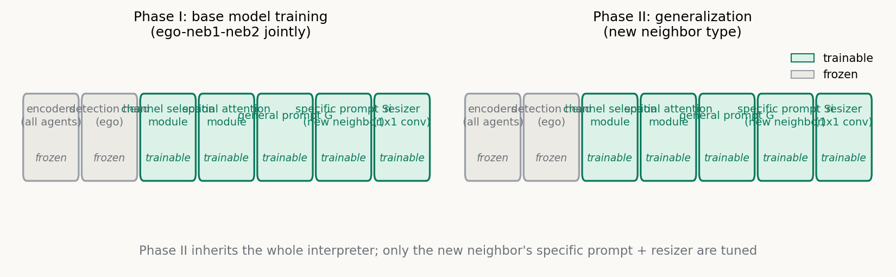
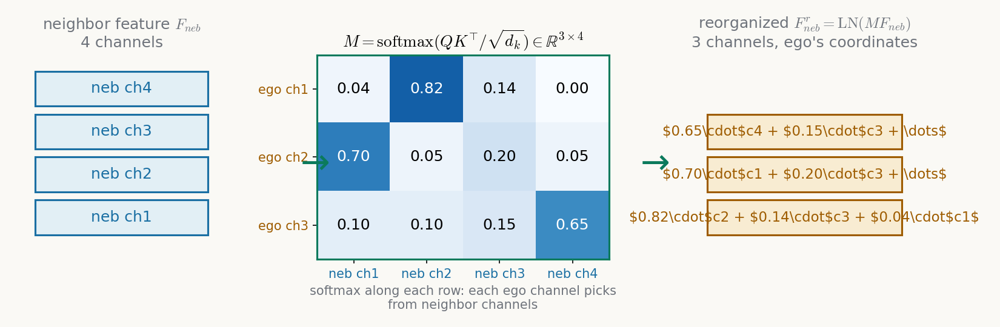
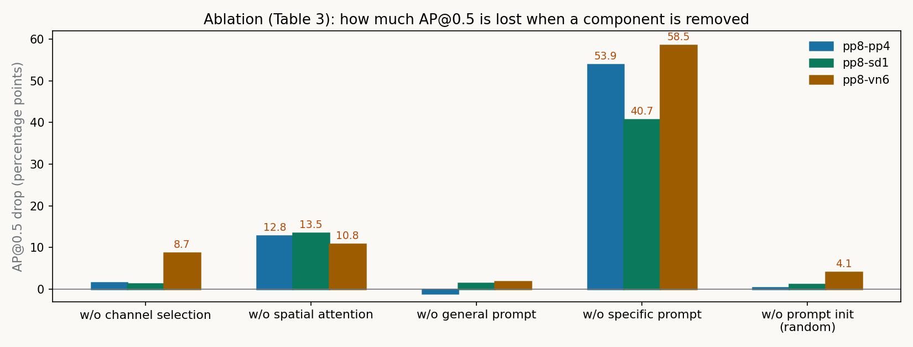

# 一个解释器、每类邻车一个 prompt：PolyInter 的多态特征解释

> **信息块**
> - **论文**：One is Plenty: A Polymorphic Feature Interpreter for Immutable Heterogeneous Collaborative Perception
> - **作者**：Yuchen Xia, Quan Yuan, Guiyang Luo, Xiaoyuan Fu, Yang Li, Xuanhan Zhu, Tianyou Luo, Siheng Chen, Jinglin Li（北邮 + 上交 Siheng Chen 组）
> - **会议**：CVPR 2025；arXiv: 2411.16799（v1 2024-11-25，v2 2025-03-23，本文按 v2 即 CVPR  camera-ready 版精读）
> - **链接**：https://arxiv.org/abs/2411.16799
> - **代码**：公开，https://github.com/yuchen-xia/PolyInter（本文对照代码核实了关键模块的实现）
> - **一句话核心洞见**：把"异构特征语义对齐"从"每对 agent 训一个解释器"转成"一个共享解释器 + 每类邻车只调一个可学习 prompt"的多态问题——解释器学跨 agent 的共性对齐手法，prompt 只携带每类 agent 的语义差异，新 agent 接入时只调 prompt。

## 编码器不能动，特征对不上：不可变异构到底卡在哪里

协作感知里最舒服的设定是所有车用同一个感知网络：大家传的中间特征语义、粒度天然对齐，直接融合就行。现实是每家车厂、每款车型的感知网络都不一样，传过来的中间特征在别人眼里是乱码。更麻烦的是"不可变"三个字：感知网络和下游检测头紧耦合，动它等于动车的安全基座，没人敢为了协作去重训它。

于是问题变成：在所有编码器冻结的前提下，自车（ego）怎么读懂邻车（neighbor）发来的异构特征？这个设定下只有两条前人走过的路，论文的图 1 把它们摆在一起，而这张图就是作者押的赌注。

第一条路是 MPDA（ICRA 2023）走的 one-stage：为每一类邻车单独训一个解释器，把它的特征一步翻成自车的语义空间。代价是扩展性：来一种新车型，就要从头训一个解释器并存一份参数，agent 类型数 N 上去之后是 O(N) 的训练和存储。

第二条路是 PnPDA（ECCV 2025，同课题组前作）走的 two-stage：定义一个标准语义空间，每类 agent 只需要训两个解释器（自己→标准空间、标准空间→自己）。扩展性好了，但每一次协作都要经过两次解释，语义损失累积两次。附录表 7 给了这个代价的硬数字：pp8-pp4 场景下 PnPDA 的 one-stage 是 77.1/51.1（AP@0.5/@0.7，F-cooper 融合），two-stage 掉到 69.1/50.8；pp8-vn6 更惨，two-stage 在 F-cooper 下只有 43.6/24.8。两次翻译，每次都丢信息，这是结构性的，不是调参能救的。

PolyInter 要的东西很明确：one-stage 的精度，two-stage 的扩展性。作者的回答是借用面向对象里的"多态"：一个解释器，行为随输入变化；新 agent 接入时"继承"这个解释器，只重写属于自己的那一小部分——specific prompt。

## 多态到底是什么：两个 phase，一套"继承"机制

整个设计可以一句话说完：Phase I 把解释器本体、一个共享的 general prompt G、和每个老邻车的 specific prompt Si 一起训好；Phase II 来新邻车时，冻结解释器本体和 G，只给新邻车初始化一个新的 Si 并微调它（外加一个必要的 resizer 做尺寸对齐）。

上图是两个阶段的可训练关系（论文图 2 的参数标注提炼）。注意几个细节：所有 agent 的编码器和自车的检测头在两个阶段都冻结，这是"不可变"设定的硬约束；channel selection 和 spatial attention 两个模块只在 Phase I 训练——也就是说，对齐的"手法"是跨 agent 共享的，不为新 agent 重新学；新 agent 带来的全部自由度就是 Si 和 resizer。

这里有一个值得停下来想的问题：凭什么认为"对齐手法"可以跨 agent 共享？作者的底气藏在 prompt 的分工设计里：G 被训练去抓所有 agent 特征里的共享语义，Si 只抓每类 agent 独有的语义。只要"怎么把通道重排、怎么把空间位置对应起来"这类操作本身不依赖具体是哪家编码器，共享解释器就成立。实验部分会验证这个赌注——pp8-vn4-sd2 上训出的解释器，能直接服务 Phase II 里没见过的 pp4、sd1、vn6。

## M 矩阵是一张翻译表：通道选择到底在算什么

异构特征的第一个不对齐在通道维。论文图 3 给了一个直观例子：PointPillars 和 VoxelNet 的 BEV 特征，通道之间没有一一对应关系，某个通道在 A 编码器里编码"车辆边缘"，在 B 编码器里可能散在三个通道里。直接把通道维对齐等于假设两套语义坐标系重合，这是不成立的。

Channel selection 模块的做法是：让自车的每个通道去邻车的通道里"点菜"。公式如下（论文式 1–3）：

$$Q = F'_{ego}W_q, \quad K = F'_{neb}W_k \tag{1}$$

$$M = \mathrm{SoftMax}\left(\frac{QK^\top}{\sqrt{d_k}}\right) \tag{2}$$

$$F^r_{neb} = \mathrm{LN}(MF_{neb}), \quad S^r_i = \mathrm{LN}(MS_i) \tag{3}$$

先把符号的形状钉死。$F_{ego} \in \mathbb{R}^{C_1 \times H \times W}$ 是自车 BEV 特征，$F_{neb} \in \mathbb{R}^{C_2 \times H \times W}$ 是邻车特征（经过 resizer 后空间尺寸已对齐，通道数 $C_1 \neq C_2$）。$F' \in \mathbb{R}^{C \times HW}$ 是把后两维拍平。$W_q, W_k$ 是两个全连接层的权重，把每个通道的 $HW$ 维"通道签名"（这个通道在整张 BEV 上的激活模式）投影到 $d_k$ 维。于是 $Q \in \mathbb{R}^{C_1 \times d_k}$，$K \in \mathbb{R}^{C_2 \times d_k}$，$M \in \mathbb{R}^{C_1 \times C_2}$。

$M$ 的每一行过 softmax，和为 1。几何上这是在干什么？把邻车的 $C_2$ 个通道看成 $C_2$ 个基向量（每个基向量是"某种语义成分"），$M$ 的第 $a$ 行就是自车第 $a$ 个通道在这组基下的坐标——一个凸组合系数。$MF_{neb}$ 这个乘法，就是把邻车特征从它自己的通道坐标系，线性重组到自车的通道坐标系下。论文图 3 中间的 0.82/0.14/0.04 就是这样一行：自车的某个通道 ≈ 0.82×邻车通道2 + 0.14×邻车通道1 + 0.04×邻车通道3。

拿一个最小实例走一遍。设自车 $C_1=3$，邻车 $C_2=4$，$HW$ 拍平后 $F'_{neb}$ 是 $4 \times HW$。假设 $W_q, W_k$ 已训练好，算出 $M$ 如上图所示：第 1 行 $[0.04, 0.82, 0.14, 0.00]$。那么重组后特征的第 1 个通道（$HW$ 维向量）$= 0.04\times$邻车通道1 $+ 0.82\times$邻车通道2 $+ 0.14\times$邻车通道3 $+ 0.00\times$邻车通道4。LN 再把这个通道的均值方差拉回正常范围。三个通道各自点完菜，邻车特征就穿上了自车通道坐标系的"衣服"。注意 $M$ 不是对称的：自车通道选邻车通道，和反过来选，是两张不同的表——解释永远是单向的，从邻车语义翻到自车语义。

式 (3) 里 $S_i$（specific prompt）也过同一个 $M$ 做重组。为什么 prompt 也要重组？因为 $S_i$ 初始形状是按邻车通道数 $C_2$ 存的（附录表 1：specific prompt 大小为 $C_2 \times H_1 \times W_1$），它携带的是"邻车语义坐标系下的修正量"，要和 $F^r_{neb}$ 相加就必须先翻到自车坐标系。这是一个容易忽略但必须有的步骤。

式 (4) 把 prompt 加进特征：

$$F^g_{neb} = F^r_{neb} + G, \quad F^s_{neb} = F^r_{neb} + S^r_i \tag{4}$$

加法在这里是"语义修正"：$G$ 是所有 agent 共享的修正方向，$S^r_i$ 是第 $i$ 类邻车专属的修正方向。两路特征 $F^g$ 和 $F^s$ 后面走不同的损失约束，这是分工的来源。

关于式 (2) 的一点诚实说明：论文正文写"channel selection module uses cosine similarity to match the channels"，但式 (1)(2) 实际是带可学习投影 $W_q, W_k$ 的缩放点积注意力，不是余弦相似度（余弦相似度要求向量先归一化，这里没有）。更值得说的是代码：开源实现里这个模块根本不是按式 (1)–(3) 写的，而是一个 `CrossAttention` 类，内部用的是两个 `MultiheadAttention`（见 `code/opencood/models/polyinter_stage1.py`）。论文的公式是简化版叙事，代码是更重的实现。复现时以代码为准。

## 通道对齐之后，空间还得对齐：spatial attention 在补什么

通道重组只解决了"每个位置上语义成分的配比"，没解决"位置和位置之间的对应"。两个异构编码器的 BEV 特征，即使空间尺寸被 resizer 对齐了，同一个 $(h,w)$ 格子里的语义也未必对得上：感受野不同、下采样路径不同，都会让"车在这个格子"这件事在两套特征里落在不同的位置、带着不同的上下文。

Spatial attention 模块（论文说是 fused axial attention，引 [37]）输入是 $F_{ego}$ 和 refine 后的邻车特征（$F^g_{neb}$ 与 $F^s_{neb}$ 拼起来），输出是空间语义被映射到自车空间后的邻车特征。论文对这个模块只给了两段文字，没有公式。代码里它是一个 `TransformerDecoder`（`code/opencood/models/sub_modules/adapter.py`），输入 `(specific_prompt+general_prompt)/2` 做 query、`query`（自车特征）做 key/value 的交叉注意力——同样，论文的"fused axial attention"叙事和代码实现对不上，复现以代码为准。

消融实验（表 3）说明这个模块是承重的：去掉它，三个场景 AP@0.5 分别掉 12.8、13.5、10.8（@0.7 掉 9.7、7.3、5.1），是所有组件里掉得最多的。直觉上也合理：通道重组是逐位置独立的线性操作，表达能力有限；真正的"把邻车看到的那辆车搬到自车 BEV 的正确格子里"靠的是空间注意力。论文图 6(d) 的可视化也印证了这一点：过完 spatial attention 后，邻车特征里车辆位置的高亮才和自车特征对上。

## 两个 prompt 的分工是被损失函数逼出来的

$G$ 和 $S_i$ 都是可学习参数，光靠协作检测损失 $L_{collab}$ 去训，它们会过拟合到 Phase I 里那两类邻车编码器上——这是论文明确承认的风险。于是作者给两路特征各加了一套"身份约束"，这就是 Phase I 总损失（论文式 10）：

$$L_{phaseI} = L_{collab} + \lambda_s L_s + \lambda_g L_g \tag{10}$$

其中 $\lambda_s = \lambda_g = 1$（4.1 节），$\omega = 0.5$。

先看管 $F^s_{neb}$（specific 路）的 $L_s = L_{single} + \omega L^s_{style}$（式 7）。$L_{single}$（式 5）是单车检测损失：把解释后的邻车特征直接喂给检测头做单车 3D 检测，分类加回归。这个约束的用意很妙——它要求 $F^s_{neb}$ 保留足够多的"这辆车自己能看懂"的信息。如果 $F^s$ 在解释过程中把邻车独有的语义细节丢光了，单车检测就会垮。所以 $L_{single}$ 是 specific prompt 的"保真"项：逼它记住差异。

$L^s_{style}$（式 6）是风格损失：

$$L^s_{style} = \|\mu(F^s_{neb}) - \mu(F_{ego})\|_2 + \|\sigma(F^s_{neb}) - \sigma(F_{ego})\|_2 \tag{6}$$

$\mu, \sigma$ 是特征的均值和标准差（注意代码里实际算的是方差 `torch.var`，不是标准差，论文和代码在这里差一个开方）。这一项把解释后特征的一阶、二阶统计量往自车特征上拉，防止解释器对某类邻车"特殊照顾"导致分布漂移。可以把它读成一种轻量的域对齐：不碰语义内容，只把整体的"画风"（亮度/对比度之于图像，激活强度之于特征）对齐。

再看管 $F^g_{neb}$（general 路）的 $L_g = L_{adversary} + \omega L^g_{style}$（式 9）。对抗项（式 8）：

$$L_{adversary} = \max_{\Phi}\min_{D}\big(\mathcal{E}_{ego}(D(F^g_{neb})) + \mathcal{E}_{neb}(D(F^g_{neb}))\big) \tag{8}$$

$\Phi$ 是 channel selection 模块加 general prompt $G$ 的参数，$D$ 是挂在 $F^g_{neb}$ 后面的判别器，$\mathcal{E}$ 是判别器把特征判成"来自自车还是邻车"的分类误差。读法：$D$ 想最小化自己的分类误差（分清这是谁的特征），$\Phi$ 想最大化这个误差（让 $F^g$ 里不含任何能暴露"这是哪家编码器"的信息）。均衡点上，$F^g$ 里只剩下所有 agent 共有的语义，agent 特有的部分被 $G$ 过滤掉了。这就是 general prompt"提取共享语义"的机制含义。

代码里这个对抗是用梯度反转层实现的：`DomainClassifier` 内部有一个 `GradientScalarLayer(-9.1)`，前向恒等、反向把梯度乘以 $-9.1$。判别器正常最小化分类误差训练，而梯度反转让 $\Phi$ 收到的梯度反向——等价于 $\Phi$ 在最大化判别误差。$-9.1$ 这个系数论文里没出现过，是实现细节。判别器本身是一个两层卷积加 maxpool 加线性层的二分类器（代码 `DomainClassifier` 类）。

Phase II 的损失（式 11）是 $L_{phaseII} = L_{collab} + \lambda_s L_s$：只保留协作损失和 specific 路的约束，因为 general 路和解释器本体都冻结了，新邻车只需要学好自己的 $S_i$。

这里要回答一个读者一定会问的问题：为什么 $L_{single}$ 用的是"解释后的邻车特征做单车检测"，而不是"原始邻车特征"？因为原始邻车特征本来就能被它自己的检测头检测（编码器冻结前就是这么训的），没有约束力。约束必须落在解释后的特征上，才能逼解释器"在翻译过程中别丢东西"。

## Phase II 只调 1.4% 参数：扩展点长什么样

论文图 4 对比了每新增一类邻车时的可训练参数量。MPDA 和 PnPDA 每来一类新邻车都要重训整个解释器（CoBEVT 融合下还要重训融合网络，曲线陡峭上升）；PolyInter 只训新邻车的 specific prompt 和 resizer，曲线几乎是平的。

更进一步，specific prompt 本身还可以做低秩分解：$S_i$ 原始大小 $C \times H \times W$，把后两维分解成 $(H \times R)(R \times W)$，$R \ll H, W$，参数量从 $C \times H \times W$ 降到 $C \times R \times (H+W)$；$R$ 降到 1 之后再把通道数 $C$ 除以 $T$。图 5 显示，sd1 的可训练参数压到 0.16M（占整个解释器的 1.4%）、vn6 压到 0.04M（0.4%）时，精度仍然超过 MPDA 和 PnPDA。摘要里的"1.4%"就是这么来的。

附录表 1 给了不分解时的完整数字：以 pp8 为自车，sd1 的 specific prompt 是 $512 \times 50 \times 176$（4.51M 参数）加 resizer 0.13M。也就是说，不分解时新 agent 的接入成本是 4.64M 参数；分解后是 0.16M。两个数字论文都给了，读的时候不要混。

## 7.9 和 11.1 是 AP 点数差，不是相对提升

表 2 是主实验。三个场景按异构强度递增排列：pp8-pp4（同为 PointPillars 家族，只差体素大小和网络规模，语义"大同小异"）、pp8-sd1（PointPillars 对 SECOND，结构不同）、pp8-vn6（对 VoxelNet，差异最大）。每个场景测两种融合（F-cooper、CoBEVT）和两种预训练组合（* = pp8-vn4-sd2，+ = pp8-pp4-vn4）。

先把论文里几个百分比的真实含义算清楚，因为它们很容易被误读。正文写 pp8-pp4 场景"9.2% improvement in AP at IoU 0.7"：PolyInter 四个格子 @0.7 是 60.9、65.4、65.8、66.0，平均 64.5；两个基线四个格子是 51.1、62.3、53.1、54.9，平均 55.4。64.5 − 55.4 = 9.1（≈9.2）。所以这里的"%"是 AP 点数差（percentage points），不是相对百分比。同理，pp8-sd1 的 9.7/14.3：PolyInter @0.5 四格平均 81.5，基线平均 71.9，差 9.6（≈9.7）；@0.7 差 69.2 − 55.0 = 14.2（≈14.3）。pp8-vn6 的 12.6/9.8：@0.5 差 72.9 − 60.3 = 12.6；@0.7 差 54.8 − 45.0 = 9.8。摘要的 7.9/11.1 是三个场景点数差再平均：(1.5 + 9.7 + 12.6)/3 ≈ 7.9，(9.2 + 14.3 + 9.8)/3 ≈ 11.1。数字全部对得上，但读者要知道这是绝对点数提升。

横向看，PolyInter 的优势随异构强度增大而增大：pp8-pp4 场景 @0.5 只领先 1.5 个点（基线本来就很强，77.4 左右），pp8-vn6 领先 12.6 个点。这符合直觉：异构越严重，解释器的价值越大；异构很轻时，大家直接融也差不太多。

附录的三个补充实验值得看。表 4（V2XSet，带真实噪声仿真）：pp8-vn6* F-cooper 下 PolyInter 80.5/71.3，PnPDA 75.9/51.7，MPDA 69.5/50.7——@0.7 领先近 20 个点，说明噪声越大解释器的价值越大。表 5（DAIR-V2X 真实数据）：优势收窄到 2–5 个点，但依然全胜。表 6（三车协作）：pp8-pp4-vn6* F-cooper 下 77.0/61.4 对 PnPDA 63.5/46.4、MPDA 69.1/49.5，多解释器并行工作没有互相干扰。

## 消融表里谁是承重墙

表 3 的消融（F-cooper 融合，Phase I 用 pp8-pp4-vn4 预训练）按"去掉谁掉得最多"排序，承重关系一目了然：

- **specific prompt 是地基**：去掉它，pp8-pp4 从 77.2/65.8 掉到 23.3/7.8，pp8-vn6 掉到 14.3/2.3。注意 23.3 这个数字比单车 pp8 自己的 83.9（表 1）低得多——没有 specific prompt 的解释器输出的不是"没解释好"，而是"有毒的"特征，直接污染了自车的融合。这是全篇最重的消融：prompt 不是装饰，是解释发生的载体。
- **spatial attention 是顶梁柱**：去掉它三个场景 @0.5 掉 12.8/13.5/10.8，是模块里掉得最多的。通道对齐只能做逐位置的线性重组，空间错位必须靠注意力搬运。
- **channel selection 在强异构下重要**：vn6 场景下去掉它掉 8.7/11.7（正文写 8.1，表里算出来是 72.8 − 64.1 = 8.7，差 0.6 个点，疑似笔误），pp4 场景下只掉 1.6——同家族编码器通道语义本来就接近，翻译表接近单位阵。
- **general prompt 贡献最小**：去掉它 pp8-pp4 的 @0.5 反而从 77.2 涨到 78.3（@0.7 从 65.8 掉到 64.0），sd1/vn6 场景小幅掉 1–2 个点。诚实地说，"共享语义"这条路线的实际增益不大，论文故事里它和 specific prompt 平起平坐，数据里它更像配角。
- **采样初始化有帮助但不大**：换成随机初始化，vn6 掉 4.1 个点，pp4/sd1 掉 1 个点左右。以及代码里实际用的就是 Xavier 随机初始化，采样初始化在开源实现里没有对应代码（下面细说）。

附录表 2 的损失消融：去掉 style、adversary、single 三项各自掉 2–6 个点，三项都有正贡献，没有哪一项是摆设。其中 single（保真项）去掉后 @0.7 掉得最多（pp8-pp4：65.8→59.7），说明"解释别丢信息"这个约束比"分布对齐"更关键。

## 代码和论文对不上的四处

对照 `code/` 读完实现，有四处论文没说实话（或者说，论文写的是简化版故事）：

1. **Channel selection 的公式是简化叙事**。论文式 (1)–(3) 写的是 $Q, K$ 投影加 softmax 的通道匹配，正文还说是"cosine similarity"；代码里的 `CrossAttention` 类用的是两个 `MultiheadAttention` 做交叉注意力，query/key/value 的组织方式和论文公式不一样。Figure 3 那个 0.82/0.14/0.04 的相似度矩阵是示意性的，代码里没有显式计算余弦相似度的地方。
2. **Spatial attention 不是 fused axial attention**。论文引 [37] 说用了 fused axial attention；代码里是 `TransformerDecoder`（`sub_modules/adapter.py`），标准的 Transformer decoder 结构。审稿人如果按论文描述去复现，会复现出另一个东西。
3. **采样初始化在代码里不存在**。论文 3.2 节花一段讲 sampling-based initialization（从训练集采样 N 个点云，过编码器、平均池化得到 prompt 初值），表 3 还有"w/o prompt init"的消融；但代码里 `general_prompt_k` 和 `specific_prompt_k/v` 都是 `torch.nn.init.xavier_normal_` 初始化的，没有任何采样代码。可能的解释是采样初始化只活在论文实验的某个脚本里没开源，或者消融的"sampling"版本和开源代码不是同一份。复现者注意：按开源代码你只能得到"w/o prompt init"那一行的性能。
4. **Style loss 的 $\sigma$ 在代码里是方差**。论文式 (6) 写 $\sigma(\cdot)$ 是标准差；代码 `std_k = torch.var(...)` 算的是方差。差一个开方，对优化动态有影响（方差对大偏差更敏感）。以及对抗的梯度反转系数 $-9.1$、判别器的具体结构（两层卷积+maxpool+线性层），论文都没提。

这些不一致不推翻论文的结论（主实验的数字是自洽的），但决定了"照论文复现"和"照代码复现"是两条路。后者才是作者实际跑通的那条。

## 这篇论文没回答的四个问题

1. **"新 agent"有多新？** Phase II 的三个新邻车 pp4、sd1、vn6，和 Phase I 训练时见过的 pp8、vn4、sd2 是同一批编码器家族（PointPillars/VoxelNet/SECOND 的不同配置）。真正的开放性——比如来一个 Transformer 架构的 BEVFormer 类编码器，或者跨模态的 camera 编码器——论文没有测。附录表 3 的多模态实验（EfficientNet/ResNet 图像编码器）算是最接近的一次，PolyInter 在那里依然领先（pp8-ResNet：72.6/56.9 对 PnPDA 61.9/42.5），但那也只是 Phase I 里见过同类模态。开放世界里的"没见过"和这里的"没见过这个配置"是两回事。
2. **超参数的敏感性**。$\omega=0.5$、$\lambda_s=\lambda_g=1$ 直接给出，没有搜索范围、没有敏感性曲线。三个损失项的量级是否在训练全程都平衡，论文没说。附录表 2 证明每一项都有用，但没证明 0.5/1/1 是稳定的选择。
3. **基线覆盖**。对比的只有 PnPDA 和 MPDA——确实是仅有的两个 immutable heterogeneous interpreter，这个选择是公平的。但 HEAL（ICLR 2024，同组 Siheng Chen 的工作）做了开放异构协作感知，只是它要求微调编码器（mutable），所以不在同一设定下，没有对比是合理的。读者不要误以为 PolyInter 打败了"所有异构协作感知方法"，它打败的是"编码器不可变"这个子设定下的全部（两个）对手。
4. **推理代价**。论文只谈了训练参数量，没谈推理时的计算量和延迟。解释器在自车上对每个邻车跑一次前向（channel attention + spatial transformer），N 个邻车就是 N 次。实时性在车端是个硬约束，这部分是空白。

另外两处笔误级问题：正文 4.4 节说图 6 的邻车是 vn6，图注写的是 vn4；附录表 7 的行标签把引用号写反了（"pp8-sd1 [16, 44]"应为 [16, 38]，"pp8-vn6 [16, 38]"应为 [16, 44]，[16]=PointPillars、[38]=SECOND、[44]=VoxelNet）。

## 能带走的三个想法

**第一个想法：把"差异"装进 prompt，把"共性"留给共享网络，是一种通用的异构对齐配方。** 这篇论文最值得偷的不是 channel selection 或 spatial attention 这两个具体模块（代码和论文还对不上），而是这个分工：共享网络学"怎么对齐"的手法，prompt 携带"每类 agent 的语义指纹"，新 agent 接入只调指纹。这个配方可以原样搬到任何"编码器不可变"的多智能体对齐问题上——V2X 里车和路侧单元的传感器异构、甚至联邦学习里各客户端模型结构不同，只要冻结各方模型、只学一个对齐层加 per-client prompt，Phase I/II 的两段式训练就能套用。$L_{single}$（保真）+$L_{adversary}$（去身份信息）这一对约束是让分工真正发生的关键，不是可有可无的装饰。

**第二个想法：one-stage vs two-stage 的权衡是信息论层面的，prompt tuning 是绕过它的第三条路。** 两次解释累积两次信息损失（附录表 7 的 43.6/24.8 是铁证），这是任何经中间标准空间的方案绕不开的。PolyInter 说明：只要对齐手法本身可迁移，就不需要中间空间——直接一对一翻译，而"为每类 agent 存一个翻译器"的 O(N) 代价被压缩成"存一个 prompt"。以后遇到"精度要求 one-stage、扩展性要求 two-stage"的两难，先问能不能把 per-agent 的部分压缩成一个轻量适配器。

**第三个值得做的问题：把 $M$ 矩阵真正打开看。** 论文用图 3 的示意图讲通道对应，但没有任何一张图展示训练好的 $M$ 到底长什么样：它是稀疏的（接近一一对应）还是稠密的（语义打散重组）？不同家族编码器之间的 $M$ 稀疏模式有没有规律？如果 $M$ 接近置换矩阵，说明异构主要在"通道顺序"层面；如果稠密，说明语义真的被打散了。这个问题半天就能做（把 $M$ 存下来画热力图），回答了它，才能判断 channel selection 到底是在做"翻译"还是在做"重组"，以及这套方法的上限在哪里。
