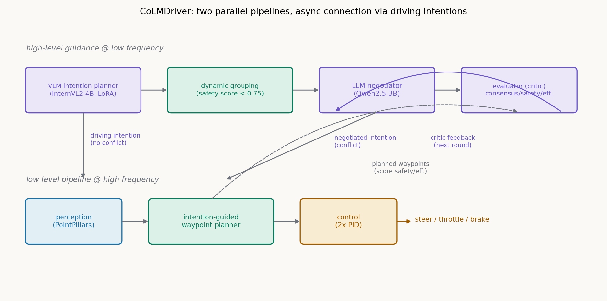
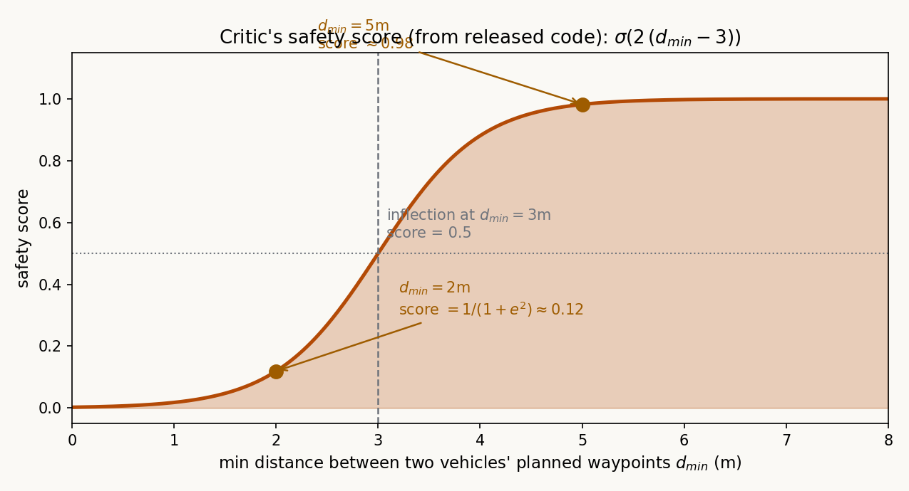

# 让车用自然语言吵架：CoLMDriver 的谈判式协作驾驶

> **信息块**
> - **论文**：CoLMDriver: LLM-based Negotiation Benefits Cooperative Autonomous Driving
> - **作者**：Changxing Liu, Genjia Liu, Zijun Wang, Jinchang Yang, Siheng Chen（上交 MAGIC 组，Siheng Chen 通讯）
> - **会议**：ICCV 2025；arXiv: 2503.08683（v1 2025-03-11，本文按此版精读）
> - **链接**：https://arxiv.org/abs/2503.08683
> - **代码**：公开，https://github.com/cxliu0314/CoLMDriver（论文写"will be released"，实际已开源，本文对照代码核实了 critic 的全部公式——论文正文里这些公式是缺失的）
> - **一句话核心洞见**：LLM 不直接碰方向盘——谈判只产出"速度意图"这种粗粒度共识，真正的空间几何规划交给传统端到端管线；快慢两条管线并行、意图做窄腰接口，谈判的延迟就不再挡实时控制的路。

## 单车智能体解决"我怎么开"，这篇解决"我们怎么商量着开"

同样是 agent 驾驶，CoLMDriver 和 LACO、ReCogDrive、DynVLA 这类单车工作回答的是不同的问题。单车工作的敌人是感知不确定性和长尾场景：看不见、看不懂、没见过。CoLMDriver 的敌人是**冲突**：两辆车都没看错、都看得很清楚，但它们的计划在时空里撞上了——无灯路口谁先走、匝道汇入谁让谁、相邻车道同时变道。这是一个博弈问题，不是感知问题，再强的单车感知也解不出来，因为解不在任何一辆车自己的传感器里，而在两辆车**达成一致**这个动作里。

传统协作驾驶有两条路。优化方法把多车规划写成带约束的优化问题，解出来的轨迹很漂亮，但需要精确的环境建模和任务特定的目标函数，换个没见过的交互模式就傻眼。学习方法（多智能体强化/模仿学习）把协作策略学进网络权重，论文引 [22][23] 指出它们在没见过的多车交互模式下性能下滑——策略被训练分布锁死了。两条路的共同病根是**协议是死的**：通信格式、协作规则在设计时就定死了。

LLM 的诱惑在于：自然语言是一种活的协议。两辆车可以用语言描述自己的意图、提出请求、讨价还价，理论上能处理任何没见过的冲突模式，因为语言本身就是开放域的。但把 LLM 直接装进协作驾驶有三个硬伤，论文在引言里点得很准：第一，LLM 不会做连续空间的几何规划，让它直接输出轨迹是赶鸭子上架；第二，无约束的谈判又慢又发散，跟谁谈、谈多久都是问题；第三，LLM 推理又长又不稳定，实时控制等不起。这篇论文的全部设计，就是对这三个硬伤的回答。

## 回答硬伤的总设计：快慢两条管线，意图做窄腰

系统分成两条并行的管线。高频的低层管线是传统的感知—规划—控制：PointPillars 编码点云，意图制导的航点规划器输出 20 个航点（5Hz），两个 PID 控制器转成方向盘、油门、刹车。这条管线自己就是完整的驾驶系统，不依赖 LLM 也能开——消融实验 ID1（关掉谈判）证明了这一点。

低频的高层管线做两件事：VLM 意图规划器（InternVL2-4B，LoRA 微调）常驻输出驾驶意图；当预测到冲突时，LLM 谈判模块启动——先动态分组确定跟谁谈，再多轮谈判，critic 评估每一轮的结果，不行就给反馈进入下一轮，谈出共识后把意图灌回低层管线。

这个架构最关键的决定是**接口选在"意图"这一层**。意图是离散的、粗粒度的：导航意图 6 类（路口左转/右转/直行、跟车道、左变道、右变道），速度意图 4 类（STOP/SLOWER/KEEP/FASTER）。LLM 只需要在 24 种组合里做选择和协商，完全避开连续空间几何规划；低层规划器负责把意图翻译成几何上可执行的航点。快慢解耦之后，LLM 谈判跑得慢不怕——低层管线按上一轮的意图继续开，新的共识到了再更新。这就是论文说的"asynchronous planning"：不是把 LLM 加速，而是让系统不再等它。

## 和谁谈、何时谈：动态分组是谈判的前提

无约束的谈判第一个死法是"跟谁都谈"。8 辆车全连起来谈判，消息量是 O(n²)，而且不相关的车会把对话带偏。动态分组解决"和谁谈"：每辆车广播自己规划的未来航点，两辆车之间按安全分连边（论文式 2–3）：

$$G = H_T, \quad H_t = \Phi(H_{t-1} \cup C_t) \tag{2}$$

$$C_t = \mathrm{DFS}\big(V^t, \{(v_i, v_j) \mid S_s(v_i, v_j) \ge \theta\}\big) \tag{3}$$

每辆车是节点，未来可能冲突的车之间连边，边按航点算出的安全分决定（注意论文这里 $S_s \ge \theta$ 的写法和代码是反的——代码里是 `safety_score < 0.75` 才连边，因为代码的安全分是"越安全分越高"，低分才表示有冲突；论文的 $S_s$ 疑似把"冲突分"和"安全分"混用了记号，读的时候以代码为准：**安全分低于 0.75 的两车才需要谈判**）。

对这个图做 DFS 找连通分量，就是当下的谈判组。再和历史组 $H_{t-1}$ 取并、合并相交的组（$\Phi$），得到跨时间的完整分组。历史合并这一步是为了防止"组"每帧乱变导致谈判策略来回横跳——今天跟 A 谈让行，明天组散了后天又重组，策略没有连续性。

"何时谈"由同一套机制回答：只有安全分低于阈值的组才触发谈判，没有冲突时系统退回 VLM 意图规划器。代码里还有一个冷却：`step * 0.05 < self.next_comm_time[car_id]`，刚谈完的车一段时间内不再触发，避免谈判抖动。

消融实验 ID2 是这一节最干净的证据：有谈判、无分组，DS 直接掉到 9.33，RC 只有 10.37——车全停在路上不敢动。无约束的谈判不如不谈判，分组是谈判能工作的前提。这个反直觉的结果（"多谈判反而更差"）恰恰说明了协作里的通信选择本身就是个需要设计的问题，单车智能体论文里根本不存在这个问题。

## 谈判员：每轮 18 个词，只谈速度

分组确定后，组内的车轮流发言。论文式 (4) 是第 $K$ 轮第 $i$ 辆车的输出：

$$O^{K}_{LLM,i} = LLM_i\Big(f_P\big(\bigcup_{j} I_j,\ \bigcup_{k<K}\bigcup_{j} O^{k}_{LLM,j},\ S^{K-1}\big)\Big) \tag{4}$$

输入三部分：组内所有车当前共享的信息 $I$（速度、意图、位置），之前所有轮的对话历史，上一轮 critic 的建议 $S^{K-1}$。$f_P$ 是 prompt 组装，$LLM_i$ 是每辆车上跑的 Qwen2.5-3B（论文强调"没经过驾驶领域训练"，靠 in-context learning 现场发挥）。

Prompt（附录 Listing 2，全文公开，值得细读）里有几个硬约束：输出不超过 18 个词；只谈速度意图，不谈导航（"Focus your message on speed rather than navigation"）；消息里必须写清每个动作/请求是哪辆车的；附了 6 条交规（汇入让直行、左转让直行/右转、被让行者加速、跟车保持距离等）。18 词限制的理由论文说了：LLM 推理时间正比于输出长度，短输出是延迟优化的一部分。附录还写了用了 prompt caching。

拿一个具体场景走一轮。匝道汇入：0 号车在加速车道要并入高速，1 号车在主路直行。分组：两车未来航点最小距离 2.1 米，安全分 $\sigma(2(2.1-3)) = 0.14 < 0.75$，连边，成组。第 1 轮：0 号车发言（按 prompt 模板）："I will slow down and merge behind; Vehicle 1 please keep speed."（11 词）1 号车："I will keep speed; Vehicle 0 please merge behind me." critic 汇总（附录 Listing 3 的分类 prompt）：{0: SLOWER, 1: KEEP}。注意这里 critic 先把自然语言对话**翻译回**离散意图——谈判的输入输出都是语言，但评估要落在可计算的量上；没有这个回译，谈判的输出就接不回评估，整个"提议—评分—再提议"的循环转不起来。

## Critic 到底在算什么：论文没写公式，代码里有

这是全篇信息量最大的部分，也是论文写得最含糊的部分。正文 4.2.1 只说 evaluator 做"sum, score, criticize"三步，安全分和效率分"由精心设计的公式 $F$ 计算"，但 $F$ 的具体形式正文和附录都没给。开源代码（`simulation/leaderboard/team_code/colmdriver_action.py`）里有完整实现，抄录如下：

**安全分**：对两车的规划航点（各 10 个点，0.2 秒间隔），逐时刻算欧氏距离，取最小值 $d_{min}$，

$$\text{safety} = \frac{1}{1 + \exp(-2\,(d_{min} - 3))}$$

这是一个 sigmoid，拐点在 $d_{min} = 3$ 米，斜率系数 2。

几何意义很直白：两车未来轨迹最近点相距 3 米时得 0.5 分；2 米时 $1/(1+e^{2}) \approx 0.12$，雪崩式下跌；5 米时 0.98，基本满分。3 米这个拐点是整套 critic 里最承重的常数——它定义了"多近算危险"。论文没说 3 怎么来的，代码里写死。继续上面的例子：$d_{min} = 2.1$ 米，安全分 0.14。

**效率分**：每辆车航点的平均速度（总路程除以 $9 \times 0.2$ 秒），组内平均，超过 8 m/s 得满分 1，否则线性折算 $\text{avg}/8$。比如两车平均 6 m/s，得 0.75。

**共识分**：把对话记录喂给 LLM（附录 Listing 4 的 prompt），让它按 0–100 打分"这群人到底谈拢了没有"，除以 100 归一化。

**总分**：

$$\text{total} = 3 \times \text{consensus} + 5 \times \min(\text{safety}) + 2 \times \text{efficiency}$$

满分 10 分。权重 3/5/2 全是代码里的魔法数字：安全占一半权重，是 critic 里真正的否决项。$\min(\text{safety})$ 取的是组内所有车对里最低的那个——一对车危险，整轮谈判就不合格，这是典型的短板逻辑。

**建议生成**（$\Psi$ 分类器，代码里是规则）：安全分低于 0.7 的车对，生成"Safety issue: Vehicle A and vehicle B may have conflict. Suggest one of them to yield, and another go pass faster."；效率分低于 0.4，加"Efficiency issue"。这些英文句子直接拼进下一轮的 prompt（式 4 里的 $S^{K-1}$）。

回到上面的例子：共识分假设 LLM 打 85（0.85），安全 0.14，效率 0.75。总分 $= 3\times0.85 + 5\times0.14 + 2\times0.75 = 2.55 + 0.70 + 1.50 = 4.75$。安全分 0.14 < 0.7，critic 生成建议："0 号和 1 号可能冲突，建议一个让行、另一个加速通过。"第 2 轮，0 号车收到建议后改口："I will stop and wait; Vehicle 1 please go faster." 重新汇总意图、重新生成航点：0 号 STOP（航点全挤在原地），1 号 FASTER，$d_{min}$ 拉到 6 米，安全分 0.997，总分 $= 2.55 + 4.99 + 1.5 \approx 9.0$，谈判结束，共识意图（0: STOP, 1: FASTER）下发给两车的航点规划器。

这里要说清楚 critic 的"actor-critic"到底是什么、不是什么。它**不是**强化学习里的 actor-critic：没有策略梯度，没有值函数，没有权重更新。"Actor"是谈判的 LLM，"critic"是打分的 LLM 加几个公式，反馈靠 in-context learning（把建议拼进下一轮 prompt）实现。用 RL 的词讲一个 prompt 工程的循环，这是论文里最营销化的命名。机制本身是成立的——图 5 显示，有 critic 反馈时谈判质量分随轮次稳定上升，无反馈时随机波动——但读者要知道它的真实分量：LLM 评价 LLM 的对话，ground truth 是另一个 LLM 的打分加几个手工公式。

## 意图制导的航点规划器：粗粒度意图和连续控制之间的翻译层

谈判产出的是离散意图，车轮要的是连续航点，中间这个翻译层是论文的第二个主要部件。它分两步：先造数据，再训模型。

**数据生成**：$W_g = \Phi(W, a)$，$W$ 是专家（论文用 [1] 的 expert agent，在 V2Xverse 里跑）的真实航点，$a = f(I, x, \sigma)$ 是环境自适应加速度模型——意图 $I$、到最近车辆的距离 $x$、车辆密度 $\sigma$ 共同决定加速度，再用多项式拟合把原轨迹按新加速度重采样。直觉：同一个"跟车道"意图，在空旷高速上应该是 FASTER 的航点序列（点间距大），在拥堵路口是 SLOWER 的（点间距小）。把 25k 条原始记录扩展成 STOP/SLOWER/KEEP/FASTER 四类共 93k 条（附录 8.2；不到 4 倍是因为有些轨迹太短做不了多项式拟合）。

**模型结构**（论文图 3）：BEV 占据图和历史 BEV 特征过 MotionNet 编码器（两层时空卷积块，输出 256 通道）；目标点、导航意图、速度意图各自嵌成 256 维向量，MLP Fuser 融成制导上下文；3 层 Transformer decoder 在航点 query 和环境/制导上下文之间做交叉注意力；两层 MLP 输出 20 个航点。意图在这里是索引张量（embedding 查表），不是文本——VLM/LLM 的文本意图在进入规划器前先被映射成类别 id。

这个设计的聪明之处在于**意图成了一个窄腰**：任何能输出 24 类意图的上游（VLM、LLM 谈判、甚至未来的符号规划器）都能插进来，下游的连续规划不用改。代价是意图的粒度很粗——速度只有四档，谈判能表达的共识上限就是"我停你走"这种粗策略。高速公路上两车以 0.5 m/s 的速度差协同汇入这种细腻操作，不在它的表达范围内。

## InterDrive：10 个场景，92 个任务，专治"不好好商量"

论文自建了 InterDrive benchmark（CARLA 0.9.10.1，基于 V2Xverse 平台）：10 种场景类型，分三类——路口交叉 IC（4 种：直行-直行、直行-左转、对向车道、混乱）、车道汇入 LM（4 种：直行-右汇、邻车道、左-右、高速匝道）、变道 LC（2 种）。场景设计参考了美国 NHTSA 的 pre-crash typology（事故前形态分类），每种场景配 2–8 辆被测车，路线高度重叠以**强制**制造冲突，外加随机交通参与者做干扰。46 条路线展开成 92 个任务（附录表 4 列了每种场景的车辆数、城镇、路线数）。

指标四个，沿用 CARLA Leaderboard 的前三个加一个更严的：路线完成率 RC、违规扣分 IS（从 1.0 起按碰撞扣）、驾驶分 DS = RC × IS（主排序指标）、成功率 SR（DS 满分的任务占比）。SR 这个指标很苛刻：但凡蹭一下（IS < 1）就不算成功，所以 SR 0.80 意味着 80% 的任务零事故跑完全程。

## 实验数字核实：11% 和 10.15% 分别是什么意思

表 1 主结果（InterDrive 全集）：CoLMDriver DS 88.53，第二名 Rule-based 78.38。正文说"领先至少 10.15%"——88.53 − 78.38 = 10.15，这是**驾驶分的点数差**，和 PolyInter 那篇一样，论文用"%"写点数差，读的时候要换算。摘要的"11% higher success rate"：SR 0.80 对 Rule-based 0.72，0.80/0.72 − 1 = 11.1%，这次是**相对提升**，算得上。

几个值得细看的对比：

- **TCP（73.68 DS，SR 只有 0.50）**：DS 不低但 SR 腰斩，说明它经常撞——RC 90.54 跑得挺欢，IS 0.82 出卖了它。单车端到端在交互场景里的典型死法：规划只管自己，不管别人。
- **LMDrive（48.83 DS）**：IS 0.85 很高（不撞），但 RC 只有 58.02。论文点名了它的死法：两辆车靠近时**同时让行**，一起停在原地谁也不走——没有协商机制，并发决策退化成死锁。这是全文最有说服力的一个反例：保守≠安全，协作缺的是"谁先走"的共识，不是"都别走"的谨慎。
- **CoDriving [8]（74.13）**：真正的协作基线（同组前作，V2Xverse 平台），在 LM 上 RC 100%、IS 0.96 极强，但在 LC 上 DS 只有 36.57、IS 0.37——变道场景的交互把它打崩了。CoLMDriver 在 LC 上 59.21/0.597/0.50，是全场唯一 LC 能看的。
- **Rule-based（78.38）**：按交规写的规则基线，在 IC（80.06）和 LM（94.44）上很强——规则在结构化场景里本来就是强的；但在 LC（34.43）上崩了，说明变道这种弱结构化交互写不出完备规则。这正是 LLM 常识推理该上场的地方。

表 2 消融（ID1→ID5）：无谈判 47.64（≈LMDrive 的 48.83，论文说"接近"是诚实的）；加谈判不加分组 9.33（灾难，已讲）；加分组 77.29；加 critic 83.46；再加 S/E+Cons 评分 88.53。每一级台阶都是正的，链条完整。

图 6 的实时性实验：在 InterDrive-LM 上，考虑 LLM 推理延迟后 DS 只掉 6.62%，还保持在 90 以上。这是双管线架构的功劳——谈判慢，但控制不等它。但论文**没有给 LLM 推理延迟的绝对数字**（Qwen2.5-3B 一次调用多少毫秒、一次谈判平均几轮、几辆车串行调用），只有相对 DS 下降。实时性论证缺了最关键的一块拼图。

表 3（Town05 公开榜）：Long 路线 81.49 对 ReasonNet 73.22（+8.27 点数，+11.3% 相对）。但这个实验的设定要打个问号：周围车"把驾驶意图广播给自车，但自己行为不变"。自车等于开了全图视野的外挂，测的是"收到意图有没有用"，不是"协作有没有用"。数字是真的，故事要打折。

附录表 5 是全文最诚实的一张表：加入 50 辆车+50 行人+50 骑行者的干扰后，CoLMDriver 总 DS 从 88.53 掉到 77.09，而**协作方法掉得比非协作方法多**（CoDriving 从 74.13 掉到 64.50，Rule-based 从 78.38 掉到 69.71；VAD/UniAD 基本不动）。作者给了个合理的解释：干扰车辆挡住了预设的冲突，该谈的没谈起来。但这也暴露了一个真问题：动态分组依赖"预测冲突"，而真实交通里到处都是计划外的干扰，谈判机制在这种噪声下的鲁棒性是单薄的。能把对自己不利的结果放进附录，值得肯定。

## 这篇论文没说透的六件事

1. **Critic 的公式和阈值全是魔法数字**。3/5/2 的权重、0.75 的分组阈值、0.7/0.4 的建议阈值、sigmoid 的 3 米拐点和斜率 2、效率的 8 m/s 封顶——没有一个在论文里出现，更没有敏感性分析。3 米这个拐点尤其承重：城市跟车 3 米很常见，高速上 3 米是玩命。同一个阈值横跨所有场景类型，合理性没有论证。
2. **"Actor-Critic"是借来的词**。没有策略梯度、没有值函数、没有权重更新，critic 的共识分还是另一个 LLM 打的。机制是"LLM 提议—公式+LLM 评分—prompt 反馈—再提议"，in-context learning 循环。叫它迭代 refinement 更准确。
3. **缺了最强的传统基线**。优化类的协作规划方法因为"闭源或平台不同"一个没比。CoLMDriver 赢的是学习类和规则类基线，打没打赢正经的优化方法，论文没有回答。
4. **InterDrive 是自建的**。场景由方法作者设计，"专治不好好商量"的场景天然对谈判方法有利。开源场景代码 mitigates 了这个问题，但独立第三方的验证还没有。
5. **"LLM 零样本泛化"的故事要打折**。谈判的 Qwen2.5-3B 确实没做驾驶微调，但常驻的 VLM 意图规划器是三阶段训出来的：64k 驾驶知识 QA（一轮）、50k 意图数据（五轮）、加谈判信息的共识调优（一轮），LoRA 在 8 张 3090 上训。系统的"常识"一半来自预训练，一半来自这些驾驶数据。把功劳全记在 LLM 的泛化上是不准确的。
6. **延迟只有相对数**。6.62% 的 DS 下降听起来很小，但谈判一轮要调几次 Qwen2.5-3B、每轮几十到几百毫秒、8 辆车串行谈判的总延迟是多少，论文没给。实时部署的可行性论证停在"DS 没掉多少"这一层。

## 协作带来的三个新问题，以及 LM 在其中扮演的角色

回到任务里点名的那个区别：这篇和单车智能体论文的根本差异不在用了 LLM，而在**协作引入了单车问题里不存在的三类问题**，而 LM 在每一类里扮演的角色都不同。

**第一，通信问题：和谁说、何时说、说什么。** 单车智能体没有通信对象，动态分组是 CoLMDriver 必须先解决的问题（安全分连边、DFS、历史合并）。LM 在这里的角色是"活的协议"：传统方法用固定格式的消息（位置、速度、航点），CoLMDriver 用自然语言，消息内容可以包含意图、请求、让步条件。附录的 prompt 显示，语言协议的优势不在"更准"，而在"更省"——18 个词的短消息装下了"谁让谁、让多少"的完整协商语义，固定协议要表达同样的事需要专门设计字段。

**第二，协同规划问题：意图冲突的消解。** 单车规划是优化问题（给定环境求最优轨迹），多车协同是博弈问题（每辆车的最优依赖于别人的选择）。LM 在这里的角色是**常识推理机**：prompt 里的 6 条交规（汇入让直行、左转让直行等）是人类交通博弈沉淀下来的均衡解，LLM 把这些先验翻译成当下的让行/加速决策。LMDrive 的双让行死锁证明了：没有这个角色，两辆各自保守的车会卡在"纳什均衡之外的坏均衡"里。

**第三，异步问题：慢思考和快动作的共存。** 单车端到端是单时钟，CoLMDriver 是双时钟。LM 在这里的角色被刻意**限制在慢时钟**：它只产出离散意图，不碰几何规划、不碰控制。快慢之间用"意图"这个窄腰接口异步衔接。这是全文最值得单车智能体研究者借鉴的一点——不是所有智能都要跑在控制频率上，把 LLM 放在它擅长的抽象层级（意图、协商、常识），把几何和实时留给传统模块，延迟问题就从"加速 LLM"变成了"设计接口"。

一句话：单车智能体论文里，LM 是司机；CoLMDrive 里，LM 是**交通协管员**——它不摸方向盘，它站在路口用对讲机喊"0 号停一下，1 号先过"。协管员的价值不在车技，而在让两辆车对"接下来发生什么"达成一致。这个"一致"是协作驾驶里唯一单车方法给不了的东西。

## 能带走的三个想法

**第一个想法：意图是一个被低估的窄腰接口。** CoLMDriver 把"自然语言意图"做成了快慢系统的分界线：上游任何慢速推理（LLM 谈判、VLM、符号规划）只输出 24 类意图，下游的连续规划器只管把意图翻译成航点。这个分层可以直接搬到单车系统里——比如把 LLM 的场景理解和端到端规划器解耦，LLM 输出意图，规划器输出轨迹，中间不需要端到端可微。窄腰的好处是两侧可以独立演进：换更大的 LLM 不用重训规划器，换规划器不用重训 LLM。

**第二个想法：critic 的"混合评估"模板。** 能写成公式的部分（安全距离、平均速度）用公式算，精确、可复现；写不成公式的部分（"他们谈拢了吗"）用 LLM 打分，模糊但覆盖语义。`total = 3*consensus + 5*min(safety) + 2*efficiency` 这个结构——可微/精确项做否决项（安全占一半权重、取最小值），LLM 项做 consensus 的软判断——是设计多智能体评估器的一个好起点。照搬时记得把那几个魔法数字换成从数据里学出来的。

**第三个值得做的问题：谈判的延迟上界。** 论文证明了"谈判慢但 DS 没掉多少"，没证明"谈判最慢能有多慢"。8 辆车、每轮每车一次 LLM 调用、Qwen2.5-3B 在 vLLM 上一次几十毫秒，串行谈判 3 轮就是秒级——高速上 1 秒是 30 米。这个上界分析（轮数 × 单次延迟 × 车辆数，和场景所需反应时间的比较）是把这套系统从"仿真里 work"推向"车上能用"必须补的一课，也是 critic 里"效率分"应该包含、但现在没包含的东西：谈判本身的时间成本。
