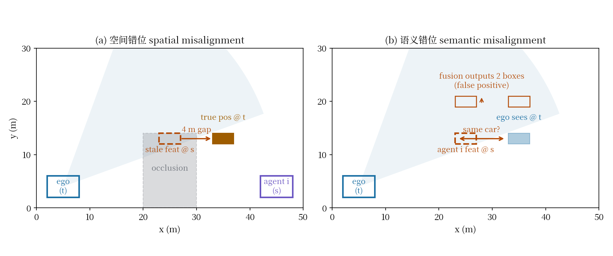
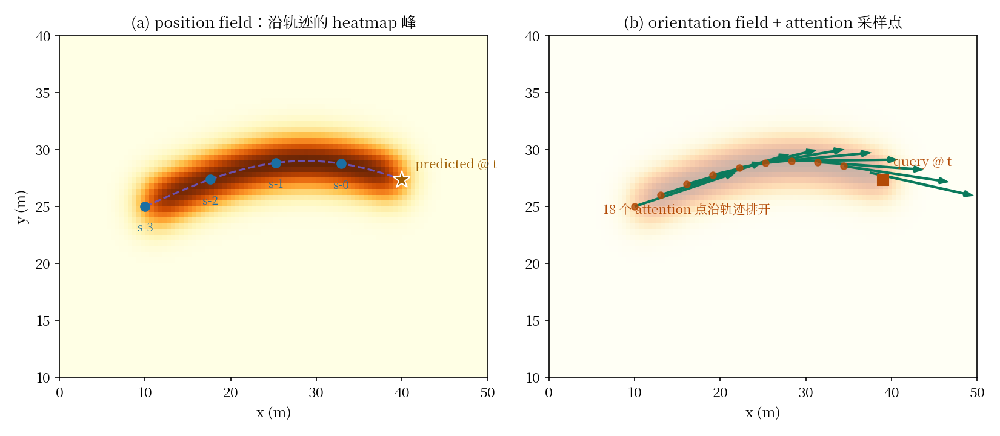
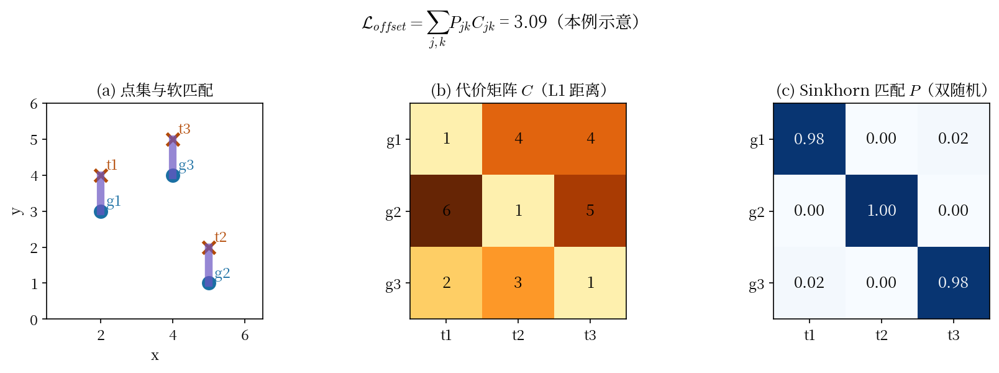
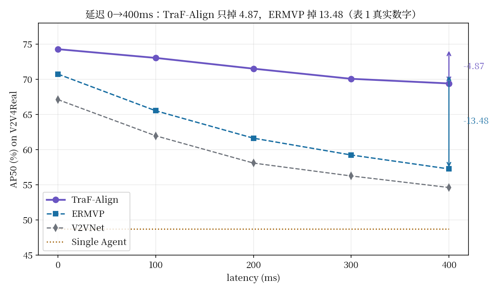

# 别预测特征，预测轨迹：TraF-Align 如何用一条低维轨迹线把延迟的特征拉回"现在"

> **信息块**
>
> - **论文**：TraF-Align: Trajectory-aware Feature Alignment for Asynchronous Multi-agent Perception
> - **作者**：Zhiying Song, Lei Yang, Fuxi Wen, Jun Li（清华大学车辆与运载学院 / 智能绿色车辆与交通全国重点实验室）
> - **会议**：CVPR 2025
> - **arXiv**：2503.19391，2025-03-25 提交（arXiv 页面只显示 v1，无后续版本）
> - **链接**：https://arxiv.org/abs/2503.19391
> - **代码**：官方已公开 https://github.com/zhyingS/TraF-Align（仓库描述明确写 "Code for CVPR 2025 paper"；本次因网络原因未能成功 clone，本文档基于论文正文+附录全文撰写，未对照代码实现）
> - **一句话核心洞见**：别的车传来的特征因为延迟"过期"了；作者不去预测过期的高维特征本身，而是预测物体在 BEV 平面上的低维运动轨迹，然后让注意力沿着这条轨迹回到历史帧里，把属于同一物体的特征"捡"回来，在当前时刻重新拼好。

---

## 延迟一到，协同感知先塌的是哪两块

先看论文 Figure 1 摆出来的那个场景，因为整篇论文都是对它的回答。

自车（ego）在时刻 $t$ 看到一辆车。另一辆协同车（agent $i$）在时刻 $s = t - \tau^i_t$ 看到了同一辆车，其中 $\tau^i_t$ 是通信延迟——可能是 100ms，也可能是 400ms。协同车把自己在 $s$ 时刻提取的 BEV 特征发过来，自车在 $t$ 时刻收到。问题是：这份特征描述的是 400ms 之前的世界。

400ms 里一辆以 10m/s 行驶的车走了 4 米。论文用的 BEV 网格是 0.4m 一格，4 米就是 10 个格子。也就是说，协同车发来的特征图上，这辆车的"影子"落在 10 个格子之前的位置。自车如果直接把这份特征和自己当前帧的特征叠起来融合，会发生两件事，论文把它们分得很清楚：

**第一，空间错位（Figure 1-I）。** 协同车特征里的物体位置和真实位置对不上。更糟的一种情况：自车自己的视野里根本看不到这个物体（被遮挡），那就连一个对齐的参照都没有，融合之后检测框直接画在 4 米之外的地方，或者干脆画出两个框。

**第二，语义错位（Figure 1-II）。** 自车和协同车都看到了同一个物体，但因为位置差了 10 个格子，融合模块认不出它们是同一个东西。结果是：协同车传来的信息非但没有帮忙，反而干扰了自车本来能看清的物体——论文 Figure 5 的 PR 曲线显示，在 200ms 延迟下，若干 SOTA 方法在低召回区域的精度甚至掉到了单车感知之下。延迟的信息变成了噪声。

这两个错位的区分是这篇论文最有价值的诊断。空间错位是"该补的没补上"（自车看不见的地方，协同信息对不准），语义错位是"不该添的添了乱"（自车看得见的地方，协同信息帮了倒忙）。后面所有的设计都是冲着同时修好这两块去的，实验部分也是按这个分组来验证的——读的时候可以一直拿着这个二分法去对照每个模块。

*图：左图空间错位——自车视野被遮挡，协同车 400ms 前的特征停在 4 米之外，没有任何参照可以对齐；右图语义错位——两车都看到同一辆车，但位置差了 10 个格子，融合模块认不出是同一个物体，可能输出两个框。*

## 在这之前，人们是怎么修延迟的，为什么修不好

引言和相关工作里列了三条路线，每条都撞在了一个具体的结构性问题上。先把这三条路线的失败说清楚，TraF-Align 的设计才会显得不是凭空冒出来的。

**路线一：预测当前帧的高维特征。** SyncNet（Lei et al., ECCV 2022）用金字塔 LSTM 迭代地从延迟特征预测当前帧特征；FFNet（Yu et al., NeurIPS 2024）用自监督学特征在相邻帧之间的一阶导数，再外推。问题在于：BEV 特征是几百维的稠密张量，预测它的逐点演化是一个欠定的高维回归问题。FFNet 学一阶导数相当于假设特征变化是线性的，延迟一大（300-400ms），线性外推就飘了。论文原话是 "predicting high-dimensional features is challenging and prone to uncontrollable variations"——翻译一下：高维空间里随便一个方向的误差，投影回检测框上都是灾难。

**路线二：预测像素级的 flow 再 warp。** CoBEVFlow（Wei et al., NeurIPS 2023）走的是另一条路：先生成实例级的 ROI，把每个 ROI 跟踪起来算运动向量，再把特征 warp 到预测位置。这条路的问题是流程：ROI 生成→匹配→跟踪→warp，是两阶段、非端到端的。任何一步的误差都会往下传，而且 ROI 匹配本身在延迟大的时候就不可靠。

**路线三：输出级的状态滤波。** Cai et al. 2023 在检测框层面做滤波预测。这条路的问题是预测时域太短，而且是在"已经做错了的检测"上打补丁。

三条路线背后有一个共同的默认假设：**要补偿延迟，就得把"过去的特征"变成"现在的特征"，而这个变换作用在特征本身上。** TraF-Align 推翻的就是这个假设。它的反问是：为什么要预测几百维的特征？物体在 BEV 平面上的运动轨迹是二维的，把这条二维轨迹预测准，然后沿着轨迹去历史帧里"取"特征，不就行了吗？特征不用预测，特征只需要被正确地"找到"。

这就是全文的底牌，一句话：**用低维轨迹的预测，代替高维特征的预测；用沿轨迹的注意力取特征，代替对特征的 warp 或外推。**

## 方法的三块拼图，先看全景

Figure 2 是架构总览。输入是异步的多智能体 LiDAR：自车在时刻 $t$，协同车 $i$ 在时刻 $s = t - \tau^i_t$。每家的单帧点云先过一个共享的稀疏编码器（PillarNext 风格的 PointPillars 变体）变成 BEV 特征 $F^i_s = f(L^i_s)$，发给自车，存进一个固定容量的特征库（feature bank，新进旧出）。然后每个智能体的多帧特征**分别**过一遍 TraF-Align 的三个模块：

1. **Field predictor（轨迹场预测器）**：输入某智能体的多帧 BEV 特征，输出一张"轨迹场"——每个物体从过去到自车当前时刻 $t$ 的预期路径，画在 BEV 平面上。关键：它预测到 $t$ 时刻为止，不管这个智能体自己的观测停在哪个历史时刻。
2. **Offset generator（偏移生成器）**：对 BEV 特征图上的每个 query 位置，生成 $n=18$ 个注意力采样点，分布在这条轨迹上。
3. **Attention layers（轨迹感知的注意力层）**：每个 query 只 attend 这 18 个点，把历史帧里属于同一物体的特征聚合过来，重建出"当前时刻"的特征。

最后把各智能体对齐到时刻 $t$ 的特征拼起来过一个卷积做融合，再接 anchor-based 检测头。

训练用三个损失：检测损失 + field loss + offset loss，权重 $\alpha = \beta = 0.05$。

下面逐块拆开。顺序按理解的依赖关系：先讲时间编码（因为多帧特征进 field predictor 之前要先带上时间信息），再讲轨迹场（核心），再讲注意力和 offset 损失。

## 时间编码：先把"这是几帧之前的特征"从点特征里拆出来

多帧点云进来之后，第一个处理是 temporal encoding。公式（1）：

$$TE_{(\tau,2j)} = \sin(\xi), \quad TE_{(\tau,2j+1)} = \cos(\xi), \quad \xi = \tau / \varepsilon^{2j/C}$$

其中 $\tau$ 是"比当前帧晚了几帧"，$j$ 是通道索引（$j = 0, 1, \dots, C/2-1$），$C$ 是特征通道数，$\varepsilon = 8$。

这个形式眼熟：就是 Transformer 的位置编码，把"位置"换成了"延迟帧数 $\tau$"。几何意义值得停一下。固定一个延迟 $\tau$，$TE$ 是一个 $C$ 维向量；当 $\tau$ 从 0 往大走，这个向量在 $C$ 维空间里画出的是一条螺旋线——低频分量（$j$ 小）转得慢，高频分量转得快。不同 $\tau$ 对应螺旋线上不同的点，而且 $\tau$ 相差越大，两个向量的内积一般越小。网络靠这个就能分辨"这份特征是 1 帧前的还是 4 帧前的"。

为什么要把时间信息"解耦"出来单独编码，而不是让点云特征自己带时间？论文的理由很实际：特征库（feature bank）里存的是各历史时刻的特征，取出来复用的时候，如果时间信息已经揉在特征里了，就分不清了。单独拼一个时间编码，再过一个 $1\times1$ 卷积融合，之后还可以做自车运动补偿（ego-motion compensation）把历史特征 warp 到 $t$ 时刻的坐标系。这是一个工程上干净的设计：**时间是一个独立的、可查询的维度，而不是特征里糊在一起的隐变量。**

注意一个细节：$\varepsilon = 8$。Transformer 原版用的是 10000。这里用 8 是因为 $\tau$ 的取值范围很小（几帧），分母 $\varepsilon^{2j/C}$ 必须让 $\xi$ 落在 $\sin$ 的敏感区间里。如果 $\varepsilon$ 太大，$\xi$ 全挤在 0 附近，$\sin(\xi) \approx \xi$，所有延迟的编码近似线性相关，区分度就没了。论文没有解释为什么是 8（这是后文怀疑式阅读的一个点），但从量级上可以算一下：$C$ 假设是 256，$j$ 从 0 到 127，$\varepsilon^{2j/C}$ 从 1 变化到 8。$\tau$ 取 1~4 帧时，$\xi$ 在低频端是 $O(1)$ 量级，正好落在 $\sin$ 的非线性区。这个选择是合理的，只是没写出来。

## 轨迹场：把"物体往哪走"画成两张 BEV 热力图

这是全文承重的那个设计。Field predictor 输入某个智能体的多帧 BEV 特征（含时间编码），输出一个轨迹场 $\in \mathbb{R}^{3 \times H \times W}$，由两部分组成：

- **Position field**（$\mathbb{R}^{1 \times H \times W}$）：沿物体轨迹画 heatmap 峰值。轨迹经过的格子响应高，没经过的格子响应低。
- **Orientation field**（$\mathbb{R}^{2 \times H \times W}$）：轨迹在每个位置的流动方向，用"反正切方向"表示（存成 2 维向量，即方向的 $(\cos\theta, \sin\theta)$ 形式，避免角度跳变）。

网络结构是 UNet 变体（细节在附录）：先降维、下采样抽深层语义，再上采样逐级拼回浅层特征。这很对路——轨迹场本质上是一个稠密的 BEV 分割/回归任务，UNet 是标准答案。

**训练监督（ground truth）怎么造？** 这是理解"轨迹场到底在学什么"的关键。对每个智能体，取它在最大时间窗内、从物体首次出现到自车当前时刻 $t$ 的所有 bounding box 标注，连中心点成一条轨迹。轨迹长度公式：$\lceil \tau_i \cdot \omega_i \rceil + m_i$，其中 $\tau_i$ 是该智能体的协同延迟（秒），$\omega_i$ 是它的 LiDAR 采样频率，$m_i$ 是历史帧数。所以轨迹 = 延迟期间走过的格子数 + 历史帧覆盖的格子数，终点是 $t$ 时刻的预测位置。把轨迹插值后投影到 BEV 特征图上：position field 在轨迹经过处画高斯峰，orientation field 在每处填方向向量。两条轨迹重叠时，时间戳新的覆盖旧的。

停下来想一下这个监督信号的妙处。网络被强迫输出的不是"延迟时刻的框"，而是"一直画到当前时刻 $t$ 的轨迹"。如果它偷懒只检测延迟的框，field loss 就会惩罚它——因为 ground truth 的轨迹一直延伸到了 $t$。**监督信号本身就把"预测到现在"这个要求写进去了**，不需要额外的时序外推模块。这就是 3.3 节那句 "Failing to do so would result in the network detecting only the delayed bounding box" 的意思。

跟路线一（预测高维特征）对比一下工作量：FFNet 要预测的是 $C \times H \times W$ 整个特征张量的演化；这里要预测的只是一张 $1 \times H \times W$ 的 heatmap 加一张 $2 \times H \times W$ 的方向图。监督信号也是现成的（标注框连起来就行，不需要自监督构造）。这就是把问题变简单的具体含义：**把难学的量换成好学的量，把贵的监督换成便宜的监督。**

Position field 用 focal loss 监督（heatmap 上正样本极少，focal loss 处理类别不平衡），orientation field 用 L1 loss。合起来是 $\mathcal{L}_{field}$。

*图：左为 position field——沿物体运动轨迹的 heatmap 峰，终点是预测到当前时刻 $t$ 的位置（路侧实际只观测到 $s$ 时刻）；右为 orientation field 的方向箭头，以及 query 在 $t$ 时刻沿轨迹向历史方向铺开的 18 个 attention 采样点。注意预测的不是高维特征，而是一张二维热力图。*

## 轨迹感知的注意力：query 沿着轨迹"回头"去取特征

有了轨迹场，下一步是真正做特征对齐的 attention（公式 2）：

$$\text{Attention}(q, R) = \text{Softmax}\left[\frac{qW^q (RW^k)^T}{\sqrt{d}}\right] RW^v$$

先把符号的形状摆清楚：输入特征图 $F^i \in \mathbb{R}^{C \times H \times W}$ 展平成 $H \times W$ 个 query，每个 $q \in \mathbb{R}^{1 \times C}$。对每个 query，offset generator 生成一个响应集 $R \in \mathbb{R}^{n \times C}$——$n = 18$ 个采样点的特征。$W^q, W^k, W^v \in \mathbb{R}^{C \times d}$ 是投影矩阵。形式上就是标准的多头注意力，只是 key/value 不是全图，而是这 18 个点。

关键在 **$R$ 里的 18 个点是怎么来的**。Offset generator 是一个简单的卷积层（加 PReLU），输入是 BEV 特征（已经带了轨迹场的信息），输出每个 query 的 18 个偏移量。它的监督（ground truth offsets）按三个条件选 $n$ 个像素：

1. position field 有响应（轨迹上）；
2. 和 query 属于同一条轨迹（同一个物体）；
3. 时间戳早于 query（历史位置）。

翻译成画面：query 落在轨迹场预测的"当前时刻位置"附近，它的 18 个注意力点沿着这条轨迹往历史方向排开。Attention 做的事情，就是让 query 去这 18 个历史位置上"收"特征——相当于把物体过去几帧的样子，沿着运动轨迹搬到现在的位置上，拼出一份"当前时刻"的特征。

Figure 7(e) 的可视化把这个行为说得很直白：对**自车**（无延迟）的数据，offset 分布以 query 为中心，近似一个卷积核——因为不需要补偿，attention 就在局部取特征；对**路侧**（400ms 延迟）的数据，attention 沿着轨迹伸展开。同一个模块，两种行为，完全由输入的延迟程度驱动。这是一个很干净的证据，说明 offset generator 真的在干"按需补偿"这件事，而不是学了个固定的模式。

为什么是 18 个点？论文没给消融（怀疑点之一）。可以这样理解量级：轨迹长度 $\lceil \tau_i \omega_i \rceil + m_i$，400ms 延迟、10Hz LiDAR 是 4 帧延迟 + 4 帧历史 = 8 个时刻的轨迹点，每个时刻轨迹占几个格子，18 个点大致能覆盖整条轨迹的采样。这是拍脑袋的合理推测，论文没说。

## Offset loss：用 Sinkhorn 给无序点集做匹配

Offset generator 输出的 18 个点是**无序**的——第 1 个点和第 7 个点没有本质区别，只是一个集合。Ground truth 的 18 个点也是无序集合。直接算 L2 损失需要点与点对齐，而对齐本身就是个组合优化问题。论文的解法是最优传输（公式 4）：

$$\mathcal{L}_{offset} = \sum_{j,k} P_{jk} \cdot C_{jk}$$

其中 $C_{jk} \in \mathbb{R}^{n \times n}$ 是 L1 距离代价矩阵（生成的点 $j$ 和真值点 $k$ 在特征图上的 L1 距离），$P_{jk}$ 是 Sinkhorn 算法算出的匹配概率矩阵（双随机矩阵，行列和均为 1）。

用一个小例子走一遍。假设 $n = 3$，生成的 3 个点位置是 $\{(2,3), (5,1), (4,4)\}$，真值的 3 个点是 $\{(2,4), (5,2), (4,5)\}$。代价矩阵 $C$ 是 3×3 的 L1 距离。Sinkhorn 迭代做的事情：反复对行和列做归一化，最后得到一个软匹配矩阵 $P$——比如 $P_{11} \approx 0.9$ 表示生成点 1 主要匹配真值点 1。损失就是 $\sum P_{jk} C_{jk}$，即按最优匹配加权的平均距离。梯度会同时推动两件事：生成点往匹配的真值点靠拢，匹配矩阵本身往更确定的方向走。

为什么不用匈牙利算法做硬匹配？硬匹配不可微，梯度传不回去。Sinkhorn 是加了熵正则的最优传输，整个迭代由可微操作（矩阵乘法、逐元素除法）组成，可以端到端训练。这是 DETR 那套 bipartite matching 思想在点集监督上的自然延伸，论文引用了 SuperGlue（Sarlin et al. 2020）也是这个路数。

总损失（公式 3）：$\mathcal{L} = \mathcal{L}_{detection} + \alpha \mathcal{L}_{field} + \beta \mathcal{L}_{offset}$，$\alpha = \beta = 0.05$。检测损失沿用 PointPillars 的那套（anchor-based）。0.05 这个量级说明 field 和 offset 是辅助损失——主任务还是检测，轨迹场是手段不是目的。论文没有给 $\alpha, \beta$ 的敏感性分析，这是后文要记的一笔。

*图：生成的点集 $\{g_1, g_2, g_3\}$ 与真值点集 $\{t_1, t_2, t_3\}$ 都是无序的。先算 L1 代价矩阵 $C$，Sinkhorn 迭代给出双随机匹配矩阵 $P$（对角线接近 1，说明匹配是确定的），损失是两者的逐元素加权和。整个过程可微，可以端到端训练。*

## 一个具体场景：400ms 延迟下，一辆车是怎么被"捡"回来的

把上面的机制放在一个具体数字场景里走一遍。场景：DAIR-V2X-Seq，路侧设备（Agent 2）延迟 400ms，一辆车以 10m/s 沿 x 轴行驶。自车无延迟。

**t 时刻的真实世界**：车在 $x = 40$m。

**路侧发来的是什么**：它在 $t - 400$ms 时刻的 4 帧点云（假设 10Hz，每帧 100ms），那时车在 $x = 36, 37, 38, 39$m。BEV 特征图上（0.4m/格），这 4 个位置相隔 2.5 个格子。

**Field predictor 的输出**：输入这 4 帧特征 + 时间编码，预测轨迹场。Position field 上从 $x=36$m 到 $x=40$m 画出一条 heatmap  ridge——注意终点 $x=40$m 是**预测**出来的，路侧自己并没有观测到 $t$ 时刻。Orientation field 在 ridge 上填方向 $(1, 0)$（沿 +x）。

**Query 与 offset**：特征图上 $x=40$m 附近的 query（对应"车现在应该在这里"），offset generator 给它生成 18 个点，沿 ridge 往 $x=36$m 方向排开。Ground truth  offsets 是按三个条件选的：ridge 上有响应、同一条轨迹、时间戳更早——正好就是这 18 个点该去的地方。

**Attention 聚合**：query 对这 18 个点做 attention。Key 是各点的特征（带着时间编码，所以网络知道哪个点是 400ms 前的、哪个是 100ms 前的），value 也是。Softmax 权重会偏向那些特征质量好的点。输出是一个融合了 4 个历史时刻信息的特征向量，放在 $x=40$m 这个位置上——**这个位置在路侧原始特征里本来是空的**（路侧没看到 $t$ 时刻），现在被"填"上了。

**融合与检测**：自车自己的特征（车在 $x=40$m 处有观测）和路侧重建的特征（车在 $x=40$m 处被重建）在位置上对齐了，拼起来过卷积融合，检测头输出一个框。空间错位修好了。

**语义错位是怎么修的**：换一个场景——自车自己能看到这辆车（无遮挡），路侧延迟 400ms。基线方法（比如 V2VNet）直接把路侧 $x=36$m 处的特征拿来和自车 $x=40$m 处的特征融合，融合模块看到两个位置都有"车"的特征，可能输出两个框（误检），或者把路侧的当成另一辆车。TraF-Align 里，路侧的特征先被 attention 沿轨迹"搬"到了 $x=40$m，**搬运的过程本身就用轨迹的连续性做了"这是同一辆车"的判断**——18 个点全在同一条 ridge 上，attention 把它们聚成一个特征。融合时自车和路侧在同一位置各有一份"同一辆车"的特征，语义一致了。论文 4.2 节的 PR 曲线分析（低召回区精度不再掉到单车之下）就是这个机制的证据。

## 实验：数字是怎么来的，先看表 1

实验设置先交代清楚，因为数字的可信度全系于此：

- **数据集**：V2V4Real（车-车协同，城市道路，稀疏 LiDAR）和 DAIR-V2X-Seq（车-路协同，路口，稠密 LiDAR）。两个都是真实世界数据集，不止仿真。
- **基线**：8 个中间融合 SOTA——F-Cooper、V2VNet、Where2comm、AttFuse、V2X-ViT、CoBEVT、MRCNet、ERMVP，外加单车感知。**所有模型在同一个 codebase 里重训 60  epochs**（9×RTX 3090，one-cycle LR，AdamW），这比直接抄原论文数字要公平得多，是加分项。
- **延迟设置**：给其中一个智能体（默认非自车）加 0/100/200/300/400ms 延迟，分别测。训练时多帧方法用 uniform(0, 400ms) 随机延迟增强。
- **公平性说明**： "To enable a fair comparison, we omit feature compression operations from the methods under evaluation."——所有方法都不做特征压缩。这一点后面要讨论。
- **指标**：AP50 / AP70（IoU 0.5 和 0.7），vehicle 类别（含 car、van、truck、bus 等）。

表 1 的主结果（vehicle 类）：

**V2V4Real**，TraF-Align 从 0ms 的 74.28/44.14 掉到 400ms 的 69.41/38.49，下降 4.87/5.65 个点。同期最强的基线 ERMVP 从 70.74/38.45 掉到 57.26/29.31，下降 13.48/9.14。**DAIR-V2X-Seq**，TraF-Align 从 76.90/58.31 掉到 71.22/52.01，下降 5.68/6.30；ERMVP 从 71.19/53.85 掉到 59.55/43.93，下降 11.64/9.92。

同步场景（0ms）下，TraF-Align 对单车感知的提升：V2V4Real 上 74.28−48.75 = 25.53（AP50）、44.14−30.53 = 13.61（AP70）；DAIR-V2X-Seq 上 76.90−51.31 = 25.59（AP50）。AP70 那项：58.31−40.45 = 17.86，但正文写的是 18.26——**这里差了 0.4 个点**，疑似笔误（后文怀疑式阅读展开）。对 ERMVP 的领先：V2V4Real 上 3.54/5.69，DAIR-V2X-Seq 上 5.71/4.46，数字都对得上。

*图：0→400ms，TraF-Align 的 AP50 只掉了 4.87 个点（74.28→69.41），而 ERMVP 掉了 13.48（70.74→57.26）。注意在 400ms 时 TraF-Align（69.41）甚至超过了 ERMVP 在 0ms 时的成绩（70.74）的大部分——延迟补偿把它拉回到了接近同步的水平。*

Figure 5 的 PR 曲线是论文里分析得最漂亮的一段，值得单独说。作者把延迟的影响按召回率区间分开读：

- **低召回区**（模型只输出最确信的那些框，基本是自车自己看得清的物体）：200ms 延迟下，SOTA 方法的精度掉到了单车感知**之下**。这说明延迟的协同信息干扰了自车本来能做对的检测——正是语义错位（Figure 1-II）的症状。
- **高召回区**（开始输出不那么确信的框，包含自车看不见、靠协同补盲的区域）：SOTA 的精度随延迟显著下降——空间错位（Figure 1-I）的症状。

而 TraF-Align 在低召回区保持了单车感知的精度（没添乱），在高召回区没有随延迟明显下降（补上了盲区）。这个"分段诊断"的读法，把 Figure 1 的两个概念和实验曲线对上了，是全文论证链条里最结实的一环。

## 消融：三块拼图各值多少钱

表 2（DAIR-V2X-Seq，训练 120 epochs，是主实验的两倍）在路侧加延迟和在车端加延迟两种设置下，逐步加上 field predictor（FP）、offset generator（OG）、attention layers（AL）：

- 路侧延迟 400ms：无模块 70.09/49.45 → +FP 71.84/51.02 → +OG 71.96/52.19 → +AL 72.89/53.21（AP50/AP70）。
- 车端延迟 400ms：无模块 56.93/24.51 → 全套 63.59/32.31。

两个观察。第一，每个模块都带来提升，没有"加了白加"的，说明三块都是承重的——但注意这是**累积式**消融（一次加一个），不是**剔除式**（一次去掉一个），它回答的是"加上有没有用"，没有回答"去掉哪个最疼"。严格来说，承重排序需要剔除式消融，论文没做。第二，车端加延迟比路侧加延迟掉得狠得多（400ms 时 63.59 vs 72.89 的 AP50），作者的解释是数据集中车端和路侧的物体可见性分布不同——路侧站得高看得远，延迟的代价相对小。这个解释合理，但"可见性分布不同"本身没有量化，是一个可以追问的地方。

表 3 消融两个辅助损失：field loss 和 offset loss 单独加、一起加。完整版（77.83/59.72 @0ms 路侧延迟）在所有延迟下都是最好的。作者的解读是 field loss 给 offset generator 提供了好的初始值——先有轨迹场，offset 才知道往哪排。这个因果链条在逻辑上是顺的：没有 field 监督，offset generator 的 18 个点就没有"沿轨迹分布"的先验，只能靠检测损失的微弱梯度去学。

表 4 消融历史帧数（V2V4Real）：ego 用 1/2/4 帧 × 协同车用 1/2/4 帧。结论两条：

1. **加 ego 帧主要涨 AP70**（定位精度），AP50 基本不动——多帧平均把位置估计磨准了，但检出率没多。
2. **加协同车帧涨 AP50 和延迟鲁棒性**——因为延迟本来就主要来自协同车，历史帧越长，能拿来做轨迹预测的信息越多。

但 ego 帧加到 4 帧时反而不如 2 帧（4+4 配置的 400ms AP50 是 69.08，2+4 是 69.41），作者引用 Rong et al. 2023 说这是 motion blur——多帧叠加把运动物体的特征抹糊了，反而伤定位。这个"多帧不是越多越好"的结论是诚实的，也和单车感知的已知现象一致。

## 怀疑式审读：这些数字和结论，有多少经得起敲打

下面按审稿人的顺序过一遍。先说清楚：这篇论文的实验是扎实的（统一 codebase 重训 8 个基线、两个真实数据集、PR 曲线分段诊断），下面的问题不是否定结论，而是标出结论的边界。

**数字笔误。** 4.2 节正文写 DAIR-V2X-Seq 同步场景下对单车感知的提升是 "25.59%/18.26%"。按表 1：AP50 是 76.90−51.31 = 25.59，对；AP70 是 58.31−40.45 = 17.86，不是 18.26。差 0.4 个点，不影响结论，但说明正文数字是手算的，没有从表格自动生成。顺手验了其他几个差值（V2V4Real 的 25.53/13.61、对 ERMVP 的 3.54/5.69 和 5.71/4.46、延迟衰减的 4.87/5.65 和 5.68/6.30），都是对的，只有这一处对不上。

**"省略特征压缩"的公平性。** 论文说为了公平比较，所有方法都不做特征压缩。但 Where2comm 的核心贡献就是"用空间置信度图做通信高效的协同"，ERMVP 的标题里也有 "Communication-efficient"。把压缩拿掉，等于把这两个方法的看家本领ban了，再比检测精度。这对 TraF-Align 是有利的——它本来就不做压缩。更公平的做法是：要么所有方法都开压缩比精度-带宽曲线，要么至少报告 TraF-Align 的传输量（每个智能体每帧传 $C \times H \times W$ 的 BEV 特征，到底是多少 KB，论文一个字没提）。通信量是协同感知的核心约束之一，整篇论文没有出现任何带宽数字，这是一个明显的缺口。

**延迟只在 100ms 的整数倍上采样测试。** 训练用 uniform(0, 400ms) 随机延迟，测试只在 100ms 的整数倍上测。真实世界的延迟是连续的，而且抖动（jitter）很大。作者在 limitations 里自己承认了："primarily trained on data with regular latencies (multiples of 100 ms)"。但更深的问题是：field predictor 的轨迹长度公式 $\lceil \tau_i \omega_i \rceil + m_i$ 里，$\tau_i$ 在测试时是已知的（实验设定），真实部署时延迟是估计出来的，估计误差会直接影响轨迹场。论文没有做延迟估计误差的鲁棒性分析。

**超参数的交代。** $\alpha = \beta = 0.05$、$n = 18$、$\varepsilon = 8$、2 层 attention、4 头——没有一个给了敏感性分析或选择依据。附录 A.2/A.3 是 LinkVLA 的？不，那是另一篇。本文附录没有超参数消融。$n=18$ 尤其值得问：如果延迟到 800ms，18 个点还够覆盖轨迹吗？论文的最大测试延迟是 400ms，结论的外推边界就到这里。

**基线的调参预算。** 8 个基线在统一 codebase 下重训 60 epochs，这很公平；但每个基线是否用了它原论文的超参数（学习率、增强策略）？论文只说 "All the models are trained within the same codebase"，没有说超参数是各用各的还是统一一套。如果是统一一套，那对超参数敏感的基线（比如 V2X-ViT）可能没发挥全力。这是一个"领域里大家都这么做"的标准做法，但读者应该知道。

**消融的训练轮数不一致。** 表 2/表 3 的消融训了 120 epochs，是主实验（表 1）60 epochs 的两倍。所以表 2 里"无模块"的 75.35/54.72 不能直接和表 1 的任何一行对比。作者注明了训练轮数，算诚实，但跨表对比数字时要小心。

**没有报告的东西**：随机种子（表 1 的数字是单次运行还是多次平均？没说）；推理延迟 / wall-clock（attention 对每个 query 生成 18 个点，2 层 4 头，计算量不小，但论文一个数字没给）；显存占用；位姿误差的影响（limitation 提了，但没量化——而多帧方法恰恰对位姿误差敏感）。

**没选的基线。** 相关工作引用了 Dao et al. 2024（Practical collaborative perception，专门做异步多智能体），但表 1 的 8 个基线里没有它。也没和 FFNet（Yu et al. 2024，自监督特征流）直接对比——而 FFNet 正是"预测高维特征"那条路线里和 TraF-Align 最接近的对手。这两个缺席的基线，恰好是和本文方法论最对位的，值得注意。

**附录和正文的一致性。** 附录的消融 PR 曲线（Figure 1-3）和正文表 2-4 的结论一致，没有发现矛盾。Field predictor 的 UNet 结构细节在附录 Figure 6，可视化（Figure 5 position/orientation field、Figure 4 attention positions、Figure 7 Sinkhorn 代价/匹配矩阵）都对得上正文的描述。版本历史干净（只有一个 v1），不存在"审稿人改出来的差别"可考。

## 代码里有、论文没写的三件事

官方代码公开了（本次未能完整 clone，但从 GitHub API 读到了关键文件）。对照 `models/modules/deform/` 下的实现，有三处论文没提：

**第一，field predictor 的输出过了 Sigmoid。** `field_predictor.py` 的 `to_field_` 最后是 `self.norm(x_traj)`，其中 `self.norm = nn.Sigmoid()`。论文只说输出轨迹场，没说加了 Sigmoid 归一化。这很合理——position field 是 heatmap，值域压到 $[0, 1]$ 才和 focal loss 的预期对上。但论文没写，复现的人如果漏了这一步，heatmap 的量级会对不上。

**第二，attention 模块带了一个可学习的空间位置编码。** `trafalign_transformer.py` 里除了论文讲的 temporal encoding，还有 `self.position_encoding = nn.Parameter(torch.randn(...))`，直接加在输入特征上。论文 3.2 节只讲了时间编码，没提这个空间位置编码。它的作用不难猜：offset 是相对偏移，query 需要知道自己在 BEV 上的绝对位置才能生成有意义的偏移。但这是一个论文没交代的参数量和设计选择。

**第三，attention 的 forward 有 topk 分支。** `forward(X, selected_indices, topk=1)` 在 `topk != 1` 时走 `forward_wtopk`，只对 `topk_index` 选出的部分像素做 attention（注释里出现 `batch_size, 50, 60, 256` 和"3000 个像素"的字样，即全图 3000 个位置的一个子集）。这像是一个推理时的效率优化——不对全图每个 query 都做 18 点 attention。论文正文说"每个 query 位置"都做，没有提这个分支。`num_random_points=18` 的默认值倒是和论文的 $n=18$ 对上了。

另外 `offset_generator.py` 确认了论文的说法：两层 $3\times3$ 卷积 + BatchNorm + PReLU，确实是"简单的卷积层"。Sinkhorn 的实现在 `loss/loss_utils.py`（`log_sinkhorn_iterations`，log-space 数值稳定版，SuperGlue 的路数），和论文公式一致。

## 作者的底牌：这篇论文凭什么中 CVPR

从论文的组织方式倒推，作者手里有三张牌。

**第一张：诊断本身就是贡献。** Figure 1 把延迟的破坏分成空间错位和语义错位，Figure 5 用 PR 曲线的分段行为把这两类错位的症状分开验证。这套"问题定义→可观测症状→对症下药→症状消失"的完整论证链条，在审稿人那里是很硬的。很多协同感知论文只报 AP 数字，这篇多走了一步：它解释了 AP 是怎么掉的。

**第二张：把难问题换成简单问题的简洁性。** 不预测 $C \times H \times W$ 的特征，只预测 $3 \times H \times W$ 的轨迹场；监督信号是标注框连起来就有，不需要自监督构造；offset generator 只是"简单的卷积层+PReLU"（论文原话），因为轨迹场已经把重活干了。一个方法的核心 trick 能用一句话讲清、实现不复杂、效果提升明显，这是 CVPR 审稿人喜欢的类型。

**第三张：实验的全面性。** 两个真实数据集（V2V 和 V2I 各一个，稀疏和稠密 LiDAR 各一个）、8 个基线统一重训、PR 曲线、消融（模块/损失/帧数）、可视化（轨迹场/attention 位置/Sinkhorn 矩阵）。证据链完整，没有明显的短板实验。

要说哪张最硬，是第一张。协同感知做延迟补偿的人很多，但把"延迟为什么让 AP 掉"拆成两个机制并分别验证的，这篇是少见的。方法本身（轨迹场+沿轨迹 attention）是对这个诊断的自然回答，读者走完"诊断"这一步，会觉得方法只能长这样——这就是 3B1B 式的"让答案显得不可避免"。

## 可以带走的东西

**第一个可迁移的想法：用低维代理任务引导高维特征的对齐。** 这是全文最值得偷的一个模式。任何"高维时序特征对齐"问题——视频理解里的跨帧对齐、多智能体协同、甚至记忆检索里的时序对齐——都可以问一句：有没有一个低维的、好监督的量，能把对齐的结构先定下来？这里是轨迹场；在别的场景里可能是光流、关键点、 occupancy 的变化。模式是通用的：**先学一个便宜的结构，再用这个结构去组织贵的特征。** 具体到你手头的 RAMP 项目：情景记忆检索时，与其让检索器直接在高维特征空间里算相似度，不如先学一个低维的"情景轨迹"（比如自车运动+风险演化的二维曲线），用它来约束检索的范围和排序。这和 TraF-Align 用轨迹场约束 attention 的采样点是同一个思想。

**第二个可迁移的想法：无序点集的监督用 Sinkhorn。** 只要你的模型输出是一个无序集合（attention 采样点、检测框、轨迹点），而监督也是一个无序集合，点对点的 L2 是没定义的——先做软匹配再算加权距离。Sinkhorn 迭代全可微，可以直接写进损失。这个技巧不只属于协同感知。

**第三个可迁移的想法：时间编码与特征解耦。** 把"这是多久之前的"从特征里拆出来，单独编码、单独拼回去。这样历史特征库里的每份特征都自带时间戳，检索和复用时不需要重新算。这是做情景记忆（episodic memory）的一个干净范式：记忆条目 = 内容特征 + 独立的时间编码，而不是把时间糊在内容里。

**第四个值得做的问题（论文留下的）**：延迟估计误差的鲁棒性。整篇论文假设 $\tau^i_t$ 已知，轨迹长度公式直接用它。真实部署时延迟是估计的、有噪声的。一个自然的 follow-up 是：把延迟估计的不确定性也建模进轨迹场（比如输出轨迹的分布而不是单条轨迹），或者做延迟抖动的增强训练。作者在 limitations 里点了前两个改进方向（更准的 field predictor、更好的定位精度），但延迟估计误差这个点他们没展开，而这恰恰是"regular latencies (multiples of 100ms)"假设下最脆弱的一环。
