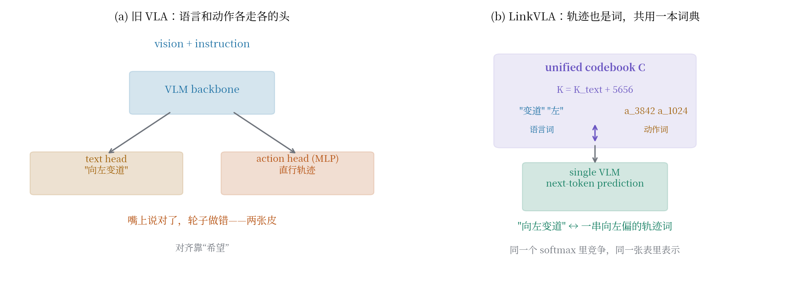
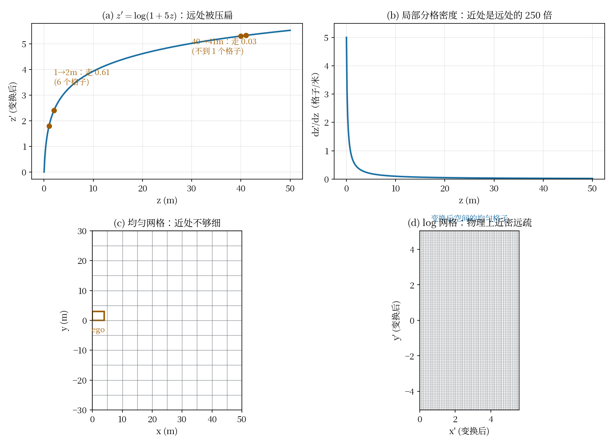
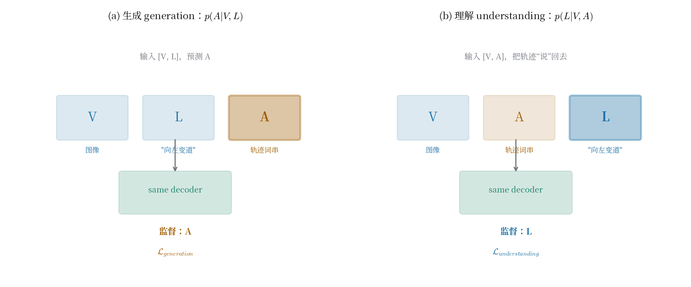
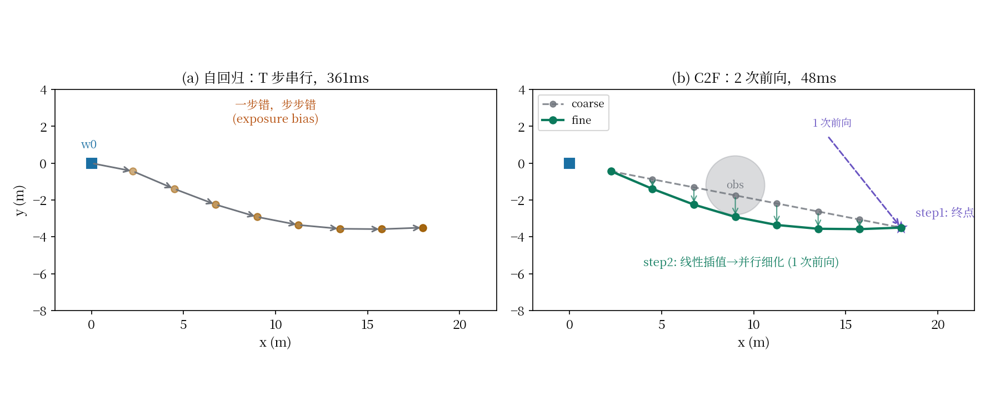

# 把轨迹也变成"词"：LinkVLA 如何用一本共享词典接通语言和动作

> **信息块**
>
> - **论文**：Unifying Language-Action Understanding and Generation for Autonomous Driving（LinkVLA）
> - **作者**：Xinyang Wang, Qian Liu, Wenjie Ding, Zhao Yang, Wei Li, Chang Liu, Bailin Li, Kun Zhan, Xianpeng Lang（均为 Li Auto，标注为实习期间完成）, Wei Chen（浙江大学 CAD&CG 国家重点实验室，通讯作者）
> - **会议**：CVPR 2026（任务指定；arXiv 页面未标注会议信息，截至 2026-10-09 只有 v1）
> - **arXiv**：2603.01441，2026-03-02 提交
> - **链接**：https://arxiv.org/abs/2603.01441
> - **代码**：未找到官方代码（arXiv 页面无代码链接；GitHub 按标题/作者搜索无结果）
> - **一句话核心洞见**：语言和动作对不上，是因为它们住在两个不同的表示空间里——语言走文本头，动作走回归/扩散头，嘴上说对了不代表轮子做对。LinkVLA 把轨迹也变成"词"：和语言 token 共用一本离散词典、同一个自回归模型；再加一个"看轨迹说回话"的逆任务逼双向一致；最后用"先猜终点、再并行填满"的两步解码，把自回归逐点生成的 361ms 砍到 48ms。

---

## 那个让 VLA 难堪的瞬间：嘴上说变道，轮子却直行

论文引言里举的例子值得全文背诵，因为它是整个工作的起点：模型正确生成了文本决策 "change lane to the left"，输出的轨迹却是一条 lane keep（直行）。指令理解和动作执行各说各话。

这不是某个模型的 bug，而是 VLA 这一类方法的结构性问题。看一下当时的 VLA 是怎么搭的：视觉编码器 + LLM 做理解，动作另起一个头——SimLingo（Renz et al., CVPR 2025）用 MLP 头回归轨迹点，DiffVLA 用扩散头，ORION 用 VAE。语言和动作在架构上是两条分开的路，只在训练损失里"希望"它们对齐。LLM 的文本输出对了，只能说明语言那条路走通了；动作那条路有自己的参数、自己的损失，错了也不奇怪。

之前有三拨人试过修这个问题，论文在引言里把它们一一否了，否的理由决定了 LinkVLA 的设计方向：

**第一拨：从数据侧绕过去。** SimLingo、CAST、OmniDrive 收集更好的对齐数据（反事实标注、难例挖掘）。论文的评价是"a strategy that sidesteps the fundamental modeling challenge"——数据再好，架构上的模态鸿沟还在，换个场景照样裂开。

**第二拨：事后打补丁。** AutoVLA 用 GRPO 强化学习做后处理精炼。论文说这是"corrective afterthought"——对齐是事后追加的，不是训练一开始就长在一起的。

**第三拨：隐式对齐。** ORION 在隐空间做分布匹配，让推理和动作的分布靠拢。论文的批评是"lacks a direct, verifiable supervision"——分布对上了，不代表具体某条指令和某条轨迹对上了，没法验证。

三拨人的共同假设是：**语言和动作是两个模态，对齐是在它们之间"搭桥"。** LinkVLA 的反问是：为什么要是两个模态？如果轨迹本身就是一种"语言"——离散的 token 序列——那就不存在桥的问题，因为它们住在同一栋房子里。这就是标题里 "Link" 的第一层含义。

## Link 的三层含义，先一次说清

论文标题里的 "Link" 不是修辞，它指三个具体的东西，分别对应三个贡献。读的时候要分清它们各修了什么：

1. **Structural link（结构连接）**：语言 token 和动作 token 合并进**同一个离散 codebook** $\mathcal{C}$，由**同一个**多模态自回归模型处理。模态鸿沟不是被"桥接"了，而是被"取消"了——架构上就不存在两个头。
2. **Semantic link（语义连接）**：一个辅助的 **action understanding** 目标——给定视觉和轨迹，反向生成描述这段轨迹的语言（captioning）。训练模型做 $p(L \mid V, A)$ 的同时也做 $p(A \mid V, L)$，双向一致性把"词"和"轨迹点"的语义绑死。
3. **效率上的连接（C2F）**：coarse-to-fine 两步解码。第一步预测轨迹终点，第二步把终点线性插值成粗轨迹、并行细化成精轨迹。$T$ 步自回归压缩成 2 次前向，延迟从 361ms 降到 48ms。

三者的关系：1 是地基（表示统一），2 是钢筋（语义绑定），3 是工程（让它能用）。消融表（表 5）正好按这个顺序加：token 化 alone 把 DS 从 85.07 拉到 89.57（+4.5），是最大的一块；+C2F 到 89.85（+0.28，基本持平，SR 还掉了 0.9）；+对齐目标到 91.01（+1.16）。**地基贡献了大部分涨点**，这个顺序和论文讲故事的顺序一致。

*图：左为旧 VLA——语言和动作各走各的头，对齐靠"希望"；右为 LinkVLA——语言词和动作词（5656 个 BEV 格子词）住在同一张 codebook 里，同一个自回归模型做 next-token prediction。"Link" 的第一层含义就是取消模态鸿沟，而不是桥接它。*

## 统一 token 空间：把 BEV 切成 5656 个"动作词"

3.1 节的核心操作分两步。第一步，把连续轨迹离散化：BEV 平面 $x \in [0, 50]$m、$y \in [-30, 30]$m（自车坐标系，前 50 米、左右各 30 米），划分成网格，每个格子是一个 action token。一条轨迹 $\mathcal{T} = \{w_1, \dots, w_T\}$ 变成 token 序列 $A = \{a_1, \dots, a_T\}$，每个 waypoint 映射到它所在的格子。

第二步，把这套 action codebook $\mathcal{C}_{action}$（大小 $K_{action}$）和文本词表（大小 $K_{text}$）**直接拼接**成一个统一 codebook $\mathcal{C}$，大小 $K = K_{text} + K_{action}$。action token 的 embedding 是从零开始端到端学的，和文本 embedding 住在同一张表里。推理时，模型吐出一个 action token id，解码成对应格子的中心坐标，就是 waypoint。

$K_{action} = 5656$ 这个数字是怎么来的，论文 4.2 节给了完整账本，值得算一遍：坐标先过 log 变换（下节讲），变换后的空间按 0.1 步长均匀切分，得到 $56 \times 101$ 的网格，$56 \times 101 = 5656$。反推一下：x 方向 56 格 × 0.1 = 5.6（变换后单位），y 方向 101 格 × 0.1 = 10.1。也就是说 log 变换把 $[0, 50]$m 压成了长度 5.6 的区间，把 $[-30, 30]$m 压成了 10.1 的区间。近处的米被"拉长"了，远处的米被"压缩"了——这正是下节要讲的。

为什么不用回归而用分类？分类（token 预测）让动作和语言共享**同一套训练机制**：都是自回归 next-token prediction，都是 cross-entropy。这就是 structural link 的实质——不是"语言模型顺便管动作"，而是"动作本来就是另一种语言"。代价是量化误差：格子中心代替真实坐标，0.1 步长在变换后空间里对应物理米数，近处很小、远处较大。论文没有量化这个误差对控制的影响（怀疑点之一）。

## Log 坐标变换：近处的格子密，远处的格子疏

朴素的均匀网格有两个毛病，论文说得很实在：第一，分辨率平均分配，近处（控制最要紧的地方）不够细；第二，one-hot 硬分配丢掉了网格的空间拓扑——格子 (3,5) 和 (3,6) 是邻居，但 one-hot 里它们正交，模型学不到"挨着"这件事。

第一个毛病用 log 变换修。公式（1）：

$$z' = \text{sign}(z) \cdot \log(1 + k \cdot |z|), \quad k = 5$$

对 $x, y$ 每个轴独立做。先看这个函数的形状。$z = 0$ 附近，$\log(1 + k|z|) \approx k|z|$，是线性的，斜率 $k = 5$；$|z|$ 很大时，$\log$ 把增长压扁。导数是 $\frac{k}{1 + k|z|}$：$z = 0$ 处导数是 5，$z = 50$ 处导数是 $5/251 \approx 0.02$。**导数的物理意义是"一米对应多少个变换后单位"，也就是局部的分格密度。** 0 米处 1 米占 5 个单位（50 个格子），50 米处 1 米只占 0.02 个单位（0.2 个格子）——近处 250 倍于远处的密度。

算两个具体数，感受一下。$k = 5$ 时：$z = 1$m → $z' = \log(6) \approx 1.79$；$z = 2$m → $\log(11) \approx 2.40$。1 米到 2 米之间，$z'$ 走了 0.61，0.1 步长下是 6 个格子。$z = 40$m → $\log(201) \approx 5.30$；$z = 41$m → $\log(206) \approx 5.33$，差 0.03——**连一个格子都不到**。40 米外的 waypoint，在 token 空间里几乎不动。这对驾驶是合理的：40 米外的路径点差一米，无所谓；1 米内的差一米，要命。

附录表 S1 试了 $k = 10$（7256 个 token），结果反而掉了：DS 91.01→89.85，SR 74.55→70.45。$k$ 越大，近处分得越细、远处压得越扁，token 总数越多。为什么更多 token 反而更差？论文没解释。一个合理的推测：分类难度随类别数上升（5656→7245 类），而远场被压得太扁，远处 waypoint 的监督信号糊成一团，模型在远场学到的东西变少了。$k = 5$ 是个甜点，但论文只试了两个值（5.0 和 10.0），没有画曲线，这是后文要记的一笔。

几何上再看一眼：这个变换是"径向"的——每个轴独立做，所以等值线是矩形网格的拉伸，不是极坐标式的扇形。y 轴 $[-30, 30]$ 的负半轴用 $\text{sign}$ 翻过去，对称处理。自车正前方（x 大、y 小）的区域，x 被压缩、y 相对保留，格子变成横向拉长的矩形。这个各向异性是变换的直接后果，论文没讨论，但它意味着"前方远处"和"侧方"的量化误差形状不一样。

*图：(a) 变换曲线——1→2m 走了 0.61（6 个格子），40→41m 只走 0.03（不到 1 个格子）；(b) 局部分格密度 dz'/dz，0 米处是 50 米处的 250 倍；(c)(d) 均匀网格 vs log 网格——变换后空间的均匀格子，反解回物理空间就是近密远疏。*

## Spatial soft-labeling：告诉模型格子之间是挨着的

第二个毛病（one-hot 丢拓扑）用 soft label 修。公式（2）：

$$q(a) = \frac{1}{Z} \exp\left(-\frac{\|\text{pos}(a) - \text{pos}(a_{gt})\|_2^2}{2\sigma^2}\right)$$

对真值 token $a_{gt}$，目标分布不是"它是 1、别人是 0"，而是一个以它为中心、$\sigma = 1.2$ 的二维高斯，半径 $R = 10$ 个格子内有效。训练损失是 cross-entropy（公式 3）：

$$\mathcal{L}_{generation} = -\sum_{a \in \mathcal{C}_{action}} q(a) \log p(a)$$

直观理解：模型被鼓励把概率质量分给真值格子**和它的邻居**，离得越近分得越多。这做了两件事。第一，学到了空间先验——预测偏一个格子只扣一点分，偏十个格子扣很多分，损失函数本身知道"远近"。第二，对标注噪声鲁棒——真值轨迹要是从 PDM-lite 专家来，专家轨迹本身有抖动，硬标签会逼模型拟合噪声，软标签相当于说"真值附近都算对"。

$\sigma = 1.2$ 的量级：高斯在 1.2 个格子处衰减到 $e^{-0.5} \approx 0.61$，3 个格子处 $e^{-3.1} \approx 0.04$。有效监督半径就是两三个格子，和 $R = 10$ 的截断半径配合（10 格子外直接截掉，省计算）。附录表 S2 试了 $\sigma = 3.0$：DS 91.01→89.73，SR 74.55→69.55。$\sigma$ 太大，目标分布太平，等于告诉模型"附近一大片都算对"，监督信号变糊，定位精度下来了。同样只试了两个值。

表 6（正文）对比了有无 soft label：DS 90.85→91.01（+0.16），SR 72.73→74.55（+1.82）。DS 涨得少，SR 涨得多——soft label 主要帮的是**任务完成率**而不是平均分。合理的解释：软目标让模型在模糊场景下不那么容易输出离谱的 outlier 轨迹（分类的 argmax 更稳定），减少了灾难性失败，而灾难性失败正是 SR 的杀手。这个"DS 微涨、SR 大涨"的模式，说明 soft label 修的是尾部风险，不是平均性能。

## 双向目标：让模型把开过的路"说"回去

3.2 节是 semantic link。训练目标除了 $\mathcal{L}_{generation}$（$p(A \mid V, L)$：看图、听指令，生成轨迹），再加一个**反向**目标（公式 4）：

$$\mathcal{L}_{understanding} = -\sum_j \log p(l_j \mid V, A, l_{<j})$$

给定视觉 $V$ 和**已经执行**的轨迹 $A$，生成描述这段行为的语言 $L$。总损失 $\mathcal{L}_{total} = \mathcal{L}_{generation} + \lambda \mathcal{L}_{understanding}$。

论文的类比是图文领域：image captioning（$p(L \mid V)$）和 text-to-image（$p(V \mid L)$）互为逆任务，一起训练能学到更好的联合表示。这里搬到驾驶：action generation 是"text-to-trajectory"，action understanding 是"trajectory-to-text"。实现上极其省事：**同一批数据**，把 $(V, L, A)$ 拼成 $[V, A, L]$ 就监督 $L$（理解），拼成 $[V, L, A]$ 就监督 $A$（生成），同一个 decoder 换一下目标就行。不需要额外数据——这是论文反复强调的（"without the need for additional data curation"），也是它相对 CAST/OmniDrive（要造反事实数据）的一个卖点。

为什么反向任务能帮助正向的指令跟随？想一下梯度流。Action token 的 embedding 在生成任务里只被"预测对 token id"监督；在理解任务里，同一个 embedding 要参与生成**描述性语言**——比如轨迹向左偏，模型要说出 "change lane to the left"。这迫使 action token 的表示里 encode 进**语言可描述的语义**，而不是仅仅"第 3842 号格子"。双向训练之后，"向左变道"这个语言概念和"一串向左偏的轨迹 token"在表示空间里被绑在了一起。引言里那个"嘴上说变道、轮子直行"的失败，根源就是语言概念和动作表示没绑死——现在绑死了。

*图：同一批 $(V, L, A)$ 数据，拼成 $[V, L, A]$ 就监督 $A$（生成，$\mathcal{L}_{generation}$），拼成 $[V, A, L]$ 就监督 $L$（理解，$\mathcal{L}_{understanding}$）。同一个 decoder，换一下目标顺序，不需要额外数据。*

表 3 的指令跟随消融验证了这一点。基线（ID1，无 token 化）平均成功率 70.11%；+token 化（ID2）到 81.63%，其中 Stop 任务直接干到 99.88%（停车就是"速度 waypoint 全零"，token 化后变成一个极好学的模式）；+C2F（ID3）到 81.87%；+对齐目标（ID4）到 87.16%，Faster 96.48%、Lane Change 97.42% 都是最高。**对齐目标是最后 5.5 个点的来源**，而且表 4 显示它同时提升了 DriveLM-VQA 和 commentary 的语言能力（SPICE 71.3→73.0 等）——理解任务反哺了语言能力，符合"双向"的预期。

但有一个细节作者没解释：ID3（+C2F 无对齐）在 Slower 任务上从 65.24 **掉到** 55.86，加了 C2F 反而把减速指令做差了。可能的原因：C2F 先预测终点，减速场景的终点（低速、近距离）对方位不敏感，终点预测的误差被线性插值放大？论文没讨论。这是一个诚实的瑕疵，藏在表 3 里。

## C2F：把 T 步自回归压成 2 次前向

3.3 节解决效率问题。自回归生成 $T$ 个 waypoint 要 $T$ 次前向（表 2 测出来 361ms），车上跑不动。C2F 把它压成两步：

**训练时**做两件事。第一，目标序列重排：$\{w_1, \dots, w_T\}$ 改成 $\{w_T, w_1, w_2, \dots, w_{T-1}\}$，并在 decoder 输入开头加特殊 token。模型学会：看到特殊 token，第一个吐出来的是**终点** $w_T$。第二，模拟粗轨迹：用真值终点做线性插值得到粗轨迹，量化成 token 当输入，训练模型把它映射回精细轨迹。

**推理时**（公式 5）：

$$w_i^{coarse} = w_0 + \frac{i}{T}(w_T - w_0), \quad i \in \{1, \dots, T\}$$

第一步，一次前向预测终点 $\hat{w}_T$；第二步，从起点 $w_0 = (0,0)$ 到 $\hat{w}_T$ 线性插值出 $T$ 个粗点，token 化后喂给模型，一次前向**并行**输出 $T$ 个精点。两步都是单次前向，总共 2 次。

为什么线性插值是个合理的"粗"起点？驾驶轨迹在短时域内（论文输出 20 个几何点 + 10 个时间点）近似直线或缓曲线，终点定了，中间点不会偏太远。Refinement 阶段"保持结构"地修正：每个粗点 $w_i^{coarse}$ 对应精点 $w_i^{fine}$，模型在 vision-language 上下文下去调整——避障、贴车道线、遵指令。论文强调这和 GoalFlow（Xing et al., CVPR 2025）不同：GoalFlow 的终点预测和轨迹生成是分开的模块，这里是**同一个统一 transformer** 里的两个步骤，终点 token 和轨迹 token 住在同一个 codebook 里。

表 2 的延迟对比是全文最抓眼球的数字：AR 361ms → C2F 48ms，省了 86.7%（论文写 86%），DS 反而从 90.66 **涨到** 91.01。C2F 不只快，还准了一点。为什么？一个可能的解释：自回归有 exposure bias——一步错步步错，$T$ 步串行把误差滚大了；C2F 的并行细化没有这个问题，终点定了之后各点独立修正。论文没这么说，这是我的推断（标明）。

*图：左为自回归——$T$ 步串行，每步以前一步的输出为输入；右为 C2F——step1 一次前向定终点，step2 把起点→终点线性插值成粗轨迹，一次前向并行细化成精轨迹（绕开障碍物）。2 次前向前后，延迟从 361ms 降到 48ms。*

## 一个具体场景：左变道指令是怎么走通的

场景：CARLA Town 13，Action Dreaming 评测集。自车在直行道，前方有慢车，指令是 "change lane to the left"。看 LinkVLA 的完整链条。

**输入**：视觉 $V$（多帧图像，InternViT 编码），语言 $L$ = "change lane to the left"，以及导航点 token（GPS 目标点或导航命令，表 7 证明两种模态差不多）。

**CoT 先行**（4.2 节）：模型先生成文本 rationale——比如"左侧车道空闲，前方车辆缓慢，变道安全"。这段 rationale 的监督来自 SimLingo 的 commentary 数据（附录 B.3 的模板规则生成）。注意：论文的延迟数字**不含** CoT（表 2 明确 omit），真实推理要先跑完这段文本生成。

**结构化的动作生成**：指令 "change lane to the left" 的 token 和视觉 token 拼在一起进 Qwen2-0.5B。C2F 第一步：特殊 token 触发终点预测——模型输出一个 action token，解码成 BEV 坐标，比如 $(18.3, -3.5)$（前方 18 米、左侧 3.5 米，正好是左车道）。因为 action token 的 embedding 在理解任务里被"向左偏的轨迹"绑定过，这个终点 token 的选择不是随机的——它是"左变道"这个语言概念在动作词典里的对应词。

**并行细化**：$(0,0) \to (18.3, -3.5)$ 线性插值出 20 个粗点，token 化，喂回去一次前向，输出 20 个精点。Vision-language 上下文在这里起作用：如果左侧有车，refinement 会把轨迹压回去或推迟变道时机——终点定了，但中间怎么走还是看路况。

**基线会怎么错**：SimLingo（MLP 头）的失败模式是语言和动作两张皮——LLM 可能正确理解了"向左变道"，但 MLP 头输出的轨迹是训练数据的平均（直行居多），指令被"平均掉"了。LinkVLA 里没有第二张皮：输出轨迹的每一个 token 都和语言 token 在同一个 softmax 里竞争、同一套 embedding 空间里表示，"变道"这个词和"向左偏的轨迹点"在训练时被双向目标焊在了一起。

## 实验：Bench2Drive 上的数字

**主结果（表 1）**：LinkVLA DS 91.01、SR 74.55%，对 SimLingo（85.07/67.27）是 +5.94/+7.28，相对 +6.98%/+10.82%（验算：5.94/85.07 = 6.98%，7.28/67.27 = 10.82%，对）。Multi-ability 平均 73.40，对 SimLingo 67.28 是 +6.12（+9.09%）。分项看，涨得最多的是交互类：Merging 53.75→60.00（+6.25）、Overtake 68.89→80.00（+11.11）、Brake 81.67→93.33（+11.66）。Efficiency 255.84 和 SimLingo 的 259.23 相当，Comfort 34.62 略高于 33.67。**指令跟随的提升主要落在需要交互的场景**——这和"语言-动作绑死了"的故事一致：简单场景大家都会，难的是"听懂指令并做出对应的交互动作"。

**延迟（表 2，H20 上测）**：SimLingo 34ms/85.07，Orion 65ms/77.74，Ours-AR 361ms/90.66，Ours-C2F 48ms/91.01。C2F 比 Orion 的 DS 高 13.27（91.01−77.74），延迟低 26%（(65−48)/65 = 26.2%）；比 SimLingo DS 高 5.94，延迟多 14ms。论文的 headline 是"86% 推理时间节省"，分母是自家的 AR（361ms）。横向看，C2F（48ms）比 SimLingo（34ms）还是慢 14ms——论文如实写了"only a modest 14ms increase"，这句是诚实的。

**消融（表 5）**：token 化是最大头（85.07→89.57），C2F 基本持平（89.85，SR 还掉了 0.9），对齐目标收尾（91.01）。**C2F 的贡献主要是延迟，不是精度**——表 5 的数字把这一点说得很清楚，C2F 在精度上是个"不亏"的中性项。

**实现细节（4.2）**：InternVL2-1B（InternViT-300M-448px + Qwen2-0.5B-Instruct），AdamW，lr 1e-4，wd 0.1，cosine schedule，30 epochs，32×H20，batch 48，LoRA rank 32、α=64、dropout 0.1。数据是 follow SimLingo、用 PDM-lite 专家在 CARLA 里收集的。输出是 20 个几何 path token + 10 个时间 speed token。

## 怀疑式审读

**48ms 不含 CoT。** 这是论文自己写明的（表 2 下："We omit the computational cost of the Chain-of-Thought (CoT) process"），但 4.2 节又说推理时确实用 CoT（先生成文本 rationale 再预测动作）。CoT 是自回归的文本生成，长度不定，延迟可能是几十到上百 ms。**48ms 是"动作解码"的延迟，不是"端到端"的延迟。** 86% 这个数字的分母（361ms AR）同样不含 CoT，所以"节省 86%"在动作解码这个子问题上是成立的，但读者如果把它理解成"整车延迟降了 86%"就错了。论文没有给出含 CoT 的总延迟，这是 headline 数字的一个边界。

**表 2 和表 5 的 AR 数字对不上。** 表 2 的 "Ours AR" DS 是 90.66，表 5 ID2（token 化、无 C2F、无对齐，即 AR）是 89.57。差 1.09 个点。可能的原因：表 2 的 AR 带了 CoT，表 5 的不带？或者评测设置不同？论文没有解释。两个表都是 closed-loop Bench2Drive，数字应该可比，对不上就是个问号。

**$\lambda$ 的值没给。** $\mathcal{L}_{total} = \mathcal{L}_{generation} + \lambda \mathcal{L}_{understanding}$，$\lambda$ 是平衡理解和生成的关键超参数，正文、附录都没写它的取值和选择过程。同样没给的：特殊 token 的具体形式、重排训练时的细节。复现的人会在这里卡住。

**超参数只试了两个点。** $k \in \{5, 10\}$、$\sigma \in \{1.2, 3.0\}$，都没有曲线。$k=10$ 反而更差这件事（91.01→89.85）没有解释——我的推测是类别太多+远场过压缩，但论文没说。$\varepsilon$？不，那是上一篇的。这里没有 $\varepsilon$。

**基线数字的来源。** 表 1 的 SimLingo 85.07/67.27 和 Orion 77.74/54.62，看引用格式是直接引的原论文（Renz et al. 2025 已发表在 CVPR 2025 proceedings）。没有重训基线——和 TraF-Align 那篇"统一 codebase 重训 8 个基线"比，这篇的基线是抄的。但公平地说：训练数据 follow SimLingo（PDM-lite 同一 pipeline），评测是 Bench2Drive 官方 220 条路线，设置是对齐的。抄数字在 VLA 这个算力门槛下（32×H20）是常见做法，但读者要知道 SR/DS 的小数点后两位是没有误差棒的——**全文没有报告任何随机种子的多次运行**，所有数字都是单次。

**评测集的主场问题。** Action Dreaming 指令跟随评测用的是 SimLingo 的数据集和 SimLingo 定义的成功标准（附录 B.1 那套 ADE 阈值、速度百分比规则）。LinkVLA 在 SimLingo 的主场赢了 SimLingo（87.16 vs 表 3 ID1 的 70.11），这当然是好事，但"主场"的成功标准本身（比如 Lane Change 只看终点位置离谁近）是不是最能反映指令跟随质量，值得打个问号。

**Slower 任务的退化没解释。** 表 3 ID2→ID3，Slower 从 65.24 掉到 55.86，加了 C2F 反而差了 10 个点。论文正文只报喜（Faster、Target Speed、Lane Change 涨了），对 Slower 的掉没给说法。这是 C2F"先定终点"机制的一个可疑之处：减速指令的终点在近处，终点预测的相对误差大，线性插值把误差传给了整条轨迹。

**没有真实世界验证。** 全文实验都在 CARLA（Bench2Drive 220 条路线、Town 13 dreamer 集）。作者全员 Li Auto，有真实车队和数据，但论文里一个实车数字都没有。VLA 的 sim-to-real 是个真问题，论文没碰。

**附录和正文一致。** 附录 A 的 $k$、$\sigma$ 消融和正文表 6 互相印证；附录 B 把 Action Dreaming 的 6 类成功标准、DriveLM 数据 pipeline、commentary 模板规则都交代了，比正文还详细。版本历史干净（v1 only）。Figure 2 的架构描述和 4.2 的实现细节一致（InternViT + Qwen2-0.5B）。

## 作者的底牌

**第一张：工业界的算力和数据 pipeline。** 32×H20 训 30 epochs、PDM-lite 大规模专家数据收集——这是学术界实验室很难复现的配置。VLA 方向现在比的就是"谁能把大模型训到在闭环评测里拿 SOTA"，Li Auto 有车队、有数据、有卡，这篇是工业界把 VLA 往 Bench2Drive SOTA 上推的一次完整示范。

**第二张：alignment 不需要新数据。** 理解目标用的是同一批 $(V, L, A)$，只是把顺序倒过来。这张牌打的是"性价比"：CAST/OmniDrive 要造反事实数据，AutoVLA 要上 RL，LinkVLA 加一个 loss 就行。审稿人一看：实现简单、不挑数据、涨点实在（表 3 的 +5.5、表 5 的 +1.16）。

**第三张：86% 的 headline。** C2F 把 361ms 砍到 48ms，这个数字放在摘要和结论里，是整篇论文传播性最强的一句。审稿人即使怀疑其他部分，这个工程收益是实测的（H20 上的 wall-clock）。

哪张最硬？第二张。第一张是资源不是思想，第三张是工程优化。共享 codebook + 双向目标这个组合，把"模态鸿沟"从架构层面取消掉——这是思想层面的，比刷点更持久。后来的工作（比如 UniDriveVLA 那类）如果还在"搭桥"，LinkVLA 的"拆墙"就是它们的参照系。

## 可以带走的东西

**第一个可迁移的想法：对齐问题的第一性解法是取消模态，而不是桥接模态。** 两个表示空间对不齐，默认反应是加一个对齐损失、一个适配器、一个 RL 后处理。LinkVLA 的做法是反过来问：它们能不能从一开始就是同一个空间？离散化是通用的"统一度量衡"——连续量（轨迹、动作、甚至图像）一旦变成 token，就能和语言进同一个 softmax、同一张 embedding 表。这个思想不只属于驾驶：任何"语言指挥连续动作"的系统（机械臂、导航 agent），都可以问一句：我的动作能不能也变成词？

**第二个可迁移的想法：把监督倒过来用一遍，是最便宜的对齐手段。** 你手头已经有 $(x, y)$ 对，训练 $p(y|x)$ 之外，顺手训练 $p(x|y)$，不需要新数据、多不了多少算力，但能逼表示空间双向一致。图文领域验证过，LinkVLA 在语言-动作上又验证了一次。下次遇到"模型理解对了但做不对"的任务，先试试加一个逆任务，而不是先去收集新数据。

**第三个可迁移的想法：自回归解码的通用加速模式——先定低维结构，再并行细化。** C2F 的本质是：序列的"骨架"（终点）信息量大、先定；"血肉"（中间点）在骨架定了之后可以并行填。这个模式不只属于轨迹：文本生成里的"先写提纲再扩写"、图像生成的 coarse-to-fine，都是同一个思想。关键条件是骨架要"充分统计"——终点定了，整条轨迹的不确定性大幅下降。用之前先验证这个条件：在你的任务里，什么是"骨架"？

**第四个值得做的问题（论文留下的）**：C2F 的终点瓶颈。表 3 Slower 任务的退化暗示：终点预测错了，整条轨迹跟着错，而且是系统性的（线性插值把误差广播到所有点）。一个自然的 follow-up 是给终点加不确定性——预测终点的分布而不是单点，或者像 diffusion 那样迭代 refine 而不是一次定死。论文的 C2F 是"one-shot"的骨架+并行血肉，骨架的容错是零。往"带不确定性的骨架"走，是这篇之后最顺的一步。
