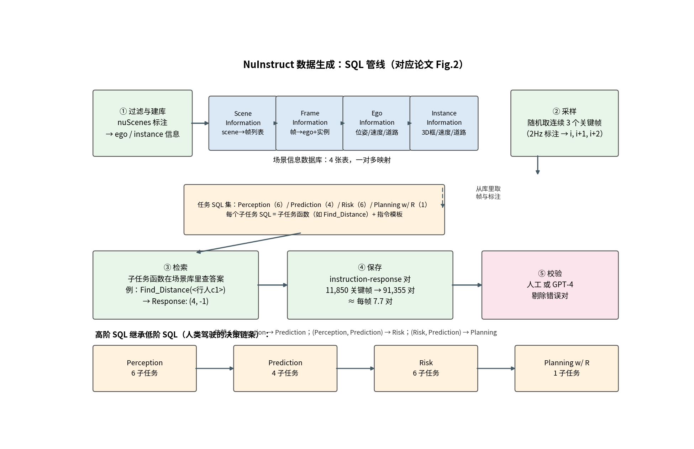
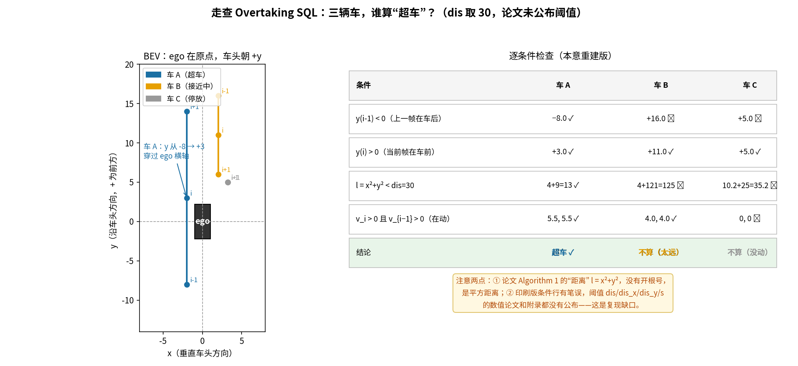
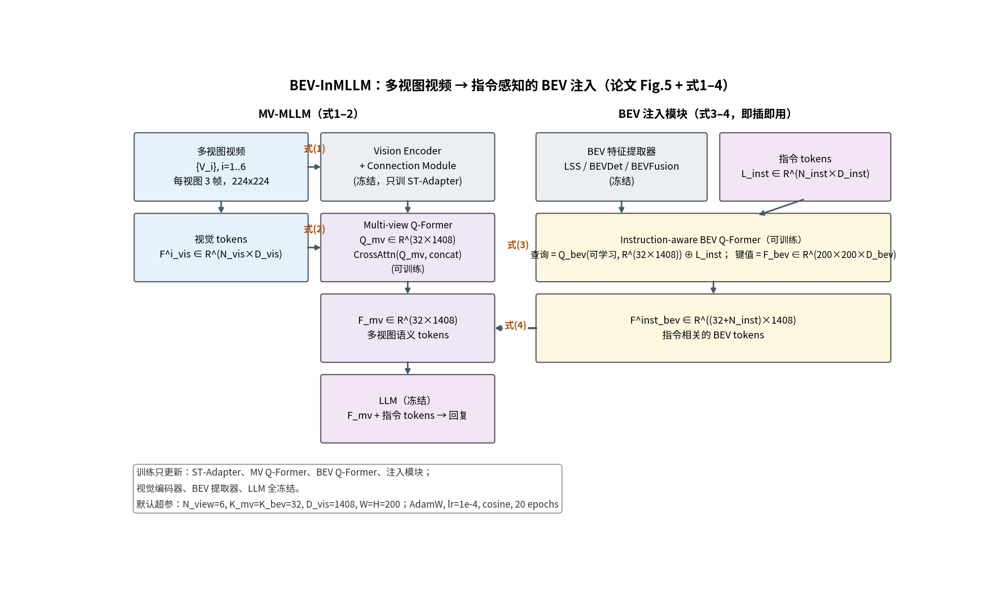

# 答案是查出来的，不是标出来的：NuInstruct 用 SQL 把驾驶问答变成数据库查询

> **信息块**
> - **论文**：Holistic Autonomous Driving Understanding by Bird's-Eye-View Injected Multi-Modal Large Models（NuInstruct / BEV-InMLLM）
> - **作者**：Xinpeng Ding, Jianhua Han, Hang Xu, Xiaodan Liang, Wei Zhang, Xiaomeng Li（注：arXiv 元数据把第二作者写成 "Jinahua Han"，论文内页为 "Jianhua Han"；官方仓库 README 的 BibTeX 里作者名有多处拼写错误，此处以论文内页为准）
> - **会议**：CVPR 2024；arXiv:2401.00988，只有 v1（2024-01-02），无更新版本
> - **链接**：https://arxiv.org/abs/2401.00988
> - **代码**：https://github.com/xmed-lab/NuInstruct —— 名义上公开，实际只有标注 JSON（且 train.json 是个 134 字节的 git-lfs 指针，训练集标注需另行拉取；无 SQL 生成代码、无模型训练代码）
> - **一句话核心洞见**：这篇论文真正的赌注不在模型，而在数据——它把驾驶问答的"正确答案"从"人写出来的句子"变成"对标注数据库的一次查询"，数据集的规模于是只受限于已有的 3D 框标注；模型部分（BEV-InMLLM）则验证了一个区分：多视图视频给 MLLM 的是"看起来像什么"，BEV 给的是"在哪里、有多远"，后者才是距离/位置敏感任务的承重墙。

91,355 个问答对，没有一个是人写的，也没有一个是 GPT 生成的。每一个回答都是从一个数据库里查出来的——字面意义上的查：一个叫 `Find_Distance` 的函数，输入一个实例 ID，返回 `(4, -1)` 这样的坐标。这就是 NuInstruct 敢自称 "holistic" 的底气来源，也是读这篇论文时最值得先想明白的一件事：当答案是算出来的，数据集的"质量"就不再是"标注员认不认真"的问题，而变成"查询规则写得对不对"的问题。整篇论文的长处和短处，几乎都可以从这句话推出来。

这篇解读先讲数据（因为它是这篇论文真正的贡献），再讲模型。数据的部分会细到伪代码的每一行——因为这里的每一行都是一次建模决策。

## 91,355 个问答对是怎么"长"出来的？先看五步管线

论文 Fig.2 把生成过程画成五步（重绘见下图）。先别被 "SQL-based" 这个词唬住：它不是真的 SQL，没有 `SELECT ... WHERE`，而是一套按"查表"组织的 Python 式伪代码。作者借 "SQL" 这个名字想表达的是**声明式**：你描述"要什么"，而不是"怎么标"。



**图**：NuInstruct 数据生成的五步管线（对应论文 Fig.2）。关键在 ① 建库和 ② 采样：先把 nuScenes 的标注整理成四张互相引用的表，之后的一切都只是查表。

**第 ① 步：过滤与建库**。把 nuScenes 的原始标注倒进四张表（论文 Fig.6(a)，补充材料 Table 7 列了字段类型）：

- **Scene Information**：scene ID → 该场景的帧 ID 列表；
- **Frame Information**：frame ID → ego 信息 ID + 该帧所有实例的信息 ID 列表；
- **Ego Information**：ego 在某一帧的位姿、朝向、速度、所在道路、相机信息；
- **Instance Information**：某个实例在某一帧的类别、属性、全局/局部平移与旋转、速度、所在道路、**在各个相机里的 2D 框位置（Camera Pos）**。

四张表之间全是一对多映射（scene→frames→ego/instances）。这一步做完，nuScenes 就从"一堆标注文件"变成了一个"可以按任意条件查询的场景数据库"。后面所有的"智能"，都建立在这四张表上——这是一个值得记住的结构：**数据集的上限在这里就已经定死了**，因为任何问答对能问的，都不能超出这四张表里存的东西。比如 Limitations 里承认的"没有红绿灯信息"，不是生成时忘了，而是表里本来就没存。

**第 ② 步：采样**。随机取连续的 3 个关键帧（nuScenes 标注频率 2Hz，所以是 i, i+1, i+2，覆盖 1 秒）。注意这里的采样单位是"三帧一组"，不是单帧——因为 Prediction 和 Risk 任务需要看运动趋势，单帧算不出速度和方向。论文一共采样了 11,850 个关键帧，来自 850 个视频。

**第 ③ 步：检索**。这一步是全文最有信息量的部分，下一节单讲。

**第 ④ 步：保存**。11,850 帧 → 91,355 对，平均每帧产出约 7.7 个问答对。过滤后得到 55,204 个互不相同的实例，在所有关键帧里共出现 295,828 次，平均每帧约 24.96 个实例。

**第 ⑤ 步：校验**。"人工或 GPT-4 剔除错误对"——论文只给了这一句话。**删了多少、什么算错、人工和 GPT-4 各看了多少，全部没说。** 这是数据部分第一个诚实标注的缺口：一个宣称 "reliable" 的管线，最后的质量关没有留下任何可核查的数字。

## 17 个子任务 SQL：先把"人类开车时在想什么"翻译成查表语句

论文把四个大任务按人类驾驶员的决策顺序排布：**Perception（看见）→ Prediction（预判）→ Risk（识别危险）→ Planning with Reasoning（带理由的规划）**，共 17 个子任务。高阶任务的 SQL 继承低阶任务的 SQL——比如预测状态要先查距离，风险判断要先查预测，规划要查风险和预测。这个继承关系（论文 Fig.2 里的蓝色虚线）是整套设计里最漂亮的想法：**任务之间的依赖被显式地写成了代码依赖**，而不是像大多数多任务数据集那样只是把几个任务堆在一起。

每个子任务 SQL = 一个子任务函数 + 一句指令模板。比如 Distance 子任务：函数 `Find_Distance(<instance>)`，模板是 "What is the distance between \<instance\> and the ego car? Please use the format as (x,y) where …"。

补充材料的 Algorithm 1–17 把 17 个函数全写出来了。挑三个最有代表性的看：

**Algorithm 1（Distance）**，五行：
```
I_i = query(T_ins, i)                      # 查实例表
ins = <cn,x1,y1,x2,y2> = I_i['Camera Pos'] # 取它在某相机的 2D 框
(x, y) = I_i['Local-T']                    # 取它在 ego 坐标系下的位置
l = x² + y²
return l
```
注意最后一行：**距离 l = x² + y²，没有开根号**。这是平方距离。论文正文和图里展示的回答如 `(4, -1)`、`(-6.15, -0.07)` 是 (x, y) 坐标对本身，不是 l——`Find_Distance` 在 Fig.3 的例子里返回的是坐标。所以 Algorithm 1 的返回值 l 和实际指令模板要的东西（"Please use the format as (x,y)"）对不上：函数返回标量 l，模板要的是坐标对。这是伪代码和实际实现之间的第一处裂缝，说明附录的算法是事后整理的示意，不是真实运行的代码（真实代码也不公开，无从对证）。

**Algorithm 11（Overtaking，超车）**是风险任务的核心，值得完整走查一遍。它的输入是三帧（i−1, i, i+1）和一个距离阈值 dis。对第 i 帧里的每个实例，查它在 i−1 帧的位置和速度，然后判断一组条件。论文印出来的条件行是：

```
if M_{i−1}[d][0] < 0 and M_{i−1}[d][0] > 0 and ...
```

**同一个量既小于 0 又大于 0——这是印刷错误，不可能成立。** 从上下文重建，它本意应该是：该物体在 ego 坐标系下的纵向坐标 y 从负（车后）变正（车前），即"从自车后面跑到了前面"，同时距离在阈值内、速度为正。下面这张图按这个本意，用三辆车的具体数字把判定过程走一遍：



**图**：Overtaking SQL 在一个三帧场景上的走查。车 A 的 y 从 −8 变到 +3，穿过 ego 横轴，被判为超车；车 B 虽然也在靠近，但距离项 l=125 超出阈值 dis=30；车 C 没动，直接排除。注意阈值 dis 的具体数值论文和附录都没公布——这是复现缺口。

这个走查暴露了 SQL 生成范式的三个真相：

1. **"超车"在这里是一个纯运动学定义**：y 变号 + 距离近 + 在动。它不理解"超车意图"，也不看转向灯。一个在相邻车道正常行驶、恰好从你身边经过的车，和一个恶意别车的超车，在这个定义下没有区别。数据集的"风险"标签，测的是运动学模式识别，不是风险理解。
2. **所有阈值（dis、dis_x、dis_y、速度阈值 s）都是超参数，但论文一个都没公布数值。** 附录给了 17 个算法的伪代码，却没给任何一个阈值的取值。这意味着即使拿到标注数据，你也复现不出完全一样的问答对——"scalable and reliable"的 "reliable" 在这里打了折扣。
3. **答案的正确性完全继承标注的正确性**。nuScenes 的 3D 框如果标偏了，查出来的 (x,y) 就偏了，而第 ⑤ 步校验删掉的只是"明显错误"，系统性的小偏差会原样进入数据集。

**Algorithm 17（Planning with Reasoning）**把"规划"还原成了模板填空：
```
R = {每种风险: 查出风险实例}   # 调 Algorithm 11–16
m = Motion Ego(i, i+1)          # 自车下一帧位移
s = Status Ego(i, i+1)          # 自车状态变化
return {R, s, m}
```
然后按模板拼成句子："There are \<行人\> crossing … hence the ego car should stay still …"。**所谓的"带理由的规划"，理由部分就是把风险实例的名字填进 "hence" 后面。** 这解释了为什么这个任务用 BLEU 评估（论文 Table 2）：参考答案本身就是模板生成的，BLEU 测的是模型输出和模板的 n-gram 重合度。一个模型只要学会"There are … hence the ego car should …"这个句式，BLEU 就不会太难看。这不是对规划能力的测量，是对模板拟合的测量——论文没有明说，但从生成方式可以直接推出来。

## BEV 是怎么喂给语言模型的？为什么不能直接拼特征

数据讲完，看模型。BEV-InMLLM 要解决的问题很具体：当时的 MLLM（BLIP-2、MiniGPT-4）都是单图输入的，而 NuInstruct 的输入是 6 视角 × 3 帧的视频，且很多任务对距离/位置敏感（"最近的物体"、"距离自车多远"）。

作者做了两层：

**第一层：MV-MLLM（式 1–2），让 MLLM 能吃多视图视频。** 对每个视角的视频 Vⁱ，先过冻结的视觉编码器 + 连接模块得到视觉 tokens：

$$F^i_{vis} = f_{connect}(f_{vision}(V^i)) \in \mathbb{R}^{N_{vis}\times D_{vis}} \quad (1)$$

然后把 6 个视角的 tokens 沿视角维拼起来，用 32 个可学习的 queries 做一次 cross-attention 压缩：

$$F_{mv} = \mathrm{CrossAttn}(Q_{mv},\, [F^1_{vis};\cdots;F^6_{vis}]) \in \mathbb{R}^{K_{mv}\times D_{vis}} \quad (2)$$

其中 $K_{mv}=32$，$D_{vis}=1408$。这一步的几何动作是：**把 6×N_vis 个视角相关的 tokens，压成 32 个视角无关的"多视图语义 tokens"**。32 个 queries 像 32 个探针，每个探针通过注意力从所有视角里捞自己关心的东西。注意这里只训练 MV Q-Former，视觉编码器和 LLM 都冻结——这是典型的"别动预训练知识"的保守策略。

**第二层：BEV 注入（式 3–4），补上空间信息。** 作者的论证是：多视图视频特征擅长"看起来像什么"，但遮挡严重、距离感差；而 BEV 特征（来自预训练的 LSS/BEVDet/BEVFusion，200×200 的网格）把物体的位置和尺度摆得明明白白。关键的设计选择是**不从头训练 BEV 提取器**（那需要大量 vision-language 数据对齐），而是冻结它，只训练一个轻量的"注入模块"把 BEV 翻译成 LLM 能懂的 tokens：

$$F^{inst}_{bev} = \mathrm{CrossAttn}(Q_{bev} \oplus L_{inst},\, F_{bev}) \quad (3)$$

$$F_{mv} = F_{mv} + \mathrm{CrossAttn}(F_{mv},\, F^{inst}_{bev}) \quad (4)$$

其中 $Q_{bev} \in \mathbb{R}^{32\times 1408}$ 是可学习的 BEV queries，$L_{inst}$ 是指令 tokens，$\oplus$ 是拼接，$F_{bev} \in \mathbb{R}^{200\times 200\times D_{bev}}$。



**图**：BEV-InMLLM 的数据流与张量形状。左列是 MV-MLLM（式 1–2），右列是 BEV 注入模块（式 3–4）。训练时只更新四个轻量模块，其余全部冻结。

## 式（3）为什么要把指令 tokens 拼进查询里？"指令感知"到底感知了什么

式（3）是这篇论文模型部分最值得细看的一行。标准的 Q-Former（BLIP-2 式）做法是：可学习的 queries 去 cross-attend 视觉特征，把视觉信息"捞"出来。这里作者把**指令的 tokens $L_{inst}$ 也拼进了查询**：查询变成 $[Q_{bev}; L_{inst}]$，共 $32 + N_{inst}$ 个。

几何上这是在干什么？Cross-attention 里，查询决定"去哪里看"，键值决定"有什么可看"。32 个可学习的 $Q_{bev}$ 是任务无关的探针——它们在训练中学会的是"一般来说 BEV 里哪些位置值得看"。而指令 tokens（比如 "What is the closest object to the back of the ego car?"）是**任务相关的探针**：它的每个 token 自带语义，"back" 这个 token 的向量天然就会和 BEV 网格中自车后方区域的特征算出更高的注意力分数。两者拼在一起，等于同时派出了"通用侦察兵"和"带着任务简报的向导"。

输出 $F^{inst}_{bev} \in \mathbb{R}^{(32+N_{inst})\times 1408}$ 里，前 32 行是通用 BEV 摘要，后 $N_{inst}$ 行是"被指令重新加权过的 BEV 摘要"——注意后 $N_{inst}$ 行的第 $j$ 行，本质上是"指令的第 $j$ 个 token 去 BEV 里看了一圈之后带回来的东西"。

这个设计有没有用？论文 Table 6(b) 给了干净的消融（MiniGPT-4 backbone，spatial MAE / whole）：不用 $L_{inst}$（只用 $Q_{bev}$ 查 BEV）是 15.3 / 20.1，加上指令 tokens 后是 13.9 / 21.5。**空间任务的 MAE 降了 1.4，整体涨了 1.4**——在一个 17 个子任务的基准上，这是实打实的提升，说明"让查询知道问题问的是什么"确实帮 BEV 特征过滤掉了无关区域。

## 式（4）为什么是加法而不是拼接？残差形式的两个理由

$$F_{mv} = F_{mv} + \mathrm{CrossAttn}(F_{mv},\, F^{inst}_{bev})$$

这里查询是 $F_{mv}$（32 个多视图语义 tokens），键值是 $F^{inst}_{bev}$（指令相关的 BEV tokens），算完 attention 再**逐点加回** $F_{mv}$。为什么是加不是拼？

第一个理由是工程性的：加完之后形状不变（还是 $32 \times 1408$），LLM 那边不用改任何东西，注入模块真正做到了"即插即用"——论文反复强调的 plug-and-play 就落在这一个加号上。拼接到 64 tokens 也不是不行，但那就动了 LLM 输入的预算。

第二个理由是语义上的：残差形式把 BEV 信息定位成"修正项"。$F_{mv}$ 本来已经是从多视图视频里提炼出的场景理解，加上 $\mathrm{CrossAttn}(F_{mv}, F^{inst}_{bev})$ 等于说"在你原有理解的基础上，补上 BEV 告诉你的空间修正"。如果 BEV 特征是噪声（比如 BEV 提取器在某个场景失效），attention 的输出可以学得很小，模型退化回纯 MV-MLLM——残差给了模型一条"忽略 BEV"的退路。拼接没有这条退路。

论文 Table 6(d) 比较了"往哪注入"：注入到 $F_{mv}$（MV Q-Former 的输出，32 tokens）vs 注入到 $\underline{F}_{mv}$（6 视角拼接的原始 tokens）。结果是注入到 $F_{mv}$ 更好：spatial 13.9 vs 15.1，whole 21.5 vs 20.8。但论文给的解释读不通——原文说 "$\underline{F}_{mv}$ 是被过滤过的视觉 tokens，丢失了很多空间信息"，可 $\underline{F}_{mv}$ 明明是**过滤前**的拼接特征，被 Q-Former 过滤掉空间信息的是 $F_{mv}$ 才对。**解释的方向和符号的定义对不上，这是论文写作上的一个瑕疵。** 更合理的重建是：往 $F_{mv}$（32 个已提炼的语义 tokens）注入时，cross-attention 的查询是干净、低维、语义集中的，学起来更容易；而往几千个原始 tokens 里注入，查询本身又长又杂，BEV 修正信号被稀释了。论文的数字可信，解释存疑——这是"作者这里的解释站不住"的一个实例，依据就是符号定义和解释文字的直接矛盾。

## 承重结构：消融表指出的真正功臣

论文 Table 5 把子任务按信息依赖重分成四组（Table 4）：Temporal（速度/运动/状态）、Multi-view（实例数/同路）、Spatial（距离/运动/状态/最近）、Holistic（风险/规划）。然后逐个拿掉模块：

| 模型 | Temporal (MAE↓/Acc↑) | Spatial (MAE↓/Acc↑) | Whole↑ |
|---|---|---|---|
| (a) 完整 BEV-InMLLM | 3.7 / 32.8 | 13.9 / 32.9 | 22.2 |
| (b) 去掉视频（只用单帧） | 7.4 / 28.5 | 14.2 / 30.8 | 21.0 |
| (c) 去掉多视图（只用单视角） | 5.2 / 31.2 | 14.4 / 32.5 | 21.6 |
| (d) 去掉 BEV | 6.0 / 31.4 | **18.0** / 30.0 | 20.1 |
| (e) 基线 MiniGPT-4 | 10.3 / 25.8 | 20.8 / 27.6 | 12.4 |

（数字引自论文 Table 5，backbone 为 MiniGPT-4。）

读法：**去掉 BEV（d）是空间任务上掉得最多的**——MAE 从 13.9 涨到 18.0，掉了 4.1，而去掉视频只掉 0.3、去掉多视图只掉 0.5。这就是承重结构：BEV 注入是空间敏感任务的顶梁柱，多视图和视频是重要但可替代的。反过来，时间任务上掉得最多的是去掉视频（b）：MAE 从 3.7 涨到 7.4，翻倍——时序信息只能来自视频，BEV 补不上。这个交叉模式很干净，说明三个模块的分工和论文的宣称一致，没有哪个模块是摆设。

Table 6(a) 还比较了 BEV 提取器的强度：LSS（13.9/21.0）< BEVDet（13.6/21.3）< BEVFusion（13.2/21.5，**用了激光雷达**）。BEV 提取器越强，注入效果越好——这意味着 BEV-InMLLM 的性能上限绑在 BEV 感知模型上，注入模块本身只是翻译层。Table 6(c)：$K_{bev}$ 从 16 加到 32，spatial 提升 0.6（14.5→13.9）；从 32 加到 64，几乎不动（13.9→13.9，whole 21.5→21.6）。32 是性价比拐点，论文默认 32 是合理的。

## 怀疑式阅读：数字、基线和没说的事

**"9% 提升"到底指什么。** 摘要说 "9% improvement on various tasks"。Table 3 里，MiniGPT-4 的 Planning（BLEU）从 26.3 涨到 35.6（+9.3），BLIP-2 从 24.9 涨到 33.3（+8.4）。所以 9% 大致对应**规划任务 BLEU 的点数提升**，不是 17 个子任务的平均。摘要的措辞 "on various tasks" 有夸大之嫌——距离任务（Dis）BLIP-2 从 29.3 降到 23.3（MAE 降 6.0，约 20% 相对提升），其实更亮眼，但作者挑了规划任务的数字放在摘要。这是一个修辞选择，不是造假，但读者应该知道 9% 的分母是什么。

**MAE 的计算藏了一个格式陷阱。** 补充材料 7.3：对 MAE 任务，先用正则表达式从模型回复里提取数值 $\hat{m}$，再算 $|\hat{m} - m|$。这意味着**模型必须一字不差地输出 "(x,y)" 格式**，否则正则提不出来——提不出来算多少？论文没说（记 0？记最大误差？丢弃该样本？）。格式合规性和数值准确性被混在了一个数字里。如果 BEV-InMLLM 只是比基线更听话（更遵守格式），MAE 也会"提升"，而这和空间理解能力无关。论文没有做"只看格式合规率"的对照，这是实验设计的一个缺口。

**风险任务的 MAP 怎么算的，没写。** 论文说把风险子任务转成目标检测问题、用 MAP 评估，但匹配标准（IoU 阈值？框是 2D 框，用哪个相机的坐标系？）在正文和附录里都没有。风险回答的格式是 "\<car\>[c1,x1,y1,x2,y2]; …" 这样的文本，解析成框再算 MAP 的细节完全缺失——这个数字别人复现不了。

**基线选择：三个 MLLM 全是 2023 年上半年的。** BLIP-2、MiniGPT-4、Video-LLaMA，冻结 LLM、只训适配器。这种"轻量微调"设定下，基线本来就没被充分训练（20 epochs，lr 1e-4，batch size 未公布）。一个自然的质疑是：如果给基线同样的 BEV 特征、端到端全量微调，差距还剩多少？论文没有这个对照。BEV 带来的提升里，有多少是"特征"的功劳，有多少是"基线没训好"的衬托，分不开。

**数据划分 7.5:1.5:1.5 是按视频分的**——"We split the all videos into training/validation/testing sets"。按视频分是对的（避免同一视频的三帧同时出现在训练和测试集）。但论文没说是否按场景（scene）分：如果同一个 nuScenes scene 的不同 video 片段被分到训练和测试，场景级的信息泄露是可能的。nuScenes 的 850 个视频来自 1000 个 scenes（每个 scene 20 秒），"video"在这里大概率就是 scene 的片段。论文没澄清，记为未确认。

**发布仓库的三个硬伤**（已用 git 和 Python 实测，不是推测）：
1. 仓库里**没有 SQL 生成代码，也没有模型训练代码**，只有标注 JSON 和论文插图。所谓的 "SQL-based method" 不可复现。
2. `train.json` 只有 134 字节，是个 git-lfs 指针文件——训练集标注（约 287MB）需要额外执行 git-lfs 拉取，仓库 clone 下来默认没有。
3. 发布标注里的 2D 框坐标是**像素坐标**（如 `<car>[c1,1142,366,1600,569]`），而论文所有图示和模板描述都用归一化坐标（如 `[c4,0.422,0.528,0.621,0.839]`）。实测 val.json 前 3000 条里像素坐标和归一化坐标混杂（593 处像素式 vs 339 处归一化式）。用这份数据训练前必须自己统一，做论文里没提的预处理。

**附录算法与正文的裂缝**：Algorithm 1 返回标量 l 但模板要 (x,y) 坐标对；Algorithm 11 条件行印刷错误；Algorithm 17 的 risks 字典里把 'Overtaking' 写成 'Overking'；Fig.7–12 的指令模板里 "camre"（camera）、"plain"（plan）、"stragihtforward" 等拼写错误原样出现在"模型输出示例"里——这些错字如果来自真实的模型输出，说明模型在复读模板错字；如果来自论文排版，说明作者没校对。无论哪种，都说明这些定性图的可信度要打折扣。

## 作者的底牌：为什么是 CVPR 2024 能接住的工作

从组织方式反推，作者手里有三张牌。第一张是**数据生成的可扩展性论证**：SQL 查表生成 vs 人工标注（Talk2BEV 是人工的）vs ChatGPT 生成（DriveGPT4 用的）——"reliable and scalable" 这个说法是写给审稿人看的，直接回应了当时 MLLM 驾驶数据"要么贵、要么幻觉"的痛点。第二张是**BEV 注入的即插即用**：不碰预训练权重、只训四个小模块，任何 MLLM 都能接——审稿人无法用"训不动"来质疑。第三张是**任务设计的完整性**：Perception→Prediction→Risk→Planning 的链条，对应了审稿人心里"自动驾驶就该这么分层"的默认模型，Table 1 那张"我们全有、别人都没有"的大对勾表就是为这个准备的。

三张牌里最硬的是第一张。模型部分（BEV 注入）本质上是一个特征翻译层，增量有限；但"把问答变成查表"的数据范式，后续被一系列驾驶 VQA 工作沿用。时间坐标也帮了忙：2024 年初正是 MLLM 往驾驶迁移最热的时候，一个 91K 的多视图视频指令数据集，投 CVPR 的时机是对的。

## 可以带走的想法

**第一个想法：把"标注"重写成"查询"，数据集的瓶颈就从人力变成了规则。** NuInstruct 的 17 个 SQL 本质上是 17 条"什么算正确答案"的形式化定义。以后你要做一个新任务的数据集，可以先问自己：这个任务的答案能不能写成对已有标注的确定性函数？如果能，你就不需要标注员，只需要写规则和校验规则的人。这个思路迁移到任何有结构化标注的领域都成立（比如把 HOI 检测的标注查成问答对）。代价是：规则的上限就是数据集的上限——规则没建模的东西（意图、红绿灯、遮挡推理），数据集里永远不会有。

**第二个想法：给 MLLM 加新模态时，"翻译层+冻结"比"重训"更可能是正确的第一步。** BEV-InMLLM 的全部可训练参数就是两个 Q-Former 加一个 cross-attention 注入，BEV 提取器和 LLM 都冻结，照样在空间任务上拿到最大的单项提升（MAE 13.9→18.0 的反向证明）。这说明预训练 BEV 特征和 LLM 表征之间的"语言鸿沟"没有想象中宽，一个轻量翻译层就能搭桥。以后给 MLLM 接任何新的传感器模态（4D 雷达、事件相机），先试试冻结+翻译层，可能是性价比最高的起点。

**第三个具体问题：阈值去哪了。** 17 个 SQL 里的 dis、dis_x、dis_y、s 等阈值，论文一个数值都没给。如果有人想复现 NuInstruct 的生成管线（比如扩展到红绿灯任务），第一个要填的坑就是这些阈值——而阈值的选择直接决定风险任务的标签分布（阈值越大，"超车"样本越多）。一个值得做的工作是：系统地研究这些规则阈值对下游模型性能的影响，回答"数据集的规则参数在多大程度上决定了模型的'能力'"。这个问题 NuInstruct 自己没有回答，但它把问题摆到了台面上。
