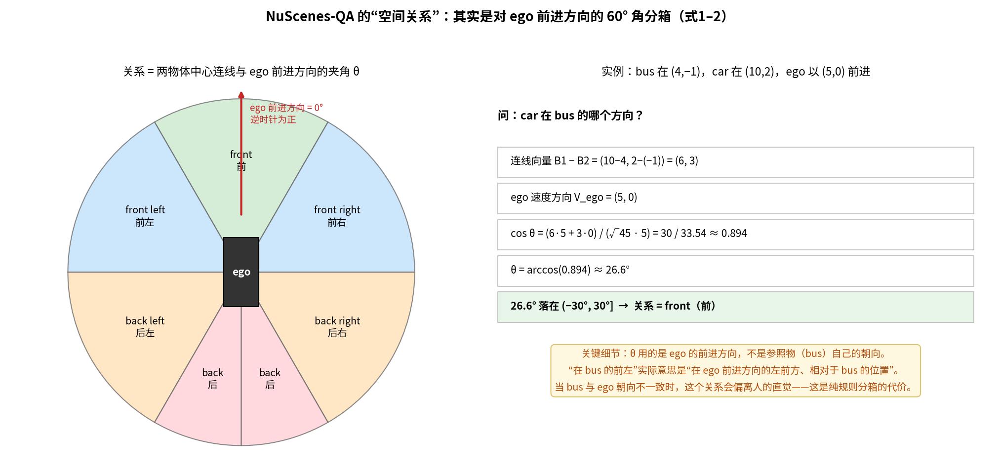
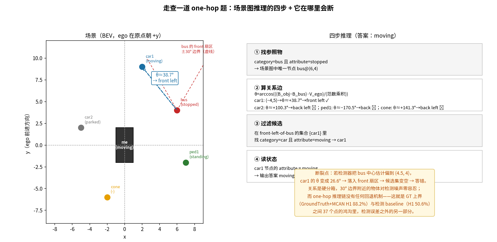
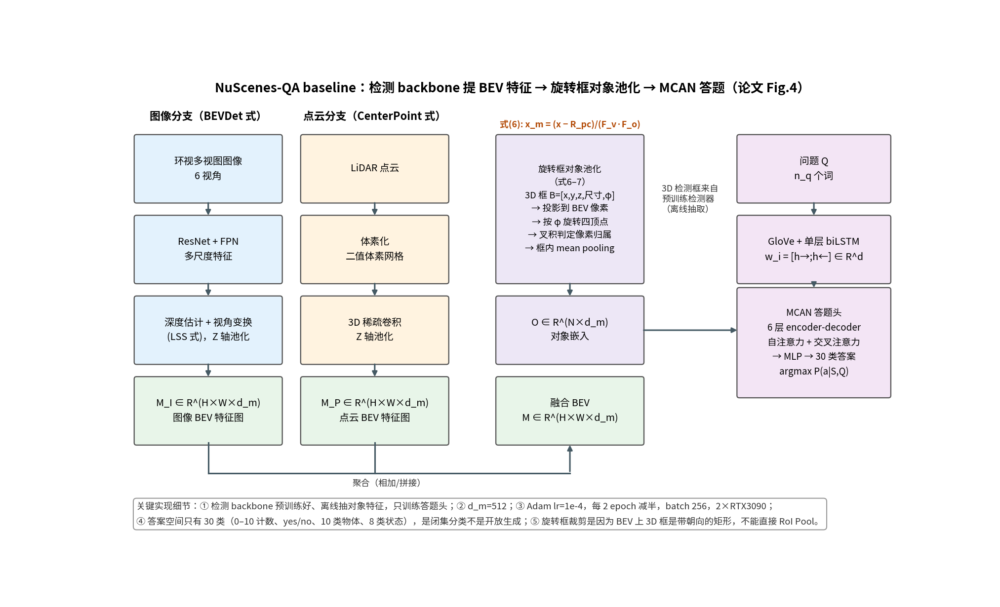

# 问题是模板套出来的，答案是查表查出来的：NuScenes-QA 到底在测什么

> **信息块**
> - **论文**：NuScenes-QA: A Multi-Modal Visual Question Answering Benchmark for Autonomous Driving Scenario
> - **作者**：Tianwen Qian, Jingjing Chen, Linhai Zhuo, Yang Jiao, Yu-Gang Jiang（复旦大学）
> - **会议**：AAAI 2024；arXiv:2305.14836，v2（2024-02-20），初版 2023-05-24
> - **链接**：https://arxiv.org/abs/2305.14836
> - **代码**：https://github.com/qiantianwen/NuScenes-QA —— 已克隆核查：训练/测试代码（MCAN、BUTD）、数据集读取、answer_dict.json 均在；问答标注与 CenterPoint 特征需从 Google Drive 另行下载；训练代码 2024-10-11 才发布，比论文晚了近一年
> - **一句话核心洞见**：这是一篇"基准"论文，它真正的技术动作只有一个——把 nuScenes 的 3D 框标注变成场景图，再把场景图变成 46 万道"选择题"；它的全部结论（多模态互补、检测是瓶颈、计数最难）都可以从"答案是查表查出来的"这句话推出来，而它的全部捷径也都藏在这句话里。

先看一道题，感受一下这个基准在要求什么：

> *"Are there any moving pedestrians in front of the stopped bus?"*（停着的公交车前面有没有正在走的行人？）

人答这道题，眼睛要干三件事：找到那辆停着的公交车，找到所有行人，判断每个行人的运动状态和相对位置。机器要答对，论文给的 baseline 走的是另一条路：先用 3D 检测器把所有物体框出来变成 BEV 上的特征，再用一个答题头（MCAN）在 30 个固定答案里选一个。**注意，还不是开放回答，是 30 选 1。** 理解了这一点，后面所有的数字就都好理解了。

这篇解读的重心按"数据集/基准"类论文的要求放：数据怎么造、它实际测什么、有哪些捷径、标注一致性如何。模型的 baseline 部分只讲到够用为止。

## 为什么需要一个新的 VQA 基准：现有基准的三个"不"

2023 年之前，VQA 领域能用的 3D 问答数据集是 ScanQA（41K 对，800 个室内场景）、CLEVR3D（60K 对，1129 个室内场景）等（论文附录 Table 5）。它们有三个和自动驾驶对不上的地方：

1. **模态不对**：它们是纯点云或纯图像，而驾驶场景是相机+激光雷达同时工作；
2. **时间不对**：它们是单帧静态场景，而驾驶数据是连续多帧的数据流，物体在动、自车也在动；
3. **内容不对**：它们是室内静态场景，而街景是室外，有运动的前景（车/人）和静态的背景（路/建筑）混在一起。

NuScenes-QA 的卖点就是把这三个"不"补上：基于 nuScenes，34,149 个视觉场景（即 nuScenes 的 keyframe），459,941 个问答对，其中训练 376,604（28,130 场景）、测试 83,337（6,019 场景），平均每个场景 13.5 对。训练用 nuScenes 的 train split，测试用 val split——划分沿用了 nuScenes 自带的数据集划分，这一点是干净的。

## 场景图：节点是现成的，边是算出来的

数据构造分四步（论文 Fig.2）：① 建场景图 → ② 手写问题模板 → ③ 实例化问答对 → ④ 后处理过滤。

场景图的节点直接来自 nuScenes 标注：物体类别、属性（attribute，如 moving/stopped/parked/standing）、3D 框，**外加一个特殊节点——自车 ego，在问题里被称为 "me"**。边（物体之间的空间关系）是 nuScenes 没有的，作者自己定义了 6 种：front、front left、front right、back、back left、back right，计算方式是论文唯一的"公式创新"：

$$\theta = \cos^{-1}\frac{(B_1[:2]-B_2[:2])\cdot V_{ego}[:2]}{\|B_1[:2]-B_2[:2]\|\,\|V_{ego}[:2]\|} \quad (1)$$

其中 $B_i = [x,y,z,x_{size},y_{size},z_{size},\phi]$ 是第 $i$ 个物体的 3D 框（取前两个分量，即 BEV 中心坐标），$V_{ego} = [v_x, v_y, v_z]$ 是自车速度。然后按 $\theta$ 落在哪个 60° 区间决定关系（式 2）：$(-30°,30°]$ 为 front，$(30°,90°]$ 为 front left，$(-90°,-30°]$ 为 front right，$(90°,150°]$ 为 back left，$(-150°,-90°]$ 为 back right，其余为 back。自车前进方向定义为 0°，逆时针为正。

## 把式（1）算一遍：θ 到底在量什么

公式里的每个量：$B_1[:2]-B_2[:2]$ 是"从物体 2 指向物体 1"的 BEV 向量；$V_{ego}[:2]$ 是自车速度在 BEV 上的投影；点积除以模长再取反余弦，就是两个向量的夹角。**它量的是"物体 1 相对物体 2 的方位"，但方位的零点是自车的前进方向。**

具体算一个（数字已用 Python 独立验算）：bus 在 (4,−1)，car 在 (10,2)，自车以 (5,0) 前进。问：car 在 bus 的哪个方向？

连线向量 = (10−4, 2−(−1)) = (6, 3)；$\cos\theta = (6\cdot5+3\cdot0)/(\sqrt{45}\cdot5) = 30/33.54 \approx 0.894$；$\theta = \arccos(0.894) \approx 26.6°$，落在 $(-30°,30°]$ → 关系为 front。

**图**：NuScenes-QA 的六种"空间关系"，其实是对自车前进方向的 60° 角分箱。右半是一个完整的手算实例（已独立验算）。注意 26.6° 这个例子离 30° 边界只有 3.4°——边界附近的判定对噪声极敏感，后文会回到这一点。

## "在 bus 的前左"到底是谁的前左：一个设计妥协

这里藏着整个数据集最重要的概念细节，论文没有强调，但每个用这个数据集的人都应该知道：

**关系是按自车（ego）的前进方向锚定的，不是按参照物自己的朝向。** "car 在 bus 的前左"实际意思是"car 位于 bus 处、朝自车前进方向的左前方"。如果 bus 和自车朝向一致，这符合直觉；但如果 bus 是横着停的（比如垂直于自车方向），"bus 的前左"按人的理解应该是 bus 车头（它自己的朝向）的左前方，而数据集给的却是自车朝向的左前方——**两者能差出 90°**。

为什么这样设计？因为简单：自车速度 $V_{ego}$ 每个场景只有一个，而每个参照物的朝向 $\phi$ 各不相同，按参照物朝向算关系要处理 6 种关系 × N 个参照物的朝向归一化。作者选了计算上最省事的方案，代价是关系的语义在参照物转向时偏离人的直觉。这是一个诚实的设计妥协，但它意味着：**模型在这个数据集上学到的"空间关系"，是"以自车为罗盘的方位"，不是"物体之间的相对方位"**。论文的 Limitation 部分承认了"只用空间位置定义关系，缺少丰富的语义关系"，但没有点出这个锚定问题。

还有一个技术细节：式（1）用的是 $\arccos$，值域只有 $[0°,180°]$，没有正负——但式（2）的分箱用了负角度（front right 是 $-90°$ 到 $-30°$）。所以实际实现里必然用了带符号的版本（比如 atan2 看叉积的正负），论文的公式是简化写法。代码仓库里没有数据生成部分的代码（只有训练代码），无从对证具体实现——这是和 NuInstruct 一样的问题：**生成管线的代码没有公开**。

## 66 个模板：16 种语义，5 类问题，0 跳或 1 跳

问题模板是手写的。附录 Table 6 列出了全部：5 种问题类型（existence 存在、counting 计数、query-object 问物体、query-status 问状态、comparison 比较），16 种语义模板，每种语义又有若干措辞变体，总共 66 个模板。比如 existence 的一跳模板：

> *"Are there any \<A2\>\<O2\>s to the \<R\> of the \<A\>\<O\>?"*
> *"There is a \<A\>\<O\>; are there any \<A2\>\<O2\>s to the \<R\> of it?"*

其中 \<A\> 是属性（moving/stopped/…）、\<O\> 是物体类别、\<R\> 是 6 种关系之一。实例化时用深度优先搜索给参数赋值，再在场景图上推导出标准答案，同时扔掉"病态"问题（比如场景里根本没有 car 却问 car 的问题）。

**zero-hop vs one-hop**：zero-hop 不需要物体间推理，如 "What is the status of the \<A\>\<O\>?"；one-hop 需要一步空间推理，如 "What is the status of the \<A2\>\<O2\> to the \<R\> of the \<A1\>\<O1\>?"。注意"一跳"在这里特指"经过一条关系边"，不是常识推理。

**后处理删掉了什么**（论文 Fig.2 步骤 ④，写得比较坦率）：一是把 ego 称为 "me" 带来的语法问题（"the me"、"there is a me" 改写）；二是删掉不合理的属性+物体组合（"standing cars"、"moving traffic cones"、"parked pedestrians"）；三是**计数答案大于 10 的问题直接删掉**——这是为了平衡答案分布，但副作用是答案空间被硬截断在 0–10（代码 answer_dict.json证实：计数类答案只有 '0' 到 '10'）。

问题长度 5–35 词（论文 Fig.3(a)），答案分布和类别分布论文称"平衡"（Fig.3(b)(c)）。但"平衡"是就答案类别而言，**模板本身的语言多样性作者自己承认不足**（Limitation 第四条）。

## 走查一道 one-hop 题：四步推理，以及它在哪里会断

用一个具体场景把 one-hop 推理走通。场景（BEV 坐标，自车在原点朝 +y，速度 (0,5)）：bus@(6,4) stopped；car1@(2,9) moving；car2@(−5,2) parked；pedestrian@(7,−2) standing；cone@(−2,−6)。

问题：*"What is the status of the moving car to the front left of the stopped bus?"*

- **① 找参照物**：场景图中 category=bus 且 attribute=stopped 的节点 → bus@(6,4)。
- **② 算关系边**：对每个其他物体算 $\theta$（已独立验算）：car1 的连线向量 (−4,5)，$\theta \approx +38.7°$ → front left ✓；car2 ≈ +100.3° → back left ✗；行人 ≈ −170.5° → back ✗；锥桶 ≈ +141.3° → back left ✗。
- **③ 过滤候选**：front-left-of-bus 的集合是 {car1}，其中 category=car 且 attribute=moving → car1。
- **④ 读状态**：car1 的 attribute = moving → 答案 "moving"。

**图**：一道 one-hop 题的完整走查（角度已独立验算）。下方的"断裂点"值得细看：如果检测器把 bus 中心估计偏 1.5 米（(6,4)→(4.5,4)），car1 的 $\theta$ 从 38.7° 变成 26.6°，掉出 front-left 扇区进入 front，候选集变空，整道题直接答错。**关系是硬分箱，30° 边界附近的物体对检测噪声零容忍，而 one-hop 推理链没有任何回退机制。**

这个断裂点解释了 Table 1 里一个关键现象：GroundTruth+MCAN 的 one-hop 准确率（Object H1 88.2%）和检测版（50.6%）之间差了 37 个点——检测误差是主因，但硬分箱的脆弱性是放大器。

## Baseline 在干什么：检测 backbone + 旋转框池化 + MCAN

论文的 baseline 不是一个新模型，是"现有 3D 检测 + 现有 VQA"的拼接（论文 Fig.4）。理解它的三段式，就理解了后面所有数字的来源：

**第一段：提 BEV 特征。** 图像分支（BEVDet）：ResNet+FPN 提多尺度特征 → 估计每个像素的深度 → LSS 式的视角变换把特征 lift 到 3D 体素 → 沿 Z 轴池化，得到 M_I（H×W×d_m）。点云分支（CenterPoint）：体素化 → 3D 稀疏卷积 → Z 轴池化，得到 M_P。两路聚合为 M，d_m = 512。多模态版用 MSMDFusion。

**第二段：旋转框对象池化（式 6–7）。** 这是 baseline 里唯一有点技术含量的地方。3D 检测框 B=[x,y,z,尺寸,phi] 投影到 BEV 上是一个带朝向的矩形，不能直接用 RoI Pooling。所以先把框参数按 x_m = (x − R_pc)/(F_v·F_o) 换算到 BEV 像素坐标（式 6），再按朝向角 phi 把矩形的四个顶点转出来（式 7），然后用叉积算法判断每个像素是否落在旋转矩形内，最后对框内像素做 mean pooling，得到对象嵌入 O（N×d_m）。几何上就是"把斜着的框摆正了再平均"。

**第三段：答题头。** 问题经 GloVe + 单层 biLSTM 编码，和对象嵌入一起喂给 MCAN（6 层 encoder-decoder，自注意力+交叉注意力），MLP 投影到 30 类答案取 argmax。训练时检测 backbone 预训练好、对象特征离线抽好，只训练答题头（Adam，lr=1e-4，每 2 epoch 减半，batch 256，2 张 RTX 3090）。

**图**：baseline 三段式（对应论文 Fig.4）。注意两个事实：检测 backbone 冻结、只训答题头——baseline 的视觉能力上限被锁死在检测器上；答案空间只有 30 类，是闭集分类。

## 数字：三层对比，差距说明了什么

论文 Table 1（测试集，top-1 准确率）可以读成三层：

| 模型 | 总体 | 存在 H0/H1 | 计数 H0/H1 | 物体 H0/H1 | 状态 H0/H1 | 比较 H0/H1 |
|---|---|---|---|---|---|---|
| Q-Only（盲模型） | 53.4 | 81.7/77.9 | 17.8/16.5 | 59.4/38.9 | 57.2/48.3 | 79.5/65.7 |
| CenterPoint+MCAN | 59.5 | 87.7/82.3 | 22.5/19.1 | 71.3/49.0 | 66.6/56.3 | 82.4/68.8 |
| MSMDFusion+MCAN（最好） | 60.4 | 89.0/82.3 | 23.4/21.1 | 75.3/50.6 | 69.0/56.2 | 78.8/68.8 |
| GroundTruth+MCAN（上界） | 84.3 | 99.6/95.5 | 52.7/39.9 | 99.7/86.2 | 99.3/95.4 | 99.7/90.2 |

（数字引自论文 Table 1；H0=zero-hop，H1=one-hop。）

三层差距各自说明一件事：

**Q-Only 53.4% vs 最好 60.4%：视觉信息只贡献了 7 个点。** 盲模型（只看问题不看图）就能拿到 53.4%，说明模板化问题的语言先验很强——存在类 H0 上 Q-Only 直接 81.7%。一个不看图的模型在"有没有"这类问题上八成答对，意味着答案分布里藏着很强的可学习偏置（比如某些属性+物体的组合在数据里绝大多数回答 "yes"）。论文用这个差距论证"模型不能只靠语言捷径"，但反过来读：**这个基准的语言捷径大到 53.4% 的上限**，视觉真正挣来的只有 7 个点。

**最好 60.4% vs GT 上界 84.3%：24 个点的鸿沟，主体是感知误差。** 把检测换成真值（GroundTruth+MCAN，用 GloVe 编码真值物体和状态），总体从 60.4% 跳到 84.3%。这说明 baseline 答错的题目里，大部分是因为检测器没框对、框偏了（还记得 30° 边界的脆弱性吗），而不是答题头不会推理。**这个基准目前主要测的是 3D 检测质量，而不是视觉推理能力**——至少对 zero-hop 题目是这样（GT 的 H0 几乎全是 99%+）。

**GT 上界内部：one-hop 仍然难，尤其是计数。** 即使给完美感知，计数 H1 只有 39.9%，物体 H1 86.2%，比较 H1 90.2%。计数是全场最难的类型（最好 baseline 23.2%），这和 2D VQA 的历史一致：计数需要精确的实例分割/去重，而 mean pooling 的对象嵌入把实例捏在了一起。**GT 上界和检测版在 H1 上的差距（比如计数 39.9 vs 21.1），才是这个基准真正留给"推理研究"的空间。**

还有一个横向结论：LiDAR 版（CenterPoint 59.5）> 相机版（BEVDet 57.9），融合版最好（60.4）。论文的解释是点云擅长结构和空间关系、图像擅长纹理，而这个基准考的正是结构和空间关系——这个解释是自洽的，也是可信的。

## 捷径清单：四条不靠真实能力拿分的路

按 skill 的要求，把"不靠真实能力拿分"的路一条条列出来，每条都给出证据：

**捷径一：语言先验。** Q-Only 在存在类 H0 上 81.7%、比较类 H0 上 79.5%。模板是固定的 66 个，问题的前四个词分布（论文附录 Fig.5）高度集中。一个模型可以学会"看到 'Are there any …' 就先猜 yes"之类的模板级偏置。论文称答案分布"平衡"（Fig.3(b)），但类别平衡不等于条件平衡——给定问题模板后答案的条件分布可能很偏，而这正是 Q-Only 能拿 53.4% 的原因。**论文没有报告"给定模板下答案的条件熵"，这是数据分析的一个缺口。**

**捷径二：关系是自车锚定的固定分箱。** 6 种关系 = 自车前进方向周围的 6 个 60° 扇区。模型不需要理解"参照物"，只需要学会"以自车为原点的极坐标方位"。更直接地说：one-hop 题里的关系推理，可以被约化成"查物体落在哪个扇区"——而扇区是全局固定的。这比真正的"物体间相对关系推理"容易得多。

**捷径三：闭集 30 分类。** 答案空间只有 30 个（代码 answer_dict.json 已核实：0–10、yes/no、10 类物体、8 类状态）。计数被截断在 10 以内（后处理删掉了 >10 的问题）。模型永远不需要生成开放文本，也永远不需要处理"11 个"这种情况。**这是一个分类基准，不是问答基准**——论文标题里的 "Question Answering" 应该读成"30 选 1"。

**捷径四：检测质量主导分数。** 如上所述，60.4%→84.3% 的 24 个点主要来自把检测换成真值。在这个基准上刷分，最有效的办法可能是换一个更强的检测器，而不是改进推理。这对"基准"的定位是个两难：它想测推理，但分数主要反映感知。

## 消融：三个反直觉的结果

论文的消融（CenterPoint+MCAN）有三个值得细看的结果：

**检测框坐标特征反而降分（Table 2）。** 把 3D 框坐标经 MLP 拼进对象嵌入：检测版 59.5%→58.9%（−0.6%），真值版 70.8%→84.3%（+13.5%）。论文的解释是两点：检测框有噪声、点云本身位置表达能力已够强。这个解释是合理的，而且它顺带证明了**点云 BEV 特征的位置信息已经饱和**——再加显式坐标是冗余的。但注意真值版 +13.5% 的巨大提升：干净的位置信息对答题头帮助极大，只是检测器给不出干净的框。这又回到了"感知是瓶颈"的结论。

**旋转框裁剪 > 外接矩形（Table 3）**：59.5% vs 58.8%。论文的解释是很多物体（bus、truck）在 BEV 上是细长的，外接矩形会框进大量背景导致特征过平滑。这个 0.7% 的差距虽小，但方向符合几何直觉，可信。

**Mean pooling > Max pooling（Table 4）**：59.5% vs 58.9%。论文的解释是 max pooling 关注纹理、mean 保留整体结构，而这个基准考的是结构。这个解释有点事后——0.6% 的差距在随机种子波动范围内（论文没报告种子数和方差），**不宜过度解读**。这是全篇实验的一个通用弱点：所有表格都没有误差棒，0.6%–1.4% 量级的结论都没有统计显著性支撑。

## 标注一致性：全自动 = 零随机噪声 + 系统性偏差

这是基准类论文必须回答的问题，NuScenes-QA 的答案很特殊：**它没有人工标注，所以传统意义上的"标注一致性"（annotator agreement）不存在**。问答对是确定性规则生成的：同样的场景图和模板，生成一万次也是同一个答案。随机噪声为零。

但一致性不等于正确性，风险转移到了三个系统性偏差上：

1. **关系定义的偏差**（前文详述）：自车锚定的 60° 分箱在参照物转向时偏离人的直觉。这是规则本身的语义偏差，会系统性地影响所有 one-hop 题。
2. **模板语言的偏差**：66 个模板、16 种语义，语言多样性低。模型可能学到的是"模板→答案"的映射，而不是"场景→答案"的映射。Q-Only 的 53.4% 就是证据。
3. **继承 nuScenes 标注的偏差**：3D 框标得不准的地方，答案就跟着错，而后处理只删"不合理组合"，不校验几何正确性。**没有任何人工抽查比例被报告**——和 NuInstruct 一样，质量控制环节没有留下数字。

论文自己在 Limitation 里承认了四点：只关注前景物体、忽略物体与背景的关系（如"前面哪个停车位是空的"问不了）；问题对人类来说可能太简单，缺少因果推理；关系只有空间位置、缺少语义关系；模板生成导致语言多样性不足。这四条是诚实的，但都指向同一个根因：**全自动生成的上限就是规则的上限**。

## 作者的底牌与时间坐标

2023 年 5 月，3D VQA 只有室内的、单模态的、几万对规模的数据集。作者（复旦的 VQA 组，之前做过 Scene Graph Refinement Network for VQA）手里的牌是：nuScenes 现成的 3D 框标注 + CLEVR 式的模板生成方法论（论文明确说 inspired by CLEVR）。把这两样拼起来，得到"第一个自动驾驶 VQA 基准"的 claim——这个 claim 在当时是成立的，AAAI 2024 接收也是合理的。

实验设计的底气在于**三层对比的完整性**：Q-Only（下界）、检测 baseline（现状）、GroundTruth（上界）。这个三层结构让论文的每个结论都有参照系，是这篇论文写作上最扎实的部分。相比之下，NuInstruct 的 Table 3 只有"基线 vs 我们"，没有上界参照。

## 可以带走的想法

**第一个想法：基准的"难度"要拆成"感知难度"和"推理难度"，NuScenes-QA 的拆法值得借鉴。** GroundTruth 上界（84.3%）这个设计，把"检测不行"和"推理不行"分开了。以后你设计任何多阶段系统的评测，都应该给每个阶段一个 oracle 上界：否则你永远不知道分数低是因为哪一段。NuScenes-QA 的 24 点鸿沟直接告诉后人：先把检测做好，再谈推理——这比一句"未来工作"实在得多。

**第二个想法：硬分箱的关系是定时炸弹，软关系可能是出路。** 30° 边界的脆弱性（fig-onehop 下半）说明，用离散关系边做场景图推理，误差会在边界处被放大。一个可迁移的改进是把关系变成连续的：不把边存成 "front left"，而是存 $(\theta, d)$ 连续值，让模型自己学分箱；或者在评测时给边界附近的样本加容差。这个想法不只适用于 VQA，任何"规则离散化连续量"的评测都有同样的问题。

**第三个具体问题：模板条件下的答案偏置没有被量化。** Q-Only 53.4% 说明偏置存在，但论文没有报告"给定模板/给定物体组合时答案的条件分布"。一个值得做的测量是：对每个模板，计算答案的条件熵，找出那些"不看图也能猜对"的模板子集，然后看模型在这些子集 vs 干净子集上的表现差异。这能回答"这个基准到底在多大程度上被语言捷径污染"——论文没有回答，但数据全在，任何人都可以做。
