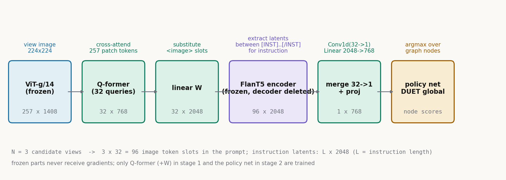
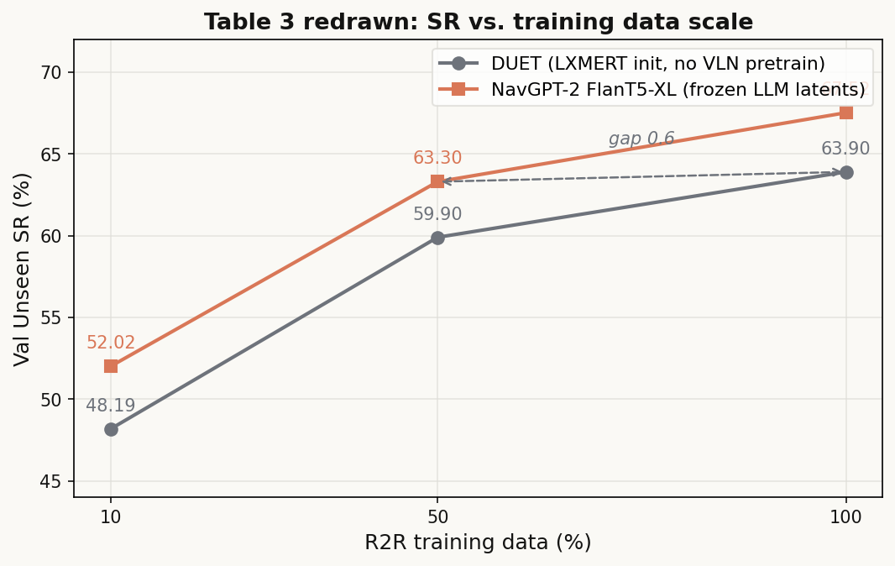

# 推理归 LLM，动作归策略网：NavGPT-2 用一次诚实的分工追上导航专家

**全局编号**：73
**论文**：NavGPT-2: Unleashing Navigational Reasoning Capability for Large Vision-Language Models
**作者**：Gengze Zhou, Yicong Hong, Zun Wang, Xin Eric Wang, Qi Wu
**会议**：ECCV 2024（arXiv:2407.12366，v2 修订于 2024-09-20）
**链接**：https://arxiv.org/abs/2407.12366
**代码**：公开，https://github.com/GengzeZhou/NavGPT-2（MIT 协议；本文核对了官方仓库代码）
**一句话核心洞见**：NavGPT-2 真正的赌注不是"让 LLM 学会走路"，而是一次分工——冻结的 LLM 只负责把多视角图像变成高质量的视觉-语言表示（导航时连 decoder 都删掉不用），走路这件事全部交给一个轻量的拓扑图策略网络；"导航推理"文本只是训练视觉对齐模块的辅助目标和给人看的副产品，从不参与决策。

---

## GPT-4 讲得头头是道，为什么走不到终点

先看一个让当时所有人都难堪的数字。R2R（Room-to-Room）是视觉-语言导航（VLN）的标准基准：智能体读一段自然语言指令，在 Matterport3D 的室内场景连通图里走，终点离目标 3 米内算成功。2024 年中，VLN 专家模型（如 DUET）在 test unseen 上成功率约 69–72%。而直接把 GPT-4 拿来当导航智能体的 NavGPT（一代），val unseen 成功率只有 **34%**，SPL 29。同一张表里，NavGPT-2（XL，w/ PREVALENT）在 test unseen 上做到 **71%**。从 34 到 71，差的不是"知识"——GPT-4 的常识和语言理解所有人都服气——差的是一双能走路的"手"。

论文引言把 LLM 进 VLN 的两条路都判了死刑，判词值得逐句看，因为这两条路的失败方式直接决定了 NavGPT-2 的形状。

**第一条路：zero-shot**。NavGPT、MapGPT、DiscussNav 的做法是：把每一步的观察用 BLIP-2 等 caption 模型翻成文字，用 GPT-3.5 把历史观察总结成文字，再写一个复杂的 prompt 让 GPT-4 读完输出动作。论文点了四个具体的伤：prompt 工程复杂且脆弱；每一步都要调一次大模型，贵；caption 和摘要两步转述必然丢信息；以及最要命的一句——"LLM 能否正确理解空间结构和物理运动的后果，仍然是个开放问题"。34% 对 72%，近 40 个点的差距，作者的结论是这条路"likely infeasible"。这不是修修补补能救的，是结构性的：LLM 预训练里就没有"身体"，它没见过"往左转 30 度之后视野会变成什么样"。

**第二条路：finetune LLM 当导航智能体**。LangNav、NavCoT、NaviLLM 把 LLaMA2-7B/Vicuna-7B 在 VLN 轨迹数据上微调，动作转成结构化文本做自回归训练。结果：NavCoT val unseen 40%，LangNav 46%，NaviLLM（7B，调得最好的）test 68%。即使把 70 亿参数的 LLM 在全量 R2R 数据上微调，离专家模型还是差一截。论文给了两个原因：VLN 数据太少，撑不起大模型微调；LLM 的预训练目标（预测下一个词）和 VLN 的训练目标（多视角图像与指令片段对齐）之间有鸿沟。更关键的是代价：**直接微调把 LLM 的通用语言能力洗掉了**——它不再能解释自己的决策、不能和人对话。而这恰恰是把 LLM 引进 embodied AI 最重要的动机之一。调完得到一个"黑盒"导航器，论文的措辞很直：这违背了初衷。

所以 2024 年中的局面是：LLM 推理强、动作弱；专家模型动作强、不会说话。NavGPT-2 的问题于是变成：在**不训练 LLM**的前提下，能不能把两边的长处拼起来？

## 作者的赌注：把"看"和"走"拆开，各用各擅长的

论文的回答是一个分工架构（Figure 2）：**VLM（冻结的 LLM + 可训的视觉对齐）负责"看"和"说"，导航策略网络负责"走"**。两个模块之间只传一种东西：LLM 编码器最后一层的隐表示。

这个赌注的底牌有三张。第一张是 InstructBLIP 已经验证过的：Q-former 这种 query-based 视觉重采样器，能在**不碰 LLM 参数**的情况下把图像对齐进冻结 LLM 的表示空间，BLIP-2、MiniGPT-4 都走通了。第二张是 DUET 验证过的：拓扑图 + 图感知注意力的策略网络是 VLN 上最有效的动作机制之一，带记忆、可回溯。第三张是成本：整个训练过程 LLM 和 ViT 始终冻结，只训 Q-former（约 1 亿参数量级）和一个 4 层 transformer 策略网络，论文称单卡 A100 跑完。这三张牌每一张都有前人背书，拼在一起的风险主要在一个地方：**LLM 编码器的隐表示里，到底有没有策略网络做决策需要的空间信息**？整篇论文的实验，本质上都是在回答这一个问题。

措辞上也可以看出作者的把握分布。摘要里 "we demonstrate""we eliminate" 都是强动词，对应表 1、表 3 这种硬数字；而 "strive to bridge""exploit a way" 这种软表达，出现在讲动机和框架的部分。作者对"分工"这个设计是有信心的，对"为什么这样分工就work"的机理解释则相对谨慎——后文会看到，消融实验其实暗示了一个比论文故事更微妙的真相。

## 32 个 query 到底在干什么：把一张图压成 LLM 读得懂的 token

这是全篇工程上最实在的一节。VLN 智能体每一步站在一个 viewpoint，周围有 N 个可走的候选节点，每个候选方向拍一张图。问题：怎么把 N 张图喂给一个**冻结的、只懂文本**的 LLM？

NavGPT-2 照搬 InstructBLIP 的 Q-former。对第 i 张候选视角图像 $o_i$：

1. 冻结的 ViT-g/14（EVA-CLIP）提视觉特征 $\mathcal{Z}^v_i = \text{ViT}(o_i)$。224×224 输入，patch 14×14，得到 256 个 patch token 加 1 个 CLS，共 257 个 token，每个 1408 维。
2. 32 个可学习的 query 向量 $\mathcal{Q}_i \in \mathbb{R}^{32 \times 768}$，**先和指令的文本 embedding 做自注意力**，得到"指令感知"的 query $\mathcal{Q}'_i$。这一步是 InstructBLIP 的关键设计：query 在去看图之前，先读一遍指令，知道自己要找什么。
3. $\mathcal{Q}'_i$ 再和 $\mathcal{Z}^v_i$ 做交叉注意力，从 257 个图像 token 里抽信息，输出还是 32 个 token。
4. 一个线性层 $W$ 把 768 维投影到 LLM 的维度（FlanT5-XL 是 2048），得到 $\mathcal{H}^v_i$：每张图 32 个"图像 token"。

为什么是 32 而不是直接把 257 个 patch token 喂进去？两个原因。第一，token 预算：N 个候选视角 × 257 = 每步上千个 token，LLM 上下文爆炸；32×N 则可控（N=3 时 96 个）。第二，query 是**可学习的瓶颈**：257→32 的压缩不是平均池化，而是"按指令需要"的信息筛选。32 这个数是 BLIP-2/InstructBLIP 沿用的，论文没做敏感性分析——这是个装饰性超参数，不是调出来的（代码配置 `num_query_token: 32` 写死）。

小例子帮你建立形状感。设某步有 N=3 个候选方向，指令 "Walk past the fireplace and stop at the dining table" 约 12 个词。Q-former 对每张图输出 32×768。注意这 32 个 query 是**同一组参数**用在 3 张图上（代码里 `query_tokens.expand`），但因为每张图的交叉注意力输入不同，输出的 32 个 token 内容不同。指令感知的自注意力让这 32 个 query 偏向"壁炉""餐桌"相关的视觉模式——这是后文"数据效率"的来源之一：图像 token 进 LLM 之前，已经被指令"预筛选"过一次。

## Prompt 里的机关：图像 token 插哪，指令从哪抠出来

Figure 3 的导航 prompt 是结构化文本，大意是：

> Candidate $i$, facing $a_i$, {direction} … [IMG]…[/IMG] … [INST] instruction [/INST] …

代码（`NavGPTThought.forward`）揭示了几个论文正文没细说的实现细节：

1. Prompt 里每个候选视角的位置预留了恰好 32 个 `<image>` 占位 token。代码用 `inputs_embeds[all_image_indices] = inputs_llm` 把 Q-former 输出的投影特征**直接替换**对应位置的词向量，并用 assert 保证占位符数量 $=$ 图像数 × 32，一个不多一个不少。
2. 方向信息 $a_i$ 以**纯文本**形式写进 prompt（"facing $a_i$"），LLM 靠读文本知道每个候选朝哪。这是个"技巧"而非"设计"：空间方向没有进任何几何编码，就是字符串。冻结 LLM 能读懂 "facing 30 degrees" 这种表述，靠的是预训练里的常识。
3. 指令的隐表示不是拿整句 prompt 的编码，而是**按 [INST]…[/INST] 的起止位置从编码器输出里抠出来**的一段：`instruct_embeds` 形状 (N, L, 768/2048)，L 是指令长度。也就是说，策略网络读到的"指令表示"，是 LLM 编码器在完整 prompt 上下文里（看过图像 token 之后）对指令词的 contextualized 表示，不是孤立的句子向量。

第 3 点很微妙：图像 token 和指令 token 在 LLM 编码器里做了**全层双向注意力交互**（FlanT5 编码器是双向的），抠出来的指令表示已经"看过"图像，抠出来的图像表示也已经"读过"指令。这种深度的图文融合，是后文表 6 里 FlanT5 大幅领先 Vicuna 的可能机制之一（见"表 6"一节）。

## 最关键的一抽：LLM 隐表示如何变成策略网络的输入

论文 3.1 节末尾这段是全文承重墙，值得逐行拆。记 LLM 为 $f_\phi$（参数 $\phi$ 冻结），对 FlanT5 这类 encoder-decoder 模型，取**编码器最后一层**的隐状态；对 Vicuna 这类 decoder-only，取最后一层的隐状态。

- 图像侧：$\mathcal{H}'^v = \{f_\phi(\mathcal{H}^v_i)\}^N_{i=1}$，即上面抠出来的每视角 32 个 token 的隐表示，形状 (N×32, C)，C=2048（XL）或 4096（XXL）。
- 文本侧：$\mathcal{H}'^l = f_\phi(\mathcal{W})$，即 [INST]…[/INST] 区间，形状 (N, L, C)。

然后"32 个 token 合成 1 个"：$\bar{\mathcal{H}}'^v = \text{MLP}(\mathcal{H}'^v)$。论文写的是 MLP，**代码默认却是 `llm_token_merge='linear'`，实现为 `nn.Conv1d(32, 1, kernel_size=1)`**——一个 1×1 卷积把 32 个通道压成 1 个，严格说是个线性加权，不是 MLP。这是个小的不一致，效果上都是"学一个 32→1 的加权"，但论文的措辞比实现听起来更强。另一个选项 `'mean'` 是直接平均池化，论文没报告用哪个更好。

代码里还有两个正文没提的细节：

1. `vp_proj`：Linear(C→768) + LayerNorm，把 LLM 的 2048/4096 维压到策略网络的 768 维。**这个投影层是在 stage 2 和策略网络一起训练的**，而 Q-former 在 stage 2 冻结（脚本 `--freeze_qformer`）。所以"视觉对齐"其实分两截：Q-former 在 stage 1 按推理数据调好后冻住，LLM→策略的维度桥接在 stage 2 现学。
2. `use_clip_img_emb` 选项可以把 CLIP CLS token 和 LLM 隐表示拼接，但**默认关闭**。表 1 的数字都是纯 LLM 隐表示跑出来的，这让"增益来自 LLM"的结论更干净。附录表 7 专门做了对照：给 DUET 换上同样的 EVA-CLIP-g 编码器，val unseen SR 只从 62 变到 63——证明 NavGPT-2 的提升不是视觉编码器升级带来的。


*图：N=3 时单步前向的 token 流向与形状。冻结模块（ViT、LLM）在任何阶段都不接受梯度；stage 1 只训 Q-former 与投影层 W，stage 2 只训策略网络与 vp_proj。自绘，脚本见同目录 fig-token-flow.py。*

这里必须点破一件事，因为它决定了你如何理解整篇论文的标题。**导航决策时，LLM 的 decoder 从不参与**。代码里 `NavGPTThought.__init__` 有三行很直白：

```python
if not config.output_thought:
    if config.model_type.startswith('flant5'):
        del self.Blip2InstructNav.t5_model.decoder
        del self.Blip2InstructNav.t5_model.lm_head
```

`output_thought` 默认 False。导航时 `forward_thought_per_step` 传 `text_outputs=None`，只跑编码器，返回隐表示；`output_text` 恒为 None。所谓"navigational reasoning"（自回归生成解释文本）只在两个地方出现：stage 1 训练 Q-former 时作为**辅助监督目标**，以及评测时另开 decoder 生成给人看的解释（human study）。**"Unleashing Navigational Reasoning Capability"这个标题，严格说应该读作"释放 LLM 隐表示中的导航信息"，而不是"让 LLM 边推理边走"**。推理文本从不进入决策通路——这是后文怀疑式阅读的总纲。

## 策略网络：拓扑图、公式 (1)(2) 与一次回溯

策略网络照抄 DUET 的 global 分支（论文自称"简化的 prevalent VLN policy"，脚本 `--fusion global` 即去掉 local 分支）。它解决 LLM 的两个硬伤：**长程历史建模**和**空间结构理解**。

**拓扑图记忆**。智能体边走边维护一张图 $\mathcal{G}_t$：走过的节点（visited）和见过但没去的邻居（frontier）。节点 embedding 的构造（论文公式 (1)）：

$$\mathcal{V}=\text{SelfAttn}\left(\frac{1}{M}\sum^{M}_{i=1}\left(\bar{\mathcal{H}}'^v_i+E^{d}_{i}+E^{s}_{i}\right)\right)$$

$M$ 是表示该节点的视角数。已访问节点：把该节点所有候选视角的特征平均；未访问节点：把"能看到它的那些已访问邻居"的对应视角特征平均。每个视角的特征是三项相加：LLM 隐表示 $\bar{\mathcal{H}}'^v_i$、方向 embedding $E^d_i$（代码：`gmap_pos_embeddings`，Linear(7→768)，7 维 = 4 维角度特征 + 3 维位置）、步骤 embedding $E^s_i$（代码：`Embedding(100, 768)`，记录这是第几步访问的；frontier 节点的 step id 为 0）。再加一个特殊的 stop 节点表示"停止"动作。

走一个三节点的小例子。智能体从 A 出发，看到候选 B、C，走向 B。在 B 看到候选 A、D。此时图里有：visited {A, B}，frontier {C（从 A 看到的）, D（从 B 看到的）}。C 的 embedding = 在 A 处朝 C 方向那个视角的特征（step embedding 为 0，因为没去过）；D 同理。如果之后发现 D 是死路，策略可以直接选 C，智能体按图中最短路走回去——**这就是"backtracking"，zero-shot LLM 方法做不到的事**，因为它们没有显式的图记忆，历史全靠文字摘要，越走越糊。

**跨模态编码与 GASA**（公式 (2)）。节点 embedding 先和指令隐表示做交叉注意力（GACAEncoder，4 层，`--num_x_layers 4`），再过图感知自注意力：

$$\text{GASA}(\mathcal{V})=\text{Softmax}\left(\frac{\mathcal{V}W_{q}(\mathcal{V}W_{k})^{T}}{\sqrt{d}}+A(\mathcal{E}_{t})\right)\mathcal{V}W_{v}$$

$A(\mathcal{E}_t)$ 是空间亲和矩阵：所有已观测节点两两之间的欧氏距离，经一个线性层（代码 `sprel_linear`）变成 attention bias 加在 logits 上。直观理解：普通自注意力只看"特征像不像"，GASA 额外加一项"离得近不近"——离得近的节点互相多 attend 一点。这是对导航图结构的显式归纳偏置，LLM 的隐表示里不一定有，策略网络在这里补上。

**动作预测**。GASA 输出过一个两层 FFN（代码 `ClsPrediction`：Linear→ReLU→LayerNorm→Linear→1），每个节点一个分数，取 argmax；已访问节点的分数被 mask 成 $-\infty$（鼓励探索，沿用 DUET）；选中目标节点后沿拓扑图最短路走过去。注意：**动作空间是"图上的节点"，不是"前后左右"**——这是 VLN 在 Matterport3D 连通图上的标准设定，也是 LLM 难直接处理、专家模型擅长的部分。

## 损失函数 (3)：BC 与 DAgger 各管什么

$$\mathcal{L}_{\text{BC}}=-\sum^{T}_{t=1}\log{\pi(v^{*}_{t}|\mathcal{W},\mathcal{G}_{t})},\quad \mathcal{L}_{\text{DAG}}=-\sum^{T}_{t=1}\log{\pi(\tilde{v}^{*}_{t}|\mathcal{W},\tilde{\mathcal{G}}_{t})}$$

$$\mathcal{L}=\lambda\mathcal{L}_{\text{BC}}+\mathcal{L}_{\text{DAG}},\quad \lambda=0.2$$

$v^*_t$ 是专家（最短路）的真值动作，$\tilde{v}^*_t$ 是智能体自己走出来的轨迹图 $\tilde{\mathcal{G}}_t$ 上、朝终点的最短路伪标签。BC（行为克隆）让模型模仿专家，DAgger 让模型在自己犯错走偏后的状态上也学到"如何纠正"。$\lambda=0.2$ 来自训练脚本的 `--ml_weight 0.2`，论文正文没给这个数——DAgger 占主导（权重 1 对 0.2），符合 VLN 领域"on-policy 纠偏比纯模仿重要"的经验。这是个沿用 DUET 训练框架的选择，不是新设计。

## 两阶段训练：10K 条 GPT-4V 推理数据到底训了什么

**Stage 1：视觉指令调优（只训 Q-former + 投影层 W）**。从 InstructBLIP 的 checkpoint（已在学术 VQA 数据上调过）初始化，ViT 和 LLM 全程冻结。训练数据是论文自己造的：从 R2R 训练集的真值轨迹上随机抽 **10K 个中间步骤**，把智能体朝向为中心的全景图（equirectangular 投影）喂给 GPT-4V，prompt 大意是"你是室内导航 AI，描述当前环境并说出下一步方向"（附录 B 给了全文），得到单步导航推理文本。然后用标准的自回归目标训练：给定图像和指令，预测这段推理文本。**历史建模被刻意丢掉了**——每条样本都是孤立的单步，不含轨迹历史。

论文称训了 200K steps、batch 8、AdamW（$\beta_1=0.9, \beta_2=0.999$，weight decay 0.05），前 1000 步从 $10^{-8}$ warmup 到 $10^{-5}$ 再 cosine 衰减到 0。但官方仓库的 stage-1 配置（`r2r_navgpt_ft_xl.yaml`）写的是 `max_epoch: 20, batch_size_train: 1, accum_grad_iters: 8`——10K 样本、有效 batch 8，20 个 epoch 只有约 **25K steps**，和论文的 200K 对不上。这是论文与代码的一处不一致，可能是配置更新滞后，也可能是论文数字有误，标"未确认"。

想清楚 stage 1 到底在优化什么：loss 只作用在**推理文本的 token** 上，梯度回传只更新 Q-former 的 query 和投影层。LLM  frozen，所以这个过程 = **"教会 Q-former 抽出能让冻结 LLM 讲出导航推理的视觉特征"**。它不直接优化任何导航动作。Q-former 学会的是"导航相关的视觉信息筛选器"。

**Stage 2：策略学习（只训策略网络 + vp_proj）**。VLM（含 Q-former）全部冻结，batch 2、lr $10^{-5}$、200K iters、单卡 A100。最好成绩的模型还加了 PREVALENT 的合成数据增强（脚本 `--aug prevalent_aug.json`）。注意表 1 里 "w/ PREVALENT" 和不带的两行：XL 的 test SR 71 vs val unseen 68——PREVALENT 增强带来约 2-3 个点的提升，和 DUET 系列的老经验一致。

## 表 1 精读："消除差距"的真实口径

表 1 是全文的主结果表，single-run，R2R。关键几行（test unseen，SR / SPL）：

| 方法 | SR | SPL |
|---|---|---|
| DUET+ScaleVLN（真 SOTA，更多环境数据） | 77 | 68 |
| BEVBert（多一个深度传感器） | 73 | 62 |
| **NavGPT-2-XXL w/ PREVALENT** | **72** | **60** |
| NavGPT-2-XL w/ PREVALENT | 71 | 60 |
| DUET（w/o local，本文基线） | 69 | 59 |
| NaviLLM（Vicuna-7B 微调） | 68 | 60 |
| NavGPT（GPT-4 zero-shot） | — | —（val unseen 34） |

论文正文说："beats the original DUET by 3% in SR on the test unseen split"（72 vs 69），"outperforms NaviLLM by 4% SR"（72 vs 68），"eliminate the gap between SOTA VLN specialists"。前两个是实的。第三个要打折：**表里真正的 SOTA 行是 DUET+ScaleVLN 的 77**，它用了 HM3D+Gibson 扩展的训练环境（原 61 个 MP3D 场景之外）。NavGPT-2 的 72 和它的差距还有 5 个点。论文的限定语是 "on the same training scale"——在相同训练规模下追平/超过 DUET。这个限定在正文 4.2 里写了，但摘要的 "eliminate the gap … and state-of-the-art VLN specialists" 没加限定，读摘要的人会得到更强的印象。这是典型的摘要口径大于正文口径，审稿人大概也注意到了，所以正文措辞收敛了些。

基线构造本身是诚实的：DUET（w/o local branch）和 NavGPT-2 共享**完全相同的策略网络架构**、相同训练数据量，唯一区别是语言分支——基线用 12 层 LXMERT 初始化的 transformer，NavGPT-2 用冻结 LLM 的隐表示。砍掉 local 分支只掉约 2 个点（test 69→67），说明 global 分支是主导，简化合理。附录表 7 进一步把 DUET 的视觉编码器也换成 EVA-CLIP-g（和 NavGPT-2 同款），SR 62→63 几乎不动——**把"视觉编码器升级"这个混淆变量排除了**，增益确实来自 LLM 表示。这是全篇实验设计里最干净的一处。

## 表 5：拿掉策略网络，SR 从 67.5 掉到 21.5

消融表 5 是全文的承重墙（val seen / val unseen，FlanT5-XL）：

- Model#1（完整）：val unseen SR **67.52**，SPL 56.01
- Model#2（w/o policy model）：val unseen SR **21.46**，SPL 10.23
- Model#3（w/o 推理预训练的 Q-former）：val unseen SR 66.75，SPL 57.10

Model#2 的做法：删掉 Q-former 和策略网络里所有的图文交叉注意力层，只留一个 GASA 层 + 一个 FFN 做动作预测——**逼冻结的 LLM 自己从隐表示里解码动作**。结果 SR 从 67.5 崩到 21.5，轨迹长度从 13.7 米膨胀到 26.7 米（智能体在乱转）。论文的结论是"frozen LLM incapable of inferring effective representations that indicate a correct action"。

这个消融有两个读法。论文的读法：LLM 隐表示里没有现成的动作信息，必须有个专家策略网络来"翻译"。更尖锐的读法（我的推断）：这个消融同时删了 Q-former 的交叉注意力，图像 token 本身的质量也降级了，变量没完全隔离；但即便如此，21.5% 的崩溃幅度也说明**线性探针式的解码远远不够**，动作预测需要深度的跨模态-图结构联合建模。这正是"LLM 推理强但动作弱"最直接的证据，也是整个分工架构存在的理由——**策略网络是承重设计，不是装饰**。

Model#3 更有意思：去掉 stage 1 的推理预训练（Q-former 用 InstructBLIP 原版），val unseen SR 只掉 0.77 个点（67.52→66.75），**SPL 反而涨了 1.09 个点**（56.01→57.10）。论文说"brings slight improvement to the success rates"，只提了 SR 没提 SPL 的反向变化。诚实地讲：**10K 条 GPT-4V 推理数据对导航性能的贡献是 marginal 的**。它的主要价值不在决策，而在让模型能生成人类可读的解释（human study 那节）。这和"最关键的一抽"一节的判断一致：推理文本是副产品，不是决策通路。这个消融是论文里最接近"证伪自己标题"的一组数字，作者如实报告了，值得肯定。

## 表 6：为什么更大的 Vicuna 反而更差

四个 LLM 变体（val unseen SR）：FlanT5-XL（1.5B 可用参数）67.52，FlanT5-XXL（5B）71.31，Vicuna-7B 53.77，Vicuna-13B **48.28**。Vicuna-13B 参数是 FlanT5-XXL 的两倍多，SR 反而低 23 个点，且 13B 比 7B 还差。规模定律在这里完全失效。

论文引用 InstructBLIP 的解释：FlanT5 系在"选择题"式任务上强，Vicuna 系在开放式生成上强，而 VLN 动作预测更接近前者。这个解释不算错，但有个更机制化的读法（推断，论文没写）：**FlanT5 是 encoder-decoder，编码器双向注意力**——图像 token 在每一层都能 attend 到指令 token，指令 token 也能 attend 到图像 token，图文在进入策略网络前已经做了深层融合。**Vicuna 是 decoder-only，因果掩码**——如果 prompt 里图像 token 排在指令文本之前，图像位置的隐表示根本看不到后面的指令（只能看到前面的 token）。Q-former 虽然做了指令感知的预筛选，但 LLM 内部少了一轮深度融合。代码里对 Vicuna 取的是"last decoder layer"的隐状态，因果结构的信息瓶颈是先天的。

这个负结果其实是全文信息量最大的发现之一：**决定导航性能的不是 LLM 的参数规模，而是它的注意力结构是否允许图文双向融合**。对后来者选 backbone 有直接指导意义——也是本文"与本课题关联"一节要借用的结论。

参数量脚注也值得拆开："1.5B 和 5B"是因为导航时只用编码器（FlanT5-XL 全模型 3B，编码器约一半；XXL 11B→约 5B），decoder 被删掉省显存。论文把这点写进了脚注，代码 `del decoder` 对上了。

## 表 3 数据效率：一条平行上移的曲线，不是加速学习

数据效率实验（表 3，val unseen SR）：DUET（LXMERT 初始化、无 VLN 预训练）vs NavGPT-2-XL，在 10%、50%、100% R2R 训练数据上：

| 数据量 | DUET | NavGPT-2 |
|---|---|---|
| 10% | 48.19 | 52.02（+3.83） |
| 50% | 59.90 | 63.30（+3.40） |
| 100% | 63.90 | 67.52（+3.62） |

论文的 claim："NavGPT-2 用 50% 数据（63.30）达到 DUET 用 100% 数据（63.90）的性能"。数字上成立，差 0.6 个点。

但看曲线的形状：两条线几乎**平行上移**，差距恒定在 3.4–3.8 个点。


*图：表 3 重绘。NavGPT-2 在 50% 数据上的 63.30 与 DUET 在 100% 数据上的 63.90 相差 0.6 个点；两条曲线平行，说明是常数项的起点优势。自绘，脚本见同目录 fig-data-efficiency.py。*这说明 LLM 隐表示带来的是一个**常数项的起点优势**（更好的初始表示），而不是"每个样本学得更快"的加速。真正的"数据效率"如果是后者，差距应该随数据量缩小而放大（小数据时优势更大）。10% 数据时优势 3.83，100% 时 3.62——没有放大。所以更准确的表述是：**冻结 LLM 提供了一个更强的表示起点，让策略网络在任何数据量下都高出约 3.5 个点**。这依然有价值（预训练表示的经典作用），但和"学会了更高效的学习算法"是两回事。

三个怀疑点。第一，**单 seed**：训练脚本 `seed=0` 写死，全文没报告多 seed 均值方差。0.6 个点的"打平"在单次运行下无法判断显著性；3.5 个点的恒定差距相对可信，但严格说也缺误差棒。第二，对比的 DUET 是**弱化版**（无 VLN 预训练，附录 C 明说"to align the same training schema"），真正的 DUET（含预训练）在 100% 数据上是 72（表 1）不是 63.9。所以"省 50% 数据"是相对于弱化基线成立的。第三，10% 数据的采样方式论文没细说（是否分层、是否固定子集），复现时这是个坑。

## 表 4 与人工评测：泛化与"说话"质量

**跨数据集泛化**（表 4，zero-shot，R2R 训练的模型直接测）：

- RxR-EN（指令更细、轨迹更长、语言风格不同）：DUET SR 25.07 → NavGPT-2-XXL 28.75，**+3.68**。nDTW 37.77→38.50。提升实在但不大，说明 LLM 表示对"换一种说法的指令"有帮助，但 RxR 的长轨迹对谁都难。
- HM3D（全新环境、不同连通图结构）：DUET SR 25.60 → NavGPT-2 **47.20**，+21.6；NE 从 6.60 降到 4.91。差距拉得很大。论文 4.5 节后半讨论了连通图偏差（connectivity bias）问题——R2R 的图结构有特定模式，专家模型容易过拟合图的先验；LLM 表示更依赖视觉-语言本身，所以换环境掉得少。这组数字是"LLM 表示更通用"最有力的证据，但 4.5 节后半的完整论述我因源站限流未能读到原文，此处只报告数字，机制解释标未确认。

**导航推理的人工评测**（表 2）：30 个 held-out 样本，10 个志愿者，0–3 分制打 Accuracy / Informativeness / Rationality。GPT-4V（老师）：2.31 / 2.95 / 2.34；NavGPT-2-XL（学生）：1.66 / 1.93 / 1.78。蒸馏损失明显，尤其是 Informativeness（2.95→1.93）。30 个样本很小，打分主观，结论只能是定性的："能讲出大致靠谱的推理，但细节和信息量比 GPT-4V 差一截"。论文如实给了老师和学生的对照，没有只报学生的绝对分，这点诚实。

Figure 1 左侧的例子（ fireplace、dining room、hallway 的相对位置识别，推断下一步并预测期望观察）展示了解释文本的理想形态；右侧展示多轮交互（用户中途干预、主动求助、回答视觉问题）——这些是冻结 LLM 保留语言能力的直接红利，finetune 路线拿不到。

## 怀疑清单：这篇论文哪里还没说透

1. **信息瓶颈的真相**。标题说"释放导航推理能力"，但决策通路里没有任何自回归推理：动作只读编码器最后一层隐状态。论文没有回答：隐表示里到底是"推理"在起作用，还是"更好的视觉-语言对齐表示"在起作用？表 6（FlanT5 对 Vicuna 的大比分领先）和表 5-Model#3（推理预训练几乎不加分）都指向后者——**起作用的是双向融合的表示质量，不是"推理"**。标题的措辞比机制强。
2. **"冻结保留推理能力"的口径**。保留的是"能生成解释文本"的能力（需另开 decoder），不是"决策时用了推理"。导航时 decoder 被删掉（代码实证）。这不算欺骗，但读者容易误读为"LLM 边想边走"。
3. **统计严谨性**。单 seed=0，无误差棒；"50% 数据打平 100%"差 0.6 个点，显著性未知。ECCV 2024 对 LLM 方向的论文普遍宽容，但按今天的标准，这组 claim 需要多 seed。
4. **超参数**。$\lambda=0.2$（BC/DAgger 权重）来自脚本默认值，正文没讨论；Q-former 的 32 query 沿用 BLIP-2，无敏感性分析；stage-1 的 200K steps 与代码配置（约 25K steps）对不上，未确认。
5. **基线口径**。数据效率对比用的是无预训练的弱化 DUET；"消除差距"的摘要口径大于正文口径（vs ScaleVLN 的 77 还有 5 点差距，且对方用了更多环境数据）。
6. **推理数据的单步性**。10K 样本全是孤立单步、无历史，GPT-4V 看全景图生成。真实导航需要历史，而 stage-1 刻意丢掉历史（"We discard historical modeling for VLM"）——历史建模完全甩给策略网络的拓扑图。这个分工是自洽的，但意味着 VLM 的"推理"永远是近视的。
7. **没做的实验**。如果把策略网络换成同样参数量的纯 transformer（无图结构），差距多大？LLM 隐表示 vs CLIP 原始特征的直接对比（附录表 7 只换了 DUET 的编码器，没做"Q-former+LLM vs 直接 CLIP 特征进同一策略网络"的对照）——后者才能精确量化"过 LLM 编码器"这一步的价值。

公允地说，论文漂亮的地方也要点名：附录表 7 的 EVA-CLIP-g 对照实验（排除视觉编码器混淆变量）设计得很干净；Model#3 这种对自己标题不利的消融如实报告了；Vicuna 的负结果没有藏着掖着，还给了和 InstructBLIP 一致的解释。一篇"分工"论文，最可贵的就是对"谁在起作用"诚实。

## 可迁移想法

1. **"表示与决策分离"是比"LLM 直接输出动作"更扎实的架构**。NavGPT-2 证明：LLM（甚至冻结的）提供高质量视觉-语言表示，专家策略网络做决策，能追上专家模型。这对任何"LLM+机器人"系统都是可复用的模板：别让 LLM 学它不擅长的（空间动作、控制），让它做它擅长的（理解、表示、解释），中间用隐表示或结构化文本搭桥。
2. **冻结大模型 + 只训轻量适配器，训练成本数量级下降**。Q-former（~1 亿参数）+ 4 层策略网络，单卡 A100 可训。且冻结保留了 LLM 的通用语言能力——解释、交互、问答都是免费的。这对资源有限的课题组是务实路线：把算力花在"对齐"和"策略"上，不花在"重训大模型"上。
3. **每视角固定 token 预算（32-query 瓶颈）是多目输入的工程范式**。视角数 N 变化时，LLM 上下文只按 N×32 增长，与图像分辨率解耦。任何多传感器进 LLM 的系统（多摄像头、激光雷达投影图）都可以借用"query 瓶颈 + 指令感知预筛选"的思路控预算。
4. **注意力结构比参数规模重要**。需要图文深度融合时，encoder-decoder 的双向编码器 beat 更大的 decoder-only 模型；若用 decoder-only，图像 token 必须排在指令文本之后（因果掩码的铁律）。选 backbone 时先看注意力结构，再看参数量。
5. **推理文本适合做"对齐监督"，不适合做"决策输入"**。用大模型生成场景推理数据，只调视觉对齐模块（stage-1 式），决策仍吃隐表示。这样既拿到可解释性，又不把决策的可靠性押在自回归生成的稳定性上。
6. **拓扑图记忆 + visited mask 是轻量有效的"情景记忆"**。已访问/前沿节点的显式区分、回溯时的最短路、mask 已访问节点鼓励探索——这套机制不依赖大模型，几百行代码，能给任何导航/探索智能体加上"不迷路"的能力。
7. **对"数据效率"claim 的正确读法**。更好的预训练表示带来的是各数据量下恒定的起点优势，不是学习加速。评估自己方法的 data efficiency 时，画出"性能-数据量"曲线看形状：平行上移 vs 差距放大，是两种完全不同的故事。

## 与本课题的关联

本课题（世界模型引导 + 自适应衰减情景记忆的闭环多规划器自动驾驶 Agent，LLM 调度多规划器执行开放式自然语言驾驶指令，Bench2Drive 闭环基准验证）与 NavGPT-2 在架构哲学上同构：**都是"LLM 不直接做底层决策"的分工设计**。映射关系如下：

- **"LLM 调度器 + 专家规划器" ↔ "VLM 表示 + 策略网络"**。NavGPT-2 的实证结论可直接借用：让 LLM 输出对场景的稠密理解（隐表示或结构化自然语言），专家规划器消费它做轨迹决策；不要逼 LLM 直接输出轨迹点/控制量——那相当于让 NavGPT-2 的 Model#2（21.5% SR）重演。调度器的"调度"动作（选哪个规划器、设什么约束）可以是一个轻量策略头，类比 NavGPT-2 的 `ClsPrediction`（两层 FFN + argmax），训练成本低。
- **视觉对齐的工程细节对车端部署的参考**。Bench2Drive 是多目输入，NavGPT-2 的"每视角 32 query、token 预算与分辨率解耦"是现成的控预算范式；冻结 LLM + 只训 Q-former 级适配器意味着车端大模型可 frozen 部署，只更新轻量模块。注意表 6 的教训：若用 decoder-only LLM 做融合，prompt 里图像 token 的**位置顺序**决定它能不能看到指令——多目 prompt 设计时要把指令文本放在图像 token 之前，或直接用双向编码器做融合层。
- **世界模型与情景记忆的对应物**。NavGPT-2 的拓扑图（visited/frontier + 回溯）是离散环境的情景记忆雏形；本课题的"自适应衰减情景记忆"可以看作它的连续驾驶版本——节点换成关键帧/场景 embedding，visited mask 换成衰减权重。NavGPT-2 用 DAgger 处理"走偏后如何纠正"，对应到驾驶即闭环评测中的分布偏移问题：开环模仿不够，必须在 on-policy 状态上训练纠偏能力。
- **可解释性的免费红利**。冻结 LLM 保留语言能力，NavGPT-2 能生成"为什么选这个方向"的解释并支持人机对话。对驾驶课题同样成立：调度器的决策理由可以用自然语言输出，这对 Bench2Drive 的失败用例分析、以及论文的 qualitative 部分是现成的素材。但要记住 NavGPT-2 的诚实教训（表 5-Model#3）：**解释文本对决策指标的贡献很小**，别在论文里把"能解释"写成"因为能解释所以开得好"——前者是工程红利，后者需要单独的因果证据。
- **一个可直接抄的实验设计**。附录表 7 的"换同款视觉编码器排除混淆变量"、表 5 的"拿掉核心模块看崩溃幅度"、表 3 的"性能-数据量曲线看形状"，都是本课题 baseline 对比时可复用的怀疑式实验模板。特别是：任何"LLM 带来提升"的 claim，都应该配一个"同等条件下、只换掉 LLM 表示"的对照，否则无法区分是 LLM 的功劳还是其他改动的功劳。
