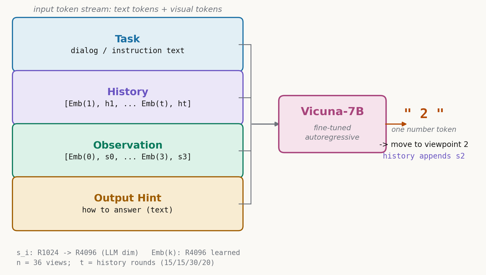

# 把一切都变成"生成下一个词"：NaviLLM 如何用 schema 把五个具身任务塞进同一个 LLM

> - 全局编号：72
> - 论文：Towards Learning a Generalist Model for Embodied Navigation（NaviLLM）
> - 作者：Duo Zheng*、Shijia Huang*、Lin Zhao、Yiwu Zhong、Liwei Wang（*共同一作；通讯作者 Liwei Wang；香港中文大学、上海人工智能实验室、CPII）
> - 会议：CVPR 2024（arXiv:2312.02010，2023-12-04 v1，2024-04-01 v3）
> - 链接：https://arxiv.org/abs/2312.02010
> - 代码：公开。论文 v1 给出 https://github.com/zd11024/NaviLLM，v3 给出 https://github.com/LaVi-Lab/NaviLLM；经检索两个仓库均存在且为同一项目，权重发布在 huggingface.co/zd11024/NaviLLM
> - 一句话核心洞见：导航、找物、问答、总结这些输出格式看起来完全不同的具身任务，可以全部写成"给定一段排好格式的输入，生成下一个词"；一旦写成这样，一个 LLM、一个交叉熵损失、多份数据拼在一起训练，就同时拿下三个 benchmark 的第一——通用性来自输入格式的统一，而不是新架构。

## 开篇先算一笔账：CVDN 测试集上 7.90 对 6.13，29% 是这么来的

CVDN（Vision-and-Dialog Navigation）的测试集上，前任第一名 VLN-PETL 的 GP（goal progress，单位是米：智能体朝目标方向实际推进了多少米）是 6.13，NaviLLM 做到了 7.90。(7.90 − 6.13) / 6.13 = 28.9%，四舍五入就是摘要里那个 29%。绝对值上看，多推进了 1.77 米。

这个数字之所以值得放在开头，是因为它违反了 2023 年底具身导航领域的默认信念：当时每个任务都有自己的专用架构——DUET 的双尺度图 transformer、HAMT 的历史感知编码器——大家默认"一个模型吃所有任务"必然在每个任务上都输给专科模型。而 NaviLLM 用**同一个模型、同一套权重**，同时在 CVDN、SOON、ScanQA 三个榜上拿第一，R2R 和 REVERIE 上和专科模型打平或接近。这个现象先摆出来，后面所有的"为什么"都围绕它。

## 在此之前，"专科医生"们在哪个具体场景里撞墙

先把任务摆清楚。具身导航不是一件事，是至少五件：R2R（跟着一步步的细粒度指令走）、CVDN（根据多轮对话找房间）、SOON（根据大段物体描述找东西）、REVERIE（根据一句话高级指令找远处的物体并定位）、ScanQA（在三维场景里回答问题）。2023 年之前的主流做法是为每个任务焊一套专用模型：文本编码器、视觉编码器各一套，输出头按任务定制——导航任务的输出头是在候选视角上做分类，REVERIE 还要外挂一个物体定位头。

这种设计在一个具体场景下会结构性失效：**任务换了，接口就对不上了**。比如你拿在 R2R 上训好的 DUET 去跑 CVDN，输入从"一段 29 个词的指令"变成"平均 81.6 个词的多轮对话"，输出还是那个分类头。你可以把对话拼成一个长字符串硬塞进文本编码器，但编码器的位置编码和注意力分布是按短指令训出来的，对话里的问答结构它从没见过；你也可以重新设计、重新训练，但那就等于为每个任务从头来一遍。MT-RCM（2020）尝试过多任务，但它没有 LLM，也只覆盖 VLN 的子任务，接口统一只做了一半。

所以这堵墙不是"参数不够"，而是"任务接口"不统一。每个任务有自己的输入格式和输出格式，模型和任务之间是硬接线。NaviLLM 要拆的正是这根硬接线。

## 作者的赌注：所有具身任务都是生成问题

作者的底牌只有一张，但很硬：**所有具身任务都可以写成"生成下一个词"**。导航 = 生成"往哪个候选方向走"的编号；物体定位 = 生成"选哪个物体"的编号；轨迹总结 = 生成一段指令文本；三维问答 = 生成答案文本。一旦输出永远是 token，任务之间的差异就只剩输入长什么样——而输入的差异可以用自然语言模板（schema）描述，不用改架构。

这个想法的上游是对话领域的 schema-guided 对话状态追踪（Rastogi et al., 2020）：用"意图-槽位"的描述格式让模型泛化到没见过的任务。NaviLLM 把它搬到多模态：schema 里除了文字，还塞进视觉 token。

从论文的措辞可以读出作者的把握程度。摘要写的是 "the first generalist model for embodied navigation"，这个 "first" 需要打个折：MT-RCM 已经做过多任务 VLN，所以准确的说法是"第一个把 LLM 微调范式完整搬到具身导航、并统一五个任务的"。作者的底气不在架构（架构几乎全是现成的：EVA-CLIP 做视觉、Vicuna-7B 做语言），而在**时间窗口**：2023 年 12 月，NavGPT 之类的工作还停留在"用 frozen 的 GPT-4 做 prompt 工程"，第一个把"微调开源 LLM + 多任务统一"完整做出来、并且数字真的超过专科模型的人，就是他。这个赌注的证据链在后面：消融实验里 LLM 权重随机初始化后性能崩塌，说明赌对了——语言理解的迁移是真实的。

## schema 的四个槽位：一个导航决策点的输入长什么样

schema 是四个槽位，拼在一起就是 LLM 的输入 token 流。以下是一个 CVDN 决策点的实际构成（模板文字来自论文附录表 13，视觉部分用符号表示）：

**Task**：自然语言的任务描述。CVDN 的例子："Find the described room according the given dialog. Target: The goal room contains a fireplace." 后面跟整段对话："Question: where should I go? Answer: If you turn around and keep heading then there is an open door on your right. Question: okay where to? Answer: Go through the open doors on the right." 任务换成 SOON，这里就变成大段的物体描述；换成问答，这里就是问题。槽位的名字不变，内容换。

**Observation**：当前观测。先是一句引导语："Following is the Candidate, which contains several directions you can go to at the current position, candidate (0) is stop." 然后是视觉 token 序列：[Emb(0), s₀, Emb(1), s₁, …, Emb(3), s₃]。每个 sᵢ 是一个候选方向的场景表示，Emb(i) 是编号 i 的可学习 embedding，用来告诉模型"这个向量对应几号候选"。

**History**：历史。引导语："Following is the History, which contains the visual information of your previous decisions." 然后是 [Emb(1), h¹, …, Emb(t), hᵗ]，hⁱ 是第 i 步选中视角的场景表示，按时间顺序编号。

**Output Hint**：输出格式提示。CVDN 的是："Understand the dialog in the Instruction and infer the current progress based on the History and dialog. Then select the correct direction from the candidates to go to the target location." 它不告诉模型答案，只告诉模型"该输出什么形状的东西"。

下图是这四个槽位拼成输入流、LLM 生成一个数字 token 的完整布局：

图注：一次导航决策的输入输出。四个 schema 槽位拼成 token 流（文字 token + 4096 维视觉 token），Vicuna-7B 自回归生成一个数字 token "2"，解析为"走向 2 号候选视角"，并把 s₂ 追加进 History。注意 Emb(k) 编号与候选编号的对应关系是模型自己从数据里学的。

一个细节论文没有交代：公式里 Observation 写成 [Emb(1), s₁, …, Emb(n), sₙ]（编号从 1 开始），但模板里 "candidate (0) is stop"（编号从 0 开始）。stop 这个候选的视觉 token 是什么、编号体系到底从 0 还是 1 开始，论文没写，记为**未确认**，复现时要去代码里看。

## 从"选方向"到"输出数字 2"：完整走一轮

把上面的图变成一段能脑内播放的过程。场景：CVDN，智能体在第 4 步，当前位置有 3 个可走邻居，加上停止，共 4 个候选 {0: stop, 1, 2, 3}。

输入 token 流按顺序是：Task 的对话文本 → History 的引导语 + [Emb(1), h¹, Emb(2), h², Emb(3), h³] → Observation 的引导语 + [Emb(0), s₀, Emb(1), s₁, Emb(2), s₂, Emb(3), s₃] → Output Hint 的文本。Vicuna-7B 在这个前缀之后自回归生成，训练目标是输出 token "2"。推理时模型真的吐出 "2"，外部代码把字符串 "2" 解析成整数 2，智能体走向 2 号候选对应的视角；同时 History 追加一项 h⁴ = s₂，下一轮的输入里 History 就变成 4 对。

同一个场景，把任务换成 REVERIE 的物体定位（REVERIE-OG）：Task 换成找物指令，Observation 的视觉 token 从"候选方向的场景表示"换成"可见物体的表示"，Output Hint 换成"从候选物体里选目标"，输出还是一个数字 ID。接口的形状完全没变——这就是"统一"在这个工作里的具体含义：任务差异只体现在输入的文本和视觉 token 里，不体现在模型结构里。

## 基线在同一个对话场景下为什么失败：DUET 的接口焊死了

拿上一节的 CVDN 场景，让在 R2R 上训好的 DUET 来零样本跑。它的问题不在"视觉能力差"，而在接口不允许它换任务。

DUET 的输出是一个分类头：输入编码好的图文表示，从候选视角里选一个。这个头是在 R2R 数据上训的，它见过的文本永远是"一段 29 个词左右的单条指令"。现在输入变成平均 81.6 个词的多轮对话，文本编码器的自注意力要处理的依赖关系完全变了——对话里有问有答，有"转身"这种需要结合历史理解的指代，而编码器的位置编码和注意力偏置是按短指令的分布训出来的。更重要的是，DUET 没有"生成"这个动作：它不能输出一个它没见过的任务格式，它只能分类。论文的 held-out 实验把这一点量化了：CVDN 上，DUET(R2R) 的 GP 是 3.38，NaviLLM（训练时没见过 CVDN）是 4.46。

反过来想：如果 DUET 的作者想支持 CVDN，他要改文本编码器的训练、改数据、重新调参；NaviLLM 的作者要支持一个新任务，只需要写四段模板文字。这就是两种范式在"扩展成本"上的差别，也是这篇论文真正想卖的东西。

## 公式 (1)–(4)：每个符号的形状、含义和一个小例子

论文的方法部分只有四个公式，全部在场景编码和 schema 构造里。LLM 本体没有新公式——这本身就是一个信号：创新点不在算子里，在接口。

$$f_{i}=\text{ViT}(I_{i})\quad \text{for } i=1,2,...,n \tag{1}$$

$I_i$ 是第 $i$ 个视角的 RGB 图像。智能体在每个位置看 36 个视角（$n=36$，附录 B），每个视角一张图。$\text{ViT}$ 是 EVA-CLIP-02-Large（4.28 亿参数，训练时冻结），$f_i$ 取的是 ViT 最后一层 [CLS] token 的隐状态。小例子：36 张 224×224×3 的图进去，出来 36 个向量，每个 1024 维。$f_3$ 只知道"视角 3 里有什么"，不知道其他方向。

$$\{s_{i}\}_{i=1}^{n}=\text{Transformer-Encoder}(\{f_{i}\}_{i=1}^{n}) \tag{2}$$

2 层 transformer encoder，隐层 1024 维，输入 36×1024，输出还是 36×1024。这个运算的几何含义：36 个视角向量互相做自注意力，每个 $s_i$ 变成所有视角的加权混合。$s_3$ 不再是"视角 3 看到了什么"，而是"站在这个位置、把 36 个方向都看了一遍之后，对方向 3 的理解"——比如视角 3 里有一扇门，视角 7 里是门外的走廊，融合之后 $s_3$ 这个向量里就带上了"这扇门通向走廊"的信息。这是整篇论文里唯一一个"视觉结构"上的设计，其余都交给了 LLM。

$$[\text{Emb}(1),{s}_{1},...,\text{Emb}(n),{s}_{n}] \tag{3}$$

Observation schema。$\text{Emb}(i)$ 是整数 $i$ 的可学习 embedding，维度必须和 Vicuna 的词 embedding 一致，即 4096 维。它的作用相当于给每个视觉向量贴一个编号标签：模型看到 "[Emb(2)] [一串 4096 维向量]"，就知道"这个向量是 2 号候选"。这里有一个论文没写的层：$s_i$ 是 1024 维，$\text{Emb}(i)$ 是 4096 维，两者要拼成同一个 token 流，中间必有一个 1024→4096 的线性投影层。论文只字未提（这是**推断**，但结构上必然存在，否则维度对不上），复现时要自己加。

$$[\text{Emb}(1),h^{1},...,\text{Emb}(t),h^{t}] \tag{4}$$

History schema。$h^i$ 是第 $i$ 步选中的视角的场景表示（VLN 任务里，$h^i$ 就是上一步选的那个 $s$）。$\text{Emb}(i)$ 这里表示时间顺序。历史轮数 $t$ 按任务取 15/15/30/20（R2R/REVERIE/CVDN/SOON，附录 B），CVDN 给 30 轮是因为对话任务的轨迹更长。

另外论文里有一句话："To enhance the scene representations, we also incorporate the angle and GPS information of each view into the scene encoding. We omit these details for brevity." 朝向角和 GPS 怎么编码的（DUET 里是正余弦编码的相对朝向），"为简洁省略"了。做过 VLN 的人都知道这部分经常影响一两个点，省略在这里等于把一个可能承重的细节藏了起来，记为**未确认**。

## 统一交叉熵：五个任务共用一个损失，以及那份没公开的"数据配比"

论文原话：用统一的交叉熵目标在不同任务上优化模型。写成公式就是：

$$L = -\sum_{\tau \in \text{tasks}} \sum_{(X,Y) \in D_\tau} \sum_{k=1}^{|Y|} \log p_\theta(y_k \mid X, y_{<k})$$

其中 $X$ 是四个 schema 拼成的输入，$Y$ 是目标 token 序列（导航任务 $|Y|=1$，问答和总结任务 $|Y|>1$）。$\theta$ 是同一套参数。

这个公式里藏着一个没写出来的东西：**任务权重**。求和是对采样到的 batch 做的，所以各个任务在梯度里的实际占比完全由数据采样策略决定：是按数据集大小比例采样？按任务轮询？还是 temperature sampling？论文全文没有写采样策略，只给了附录表 8 的数据量：CVDN 4.7k、SOON 27.8k、R2R 14k、REVERIE 10.5k、ScanQA 25.6k、LLaVA 23k、R2R 增强 1070k、REVERIE 增强 20k。

这里有两个值得停下来的数字。第一，R2R 增强数据 107 万条，占预训练池（约 117 万）的九成以上；但预训练只跑 10,000 步 × batch 64 = 64 万个样本——**增强的 R2R 数据连一整轮都看不完**，采样策略直接决定模型实际吃了什么，而策略没公开。第二，SOON 的数据量表 8 写 27.8k，附录 A 正文写训练集 2,780 条指令，差了 10 倍。是笔误、小数点错位，还是把某种增广算进去了？论文没解释，记为**未确认**。多任务训练里，数据配比是最关键的超参数之一，它的缺席是这篇论文在"可复现性"上最大的洞。

## 两阶段训练：10,000 步与 5,000 步里到底发生了什么

训练分两段。第一段叫预训练：在 CVDN、SOON、R2R、REVERIE、ScanQA 加 R2R/REVERIE 增强数据的合集上做 teacher forcing，10,000 步。第二段叫多任务微调：在上面的合集（去掉增强数据，加上 LLaVA-23k）上**交替**用 teacher forcing 和 student forcing，5,000 步。全程 Adam，学习率 3e-5，batch 64，8 张 A100 跑约 80 小时。

student forcing 在 VLN 里的含义值得展开：teacher forcing 是把标准轨迹的每一步正确答案喂给模型算损失；student forcing（DAgger 一脉）是让模型自己走，用它自己走出来的轨迹算损失——这需要把模型放进仿真器里实际 rollout，代价比 teacher forcing 高得多。论文只说"交替"，没说交替的 schedule（一步一换？一轮一换？）、rollout 的长度和采样方式。这是闭环训练的核心细节，它的缺席意味着**这篇论文的"闭环"部分是不可复现的**——对我们做 Bench2Drive 闭环验证的人来说，这是一个明确的提醒：论文的开环部分讲得很细，闭环部分一笔带过。

测试时的一个怪细节：SOON 和 REVERIE 用 temperature 0.01 采样，其余任务用贪心。0.01 的温度下 softmax 几乎就是 one-hot，"鼓励探索"的说法站不住——更可能的作用是打破概率完全相同时的平局，或者绕开某些实现的数值问题。这是一个小例子，说明论文里的动机解释有时只是顺手写的，不必全信。

## 表 1 的正确读法：CVDN 那一列的表注写错了

表 1 的表注写着 "We report SPL for CVDN, SOON, R2R, and REVERIE"，但 CVDN 那一列的数字（3.15、4.41、5.13、…、7.90）明显是 GP（单位米），和附录表 7 的 CVDN 数字对得上。表注把 GP 写成了 SPL，是一个笔误。读表时以附录表 7、9、10、11 的细表为准。

修正后果然，NaviLLM 的成绩单是：CVDN 测试集 GP 7.90，第一；SOON 测试集 SPL 26.26，第一（前任 Meta-Explore 25.8）；ScanQA 测试集 EM 26.3，对已发表方法第一；R2R 测试集 SPL 60，和 BEV-BERT 持平，比 Meta-Explore 的 61 低一点；REVERIE 测试集 SPL 32.33，明显低于 DUET 的 36.06 和 AZHP 的 35.85。

所以准确的表述是"三个第一、一个持平、一个落后"，而不是"全面超越"。REVERIE 上的落后后面会专门讲，它是理解"通用 vs 专用"取舍的关键证据。

## CVDN 为什么涨得最多：81.6 个词的对话与最小的数据集

论文自己给了两个原因，值得展开算一算。第一，CVDN 的指令最复杂：平均 81.6 个词的多轮对话，SOON 38.6 词，R2R 29 词，REVERIE 只有 18 词。NaviLLM 的涨幅和这个顺序同向——CVDN 第一、SOON 第一、R2R 持平、REVERIE 落后。这不是巧合：LLM 预训练吃进去的是海量人类对话和长文本，它最擅长的就是从啰嗦、指代多、结构松散的语言里提取意图。对话理解恰好是专科导航模型最弱的一环（它们的文本编码器按短指令训），所以 LLM 的加入在这里的边际收益最大。

第二，CVDN 的数据最小：训练集 4,742 条问答，R2R 有 14,039 条指令，REVERIE 有 10,466 条。小数据集上，单任务训练容易过拟合；多任务统一之后，CVDN 变相"借"了其他任务的数据——视觉编码器见过更多的房间，LLM 见过更多的指令表达。消融实验里多任务相对单任务在 CVDN 上 GP 从 5.54 涨到 5.91，就是这笔借款的利息。

还有一个背景：前任第一 VLN-PETL（Qiao et al., 2023）做的是参数高效微调，思路是在小模型上省参数；NaviLLM 反其道而行，用 70 亿参数的 LLM 正面强攻对话理解。在"指令最复杂、数据最少"的任务上，重火力赢了轻骑兵，这个结论是干净的。

## 表 3 的 136%：分母是哪个 DUET，held-out 实验到底做了什么

5.2 节的泛化实验设计值得细看：分别把 CVDN、SOON、REVERIE 从训练集里拿掉，训三个模型，再到被拿掉的那个数据集上零样本测试。注意一个关键细节——表 3 的表注写着 "We only perform the multi-task fine-tuning for held-out experiments"，即这三个模型**只做了微调阶段，没做预训练**。所以表 3 的数字和表 1 的主结果不是同一训练流程，不能直接对比。

论文说 "improving 32% of GP on CVDN and 136% SPL on SOON"，分母是哪个基线？论文没明说，我按表 3 的数字反推：CVDN 上 NaviLLM GP 4.46，三个 DUET 基线里最高的是 DUET(R2R) 的 3.38，(4.46−3.38)/3.38 = 32.0%；SOON 上 NaviLLM SPL 14.29，DUET 基线里最高的是 DUET(REVERIE) 的 6.06，(14.29−6.06)/6.06 = 135.8% ≈ 136%。所以分母取的是"每个数据集上表现最好的那个 DUET"，这个反推是**我的计算**，论文没有明确说明，读者应当知道 136% 的分母是 DUET(REVERIE) 的 6.06 而不是 DUET(SOON)（后者在 SOON 上没有数字）。

REVERIE 的 held-out 结果最有信息量：NaviLLM SR 28.10，只比 DUET(R2R) 的 24.91 高一点。REVERIE 的指令短（18 词）、和 R2R 高度相似，DUET 在 R2R 上学到的东西能直接搬过来，专科模型的地盘就没那么好攻。这从反面印证了上一节的结论：NaviLLM 的优势集中在"指令复杂、专科模型不擅长"的任务上。

## ScanQA "第一"的边界：附录表 12 上的第二名

正文 5.1 节说在 ScanQA 的 val 和 test 所有指标上都是 SoTA，表 2 的数字支持这个说法：test EM 26.3，对 3D-LLM（BLIP2-flant5）的 19.1 高出 7.2 个百分点（论文写 "7.2% improvement"，实际是百分点之差，不是相对比例）。但有两个边界要划清楚。

第一，附录表 12 给出了截至 2023 年 11 月的 ScanQA 排行榜：NaviLLM（EM 24.77）排**第二**，第一名是一个叫 "mare" 的匿名队伍，EM 30.82。所以"SoTA"指的是"已发表方法里的第一"，不是榜单第一。论文没有在正文里提这个第二名，读者只看正文会得到偏乐观的印象。

第二，表 2 的 test EM 26.3 和表 12 的 24.77 对不上。一种可能是表 2 用的是 test w/ objects 子集（4.3 节明确说用 val 和 test w/ objects 对比），表 12 是总榜；但论文没有解释这个差异，记为**未确认**。另外 4.3 节说 test w/o objects 的结果"见附录"，附录里并没有这张表——承诺了没兑现，记为**缺失**。

## EQA 零样本：849 条数据的含义与两阶段技能组合

MP3D-EQA 在训练时被整个拿掉（held out），测试时让模型先导航、再问答，两个阶段分别用 VLN 和 3D-QA 的 schema 串起来。结果：导航 SR 47.78%、SPL 35.60%（比 DUET(R2R) 的 30.51 高 5.09 个百分点，论文写 "by 5.1% in SPL"，实际是百分点之差），问答准确率 44.5%（DUET 们没有问答能力，直接缺席这一项）；如果给标准轨迹（只测问答），NaviLLM 47.4% 超过在 EQA 训练集上全监督训练的专用模型（46.0%）。

"技能组合"这个说法是成立的：导航和问答两个子技能训练时都见过，没见过的是"先导航后问答"这个组合方式，模型靠 schema 的统一接口把它拼起来了。但数据的处理要打折：MP3D-EQA 的验证集里有些样本的终点标注不准，作者"人工检查并过滤掉无效数据"，剩下 849 条。过滤标准是主观的、不可复现的，所以这个 44.5% 不能和用全集的其他论文的数字直接对比。这是一个诚实但削弱可比性的处理，论文写清楚了，值得肯定，但读者要知道可比性的边界。

## 消融表 5：哪几行数字说明什么是承重的

表 5 有四行，列是 CVDN GP、SOON SR/SPL、R2R SR/SPL、REVERIE SR/SPL、ScanQA EM/ROUGE-L。逐行读：

第 2 行 vs 第 3 行：唯一差别是 LLM 用随机初始化还是 Vicuna 预训练权重。CVDN 3.64→5.91，SOON SPL 17.39→28.09，R2R SPL 40→58，ScanQA EM 12.4→23.3——**所有任务全线崩塌**。这是整篇论文最承重的一组数字：拿掉 LLM 的预训练权重，整个方法就不存在了。反过来说，这个工作的性能里，有多少来自 schema 设计、多少来自"直接继承了一个 70 亿参数的语言模型"，表 5 没有进一步拆分。

第 1 行 vs 第 3 行：单任务训练 vs 多任务训练。多任务在所有任务上都涨，REVERIE 涨得最多（SPL 24.10→36.63）。REVERIE 需要把短指令和远处物体对齐，是最吃数据的一类任务，多任务的数据复用在这里收益最大。

第 3 行 vs 第 4 行：加不加增强数据预训练。CVDN 5.91→6.16、SOON SPL 28.09→29.24、R2R 几乎不动——"轻微提升"属实；但 REVERIE SPL 36.63→35.68、ScanQA EM 23.3→22.1 是**掉**的，正文只字未提。作者的解释是推测（"we speculate"）：数据质量比数量更重要。增强数据来自 HM3D-AutoVLN 的自动标注，噪声大，在小而干净的评测集上反而有害——这个推测是合理的，但论文没有做验证实验（比如按噪声水平分层），停留在推测层面。

还有一个表格层面的疑点：附录表 11 里 "NaviLLM w/p pretrain" 一行的数字（REVERIE val-U SR 44.56 / SPL 36.63）恰好等于表 5 第 3 行（**无**预训练）的数字，而表 11 "NaviLLM" 一行的数字等于表 5 第 4 行（有预训练）。标签疑似写反了，或者两处"预训练"指的不是同一件事。无论哪种，这个不一致应当记为**未确认**，它不影响"预训练收益很小"的结论方向，但影响具体数字的归属。

## 附录表 6：删掉 output hint 会掉多少

附录 C 做了 schema 元素的消融：去掉 Output Hint（O）和 Task Hint（T）中的一个或两个。注意这组实验只训了 2,500 步，和主实验的 15,000 步不可比，看的是相对趋势：完整 schema 五项总分 140.45，两个 hint 全去掉掉到 107.49，只保留 Output Hint 回到 129.65。

这个实验回答了一个关键质疑：schema 里的自然语言提示是不是装饰？数字说不是——没有它们，模型分不清任务，五个任务混在一起训就互相污染。Output Hint 一个人就补回了 22 分（107.49→129.65），说明"告诉模型该输出什么形状"这个信息量是最大的。但也要看到，这组消融没有拆"四个槽位里的视觉 token 排列方式"（比如 Emb 编号有没有用），只拆了文本提示，schema 设计里真正新颖的那部分（ID 编号机制）没有被消融验证。

## 怀疑清单：论文没说清楚的七件事

读到这里，把论文没交代、但影响判断和复现的事项集中列出来：

1. **数据采样配比没写**。多任务训练的核心超参数，决定了 107 万条 R2R 增强数据实际占多少梯度。全文无描述，记为缺失。
2. **teacher/student forcing 的交替 schedule 没写**。student forcing 需要仿真器 rollout，是闭环训练的关键，细节缺席意味着闭环部分不可复现。
3. **生成 ID 的后处理没写**。模型输出非法 token（比如编号超出候选范围、输出的不是数字）时怎么办？贪心解码下这种错误必然出现，论文没提处理逻辑。
4. **angle 和 GPS 编码"为简洁省略"**。VLN 里朝向信息的编码方式经常影响一两个点，省略等于藏起了一个可能承重的细节。
5. **1024→4096 的投影层没写**。结构上必然存在（维度对不上），但初始化方式、是否可训练都没说。
6. **随机种子和方差没报**。所有数字都是单次运行，没有误差棒；CVDN 测试集只有 1,384 条，7.90 这个数字的波动范围未知。
7. **基线选择**。排除了用 pre-exploration 的方法（AuxRN、RREx-BoT）和 HM3D-AutoVLN——理由是"用了新环境"，公平；但预训练阶段用了 HM3D-AutoVLN 的增强数据，这个不对称应当明确说明。

另外附带三个已发现的笔误/不一致：表 1 表注把 CVDN 的 GP 写成 SPL；表 11 的 "w/p pretrain" 标签疑似写反；SOON 数据量表 8 的 27.8k 与附录 A 正文的 2,780 差 10 倍。以及一个承诺未兑现：ScanQA test w/o objects 的结果说"见附录"，附录里没有。

## 任务间干扰真实存在吗：REVERIE 上的代价

"统一模型是否存在任务间干扰"，论文没有直接回答，但数字里有三处痕迹。第一，REVERIE 测试集 SPL 32.33，落后专科模型 DUET（36.06）和 AZHP（35.85）近 4 个点——这是五个任务里唯一一个被拉开差距的。第二，增强数据预训练让 REVERIE val-U 的 SPL 从 36.63 掉到 35.68、ScanQA EM 从 23.3 掉到 22.1，多任务数据不是对所有任务都有益。第三，R2R 测试集 SPL 60，低于 Meta-Explore 的 61，统一模型在 R2R 上也没有摸到专科的天花板。

为什么偏偏是 REVERIE？REVERIE 的指令平均 18 个词，是四个导航任务里最短的——LLM 的语言理解优势在这里用不上；而它的难点是"把短指令和远处的目标物体对齐"，DUET 的双尺度图 transformer 里有显式的拓扑结构归纳偏置，NaviLLM 的生成式 ID 预测没有。也就是说，**当任务的瓶颈从"语言理解"变成"空间结构建模"时，通用模型的通用接口就开始交税**。

所以"通用 vs 专用"的取舍是真实存在的：NaviLLM 用一个模型换来了五个任务的平均最优和跨任务泛化，代价是在 REVERIE 这类结构化强的任务上让出几个点。对科研新手来说，这个取舍比"谁第一"更重要：选通用路线之前，先看你的任务瓶颈在语言还是在结构。

## "通用"的边界：EQA 和 3D captioning 到底算不算没见过

论文说 EQA 和 3D captioning 是"unseen tasks"，这个说法要打折。EQA = 导航 + 问答，两个子技能训练时都见过（VLN 数据和 ScanQA 数据），没见过的是"先导航后问答"这个**组合方式**。3D captioning 和训练时见过的 trajectory summarization 都是"看一段视觉输入、生成一段描述"，输入输出格式高度相似，泛化距离很短。

真正的"没见过"应当是：全新的输出格式（比如输出连续的控制量、输出三维框）、全新的模态、或者需要训练时完全没出现过的推理模式。这些论文都没测。所以 NaviLLM 的"通用"，准确的范围是"**schema 能描述的任务空间内通用**"——只要新任务能写成四个槽位、输出能写成 token，模型就有机会；写不成的，就超出边界了。这个边界比"通用智能体"的叙事小，但比"多任务 VLN"大，诚实的位置在这里。

## 可迁移想法

1. **先定接口，再谈多任务**。NaviLLM 的全部通用性来自一个决定：输出永远是 token。数据复用、跨任务泛化都是这个决定的推论。自己做多任务时，第一个问题不应该是"模型怎么改"，而是"能不能找到一个所有任务都能输出的格式"。
2. **schema 是用自然语言写任务接口**。定义一个新任务的成本从"改架构、加输出头、重新调参"降到"写四段模板文字"。附录表 6 证明这些文字不是装饰——它们是任务的身份标识。这个思想可以搬到任何"任务种类多、每个任务数据少"的领域。
3. **held-out 实验是检验"通用"的正确姿势**。把整个数据集拿掉再测，比在混合数据上测更能说明问题。以后看到"通用模型"的 claim，先找它的 held-out 实验；没有，就先打个问号。
4. **ID 化输出是通用手法**。把离散决策（选方向、选物体、选规划器）变成"生成编号 token"，这条路从 Pix2Seq（检测）到 RT-2（机器人动作）再到 NaviLLM（导航）反复出现。凡是输出空间可枚举的决策问题，都可以考虑这条路——它把分类问题变成了语言模型最擅长的问题。
5. **指令越复杂，LLM 越划算**。CVDN（81.6 词）大涨、REVERIE（18 词）落后，这个单调关系是一个选型依据：先量你的任务指令复杂度，再决定要不要上 LLM。
6. **看预训练/多任务在哪项上掉点**。REVERIE 和 ScanQA 在增强预训练后掉点，是检测负迁移的现成信号。多任务训练时，永远要有一张"每项任务单独看"的表，而不是只看平均分。

## 与本课题的关联

我们的课题是"世界模型引导 + 自适应衰减情景记忆的闭环多规划器自动驾驶 Agent"：LLM 调度多个规划器，执行开放式自然语言驾驶指令，在 Bench2Drive 闭环基准上验证。NaviLLM 的 schema 思想可以直接映射到调度器的设计上：

**调度器输出的统一格式**。把"调度哪个规划器、给什么参数"写成生成问题：输出 = 规划器 ID token + 参数 token。就像 NaviLLM 用数字 ID 表示候选方向，我们可以用 ID 表示候选规划器（0: 停止/接管，1: 激进超车规划器，2: 保守跟车规划器……）。一旦输出格式统一，不同驾驶指令、不同场景的数据就可以混在一起训练调度器，这正是我们目前"每个场景单独调"想摆脱的。

**schema 四槽位对驾驶指令的形式化**。Task 槽位放自然语言驾驶指令（"在下一个路口掉头"）；Observation 槽位放 BEV 特征或多视角图像特征，外加候选轨迹/候选规划器的 ID 编号——对应 NaviLLM 的 [Emb(i), sᵢ]；History 槽位放情景记忆——我们的"自适应衰减情景记忆"在物理上就是 h¹…hᵗ 的组织方式，衰减权重可以体现在采样哪些历史步进 schema；Output Hint 槽位放输出格式约束（"输出规划器编号和置信度"）。世界模型的未来预测 rollout 可以作为 Observation 的一部分拼进输入，相当于给 LLM 看"每个候选动作的未来"。

**闭环训练的提醒**。NaviLLM 恰恰在 student forcing（闭环 rollout）的细节上语焉不详——schedule 没写、rollout 长度没写。这说明即使是 CVPR 2024 的工作，闭环部分也是最难讲清楚、最容易藏坑的地方。我们在 Bench2Drive 上做闭环验证时，要把开环 teacher forcing 和闭环 student forcing 的配比、rollout 策略作为一级超参数记录，而不是事后补。

**指令复杂度的选型依据**。CVDN 的经验证明，开放式、长指令任务上 LLM 的优势最大。我们的"开放式自然语言驾驶指令"（区别于固定模板指令）正好落在 LLM 的优势区间里——这是用 LLM 做调度器的正面证据。但 REVERIE 的教训也要记住：如果某个驾驶子任务的瓶颈是精确的几何约束（比如泊车时的厘米级控制），LLM 生成式调度的精度可能不如专用规划器，这时应该让 LLM 只做"选哪个规划器"的离散决策，把连续控制留给专科模块——也就是我们"多规划器"架构本身。

