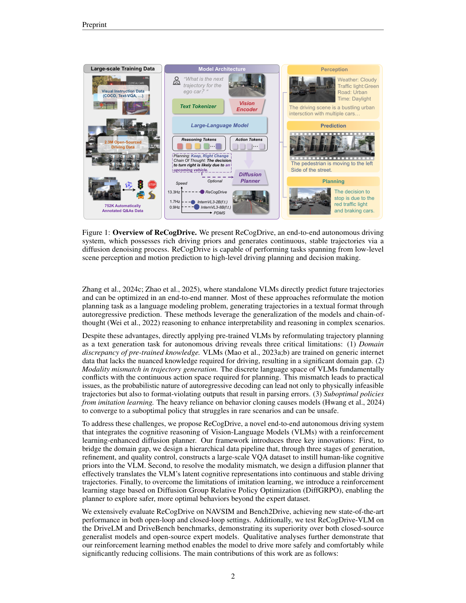
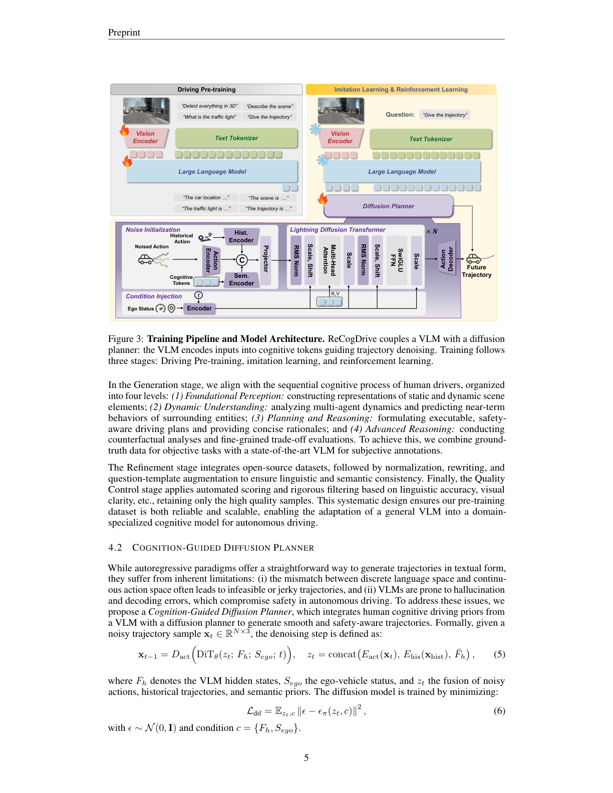
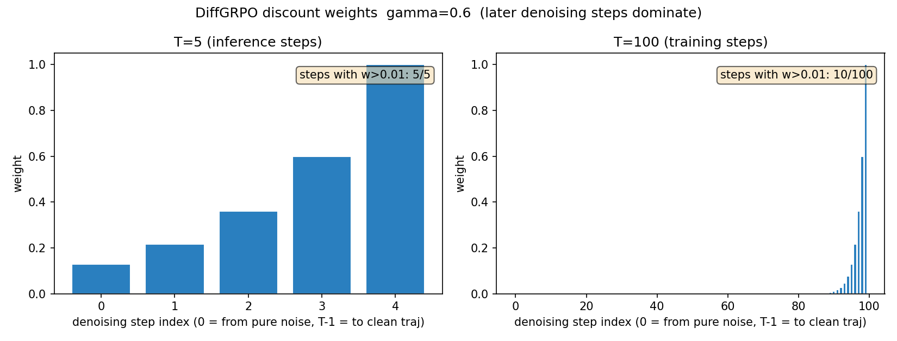
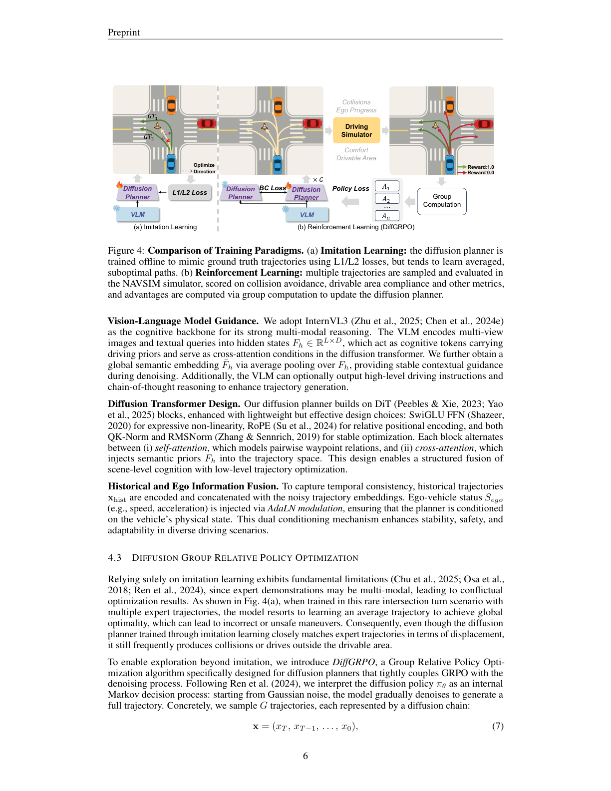
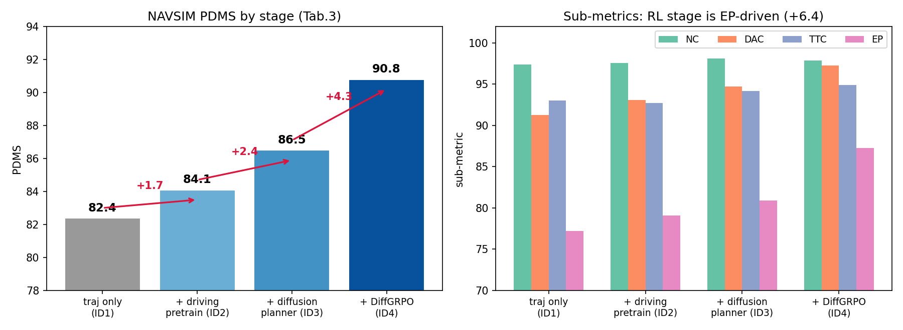

# VLM 负责想，扩散负责画，RL 负责改：ReCogDrive 把轨迹规划从语言空间搬回连续动作空间

> **全局编号**：101-VLA-recogdrive
> **论文标题**：ReCogDrive: A Reinforced Cognitive Framework for End-to-End Autonomous Driving
> **作者**：Yongkang Li*、Kaixin Xiong*（共同一作）、Xiangyu Guo、Fang Li、Sixu Yan、Gangwei Xu、Lijun Zhou、Long Chen、Haiyang Sun†、Bing Wang、Kun Ma、Guang Chen、Hangjun Ye、Wenyu Liu、Xinggang Wang（1 华中科技大学，2 小米汽车；† 通讯作者为 Haiyang Sun）
> **会议**：ICLR 2026 Poster（OpenReview 官方记录 venue 字段为 "ICLR 2026 Poster"；官方 GitHub 仓库描述栏亦标注 [ICLR 2026]；arXiv 摘要页无 comments 栏声明）
> **arXiv**：2506.08052（v1 2025-06-09，v2 2025-09-29；本文按 v2 精读，共 37 页含附录）
> **链接**：https://arxiv.org/abs/2506.08052 ｜ 项目页 https://xiaomi-research.github.io/recogdrive
> **代码**：公开，https://github.com/xiaomi-research/recogdrive（619 stars，2026-10-09 仍在更新；已 clone 到 code/ 并通读关键文件，论文–代码不一致处见"代码告诉你的三件事"一节）
> **一句话核心洞见**：VLA 驾驶这条路最大的坑，是让 VLM 在离散的语言空间里输出连续的物理动作——格式错一位就解析失败、慢、还容易幻觉；ReCogDrive 的赌注是把分工切开：VLM 只负责"想"（输出带驾驶先验的认知 token，不直接输出轨迹），扩散模型负责"画"（在连续动作空间去噪出轨迹），最后用 NAVSIM 模拟器的 PDMS 做奖励、GRPO 微调扩散规划器，让它敢于偏离专家演示去开得更远——NAVSIM PDMS 90.8 里最后 +4.3 几乎全是这一步给的。

## "让 VLM 直接输出轨迹"为什么是个坏接口

2024 到 2025 年，VLA 驾驶的主流做法是把轨迹规划重写成语言建模：VLM 自回归地吐出 waypoint 的文本，配上 chain-of-thought 看起来还能解释自己为什么这么开。EMMA、OmniDrive、GPT-Driver 都是这条路。ReCogDrive 的起点，是判断这条路在接口层面就是错的——不是调参能救的，是结构性的。论文引言列了三条，每条都值得单独看：

第一，**离散语言空间 vs 连续动作空间的失配**。自回归解码是概率性的：同一个场景跑两次，token 序列可能不一样。对聊天这没事，对开车这很要命——小数点后一位的抖动就是方向盘的抖动。更糟的是格式：轨迹被编码成文本，解码时只要有一个 token 不合模板，整条轨迹解析失败。论文表 4 给了数字：纯文本基线有 0.01% 的格式错误率。0.01% 听起来很小，但这是安全关键系统：每开一万次规划就有一次直接抛异常。作者在附录 Q9 里把话说得很直白——这个错误率"在安全关键驾驶中不可接受"。

第二，**慢**。自回归是一个 token 一个 token 往外吐，表 4 实测 0.5839 秒一条轨迹。对比扩散规划器一次前向 0.0750 秒，7.8 倍差。注意一个细节：表 4 注明文本基线用了 lmdeploy 加速（†），而扩散那行没标——也就是说 7.8 倍这个数字还是在"文本侧已占便宜"的情况下算出来的，真实差距只会更大。

第三，**模仿学习的平均化陷阱**。图 4(a) 是全篇最有说服力的一张示意图：一个罕见的路口转弯场景，专家演示本身是多模态的（有的司机贴内线转，有的走外线），行为克隆为了最小化全局 L2，被迫学出一条"平均轨迹"——而平均轨迹恰好穿过两条安全轨迹之间的禁区：撞上护栏或开出可行驶区域。位移误差（ADE）很小，车却撞了。这是模仿学习的结构性问题：优化目标和安全目标不一致。

想清楚这三条，ReCogDrive 的设计就不是"作者的发明"，而是问题的形状逼出来的：VLM 的强项是认知和先验，不是输出连续动作——那就让它只输出认知；连续动作交给扩散模型；安全和最优的鸿沟，用带模拟器奖励的 RL 来填。三段式各管一段。

## 作者的底牌：三张牌都很硬

第一张牌是**人**。通讯作者 Haiyang Sun 在小米汽车，一作 Yongkang Li、Xinggang Wang 来自华中科技大学——Xinggang Wang 组是做 VAD、DiffusionDrive、Senna 的组，端到端驾驶的工程链条是现成的。这意味着他们手里有现成的 NAVSIM 评测管线、Bench2Drive 闭环环境，以及调大规模训练的经验。论文里 32 张 H20 的训练配置（附录 E）印证了这一点：这不是一个小作坊能跑出来的实验。

第二张牌是**奖励的可获得性**。DiffGRPO 的核心动作，是把 NAVSIM 模拟器的 PDMS 直接当奖励函数用。这件事听起来简单，但前提是你得有一个能批量、快速给轨迹打分的非反应式模拟器——NAVSIM（NeurIPS 2025，Dauner 等）正好提供了 metric cache 机制，代码里 `metric_cache_loader` 就是干这个的：预先把每个场景的评估缓存算好，RL 时查表打分，不用真的跑物理仿真。没有这个基础设施，"用 PDMS 做奖励"就是一句空话。论文 Related Work 里把同时期的 AlphaDrive、R2SE、TrajHF、Gen-Drive 都列了——这些工作也在往 RL 方向走，ReCogDrive 的差异化是第一个把 RL 做到**扩散规划器**上（而不是自回归策略上）。

第三张牌是**时机**。v1 挂 arXiv 是 2025 年 6 月，那时 InternVL3（2025 年 4 月）刚出来，NAVSIM 刚成为事实标准评测，GRPO（DeepSeek-R1，2025 年 1 月）正热。三个部件都是热乎的，拼在一起就是一篇 ICLR Poster。这张牌不算最硬，但够用了。

## 数据管线："人类认知过程"的真实含义是 Qwen2.5-VL 的标注

4.1 节的花哨标题下，是一套三阶段数据工程，值得逐段看它到底做了什么：

**生成（Generation）**：在 NAVSIM 场景上，用 Qwen2.5-VL 按四层认知模板批量生成 QA——L1 基础感知（场景描述、3D 目标检测、交通灯分类）、L2 动态理解（关键 agent 识别、运动预测）、L3 规划推理（高层指令、决策解释）、L4 高级推理（反事实、精细权衡）。注意：这里的"人类驾驶员的 sequential cognitive process"是个叙事包装，实际发生的是"用一个通用 VLM 给驾驶场景批量打标签"。775K 对 NAVSIM 场景的 QA 全是这么来的。

**精制（Refinement）**：把 12 个开源数据集（Talk2Car、SUTD、DRAMA、NuScenes-QA、DriveGPT4、LingoQA、DriveLM、MAPLM、NuInstruct、CODA-LM、OmniDrive、Senna）共 310 万 QA 对做格式统一——比如把 DriveLM 的 `<c2,CAM_BACK,864.2,468.3>` 和 NuInstruct 的 `<car>[c2,584,478,603,516]` 都转成 InternVL3 的 `<car><FRONT_VIEW><box>[x1,y1,x2,y2]</box>` 格式，坐标归一化到 [0,1000]。再用 LLM 改写问题模板扩充语言多样性。

**质检（Quality Control）**：用 Qwen2.5-VL 给每对 QA 打分，低于 60 分的扔掉，最后剩 230 万对。

这里有两个诚实的问题。第一，**标注者和质检员是同一个模型**（Qwen2.5-VL 生成、Qwen2.5-VL 打分）——自产自销的过滤，60 分这个阈值筛掉的是"Qwen 自己觉得不好"的东西，不是"人类觉得不好"的东西。论文没有报告筛掉了多少比例，也没有人类抽检一致性数据。第二，所谓的"人类认知先验"，实质是从 Qwen2.5-VL-72B 蒸馏来的驾驶域知识，不是人类标注的认知过程。效果上这没问题（表 3 显示 +1.7 PDMS），但叙事上要打个折：这是 VLM-to-VLM 的域适应，不是 human cognition 的注入。

数据配比：41% 感知、11% 预测、24% 规划、24% 通用视觉指令（防止灾难性遗忘，保持指令跟随能力）。这个配比是合理的——规划只占四分之一，说明作者清楚 VLM 的主业是提供表征，不是直接做规划。

## 架构：VLM 只输出 token，不输出轨迹

图 3 是全篇的架构总览，值得对照着看。数据流是这样的：

多视角图像 → InternViT（300M）→ 视觉 token；文本 query（"Give the trajectory" 之类）→ 分词；两者拼在一起进 Qwen2.5（7B 级，InternVL3-8B 的 LLM 部分）→ 输出 hidden states $F_h \in \mathbb{R}^{L \times D}$。**到这里 VLM 的工作就结束了**——它不解码任何文本轨迹。$F_h$ 被称为 "cognitive tokens"，取平均池化再得到一个全局语义向量 $\bar{F}_h$。

然后扩散规划器接管。公式（5）：

$$x_{t-1} = D_{act}\left(DiT_\theta(z_t; F_h; S_{ego}; t)\right), \quad z_t = \text{concat}\left(E_{act}(x_t), E_{his}(x_{hist}), \bar{F}_h\right)$$

逐项拆。$x_t \in \mathbb{R}^{N \times 3}$ 是第 $t$ 步的带噪轨迹：$N$ 个 waypoint，每个 3 维（x, y, heading）。$E_{act}$ 把它编码成 embedding；$E_{his}$ 编码历史轨迹 $x_{hist}$（时序一致性就靠它）；$\bar{F}_h$ 是 VLM 的全局认知向量，三者 concat 成 $z_t$。$DiT_\theta$ 是 Diffusion Transformer：16 层、8 头、hidden 384——注意这个尺寸很小（对比 DiT-XL 是 28 层 hidden 1152），是个轻量规划器。每个 block 交替做两件事：self-attention 建模 waypoint 之间的两两关系（轨迹的光滑性就从这里来），cross-attention 把 $F_h$（完整的 token 序列，不只是池化向量）注入轨迹空间。$S_{ego}$（自车速度、加速度）通过 AdaLN 调制注入——AdaLN 的做法是拿 $S_{ego}$ 的编码去预测 LayerNorm 的 scale 和 shift，相当于让自车状态去"拧"每一层的归一化，物理状态 conditioning 的标准做法。最后 $D_{act}$ 把去噪后的表示解码回轨迹。

训练目标公式（6）是标准的 DDPM 噪声预测：

$$L_{dif} = \mathbb{E}_{z_t, c}\|\epsilon - \epsilon_\pi(z_t, c)\|_2^2, \quad c = \{F_h, S_{ego}\}$$

没什么花样，就是告诉网络"看着认知条件，把加进去的噪声猜回来"。

张量形状一张表说清（$B$ batch，$N$ waypoint 数，$D$ 隐 dim）：

| 符号 | 形状 | 含义 |
|---|---|---|
| $x_t$ | $B \times N \times 3$ | 第 $t$ 步带噪轨迹（x, y, heading） |
| $F_h$ | $B \times L \times D$ | VLM hidden states（cognitive tokens） |
| $\bar{F}_h$ | $B \times D$ | 平均池化后的全局语义向量 |
| $z_t$ | $B \times (N+N_{his}+1) \times D$ | concat 后的融合输入 |
| $S_{ego}$ | $B \times d_{ego}$ | 自车状态（速度、加速度），经 AdaLN 注入 |

设计上真正关键的选择是：**VLM 参数在第二、三阶段冻结**。VLM 只在第一阶段 SFT，之后当 frozen backbone 用。这意味着 8B 参数的大模型在推理时只跑一次前向取 $F_h$，扩散规划器是个小 DiT——这是 0.075 秒推理时间的来源。代价是 VLM 的认知能力在 RL 阶段得不到更新，规划器只能在自己的一亩三分地里优化。

*该看哪里：左半是"VLM 只出 token"的证据——Action Tokens / Reasoning Tokens 都是文本侧的可选项；右下角的 PDMS/Speed 对比是作者押的赌注：纯视觉、又准又快。注意图中 InternVL3-2B/8B 的速度数字在文本提取中错位，正文表 4 的 0.0750s 才是可引用的测量值。*

*该看哪里：中间 Lightning Diffusion Transformer 的 Condition Injection——K,V 来自 cognitive tokens，这是"认知引导"四个字的全部实质：cross-attention 的 K/V。左下角 Action Decoder 只在 IL 阶段用虚线标出，RL 阶段真正更新的是 DiT。*

## DiffGRPO：把"整条轨迹"当成一个动作，把去噪链当成 MDP

这是论文的方法核心，也是最需要慢下来讲的部分。先说它要解决什么：行为克隆训出来的扩散规划器，在位移误差上已经很接近专家了（表 3 ID3 的 PDMS 86.5），但闭环里照样撞——因为它学的是"专家的平均"，不是"安全的驾驶"。RL 的目标是让规划器敢于偏离专家分布，去探索 PDMS 更高的轨迹。

第一个要跨过的坎：**扩散模型怎么做 RL？** 扩散采样不是一步决策，而是一个 $T$ 步的去噪链。作者跟 DPPO（Ren et al., 2024）的做法一样，把去噪链本身看成一个内部 MDP：状态是 $x_t$（带噪轨迹），动作是 $x_{t-1}$（去噪一步的结果），策略是高斯：

$$\pi_\theta(x_{t-1}|x_t) = \mathcal{N}(x_{t-1}; \mu_\theta(x_t, t), \sigma_t^2 I) \tag{10}$$

均值是网络预测的，方差 $\sigma_t^2$ 是固定的（DDPM 的 schedule）。整条链的对数概率就是每步加起来（公式 11），$x_T$ 的先验和 $\theta$ 无关，求导时消掉。

第二个关键选择：**奖励只看整条轨迹**。对每个场景，从当前策略里采样 $G$ 条完整轨迹（代码默认 $G=8$），每条扔进 NAVSIM 模拟器算 PDMS，得到 $r_1, \dots, r_G$。注意这里没有 dense reward、没有中间步骤奖励——整条轨迹是一个"复合动作"，PDMS 是它的总回报。然后算组内标准化的 advantage（公式 9）：

$$\hat{A}_i = \frac{r_i - \text{mean}(r_{1..G})}{\sqrt{\text{var}(r_{1..G})}}$$

这是 GRPO 的标志性动作：不用学 value function，同一组样本的均值就是 baseline。$G=8$ 条轨迹里，PDMS 高于组平均的 advantage 为正，采样概率被推高；低于平均的被压低。

我们拿一个具体数字走一遍。假设某场景采样 8 条轨迹，PDMS 分别是 $[0.92, 0.85, 0.88, 0.45, 0.90, 0.87, 0.91, 0.30]$——其中两条撞了（0.45 和 0.30，NC 项把分数拉下来）。均值 $\approx 0.76$，标准差 $\approx 0.22$。那么第 1 条的 advantage $= (0.92-0.76)/0.22 \approx +0.73$，第 8 条 $= (0.30-0.76)/0.22 \approx -2.09$。梯度更新时，第 8 条轨迹的整条去噪链的对数概率被乘以 $-2.09$ 往下压——注意是**整条链的每一步**都被乘以同一个 advantage，因为奖励是轨迹级的，无法分配到某一步去噪。这就是"single-step decision"的含义：credit assignment 在去噪步之间是均摊的（只差一个 $\gamma$ 折扣）。

第三个选择是 $\gamma^{t-1}$ 折扣（公式 12 的 $L_{RL}$ 项）。代码实现是 `discount = gamma ** (num_steps - indices - 1)`，$\gamma=0.6$。下标容易看晕，我们直接算：设去噪步数 $T=5$（推理时的步数），$t=1$ 是最后一步（$x_1 \to x_0$，输出干净轨迹），$t=5$ 是第一步（从纯噪声 $x_5$ 出发）。权重分别是：

| 去噪步 | $t=5$（从噪声出发） | $t=4$ | $t=3$ | $t=2$ | $t=1$（输出干净轨迹） |
|---|---|---|---|---|---|
| 权重 $\gamma^{t-1}$ | $0.6^4=0.130$ | $0.6^3=0.216$ | $0.6^2=0.36$ | $0.6^1=0.6$ | $0.6^0=1.0$ |

越靠近干净轨迹的步，权重越大。直觉是：早期步面对的是几乎纯噪声，梯度方差大、信噪比低，学不到东西还抖动训练；后期步的输入已经接近合理轨迹，微调方向才可信。附录 Q7 专门回答了"为什么 $\gamma$ 这么小"——它折的是**去噪步**，不是驾驶的时间 horizon，别和 RL 教科书里的 long-horizon 搞混。如果训练用 $T=100$ 步，权重 $>0.01$ 的只有最后约 9 步——等于宣告"前 90 步的梯度我不要了"。这是个很激进但诚实的选择：承认早期去噪步的 policy gradient 基本是噪声。

*该看哪里：左图是推理步数（T=5）下的权重分布，右图是训练步数（T=100）——前 90 步的权重被压到接近零，实际有效的只有最后几步。这就是附录 Q7 说的"把更新集中在更可靠的后期去噪步"。*

最后看完整损失（公式 12），两项：

$$L = \underbrace{-\frac{1}{G}\sum_{i=1}^G \frac{1}{T}\sum_{t=1}^T \gamma^{t-1} \log\pi_\theta(x^{(i)}_{t-1}|x^{(i)}_t)\hat{A}_i}_{L_{RL}} \underbrace{-\lambda \frac{1}{G}\sum_{i=1}^G \frac{1}{T}\sum_{t=1}^T \log\pi_\theta(\tilde{x}^{(i)}_{t-1}|\tilde{x}^{(i)}_t)}_{L_{BC}}$$

$L_{RL}$ 是 REINFORCE 风格的策略梯度（Williams 1992），$L_{BC}$ 是行为克隆正则：$\tilde{x}$ 从冻结的 reference policy（IL 训好的模型）采样，防止 RL 探索时整个分布塌掉。论文说"我们省略了 PPO 式的 clipping，更新迭代设为 1"——翻译一下：这**不是** PPO，也不是完整版 GRPO（DeepSeek-R1 那个带 clipping 和多 epoch 的），而是**单步、组基线的 REINFORCE + BC 正则**。名字里有 GRPO，但 clip 和重要性采样比率都不存在。效果上没问题（表 3 的 +4.3 是实打实的），但读者要知道它的真实力学：简单、方差大、靠 BC 项拽着不发散。

*该看哪里：(a) 的"平均轨迹"陷阱是全文的动机之源——多模态专家演示下 L2 最小的解恰好是最不安全的解；(b) 的 Group Computation 就是公式 9 的组内标准化。注意 (b) 里奖励只有 0.0/1.0 两个示意值，实际是连续的 PDMS。*

## 实验：数字逐项过

**NAVSIM（表 1）**：ReCogDrive PDMS **90.8**，纯视觉。往下看三个关键对比。第一，和同样用扩散的 DiffusionDrive（88.1，相机+激光雷达）比，+2.7——纯视觉赢了多模态，这是 VLM 先验+RL 的功劳，但也要看到对手是 2024 年的工作，差了一年。第二，和 WoTE（88.3）比 +2.5。第三，和自家复现的 InternVL3-8B†（83.3，直接拿 VLM 输出文本轨迹）比，+7.5——这 7.5 就是"扩散规划器 + 数据 + RL"三件套的总价值。

子指标里最扎眼的是 **EP 87.3**：第二名 DiffusionDrive 是 82.2，UniAD 系在 78-79 徘徊。EP（ego progress，开了多远）一家独大，而 NC 97.9 反而略低于 DrivingGPT 的 98.9。这是一个值得记住的指纹：ReCogDrive 的车**更敢开**。RL 阶段 EP 从 80.9 跳到 87.3（+6.4），NC 从 98.1 微降到 97.9——PDMS 公式里 EP 权重是 5，和 TTC 并列最高，所以"敢开"直接兑换成 PDMS。后文会讲到，这个"敢"有一半是奖励函数设计喂出来的。

**消融（表 3）**：82.4（纯轨迹训练）→ 84.1（+驾驶预训练，+1.7）→ 86.5（+扩散规划器，+2.4）→ 90.8（+DiffGRPO，+4.3）。RL 这一项的增益最大，而且增益几乎全在 EP 和 DAC 上（DAC 94.7→97.3 是全场最大单项跳跃）。注意 ID1 的 82.4 和表 1 里 InternVL3-8B† 的 83.3 对不上——差 0.9，论文没解释，可能是不同随机种子或训练轮次，记一笔小的不一致。

*该看哪里：左图四级台阶，RL 那级最高（+4.3）；右图揭示这 +4.3 的构成——EP 的柱子从 80.9 拔到 87.3，是唯一的陡峭变化，NC 反而微降。结论：DiffGRPO 主要是在"敢开"上兑现 PDMS。*

**Bench2Drive（表 2）**：闭环 DS **71.36**、SR **45.45%**，都是全场最高。DriveTransformer-L 是 63.46/35.01。分项看：Emergency Brake 69.09%、Traffic Sign 71.34% 是强项；Give Way 20.00% 是短板（TCP-traj 是 40.00%）。但有两个数字论文正文没提：Comfort 17.45（全场最低一档，TCP 是 47.80）和 Efficiency 138.18（全场最高）。Bench2Drive 的 Comfort 分数越高越好——17.45 意味着 RL 训出来的车开得"敢"但不"柔"。论文正文只说"maintaining strong efficiency"，对 comfort 的塌陷只字不提。结合附录 I.4 作者自己承认的 failure case（"aggressive driving caused by the model's tendency to prioritize ego progress"），这是一个自洽但不好看的故事：**奖励函数把 progress 权重翻倍，车就学会了用舒适性换进度**。

**轨迹生成方式对比（表 4）**：纯文本 0.5839s/84.1 PDMS/0.01% 格式错误 → 扩散 0.0750s/86.5/0%。7.8 倍加速和格式错误清零是扩散方案最硬的两个论据。SwiGLU/RMSNorm/RoPE/QK-Norm 这些"轻量改进"加起来只给了 +1.1 PDMS（85.4→86.5），属于装饰项——真正承重的是"从文本换成扩散"这一下（+2.4 里的大头）。

**DriveBench（表 5）**：ReCogDrive-VLM 平均分 56.71，超过 GPT-4o 的 51.96。Perception 一项 64.95 对 GPT-4o 的 35.37，断层领先——这是 230 万驾驶 QA 的 SFT 红利。但注意 Behavior 一项 42.36 反而不如 GPT-4o 的 45.40，Planning 70.20 输给 GPT-4o 的 75.75。VLM 的"认知"在感知上拉开近 30 分的差距（64.95 对 35.37），在需要权衡的决策上并没有赢——这和表 10（CoT 对规划零增益）是同一个故事的两面。

## 怀疑式审读：七个值得在组会上问的问题

**1. BC 损失权重 λ：论文里有三个不同的数。** 表 8 的超参扫描显示 λ=0.001 时 PDMS 最高（90.8，正好等于主结果），λ=0.01 时 90.3，λ=0.1 时 89.3。但附录表 12 的超参总表写的是 1e-2，而开源代码里 `forward_grpo` 的默认参数是 `bc_coeff=0.1`，且训练脚本没有覆盖它——也就是说，**按默认代码跑出来的是表 8 里最差的那档配置**。最可能的解释是：主结果用 λ=0.001 跑的，但代码和超参表没同步更新。复现时请以表 8 为准，不要信代码默认值。

**2. 训练奖励不是评估指标：progress 权重被翻倍了。** 论文正文说"把 PDMS 当奖励"，公式 13 的官方 PDMS 里 EP 权重是 5。但代码里 RL 用的 scorer 配置是 `progress_weight=10.0`（`pdm_scorer.py` 的官方默认值是 5.0）。训练时 progress 的权重是评估时的两倍。这不算作弊——评估用的还是标准 PDMS，90.8 是实打实的——但它解释了消融表里 EP +6.4 的陡峭跳跃从哪来：**奖励函数亲手把"敢开"的权重调高了**。论文正文没有披露这一处 shaping，附录 Q&A 里也没有。如果把训练权重改回 5，RL 的增益还有多少，是个 open question。

**3. 噪声裁剪阈值：正文 ±5.0，超参表 ±3.0。** 附录 E 正文写"clipping Gaussian noise samples to ±5.0"，表 12 写"Noise clip threshold ±3.0"。小事，但说明超参表和正文是两拨人写的，没对齐。复现建议看代码（以代码为准，见下节）。

**4. "CoT 没用"动摇了"cognitive"的叙事。** 表 10：只输出轨迹 90.8，加 high-level command 90.8，加 chain-of-thought 90.7（还降了 0.1）。作者在附录 Q2 的解释是"NAVSIM 场景多样性不够"。但换个角度读：VLM 的显式推理对最终规划分数**零贡献**，真正干活的是 frozen VLM 的隐式表征 + 扩散规划器 + RL。那么"cognitive framework"这个标题里，cognitive 到底指什么？一个更诚实的标题应该是"VLM-guided diffusion planner with RL"。作者选择了更好听的那个。当然，DriveBench 上 VLM 的感知问答确实强（表 5），所以认知能力是真的，只是没传导到规划分数上。

**5. "首个把 RL 用到 VLA"的说法站不住。** 相关工作里作者自己引用了 AlphaDrive（"Unleashing the power of VLMs in autonomous driving via reinforcement learning"）、R2SE、TrajHF——这些都是 2025 年把 RL/GRPO 用到驾驶 VLM 的工作。ReCogDrive 的真实首创是"把 RL 用到**扩散**规划器上"（DiffGRPO），而不是"把 RL 用到 VLA 上"。引言最后一句"We pioneer the application of reinforcement learning to Vision-Language-Action (VLA) models"把范围说大了，审稿人如果较真，这是会被 challenge 的一句话。好在方法部分的 DiffGRPO 本身是 solid 的。

**6. Bench2Drive 的 Comfort 17.45 没人提。** 表 2 里 ReCogDrive 的 Comfort 是 17.45，TCP 是 47.80，DriveTransformer-L 是 46.01。正文对这一列零讨论。结合第 2 条（progress 权重翻倍）和附录 I.4 的自我检讨（aggressive driving、unsafe following distances），结论是自洽的：这是一个**用舒适性换进度**的策略。在真实部署里，舒适性是乘客体验的核心指标，17.45 这个数字如果放在 Wayve/小米的实车标准下看，是不会被接受的。论文的 SOTA 声明在 PDMS/DS 口径下成立，在"开得舒服"这个维度下要打折。

**7. 训练成本与"高效"的张力。** 推理 0.075 秒确实快，但训练用了 32 张 H20：VLM SFT 3 epoch（batch 1024）、扩散 BC 200 epoch（batch 512）、RL 10 epoch（batch 128，每 batch 采样 G=8 条轨迹跑 NAVSIM 打分）。RL 阶段每个 batch 要做 128×8=1024 次完整去噪采样 + 1024 次 PDMS 打分——这是整个管线里最贵的一步，论文没有报告 RL 阶段的墙钟时间。附录 F 承认"relatively high inference latency"是局限——注意这里说的是整个系统（含 8B VLM 前向）的延迟，不是表 4 里那个 0.075 秒的纯规划器延迟。读表 4 时不要把两者混为一谈。

另外两个小的不一致，记在这里备查：表 1 的 InternVL3-8B† 是 83.3，表 3 ID1（同样是"只训轨迹"）是 82.4，差 0.9 未解释；σ_min 的配置默认值是 0.04（代码），表 9 最优是 0.02（90.8），正文说 floor 是 0.02——又一个"最优值 ≠ 默认值"。

## 代码告诉你的三件事（论文里没有的）

**第一，advantage 有分位数裁剪。** 公式 9 只写了标准化，但代码里还有两行：按分位数算上下界再 `clamp`（默认 `clip_advantage_lower_quantile=0.0, clip_advantage_upper_quantile=1.0`——注意默认是 0 和 1，也就是**默认不裁剪**，上下界取 0% 和 100% 分位数）。这是个"留了接口但没启用"的稳定装置，说明作者在训练中遇到过 advantage 爆炸，加了保险但最终没用上。复现遇到发散时，可以把上分位数调到 0.95 试试。

**第二，log-prob 有硬裁剪。** `log_probs.clamp(min=-5, max=2)`——单个去噪步的对数概率被钳在 [-5, 2] 区间。结合 `min_logprob_denoising_std=0.1`（算 log-prob 时 σ 至少 0.1，防止方差太小导致 log-prob 爆炸），整套 RL 的数值稳定是靠三处钳位（γ 折扣、σ 下限、log-prob 上下限）撑起来的。论文只讲了 γ，另外两处是代码里才有的。

**第三，BC 的 teacher 是 frozen 的 IL 模型。** `self.old_policy.sample_chain`——reference policy 是第二阶段训完就冻结的扩散模型，RL 全程不更新它。这和 PPO 里"old policy 是上一个迭代"的概念不一样：这里的 BC 项是一个**静态锚**，把策略拽回模仿学习的分布。λ=0.001 时锚很轻（RL 占主导），λ=0.1 时锚很重。表 8 的单调趋势（λ 越小 PDMS 越高）说明：在这个任务上，**离专家越远越好**——只要别发散。RL 的探索红利是真实的。

## 能带走的东西

**可迁移的想法一：VLM 当 encoder，不当 decoder。** 这是全文最值得抄的架构决策。VLM 的自回归解码对驾驶是三个维度的错配（离散/连续、慢、格式风险），但它的表征是好东西。ReCogDrive 证明了"frozen VLM 出 token + 小扩散模型出轨迹"这条分工在 NAVSIM 上能到 90.8。下次设计 VLA 系统，先问一句：我的 VLM 真的需要解码吗？

**可迁移的想法二：组内标准化是 RL 里最便宜的 baseline。** 不用学 value function，不用 GAE，同一 batch 里 G 条轨迹的均值就是 baseline。对"一次采样贵、样本少"的场景（比如每次采样都要跑模拟器），这是性价比最高的选择。代价是方差大——所以作者配了 γ 折扣 + 三处钳位 + BC 锚。四件套要一起抄，单抄一条容易崩。

**可迁移的想法三：奖励函数和评估指标不一致时，增益的归因要重做。** progress_weight 10 vs 5 这件事的教训是：凡是看到"RL 大幅提升某子指标"，先去代码里看奖励函数的权重是不是和评估公式一致。不一致不代表作恶，但增益的解释要改写——"RL 让车更敢开"比"RL 让车更安全"更接近真相。

**值得做的一个具体问题**：表 10 显示 CoT 对 NAVSIM 规划零增益，作者归因于"场景多样性不够"。但 Bench2Drive 的 220 个长尾场景是有多样性的——论文没有报告 CoT/High-command 在 Bench2Drive 上的消融。如果在 Bench2Drive 上 CoT 依然零增益，那"VLM 推理无助于规划"的结论就硬了，整个 VLA 领域的"可解释性"叙事都要重估；如果 CoT 在 Bench2Drive 上有效，那说明 NAVSIM 的 136 个 navtest 场景确实太简单，不配当 VLA 推理能力的试金石。无论哪种答案，都值得一篇论文。数据、代码、模型全是现成的，实验两周能跑完。

---

*本文档按 paper-xray skill 中文 MD 规格撰写。 venue 经 OpenReview 官方记录核实为 ICLR 2026 Poster；arXiv 页无 comments 声明。所有数字引自 arXiv:2506.08052v2（2025-09-29）正文、附录及官方开源代码；代码与论文不一致处已在正文中标出；未核实项均已标注。*
