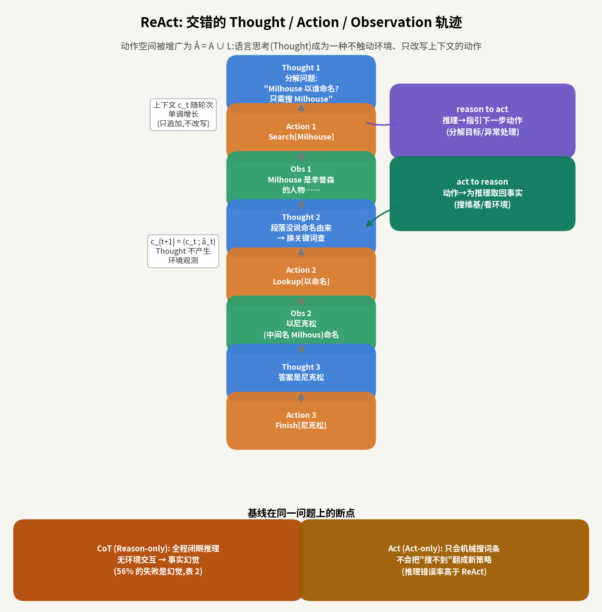
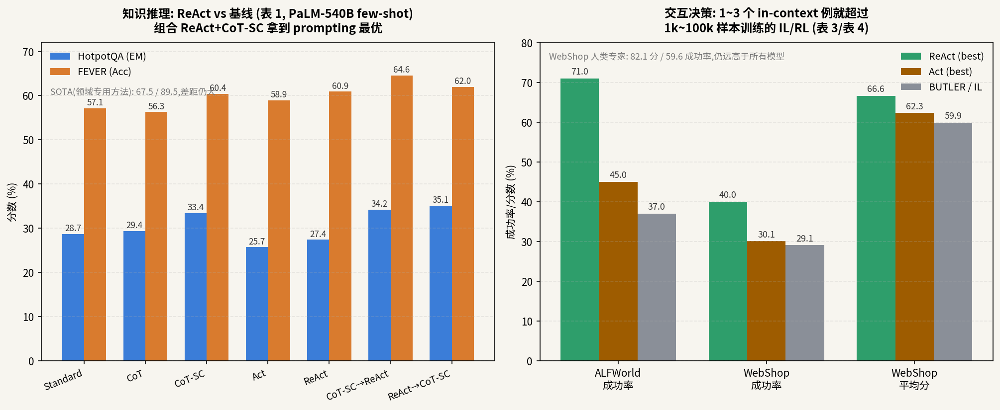

# 把"思考"也当成一个动作:ReAct 如何用一行 trick 让推理和行动互相喂饭

> **信息块**
> - 论文:ReAct: Synergizing Reasoning and Acting in Language Models
> - 作者:Shunyu Yao(普林斯顿,当时在 Google 实习)、Jeffrey Zhao、Dian Yu、Nan Du、Izhak Shafran(Google Research Brain 团队)、Karthik Narasimhan、Yuan Cao
> - 会议:ICLR 2023(正文页眉"Published as a conference paper at ICLR 2023";arXiv 2210.03629,v3 修订于 2023-03-10)
> - 链接:https://arxiv.org/abs/2210.03629 · 项目页 https://react-lm.github.io/
> - 代码:官方开源 https://github.com/ysymyth/ReAct(已 clone 到本目录 `code/`,含四个任务的 notebook、Wikipedia 环境 `wikienv.py`、prompt 文件)
> - 一句话核心洞见:**把语言思考(Thought)也定义成一种动作——它不触动外部环境,只把推理结果追加进上下文——于是"边想边做"变成同一个自回归流里的交替生成,冻结的大模型不做任何训练就能同时当推理机和执行器。**

---

## 一个反常识的起点:为什么"会想的模型"反而需要"动手"

2022 年初,思维链(CoT,Chain-of-Thought)刚点燃全场:给大模型几个"一步步想"的例子,它在数学和常识题上突飞猛进。但 Shunyu Yao 看到的是另一面——**CoT 是一个闭着眼睛的推理过程**。模型全程只跟自己的内部表示打交道,不跟外部世界确认任何事。问它"Milhouse 以谁命名",它可能一本正经地编出一个看似合理的人名,错得理直气壮。论文管这叫幻觉(hallucination,指模型编造看似合理但实际不存在的事实)和误差传播(一处想错,步步错)。

另一边,机器人/智能体圈子(SayCan、Inner Monologue、WebGPT)已经在让语言模型"动手":把观测转成文字,让模型吐动作,再用控制器执行。但这些方法几乎不让模型"想"——SayCan 每一步只做一次打分排序,Inner Monologue 的"内心独白"在 ReAct 作者看来根本不是思考,只是环境反馈的复读(第 4 节原话大意:Inner Monologue 的独白局限于"环境现在什么样、还差什么",没有目标分解、没有常识推理、没有异常处理)。

两个阵营各自缺了一半:CoT 有推理没行动,SayCan 一系有行动没推理。ReAct 的起点就是把这两半拼起来——**而且拼的方式极其便宜,不需要新架构、不需要训练,只需要改 prompt 的格式**。

这就是这篇论文的底牌。2022 年 10 月的时间点上,LLM agent 还没有统一范式,谁先给出一个"零训练成本、四个任务通吃"的通用框架,谁就定义了赛道。ReAct 的赌注是:冻结的 PaLM-540B 靠几个手写的人类轨迹例子(in-context examples,指直接写在 prompt 里的示范,不更新模型参数),就能学会在"想"和"做"之间切换。这个赌注押中了,后面 LangChain 的 Agent、AutoGPT 的循环,骨子里都是这个形状。

## 核心机制:动作空间里多了一个"不动手"的动作

先把 ReAct 的形式化定义拆开。标准智能体设定:时刻 t,智能体收到环境观测 o_t(observation,环境返回的一段文字,比如维基词条的前几句),按策略 π 从动作空间 A 里选动作 a_t。上下文 c_t 就是到目前为止的全部历史:

$$c_t = (o_1, a_1, o_2, a_2, \dots, o_{t-1}, a_{t-1}, o_t)$$

上下文就是一段 token 序列,形状上只是一串文字,没有矩阵、没有向量,这一点后面很重要——因为"思考"也要塞进同一串文字里。

ReAct 只做了一件事:**把动作空间增广**——

$$\hat{A} = A \cup L$$

L 是全部自然语言构成的空间。从 L 里选出的"动作"â_t 叫 Thought(思考痕迹),它**不作用于外部环境**,因而不产生观测反馈。它的唯一效果是改写上下文:

$$c_{t+1} = (c_t; \hat{a}_t)$$

也就是把这段思考文字追加到历史末尾,供后面的推理和行动使用。

用大白话说:以前模型每一步只能"动手"(搜词条、拿杯子),现在它多了一个选项——"停下来想一想",而这个"想"的动作不花环境交互成本,只花 token。整个轨迹变成 Thought、Action、Observation 的交错序列,同一个冻结大模型用同一次自回归生成,时而输出思考,时而输出动作。

为什么这个 trick 非如此不可?想想替代方案:你可以训两个模型,一个负责想、一个负责做,再设计它们之间的通信协议。但 2022 年的现实是,大模型推理能力已经足够强,缺的只是一个让它"在正确时机想、想完立刻做"的脚手架。把思考编码成动作,脚手架就退化成 prompt 格式设计——人类标注员只需要在自己动手的轨迹上,顺手把当时的想法用文字写下来(论文 §2 特点 A 特别强调:不需要特别的格式设计,标注员"just type down their thoughts")。这就是为什么 ReAct 能零训练成本跑起来:它把"学一个思考-行动协同策略"这个难题,转化成了"大模型本来就会的"按例子模仿文字格式。

论文总结了 Thought 的几种典型用途(§2),值得逐个记住,因为后面每个实验都在用它们:

- **分解目标、制定行动计划**(reason to act):"这个问题简化成搜 Milhouse,再查命名由来";
- **从观测里提取关键信息**:"这段没说命名由来";
- **注入常识**:"台灯一般在桌子上找";
- **追踪进度、切换子目标**:"杯子已经拿到了,下一步加热";
- **处理异常、调整计划**:"搜不到就换关键词";
- **综合出最终答案**:"……所以答案是尼克松"。

以及反方向的协同(act to reason):动手是为了给推理拿事实,比如去维基搜词条、去环境里看一眼。这两个方向就是论文反复念叨的 **reason to act / act to reason**,理解了这一对,就理解了全文。

*图 1:自绘。ReAct 的交错轨迹:Thought 只追加上下文、不产生环境观测;Action 产生 Observation 回来喂给下一轮 Thought。右侧是两种协同方向,底部是两个基线在同一问题上的断点。*

## 一条 HotpotQA 轨迹,从头走到尾

场景是论文图 1 的 HotpotQA 例子(多跳问答,HotpotQA 是一个需要综合两篇以上维基段落才能回答的问答基准)。问题:"音乐家兼讽刺作家 Allie Goertz 写了一首关于《辛普森一家》里 Milhouse 的歌,剧作者 Matt Groening 用谁的名字给 Milhouse 命的名?"(这是论文附录里的真实例子,我用中文复述)。

Wikipedia API 只有三个动作(§3.1):`Search[词条]` 返回词条前 5 句,搜不到则推荐 5 个相似词条;`Lookup[字符串]` 在当前页面里找包含该字符串的下一句(模拟浏览器的 Ctrl+F);`Finish[答案]` 结束并提交答案。注意这个 API 比真正的检索引擎弱得多——只能按精确词条名检索,这是作者故意的:逼模型用显式推理去"想搜什么",而不是靠检索器的模糊匹配蒙混过关。

ReAct 轨迹(稠密交错,每步先想后做):

- **Thought 1**:问题简化成"Milhouse 以谁命名",只需要搜 Milhouse。(这是目标分解)
- **Action 1**:`Search[Milhouse]`
- **Obs 1**:Milhouse 是《辛普森一家》的人物,Matt Groening 创造……(没提命名由来)
- **Thought 2**:这段没说命名由来,换关键词"以命名"查。(从观测提取关键信息 + 调整检索策略——这就是 act to reason 再 reason to act 的完整小循环)
- **Action 2**:`Lookup[以命名]`
- **Obs 2**:Milhouse 以美国总统尼克松命名,其中间名是 Milhous。
- **Thought 3**:答案是尼克松。(综合)
- **Action 3**:`Finish[尼克松]`

同一问题,CoT(纯推理)会怎么走?它没有 Search 动作,只能靠内部知识一路编下去。尼克松这个冷知识恰好在它的知识边界上,它可能编出"以编剧朋友命名"之类的合理谎言——论文的人工分析(表 2)显示,CoT 在 HotpotQA 上的失败里 **56% 是幻觉**,而 ReAct 的失败里幻觉是 **0%**。反过来,Act(纯行动)有 Search 但没 Thought:它搜完 Milhouse 发现没答案,下一步不知道"换关键词"这个策略,只能机械地继续搜相近词条。论文图 1(1c) 展示的就是 Act 在需要综合推理的最后一步(Act 4)直接垮掉。

这个例子暴露了 ReAct 真正的价值主张:**它不是让模型更聪明,而是给模型配了一副"拐杖"——行动是推理的拐杖(拿事实),推理是行动的拐杖(定策略)**。两根拐杖缺一根,都会在上例的某一步摔倒。

## 稀疏思考:ALFWorld 里的"想"不是每步都想

知识问答里 Thought 是稠密的(每步先想后做),但在 ALFWorld(一个文字版的 household 模拟游戏,有 50 多个位置、专家策略要 50 多步,任务如"把纸拿到台灯下看")里,论文换了策略:**Thought 是稀疏的,模型自己决定什么时候想**(§2:"we let the language model decide the asynchronous occurrence of thoughts and actions for itself")。

为什么?一个 50 步的任务如果每步都先想一段,上下文会爆炸,而且大部分步骤是机械的(走到桌子前、拿起杯子)。人类做家务也不是每步都默念。论文给 ALFWorld 标注的 Thought 只有四类:(1)分解目标,(2)追踪子目标完成情况,(3)决定下一个子目标,(4)用常识推理东西在哪("台灯一般在桌子、架子或梳妆台上")。

走一个 ALFWorld 轨迹(论文附录 D.2.1 的模式,我按论文描述复述结构):

- **Thought**:任务是"把苹果加热后放到桌上"。分解:先找苹果→加热→放桌上。苹果一般在冰箱或厨房台面。(目标分解 + 常识注入)
- **Action**:`go to fridge 1` → Obs:看到苹果。
- **Action**:`take apple 1` → …(中间一串机械动作,无 Thought)
- **Thought**:苹果拿到了,下一步找微波炉加热。(进度追踪 + 子目标切换)
- **Action**:`go to microwave 1` → Obs:微波炉是关着的。
- **Thought**:需要先打开再加热。(异常处理)
- ……

Act 基线(去掉 Thought)在同一个任务里会怎么死?论文 §4 写得很直白:它不会把大目标分解成小目标,会在环境里迷路;更典型的是"幻觉动作"——它从上下文里没读出来"sinkbasin 1 里没有 peppershaker",于是反复尝试从空水槽里拿东西。**没有 Thought,模型就没有一个"工作记忆"(working memory,指在一段文字里显式维护"我做到哪了、还差什么")的位置**。观测文字是环境给的,动作是发出去的,只有 Thought 是模型"自己的话",是它唯一能写下"我认为现在是什么情况"的地方。删掉 Thought,等于删掉模型的自我状态——这就是 Act 在 ALFWorld 上 45% 对 71% 惨败的结构性原因。

## 数字:四个任务,两种胜利

论文在四个基准上报告数字,全部用 PaLM-540B(Google 当时最大的模型,5400 亿参数,不公开)。先看知识推理(表 1):

| 方法 | HotpotQA(EM) | FEVER(Acc) |
|---|---|---|
| Standard(直接答) | 28.7 | 57.1 |
| CoT | 29.4 | 56.3 |
| CoT-SC(自洽,采样 21 条) | 33.4 | 60.4 |
| Act | 25.7 | 58.9 |
| ReAct | 27.4 | 60.9 |
| CoT-SC→ReAct | 34.2 | **64.6** |
| ReAct→CoT-SC | **35.1** | 62.0 |
| 领域 SOTA | 67.5 | 89.5 |

(EM = Exact Match,答案与标准答案逐字相同的比例;Acc = 分类准确率。CoT-SC = Self-Consistency,采样多条推理链投票,温度 0.7。)

三个观察。第一,**ReAct 在 FEVER 上赢了 CoT(60.9 vs 56.3),在 HotpotQA 上小输(27.4 vs 29.4)**——论文没有藏这个,而是正面解释:FEVER 的 SUPPORTS/REFUTES 判定经常差之毫厘,必须查实时准确的外部知识;HotpotQA 更吃推理结构,而 ReAct"想-做-看"的固定结构反而束缚了推理的灵活性(表 2:ReAct 的推理错误率 47%,高于 CoT 的 16%)。这是一个诚实的 trade-off:factuality(事实 grounded) vs flexibility(推理灵活)。

第二,**最好的 prompting 方法是 ReAct 和 CoT-SC 的组合**(35.1 / 64.6)。组合策略是两条启发式:ReAct→CoT-SC——ReAct 在限定步数(7/5 步)内没给出答案就回退到 CoT-SC;CoT-SC→ReAct——21 条采样里多数答案出现次数不足一半(说明内部知识没把握)就回退到 ReAct。图 2 显示,组合方法用 3~5 条 CoT-SC 采样就达到了纯 CoT-SC 用 21 条采样的水平。解读:内部知识和外部知识是互补的,关键是知道什么时候该信自己、什么时候该去查。

第三,**离领域 SOTA(67.5/89.5)还差得远**。ReAct 的 Wikipedia API 是故意做弱的,所以这个差距不意外,但它划定了 ReAct 的位置:一个通用 prompting 范式,不是问答 SOTA 杀手。

再看交互决策(表 3、表 4):

- **ALFWorld**(134 个未见过的游戏,成功率):ReAct 最好 trial **71%**,Act 最好 45%,BUTLER(模仿学习,每个任务类型 10 条专家轨迹训练)37%。而且 **6 个 prompt 排列里最差的 ReAct(48%)也超过了最好的 Act 和 BUTLER**。ReAct 相对 Act 的提升在 33%~90% 之间,平均 62%。
- **WebShop**(500 条购物指令,真实商品):ReAct 成功率 **40.0%**、平均分 66.6;Act 30.1%/62.3;IL(1012 条人工轨迹训练的模仿学习)29.1%/59.9;IL+RL(再加 10587 条指令做强化学习)28.7%/62.4。ReAct 用 **1 个 in-context 例子**就超过了用 1k~100k 样本训练的方法,成功率绝对提升约 10 个点(论文写 10%,实际 40.0-29.1=10.9)。但人类专家是 82.1 分/59.6% 成功率——模型离人还差一大截,论文承认差距主要在"人类会做更多轮的商品探索和 query 改写"。

*图 2:自绘,数字全部取自论文表 1(知识推理)与表 3/表 4(交互决策)。左:prompting 方法对比,组合策略最优但离领域 SOTA 仍远。右:1~3 个例子的 ReAct 超过千至十万样本训练的 IL/RL,但离人类专家仍有距离。*

## 微调实验:小模型学会"动手"之后反超大模型

第 3.3 节末尾和图 3 藏着一个容易被忽略但很重要的结果。作者用 ReAct 生成 3000 条答对的轨迹(自举,类似 STaR 的做法:先用大模型生成,再拿对的去训小模型),去微调 PaLM-8B 和 62B,让它们直接解码整条轨迹(Thought+Action+Observation 全学)。

结果:prompting 时 ReAct 在 8B/62B 上是四个方法里最差的(小模型学不会又想又做);但微调后,**8B 的 ReAct 超过所有 62B 的 prompting 方法,62B 的 ReAct 超过所有 540B 的 prompting 方法**。而微调 Standard/CoT 反而不如微调 ReAct/Act——因为前者在教模型背(可能是幻觉的)知识,后者在教模型"怎么动手查资料",后者是更通用的技能。

这个实验的潜台词很妙:prompting 证明了范式可行,finetuning 证明了范式可扩展。ReAct 的真正形态可能不是 prompt,而是一种**训练数据的格式**——把"思考+行动+观测"写成统一序列去训模型。这直接预言了后来 Agent 训练数据的标准格式(轨迹级 supervised fine-tuning)。

## 怀疑式审读:这篇论文哪里没说全

**1. ALFWorld 的"best of 6"报告方式。** 每个任务类型标注 3 条轨迹,取其中 2 条的 6 种排列做 6 个 prompt,然后报告最好 trial 的 71%。挑最好的报,天然偏高。不过论文也报了平均(57%)和最差(48%),且最差也赢了基线,所以结论方向可信,但 71% 这个数字的"最好"属性要打折扣。另外 6 个 trial 之间相对提升 33%~90% 波动巨大,说明 **ReAct 对 prompt 例子选择很敏感**——"1~2 个例子就学会"的故事背后,是例子选得好不好天差地别。

**2. 稠密 vs 稀疏,是人定的,不是学出来的。** QA 任务强制每步先想后做,ALFWorld 让模型自己决定。论文没有给出"什么时候该稠密、什么时候该稀疏"的原则,也没有消融"如果 ALFWorld 用稠密会怎样"。这是一个手工超参,藏在方法描述里。

**3. 最著名的失败模式:原地打转。** 表 2 里 ReAct 47% 的失败是"推理错误",其中一个高频模式是模型不断重复之前的 Thought 和 Action,跳不出循环。脚注 4 作者自己怀疑这是贪心解码(greedy decoding,每步只取概率最高的 token,不回溯)的锅,beam search 可能缓解。也就是说,ReAct 的一大弱点可能不是思想问题,是解码策略问题——但论文没有验证这个猜想,留了个尾巴。

**4. 组合策略的启发式很 ad hoc。** "多数答案出现不足 n/2 次就切 ReAct"、"7 步/5 步没答出来就切 CoT-SC",阈值怎么来的没有 sensitivity 分析。这是典型的"为了让数字好看加的开关",虽然方向合理(内部知识不自信时去查外部),但读者不应该把它当成原则性设计。

**5. 微调实验的训练预算不对等。** 附录 B.1:ReAct/Act 微调 4000 步,Standard/CoT 只微调 2000/1000 步,理由是后者"很快就退化"。这在逻辑上是自洽的(早停),但严格来说两边的训练预算不同,对比时要知道这个前提。

**6. 可复现性在今天已经部分失效。** 主实验用不公开的 PaLM-540B;附录 A.1 用 GPT-3(text-davinci-002)复现了一遍(HotpotQA 30.8、ALFWorld 78.4,都比 PaLM 好,作者归因于 instruction tuning),但 davinci-002 今天已经下线。更关键的是 `wikienv.py` 抓的是**实时维基百科**,今天的词条内容和 2022 年不一样,HotpotQA 的数字无法精确复现。代码层面我核对过:notebook 里确实只跑 500 个随机 dev 例子(与脚注一致),prompt 文件里有 alfworld/fever 的 JSON,HotpotQA 的 prompt 直接写在 notebook 里——与论文描述一致,没有发现论文-代码矛盾。

**7. 对 Inner Monologue 的批评有点诛心但基本成立。** 论文 §4 说 Inner Monologue 的"内心独白"不是真正的思考,只是环境反馈的复读,并做了 ReAct-IM 消融(把 Thought 限制成只复述"当前子目标是什么",去掉目标分解和常识推理):71% vs 53%。这个消融设计得干净,确实隔离了"内部推理"这个变量。但公平地说,Inner Monologue 的场景是真实机器人,反馈里包含成功检测、场景描述、人类干预,比 ALFWorld 的文字观测噪声大得多,直接对比有点欺负人。

## 时间坐标与 lineage

ReAct(arXiv 2022-10-06)站在三个前作的肩膀上,也挨个"修正"了它们:

- **CoT**(2022-01):给了"让模型写出思考过程"的技术,但 ReAct 指出 CoT 是静态黑盒,不接地。
- **SayCan**(2022-04,本系列 103):给了"LLM 提议 + 外部模型把关"的双系统,但 SayCan 的 LLM 只负责出点子,不做多步推理、不维护工作记忆。
- **Inner Monologue**(2022-07,本系列 105):给了"闭环语言反馈"的概念,ReAct 说你的独白不够"内",然后把它做成自己的消融基线(ReAct-IM)。
- **WebGPT**(2021):给了"LLM 操作浏览器"的先例,但靠的是 RLHF 重型训练;ReAct 的潜台词是:同样的事,prompt 就够了。

往后看,ReAct 定义了此后两年 LLM Agent 的**默认循环形状**:Thought → Action → Observation → Thought……LangChain 的 ReAct Agent、AutoGPT、Reflexion(在 ReAct 上加自我反思)、ReWOO,全是这个循环的变体。它的历史地位不是"效果最好",而是"格式制定者"——就像 Transformer 定义了序列建模的格式,ReAct 定义了 agent 轨迹的格式。

## 与 RAMP 的血缘/划界

ReAct 与 RAMP 的四个模块的关系:**先例(调度循环的形状)+ 正交(缺失的三个模块)**。

- **对"LLM 在线多规划器调度"模块:直接先例,但 RAMP 的增量在"调度"二字。** ReAct 的 Thought 本质上就是一次轻量调度——"下一步该搜词条还是该下结论"。但 ReAct 的调度对象是**单个动作**(Search/Lookup/Finish),且没有显式的候选比较:模型一次只生成一个动作,没有"多个规划器各提一个方案、再选"的结构。RAMP 的 LLM 调度器面对的是多个异构规划器(比如激进型/保守型/舒适型),需要显式地做选择/仲裁,这是 ReAct 没有的。另一个关键差异:ReAct 的 Thought 是自由文本,没有结构化约束;RAMP 的调度需要输出可被下游消费的结构(选哪个规划器、为什么),否则闭环校验无从谈起。
- **对"世界模型中间分布复用"模块:正交。** ReAct 的"act to reason"是向**外部环境**要观测(搜维基、看游戏文字),观测是真实发生的、不可撤销的。RAMP 的世界模型是向**内部预测**要"如果这么做会怎样"的分布,且一次前向要同时服务调度先验和风险校验。ReAct 没有"先在脑子里试一下"的概念——它的试错全发生在真实环境里,代价是真实的(在驾驶里就是撞车)。这是 RAMP 相对 ReAct 最大的范式增量:把 ReAct 的"真实试错"换成"世界模型里的廉价试错"。
- **对"风险加权自适应衰减情景记忆"模块:正交,且是 ReAct 最缺的一块。** ReAct 的"记忆"就是上下文 c_t——只追加、不遗忘、不加权,长了就截断。ALFWorld 50 步任务里,早期的 Thought 会被挤出上下文,模型会"忘记"自己为什么来这里。RAMP 的情景记忆(风险加权、随时间衰减、按风险保留)正好补的是 ReAct 的结构性短板:ReAct 假设上下文窗口无限且所有历史等权,这在长时驾驶里不成立。
- **对"闭环风险校验/安全盾"模块:正交。** ReAct 没有安全概念:Thought 里写错了,Action 就发出去了,没有第二道关卡。论文的伦理声明只说"我们把动作空间限制在安全网站",这是一种**开环的安全**(靠设计时限制),不是闭环校验。RAMP 的安全盾(候选轨迹先过风险校验再执行)是 ReAct 完全没有的维度——在驾驶场景里,没有这一层,ReAct 式的 agent 不可上路。

一句话:ReAct 给了 RAMP **最外层的循环骨架**(想-做-看-想),RAMP 在这个骨架上加了三样 ReAct 没有的东西:**做之前先在世界模型里预演、记住的按风险加权衰减、做之前先过安全校验**。写 ICAPS 论文时,related work 里把 ReAct 定位成"open-loop interleaved agent 的开山格式",RAMP 是"planning 会议口味"的回答:把格式里的每一步都变成可验证的决策问题。
