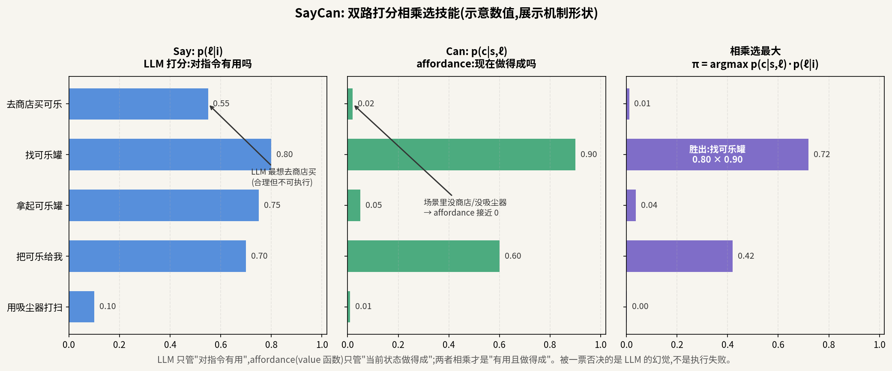
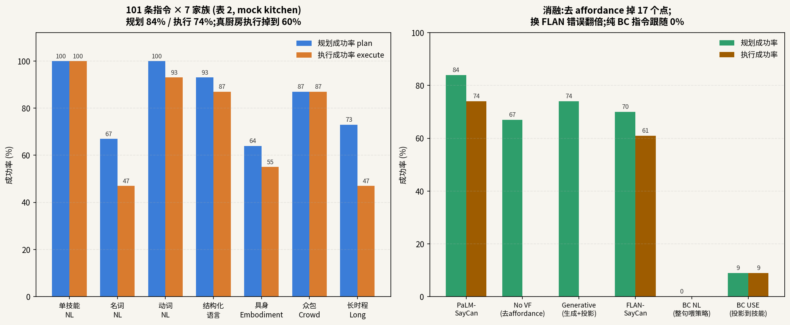

# 让语言模型"闭嘴打分":SayCan 如何用乘法把语义和物理焊在一起

> **信息块**
> - 论文:Do As I Can, Not As I Say: Grounding Language in Robotic Affordances
> - 作者:Michael Ahn 等 40 余人(按字母序),Google Robotics / Everyday Robots;通讯作者 Brian Ichter、Fei Xia、Karol Hausman
> - 会议:CoRL 2022(arXiv 2204.01691,v2 修订于 2022-08-16;项目页 say-can.github.io 标注 CoRL 2022 Submission 263)
> - 链接:https://arxiv.org/abs/2204.01691
> - 代码:官方仅开源 tabletop 演示(Google Colab:UR5 + CLIPort 策略 + ViLD 检测器做 affordance + GPT-3);真实厨房系统的 551 个技能、value 函数与 PaLM 打分管线**未开源**,核心实验不可复现
> - 一句话核心洞见:**不让 LLM 自由生成计划,而让它给固定的技能候选打分("对指令有用吗"),再乘上每个技能的 value 函数("当前状态做得成吗"),乘积最大的技能就是"有用且做得成"的下一步——语义和物理第一次被写成两个可相乘的概率。**

---

## 先看那个让所有人傻眼的例子

"我把饮料洒了,能帮忙吗?"——2022 年 4 月,你把这句话喂给当时最强的语言模型,它会给你一段合情合理的叙述:"你可以试试用吸尘器。"问题是:厨房里没有吸尘器,机器人也不会用吸尘器。这段话**语义上满分,物理上零分**。

SayCan 整篇论文就是对这个例子的回答。它的立场很硬:LLM 的毛病不是"不够聪明",而是**它这辈子没摸过任何东西**——论文引言引用 Bender & Koller 的论点,LLM 只在文字里见过世界,从没观测过自己的输出对物理过程产生什么后果。所以它分不清"我知道怎么做"和"我现在做得到"的区别。人类心里这两件事是分开的:你知道"去商店买可乐"是清理思路,但你也知道"现在半夜三点商店关门"所以做不成。SayCan 把这种常识拆成两个独立的概率源,让它们相乘。

这就是标题"Do As I Can, Not As I Say"的含义:**听我的能力(Can),别听我的嘴(Say)**。

## 前人真正撞墙的地方

SayCan 之前,用 LLM 做机器人规划的标准做法是 prompt engineering(提示工程,指精心设计例子诱导模型按固定格式输出):代表作是同年 1 月的 "Language Models as Zero-Shot Planners"(Huang et al.,ICML 2022)——给 LLM 几个"指令→步骤"的例子,让它自由生成(sampling)出动作序列。

这个做法撞了两堵墙,论文 §3 写得很具体:

1. **生成的东西可能根本不在机器人的能力范围内**(inadmissible actions)。LLM 自由生成时没有任何机制把它约束在"机器人会的那 551 个技能"里,它会输出"用吸尘器"这种技能库里没有的东西,或者格式乱到解析不出步骤。
2. **即使技能都在库里,也可能在当前状态下做不成。** "给我拿个苹果"——如果视野里没有苹果,或者手里已经拿着一个,正确的下一步完全不同。纯 LLM 看不到状态,它的 plan 是开环的。

SayCan 的解法是对这两堵墙各开一扇门:第一扇门叫 **scoring**(打分,不用 LLM 自由生成,而是对固定的技能描述逐个算概率,天然约束在技能库内);第二扇门叫 **affordance**(能力可供性,生态心理学 Gibson 1977 的概念:环境向特定身体"提供"了哪些行动可能,比如"椅子向人提供可坐性")。

## 核心公式:一次乘法,两种 grounding

设用户指令为 i,技能库里的每个技能 π 有一段文本描述 ℓ_π(比如"find a sponge")。我们关心的是:**技能 π 成功地推动指令 i 的概率**,记作 p(c_π | i; s, ℓ_π),其中 c_π 是一个 Bernoulli 随机变量(0/1,技能做成/没做成),s 是当前状态。

论文 §3 的关键推导(我把它展开写):

$$p(c_\pi \mid i; s, \ell_\pi) \;\propto\; p(c_\pi \mid s, \ell_\pi)\; p(\ell_\pi \mid i)$$

推导逻辑分三步,每一步都是一个可以质疑的假设——先正面讲,再在怀疑节里质疑:

**第一步,拆"做成且有用"。** 技能 π 对指令 i 有进展,当且仅当"它被执行且成功了"并且"它是正确的下一步"。论文假设:**做失败的技能,对指令的进展贡献为零;做成功的技能,对指令有进展的概率就是"它是正确下一步"的概率**。于是联合概率拆成"做得成"乘以"该做"。

**第二步,两个因子各找各的妈。** p(ℓ_π | i) 叫 **task-grounding**(任务接地):给定指令 i,技能描述 ℓ_π 是合理下一步的概率——**只跟语言有关,看不见状态**,由 LLM 打分。p(c_π | s, ℓ_π) 叫 **world-grounding**(世界接地):在状态 s 下执行 ℓ_π 能成功的概率——**只跟物理有关,不管指令**,由 value 函数给出。

**第三步,选乘积最大的:**

$$\pi_n = \arg\max_{\pi}\; p(c_\pi \mid s_n, \ell_\pi)\; p(\ell_\pi \mid i, \ell_{n-1}, \dots, \ell_0)$$

选出来执行,执行完把它的描述追加到 prompt 里("1. find a sponge, 2. …"),下一轮重新对所有技能打分,直到选出终止符"done"。这就是算法 1,一个贪心的单步前视循环。

为什么这个乘法"只能长这样"?想象你在餐厅点菜:菜单(LLM)告诉你"龙虾意面很配今天的主题",服务员(affordance)告诉你"龙虾卖完了"。你要的不是"最好吃的",也不是"最有货的",而是"好吃且有货"的。乘法就是"且"的概率表达——**任何一路接近零,乘积就接近零,一票否决**。LLM 的幻觉("去商店买可乐")不是靠更聪明的 LLM 修好的,是靠 affordance 那一路的零把它乘死的。这个设计把"纠正幻觉"的责任从语言模型手里拿走,交给了物理世界。这是 SayCan 相对纯 prompting 路线最根本的不同:它不相信 LLM 能自己变靠谱,它给 LLM 配了一个"现实检查员"。

*图 1:自绘,数值经构造仅展示机制形状。"去商店买可乐"LLM 打分最高(0.55),但 affordance 接近 0(半夜没商店),乘积被一票否决;胜出的是"找可乐罐"。*

## Affordance 从哪来:value 函数的"第二职业"

World-grounding 那一路 p(c | s, ℓ) 从哪来?论文的答案是:**拿强化学习的 value 函数来兼职**。

先讲大白话。Value 函数 V(s) 在强化学习里本来表示"从状态 s 出发,按当前策略走下去,未来能拿到多少折扣奖励"。SayCan 给每个技能设了**稀疏奖励**:整个 episode(一次执行)结束时,人类看了录像判定做成了就给 1,没做成就给 0,中间全是 0。在这种设定下,value 函数的数学含义坍缩成一件事:**"从当前状态出发,这个技能最终做成的概率"**——正好就是 affordance 想要的量。这就是 §2 "Preliminaries"里那段话的实质:稀疏 0/1 奖励下的 value 函数,天然就是"做得成吗"的概率估计。

实现上有个分工(§4),值得细看,因为它暴露了工程现实:

- **策略(policy,负责动手)**用 BC-Z 做行为克隆(behavioral cloning,看人类演示学动作)训练——因为在当时的数据量下,BC 的成功率比 RL 高。
- **value 函数(负责打分)**用 MT-Opt 做 RL 训练——因为只有 RL 的 TD 更新(temporal-difference,时序差分,一种用"下一步的估计"来修正"这一步的估计"的学习方法)能给出像样的成功概率估计。BC 学出来的是"怎么做",不是"做不做得成"。
- 为了摊薄 551 个技能的训练成本,策略和 value 函数都是**语言条件的多任务模型**:输入是技能文本描述的 embedding(用预训练句子编码器,冻结参数),一个模型服务所有技能,而不是 551 个独立模型。

技能库本身:551 个技能,7 大家族(拿、放、整理、开关抽屉、导航、按配置摆放……),覆盖 17 种物体。实验实际用了其中"最适合组合、当前数据下性能最高的"子集(§4 原话,具体哪几个见附录 D——**论文没有在正文列出确切数量,这是一个信息缺口**;后文会回到这一点)。

## 一次完整的决策:把"我刚健完身"走完

论文图 5a 的真实例子(我用中文复述结构):指令"**我刚健完身,能带点喝的和吃的来帮我恢复吗?**"

- **第 1 轮**:LLM 对 551 个技能打分。"find a water bottle""find an apple"得分高(任务 grounding:运动后恢复→水和健康零食,这是 LLM 从文本里学到的常识);"find a coke can"得分低(可乐不健康)。Affordance 那一路:水和苹果都在视野里,value 高。乘积最大的是"find a water bottle"→执行。
- **第 2~3 轮**:"pick up the water bottle"→"bring it to you"。注意顺序是模型自己排出来的:先找、再拿、再送,LLM 的打分天然理解这个时序(论文图 6 专门展示了这一点)。
- **第 4 轮起**:prompt 里已经有了"1. find water, 2. pick up water, 3. bring it to you",LLM 打分时看到"喝的已经送过了",于是"find an apple"升到最高——**历史被编码在 prompt 的追加序列里,模型自己做了进度追踪**。
- **最后**:"done"的乘积最高,终止。

这个例子展示了 SayCan 最漂亮的一面:抽象名词("恢复"→水+苹果)、时序常识(找→拿→送)、进度追踪,全是 LLM 的语义知识在干活;而"水在视野里所以找得到"是 affordance 在干活。两路各干各的,乘法把它们拼起来。

但论文也诚实地报告了它**最丑的失败**(§5.1):长时程任务里最常见的失败是 **LLM 提前终止**——带了一样东西就"done"了,忘了还要带第二样。因为终止决策也是靠打分,没有显式的"任务清单"数据结构,LLM 的"记得"全靠 prompt 里那串追加文字,长了就漏。这和 ReAct 的上下文遗忘是同一个病根:记忆=prompt,既不加权也不结构化。

## 数字:101 条指令,两个厨房

实验设置(§5):移动机械臂(Everyday Robots,7 自由度手臂+两指夹爪),两个厨房——mock kitchen(技能训练的环境,摆设固定)和真实办公厨房;15 种常见物品,5 个语义位置(两个台面、一张桌子、垃圾桶、用户位置)。101 条指令分 7 个家族(表 1):单技能 NL、名词 NL、动词 NL、结构化语言、具身(Embodiment,从不同完成阶段开始,考"看状态")、众包、长时程。

两个核心指标(都是 3 个人工评分、2/3 通过):**plan 成功率**(选的技能序列对不对,不管执行)和 **execute 成功率**(机器人真做成了没有)。

| 家族 | mock plan | mock execute | 真厨房 plan | 真厨房 execute |
|---|---|---|---|---|
| 单技能 | 100% | 100% | 93% | 87% |
| 名词 | 67% | 47% | 60% | 40% |
| 动词 | 100% | 93% | 93% | 73% |
| 结构化 | 93% | 87% | 93% | 47% |
| 具身 | 64% | 55% | 64% | 55% |
| 众包 | 87% | 87% | 73% | 60% |
| 长时程 | 73% | 47% | 73% | 47% |
| **总计** | **84%** | **74%** | **81%** | **60%** |

(表 2,PaLM-540B。名词家族最差:15 种物体×5 个位置的组合太多,LLM 在细粒度指称上弱;具身家族 64% 的 plan 失败主要来自 affordance 误分类。)

消融(表 2 右半):

- **No VF**(只用 LLM 打分,不乘 affordance):plan 67%——**掉了 17 个点**,这是 affordance 价值最直接的证据。尤其在具身家族,No VF 只有 18%(vs 64%),说明"看状态"几乎全靠 value 函数。
- **Generative**(LLM 自由生成再投影到最近技能,对应 Huang et al. 的做法):plan 74%,介于两者之间,且失去了可解释的概率(没法和 affordance 相乘)。
- **BC NL**(整句指令直接喂给低层策略):**0%**——标准模仿学习范式在这种抽象长时程指令上全军覆没。
- **BC USE**(指令 embedding 找最相似的技能序列):单技能 60%,其余 0%。
- **FLAN-SayCan**(137B FLAN 替代 540B PaLM):plan 70%/execute 61%,错误率相对 PaLM 版几乎翻倍。论文的解读很激动:**这是第一次看到"换更大的语言模型,机器人直接变强",NLP 和机器人可以一起 scale**。

错误归因:65% 是 LLM 失败(打分错、提前终止、否定理解差),35% 是 affordance 失败(value 误分类)。

*图 2:自绘,数字取自论文表 2/表 3。左:七个家族的规划/执行成功率,名词与具身家族是短板。右:消融对比,去 affordance 掉 17 个点,换小模型错误翻倍,纯 BC 指令跟随归零。*

## 怀疑式审读:乘法很漂亮,但每一步都有税

**1. Value 函数的输出真的是概率吗?** 这是整个大厦的地基,论文没有检验。TD 学出来的 value 在训练分布内近似成功概率,但在分布外(OOD)会系统性高估(Q 学习的高估偏差是老问题)。具身家族 64% 的 plan 成功率、"失败主要来自 affordance 误分类"(§5.1 原话),说明 value 函数在"能不能做成"这个它唯一负责的问题上,错了三分之一。论文没有做任何校准分析(calibration,预测概率 0.8 的那些 case 里是不是真有 80% 做成了),也没有画可靠性曲线。乘法对一路的零很敏感,但对一路的**虚高**同样敏感——虚高的 affordance 会把 LLM 的烂点子放行。

**2. 每步 551 次打分,成本呢?** 算法 1 的 for 循环是对**全部技能**逐个算 p_LLM 和 p_affordance。551 次 PaLM-540B scoring + 551 次 value 网络前向,每一步都来一遍。论文对推理成本只字不提。在真实机器人上,这是部署的第一道坎。后来的工作(RT-2 等)走端到端,部分原因就是 SayCan 这种"每步全库打分"太贵。

**3. 指标是人评的,主观性多大?** plan 和 execute 成功率都靠 3 个 rater 看录像/看序列投票,"多个有效解"的问题(先拿海绵还是先扔罐子都对)靠 rater 自行判断。论文没有报告 rater 间一致性(比如 Fleiss' kappa)。84% 这个数字的误差棒是未知的。

**4. 真厨房 execute 从 74% 掉到 60%。** plan 只掉了 3 个点(84→81),说明 LLM 打分泛化得不错;execute 掉了 14 个点,说明**低层技能和 value 函数的泛化才是瓶颈**。论文的标题故事是"LLM grounding",但数字说:grounding 的那一路(Can)恰恰是泛化最差的一路。这个反差论文没有正面讨论。

**5. BC NL 的 0% 是个稻草人。** 把"帮我恢复一下"这种抽象长时程指令直接喂给单步策略,本来就不该 work。这个基线的作用是"证明问题很难",不是"证明我们的方法好"。真正的 hard baseline 应该是 Generative(74%),差距是 10 个点——依然显著,但没有 84 vs 0 那么戏剧化。

**6. 实验用的技能子集没有在正文交代。** §4 说"我们使用最适合组合、当前数据下性能最高的子集",具体数量和选择标准在附录 D。这意味着 551 是技能库的总数,不是实验的动作空间大小。动作空间越大,argmax 越难,这个数字直接影响结果的可比性,放在附录里不合适。

**7. 开环:技能失败了怎么办?** 论文结论自己承认:如果技能 value 很高但实际执行失败了,系统没有反应机制——下一轮打分时,失败的那个技能 value 可能还是高,于是重复执行。这是 SayCan 架构性的洞:它的"闭环"只闭在"选下一步"上,没有"上一步做成了吗"的反馈通道。**Inner Monologue(本系列 105)正是来补这个洞的**:加成功检测、场景描述、人类反馈,让 LLM 能看到执行结果。

**8. 40 多个作者、字母序。** 这是一篇大工程论文:机器人、数据采集、标注管线、sim2real、策略训练,每一块都是一个团队。它的贡献一半在思想(乘法),一半在"我们真的在真实厨房跑了 101 个任务"。读的时候要分开评价:思想可迁移,工程不可复现(核心代码没开源)。

## 时间坐标:机器人 LLM 化第一波的"定心丸"

2022 年 4 月的时间点:CoT 刚出来 3 个月,PaLM 还没正式发布(论文用的是内部版 540B),机器人圈对 LLM 的态度是"这东西会聊天,但跟我的机械臂有什么关系"。SayCan 是第一波里**唯一在真实机器人、真实厨房、101 个任务上交出数字**的工作,它的历史作用是"定心丸":证明 LLM 的语义知识真的能变成机器人的行动力,而且**换更大的 LLM 机器人直接变强**(表 3)——这句话在 2022 年是对整个机器人圈喊的:你们不需要等机器人数据 scale,去抱 NLP 的大腿就行。

往后看:它的开环洞由 Inner Monologue(2022-07)来补;它的"技能库+打分"范式被 Code as Policies(2022-09)用"代码生成"部分替代;它的 value-as-affordance 思想在 RT 系列里被端到端 VLA 吸收。SayCan 自己则成了所有"LLM 机器人规划"论文必须引用的 related work 第一段。

## 与 RAMP 的血缘/划界

SayCan 与 RAMP 的关系:**"调度"思想的直系祖先,但调度对象和仲裁机制完全不同;安全观的反面教材**。

- **对"LLM 在线多规划器调度"模块:直接先例,机制可迁移。** SayCan 的 argmax_π p(can)·p(say) 本质上就是一次**调度**:从候选集合(技能库)里按"有用×可行"选一个执行。RAMP 的 LLM 调度器面对的是多个规划器候选,结构高度同构:SayCan 的 p(ℓ|i) 对应 RAMP 里"规划器输出与指令的语义匹配度"(调度先验),p(c|s,ℓ) 对应"候选轨迹的风险/可行性评分"。**RAMP 可以把 SayCan 的乘法调度写成自己调度器的特例**,这是 related work 里很好的一句话:"from skill selection to planner selection"。增量在于:(1)SayCan 的候选是离散技能,RAMP 的候选是连续轨迹,需要世界模型给出分布而非单点 value;(2)SayCan 是贪心单步,RAMP 需要多步前视(规划器输出的是整条轨迹)。
- **对"世界模型中间分布复用"模块:启发,但方向相反。** SayCan 的 affordance 是**向后看**的(这个技能历史上做成过几次),RAMP 的世界模型是**向前看**的(这条轨迹未来会撞吗)。两者都是"给 LLM 配一个现实检查员",但 SayCan 的检查员是统计记忆,RAMP 的检查员是生成式预测。在驾驶这种长尾场景里,向后看是不够的——灰猫在黑夜里这种 case 历史上没出现过,value 函数给不出有意义的分数。这正是 RAMP 用世界模型替代 value 函数的动机,可以在论文里明写。
- **对"风险加权自适应衰减情景记忆"模块:正交。** SayCan 没有记忆模块:历史只存在于 prompt 的追加序列里,长了就漏(提前终止的失败模式就是证据)。RAMP 的情景记忆补的是 SayCan 同款短板,但做得更进一步——不是简单追加,而是风险加权+自适应衰减。
- **对"闭环风险校验/安全盾"模块:反面教材,划界用。** SayCan 是**开环**的:选出技能就执行,没有第二道关卡;论文自己承认技能失败无反应机制。在机器人慢速场景里这只是"任务失败",在驾驶里这就是事故。RAMP 的安全盾(候选轨迹先过风险校验)正是 SayCan 架构里缺失的那一环。写论文时可以把 SayCan 放在"open-loop grounding"的代表,与 RAMP 的"closed-loop verification"形成对照——这是 ICAPS 审稿人会喜欢的 framing:从 open-loop selection 到 closed-loop verified selection。

一句话:SayCan 教会领域"**LLM 只管提议,可行性另找人算,两者相乘**";RAMP 把这句话搬到驾驶上,但把"另找人算"的部分从 value 函数升级成世界模型,又加了记忆和安全盾。SayCan 是 RAMP 调度器最正统的血缘祖先,引用时要给足尊重,划界时要钉死"开环 vs 闭环"这一刀。
