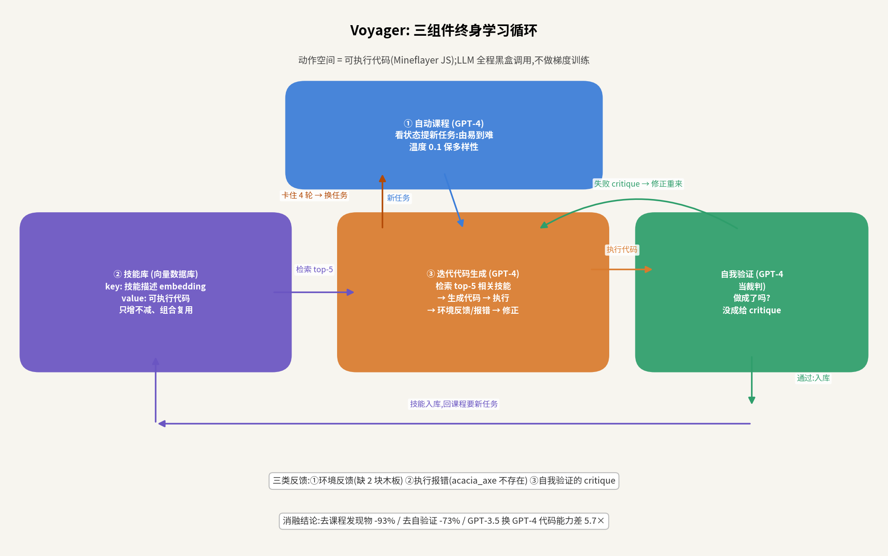
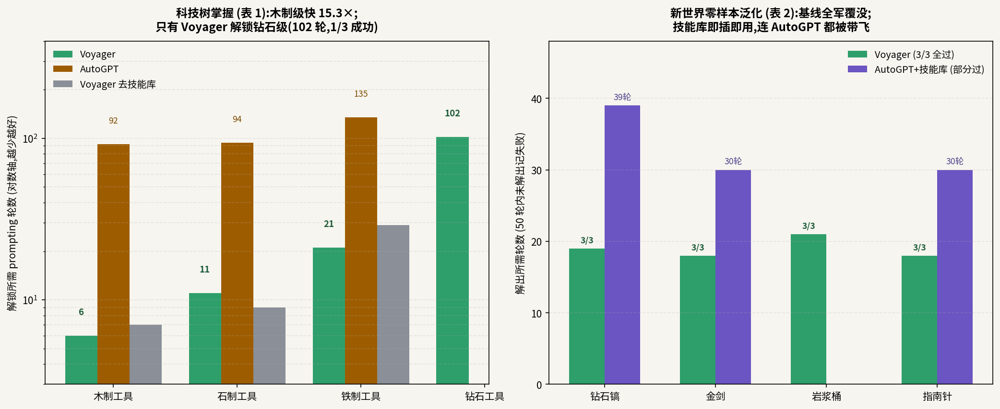

# 不训练任何参数,靠"写代码+攒代码"通关 Minecraft:Voyager 的终身学习循环

> **信息块**
> - 论文:Voyager: An Open-Ended Embodied Agent with Large Language Models
> - 作者:Guanzhi Wang(Caltech, NVIDIA 实习)、Yuqi Xie、Yunfan Jiang、Ajay Mandlekar、Chaowei Xiao、Yuke Zhu、Linxi "Jim" Fan、Anima Anandkumar(NVIDIA/Caltech/UT Austin/Stanford/UW Madison)
> - 会议:TMLR 2024(Transactions on Machine Learning Research;arXiv 2305.16291,初版 2023-05-25,v2 修订于 2023-10-19;项目页 https://voyager.minedojo.org)
> - 链接:https://arxiv.org/abs/2305.16291
> - 代码:官方开源 https://github.com/MineDojo/Voyager(已 clone 到本目录 `code/`;含 `voyager/agents/{action,critic,curriculum,skill}.py`、`skill_library/trial{1,2,3}` 三次运行的技能库快照)。核对结论:代码结构与论文 §2 三组件一一对应;`action_agent_task_max_retries=4` 与论文"卡住 4 轮就换任务"一致;温度默认 0 与 §3.1 一致
> - 一句话核心洞见:**把"学技能"变成"写代码、把代码存进向量库、下次检索复用"——终身学习不需要梯度,只需要一个只增不减的程序库和一个会出题、会改错、会判分的 GPT-4 循环。**

---

## 为什么是 Minecraft,为什么是"不训练"

2023 年 5 月,GPT-4 发布才两个月。具身智能当时有两条路:一条是 VPT 那种——看像素、输出底层动作,用海量人类视频做行为克隆,又贵又难泛化;一条是 SayCan/Code as Policies 那种——LLM 当规划器,但任务都是人给的,做完就忘,没有"越玩越厉害"。

Voyager 盯住的是第三个问题:**开放世界里没有终点,谁来出题?** Minecraft 没有预设结局,人类玩家自己找事做:先砍树、再做工作台、再挖石头、再打僵尸——一个自发形成的课程。经典 RL 的课程学习(curriculum learning,按难度排序任务)需要人设计,而开放世界要的是**智能体自己给自己出题**。Voyager 的赌注是:GPT-4 互联网规模的知识里已经装着"Minecraft 该怎么玩",让它同时当**出题人、做题人、改卷人**,一个黑盒循环就能跑出终身学习,全程不碰模型参数。

这个赌注的时代注脚很重要:2023 年初,OpenAI 刚开放 GPT-4 API,整个社区都在问"除了聊天,GPT-4 还能干什么"。Voyager 是第一批"把 GPT-4 当操作系统"的作品——它的三组件(课程、技能库、迭代执行)后来成了 LLM Agent 的标准件:自动课程启发了无数"self-evolving agent",技能库就是今天 Agent 记忆/工具库的前身,自我验证则是 LLM-as-judge 的早期形态。

## 三组件:出题人、笔记本、改错循环

### ① 自动课程:一个会看状态的出题人

课程模块就是一个精心设计的 GPT-4 prompt(§2.1,完整 prompt 在附录 A.3)。输入四样东西:

1. **指令**:终极目标是"发现尽可能多样的东西",但"下一个任务别太难,我可能没资源、技能也不够";
2. **智能体当前状态**:背包、装备、附近的方块和生物、生物群系(biome,沙漠/森林等地形类型)、时间、血量、饥饿值、坐标;
3. **已完成/失败的任务清单**:知道自己走到了哪,别出重复的题;
4. **GPT-3.5 的自问自答**:针对当前状态提几个问题再回答(省钱,GPT-3.5 便宜 15 倍),给 GPT-4 提供额外上下文。

论文图 3 的真实例子:背包里有木镐和石头→出题"做一把石镐";在河边、有鱼竿→出题"钓一条鱼";饥饿值为 0、附近有猪→出题"杀一头猪";晚上、有僵尸、有石剑→出题"杀一只僵尸"。**出题逻辑=状态+常识+难度匹配**,全是 GPT-4 的互联网知识在干活,没有学过任何"Minecraft 课程"。

### ② 技能库:只增不减的程序笔记本

这是 Voyager 最有远见的设计。每个学会的技能存成**可执行的代码**(Mineflayer 的 JavaScript API),比如 `craftStoneSword()`、`combatZombieWithSword()`。存储结构是向量数据库(§2.2,图 4):

- **key**:技能**文本描述**的 embedding(用 GPT-3.5 / text-embedding-ada-002 生成);
- **value**:代码本身。

检索时:先让 GPT-3.5 针对新任务写一段"怎么做"的通用建议,和当前环境反馈拼成查询,取 top-5 相关技能塞进代码生成的 prompt 里做 in-context 学习。

为什么用代码而不用神经网络权重当技能?论文 §2.2 的论证值得展开:**代码天然是时序延展的**(一个函数里可以顺序调用挖矿、合成、战斗)、**可组合的**(复杂技能调用简单技能当子程序,比如打僵尸前先检查背包、没有剑就先做剑)、**可解释的**(人能读)。这三条恰好是神经网络技能最缺的三条。代价是:代码是离散的,没法梯度优化——但 Voyager 本来就不用梯度。

"终身学习不遗忘"在这里是**靠架构免费得到的**:库只增不减,旧技能永远在,新技能调用旧技能。所以论文摘要里"alleviates catastrophic forgetting"(缓解灾难性遗忘,指学新任务时把旧任务忘掉)与其说是实验结论,不如说是设计使然——**它没有测量遗忘,只是让遗忘在结构上不可能发生**。这一点后文怀疑节会展开。

### ③ 迭代提示:执行→报错→改,直到裁判点头

LLM 一次写对 Minecraft 控制代码的概率不高(论文引用 Codex 的结论)。Voyager 的解法是三类反馈的循环(§2.3,图 5/图 6):

1. **环境反馈**:在控制 API 里埋 `bot.chat()`,执行中途喊话,比如"我做不了木棍,还差 2 块木板"——让 GPT-4 知道**缺什么**;
2. **执行报错**:解释器的 error trace,比如 `No item named acacia_axe`(Minecraft 里根本没有金合欢木斧)——让 GPT-4 知道**写错了什么**;
3. **自我验证**:另起一个 GPT-4 当裁判,输入当前状态和任务,判"做成了吗",没成就给 critique(批评意见),比如"去地下找紫水晶碎片"。

循环直到裁判点头,代码入库;**如果卡住 4 轮还搞不定,就放弃这个任务,回课程要个新题**(代码里 `action_agent_task_max_retries=4`,已核对)。这个"4 轮止损"很关键:它让智能体不会在一道难题上烧光预算,而是先去学别的,以后再回来——很像人类玩家的策略。

*图 1:自绘。Voyager 的终身学习循环:课程出题→检索技能→生成代码→执行→三类反馈→裁判验证→入库→出新题。卡住 4 轮自动换题。*

## 数字:160 轮里发现 63 种物品,基线还在原地打转

实验基于 MineDojo + Mineflayer,用 `gpt-4-0314` 和 `gpt-3.5-turbo-0301`,温度全 0(课程 0.1 保多样性)。基线是作者自己"翻译"到 Minecraft 的 ReAct、Reflexion、AutoGPT(原作都是纯 NLP 工具,没有 Minecraft 版——**这个"翻译"的公平性后文会质疑**)。

**探索**(图 1):160 个 prompting 轮次里,Voyager 发现 **63 种**独特物品,是基线的 **3.3 倍**;跑图距离是基线的 **2.3 倍**。

**科技树**(表 1,解锁到某级工具所需的 prompting 轮数,越少越好;3 次试验平均):

| 方法 | 木制 | 石制 | 铁制 | 钻石 |
|---|---|---|---|---|
| ReAct | 0/3 未解锁 | 0/3 | 0/3 | 0/3 |
| Reflexion | 0/3 | 0/3 | 0/3 | 0/3 |
| AutoGPT | 92±72 | 94±72 | 135±103 | 0/3 未解锁 |
| Voyager 去技能库 | 7±2 | 9±4 | 29±11 | 0/3 |
| **Voyager** | **6±2** | **11±2** | **21±7** | **102(1/3)** |

摘要里的"15.3 倍"是木制级 92/6 算出来的;石制 8.5 倍、铁制 6.4 倍——**标题数字取的是最漂亮的那一级**。钻石级只有 Voyager 解锁,但 3 次里只成功 1 次,方差极大。

**零样本泛化**(表 2):清空背包、换新世界,做 4 个没见过的任务(钻石镐、金剑、岩浆桶、指南针),50 轮内解出算成功。Voyager **4 个全过**(19/18/21/18 轮,都是 3/3);三个基线**全军覆没**(0/3)。最有意思的一行是"AutoGPT + 我们的技能库":1/3、1/3、0/3、2/3——**技能库是即插即用的,换个智能体也能用**。这是全篇最有说服力的证据:知识真的被沉淀成了可迁移的资产,而不是锁在某次 prompt 里。

**消融**(图 9):

- 课程换成随机的:发现物 **-93%**——没有由易到难的出题,智能体直接去挑战做不出的任务,原地空转。
- 去掉自我验证:-73%——裁判是"什么时候换题"的唯一决策者,没它就不知道任务到底做成没。
- 去掉技能库:后期 plateau(平台期)——能学会新东西,但复杂技能无法站在旧技能肩膀上。
- GPT-3.5 换 GPT-4 写代码:发现物差 **5.7 倍**——"GPT-4 的代码能力是质变",这是 2023 年中期的共识,Voyager 是最早的实证之一。

*图 2:自绘,数字取自论文表 1(科技树,对数轴)与表 2(零样本泛化)。左:只有 Voyager 解锁钻石级,但 3 次中仅成功 1 次。右:技能库可迁移,连基线 AutoGPT 装上后也能解出部分新任务。*

## 怀疑式审读:光环之下的七个问题

**1. 基线是"作者版"的,ReAct 的 0/3 不正常。** ReAct/Reflexion/AutoGPT 本来都没有 Minecraft 实现,是作者"尽力翻译"的(§3.2 原话 "we make our best effort")。ReAct 在四个科技树级别上全部 0/3——一个连木制工具都做不出的 ReAct,和原论文里在 ALFWorld 上 71% 的 ReAct 是同一个方法吗?问题很可能出在"翻译"上:ReAct 的动作空间被设成了"生成代码",而 ReAct 原生是为短文本动作设计的,让它直接写 Mineflayer 代码等于让它裸考。**基线的惨败可能更多是"水土不服",而不是"方法不行"**。公平的对比应该给基线也配上技能库(作者只给 AutoGPT 配了,配完 AutoGPT 确实在泛化任务上活过来了——这反而证明技能库才是最大变量)。

**2. "15.3 倍"取的是最漂亮的一级,钻石级 1/3。** 木制 15.3×、石制 8.5×、铁制 6.4×,标题只写最大的。钻石级 102 轮、3 次成功 1 次——按同样的"取最好"逻辑,这个数字的方差大到几乎不能当结论用。论文没有报告钻石级失败的那两次卡在哪,是一个信息缺口。

**3. "缓解灾难性遗忘"没有被测量。** 技能库只增不减,旧技能不可能被覆盖,所以"不遗忘"是架构的免费午餐,不是实验发现。真正的终身学习难题——库膨胀后检索质量下降、新旧技能冲突——论文没有涉及。技能库的规模曲线(160 轮后库里有多少技能、检索 top-5 的命中率)没有报告。

**4. 裁判和运动员是同一个人。** 自我验证用 GPT-4 判 GPT-4 生成的代码做没做成。论文自己承认裁判会犯错(§4:把"蜘蛛丝"没认成"打败蜘蛛"的成功信号)。更深的问题是**系统性偏差**:生成器和裁判共享同一个世界模型,生成器的幻觉(比如以为"铜剑"存在)裁判也可能信。没有 ground-truth 成功检测器,整个循环的"做成"标准是 LLM 的主观判断——在 Minecraft 里这只是分数虚高,在真实系统里这是安全隐患。

**5. 成本:黑盒调用的账单。** 论文 §4 承认 GPT-4 比 GPT-3.5 贵 15 倍,但没有给出跑 160 轮到底花了多少钱、调了多少次 API。一个任务要经过:课程(1 次 GPT-4)+代码生成(每轮 1 次,最多 4 轮)+裁判(每轮 1 次)+技能描述/GPT-3.5 若干次。粗估一个任务几十次 GPT-4 调用,160 轮就是数千次——**这是"不训练参数"省下的钱,全交给了 API 账单**。论文把"无需微调"写成优点,但没有给出总成本,读者无法判断这条路线的经济性。

**6. 感知被抽象掉了,"具身"是打折的。** 智能体看不到像素,状态是 Mineflayer 给的结构化文本(背包、坐标、附近生物)。论文明确说不跟 VPT 这类像素输入的方法比(§3.2),理由是"不正交、可组合"。这话没错,但读者要清楚:Voyager 解决的是"有了完美感知和底层控制之后,上层怎么学",而真实机器人最难的恰恰是感知和控制。它的"具身"是文本具身。

**7. 课程的幻觉:让智能体去做不存在的东西。** §4 承认课程偶尔出"做铜剑""做铜胸甲"这种游戏里不存在的任务,代码生成时也会用圆石当燃料(无效)。课程模块没有任何"任务是否合法"的检查,靠 4 轮止损兜底。这在 Minecraft 里是浪费几轮,在开放世界机器人里可能是危险动作——**出题人也需要一个现实检查员**,而 Voyager 没有。

## 时间坐标:GPT-4 元年的"操作系统"演示

2023 年 5 月的 arXiv,距离 GPT-4 API 开放不到两个月。Voyager 是第一批回答"GPT-4 除了聊天还能干什么"的重磅作品,它的真正贡献不是某个数字,而是**证明了"LLM 当循环操作系统"的可行性**:出题、做题、改卷、攒笔记,四个角色全由 prompt 驱动,不需要一个梯度。

它的三组件后来被拆开、各奔东西:自动课程→"self-evolving agents""curriculum learning with LLM";技能库→Agent 的工具库/记忆库(今天每个 Agent 框架都有个 skill/tool registry,形状就是 Voyager 的 key-value 库);自我验证→LLM-as-judge。TMLR 2024 的发表(而非投某个截止日期的会议)也符合它的气质:这是一篇"宣布范式"的论文,不是"刷 SOTA"的论文。

## 与 RAMP 的血缘/划界

Voyager 与 RAMP 的关系:**记忆(技能库)思想的直接血缘;其他三块正交或反面**。

- **对"风险加权自适应衰减情景记忆"模块:最直接的血缘,也是 RAMP 要超越的模板。** Voyager 的技能库是情景记忆(记住"上次怎么做成的")最成功的大规模演示:RAMP 的情景记忆可以直接引用它做 lineage——"Voyager 证明了程序化记忆可组合、可迁移(RAMP 引言可用表 2 的即插即用证据)"。但差异是本质的:(1)Voyager 的库**只增不减、无衰减**,靠"永远记住"回避遗忘;RAMP 的记忆是**风险加权+自适应衰减**,主动忘记低风险旧经验——在驾驶这种无限流数据场景里,只增不减的库会爆炸,必须有权重和遗忘机制,这是 RAMP 相对 Voyager 的增量;(2)Voyager 存的是"成功技能",RAMP 的情景记忆还要存"高风险/失败边缘"的经验(风险加权),因为驾驶里最值得记住的恰恰是差点撞上的那几秒,而不是顺畅的直行。
- **对"LLM 在线多规划器调度"模块:弱相关。** Voyager 的"调度"只有一层:课程出题→检索技能→生成代码,没有多候选并行比较。它的检索(top-5 embedding 相似度)是最朴素的调度,RAMP 的多规划器调度(异构规划器各提方案、LLM 仲裁)比它深得多。可以写成:"Voyager 的检索是调度的退化形式(单路),RAMP 把它升级为多路仲裁"。
- **对"世界模型中间分布复用"模块:正交。** Voyager 没有预测未来,它的"试错"全在真实环境(Minecraft)里发生,靠 4 轮止损控制代价。在 Minecraft 里试错便宜,在驾驶里试错是撞车。RAMP 的世界模型正是把 Voyager 的"真实试错"搬进"模型内预演"——这是 ICAPS framing 里很好的一句:"把 Voyager 的环境交互换成世界模型内的 rollout,试错成本从真实事故降为一次前向"。
- **对"闭环风险校验/安全盾"模块:反面教材。** Voyager 的"裁判"(自我验证)只判"任务做成了吗",不判"做得危险吗";代码直接执行,没有安全检查。在 Minecraft 里这无所谓,在驾驶里不可接受。RAMP 的安全盾补的正是这一块。划界时可以写:Voyager 的 self-verification 是**任务成功校验**,RAMP 的安全盾是**风险校验**——前者回答"做没做成",后者回答"敢不敢执行",两者正交且都需要。

一句话:Voyager 给了 RAMP **记忆模块的"存在性证明"**(程序化记忆可行、可组合、可迁移),RAMP 在此基础上加了驾驶必需的三样东西:**遗忘机制(风险加权衰减)、预演机制(世界模型替代真实试错)、安全机制(风险校验替代成功校验)**。Related work 里把 Voyager 放在"agent memory"的祖师爷位置,同时用这三点划界,ICAPS 审稿人能一眼看懂增量。
