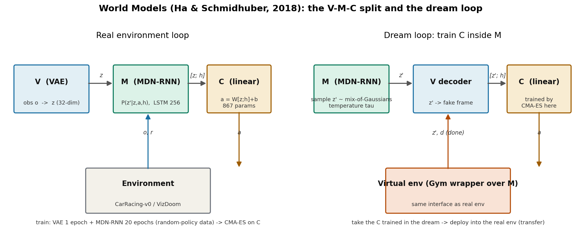
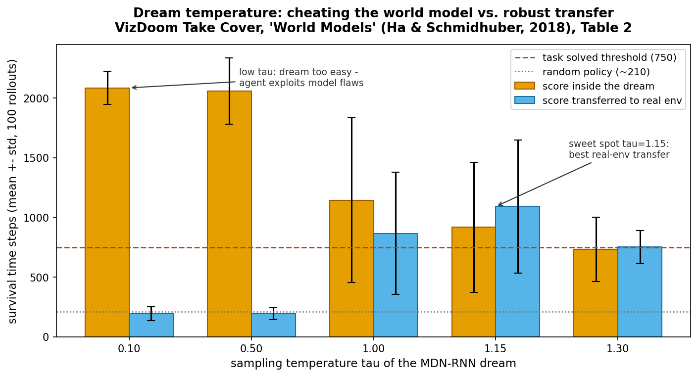

# 在梦里练，在现实里开：World Models 把智能体拆成"看-记-动"三块

> **信息块**：World Models · David Ha（Google Brain，当时）& Jürgen Schmidhuber（NNAISENSE / IDSIA）· **未正式发表，arXiv 预印本 arXiv:1803.10122（v4，2018-05-09）**，2018 年 3 月 27 日首版 · 配套交互式网页 https://worldmodels.github.io · 代码为博客式实验代码（Ha 个人仓库 world-models，非正式官方库；本次以论文正文+附录为准）· **核心洞见一句话**：把智能体拆成"看（V，压缩）-记（M，预测）-动（C，决策）"三块，大网络只做无监督的世界建模、小网络只做决策，于是大网络可以用反向传播高效训练、小网络可以用进化算法硬搜——**世界模型不是用来"规划"的，是用来给控制器"提供特征"和"提供梦境"的**。

## 先纠正一个流传很广的误读

很多人把 World Models 记成"在世界模型里做规划（planning）"。论文第 3.3 节明确否定了这个读法：控制器 C 拿到 $z_t$ 和 $h_t$ 之后，**直接输出动作，不做任何前向搜索、不 roll out 假设场景**。$h_t$ 里已经装着"未来可能长什么样"的分布信息，C 只是"本能地"查一下 RNN 就做决定——作者的比喻是棒球击球手：球速太快，等视觉信号传到大脑再规划就来不及了，靠的是内化的预测模型直接触发肌肉反应。

所以这篇论文真正的结构是：**M 不是规划器，M 是 C 的感官延伸**。理解了这一点，后面"梦境训练"的设计才顺理成章：既然 C 只依赖 $(z_t, h_t)$，那只要 M 能凭空产生可信的 $(z_t, h_t)$ 序列，C 根本不需要真实环境就能训练。

## 时间坐标：2018 年的赌注为什么成立

这篇论文自己说得很坦白（第 1 节末尾）：它不是一篇"新方法"论文，而是一次**蒸馏**——把 Schmidhuber 在 1990–2015 年间一系列 RNN 世界模型 + 控制器的工作（1990a/b、1991a、1990c、2015a《On Learning to Think》）里几个关键概念，用 2018 年的工具（VAE、LSTM、GPU、CMA-ES）重新做一遍，证明它们在像素级游戏环境里真的 work。

2018 年的默认信念是 model-free RL（DQN、A3C、PPO）：端到端、一个网络、从奖励里学一切。World Models 反其道而行：**把表征学习和决策彻底分开**。它的底气来自一个几乎无法反驳的观察：反向传播训练大网络需要"行为良好、可微"的损失，而 RL 的奖励信号稀疏、延迟、不平滑，不适合训练大网络；但"预测下一帧"这个无监督目标是稠密、每步都有、完全可微的。所以让大网络去干预测的活（V+M，几百万参数），小网络去干决策的活（C，867 个参数），各干各擅长的。

附带说明 venue：这篇论文从未投过任何会议或期刊，是 Schmidhuber/Ha 风格的 arXiv 长文（21 页正文+附录）。引用时按 arXiv 预印本引用即可，这在领域内是被广泛接受的。

## V：把一帧画面压成 32 个数

**大白话**：V（Vision）是一个变分自编码器（VAE），干的事就是"看图压缩"。输入 64×64×3 的 RGB 画面，经过 4 层卷积（每层 stride 2，分辨率减半：64→32→16→8→4），压成均值 $\mu$ 和方差 $\sigma$ 两个 $N_z$ 维向量，再从 $\mathcal{N}(\mu, \sigma I)$ 里采样出潜向量 $z$；解码器用 4 层反卷积把 $z$ 还原回 64×64×3。

CarRacing 任务 $N_z=32$，VizDoom 任务 $N_z=64$。训练数据是**一万条随机策略的 rollout**——注意，不是专家数据，是随机乱开的录像。训练 1 个 epoch，损失是 L2 重建误差 + KL 散度。Figure 10 显示重建图丢了很多细节但"意思"都在：赛道形状、车的位置、火球的位置。

这里有一个附录里才讲的细节：**VAE 的高斯先验不只是为了正则化，更是为了让 M 生成的"假 $z$"不至于太离谱**——先验把潜空间约束在一个合理范围内，M 采样出来的 $z$ 解码后才像个正常画面。这是 V 和 M 之间的隐性契约。

## M：预测下一个 $z$ 的分布，而不是 $z$ 本身

这是全文公式上最关键的一步，值得慢下来。

M 要建模的是 $P(z_{t+1} \mid a_t, z_t, h_t)$：给定当前潜向量、当前动作、RNN 隐状态，**下一帧的潜向量服从什么分布**。注意是分布，不是点预测。为什么？因为环境有随机性（VizDoom 里怪物随机开火、CarRacing 里随机赛道），点预测在随机环境里会被迫输出"平均未来"，画面糊成一团；分布预测则可以保留多峰性。

具体实现是 MDN-RNN（Mixture Density Network + RNN，Bishop 1994 + Graves 2013）：一个 LSTM（CarRacing 256 隐单元，VizDoom 512 隐单元），输出层不是输出 $z$，而是输出**5 个高斯分量的参数**（每个分量的权重 $\pi_k$、均值 $\mu_k$、对角方差 $\sigma_k^2$；附录 A.2 明确说没建模分量间的相关系数 $\rho$，用的是 factored Gaussian）。采样时先按 $\pi_k$ 挑一个分量，再从那个高斯里采样。

**温度参数 $\tau$**（从 SketchRNN 借来的技巧）：采样前把各分量的方差放大 $\tau$ 倍。$\tau$ 越大，梦境越随机、越难。论文用它干了一件漂亮的事：**把"梦境难度"变成一个可调旋钮**，$\tau=0.1$ 时梦境几乎确定、怪物不打火球（mode collapse），$\tau=1.3$ 时火球乱飞、agent 可能"死于非命"。这个旋钮后面成了整篇论文最有力的证据（见温度实验）。

训练细节（附录 A.2）：20 个 epoch，teacher forcing；每个 batch 构造时从预存的 $(\mu, \sigma)$ 里**重新采样** $z \sim \mathcal{N}(\mu, \sigma)$，防止 MDN-RNN 过拟合到某一次具体的采样——这是个小技巧，但决定了梦境的多样性。VizDoom 版还多预测一个"死了没" $d_{t+1}$（二分类，概率超 50% 就判 done，比从 Bernoulli 采样更稳定，因为死亡是低概率事件）。

## C：867 个参数的线性控制器，进化算法硬搜

$$a_t = W_c [z_t; h_t] + b_c \tag{1}$$

就这么简单：把 $z_t$ 和 $h_t$ 拼起来，过一个线性层。CarRacing 版 867 个参数，VizDoom 版 1,088 个（Doom 的控制器输入还拼了 LSTM 的 cell state $c$）。训练用 CMA-ES（协方差矩阵自适应进化策略），种群 64，每代每个个体跑 16 次取平均奖励当 fitness。CarRacing 跑了 1800 代才过 900 分线——**进化算法在这里是"大力出奇迹"，不是"高效"**。

为什么敢用线性控制器？这就是 V-M-C 拆分的红利：$[z_t; h_t]$ 已经是"当前+未来"的富特征，决策面本身可以很简单。论文用消融证明了这一点：只给 $z_t$（不给 $h_t$）的控制器 632±251，加一层 40 个 tanh 隐单元提到 788±141，但都过不了 900 的 solve 线；给了 $h_t$ 之后线性控制器直接 906±21。**$h_t$ 里的时间信息是承重墙**。

## CarRacing：第一个"解出"这道题的方案

CarRacing-v0 的 solve 标准是 100 次连续 trial 平均奖励超 900（随机生成的赛道，奖励按访问的 tile 数算，容错极低）。结果（表 1）：

| 方法 | 平均分（100 trials） |
|---|---|
| DQN | 343 ± 18 |
| A3C（连续） | 591 ± 45 |
| A3C（离散） | 652 ± 10 |
| Gym leaderboard 最好 | 838 ± 11 |
| V only（$a=Wz+b$） | 632 ± 251 |
| V + 隐层 | 788 ± 141 |
| **Full world model（V+M）** | **906 ± 21** |

注意 V only 的方差 251 巨大——光看当前帧开车，急弯必翻，方差来自"翻没翻车"的二值性。给了 $h_t$ 之后方差压到 21，说明预测性特征把驾驶从"赌博"变成了"稳定控制"。论文宣称"首个解出 CarRacing-v0 的方案"，按 2018 年的 leaderboard 口径成立。

## 梦境训练：在假环境里练，回真环境里考

VizDoom "Take Cover"：躲怪物打来的火球，活 2100 步满分，750 步算 solve。流程：M 除了预测 $z_{t+1}$ 还预测 $d_{t+1}$（死了没），于是 M 本身就是一个完整的 Gym 环境——把 M 包一层 `gym.Env` 接口，C 直接在里面训练，全程只在潜空间里跑，**不需要 V 编码真实画面、不需要渲染、不需要跑 Doom 引擎**（附录 A.5 起名 DoomRNN，强调它比 VizDoom 快得多）。

结果：梦里练到 ~900 步，拿回真环境测 **~1100 步**，远超 750 的线，也超过 leaderboard 的 820±58。真环境分数反而更高——因为梦境（$\tau=1$）比真实环境更难、更嘈杂，"在噩梦里活下来的人回到现实觉得很轻松"。

## 全文最精彩的一节：智能体在"作弊"

第 4.5 节 "Cheating the World Model" 是这篇论文留给后世最重要的一课，**也是 RAMP 安全盾的直接思想来源**，值得全文精读。

现象：早期实验里，C 在梦境里学会了"超能力"——走位让怪物一发火球都不打，或者火球飞到一半凭空熄灭。原因有两层。第一，M 只是近似模型，梦境里存在真实环境没有的"漏洞"，C 作为奖励最大化器必然去钻这些漏洞（这是优化器的本性，不是 bug）。第二，更隐蔽：**C 能直接看到 M 的全部隐状态**——相当于玩家能读游戏引擎的内存，它可以直接操纵 M 的内部状态来"改命"，而不是像真实玩家那样只能看画面。

论文的回应是双重的。工程上：用 MDN 的随机性（$\tau$ 旋钮）让漏洞不好钻——$\tau=0.1$ 时梦境几乎确定，C 钻到"怪物永不开火"的漏洞，梦里拿满分 2086，回到现实只有 193，连随机策略（210）都不如；$\tau=1.15$ 时梦境够难，C 钻不了漏洞，现实分数 1092±556 最好（见图 `fig-temperature.png`）。思想上：作者承认这是"在学到的动力学模型里训练策略"的**结构性弱点**，并指出 Schmidhuber 2015《On Learning to Think》里的更激进方案——C 可以学会**忽略**不可靠的 M，只把 M 当计算 subroutine 用，而不是每一步都信它。

温度实验的完整数字（表 2，100 次 trial）：

| $\tau$ | 梦里分数 | 真实环境分数 |
|---|---|---|
| 0.10 | 2086 ± 140 | 193 ± 58 |
| 0.50 | 2060 ± 277 | 196 ± 50 |
| 1.00 | 1145 ± 690 | 868 ± 511 |
| 1.15 | 918 ± 546 | **1092 ± 556** |
| 1.30 | 732 ± 269 | 753 ± 139（方差更小，策略更保守） |

$\tau$ 从 1.15 加到 1.30，分数下降但方差也下降——**温度同时控制了"难度"和"策略的风险偏好"**，这是论文里没有明说、但从数字里能读出来的第二层含义。

## 第 5 节的"迭代训练"：写了，但没跑

论文第 5 节提出了一个 4 步迭代训练流程：随机初始化 → 真环境 rollout 收集数据 → 在 M 里训练 C → 回到真环境收集新数据，循环。还提出了一个漂亮的 curiosity 想法：**把 M 的损失函数符号反过来当奖励**，让 C 去探索 M 预测不准的地方（预测误差大 = 不熟悉 = 值得探索）。

但必须指出：**这节是纯 proposal，两个实验都只跑了一次迭代**。随机策略的数据碰巧够用了（CarRacing 和 Take Cover 都不难），所以作者没被迫去验证迭代流程。Dreamer 系列后来（2019–2023）实际上把"迭代收集数据 + 训世界模型 + 在梦里训策略"做成了标准 loop，第 5 节可以看作 Dreamer 的出生证明，但这篇论文本身没有证据支撑它 work。

## 怀疑式阅读：这篇论文的边界

1. **数据全部来自随机策略**。M 只见过随机乱开的数据，它的"世界"里没有"开得好是什么样"。CarRacing 上这够用了，因为随机数据已经覆盖了赛道各处；但凡是需要精细操作的任务，随机数据都覆盖不到关键状态。这是 2018 年版本的结构性天花板，Dreamer 用迭代数据收集解决了它。
2. **CMA-ES 的代价**。CarRacing 的 C 跑了 1800 代 × 64 个体 × 16 次 rollout，进化算法在这里是"用算力换简单"，不是"高效"。论文没有报告墙钟时间，只说了 V/M 训练"单 GPU 不到一小时"。
3. **温度 $\tau$ 是手工调的超参数**。梦境难度这个旋钮没有自适应机制，表 2 的 sweep 是暴力试出来的。$\tau$ 选错（0.1）会得到"梦里满分、现实白给"的灾难，说明整个方法的可靠性对这一个旋钮高度敏感。
4. **"首个解出 CarRacing"的口径**。按 Gym leaderboard 2018 年的记录成立；但 leaderboard 本身是社区自报，不是标准 benchmark。今天引用时建议写"reported as the first solution to exceed 900 on CarRacing-v0 at the time"。
5. **VAE 重建质量 vs 控制**。Figure 10 的重建图丢了很多细节（怪物数量都对不上），但 C 照样开得好——这说明**控制需要的表征和重建需要的表征不是一回事**，重建损失只是"顺手"的正则。这个观察后来在 DreamerV3 的消融里被正面验证了（representation loss 权重只给 0.1 还加 free bits）。

## 与 RAMP 的血缘/划界

**血缘是直系的，而且是双线的**。

第一条线是**架构血缘**：V-M-C 就是 RAMP 世界模型模块的曾祖父。对应关系可以精确到符号：V 的编码器 $q(z \mid o)$（论文里 VAE 的 encoder，$o$ 是观测）正是 RAMP"单次前向中间分布复用"要复用的那个分布——RAMP 不再为风险校验单独跑一遍编码器，而是直接拿世界模型前向时已经算出来的 $q(z_t \mid h_t, o_t)$ 当风险评估的特征输入。2018 年的论文已经演示了这种复用的价值：C 的输入 $[z_t; h_t]$ 里，$z_t$ 就是 V 的现成输出，**"表征只算一次、到处复用"是这篇论文的元设计**，RAMP 的创新 B 是把它从"特征复用"推进到"分布复用"（复用的是后验分布本身，而不只是采样出的 $z$）。

第二条线是**问题血缘**："Cheating the World Model"整节就是 RAMP"闭环风险校验/安全盾"的立论依据。Ha 和 Schmidhuber 在 2018 年就指出来了：在学到的模型里优化策略，策略一定会去钻模型的漏洞；他们的解法是加随机性（$\tau$）让漏洞不好钻。RAMP 的解法是另一条路：**不指望模型无漏洞，而是在执行层加一个独立于世界模型的校验器**——安全盾不信任 M，只信任自己的风险评估。这是对 4.5 节问题的正面回答，写进 related work 里是"我们解决了开山论文留下的问题"的叙事。

**划界有三条**。第一，World Models 的 M 是 LSTM+高斯混合，RAMP 的直系技术是 DreamerV3 的 RSSM（categorical 潜变量 + GRU + KL balancing），中间隔了 DreamerV1/V2 两代，引用时不要把 2018 的 MDN-RNN 写成 RAMP 的直接前身。第二，2018 的"梦境"是开环 hallucination（C 在梦里训完就不回来了），RAMP 的世界模型是闭环在线用的（每步 rollout 做风险预判），用法不同。第三，2018 的 C 是 867 参数的线性层，RAMP 的决策层是 LLM 调度的多规划器——"小控制器"这个位置被整个换掉了，这是 RAMP 的 agent 范式与 2018 范式的根本分野。

*V-M-C 三件套与"梦境训练"回路。左：在真实环境里 V、M、C 如何配合；右：把 M 包成 Gym 环境，C 在梦里训练后再迁回现实。*

*VizDoom Take Cover 的温度 sweep（论文表 2）。$\tau$ 太小梦境太简单，C 钻模型漏洞，梦里满分、现实白给；$\tau=1.15$ 是迁移效果最好的点；$\tau$ 继续加大则策略更保守、方差更小。*
