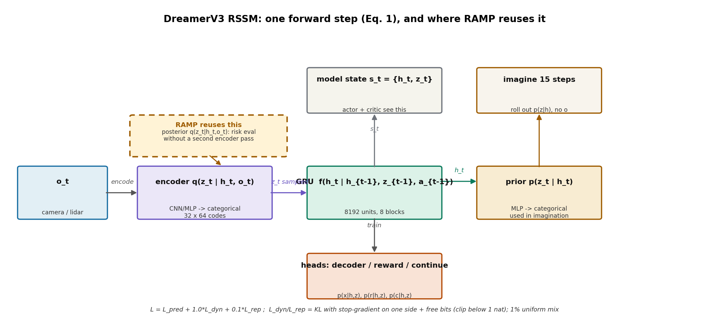
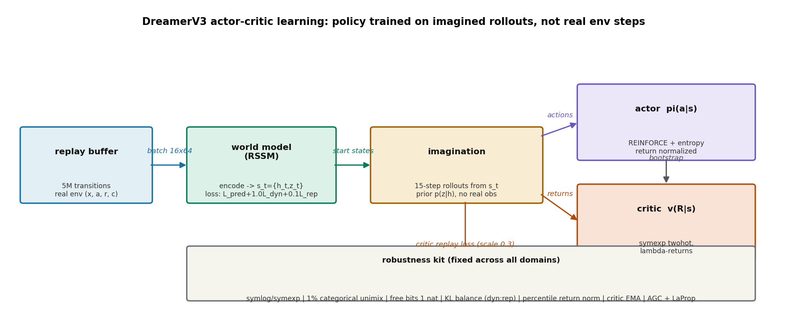

# 一套超参数，150 个任务：DreamerV3 把世界模型做成了"通用件"

> **信息块**：Mastering Diverse Domains through World Models（DreamerV3）· Danijar Hafner, Jurgis Pasukonis, Jimmy Ba, Timothy Lillicrap（Google DeepMind + 多伦多大学）· **正式发表于 Nature 2025**（DOI 10.1038/s41586-025-08744-2，题为 Mastering diverse control tasks through world models；arXiv 预印本 arXiv:2301.04104，v2 2024-04-17，本次按 v2 全文精读）· 代码公开 https://github.com/danijar/dreamerv3（项目页 danijar.com/dreamerv3）· **核心洞见一句话**：世界模型 + 一套"鲁棒性工具箱"（symlog、KL balancing、free bits、twohot、return normalization），配合**离散（categorical）潜变量的 RSSM**，让同一套超参数在 150 多个任务上打赢各自的专用调优算法——"通用"的秘诀不在更大的网络，在让每个损失项在各种数值尺度下都不爆炸。

## 先把 Dreamer 三代的时间线摆正

DreamerV1（2019）：只能做连续控制，在 latent imagination 里训 actor-critic。DreamerV2（2020）：把潜变量换成离散的（categorical），在 Atari 上超人类。DreamerV3（2023 预印 / 2025 Nature）：**方法上只加了一套鲁棒性技术，目标是"换 domain 不用调参"**。论文第 20 页"Previous Dreamer generations"自己总结了 V3 的增量：① 鲁棒性技术（observation symlog、KL balance + free bits、1% unimix、percentile return normalization、symexp twohot）；② 网络架构（Block GRU、RMSNorm、SiLU）；③ 优化器（AGC 自适应梯度裁剪、LaProp）；④ replay buffer（更大容量、online queue、存 latent state）。

看懂这个定位很重要：**V3 的贡献不是新架构，是"把世界模型做成通用件"的工程**。它的对手不是某个具体算法，是"每个新任务都要调参"这件事本身。

## RSSM 三件套：表征、转移、解码（RAMP 血缘的核心）

世界模型是一个 RSSM（Recurrent State-Space Model，Hafner et al. 2018）。论文公式 (1) 给出了全部：

$$\begin{cases}
\text{Sequence model:} & h_t = f_\phi(h_{t-1}, z_{t-1}, a_{t-1}) \
\text{Encoder (posterior):} & z_t \sim q_\phi(z_t \mid h_t, x_t) \
\text{Dynamics predictor (prior):} & \hat{z}_t \sim p_\phi(\hat{z}_t \mid h_t) \
\text{Reward predictor:} & \hat{r}_t \sim p_\phi(\hat{r}_t \mid h_t, z_t) \
\text{Continue predictor:} & \hat{c}_t \sim p_\phi(\hat{c}_t \mid h_t, z_t) \
\text{Decoder:} & \hat{x}_t \sim p_\phi(\hat{x}_t \mid h_t, z_t)
\end{cases} \tag{1}$$

**大白话**：$h_t$ 是 GRU 的确定性记忆（"到目前为止发生了什么"的压缩），$z_t$ 是随机潜变量（"当前这一刻具体长什么样"的压缩）。$h_t$ 只依赖过去，$z_t$ 还多看了当前观测 $x_t$。模型状态 $s_t = \{h_t, z_t\}$ 是 Markov 的——actor 和 critic 只看 $s_t$ 就够了，不需要看历史。

三件套分工：

**① 表征（encoder，后验 $q$）**：CNN（图像）或 MLP（向量）把 $x_t$ 编成 categorical 分布的参数。关键设计：**潜变量是离散的**——$z_t$ 是"一组 softmax 分布里采样出来的"，200M 模型是 32 个 categorical 变量、每个 64 类（32 是代码默认值、论文正文未明写；Table 3 给的是"每 latent 的 code 数 = d/16"，200M 的 d=1024 故每 latent 64 类），拼成 2048 维向量。采样用 straight-through 梯度（前向采样离散值、反向按连续值传梯度）。为什么离散？DreamerV2 的结论：离散潜变量先天稀疏、多模态环境里不糊，Atari 上超了人类；V3 沿用。

**② 转移（dynamics，先验 $p$）**：MLP 从 $h_t$ 预测 $z_t$ 的分布，**预测时不看 $x_t$**。这就是"想象"的能力来源：rollout 时没有真实观测，只能靠 $p(\hat{z}_t \mid h_t)$ 一步步往前推。GRU 是 block-diagonal 的（8 个 block），8192 个循环单元但参数量不随单元数平方增长——大记忆、小参数。

**③ 解码（decoder + reward/continue heads）**：decoder 把 $(h_t, z_t)$ 还原成 $\hat{x}_t$（转置卷积，sigmoid 输出），reward/continue 各是一个 1 层 MLP。**这三个 head 的唯一作用是"给表征提供训练信号"**，imagination 时真正用的是 $z$ 和 $r$、$c$ 的预测。

*RSSM 的一次前向（论文公式 1）：encoder 产生后验 $q(z_t\mid h_t,o_t)$，GRU 维护 $h_t$，先验 $p(z_t\mid h_t)$ 负责想象。RAMP 的创新 B 复用的正是虚线框里的后验分布——风险评估直接用它，不再为校验器单独跑一遍编码。*

## 跟着一个 $o_t$ 走完全程：形状都长什么样

拿 200M 模型、64×64 图像输入为例（论文补充材料 + Table 3）：

1. $o_t \in \mathbb{R}^{64\times64\times3}$ 进 CNN encoder（stride 2 卷积，通道数 d/16=64），压到 $6\times6$ 或 $4\times4$ 再展平。
2. MLP 输出 32×64 个 logit → 32 个 softmax → 采样得 $z_t$（2048 维，one-hot 拼接）。
3. $h_t = \text{GRU}(h_{t-1}, [z_{t-1}; a_{t-1}])$，$h_t \in \mathbb{R}^{8192}$（8 blocks × 1024）。
4. $s_t = \{h_t, z_t\}$（10240 维）同时喂给：decoder（重建 $\hat{x}_t$）、reward head（twohot 预测 $\hat{r}_t$）、continue head（logistic 回归预测 $\hat{c}_t$）、actor（$\pi(a_t\mid s_t)$）、critic（$v(R_t\mid s_t)$）。
5. Imagination：从 replay 里拿一个真实的 $s_t$ 出发，actor 选 $a_t$，GRU 更新 $h_{t+1}$，**先验** $p(\hat{z}_{t+1}\mid h_{t+1})$ 采样 $\hat{z}_{t+1}$，reward head 给 $\hat{r}_{t+1}$——15 步，全程**没有任何真实观测**。

注意第 5 步和第 2 步用的不是同一个分布：训练时编码用后验 $q(z_t\mid h_t,x_t)$（看得见 $x_t$），想象时只能用先验 $p(\hat{z}_t\mid h_t)$（看不见）。**让先验逼近后验，就是下面 KL 损失干的事**。

## 损失函数：三项各惩罚什么，KL balancing 为什么是承重墙

$$\mathcal{L}(\phi) = \mathbb{E}_{q_\phi}\sum_{t=1}^T \big( \beta_{\text{pred}}\mathcal{L}_{\text{pred}} + \beta_{\text{dyn}}\mathcal{L}_{\text{dyn}} + \beta_{\text{rep}}\mathcal{L}_{\text{rep}} \big), \quad \beta_{\text{pred}}=1,\ \beta_{\text{dyn}}=1,\ \beta_{\text{rep}}=0.1 \tag{2}$$

$$\begin{aligned}
\mathcal{L}_{\text{pred}} &= -\ln p_\phi(x_t\mid z_t,h_t) - \ln p_\phi(r_t\mid z_t,h_t) - \ln p_\phi(c_t\mid z_t,h_t) \
\mathcal{L}_{\text{dyn}} &= \max\!\big(1,\ \mathrm{KL}[\, \mathrm{sg}(q_\phi(z_t\mid h_t,x_t)) \,\|\, p_\phi(z_t\mid h_t) \,]\big) \
\mathcal{L}_{\text{rep}} &= \max\!\big(1,\ \mathrm{KL}[\, q_\phi(z_t\mid h_t,x_t) \,\|\, \mathrm{sg}(p_\phi(z_t\mid h_t)) \,]\big)
\end{aligned} \tag{3}$$

逐项解释：

- **$\mathcal{L}_{\text{pred}}$（预测损失，权重 1）**：decoder 重建 $x_t$、reward head 预测 $r_t$、continue head 预测 $c_t$，三项加起来。图像重建用 symlog 平方损失（见下），reward 用 symexp twohot，continue 用 logistic 回归。**这是表征的信息来源**——图 6b 的消融显示，掐掉 reward/value 梯度，性能基本不掉；掐掉重建梯度，性能崩。**Dreamer 的表征主要靠"无监督重建"学出来，不靠奖励**——这和 MuZero 那类"只预测 reward/value"的世界模型是根本分歧。
- **$\mathcal{L}_{\text{dyn}}$（动力学损失，权重 1）**：$\mathrm{KL}[\mathrm{sg}(q)\|p]$，stop-gradient 停在后验 $q$ 那边，梯度只更新先验 $p$——"让先验去追后验"，即让"闭眼想象"逼近"睁眼看到的"。这是 imagination 能 work 的前提。
- **$\mathcal{L}_{\text{rep}}$（表征损失，权重 0.1）**：$\mathrm{KL}[q\|\mathrm{sg}(p)]$，梯度只更新后验 $q$——"让后验变得好预测"，即把表征往先验能预测的方向拉。权重只有 0.1 是故意的：太强会把表征压成先验能猜中的无聊东西，信息就丢了。

**KL balancing** 就是这两项"各管一边"的设计（名字来自 DreamerV2，思想是：$q$ 和 $p$ 互相靠近时，学表征和学动力学的梯度不要打架）。**free bits** 是那个 $\max(1, \cdot)$：KL 低于 1 nat（≈1.44 bits）就不再惩罚——"已经够近了，别再压了，把学习火力留给预测损失"。论文说得很直白：以前不同环境要给 representation loss 配不同权重（3D 复杂环境要强正则、像素级游戏要弱正则），free bits + 0.1 小权重**一次性解决了这个调参噩梦**，是固定超参数能跨多 domain 的关键之一。图 6a 的消融里，"No KL balance & free bits"是掉点最多的一项——**这是承重墙**。

**1% unimix**：encoder 和先验的 categorical 分布按 99% 神经网络输出 + 1% 均匀分布混合。**大白话**：不许任何一个类别的概率变成严格 0，否则 KL 会炸（log 0）。这是从 deep VAE 文献里借来的防爆技巧，便宜但关键。

## symlog 和 twohot：让损失函数对"数量级"脱敏

跨 domain 最大的敌人是**数值尺度**：Atari 的 reward 是几百分，DMLab 是几十分，Minecraft 的钻石 reward 稀疏到几乎为 0。平方损失在小目标上学不动、在大目标上爆炸；按 running 统计归一化又引入非平稳。DreamerV3 的答案是两个变换：

**symlog**：$\mathrm{symlog}(x) = \mathrm{sign}(x)\ln(|x|+1)$，逆变换 $\mathrm{symexp}(x) = \mathrm{sign}(x)(\exp(|x|)-1)$。几何图像：原点附近近似恒等（$|x|\ll1$ 时 $\ln(1+|x|)\approx|x|$），小目标的学习不受影响；$|x|$ 大时压成对数，10000 和 1000000 的差距只剩几个单位。**和普通 log 的区别是处理负数**：对称地压两边，reward 为负的 domain 也能用。网络预测的是 $\mathrm{symlog}(y)$，读数时再 $\mathrm{symexp}$ 回来。

**symexp twohot**：reward 和 critic 的目标可能是多峰、跨数量级的，干脆不回归标量，改做**分类**。bins 取 $B = \mathrm{symexp}(-20, \ldots, +20)$（指数间隔），网络输出 softmax，预测值是"概率加权的 bin 位置平均"。目标 $y$ 被 twohot 编码：找到 $y$ 落在哪两个相邻 bin 之间，按距离线性分配权重（onehot 的连续版）。损失是交叉熵——**梯度大小只和概率分布有关，和目标本身的数量级脱钩**。这是"解耦梯度尺度和目标尺度"最干净的做法，论文说试过不对称变换的替代方案，平均下来不如这个。

**Actor 的 return normalization**：熵正则系数 $\eta=3\times10^{-4}$ 要在所有 domain 通用，但"多大算大"取决于 reward 尺度。做法：return 除以范围 $S$，$S$ 取 batch 内 return 的 95 分位减 5 分位（抗 outlier），再做 EMA（0.99）平滑；分母 $\max(1, S)$——**只缩小大 return，不放大**小 return（$S<1$ 时不除），避免稀疏 reward 下噪声被放大淹没熵正则。论文对比了 normalize advantage（PPO 做法，稀疏下会放大噪声）、按标准差归一化（稀疏下标准差≈0，直接爆炸）、约束优化固定熵（稀疏下探索太慢），都不如这个"只压大、不抬小"的方案。

## Actor-critic：在想象里训练，不在真实环境里

*Actor-critic 只在世界模型想象出的 15 步轨迹上训练。Critic 同时吃想象轨迹（权重 1）和 replay 真实轨迹（权重 0.3）；reward/critic 初始化为 0，避免初期大预测拖慢学习。*

流程（论文图 3b）：从 replay 里取真实 $s_t$ 出发，actor 和世界模型滚 15 步，得到想象的 $(s, a, r, c)$ 序列；critic 学 $\lambda$-return（$\lambda=0.95$，$\gamma=0.997$，horizon 15 步之外靠 critic 自举）；actor 用 REINFORCE + 熵正则，目标是最大化归一化后的 return。

三个稳定技巧：① critic 预测的是**分布**（twohot categorical），读数取期望；② critic 有 EMA target 正则（target network 的软版本）；③ reward head 和 critic 的输出层**初始化为 0**——随机初始化的网络在训练初期会输出很大的预测 reward，把学习带偏，置零后"从 0 开始学"反而更快。这是典型的"论文里一句话、复现时救命"的细节。

超参数表（Table 4，全 domain 固定）：batch 16×64，学习率 $4\times10^{-5}$，replay 容量 5M，imagination horizon 15，critic replay loss 权重 0.3，$\beta_{\text{val}}=1$，无学习率衰减、无 prioritized replay、无 weight decay、无 dropout。**"我们不用任何超参数退火"是全文最嚣张的一句话，也是它敢叫"通用算法"的底气**。

## 实验：150+ 任务、8 个 domain，Minecraft 钻石是皇冠

评估覆盖 8 个 domain（补充材料表 2 的协议）：Atari 57 任务/200M 帧、ProcGen 16/50M、DMLab 30/100M、Atari100k 26/400K、本体控制 18/500K、视觉控制 20/1M、BSuite 23、Minecraft 1/100M。**所有 Dreamer 都在单张 A100 上训练**，200M 模型打视觉 domain，控制任务用 12M 模型（更快，性能一样）。

结果要点（图 1）：Atari 上超过 MuZero（且只用其一小部分算力）、超过 Rainbow 和 IQN；ProcGen 打平调优过的 PPG、超过 Rainbow；DMLab 用 100M 帧超过了 IMPALA/R2D2+ 在 1B 帧的成绩（10 倍数据效率）；Atari100k 超过 IRIS、TWM、SPR、SimPLe（不如 EfficientZero，但后者用了 early reset 等额外技巧，作者认为不可比）；本体/视觉控制都是新 SOTA；BSuite 尤其在 scale robustness 上领先。PPO（Acme 高质量实现、跨 domain 调到最优的固定超参）在**所有** domain 都被大幅拉开。

**Minecraft 钻石**是皇冠上的明珠：开放世界、程序生成、稀疏奖励、3 万 6 千步一局（30 分钟）、要按顺序发现 12 种物品。之前的方法要么靠人类专家数据（VPT：720 张 GPU 跑 9 天，先行为克隆再 RL 微调），要么靠课程学习。Dreamer 开箱即用、**单张 GPU 9 天**、从零开始，10 个种子**全部**在 100M 步内挖到钻石；IMPALA、Rainbow、PPO 等基线最多走到铁镐，没有一个摸到钻石（图 5）。论文把 Minecraft 协议定为"100M 步时的 episode return"，约等于 100 天游戏时间。

**消融（图 6，14 个任务平均）**：① 鲁棒性技术每项都有贡献，掉点最多的是 "No KL balance & free bits"，其次是 return normalization 和 symexp twohot；② 掐掉 reward/value 梯度性能基本不掉，掐掉重建梯度则崩——**表征主要靠无监督重建**，这为"用互联网视频预训练世界模型"留了后门；③ 模型从 12M 放到 400M，性能单调涨，**而且大模型用更少的环境交互就达到同样性能**（data efficiency 也随模型涨）；④ replay ratio（每步环境交互配多少次梯度更新）提高，性能可预测地涨。两条 scaling 曲线（模型大小、replay ratio）都很光滑——"加算力就能变强"是它敢叫板 scaling law 的底气。

## 怀疑式阅读

1. **"固定超参数"的口径**。超参数确实固定，但**模型大小是按 domain 换的**（视觉 200M、控制 12M），replay ratio 也是"按 step budget 选的"。这两个恰恰是最影响性能和算力的旋钮。论文的说法是"超参数固定、只换算力档位"，这在字面上成立，但读者要明白：打 Atari 和打控制任务用的不是同一个模型。
2. **DMLab 基线的 10 倍口径**。IMPALA/R2D2+ 的 1B 步成绩是"为扩展性设计的算法在 10 倍数据下的成绩"，作者自己也承认这些基线"不是为数据效率设计的"。10 倍这个数字听着唬人，分母选得有点慷慨。
3. **Atari 上"超过 MuZero"的限定词**："只用一小部分算力"——MuZero 的原论文用了多少 TPU，Dreamer 用了多少 GPU-day，论文没有并排放出精确数字对比。这是一个定性表述，不是定量表述。
4. **Minecraft 的动作空间是简化过的**。用的是 MineRL 竞赛的 block-breaking 设置（"提供的动作空间会让随机策略难以长时间按住一个键"），不是 VPT 用的键鼠 raw 动作。两个"挖到钻石"的难度不完全可比，论文在正文里提了一句，读者容易滑过去。
5. **Critic 的 twohot 和 reward 的 twohot 共用一套 bins**，bins 是固定的 $\mathrm{symexp}(-20\ldots+20)$。如果某个 domain 的 return 超出这个范围（$\mathrm{symexp}(20) \approx 4.85\times10^8$），预测会被截断——实际上够用了，但"通用"的边界在这里。
6. **诚实分**：消融图 6a 显示每个技术"只在部分任务上关键"，作者没有藏；PPO 基线是按"跨 domain 最优"调过的、还在 ProcGen 上对上了官方调优版的分数——基线工作是扎实的，不是纸片人。

## 与 RAMP 的血缘/划界：RSSM 是 RAMP 世界模型模块的直系血缘

**血缘精确到符号**。RAMP 的世界模型模块就是 RSSM 的驾驶特化版，三件套一一对应：

| DreamerV3 | RAMP 对应 |
|---|---|
| Encoder 后验 $q_\phi(z_t \mid h_t, x_t)$ | **创新 B 的复用对象**：RAMP 在单次前向中直接拿这个后验分布（categorical logits）做风险评估，不再为安全校验单独跑编码器 |
| GRU $h_t = f(h_{t-1}, z_{t-1}, a_{t-1})$ + 先验 $p(\hat{z}_t\mid h_t)$ | RAMP 的未来 rollout：多步想象出 $z_{t+1:t+H}$，给风险校验提供"未来分布" |
| Decoder / reward / continue heads | RAMP 的风险 head：把"重建/奖赏"换成"风险/碰撞概率"，但训练信号的组织方式（prediction loss 主导、KL 正则）同构 |

RAMP 创新 B"世界模型中间分布复用"的完整论述链条在这里：① World Models（108）证明了"表征只算一次、控制器复用"是高效的（$[z_t;h_t]$ 给 C）；② DreamerV3 把复用推进到"先验/后验分布"的层次（imagination 全靠 $p(\hat{z}\mid h)$，actor-critic 全靠 $s_t=\{h_t,z_t\}$）；③ RAMP 再往前一步：**复用的不只是采样出的 $z$，而是后验分布 $q$ 本身**——风险校验需要的是不确定性（分布的形状），不是点估计。$q(z_t\mid h_t,o_t)$ 的熵、众数、尾部质量，直接就是风险信号。这是对 DreamerV3 的自然延伸，不是另起炉灶。

**划界有三条**。第一，DreamerV3 的世界模型是为**控制**服务的（学出来给 actor-critic 用，reward 是唯一的任务信号）；RAMP 的世界模型是为**风险评估**服务的（reward head 被风险 head 取代，优化目标从"最大化回报"变成"最小化风险+完成指令"）——目标函数不同，表征学出来的形状就不同，不能直接把 DreamerV3 的权重拿来当 RAMP 的。第二，DreamerV3 是离线 RL（replay buffer + imagination 训练），RAMP 是在线闭环（每步都要 rollout 做预判），对推理延迟的要求差两个数量级——这就是 RAMP 做"中间分布复用"的工程动机：**每步省一次编码器前向**。第三，DreamerV3 的"通用性"是跨任务的通用，RAMP 要的是**跨场景的鲁棒**（长尾 corner case），两者验证的维度不同；RAMP 在 related work 里引用 DreamerV3 时，应当引的是"RSSM + 鲁棒性工具箱"的方法，而不是"Minecraft 挖钻石"的成绩。

一句话：DreamerV3 给了 RAMP 世界模型模块的**骨架**（RSSM 三件套 + KL balancing + categorical 潜变量），RAMP 换的是**血肉**（风险 head、在线复用、闭环校验）。ICAPS 的审稿人如果问"你们的世界模型和 DreamerV3 什么关系"，答案就是这张表。
