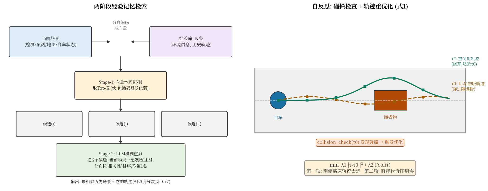
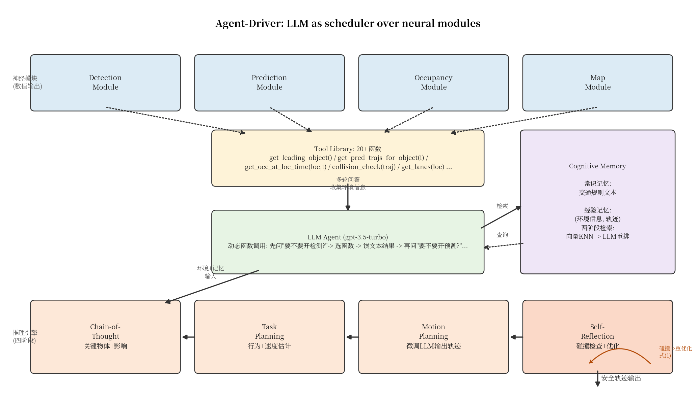

# Agent-Driver：第一个把 LLM 当成“调度员”而不是“司机”的工作

> **信息块**
> - 论文标题：A Language Agent for Autonomous Driving（Agent-Driver）
> - 作者：Jiageng Mao*, Junjie Ye*（共同一作）, Yuxi Qian, Marco Pavone（斯坦福/NVIDIA）, Yue Wang —— USC
> - 会议：**COLM 2024**（Conference on Language Modeling）；arXiv:2311.10813v4（v1 2023-11-17，v4 2024-07-28 为 COLM 相机版）
> - 链接：https://arxiv.org/abs/2311.10813 ｜ OpenReview: https://openreview.net/forum?id=UPE6WYE8vg
> - 代码：**官方仓库 https://github.com/USC-GVL/Agent-Driver 现已失效**——访问返回一个纯跳转页面（meta refresh 到 physical-superintelligence-lab.github.io/Agent-Driver），无任何代码。论文中的 Reproducibility Statement 称 supplementary material 含代码，但公开渠道无法获取。本篇 x-ray 所有实现细节均按论文正文+附录转述，凡论文未披露处明确标注“未披露”，不做推测性补全。
> - PDF：本目录 `2311.10813.pdf`
> - 一句话核心洞见：**LLM 不应该学开车，应该学调度**——感知、预测、地图这些神经模块继续干它们的活，LLM 只负责三件事：决定现在需要看什么（调哪个工具）、想起以前见过什么（查记忆）、一步一步推出轨迹（推理引擎）；自然语言是连接“人的知识”和“神经网络的数值”的唯一接口。

---

## 为什么这篇是开山：2023 年 11 月，别人还在让 LLM 直接输出方向盘

时间坐标先摆出来。2023 年 10 月，同一团队（Mao 等）发了 GPT-Driver：把运动规划重构成语言建模问题，微调 GPT 输出轨迹 waypoint——这是“LLM 当司机”路线的代表作。一个月后，同一个一作交出了 Agent-Driver，路线完全反过来：**LLM 不碰轨迹生成之外的任何数值计算，它当调度员**。

这个转向的动机，论文引言用“球和孩子”的例子讲得很漂亮：小区里一个球滚到马路上，人类司机会本能地减速——不是因为看见了孩子，而是因为“球后面可能跟着孩子”这条常识。传统感知-预测-规划流水线的问题不在于看不见球，而在于**没有地方存放“球→孩子”这种知识**。神经网络的输入是数值（bbox、轨迹点），人的知识是语言，两种表示不兼容。之前有人试过把语言知识蒸馏成正则项塞进神经网络（Kuo et al. 2022），效果受限于跨模态鸿沟。Agent-Driver 的解法是反过来的：**不把语言塞进网络，而是把网络的输出翻译成语言，拿到 LLM 的地盘上做决策**。工具库就是那个翻译层。

所以这篇论文的真正贡献不是“LLM 开车开得更好”（虽然数字确实更好），而是**确立了一种架构范式**：LLM agent + 工具库 + 记忆 + 推理引擎。这个四件套后来被无数工作复用——DriVLMe 的 `plan(landmark)`、PlanAgent 的三模块、VLM-MPC 的双层，骨架都能追溯到这里。S 级的评级给的是这个范式确立者的位置。

## 三件套之一：工具库——把神经网络变成 LLM 可以调用的函数

工具库建立在四个神经模块之上：检测、预测、occupancy、地图。模块本身是现成的（论文用 UniAD 的模块，附录 D.5 还试了 VAD/ST-P3 的组合，即插即用），创新在于**模块输出不直接进规划器，而是先被 20 多个函数翻译成文本**。

函数举例（附录 A.1 列全表，正文给代表）：
- 检测：`get_leading_object()`——“自车同车道正前方那个物体是什么、在哪、多大”；`get_objects_in_range(r)`——半径 r 内所有物体。
- 预测：`get_pred_trajs_for_object(i)`——指定 id 的物体未来 3 秒轨迹的文本描述；`get_waypoint(i, t)`。
- occupancy：`get_occ_at_loc_time(loc, t)`——某个位置某时刻被占的概率；`collision_check(traj)`——给定轨迹会不会撞。
- 地图：`get_drivable(loc)`、`get_lanes(loc)`（左右车道信息）、`get_shoulders`（路肩）。

调用流程（Fig. 3 的例子，值得细读）：LLM 先拿到自车状态等初始信息，然后被问“要不要做检测？YES/NO”。答 YES，就把检测相关的函数列表给它，它选 `get_front_object_detections`，执行后拿回文本：“检测到物体，类型 car，id 2，位置 (4.36, 9.56)，尺寸 (4.72, 1.86)”。接着被问“要不要做预测？”，答 YES，调 `get_future_trajectories_for_specific_objects(object_ids=[2,...,23])`，拿回每个物体的未来 waypoint。再被问“要不要 occupancy？”，答 NO——**这一问一答就是动态性的全部含义**：这个场景里 LLM 判断 occupancy 信息不重要，直接跳过。最后问地图，答 YES，调 `get_lanes` 和 `get_shoulders`。

这个设计的妙处和代价要分开看。妙处是**信息按需获取**：传统流水线每一帧都把全量检测（几百个 bbox）、全量预测跑一遍，大部分和决策无关；这里 LLM 只问它关心的。附录 D.3 的消融证实：去掉工具库（全量感知直接喂 LLM），输入 token 翻倍，collision 从 0.35% 涨到 0.40%。代价是**多轮 LLM 调用**：每一轮“要不要开某模块”都是一次 gpt-3.5-turbo API 调用，一个场景下来可能是 5–10 次调用。论文全文没有报告时延——这是它最大的未披露项，结论的 future work 里“optimize the LLMs for real-time inference”等于承认现在离实时还差得远。

还有一个细节：工具调用的 LLM 用的是**原始预训练模型 + system prompt**，没有微调、没有 in-context 示例（附录 D.2 明确说了）。也就是说“要不要开检测”这种判断，靠的是 GPT-3.5 的通用常识，而不是驾驶特化训练。这既是优雅之处（零训练成本），也是脆弱之处（换个弱一点的模型，调用策略可能全乱）。

## 三件套之二：认知记忆——常识是手写的，经验是检索的

记忆分两块。**常识记忆**是纯文本的交通规则和驾驶知识（“和前车保持安全距离”“别撞东西”），完全可配置——用户可以自己写一套换上去。**经验记忆**是历史场景库，每条是（环境信息， 当时开出的轨迹）。

检索是两阶段（Fig. 4，自绘图见 `fig-memory-reflection.png` 左半）：

**Stage-1：向量 KNN。** 当前场景的环境信息（检测/预测/occupancy/地图/自车状态拼成的文本）编码成向量，经验库每条也编码成向量，取 Top-K。这一步快，但论文自己承认编码器的泛化能力有限——驾驶场景太多样，向量相似度经常不靠谱。

**Stage-2：LLM 模糊重排。** 把 K 个候选和当前场景一起喂给 LLM，让它按“相关性”排个序，取第一名。这一步慢，但利用了 LLM 的泛化推理能力。

为什么需要第二阶段？论文的论点是：向量检索的相似是**表层特征相似**（都有卡车、都在路口），LLM 判断的是**决策相关相似**（“上次那辆减速的卡车和这次这辆减速的卡车，对我的决策影响一样”）。Fig. 7 的例子：一次检索回来的最相似场景相似度 0.77，另一次只有 0.45——低分场景的参考轨迹，LLM 会打折扣使用。但这里有个未披露的细节：**这个相似度分数是哪来的**？论文没说是向量余弦还是 LLM 打的。如果是向量相似度，那 Stage-2 的重排并没有输出分数，0.77 只是 Stage-1 的分数，LLM 的重排结果就只是一个排序，没有置信度——下游使用时无法加权。这是一个实现细节的缺口，代码不可得，无法核对。

经验记忆还有一个关键性质：**只读不写**。检索出来的历史轨迹是“参考”，LLM 看一眼再自己做决策；系统开完车不会把这次经历写回库里。所以这不是真正的终身学习，是一个静态 few-shot 库。RAMP 的自适应衰减记忆要解决的正是这个问题。

*自绘图左：两阶段检索流程；右：自反思式 (1) 的几何含义——τ0 是 LLM 初版轨迹（穿过障碍物），优化后得到贴近原轨迹但无碰撞的 τ*。*

## 三件套之三：推理引擎——人类开车决策的四步拆解

推理引擎是全文最“像人”的部分，四步流水（Fig. 5）：

**1. Chain-of-Thought 推理。** 输入环境信息 + 记忆，输出“关键物体及其潜在影响”的列表，比如：“值得注意的物体：行人 at (0.80, 18.81)，3 秒后移动到 (-2.53, 20.89)；潜在影响：如果保持当前速度可能相撞。” 用 2 个随机选的人工标注示例做 in-context learning（附录 D.2）。这一步的本质是**注意力机制的语言版**：从几十个检测物体里挑出真正影响决策的几个。

**2. Task Planning（任务规划）。** 高层驾驶计划 = 离散行为 × 速度估计，比如 `change lane to left` × `deceleration` = “减速向左变道”。这一步是**给 motion planning 一个强先验**：先定性（往哪走、加速还是减速），再定量（具体轨迹点）。

**3. Motion Planning（运动规划）。** 把环境信息、记忆、CoT 结果、高层计划一起喂给**微调过的 LLM**（nuScenes 训练集人类轨迹，微调 1 个 epoch），让它输出文本形式的轨迹 waypoint 序列，再转回数值轨迹执行。这是四步里**唯一需要微调**的一步——附录 D.2 和 Table 5 的结论：CoT 和任务规划用 in-context learning 更好（微调反而略差），motion planning 不用微调不行（ICL 的 L2 1.90 vs 微调 0.74）。原因不难理解：输出 waypoint 坐标是精确数值生成，LLM 的预训练里没有这种分布，必须靠微调“校准”数值输出头；而推理和规划是语言任务，预训练的常识就够。

**4. Self-Reflection（自反思）。** 对 LLM 输出的轨迹 $\hat{\tau}$ 调工具库的 `collision_check`。如果撞了，解优化问题修轨迹：

$$\tau^* = \arg\min_\tau \lambda_1\|\tau - \hat{\tau}\|^2 + \lambda_2 F_{col}(\tau)$$

第一项别偏离原轨迹太远（保持 LLM 的意图和舒适性），第二项把碰撞代价压下去。$\lambda_1, \lambda_2$ 的取值论文**未披露**，$F_{col}$ 的具体形式也未展开——这是另一个代码不可得导致的缺口。Fig. 2 的例子：初版轨迹 `[(0.04,1.26),...,(0.39,7.39)]` 碰撞检查后被修成 `[(0.04,1.26),...,(0.39,6.21)]`（尾部收短避障）。

四步里承重的是哪一步？看附录 D.3 的消融（10% 数据）：去掉 CoT，collision 0.35→0.38；去掉任务规划，→0.40；去掉经验记忆，→0.42；**加上自反思，0.35→0.23**——自反思是单步贡献最大的。但注意这个比较有个前提：消融时其他模块都在，所以自反思的 0.12 个百分点里，有多少是它自己修好的、有多少是前面几步已经把轨迹做好了的，分不开。论文没有做“只留自反思、去掉前面”的消融。

*自绘图：Agent-Driver 完整管线。神经模块（数值）→ 工具库（翻译成文本）→ LLM 多轮问答动态调用 → 认知记忆两阶段检索 → 推理引擎四阶段 → 安全轨迹。注意信息流是“数值→文本→数值”的往返。*

## 一个场景走完全程：Fig. 7 的两个例子

把 Fig. 7 的左例（行人场景）按数据流走一遍，这是理解“编排”到底在干什么的最好方式：

1. **工具调用**：LLM 问了检测（拿回：行人 id 0 在 (-4.32,13.85)，行人 id 9 在 (2.23,19.39)……）、问了预测（拿回两个行人的未来 3 秒 waypoint）、跳过 occupancy、问了地图（路肩信息：左路肩 0.5m，右路肩 4.5m——说明车在很靠左的位置）。
2. **记忆检索**：常识（“和前车保持安全距离……”）+ 经验（最相似历史场景，相似度 0.77，参考轨迹 `[(0.04,2.49),...,(0.30,12.26)]`）。
3. **CoT**：挑出关键物体——行人 at (0.80,18.81)，3 秒后到 (-2.53,20.89)；潜在影响：保持速度会撞。
4. **任务规划**：行为 forward，速度 deceleration → “减速直行”。
5. **运动规划**：输出 6 个 waypoint `[(-0.03,2.47),...,(-0.49,13.22)]`——注意 x 坐标从 -0.03 漂到 -0.49，车在轻微左打方向，可能是给行人让空间。
6. **自反思**：碰撞检查通过，轨迹不变。

右例（路口左转）同理：检测到前方车辆 id 4/6 → CoT 判定 id 4 在 1.5 秒后进入自车安全区 → 任务规划“减速左转” → 输出左转轨迹 → 无碰撞。

两个例子共同说明：**系统的决策痕迹是完全可读的**。每一步的输入输出都是文本，事后可以审计“它当时看到了什么、想了什么”。这是论文 4.4 节 interpretability 的主张，也是 LLM agent 相对黑盒端到端最硬的优势——代价是每一步都要调一次 LLM。

## 实验数字：开环大胜，闭环小胜，few-shot 是真本事

**开环（nuScenes，Table 2 主表）**，两套指标口径：

ST-P3 口径：Agent-Driver 平均 L2 0.37m（0.16/0.34/0.61），平均 collision 0.09%（0.02/0.07/0.18）。第二名 VAD：L2 0.37，collision 0.14%。collision 相对降幅 (0.14-0.09)/0.14 = **35.7%**——摘要里“more than 30%”的出处。注意 L2 和 VAD 打平（0.37 vs 0.37），赢的全在 collision 上。

UniAD 口径：Agent-Driver L2 0.74（0.22/0.65/1.34），collision 0.21%（0.02/0.13/0.48）。vs GPT-Driver L2 0.84（好 11.9%），vs UniAD collision 0.31%（好 32.3%）。

**闭环（CARLA Town05-Short，10 条路线，Table 1）**：Driving Score 57.33，Route Completion 91.37。对比：VAD 55.14/86.74，ST-P3 64.29/87.26，TransFuser 54.52/78.41。论文说 RC 超第二名 VAD “4.1%”——实际是 91.37-86.74 = **4.63 个百分点**（相对值是 5.3%），表述上把百分点写成了百分比，这里纠正一下。**DS 没赢**：ST-P3 的 64.29 高出一截。DS 里扣了舒适性和违章分，说明 Agent-Driver 开得远（RC 高），但开得不如 ST-P3 稳。论文正文对 DS 只说 "on par"，摘要里也不提闭环——重心明显在开环数字上。

**Few-shot（Fig. 6）**：motion planning 的 LLM 只用 0.1% 训练数据（23 个样本）微调 1 个 epoch，效果就“promising”；1% 数据就超过用 100% 数据训的 UniAD baseline。这是最能打的一张图，说明**轨迹生成的知识主要来自预训练 + 工具/记忆给的上下文，微调只是校准输出格式**。Table 4 的稳定性测试：1% 数据下，6019 个验证场景**零无效输出**（0.1% 时有 2 个）——LLM 输出 waypoint 的格式鲁棒性，靠 1% 数据就够了。

**兼容性（Table 3）**：换 Llama-2-7B（L2 0.80/col 0.35）、gpt-3.5-turbo-1106（0.80/0.25），都 work，0613 最好（0.74/0.21）。说明架构不绑定特定模型。

**Ego-state 消融（附录 D.4，作者自己主动做的，值得表扬）**：只用自车状态（ego-only）L2 0.93/col 0.32；去掉自车状态 1.00/0.32；完整版 0.80/0.23。结论：系统不纯靠自车状态作弊（当时开环规划领域正好在讨论 ego-state 泄露问题，Li et al. 2023），去掉之后还能和 UniAD（1.03/0.31）打平。这个消融是作者对领域质疑的 preemptive 回应，做得诚实。

## 怀疑式阅读

**第一，代码不可得，一切实现细节都是黑箱。** 官方仓库变成跳转页，附录 A.1 的 20+ 函数签名、B. 的记忆编码器、D.2 的 prompt 模板，全部无法核对。论文里所有“我们发现这个策略有效”的表述，都只能信论文的一面之词。这是本篇 x-ray 最大的方法论限制——我把凡是需要代码确认的判断都标出来了。

**第二，时延和调用次数全文未报告。** 一个场景要经过：N 轮工具问答（每轮 1 次 LLM 调用）+ 记忆检索（向量 1 次 + LLM 重排 1 次）+ CoT（1 次）+ 任务规划（1 次）+ 运动规划（1 次）+ 自反思（碰撞检查是函数，优化是数值计算）。按 Fig. 3 的例子，工具问答至少 4 轮——**一个决策点 8–10 次 gpt-3.5-turbo API 调用**，就算每次 1 秒，也要近 10 秒。论文没有任何一处讨论这个，只在 future work 里说要优化实时推理。2023 年底的论文有时代局限性，但读者要清楚：这个数字是在**离线开环**评测下取得的。

**第三，闭环评测的规模很小。** Town05-Short 只有 10 条路线，每条 3 个路口。对比同时期 TransFuser 等工作在 Town05-Long 上的评测，这个闭环实验是点到为止。而且 DS 没赢，论文把闭环结果放在 Table 1（注意编号是 Table 1，排在开环 Table 2 之前，但正文先讲开环），有把最强数字放前面的写作意图。

**第四，工具库的真实贡献主要是效率，不是性能。** 消融 ID1（去工具库）collision 只涨 0.05 个百分点（0.35→0.40），L2 几乎不动（0.79→0.80）。论文自己也承认主要收益是 token 减半。所以“动态调用减少冗余”这个故事，证据支持的是**省 token**，不是**更安全**。安全性的大头是自反思（-0.12）和经验记忆（-0.07）给的。

**第五，常识记忆的内容没有披露。** 附录 B 说常识记忆是“可配置的文本”，但没给具体写了多少条、什么内容。如果常识里写了针对 nuScenes 场景的针对性规则，那通用性主张要打折。代码不可得，这个问题无解，只能标注。

**第六，版本差异。** 我读的是 v4（COLM 相机版）。v1（2023-11）和 v4 的主要差别在实验部分（v1 只有开环，闭环是后加的——从行文看 4.2 节闭环段落像是回应审稿人补的）。引用数字时以 v4 为准。

公平处也要说：附录 D.4 的 ego-state 消融、D.5 的神经模块即插即用、Table 5 的 ICL vs FT 对比，都是**诚实且信息量大**的实验。作者没有回避“工具库贡献小”“DS 没赢”这些不好看的数字，只是把它们放在了附录和次要位置。这是一篇写作上精明、但实验上基本诚实的论文。

## 与 RAMP 的血缘/划界

这是 RAMP 调度器模块的直系先例，血缘节必须讲透。先讲**同**，再讲**异**，异的部分是 RAMP 的立项依据。

**同（继承下来的三条）：**

1. **“LLM 当调度员”是共同范式。** Agent-Driver 的 LLM 在神经模块之上做动态函数调用，RAMP 的 LLM 在多个规划器之上做在线调度——都是“LLM 不直接产生控制量，只决定调用谁、怎么组合”。这是 agentic driving 区别于端到端 VLA 的根本分野，Agent-Driver 是第一个把这句话写成架构的人。
2. **记忆是 agent 的标配。** Agent-Driver 的认知记忆（常识 + 经验两阶段检索）是 RAMP 情景记忆的直系前身。连检索流程都同构：向量粗排 → LLM 精排 ≈ RAMP 的分层粗细检索。
3. **安全需要独立校验层。** Agent-Driver 的自反思（碰撞检查 + 式 1 重优化）是 RAMP 闭环风险校验/安全盾的思想前身——LLM 的输出不能直接执行，必须过一道独立的安全检查。

**异（RAMP 往前走的四步，每一步都是论文）：**

1. **调度对象不同：信息工具 vs 决策规划器。** Agent-Driver 调度的是**只读的信息获取工具**（检测、预测、地图查询）——调错了最多是信息不全，不会直接撞车。RAMP 调度的是**有执行后果的异构规划器**——选错规划器就是选错轨迹。这是“编排”从信息层面上升到决策层面，调度的风险等级完全不同，因此 RAMP 需要世界模型做前向验证，而 Agent-Driver 只需要事后碰撞检查。
2. **调度节拍不同：按需调用 vs 每帧仲裁。** Agent-Driver 的工具调用是事件驱动的（“要不要开检测？”），一帧调几次，调完就歇。RAMP 的调度是**每帧在线**的——每个 planning cycle 都要根据世界模型预测和记忆检索重新仲裁。这是实时性约束的来源，也是 RAMP 做时延优化（中间分布复用、异步流水线）的动机；Agent-Driver 全文不讨论时延，RAMP 把时延当核心创新点。
3. **记忆的生命力不同：静态库 vs 自适应衰减。** Agent-Driver 的经验记忆是**只读**的——开完车不写回，旧经验永不过期。真实驾驶里，三年前的经验和三年前的路况可能都失效了。RAMP 的风险加权自适应衰减正是要解决“记忆会过期、且高风险记忆应该留得更久”——这是 Agent-Driver 完全没碰的问题。
4. **校验的时序不同：事后修补 vs 事前验证。** Agent-Driver 的自反思是**开环事后**的：轨迹生成完，检查撞不撞，撞了再优化（式 1）。它没有前向仿真“如果执行这条轨迹，3 秒后会发生什么”。RAMP 的世界模型 rollout 是**事前**的：在执行之前先在世界模型里把未来走一遍，风险高的直接否决。DriVLMe 的前车急停失败案例（第 115 篇）恰好证明了事后检查在紧急场景下不够用——等你发现撞了，已经晚了。

一句话总结这段血缘：**Agent-Driver 证明了“LLM 调度 + 工具 + 记忆 + 校验”这个四件套在开环上能赢；RAMP 要证明的是，这个四件套在“每帧实时、闭环、有世界模型、有衰减记忆”的约束下依然能赢，而且赢得更多。** 写 related work 时，Agent-Driver 应该放在 agentic driving 范式确立者的位置引用，然后明确列出上面四条 RAMP 超越它的地方——这四条每一条都对应 RAMP 的一个创新点，related work 和 contribution 可以一一对上。
