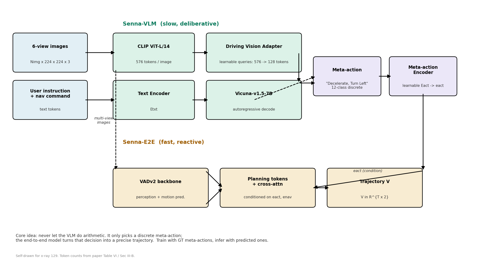
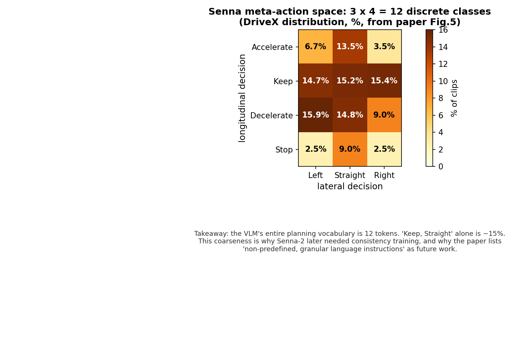

# 别让 VLM 算数：Senna 把驾驶规划拆成"说"和"做"两层

> **论文**：Senna: Bridging Large Vision-Language Models and End-to-End Autonomous Driving
> **作者**：Bo Jiang, Shaoyu Chen, Bencheng Liao（华科）; Xingyu Zhang, Wei Yin, Qian Zhang, Chang Huang（地平线）; Wenyu Liu, Xinggang Wang（华科，通讯）
> **Venue**：IJCV 2026（已核实：官方仓库 hustvl/Senna 于 2026-08-11 公告 accepted by IJCV 2026；arXiv:2410.22313v1，2024-10-29）
> **链接**：https://arxiv.org/abs/2410.22313 ｜ **代码**：https://github.com/hustvl/Senna（已公开，本文已 clone 核对；另有 HF 权重）
> **核心洞见（一句话）**：VLM 的强项是"说人话做判断"、弱项是"算数字"——所以别让它预测轨迹点，只让它从 12 个离散 meta-action 里选一个词，真正的轨迹交给端到端模型去算；两层之间用可学习的 embedding 搭桥，而不是用自然语言传话。

---

## 作者押的赌注：VLM 直接控车是死路

2024 年下半年，VLM 进自动驾驶有两条路。第一条是让 VLM 直接当 planner：DriveGPT4 预测 control signal，DriveMLM 做行为规划，DriveVLM 让 VLM 先预测一条低频轨迹、再由端到端模型加密成高频轨迹。第二条是 Senna 选的：VLM 只输出高层决策，轨迹完全由端到端模型负责。

作者的赌注写在摘要第一句的对比里：用 LVLM 预测轨迹或控制信号"yield suboptimal results, as LVLMs are not well-suited for precise numerical predictions"。这句话背后是一个 2024 年人人皆知但很少有人正面处理的事实：自回归语言模型输出的是离散 token 的概率分布，让它吐出一串浮点坐标，本质上是在用分类头做回归。DriveVLM 的折中方案（VLM 只预测稀疏轨迹点）只是把问题缩小了，没有消灭它——VLM 还是要算数。

Senna 的回答是把"算数"彻底从 VLM 手里拿走。VLM 的输出 vocabulary 被压缩到 12 个 meta-action（横向 Left/Straight/Right × 纵向 Accelerate/Keep/Decelerate/Stop），每个都是一句人话。端到端模型（VADv2 的扩展）拿到的是这个决策的 embedding，而不是轨迹点。Fig.2 把这个对比画得很直白：previous method 是"VLM → 低频轨迹 → 端到端加密"，Senna 是"VLM → 高层决策 → 端到端直接规划"。

这个赌注为什么在当时是合理的？三张牌。第一，2024 年 VLM 做数学不行的证据已经很充分（论文引了 Frieder 等人和 Hendrycks 的 MATH），审稿人不用说服。第二，meta-action 的监督信号是免费的：未来的轨迹是已知的，用运动学规则就能反推出"这三秒是加速还是减速、直行还是转弯"，不需要人工标注，数据可以无限扩。第三，12 分类问题比轨迹回归简单两个数量级，7B 的 Vicuna 就够，不需要上 70B。这三张里最硬的是第二张：**监督信号的免费性决定了这条路线的可扩展性**。DriveX 的 100 万个 3 秒片段（800k 训练 / 200k 验证）全是这样自动标出来的。


*自绘图：Senna 的双系统架构。慢层（Senna-VLM）只做离散决策，快层（Senna-E2E）负责精确轨迹；两层之间唯一的通道是 meta-action embedding eact。注意训练时 E2E 见的是 GT 决策、推理时见的是预测决策——这个不一致是后文怀疑式阅读的第 3 点。*

## 12 个词的规划词汇表：fK 映射是怎么把轨迹变成词的

Meta-action 的定义在 Sec III-A "Meta-action Planning"：横向看预测时域 T 内的横向位移决定 Left/Straight/Right；纵向看速度变化决定 Accelerate/Keep/Decelerate/Stop。注意这里的"预测时域"是未来的真实轨迹（训练时用 ground truth），所以这是一个**事后标注**过程：已知未来 3 秒车怎么走，反推它"意图"是什么。

这个反推函数在 Senna-2 里被明确命名为 kinematic mapping fK，Senna 本体里它是隐含的。它的样子不难想象：比如横向位移 > 某个阈值判 Left/ Right，末速度 - 初速度 > 阈值判 Accelerate，速度接近 0 判 Stop。论文没有给出具体阈值（这是个缺口，后面怀疑式阅读会讲），但逻辑是标准的。

有意思的是 DriveX 的分布（Fig.5，自绘图如下）：Keep, Straight 占 15.18%，是最大的一类；Decelerate 相关三类加起来约 40%。这说明自动驾驶数据天然是"无聊"的——大部分时间就是直行保持。


*自绘图：Senna 的 meta-action 空间——横向 3 类 × 纵向 4 类 = 12 个离散决策，DriveX 分布（百分比来自论文 Fig.5）。VLM 的全部规划词汇表就是这 12 个词。*

12 分类里最难的是少数类：Accelerate, Right 只有 3.54%。这直接解释了 Table I 里为什么 "dec."（减速）的 F1 是各档里最低的（61.99），以及为什么作者要强调"在最关键的驾驶安全决策（如减速）上 F1 从 52.68 提升到 61.99"——减速恰恰是安全最相关、数据又相对难学的类别。

另一个值得注意的不一致：Motion Intention Prediction QA 里预测他车的 PATH 用的是五类（STRAIGHT, RIGHT_CHANGE, LEFT_CHANGE, RIGHT_TURN, LEFT_TURN），而自车的 meta-action 横向只有三类（Left/Straight/Right）。也就是说，**作者认为他车的意图值得更细的粒度，自车的决策却只用粗粒度**。这个不对称论文没有解释。推测（标注为推测）：自车决策要喂给端到端模型做条件，类别越少、每个类的样本越多、学得越稳；而他车意图只是辅助 QA，不直接影响规划，可以细一点。但这也意味着 Senna 的 VLM 实际上"看"得比"说"得细。

## 576 个 token 为什么会"崩"：Driving Vision Adapter

这是论文里最有工程味道的一节。CLIP ViT-L/14 把 224×224 的图切成 16×16 的 patch，得到 576 个 token。单图 576 个 token 对 LLaVA 是常规操作，但 Senna 要吃 6 张环视图：6×576=3456 个图像 token，再加上文本 prompt。作者说直接这样训会出现 "model collapse and decoding failure"——模型直接解码失败，吐不出东西。

Table VI 把这个现象量化了：每图 576 token 和 512 token 时，planning accuracy 那一列是 0.00——注意不是低，是 0，模型完全不工作。降到 256 token 时恢复（69.52%），128 token 时最好（71.21%），再降到 64/32 影响很小（70.42%/71.21%→56.13%？注意 32 token 时 Acc 掉到 56.13，但 Path/Speed F1 还行，这是个有趣的分化）。

Adapter 的做法（公式 1）：

$$E^i_{img} = \text{MHSA}[Q^i_{img}, W \cdot g(I^i), W \cdot g(I^i)] \in \mathbb{R}^{M_{img} \times C}$$

逐项拆。$g$ 是 frozen 的 CLIP ViT-L/14，$I^i$ 是第 $i$ 张图（$i=1..6$）。$W$ 是一个 MLP（Linear+GELU+Linear），把视觉特征投影到 LLM 的维度 $C$。关键在 $Q^i_{img} \in \mathbb{R}^{M_{img} \times C}$：一组**可学习的 image queries**，每张图 $M_{img}$ 个（默认 128）。MHSA 里 query 是这 128 个可学习向量，key/value 是 576 个图像特征。输出是 128 个 token——query 的数量决定了输出长度，576 个原始特征只作为被 attends 的对象。

几何直觉：想象 576 个 patch 特征是墙上贴的 576 张便签，128 个 query 是 128 个带着问题的人，每个人扫一遍墙，把自己关心的信息记下来。最后 LLM 看到的不是墙，而是 128 个人的笔记。这就是 Perceiver Resampler / Q-Former 的路数，BLIP-2 玩剩下的。但 Senna 的贡献在于**把它用在了 6 图拼接会崩的场景，并给出了崩溃阈值的实测数据**（512 崩、256 活），这个阈值数据比方法本身更有价值——后来者不用再踩一遍。

为什么 576 会崩、256 就活？论文没有深究（记为缺口）。合理的推测：Vicuna-7B 的上下文窗口是 4096，3456 个图像 token + 文本 prompt 已经逼近上限，位置编码外推失效 + 注意力被稀释到每个 token 分不到多少权重，解码时第一个 token 的 logits 就乱了。但注意 512×6=3072 也崩，256×6=1536 活，阈值在两者之间。论文没有做 384/448 的二分查找，有点可惜——这个"崩溃边界"如果能精确定位，本身就是一个值得发表的工程发现。

Decode latency（Table VIII，RTX 4090）：LLaVA-1.5 单图 808 token 解码 0.51s；Senna128 六图 1000 token 解码 0.58s；Senna64 0.42s；Senna32 0.35s。作者强调"六图只比单图慢一点"，但横向看绝对值：**0.58 秒一帧，离车载实时（10-20Hz）差一个数量级**。Limitation 一节作者自己承认了：大模型推理速度 hinder the system from meeting real-time requirements。这也是 Senna-2 后来把 VLM 换成 3B、单前视、异步缓存的直接动机。

## 环视提示词：五毛钱的空间技巧

Fig.4 的 surround-view prompt 长这样（以前视为例）：

```
<FRONT VIEW>:\n<image>\n<FRONT LEFT VIEW>:\n<image>\n...
```

就是在每张图的 token 前面加一句 "这是前视图"。没有几何投影，没有相机参数，没有 3D 位置编码。Table V 显示就这么一句话，planning accuracy 从 64.91%（单前视）涨到 71.21%（六图+提示词）。

为什么这么便宜的技巧有效？因为 LLM 是语言模型，它对 token 序列的理解严重依赖**显式的文本锚点**。3456 个图像 token 排成一排，模型分不清哪 128 个是前、哪 128 个是后；加了 "<FRONT VIEW>:" 之后，cross-attention 有了一个可以挂靠的语义标签。这类似于给乱序的抽屉贴上标签——抽屉里的东西没变，但找东西的人知道去哪个抽屉。

但也要看到它的天花板：这种提示词给的是**离散的方向标签**，不是连续的几何关系。模型知道"这是左前"，但不知道左前相机和前相机视野重叠了多少、相对位姿是什么。真正的空间推理（比如判断一辆车是从左前视野开到前视野的同一辆车）靠的还是数据驱动的统计关联。这就是为什么后来者（如 Senna-2）并没有在这条路上继续加码，而是转向对齐训练。

## 六类 QA：自动标注流水线是真正的可扩展性来源

Sec III-A 的 planning-oriented QAs 是六类：场景描述、交通灯检测、VRU 识别、他车运动意图预测、meta-action 规划、规划解释。前五类的 raw data（3D 检测框、跟踪轨迹、红绿灯状态）都可以从自动标注系统得到；场景描述和规划解释用 GPT-4o 生成。

这里有两个细节值得展开。

第一，**VRU 识别只让模型预测距离的整数部分**。"A pedestrian is 12 meters ahead and 3 meters to the left"——12 和 3 都是整数。为什么？因为让语言模型输出 "12.73 meters" 这种浮点数，token 级别的交叉熵损失会惩罚每一个数字 token，而小数点后一位的误差在驾驶上毫无意义。取整是把回归问题粗粒化为分类问题，和 meta-action 的思想一脉相承：**凡是数字，一律离散化**。这是 Senna 全文最统一的方法论。

第二，规划解释 QA 是"开卷考试"：把车辆真实的未来动作告诉 GPT-4o（"假设你要 DECELERATE, STRAIGHT，请分析原因"），让它编理由。这个设计的聪明之处在于，解释的质量不重要（反正是 GPT-4o 生成的，可能有幻觉），重要的是**让模型在训练时见过"决策→理由"的文本模式**，这样推理时它输出决策附带解释，解释又反过来约束决策的连贯性。但风险也在这里：GPT-4o 生成的解释可能把因果搞反（比如把"减速是因为红灯"说成"减速是因为前车"，而真实原因是红灯），模型学到的可能是**看起来合理的归因**，而不是真实的因果。论文没有对自动生成的 QA 做人工质量抽查（记为缺口）。

Table IV 的消融显示，去掉 meta-action QA（ID 1）时 accuracy 从 71.21% 掉到 52.67%，掉得最多——说明六类 QA 里真正承重的是 meta-action 本身，其他五类是辅助。这个消融表是诚实的：它告诉你论文的增量里哪块是干货。

## 三阶段训练：为什么混合预训练是必要的

Stage 1（Mix Pre-training）：冻结除 Driving Vision Adapter 外的一切，只训 adapter，数据是 LLaVA 的通用指令数据 + 驾驶场景描述。Stage 2（Driving Fine-tuning）：解冻（除 vision encoder），用五类 QA（不含 meta-action）训。Stage 3（Planning Fine-tuning）：只用 meta-action QA 训。

Table IX 对比了 6 种组合。关键对比：ID 1（只用 driving 数据预训练+微调）60.01%，ID 6（Mix 预训练 + Driving 微调 + Planning 微调）71.21%。而 ID 3（预训练只用 driving，不用通用数据）只有 58.53%，比 ID 1 还低。**这说明通用指令数据不是可有可无的装饰**：如果预训练只看驾驶数据，VLM 的通用常识会被洗掉（作者说的 "preventing model collapse" 指的就是这个——不是梯度爆炸那种 collapse，是常识遗忘）。Mix 的作用是给模型留一条"我还是个语言模型"的锚。

这个三阶段的真实逻辑是课程学习：先学会"看"（adapter 对齐视觉-语言空间），再学会"理解驾驶场景"（五类 QA），最后学会"做决策"（meta-action）。如果 Stage 2 和 3 合并（ID 4：Driving+Planning 一起微调），accuracy 是 65.12%，比三阶段的 71.21% 低 6 个点。为什么分开更好？推测：五类 QA 是描述性的、答案长的、发散的；meta-action QA 是决策性的、答案短的、收敛的。混在一起训，模型在两种输出风格之间摇摆；分开训，先发散再收敛，符合直觉。

## 公式 (2)(3)：eact 怎么喂给端到端

$$e_{act} = \phi(\text{LLM}[\text{concat}(\{E^i_{view}, E^i_{img}\}_{i=1}^{N_{img}}, E_{txt})])$$

LLM 输出的是自然语言 meta-action（比如 "Decelerate, Turn Left" 的 token 序列）。$\phi$ 是 Meta-action Encoder：因为 meta-action 是**格式化**的（12 类固定），$\phi$ 不需要理解自然语言——它就是一个查表：12 个可学习的 embedding $E_{act} \in \mathbb{R}^{N_{act} \times D}$，根据解码出的类别取对应向量。论文原话 "achieves one-to-one mapping"。所以 VLM 的自然语言输出在这里被**重新离散化**了：VLM 吭哧吭哧生成一句话，最后只取它的类别标签。

这个设计有个微妙的讽刺：VLM 生成自然语言的全部表达能力，最后被压缩成一个 12 选 1 的查表。那为什么不直接让 VLM 输出分类 logits？因为作者想保留"用语言预训练的常识"——分类头是随机初始化的，而语言解码头是预训练好的。从优化角度看，这是一个**用生成式接口做分类任务**的 trick，代价是推理时要完整解码一句话（这也是 0.58s 延迟的一部分）。

$$V = \Phi(I, e_{nav}, e_{act}) \in \mathbb{R}^{T \times 2}$$

Senna-E2E（$\Phi$，VADv2 扩展）拿图像 $I$、导航 $e_{nav}$、决策 $e_{act}$，输出 $T \times 2$ 的轨迹。$e_{act}$ 作为 "additional interaction token" 喂进去——可以理解为 planning token 序列里多了一个携带决策信息的 token，通过 cross-attention 影响轨迹解码。

**训练-推理不一致**：训练 Senna-E2E 时用的是 ground truth meta-action，推理时用的是 VLM 预测的。这是一个经典的 exposure bias：E2E 在训练时从没见过"错误的决策 embedding"，推理时一旦 VLM 判错，E2E 的行为是未定义的。论文没有做"用预测决策训练 E2E"的消融（记为缺口）。Table III 里 VADv2+GT meta-action 的 L2（0.37/1.08/2.24）可以看作这个架构的**上界**——GT 决策能把 1s L2 从 0.49 压到 0.37，说明 VLM 的决策误差目前吃掉了约 25% 的精度提升空间。这正是 Senna-2 要解决的 consistency gap。

## 数字逐个验算

- **27.12% / 33.33%**（摘要）：Senna†（DriveX 预训练 + nuScenes 微调）vs Senna（无 DriveX 预训练），nuScenes 无 ego-status 行：L2 avg 0.59→0.43，(0.59-0.43)/0.59=27.12% ✓；collision avg 0.18→0.12，(0.18-0.12)/0.18=33.33% ✓。分母是"不用 DriveX 预训练的自己"，不是外部基线——这是"预训练的增益"，不是"方法的增益"，摘要的措辞 "over model without pre-training" 是准确的，不算夸大。
- **29.03% / 20.00%**（正文，vs DriveVLM）：nuScenes 有 ego-status 行：L2 avg 0.31→0.22，(0.31-0.22)/0.31=29.03% ✓；collision 0.10→0.08，20% ✓。分母是 DriveVLM*（作者自复现的 DriveVLM，见下文怀疑点）。
- **40.28% / 45.45%**（vs VAD）：无 ego-status 行，Senna† vs VAD-Base：L2 0.72→0.43=40.28% ✓；collision 0.22→0.12=45.45% ✓。但注意这里 Senna† 占了 DriveX 预训练的便宜，VAD-Base 没有——不是同起跑线。
- **14.27%**（DriveX，Table III）：正文说 "compared to the previous SOTA method [27]"，但验算：Senna avg L2=(0.49+1.27+2.62)/3=1.46；DriveVLM† avg=(0.61+1.44+3.00)/3=1.683；(1.683-1.46)/1.683=13.3%，不是 14.27%。换分母 VADv2-None：avg=(0.55+1.46+3.10)/3=1.703；(1.703-1.46)/1.703=14.28%≈14.27% ✓。**所以 14.27% 的分母是"不用任何规划信息"的 VADv2，而不是 DriveVLM**。正文把 DriveVLM 放在同一段里提，容易让读者误以为分母是它。这是一个措辞上的滑头，数字本身没错，但归因有误导性。
- **10.44%**（planning accuracy vs 最好的微调基线）：(71.21-64.48)/64.48=10.44% ✓，分母是 LLaVA-1.5†。
- **17.67%**（减速 F1）：(61.99-52.68)/52.68=17.67% ✓，分母 52.68 是 LLaVA-1.5† 的 dec. F1。

## 一个红灯左转的 walkthrough：DriveVLM 在哪一步输

场景：白天路口，自车速度 2m/s，导航指令左转，前方红灯，右侧有一辆车，路边有行人。GT 未来 3 秒：减速至停止（等红灯）。

**Senna 的流程**。6 张环视图进 ViT-L/14，每张 576 token；Driving Vision Adapter 用 128 个 query 压缩成 128 token/图，共 768 图像 token；加上 "<FRONT VIEW>:" 等提示词和用户指令 "plan the meta-action for driving safely"、导航 "turn left"、自车速度。Vicuna 解码输出 "Decelerate, Turn Left"（训练时这类样本见过很多次：红灯+左转导航→Decelerate, Left）。Meta-action Encoder 查表得 $e_{act}$（Decelerate 类 embedding + Left 类 embedding 的组合）。Senna-E2E 以 $e_{act}$ 为条件，结合 BEV 感知（检测到红灯、行人），解码出一条减速到停止的轨迹。

**DriveVLM（作者复现版）的流程**。VLM 直接预测低频轨迹点：比如 3 个点 (x1,y1),(x2,y2),(x3,y3)。问题出在数值精度：VLM 的每个坐标是逐 token 生成的浮点数，"0.83" 和 "0.38" 在 token 空间里只差一个字符，在物理空间里差半米。红灯停车要求终点精确停在停止线前，VLM 的量化噪声直接转化为停车位置误差。然后端到端模型在这个有噪声的低频轨迹上做加密——**上游的噪声被下游继承**，而不是被纠正。Table III 显示 DriveVLM† 的 1s L2 是 0.61，甚至不如不用规划信息的 VADv2（0.55）——VLM 的低频轨迹在短时域反而是负贡献，因为 1 秒内的运动本来就很简单（接近匀速），VLM 的数值噪声盖过了它的语义价值。

这个 walkthrough 揭示了 Senna 设计的深层逻辑：**VLM 的语义判断（该不该停）是高信噪比的，VLM 的数值预测（停在哪）是低信噪比的**。Senna 只取前者，丢掉后者。DriveVLM 两者都要，被后者拖累。

## 怀疑式阅读：八处

1. **DriveVLM† 是自复现基线**。Table III 的 DriveVLM† 明确标注 "our reproduced DriveVLM, which employs the same vision encoder and LLM as Senna"。复现质量无人验证。原版 DriveVLM 用的是自己的训练流程和数据，复现版换了 encoder 和 LLM 后性能是否忠实原版未知。更微妙的是：复现版在 DriveX 1s L2 上（0.61）比不用规划信息的 VADv2（0.55）还差——一个"复现"把原方法复现得比 baseline 还弱，要么是复现有问题，要么是原方法在 DriveX 分布上本来就不行。两种情况都削弱 "vs SOTA" 的说服力。

2. **14.27% 的分母问题**（上文已验算）：分母是 VADv2-None，不是 DriveVLM。读者会被正文措辞误导。

3. **训练-推理的 meta-action 分布偏移**。E2E 训练时见的全是 GT 决策（100% 正确），推理时见的是 VLM 预测（71.21% 准确率，即 28.79% 错误）。E2E 从没学过"当决策错了该怎么办"。一个更扎实的训练方案是用 VLM 的预测（带错误）去训 E2E，或者做 scheduled sampling。论文没做。

4. **无实现细节**。全文没有训练 epoch 数、batch size、GPU 数量和型号、学习率、优化器。13 页的期刊版（IJCV 投稿版）连这个都不给，复现者只能去代码里挖。代码已公开，部分弥补，但论文本身的信息是不完整的。

5. **无闭环评估**。所有实验是开环的 nuScenes/DriveX L2 和碰撞率。作者自己也知道这是软肋——Senna-2 的核心卖点之一就是补了闭环。

6. **576 token 崩溃没有机理解释**。"model collapse and decoding failure" 只给了现象和阈值（512 崩 / 256 活），没有分析是位置编码外推、注意力稀释还是别的。阈值数据有价值，机理缺失。

7. **自动标注 QA 无质量控制**。GPT-4o 生成的场景描述和规划解释没有人工抽查比例和错误率。规划解释是"开卷编理由"，因果倒置的风险真实存在。

8. **ego-status 的处理前后不一致**。Table II 同时报告了用和不用 ego 状态的结果，并引用 [73] 说用 ego 状态有"潜在问题"（指模型抄自车速度走捷径）。但用了 ego 状态的那几行（Senna*）数字更好看（L2 0.22），摘要和结论里引用的是哪组？摘要的 27.12%/33.33% 用的是**不用** ego 状态的行（0.59→0.43），是诚实的那组。这点要表扬：作者没有拿 ego-status 那组更好看的数字去讲故事。

## 作者的底牌

三张。第一张是**监督信号的免费性**：meta-action 标签从 GT 轨迹自动反推，100 万片段的标注成本接近零。这张最硬，它决定了 Senna 可以吃大数据的红利（Table VII：100k→800k 准确率单调涨，无平台期）。第二张是**接口的窄**：VLM 和 E2E 之间只传一个 12 分类 embedding，窄接口意味着两边可以独立迭代、独立debug。第三张是**时机的**：2024 年底正是"VLM 直接控车"热（DriveVLM、DriveMLM）但数值精度问题开始暴露的时候，一篇"别让 VLM 算数"的论文天然有读者。IJCV 2026 的录用（2026-08-11 公告）说明这套叙事在期刊审稿人那里也过关了。

## 与 RAMP 的血缘/划界

**血缘（RAMP 从 Senna 这里继承了什么）**：

- **双系统直觉**。Senna 是"慢 VLM 做决策 + 快 E2E 做执行"的 dual-system，RAMP 是"LLM 做多规划器调度 + 快规划器做执行"。Senna 证明了这条路线在开环上能打（nuScenes SOTA），是 RAMP 相关工作里必须引用的范式代表。
- **窄接口哲学**。Senna 用 12 分类 embedding 做两层间的唯一通道；RAMP 的 LLM 调度器和规划器之间也应该是窄的、可检查的接口（选哪个规划器、用什么参数），而不是把自然语言直接灌进规划器。这个"接口越窄越可控"的教训可以直接写进 RAMP 的 design rationale。
- **异步的伏笔**。Senna 的 VLM 解码要 0.58s，根本跑不到实时——Senna-2 的 limitation 明确说 VLM 和 E2E 是异步的、靠 memory bank 缓存特征。RAMP 的异步流水线+时间戳补偿走的是同一条路，但 RAMP 把"异步"做成了显式设计（时间戳运动学补偿），而 Senna-2 只是拿 memory bank 糊了一下。

**划界（RAMP 和 Senna 不一样的地方，related work 里要写清楚）**：

1. **Senna 的 VLM 是单决策者，RAMP 的 LLM 是多规划器调度器**。Senna-VLM 每次只输出一个 meta-action；RAMP 的 LLM 在多个异构规划器之间做选择和参数调度，还要处理开放式自然语言指令（不只是 12 分类能覆盖的）。
2. **Senna 没有记忆**。它的每一帧决策是独立的，不利用历史经验。RAMP 的风险加权自适应衰减情景记忆是 Senna 完全没有的东西。
3. **Senna 没有校验**。Senna-E2E 输出轨迹后没有任何 safety check；VLM 判错（28.79% 的情况）会直接传导到执行。RAMP 的闭环风险校验正是为这类"上游判错"准备的——Senna-2 的 Fig.5(a) 已经展示了 VLM 判对、E2E 没跟上的反例，说明光有分层不够，还要有校验。
4. **Senna 没有世界模型**。它的"未来"只存在于 E2E 的轨迹解码里，没有显式的未来预测和复用。
5. **评估维度**。Senna 全是开环，RAMP 目标是 Bench2Drive 闭环。在 ICAPS 的 framing 下，Senna 是"分层决策"一支，RAMP 是"分层决策 + 记忆 + 校验"的闭环一支。

一句话：Senna 回答了"VLM 和端到端怎么分工"，RAMP 回答的是"分工之后，谁来保证它们不犯错、谁来记住教训"。
