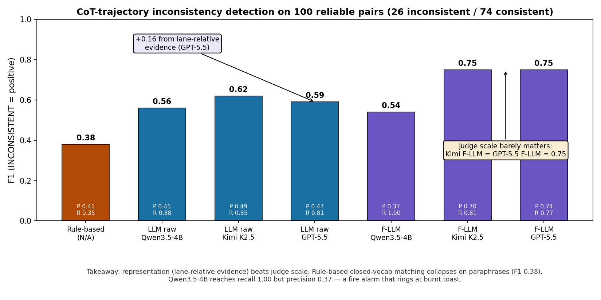
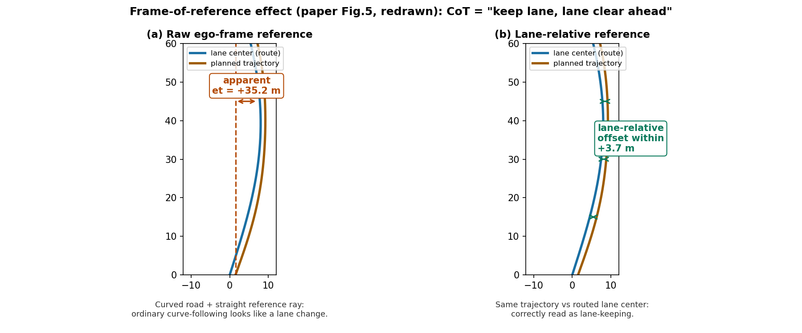

# 想法很丰满，现实很骨感：拿 VLA 的 CoT 当"规约"做运行时校验

> **论文**：Drive the Thoughts: Runtime Monitoring of VLA Reasoning-Trajectory Consistency
> **作者**：Tian Yu, Lu Feng, Sebastian Elbaum —— 弗吉尼亚大学（UVA，软件工程/验证背景，不是自动驾驶组）
> **Venue**：arXiv:2608.29583v1（2026-08-30）
> **链接**：https://arxiv.org/abs/2608.29583 ｜ **代码**：https://github.com/776styjsu/drive-the-thoughts（已公开：DriveAlignBench 数据集、三个 monitor 实现、标注工具）
> **核心洞见（一句话）**：驾驶 VLA 输出的 CoT 可以当作"局部规约"来运行时校验轨迹，但有两个前提——CoT 本身得可靠（实测只有 66.7% 可靠），轨迹得有合适的表示才能和 CoT 对上；以及一个反直觉的结论：**给裁判更好的证据（lane-relative 表示，+0.16 F1）比换更大的裁判模型增益更大**。

---

## 两个假设：这篇论文的骨架

全文的结构是罕见的干净：两个假设，每个假设对应一个贡献。

**假设一**：CoT 必须可靠，才能当规约用。如果 CoT 本身在胡说（幻觉出一个不存在的前车）或在教唆危险动作（"向左微调超车"，而对向有来车），那"轨迹和 CoT 一致"这个判断就没有意义——一致地执行一个坏主意，比不一致更糟。

**假设二**：CoT 和轨迹必须可比。CoT 是开放词汇的自然语言（"向左变道，因为前方慢车且有空隙"），轨迹是一串自车运动的几何点。两者不在同一个抽象层级，直接比对是鸡同鸭讲。

论文的诚实之处在于，它没有默认这两个假设成立，而是各花一节去**测量**它们。Sec III 测量假设一（150 对人工标注），Sec IV-V 测量假设二（三级 monitor 的 F1）。这种"先验证前提再谈方法"的写法，在 ML 论文里不多见，在软件工程（作者的本行）里是标准动作。

## DriveAlignBench：150 对是怎么来的

数据源是 NVIDIA 的 Alpamayo 1.5——10B 参数的推理型 VLA，开源，输出自然语言 CoT + 6.4 秒轨迹（2026-03-19 发布）。运行在 AlpaSim（NVIDIA 的轻量仿真器）+ NuRec 重建场景上，每个 rollout 记录一对（CoT, 轨迹）。

采样策略是**覆盖导向**不是自然分布：先覆盖 40 个场景标签类别，再优先采没见过的行为标签，覆盖饱和后随机采。结果是 150 对覆盖了所有纵向决策类别和 5 个横向类别（out-of-lane nudge、pull-over、横向中止这三类缺失，因为 Alpamayo 几乎不产生）。**重要**：因为采样是覆盖导向的，66.7% 的可靠率是"这个 benchmark 上的比率"，不是"部署时的真实比率"。论文在 RQ1 下面明确说了这句，值得表扬——很多论文会把 benchmark 比率当总体比率讲。

标注协议有个关键设计：**判 CoT 可靠性时不给标注者看轨迹**。两个作者先标 20 对校准，再一人标全部、一人独立标 10 对子集。可靠性标注的一致率是 9/10，一致性和安全性标注的一致率是 10/10。样本小（双标的只有 10 对），但协议是严谨的。

## 可靠性三标准：G∧S∧L

公式 (1)：

$$\text{Reliable}(c, o) = G(c, o) \land S(m(c), o) \land L(c, o)$$

$c$ 是 CoT，$o$ 是观测，$m(c)$ 是 CoT 陈述的动作。三条：

- **G（场景 grounded）**：CoT 引用的每个场景前提必须在视觉输入里找得到。"红灯所以停"——信号灯必须 visibly 是红的。证据不足也算失败（比如断言前车"更慢"，但相对运动无法确认）。
- **S（动作安全）**：CoT 陈述的动作执行起来不能制造可观测的危险、不能违反生效的交规。注意 S 判的是 **CoT 说的动作**，不是解码出的轨迹干了什么——两者是独立标注的。
- **L（逻辑连贯）**： grounded 的前提要能推出动作。"前车慢+目标车道有空隙→变道"连贯；"为了让行 merging 车辆→变进它占的车道"不连贯。

Fig.2 的四个例子把三条标准钉死了：(a)(b) 可靠（黄昏跟车、夜间红灯停）；(c) grounding 失败（把邻车道的车说成是本车道前车）；(d) 安全失败（对向有来车还 nudge left 超车）。**失败可兼得**：6 个 CoT 挂了不止一条。

RQ1 数字：100/150 可靠（66.7%）。50 个不可靠里，43 个 grounding 失败（86%）、7 个动作不安全（14%）、6 个逻辑不连贯（12%）。**Grounding 是主要矛盾**——VLA 的 CoT 最大的问题不是"推理错了"，是"看错了"。这个结论对 RAMP 有直接意义：如果 RAMP 的 LLM 调度器要输出自然语言决策，grounding 失败会是它的主要失效模式，校验器必须能发现"决策引用的场景前提不存在"。

## RQ2：哪些决策的 CoT 最不可靠

Fig.3 的条件可靠率（样本量≥10 的类别）：

- 最可靠的：set-speed 跟踪 8/10（80%）、lead follow 40/52（76.9%）、lane keep 61/75（81.3%）——都是**常规、直接可观测**的行为。
- 最不可靠的：lane change 16/42（38.1%）、gap search 6/13（46.2%）、yield 3/8（37.5%)、overtake accel 3/10（30%）。因果因子里：routing intent 11/25（44%）、lane/lanelines 44/82（53.7%）。

规律很清楚：**凡是需要推断车道拓扑、路由意图、时空空隙的，CoT 就不可靠**。这些恰恰是驾驶里最难、也最需要 VLM 常识的部分——VLM 在最需要它的地方最不可靠。这是一个苦涩的结论：CoT 当规约用的价值，集中在"本来就不太会错"的常规行为上；在长尾决策上，你得先对 CoT 做可靠性过滤，而论文**没有**实现这个过滤器（列为 future work）。所以这篇论文的 monitor 在实际部署时，前面还缺一整个模块。

## 三级 monitor：表示的阶梯

Sec IV 的核心设计问题：**什么样的轨迹表示能让 CoT 和轨迹可比**。三级 monitor 是表示的阶梯：

**Rule-based**：CoT 解析器 $P_c$（200 个短语的词典，从 dev 集挖掘+改写扩充）把 CoT 映射到 Alpamayo-R1 的纵向/横向 meta-action 词汇表；轨迹解析器 $P_\tau$ 用运动学阈值（速度、加速度、曲率分段）把轨迹映射到同一词汇表；然后**精确匹配**动作序列。F1=0.38（TP 9，FP 13，FN 17）。词典法死在开放词汇上："move over""merge right""position for the turn"说的是同一件事，词典要一一枚举，枚举不完。

**LLM monitor**：保留 CoT 的开放词汇，用 judge LLM 直接判。轨迹证据 $\phi_{ego}(\tau)$ 是自车系下的 waypoint 序列化：10Hz 原始轨迹下采样到 ~1.25Hz（每 0.8 秒取一个点），每个点给位置、速度、横向速度、纵向加速度，再加总时长、路径长度、起终点位移、横向偏移范围、平均/最大速度。Judge 打 1-5 分，$\theta=2$，$s \le 2$ 判 INCONSISTENT。GPT-5.5 的 F1=0.59。

下采样到 1.25Hz 的细节值得注意：作者的理由是"保留机动级形状、减少 prompt 长度、避免过度强调底层控制平滑性"。这是对的——judge 需要看到的是"变道"这个形状，不是方向盘的抖动。但 0.8 秒的粒度会丢掉急打方向这种亚秒级机动，好在一致性判断是机动级的，问题不大。

**F-LLM**：judge 不变，证据加上 lane-relative 表示 $\phi_{lane}(\tau, route)$。做法：从 AlpaSim 查高精地图，建车道中心线的有向图，从自车位姿枚举 route 候选，选"轨迹投影横向偏移平方和最小"的那条（$route = \arg\min \sum e_{t,j}^2$），然后把轨迹投影到这条参考线上，算纵向进度 $l_t$、有向横向偏移 $e_t$、偏移变化 $\Delta e_t = e_t - e_1$、横向速度 $\dot{e}_t$。GPT-5.5 的 F1=0.75（P 0.74，R 0.77）。

*自绘图：三级 monitor 在 100 个可靠对上的 F1（INCONSISTENT 为正类）。从 rule-based 到 F-LLM 的增益主要来自表示的丰富化，而不是裁判的规模。*

## Fig.5：为什么 ego-frame 会骗人

论文 Fig.5 的例子（自绘图如下）：CoT 是"keep lane，车道前方清空"。轨迹跟着一条**向左弯**的车道走。

- 在 raw ego-frame 下（参考系是自车初始朝向的直线），轨迹的表观横向偏移 $e_t$ = +35.2 米——看起来像一次大幅度的横向机动，judge 会误判为"变道/偏离"，和"keep lane"矛盾。
- 在 lane-relative 下（参考系是 route 的车道中心线），偏移全程在 +3.7 米以内——老老实实在车道里。

*自绘图（按论文 Fig.5 数据重画）：同一条跟弯道的轨迹，在自车系下表观横向偏移 35.2 米（误判为变道），在车道系下只有 3.7 米（正确判为 keep lane）。CoT 说的是车道系的语言，证据也必须翻译成车道系。*

这个例子的教学价值在于它揭示了一个一般性原理：**CoT 说的是场景相关的语言（车道、路口、障碍物），轨迹是自车运动的几何；两者之间的"翻译"需要场景结构（地图、车道、他车），光有自车运动是不够的**。F-LLM 的 +0.16 增益本质上是"把场景结构喂给 judge"。这对 RAMP 的校验器设计是直接指导：风险校验的证据不能只是自车轨迹，必须是**场景相对**的（车道相对、他车相对）。

## Fig.7 和 Fig.8：一对成功一对失败

**Fig.7（F-LLM 修好了 raw 的错误）**：CoT 说"右转避开锥桶封锁的左岔路"，轨迹实际上没完成右转、随后又左转了。Raw waypoint monitor 的 judge 给了 5/5（满分一致）——因为在自车系下，轨迹相对初始朝向确实 mostly 向右，judge 被"向右的运动"骗了。F-LLM 看到 lane-relative 证据：route 是向右弯的，轨迹相对车道中心是**向左偏**的——正确判 INCONSISTENT（1/5）。这个例子说明 raw ego-frame 的错误是**系统性**的：它把道路几何和自车意图混在一起了。

**Fig.8（两个 monitor 都错了）**：CoT 说"和慢速前车保持距离"，人类标 CONSISTENT，两个 LLM monitor 都判 INCONSISTENT（2/5）。原因："保持距离"是**自车-前车关系**上的时间承诺，不是"减速"这个动作。Monitor 的证据里只有自车运动，没有前车、没有车间距——judge 只能从"轻微加速"读出"可能在 closing gap"。**关系型断言需要关系型证据**。Lane-relative 解决了几何混淆，但解决不了"缺了他车"的证据缺失。论文在结论里明确说：下一步要加 agent-relative 和 temporal traces。这是全篇最诚实的自我剖析。

## 关键结论：表示 > 规模

Table I 的数字支持一个反直觉的结论：

- 加 lane-relative 证据：GPT-5.5 的 F1 从 0.59→0.75（**+0.16**），Kimi K2.5 从 0.62→0.75（+0.13）。
- 换更大的 judge：raw 下 Kimi（0.62）反而比 GPT-5.5（0.59）高 0.03；F-LLM 下 Kimi 和 GPT-5.5 都是 0.75，**打平**。

也就是说，**证据表示的改进（+0.16）大于裁判规模的改进（≈0）**。Kimi F-LLM（0.75）> GPT-5.5 raw（0.59）——一个中等 judge 配好证据，打败 frontier judge 配差证据。这对 RAMP 是好消息：校验器不需要用最大的模型，用对的表示+中等模型就行，延迟和成本都下来了。

Qwen3.5-4B-FP8 是个有趣的对照：F-LLM 下 recall 1.00（26/26 全抓住）但 precision 0.37（FP 44）——**烟雾报警器行为**：着火了一定响，但煎个牛排也响。作者指出它对安全导向的检测"valuable"，但 standalone 用就是灾难。这个 high-recall/low-precision profile 说明小 judge 的问题不是"看不见证据"，是"不会权衡证据"——lane-relative 证据给了它，它把所有偏移都当可疑。

F-LLM 的主要增益来自**减少误报**：Kimi 的 FP 从 23→9，GPT-5.5 的 FP 从 24→7。Raw ego-frame 的误报模式是"把跟弯道、车道分叉、微调避让都看成横向机动"——lane-relative 一一消解。

## RQ4：一致性是安全网的一层，不是安全本身

Table II（人类标注的交叉表）：9 条 unsafe 轨迹里 7 条是 INCONSISTENT；inconsistent 对里 26.9% 是 unsafe，consistent 对里只有 2.7%。部署的 F-LLM 抓住了全部 7 条"human-labeled inconsistent 且 unsafe"的轨迹。

但反过来看：**inconsistent ⇒ unsafe 的 precision 只有 0.27**（Table II 下半：P 0.27，R 0.78，F1 0.40）。也就是说，monitor 报警 100 次，只有 27 次真有安全问题——剩下的 73 次是"话没说对但车开得没问题"。以及 2 条 unsafe 轨迹是 CONSISTENT 的（CoT 和轨迹一致，但轨迹本身不安全）——**一致性 monitor 对这类问题完全盲**。

论文的结论措辞是准确的："inconsistency is safety-relevant and can add a monitoring layer, but is insufficient as the sole safety-monitoring interface"。翻译成人话：**一致性校验是安全网的一层，不是安全网本身**。RAMP 的 related work 引用这篇时，这句话要原样继承——RAMP 的风险校验和一致性校验是互补的两层，不是谁替代谁。

## Latency：离线研究和在线部署的鸿沟

论文 V-C 是少数敢写 latency 的：GPT-5.5 和 Kimi K2.5 每 query 数秒到数十秒——**在线部署没戏**；本地 Qwen3.5-4B-FP8 在 A100-80GB 上 sub-second，但误报率高到没法 standalone 用。作者把"蒸馏大模型到小学生模型"列为 future work。

这个鸿沟对 RAMP 是预警：RAMP 的闭环风险校验如果也用 LLM judge，会掉进同一个坑。132 的出路（表示>规模、中等模型+好证据、蒸馏）就是 RAMP 校验器的出路。或者更激进：校验器不用 LLM，用世界模型 rollout + 几何/运动学风险评分（这正是 RAMP 的设计）——132 的 Fig.8 已经证明 LLM judge 有系统性的证据盲区。

## Threats to validity：作者自己写得最好的部分

Sec V-D 的四段（外部/内部/构念/结论效度）是全篇我最欣赏的部分，逐条点评：

- **外部效度**：单 VLA（Alpamayo 1.5）、单仿真管线、覆盖导向采样非自然分布。作者明确说"reported rates should be read as conditional on this setup rather than as population estimates"。很多论文不敢写这句。
- **内部效度**：标注主观性（双标子集只有 10 对，9/10 和 10/10 的一致率样本太小）；rule-based 的阈值/词典是作者对 Alpamayo-R1 流程的**复现**（"may differ from the original implementation"）——这个声明很关键，意味着 rule-based baseline 可能弱于原版，F-LLM 的相对增益可能被高估了一点。
- **构念效度**：只在 reliable 子集上评估——结论的条件是"CoT 已经是合格的规约"，而部署时这个条件不自动成立。1-5 分二值化的阈值 $\theta=2$ 是固定的，换个 operating point 精度/召回会变。
- **结论效度**：100 对、9 条 unsafe——"indicative rather than definitive"，不声称统计显著性。在这个样本量下，7/9 这种数字的置信区间是很宽的（粗略算，7/9 的 95% 区间大约是 40%-97%），论文用"descriptive counts"是对的。

## 怀疑式阅读（补充作者没说的）

1. **Judge 比 driver 强**。Alpamayo 1.5 是 10B 的 VLA，judge 是 GPT-5.5 / Kimi K2.5（1T MoE，32B 激活）。用更强的模型去判更弱的模型的 CoT，检出率高是顺理成章的。如果 driver 和 judge 同量级（比如都是 10B），F1 会掉多少？论文没测。这个"代差红利"在部署时不存在——车上不可能跑一个比驾驶模型大 100 倍的裁判。

2. **$\theta=2$ 的选择**。1-5 分制下 $\le 2$ 判不一致，这个阈值是拍的。Table I 的所有数字都依赖它。换 $\theta=3$，recall 涨、precision 掉，F1 排序可能变（Qwen 的 high-recall profile 在 $\theta=3$ 下会更极端）。

3. **只在 reliable 子集上评估**。66.7% 的 CoT 是可靠的，剩下 33.3% 的 monitor 行为未知。部署时的 pipeline 是"可靠性过滤→一致性检查"两级，但论文只做了第二级。第一级的缺失意味着这篇论文离"runtime monitor"还差一个模块——标题里的 Runtime 有点超前，实际做的是**离线开环评估**。

4. **CoT 是固定 prompt 下生成的**。$\ell$ 是固定的自然语言驾驶 prompt。换 prompt，CoT 的风格和可靠性都会变，monitor 的 prompt 也要跟着调。Prompt 敏感性没测。

5. **150 对、单模型、单仿真器**。作者自己承认了，这里不再展开。但要强调：这篇论文的**方法论贡献**（怎么搭 monitor、怎么测）比它的**数字贡献**（F1=0.75）更经得起时间——数字是 conditional 的，方法论是可迁移的。

## 作者的底牌

这篇的作者是 UVA 软件工程组（Elbaum 是软件测试/验证领域的老手），不是自动驾驶组。他们的底牌是**验证的方法论**：benchmark 怎么做、rubric 怎么写、threats to validity 怎么披露。这套东西在 ML 圈是稀缺品——大多数 VLA 论文的"评估"就是跑个榜。但也正因为是验证背景，他们**没有碰最难的部分**：实时性（latency 一节承认了）、闭环（future work）、可靠性过滤器（future work）。这篇论文的真实定位是"**可行性研究 + 方法论示范**"，不是"可部署的 monitor"。

时间点也值得注意：2026-08-30 的 arXiv，正好卡在 Alpamayo-R1（2025-11）和一堆 VLA 推理模型之后——"CoT 能不能用来做 V&V"在当时是开放问题，这篇是第一批系统回答的。首发性是它的第二张牌。

## 与 RAMP 的血缘/划界

**血缘（这是 RAMP 风险校验最直接的先例，related work 必引）**：

- **"运行时校验"的思想同源**。132 问的是"轨迹和 CoT 说的是不是一回事"，RAMP 问的是"轨迹安不安全"。两个都是"用第二双眼睛在运行时盯着规划输出"。132 的三级 monitor 是 RAMP 校验器设计的**直接参考实现**：证据表示怎么搭、judge 怎么 prompt、阈值怎么做。
- **"表示 > 规模"的结论直接指导 RAMP**。RAMP 的校验器不需要堆最大的 LLM——中等模型 + lane-relative/agent-relative 的场景相对证据，效果更好、延迟更低、成本更低。这个结论可以写进 RAMP 的设计 rationale。
- **"一致性是安全网的一层"的定位**。132 证明了 inconsistency ⇒ unsafe 的 precision 只有 0.27，且有 2/9 的 unsafe 是 consistent 的。RAMP 的 related work 里应该明确：**一致性校验和风险校验是互补的两层**——RAMP 做的是风险那层，132 做的是一致性那层，两者正交，可以叠加。

**划界（四条，related work 里建议这样写）**：

1. **校验对象不同**。132 校验的是 CoT↔轨迹的**一致性**（faithfulness），RAMP 校验的是轨迹↔世界模型 rollout 的**风险**（safety）。一致性的反例（Fig.6b：CoT 说变道、轨迹拐进对向车道）恰好说明：一致性检查抓的是"言行不一"，风险检查抓的是"言行一致但危险"。132 自己测出 2 条 consistent-but-unsafe——这 2 条是 132 的盲区，正好是 RAMP 的靶心。

2. **时机不同：离线开环 vs 在线闭环**。132 的评估是离线的（150 对静态数据）、开环的（没有反馈回车辆），latency 是秒级的——它离"runtime"还差一个可靠性过滤器和两个数量级的延迟优化。RAMP 的校验是**在线闭环**的：每一帧、毫秒级、有 fallback/replanning。这是部署维度的代差。

3. **132 的 monitor 是 LLM judge，RAMP 的校验器是世界模型+风险评分**。132 的 Fig.8 已经证明 LLM judge 有系统性盲区（缺 agent-relative 证据就判错"keep distance"）；RAMP 用世界模型 rollout 生成未来场景、用几何/运动学算风险，不依赖 LLM 的语言理解——这是**机制上的不同路线**，不是参数上的差异。

4. **132 没有记忆、没有调度、没有多规划器**。它的世界里只有一个 VLA，一次只产一对（CoT，轨迹）。RAMP 的世界里有多个规划器、LLM 调度器、情景记忆——132 的一致性检查可以作为 RAMP 校验器的**一个子模块**（检查"调度器的自然语言决策和被选规划器的轨迹是否一致"），而不是替代品。

**一句话**：132 是 RAMP 风险校验的"思想先祖"和"证据设计教科书"，但它校验的是一致性、做的是离线研究；RAMP 要做的是在线的风险校验——把 132 的 monitor 思想装进毫秒级的闭环，把"言行是否一致"升级为"言行是否安全"，再补上 132 缺的那两块（可靠性过滤、实时性）。
